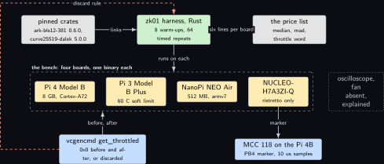
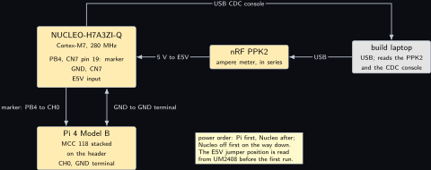
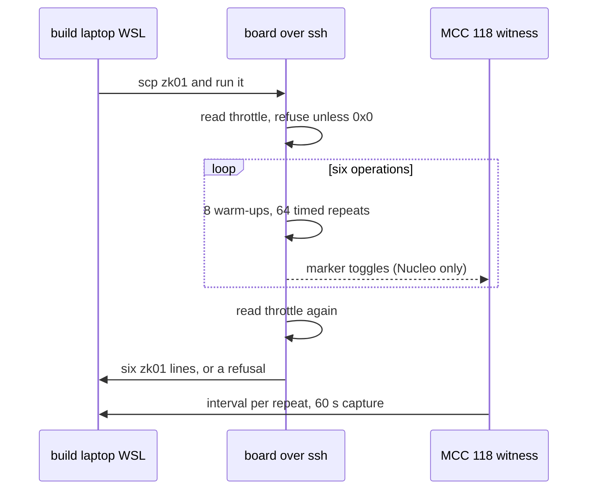
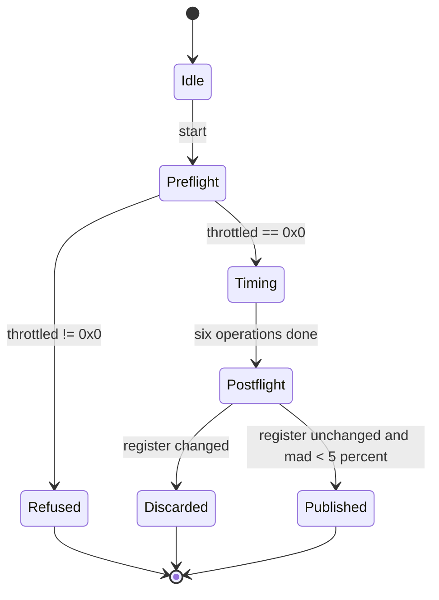
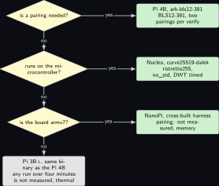

# Project 1. The price list: field, group and pairing arithmetic on every board

> **Board:** Pi 4B, Pi 3B+, NanoPi NEO Air, NUCLEO-H7A3ZI-Q; MCC 118 and PPK2 as witnesses  
> **Language:** Rust

> [!IMPORTANT]
> **The question, instanced**
>
> What can a verifier learn from a device without the device revealing itself, and what does it cost on this board? Before any chapter can answer the first half, this one answers the second: how long one scalar multiplication, one multi-scalar multiplication, one pairing, one ristretto operation and one hash take on each board on this bench, measured by an instrument that has itself been checked against a witness.

> **Key facts**
>
> - **Board:** Raspberry Pi 4 Model B Rev 1.4 (8 GB), Raspberry Pi 3 Model B Plus Rev 1.3 (905 MB, 60 C soft limit), NanoPi NEO Air (512 MB, armv7), NUCLEO-H7A3ZI-Q (Cortex-M7 at 280 MHz)
> - **Parts:** the four boards, the Renkforce USB/TTL cable for the Pi 4B console, the MCC 118 on the Pi 4B as the Nucleo's timing witness, the PPK2 as the Nucleo's ampere meter
> - **Interface:** SSH to the Linux boards; the ST-LINK drive and the USB CDC console for the Nucleo
> - **Language and library:** Rust, `ark-bls12-381` 0.6.0 \[[7](#references)\], `curve25519-dalek` 5.0.0 \[[8](#references)\], `sha2`; the Nucleo build is `no_std` with `curve25519-dalek` only
> - **Primitive:** every one that the paper's two schemes call \[[1](#references)\]: field multiplication, $\mathbb{G}_1$ scalar multiplication, a multi-scalar multiplication, a pairing, a ristretto255 operation, a hash
> - **Secret:** none; this chapter is the instrument
> - **Public:** the price list: median and spread per operation, per board, with the throttle register before and after
> - **Model:** none
> - **Acceptance:** a harness figure is published only when its own repeat spread is under 5 percent and, on the Nucleo, when the DWT cycle count and the MCC 118 marker interval agree within 2 percent; `vcgencmd get_throttled` reads `0x0` before and after on every Pi
> - **Difficulty:** 2 of 5
> - **Effort:** one afternoon per Linux board, one evening for the Nucleo `no_std` build on the build laptop, a second day for the repeat

## Pitch

Every cost claim in the nineteen chapters that follow is a count of operations multiplied by a number from this chapter. The paper reports its prover and verifier times on an AWS `c6g.8xlarge` with 32 Graviton2 cores and 64 GiB \[[1](#references)\]; nothing on this bench is that machine, and a Raspberry Pi 3 Model B Plus that trips its thermal limit four minutes into a run is a different instrument again. So this chapter does one thing: it builds one harness in Rust against pinned crate versions, runs the same six operations on each board, reads the throttle register before and after, and prints a table whose every cell names the instrument that produced it or reads **not measured** with the reason. On the Nucleo the harness cannot read a wall clock, so it counts cycles with the DWT and toggles a marker pin that the MCC 118 on the Pi 4B witnesses, and the two must agree before either is believed.

## Parts and interface

| **Part** | **Role** | **Interface** | **Address or pin** |
| --- | --- | --- | --- |
| Raspberry Pi 4 Model B | the fastest Linux board; 8 GB read on Friday 16 October 2026 | SSH, or the Renkforce cable at 115200 | header pins 6, 8, 10 |
| Raspberry Pi 3 Model B Plus | the thermally limited board; every run longer than four minutes is suspect | SSH only; its serial console is dead | none |
| NanoPi NEO Air | the armv7 floor; the harness is cross built on the build laptop | SSH over Wi-Fi | none |
| NUCLEO-H7A3ZI-Q | the microcontroller; `no_std`, ristretto255 only, no pairing | the ST-LINK drive `NOD_H7A3ZIQ` and USB CDC | marker on PB4, CN7 pin 19 |
| MCC 118 on the Pi 4B | witness of the Nucleo's marker interval, 10 microsecond samples | SPI0 CE0 on the Pi 4B | CH0 to PB4, GND to a Nucleo GND |
| nRF PPK2 | ampere meter for the Nucleo, energy per operation | USB to the build laptop | in series with the board's external 5 V input; the jumper position is read from UM2408 \[[16](#references)\] |
| the build laptop, WSL side | every compile; the Nucleo cross build; the PPK2 host | LAN |  |

## The secret, the statement and the relation

The chapter proves nothing in zero knowledge, so its relation is the volume's. The paper states the whole task as one proof of knowledge \[[1](#references)\], its Equation 2:

$$
\mathcal{R} = \mathsf{PoK}\Big\lbrace \thinspace  \underbrace{(\mathcal{M}, r)}_{w} ;\thickspace  \underbrace{(v_\phi, c_\mathcal{M})}_{u} \thickspace :\thickspace 
    \mathsf{Cert}(\mathcal{M}, \phi) \rightsquigarrow v_\phi \thickspace \wedge\thickspace  \mathsf{Com}(\mathsf{sp}, \mathcal{M}; r) = c_\mathcal{M} \thinspace \Big\rbrace . \tag{1.1}
$$

The witness $w$ is the secret system and the randomness of its commitment; the statement $u$ is the public certificate and the public commitment. Every later chapter instantiates one part of this relation on one board. What this chapter measures is the set of operations that any prover or verifier of $\mathcal{R}$ must execute,

$$
\mathrm{Ops} = \lbrace \thinspace  \mathsf{fmul},\thickspace  \mathsf{smul}_{\mathbb{G}_1},\thickspace  \mathsf{msm}_{\mathbb{G}_1}^{(n)},\thickspace 
  \mathsf{pair},\thickspace  \mathsf{rmul},\thickspace  \mathsf{hash} \thinspace \rbrace ,
$$

and the price list is a partial function $\mathrm{cost} : \mathrm{Boards} \times \mathrm{Ops} \rightharpoonup \mathbb{R}_{\ge 0}$ whose undefined cells read **not measured** with a reason, never a guess.

## The mathematics

**Definition Z1.1 (Commitment scheme).** Let $\lambda$ be a security parameter. A commitment scheme over a message space $M$ and a randomness space $R$ is a pair of algorithms $(\mathsf{Setup}, \mathsf{Com})$ with $\mathsf{sp} \leftarrow \mathsf{Setup}(1^\lambda)$ and $\mathsf{Com} : \lbrace \mathsf{sp}\rbrace \times M \times R \to C$. It is *hiding* if for all $m_0, m_1 \in M$ the distributions $\lbrace \mathsf{Com}(\mathsf{sp}, m_0; r) : r \leftarrow R\rbrace$ and $\lbrace \mathsf{Com}(\mathsf{sp}, m_1; r) : r \leftarrow R\rbrace$ are indistinguishable, and *binding* if no efficient adversary outputs $(m, r, m', r')$ with $m \ne m'$ and $\mathsf{Com}(\mathsf{sp}, m; r) = \mathsf{Com}(\mathsf{sp}, m'; r')$ except with probability $\mathrm{negl}(\lambda)$ \[[4](#references)\].

**Definition Z1.2 (Pedersen commitment).** Let $\mathbb{G}$ be a cyclic group of prime order $p$ with generators $g, h$ such that $\log_g h$ is unknown. For $v \in \mathbb{Z}_p$ and $r \in \mathbb{Z}_p$, $\mathsf{Com}(v; r) = g^v h^r$ \[[3](#references)\].

**Theorem Z1.3 (Pedersen is perfectly hiding).** For every $v \in \mathbb{Z}_p$ the random variable $\mathsf{Com}(v; r)$ with $r$ uniform in $\mathbb{Z}_p$ is uniform on $\mathbb{G}$. Hence the distributions of Definition **Definition Z1.1** are identical, not merely indistinguishable.

*Proof.* Fix $v$. Because $p$ is prime and $h \ne 1$, $h$ generates $\mathbb{G}$, so the map $\mathbb{Z}_p \to \mathbb{G}$, $r \mapsto h^r$ is a bijection. Composition with the bijection $x \mapsto g^v x$ of $\mathbb{G}$ onto itself is again a bijection $r \mapsto g^v h^r$. The image of the uniform distribution on $\mathbb{Z}_p$ under a bijection onto $\mathbb{G}$ is the uniform distribution on $\mathbb{G}$, and it does not depend on $v$. &#9632;

**Theorem Z1.4 (Pedersen is binding under the discrete logarithm assumption).** If an adversary outputs $(v, r, v', r')$ with $v \ne v'$ and $g^v h^r = g^{v'} h^{r'}$, then it has computed $\log_g h$.

*Proof.* From $g^v h^r = g^{v'} h^{r'}$ we have $g^{v - v'} = h^{r' - r}$. If $r' = r$ then $g^{v - v'} = 1$, and since $g$ has order $p$ this forces $p \mid (v - v')$, so $v = v'$ in $\mathbb{Z}_p$, contradicting $v \ne v'$. Hence $r' \ne r$, $(r' - r)$ is invertible in $\mathbb{Z}_p$, and $h = g^{(v - v')(r' - r)^{-1}}$, so $\log_g h = (v - v')(r' - r)^{-1} \bmod p$. &#9632;

The two theorems are the reason the two group operations $\mathsf{rmul}$ and $\mathsf{smul}_{\mathbb{G}_1}$ head the price list: every commitment in the volume is one or two of them, and every opening check is the same count again.

**Lemma Z1.5 (Operation counts of the two schemes).** Let $|S|$ be the number of states of the explicit-state scheme and let $N$ be the number of obligations of the symbolic scheme, each with $\hat n$ rows. Then, counting only group operations: (i) committing to the transition polynomial $p_T$ of degree $d = O(|S|^2)$ under KZG is one multi-scalar multiplication of size $d + 1$ in $\mathbb{G}_1$ \[[2](#references)\]; (ii) the batch opening of $p_T$ on a set $E$ produces one $\mathbb{G}_1$ element and its verification costs two pairings; (iii) one Pedersen vector commitment to $n$ entries costs one multi-scalar multiplication of size $n + 1$; (iv) folding $N$ obligations costs the prover $O(N^2)$ field products for the cross terms, but with a Salem-Spencer schedule the number of cross-term commitments is $4|K|$ with $|K| < 3^{\lceil \log_2 N \rceil}$ \[[1](#references)\].

*Proof.* (i) A KZG commitment is $\prod_{i=0}^{d} (g^{\tau^i})^{a_i}$ for the coefficients $a_i$ of the polynomial, which is by definition a multi-scalar multiplication of the $d + 1$ setup elements by the $d + 1$ coefficients. (ii) The batch opening is the commitment to the quotient $q(X) = p_T(X) / Z_E(X)$ with $Z_E(X) = \prod_{e \in E}(X - e)$, one group element; the verifier checks $e(c_T, g_2) = e(c_q, g_2^{Z_E(\tau)})$, two pairings, with $g_2^{Z_E(\tau)}$ computable from the setup in $\mathbb{G}_2$ \[[2](#references)\]. (iii) A Pedersen vector commitment is $h^r \prod_{i=1}^{n} g_i^{v_i}$, a multi-scalar multiplication of size $n + 1$ \[[3](#references)\]. (iv) The folded product $A^* \lambda^*$ expands into $N$ diagonal terms and $N(N-1)$ cross terms by Equation 27 of the paper; a schedule $C$ with $2C \cap K = \emptyset$ exists with $|K| < 3^{\lceil \log_2 N \rceil}$ by reading the binary digits of $i - 1$ in base 3, and the prover commits to the four families over $K$ once each, hence $4|K|$ \[[1](#references), [5](#references), [6](#references)\]. &#9632;

**Remark Z1.7.** The lemma turns the paper's Table 1 into a prediction for this bench only through the price list: the prover time for `exb_i4a3` on the paper's machine is 2 s with $\sum |E_\star| = 2^{13.8}$ \[[1](#references)\]; on a board where $\mathsf{msm}^{(n)}_{\mathbb{G}_1}$ costs $k$ times more per element, the prediction is $2k$ s, and the chapter that runs it says whether the prediction held.

## The protocol

This is a measurement protocol, not a proof protocol, and it is written so that it can fail.

1. On each Linux board read `vcgencmd get_throttled` (not available on the NanoPi, which reads its thermal zone instead) and refuse to start unless it is `0x0`.
2. For each operation in $\mathrm{Ops}$, run a warm-up of 8 repeats, then $n = 64$ timed repeats with `std::time::Instant`; record the median and the median absolute deviation.
3. On the Nucleo, run the same loop with the DWT cycle counter and toggle PB4 at the start and end of each timed repeat; the MCC 118 on the Pi 4B captures 60 s at 100 kS/s and the interval between toggles is the witness.
4. Read the throttle register again; discard the run if it changed.
5. Publish a cell only if the median absolute deviation is under 5 percent of the median and, on the Nucleo, the cycle count and the witness interval agree within 2 percent.

## The code

The harness prints one line per operation in a format no other project prints, so that a capture taken later can still be attributed to this binary.

```rust
use ark_bls12_381::{Bls12_381, Fr, G1Affine, G1Projective, G2Affine};
use ark_ec::{pairing::Pairing, CurveGroup, VariableBaseMSM};
use ark_ff::UniformRand;
use ark_std::rand::SeedableRng;
use curve25519_dalek::{ristretto::RistrettoPoint, scalar::Scalar};
use sha2::{Digest, Sha256};
use std::time::Instant;

fn median_mad(mut us: Vec<f64>) -> (f64, f64) {
    us.sort_by(|a, b| a.partial_cmp(b).unwrap());
    let med = us[us.len() / 2];
    let mut dev: Vec<f64> = us.iter().map(|x| (x - med).abs()).collect();
    dev.sort_by(|a, b| a.partial_cmp(b).unwrap());
    (med, dev[dev.len() / 2])
}

fn timed<F: FnMut()>(name: &str, n: usize, mut f: F) {
    for _ in 0..8 { f(); }
    let mut us = Vec::with_capacity(n);
    for _ in 0..n {
        let t0 = Instant::now();
        f();
        us.push(t0.elapsed().as_secs_f64() * 1e6);
    }
    let (med, mad) = median_mad(us);
    println!("zk01 op={} n={} median_us={:.1} mad_us={:.1} throttled={}",
             name, n, med, mad, throttle_word());
}

fn throttle_word() -> String {
    std::fs::read_to_string("/sys/devices/platform/soc/soc:firmware/get_throttled")
        .map(|s| s.trim().to_string()).unwrap_or_else(|_| "na".into())
}

fn main() {
    let mut rng = ark_std::rand::rngs::StdRng::seed_from_u64(1);
    let (a, b) = (Fr::rand(&mut rng), Fr::rand(&mut rng));
    let g1 = G1Affine::generator();
    let g2 = G2Affine::generator();
    let bases: Vec<G1Affine> =
        (0..1024).map(|_| (g1 * Fr::rand(&mut rng)).into_affine()).collect();
    let scalars: Vec<Fr> = (0..1024).map(|_| Fr::rand(&mut rng)).collect();
    let mut osrng = rand::thread_rng();
    let (rp, rs) = (RistrettoPoint::random(&mut osrng), Scalar::random(&mut osrng));
    timed("fmul", 64, || { std::hint::black_box(a * b); });
    timed("smul_g1", 64, || { std::hint::black_box(g1 * a); });
    timed("msm_g1_1024", 64, || {
        std::hint::black_box(G1Projective::msm(&bases, &scalars).unwrap());
    });
    timed("pair", 64, || { std::hint::black_box(Bls12_381::pairing(g1, g2)); });
    timed("rmul", 64, || { std::hint::black_box(rp * rs); });
    timed("hash_1k", 64, || { std::hint::black_box(Sha256::digest(&[0u8; 1024])); });
}
```

```bash
# build laptop, WSL: native for the Pi 4B and 3B+ (aarch64), cross for the NanoPi
cargo build --release --target aarch64-unknown-linux-gnu
cargo build --release --target armv7-unknown-linux-gnueabihf
scp target/aarch64-unknown-linux-gnu/release/zk01 <user>@<pi4b>:~/zk01
```

The Nucleo build replaces `Instant` by the DWT cycle counter and keeps only `rmul` and `hash_1k`: the pairing crate needs an allocator and 1312 kB of SRAM is enough for it, but the volume's rule is that a microcontroller commits and the Pi verifies, so a pairing on the Nucleo is not an operation any chapter needs.

## The model, if any

None. The chapter is the instrument, and no model proposes anything in it.

## Real, modelled, absent

- **have:** real: the four boards, the two crates at the versions read on Friday 6 November 2026, the MCC 118 witness live on the Pi 4B since Friday 9 October 2026, the PPK2
- **learn:** modelled: every bar in the benchmark figure below is the order of magnitude one expects from the crates’ own published timings on a laptop scaled by core clock; it is drawn dashed and is replaced by a measured bar only when the run has happened. The PPK2 series position on the Nucleo is to be read from UM2408 \[[16](#references)\] before the first measurement
- **absent:** absent: an oscilloscope or logic analyser, so the Nucleo's marker is witnessed at 10 microsecond resolution only; a fan for the Pi 3B+, so its cells are "not measured, thermal" for any operation whose 64 repeats exceed four minutes; a SIM, which this chapter does not need

## System architecture



*Figure 1.1. The instrument. Along the top, three solid blocks: the pinned crates in the grey public style, the Rust harness in user-space green, and the price list table in grey; a solid arrow carries the crates into the harness and a solid arrow from the harness writes the table. Below, inside a dashed layer labelled as the bench, four solid hardware blocks: the Pi 4 Model B with its 8 GB, the Pi 3 Model B Plus with its 60 C limit, the NanoPi NEO Air with armv7, and the NUCLEO-H7A3ZI-Q with its ristretto-only build; to their right a dotted grey block for the absent oscilloscope and fan. At the bottom, two solid witness blocks in kernel blue: the MCC 118 on the Pi 4B that reads the Nucleo's marker, and the throttle register read before and after every Pi run; a stop-coloured dashed arrow from the throttle block to the harness carries the discard rule.*

Read the figure as one harness and two witnesses. The harness is the same source on every board; the witnesses are what make a figure from the Nucleo attributable, because the DWT count and the MCC 118 interval are produced by two different clocks and must agree.

## Wiring



*Figure 1.2. The Nucleo witness wiring. On the left the NUCLEO-H7A3ZI-Q as a solid hardware block with three pins called out: PB4 on CN7 pin 19 as the marker, a GND pin on CN7, and the external 5 V input whose jumper position is marked to verify. In the middle the PPK2 as a solid hardware block in ampere-meter mode, in series on the 5 V line, with its USB going to the build laptop drawn as a solid grey block on the right. Below, the Pi 4B with the MCC 118 stacked on its header as a solid block, CH0 wired to PB4 and its GND terminal to the Nucleo GND; the power order note says Pi first, Nucleo after, and Nucleo off first on the way down.*

| **Signal** | **From** | **To** | **Note** |
| --- | --- | --- | --- |
| marker | Nucleo PB4, CN7 pin 19 | MCC 118 CH0 | toggles once per timed repeat; the MCC 118 samples every 10 microseconds, so an operation under 100 microseconds is witnessed as an interval over many repeats, not one |
| ground | Nucleo GND, CN7 | MCC 118 GND terminal | common reference; without it CH0 floats |
| 5 V supply | external supply | Nucleo E5V through the PPK2 ampere meter | jumper position from UM2408 \[[16](#references)\]; marked to verify |
| USB CDC | Nucleo CN1 | build laptop | the console that prints the `zk01` lines |

## Sequence and states





## Decision tree



*Figure 1.3. Which board and which library for which operation. The root diamond asks whether a pairing is needed; yes leads to a leaf naming the Pi 4B with ark-bls12-381, no leads to a second diamond asking whether the operation runs on the microcontroller; yes leads to a leaf naming the Nucleo with the ristretto255 build of curve25519-dalek, no to a third diamond asking whether the board is armv7; yes leads to a leaf naming the NanoPi with the cross-built harness and a note that a pairing there is "not measured, memory", no leads to the Pi 3B+ leaf with the four-minute thermal rule written beside it.*

## Benchmark


*Figure 1.4. Expected cost per operation on the four boards, log scale in microseconds, drawn as dashed bars because none has been measured on this bench; from left to right the six operations of the price list, each with four bars for the Pi 4B, the Pi 3B+, the NanoPi and the Nucleo, the Nucleo bars present only for the ristretto multiplication and the hash. A solid bar replaces a dashed one when the run has happened and the acceptance test has passed; the caption of the replacing figure names the record.*

| **Operation** | **Pi 4B** | **Pi 3B+** | **NanoPi** | **Nucleo** | **Instrument** |
| --- | --- | --- | --- | --- | --- |
| fmul, $\mathbb{F}_r$ of BLS12-381 | not measured | not measured | not measured | not built | Instant, 64 repeats |
| smul, $\mathbb{G}_1$ | not measured | not measured | not measured | not built | Instant, 64 repeats |
| msm, 1024 in $\mathbb{G}_1$ | not measured | not measured, thermal if over 4 min | not measured, memory if over 300 MB | not built | Instant, 64 repeats |
| pairing | not measured | not measured | not measured | not built | Instant, 64 repeats |
| rmul, ristretto255 | not measured | not measured | not measured | not measured | Instant; DWT and MCC 118 on the Nucleo |
| hash, SHA-256 of 1 kB | not measured | not measured | not measured | not measured | Instant; DWT and MCC 118 on the Nucleo |
| energy per rmul | no, PPK2 cannot meter a Pi | no | no | not measured | PPK2 ampere meter |

For scale, the only measured numbers in this chapter are the paper's: on its 32-core machine the explicit-state prover took 2 s for $2^{8.6}$ states and 6 s for $2^{9.6}$, and the symbolic verifier 10 s for 217 obligations \[[1](#references)\]. Those are attributed to the paper's AWS instance and are never copied into a cell above.

## Steps

**Step 1.** On the authoring laptop, write the harness and the Cargo manifest with the two crates pinned at the versions in \[[7](#references)\] and \[[8](#references)\]; commit.

**Step 2.** On the build laptop in WSL, `git pull --ff-only`, install the `aarch64-unknown-linux-gnu` and `armv7-unknown-linux-gnueabihf` targets, build both, and copy the binaries to the Pi 4B, the Pi 3B+ and the NanoPi.

**Step 3.** On each Pi over ssh, read `vcgencmd get_throttled`, run the harness, read it again, and keep the six lines. On the NanoPi read `/sys/class/thermal/thermal_zone0/temp` before and after instead.

**Step 4.** On the build laptop, build the `no_std` Nucleo image with the DWT counter and the PB4 marker; copy it to `NOD_H7A3ZIQ` and open the USB CDC console in the same PowerShell line, so the banner is caught.

**Step 5.** On the Pi 4B over ssh, with the MCC 118's SPI0 free of the CAN overlays, capture 60 s on CH0 at 100 kS/s and compute the interval between marker toggles.

**Step 6.** Compare the DWT count divided by 280 MHz with the witness interval; publish the Nucleo cells only if they agree within 2 percent.

**Step 7.** Repeat the whole set on a second day; a cell whose second-day median differs by more than 15 percent is withdrawn and both figures are printed.

## Acceptance test

The chapter passes when, for each board, six `zk01` lines exist with `mad_us` under 5 percent of `median_us`, the throttle word reads `0x0` on both reads, the Nucleo's two cells agree with the MCC 118 interval within 2 percent, and the second-day repeat is within 15 percent. It fails if any Pi 3B+ cell was taken in a run longer than four minutes, if any NanoPi cell was taken with less than 100 MB free, or if a cell is filled with a laptop figure.

## Variants

**A zkVM row in the price list.** The swap is the unit: instead of six primitive operations timed one at a time, the harness times one whole guest execution proved by a zero-knowledge virtual machine \[[11](#references)\], and the row's cells are seconds per proof and bytes per proof rather than microseconds per operation. Nothing else changes: the same Rust toolchain on the build laptop builds the guest, the Pi 4B runs the host, and the Nucleo has no cell because a prover does not fit in 1312 kB of SRAM. The arithmetic that makes the row readable is the row count: a guest of $n$ instructions commits $\Theta(n)$ trace rows, so with this chapter's 1024-element multi-scalar multiplication as the unit of committed work, a guest of $2^{20}$ instructions is $2^{20} / 1024 = 1024$ such multiplications, computed. The bottleneck sits before the pairing, in the generation of that trace: the heterogeneous accelerator work reports trace generation as the stage that dominates a zkVM prover \[[14](#references)\], and the programmable gate-level accelerator addresses the same cost one layer down \[[15](#references)\]; neither part is on this bench, so both of the new row's cells read **not measured, no accelerator**. Choose this row when a later chapter asks what proving a program costs rather than what one group operation costs, and read [Project 21](21-a-zero-knowledge-virtual-machine-on-the-bench.md) for the chapter that runs it. The row is the design brief's own framing on its first page \[[10](#references)\].

**A ternary inference row.** The second new row is one inference step of a ternary-weight model beside the six cryptographic operations \[[12](#references)\], run by that model's own C++ framework rather than by this chapter's Rust harness \[[13](#references)\], with one token as the unit. What it buys is the comparison this volume keeps needing, the price of a proposal against the price of a proof, so that a chapter which puts a model in front of a certifier can print both in one table. The arithmetic is the layer: a ternary matrix-vector product of width $d$ needs $d^2$ additions or subtractions and no multiplication, against $d^2$ multiply-accumulate operations in floating point, which at $d = 1024$ is $1048576$ of each, computed, so the saving is in the kind of operation and not in their number. Choose this row whenever a chapter's model proposes and its certifier decides, and read [Project 24](24-a-one-bit-model.md) for the chapter that measures it. The brief places this model on the NanoPi NEO Air \[[10](#references)\]; that board has 512 MB, so the row is taken on the Pi 4B and the NanoPi cell reads **not measured, memory** until the model file's size has been read from its own card.

## Pitfalls

- A median over 64 repeats of a 300 ms multi-scalar multiplication is a 20 s run per operation and fits the Pi 3B+'s four-minute window; a 1024-element MSM on the NanoPi may not, and the cell says so rather than reporting a throttled number.
- `get_throttled` clears nothing: a sticky bit set in an earlier session is still set, so a non-zero reading before the run means reboot, not retry.
- The MCC 118 cannot see a marker pulse shorter than its 10 microsecond sample period; the marker must toggle, not pulse, which is why the harness flips PB4 once per repeat.
- The SPI0 chip selects are taken by the CAN HAT's overlays whenever those lines are live in `config.txt`; `ls /dev/spidev0.0` is the check, not `hat_list`.

## Languages and libraries not chosen

- C with `blst` v0.3.17 \[[9](#references)\]: faster pairings on aarch64 through its assembly, and the choice of [Project 4](04-two-group-elements.md); here Rust keeps one source for four boards.
- Go with `gnark-crypto`: cross-compiles to armv7 in one flag, used in [Project 12](12-a-plonk-gate-for-the-inductive-step.md); its BLS12-381 is slower than arkworks on Cortex-A72 by a factor to measure, not to assume.
- Python with `py_ecc`: pure Python pairings are minutes, not milliseconds; it is the front-end language in [Project 3](03-the-modems-backoff-machine.md) and never the instrument.

## Sources

- [arxiv.org/abs/2605.00487](https://arxiv.org/abs/2605.00487) (verified Friday 6 November 2026), the paper and its Table 1.
- [crates.io, ark-bls12-381 0.6.0](https://crates.io/api/v1/crates/ark-bls12-381) (verified Friday 6 November 2026).
- [crates.io, curve25519-dalek 5.0.0](https://crates.io/api/v1/crates/curve25519-dalek) (verified Friday 6 November 2026).
- [digilent.com, MCC 118](https://digilent.com/shop/mcc-118-128-voltage-measurement-daq-hat-for-raspberry-pi/) (to verify).

<a id="references"></a>

## References

1. Pascal Berrang, Mirco Giacobbe, Jacob Swales and Xiao Yang. Zero-Knowledge Model Checking. arXiv:2605.00487v2 \[cs.CR\], version 1 submitted Friday 1 May 2026, version 2 Tuesday 8 September 2026. [arxiv.org/abs/2605.00487](https://arxiv.org/abs/2605.00487) (verified Friday 6 November 2026).
2. Aniket Kate, Gregory M. Zaverucha and Ian Goldberg. Constant-size commitments to polynomials and their applications. In ASIACRYPT 2010, LNCS 6477, pages 177 to 194. Springer, 2010. [doi:10.1007/978-3-642-17373-8\_11](https://doi.org/10.1007/978-3-642-17373-8_11) (to verify).
3. Torben P. Pedersen. Non-interactive and information-theoretic secure verifiable secret sharing. In CRYPTO 1991, LNCS 576, pages 129 to 140. Springer, 1991. [doi:10.1007/3-540-46766-1\_9](https://doi.org/10.1007/3-540-46766-1_9) (to verify).
4. Jonathan Katz and Yehuda Lindell. Introduction to Modern Cryptography, second edition. CRC Press, 2014. (to verify)
5. Felix A. Behrend. On sets of integers which contain no three terms in arithmetical progression. Proceedings of the National Academy of Sciences, 32(12), pages 331 to 332, 1946. [doi:10.1073/pnas.32.12.331](https://doi.org/10.1073/pnas.32.12.331) (to verify).
6. Raphael Salem and Donald C. Spencer. On sets of integers which contain no three terms in arithmetical progression. Proceedings of the National Academy of Sciences, 28(12), pages 561 to 563, 1942. [doi:10.1073/pnas.28.12.561](https://doi.org/10.1073/pnas.28.12.561) (to verify).
7. arkworks contributors. arkworks: a Rust ecosystem for zkSNARK programming. The ark-bls12-381 crate is at version 0.6.0, updated Sunday 26 April 2026, 25.3 million downloads. [crates.io, ark-bls12-381](https://crates.io/api/v1/crates/ark-bls12-381) (verified Friday 6 November 2026).
8. dalek cryptography contributors. curve25519-dalek: group operations on ristretto255 and Curve25519. Version 5.0.0, updated Monday 6 July 2026, 318.9 million downloads. [crates.io, curve25519-dalek](https://crates.io/api/v1/crates/curve25519-dalek) (verified Friday 6 November 2026).
9. Supranational. blst: a BLS12-381 signature and pairing library in C and assembly. Release v0.3.17, Friday 24 July 2026. [github.com/supranational/blst, latest release](https://api.github.com/repos/supranational/blst/releases/latest) (verified Friday 6 November 2026).
10. Advanced hardware-software architectures for edge artificial intelligence and zero-knowledge model checking. A design brief of twenty project sketches, read on Friday 6 November 2026 and held locally at `a local design brief`. It is the input to this second edition and is not a published source; where its hardware claims disagree with the bench, the bench is followed and the disagreement is stated.
11. Succinct Labs. SP1: a zero-knowledge virtual machine that proves the execution of a RISC-V binary. Release v6.10.0, Friday 23 October 2026. [github.com/succinctlabs/sp1](https://github.com/succinctlabs/sp1) (verified Friday 6 November 2026).
12. Shuming Ma, Hongyu Wang, Lingxiao Ma, Lei Wang, Wenhui Wang, Shaohan Huang, Li Dong, Ruiping Wang, Jilong Xue and Furu Wei. The era of 1-bit LLMs: all large language models are in 1.58 bits. arXiv:2402.17764, submitted Tuesday 27 February 2024; every weight is ternary, in the set with the three values minus one, zero and one. [arxiv.org/abs/2402.17764](https://arxiv.org/abs/2402.17764) (verified Friday 6 November 2026).
13. Microsoft. BitNet: the official inference framework for 1-bit large language models, in C++, MIT licence, 41466 stars when read. [github.com/microsoft/BitNet](https://github.com/microsoft/BitNet) (verified Friday 6 November 2026).
14. Jieran Cui, Zhengkai Wen, Haowen Fang, Yinan Zhu, Jia Xiong, Cheng Ni, Mingchi Zhang, Nan Guan and Xi Wang. ZK-Tracer: a high-performance heterogeneous accelerator for zero-knowledge virtual machine trace generation. arXiv:2605.25493, submitted Monday 25 May 2026, revised Tuesday 26 May 2026. [arxiv.org/abs/2605.25493](https://arxiv.org/abs/2605.25493) (verified Friday 6 November 2026).
15. zkPHIRE: a programmable accelerator for zero-knowledge proofs over high-degree, expressive gates. arXiv:2508.16738, 2025. [arxiv.org/abs/2508.16738](https://arxiv.org/abs/2508.16738) (to verify).
16. STMicroelectronics. UM2408, STM32H7 Nucleo-144 boards (MB1363) user manual. (to verify)

---

[Previous](00-about-this-volume.md) &nbsp;&nbsp;|&nbsp;&nbsp; [Contents](../CONTENTS.md) &nbsp;&nbsp;|&nbsp;&nbsp; [Next](02-a-sensor-reading-committed-on-the-microcontroller.md)
