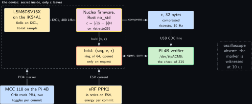
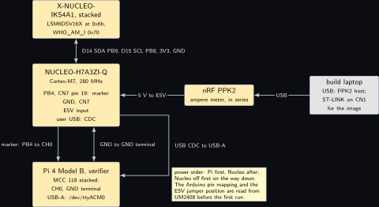
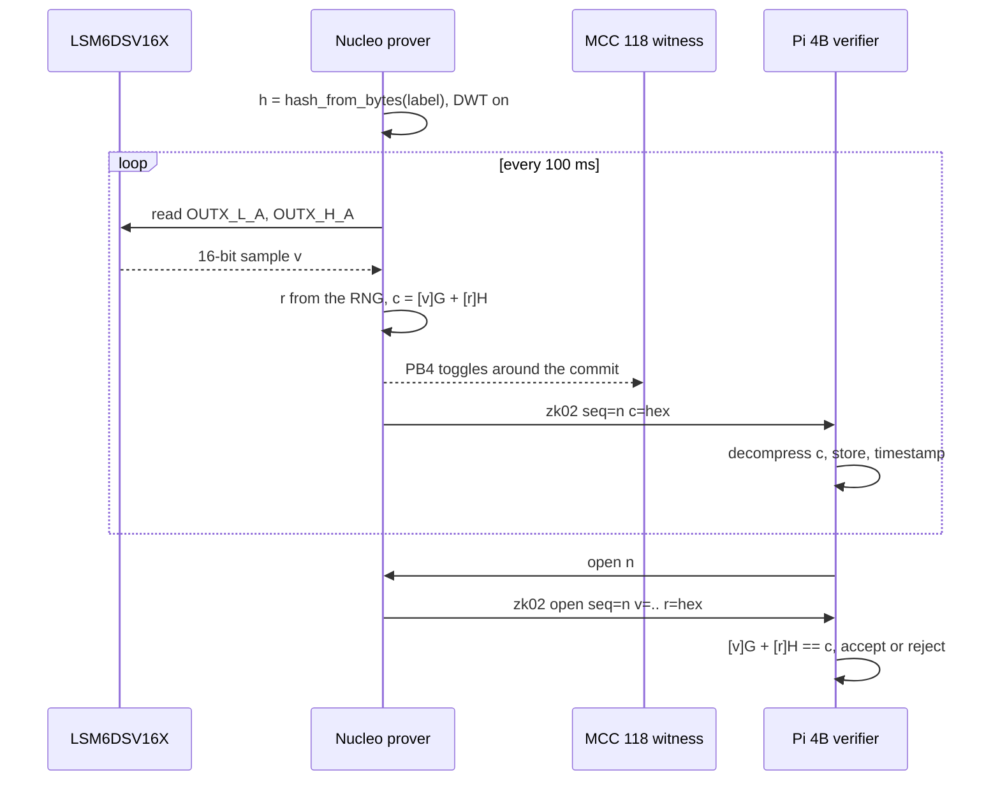
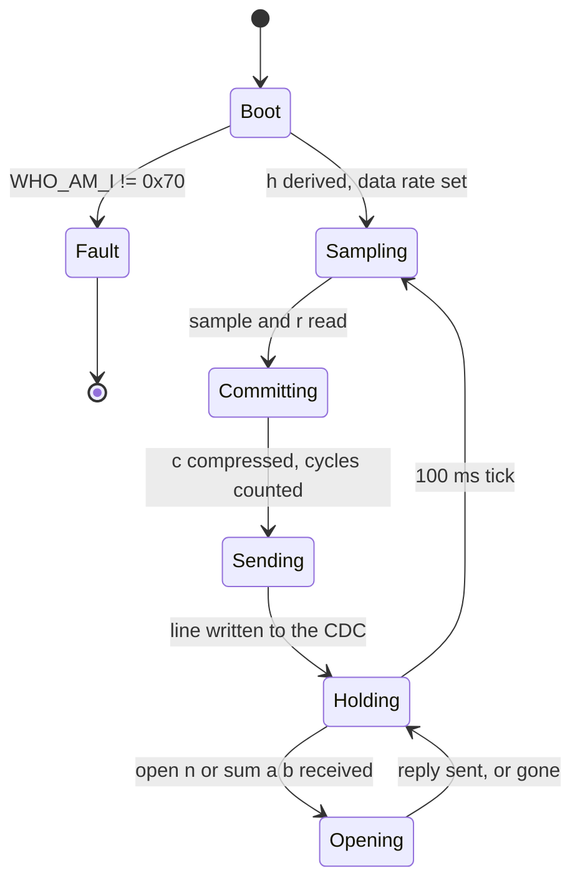
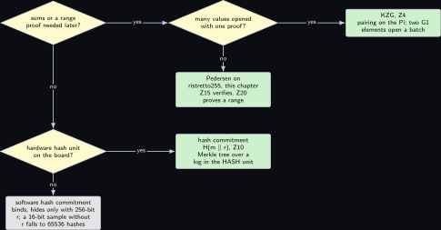

# Project 2. A sensor reading committed on the microcontroller

> **Board:** NUCLEO-H7A3ZI-Q with the X-NUCLEO-IKS4A1 stacked; Pi 4B as the verifier over USB CDC; MCC 118 and PPK2 as witnesses  
> **Language:** Rust

> [!IMPORTANT]
> **The question, instanced**
>
> What can a verifier learn from a device without the device revealing itself, and what does it cost on this board? Here the device is the Nucleo with an accelerometer on its header, the thing it does not reveal is the 16-bit sample it just read, and what the verifier learns is that the sample is fixed: a 32-byte Pedersen commitment leaves the board ten times a second, and the sample behind any one of them can be opened later, or summed with its neighbours without ever being opened one by one. The cost is a few hundred thousand cycles per commit, a figure the DWT counter and the MCC 118 must agree on before it is printed.

> **Key facts**
>
> - **Board:** NUCLEO-H7A3ZI-Q (STM32H7A3ZI, Cortex-M7 at 280 MHz, 1312 kB SRAM, hardware RNG) as the prover; Raspberry Pi 4 Model B Rev 1.4 (8 GB) as the verifier
> - **Parts:** X-NUCLEO-IKS4A1 on the Arduino header with the LSM6DSV16X at 0x6b; the MCC 118 on the Pi 4B as the timing witness; the nRF PPK2 as the ampere meter
> - **Interface:** I2C1 at 400 kHz to the shield; USB CDC from the Nucleo's user USB to the Pi 4B; the ST-LINK drive `NOD_H7A3ZIQ` for the image; PB4 on CN7 pin 19 as the marker
> - **Language and library:** Rust `no_std`, `curve25519-dalek` 5.0.0 \[[5](#references)\] with the 32-bit backend, `cortex-m-rt` 0.7.7 \[[9](#references)\], `stm32h7xx-hal` 0.16.0 \[[8](#references)\], `usb-device` 0.3.2 \[[10](#references)\] and `usbd-serial` for the CDC
> - **Primitive:** the Pedersen commitment $`\mathsf{Com}(v; r) = g^v h^r`$ of the paper's symbolic scheme \[[1](#references)\], moved from $`\mathbb{G}_1`$ of BLS12-381 to ristretto255 because a scalar commitment needs no pairing
> - **Secret:** the sample $`v \in [0, 2^{16})`$ and the randomness $`r \in \mathbb{Z}_p`$
> - **Public:** $`c = g^v h^r`$, 32 bytes, once per 100 ms; later $`(v, r)`$ for the sequence numbers the verifier asks about. The cycle count of the commitment is not on that line: it is printed only by the calibration build, which commits a fixed constant sample instead of a sensor reading
> - **Model:** none
> - **Acceptance:** 100 consecutive commitments at 10 Hz decode as ristretto points on the Pi 4B with no gap over 150 ms; ten requested openings verify and ten altered openings are refused; and the DWT cycle count and the MCC 118 marker interval agree within 2 percent, which is attainable only for a commitment of at least 280000 cycles. The MCC 118 samples every 10 microseconds, so each of the two marker edges is located to within one sample period and the interval carries up to 20 microseconds of quantisation error; for that to be 2 percent or less the interval must be at least 1000 microseconds, which at 280 MHz is 280000 cycles (computed). If the measured commitment falls below that, the witness is taken over a block of $`N`$ consecutive commitments with the marker toggled once per block, as [Project 1](01-the-price-list.md) does for its sub-100-microsecond operations, and $`N`$ is chosen so that the block exceeds 1 millisecond; the published figure then names the block size
> - **Difficulty:** 3 of 5
> - **Effort:** two evenings on the build laptop for the `no_std` build with the 32-bit backend and the CDC, one afternoon on the bench for the shield, the witness and the first hundred commitments

## Pitch

The paper commits to a whole transition system and proves a temporal property about it \[[1](#references)\]. This chapter commits to one number, because one number is what a sensor produces, and because every larger commitment in the volume is built from the same operation. The Nucleo reads the accelerometer, draws 64 bytes from its hardware random number generator, computes $`c = [v]G + [r]H`$ on ristretto255 and sends the 32-byte encoding of $`c`$ over USB to the Pi, keeping $`(v, r)`$ in a ring of 64 entries. The Pi can later ask for any entry by its sequence number and check it with the verifier of [Project 15](15-a-zig-verifier-of-pedersen-openings.md); it can also ask for the sum of a window of ten samples and check it against the product of ten commitments, which is the homomorphism proved below. What the Pi cannot do is learn anything about $`v`$ from $`c`$ alone: Theorem thm:z01\_hiding says the commitment is a uniform group element whatever the sample. The chapter's price is paid on the microcontroller, where a 253-bit scalar multiplication is the long pole, and that price is "not measured" until the DWT and the MCC 118 agree on it.

## Parts and interface

| **Part** | **Role** | **Interface** | **Address or pin** |
| --- | --- | --- | --- |
| NUCLEO-H7A3ZI-Q | the prover; `no_std` Rust, the RNG peripheral for $`r`$ | the ST-LINK drive `NOD_H7A3ZIQ` for the image; the user USB connector for the CDC (connector name to verify in UM2408 \[[12](#references)\]) | PB4 marker on CN7 pin 19; I2C1 on PB8 (SCL) and PB9 (SDA) |
| X-NUCLEO-IKS4A1 | the sensor shield, stacked on the Arduino header; its addresses were measured on a Pi bus on Wednesday 30 September 2026 | I2C1 at 400 kHz; the shield carries the pull-ups | LSM6DSV16X at 0x6b, WHO\_AM\_I 0x70; SDA on D14, SCL on D15 (to verify against UM2408) |
| Raspberry Pi 4 Model B | the verifier; reads the CDC lines, requests openings, runs the witness | USB-A to the Nucleo; SSH from the build laptop | `/dev/ttyACM0` |
| MCC 118 on the Pi 4B | witness of the per-commit interval, 10 microsecond samples | SPI0 CE0, free of the CAN overlays | CH0 to PB4, GND terminal to a Nucleo GND |
| nRF PPK2 | energy per commit | USB to the build laptop | in series on E5V; the jumper position is read from UM2408 \[[12](#references)\] (to verify) |
| the build laptop, WSL side | the cross build for `thumbv7em-none-eabihf`; the PPK2 host | LAN, USB |  |

## The secret, the statement and the relation

The witness is the pair $`w = (v, r)`$ and the statement is the commitment $`u = c`$. The sample space is $`V = [0, 2^{16}) = \{0, 1, \dots, 65535\}`$, read as the unsigned value of the two output register bytes so that the range is exact; the randomness space is $`\mathbb{Z}_p`$ for the prime $`p`$ of Definition **Definition Z2.1**; the commitment space is the group $`\mathbb{G}`$ of that definition. The relation is

```math
\mathcal{R}_{\mathrm{open}} = \big\{\, ((v, r), c) \in (V \times \mathbb{Z}_p) \times \mathbb{G}
    \;:\; c = g^v h^r \,\big\},
```

*(2.1)*

and it is the $`\mathsf{Com}(\mathsf{sp}, \mathcal{M}; r) = c_\mathcal{M}`$ half of the paper's Equation 2 with $`\mathcal{M}`$ replaced by one sample and $`\mathsf{sp} = (\mathbb{G}, g, h)`$ \[[1](#references)\]; the $`\mathsf{Cert}`$ half, which needs a certificate, belongs to [Project 3](03-the-modems-backoff-machine.md) and [Project 5](05-farkas-witnesses-for-a-joystick-program.md). After $`n`$ commitments the verifier's view is the set $`\{c_1, \dots, c_n\}`$, and by Theorem thm:z01\_hiding with independent uniform $`r_i`$ it is distributed as $`n`$ independent uniform elements of $`\mathbb{G}`$ for every choice of $`(v_1, \dots, v_n) \in V^n`$: the view is the same set-valued random variable whether the board is at rest or falling. By Theorem thm:z01\_binding a board that opens one $`c_i`$ to two different samples has computed $`\log_g h`$, and Theorem **Theorem Z2.6** says what that would mean.

## The mathematics

**Definition Z2.1 (ristretto255).** Let $`q = 2^{255} - 19`$ and let $`E`$ be the twisted Edwards curve $`-x^2 + y^2 = 1 + d x^2 y^2`$ over $`\mathbb{F}_q`$ with $`d = -121665/121666`$, the curve of Ed25519 \[[3](#references)\]. The group $`E(\mathbb{F}_q)`$ is cyclic of order $`8p`$ with

```math
p = 2^{252} + 27742317777372353535851937790883648493
```

prime. Write $`2E = \{\, 2P \mid P \in E(\mathbb{F}_q) \,\}`$ for the subgroup of doubles and $`E[4] = \{\, P \in E(\mathbb{F}_q) \mid 4P = 0 \,\}`$ for the 4-torsion. The group ristretto255 is the quotient $`\mathbb{G} = 2E / E[4]`$ together with the encoding of \[[4](#references)\], which maps every coset to one 32-byte string and refuses every string that is not the canonical encoding of a coset (the quotient as written here is to verify against the ristretto255 specification, which is RFC 9496 \[[7](#references)\]). The group law is the curve law on representatives, $`(P + E[4]) + (Q + E[4]) = (P + Q) + E[4]`$, well defined because $`E[4]`$ is a subgroup. The generator $`g`$ of this volume is the coset of the Ed25519 base point, and the group is written multiplicatively in the theorems and additively in the code, where $`g^v h^r`$ reads $`[v]G + [r]H`$.

**Lemma Z2.2 (ristretto255 has prime order).** $`|\mathbb{G}| = p`$, and every element of $`\mathbb{G}`$ other than the identity generates $`\mathbb{G}`$.

*Proof.* Fix a generator $`P_0`$ of the cyclic group $`E(\mathbb{F}_q)`$ of order $`8p`$. The doubling map $`P \mapsto 2P`$ is a group homomorphism of $`E(\mathbb{F}_q)`$ into itself; its kernel is $`E[2] = \{\, kP_0 \mid 8p \mid 2k \,\} = \{0, 4pP_0\}`$, of order 2, so by the first isomorphism theorem its image $`2E`$ has order $`8p / 2 = 4p`$. The 4-torsion is $`E[4] = \{\, kP_0 \mid 8p \mid 4k \,\} = \{\, kP_0 \mid 2p \mid k \,\} = \{0, 2pP_0, 4pP_0, 6pP_0\}`$, of order 4. A cyclic group has exactly one subgroup of each order dividing the group order, so $`2E`$ is the unique subgroup of order $`4p`$; since $`4 \mid 4p`$, the cyclic group $`2E`$ contains a subgroup of order 4, which by uniqueness in $`E(\mathbb{F}_q)`$ is $`E[4]`$ itself. Hence $`E[4] \subseteq 2E`$, the quotient is defined, and $`|\mathbb{G}| = |2E| / |E[4]| = 4p / 4 = p`$. By Lagrange's theorem the order of an element of $`\mathbb{G}`$ divides $`p`$; as $`p`$ is prime the order is 1 or $`p`$; the only element of order 1 is the identity, so every other element has order $`p`$, and the cyclic subgroup it generates has $`p`$ elements, which is all of $`\mathbb{G}`$. &#9632;

**Theorem Z2.3 (Pedersen is additively homomorphic).** For all $`v, v', r, r' \in \mathbb{Z}_p`$,

```math
\mathsf{Com}(v; r) \cdot \mathsf{Com}(v'; r') = \mathsf{Com}(v + v'; r + r'),
```

*(2.2)*

the sums taken in $`\mathbb{Z}_p`$. In particular, for samples $`v_1, \dots, v_n \in [0, 2^{16})`$ with $`n < 2^{236}`$, the product $`\prod_{i=1}^{n} \mathsf{Com}(v_i; r_i)`$ is a commitment to the integer sum $`\sum_{i=1}^{n} v_i`$ with randomness $`\sum_{i=1}^{n} r_i \bmod p`$, and no wrap-around occurs in the value.

*Proof.* By definition $`\mathsf{Com}(v; r) \cdot \mathsf{Com}(v'; r') = (g^v h^r)(g^{v'} h^{r'})`$. The group $`\mathbb{G}`$ is cyclic by Lemma **Lemma Z2.2**, hence abelian, so the four factors may be reordered: $`(g^v h^r)(g^{v'} h^{r'}) = g^v g^{v'} h^r h^{r'}`$. The exponent law $`x^a x^b = x^{a+b}`$ for integers $`a, b`$ gives $`g^{v + v'} h^{r + r'}`$ with the sums taken in $`\mathbb{Z}`$. Since $`g`$ and $`h`$ have order $`p`$ (Lemma **Lemma Z2.2**, both being different from the identity), $`g^a = g^{a \bmod p}`$ for every integer $`a`$, so the integer sums may be reduced modulo $`p`$, and the product equals $`\mathsf{Com}(v + v' \bmod p;\; r + r' \bmod p)`$, which is Equation 2.2. For the second claim, induction on $`n`$: the case $`n = 1`$ is trivial, and if $`\prod_{i=1}^{n-1} \mathsf{Com}(v_i; r_i) = \mathsf{Com}(\sum_{i<n} v_i \bmod p;\; \sum_{i<n} r_i \bmod p)`$ then multiplying by $`\mathsf{Com}(v_n; r_n)`$ and applying Equation 2.2 gives the statement for $`n`$. Each $`v_i < 2^{16}`$, so $`\sum_{i=1}^{n} v_i < n \cdot 2^{16} < 2^{236} \cdot 2^{16} = 2^{252} < p`$, and the reduction modulo $`p`$ leaves the integer sum unchanged. &#9632;

**Remark Z2.8.** The theorem is what the decision tree below turns on. A verifier that holds ten commitments $`c_1, \dots, c_{10}`$ can ask the board for $`(\sum v_i, \sum r_i \bmod p)`$ alone, multiply the ten commitments, and check one opening; it learns the ten-sample sum and nothing about the individual samples beyond what the sum implies. A hash commitment ([Project 10](10-the-hardware-hash-unit-commits-to-a-transition.md)) cannot do this; a KZG commitment ([Project 4](04-two-group-elements.md)) can, and can also open many values with one proof, at the price of a pairing that this board does not compute.

**Lemma Z2.5 (Cost of one opening check).** Given $`(v, r, c)`$, deciding whether $`((v, r), c) \in \mathcal{R}_{\mathrm{open}}`$ costs two scalar multiplications, one group addition and one comparison of 32-byte encodings. With $`v < 2^{16}`$, the double-and-add method computes $`[v]G`$ with at most 15 doublings and at most 16 additions, and $`[r]H`$ with at most 252 doublings and at most 253 additions. The prover's commitment costs the same operations as the verifier's check.

*Proof.* The check recomputes $`[v]G + [r]H`$ and compares its encoding with the received $`c`$: when the two products are formed separately that is two scalar multiplications, one addition and one comparison, an upper bound and not a lower one. Neither $`[v]G`$ nor $`[r]H`$ is given, and the encoding of a sum does not reveal its summands. Double-and-add on a $`k`$-bit scalar $`a = \sum_{i=0}^{k-1} a_i 2^i`$ with $`a_{k-1} = 1`$ starts from $`Q = P`$, and for each lower bit doubles once and adds $`P`$ once when the bit is set: at most $`k - 1`$ doublings and at most $`k`$ additions in total. With $`k = 16`$ for $`v`$ the counts are 15 and 16; with $`k = 253`$ for $`r < p < 2^{253}`$ they are 252 and 253. The prover computes the same $`[v]G + [r]H`$ to produce $`c`$, so its count is the verifier's count. &#9632;

These are the counts of the textbook method, computed, not measured. The library replaces double-and-add for the fixed base $`G`$ by a precomputed table lookup and uses a windowed method for $`[r]H`$ \[[5](#references)\]; the DWT count in the benchmark is the number that stands in for the lemma once it has been measured.

**Theorem Z2.6 (The second generator is independent of the device).** Let $`H : \{0, 1\}^* \to \mathbb{G}`$ be modelled as a random oracle and let $`h = H(\mathsf{label})`$ for a fixed public string. If an algorithm $`\mathcal{A}`$ that makes at most $`Q`$ oracle queries outputs $`x`$ with $`g^x = h`$ with probability $`\varepsilon`$, then there is an algorithm $`\mathcal{B}`$ that, given a uniform $`y \in \mathbb{G}`$, outputs $`\log_g y`$ with probability $`\varepsilon`$, running in the time of $`\mathcal{A}`$ plus at most $`Q`$ group exponentiations.

*Proof.* $`\mathcal{B}`$ receives $`y`$ and runs $`\mathcal{A}`$, answering the oracle queries itself. For the query $`\mathsf{label}`$ it answers $`y`$. For any other string $`s`$ queried for the first time it draws $`t_s`$ uniform in $`\mathbb{Z}_p`$, stores $`(s, t_s)`$ and answers $`g^{t_s}`$; for a repeated query it answers what it stored. By Lemma **Lemma Z2.2** the map $`t \mapsto g^t`$ is a bijection from $`\mathbb{Z}_p`$ onto $`\mathbb{G}`$, so each fresh answer is uniform in $`\mathbb{G}`$ and independent of the others, and $`y`$ is uniform in $`\mathbb{G}`$ by hypothesis. A random oracle into $`\mathbb{G}`$ answers every fresh query with an independent uniform element of $`\mathbb{G}`$ and repeats itself on repeated queries, so the two views of $`\mathcal{A}`$, the real one and the simulated one, have the same distribution, and $`\mathcal{A}`$ outputs $`x`$ with $`g^x = y`$ with probability $`\varepsilon`$. $`\mathcal{B}`$ outputs that $`x`$. It performs one exponentiation per fresh query, at most $`Q`$. &#9632;

**Remark Z2.9 (Why the device must not choose $`h`$).** If the device could pick $`h = g^k`$ for a $`k`$ it knows, then for any $`v' \ne v`$ it could open $`c = g^v h^r`$ to $`v'`$ by sending $`r' = r + (v - v') k^{-1} \bmod p`$, because $`g^{v'} h^{r'} = g^{v' + k r'} = g^{v' + k r + v - v'} = g^{v + k r} = c`$. In the firmware $`h`$ is `RistrettoPoint::hash_from_bytes::<Sha512>(label)` \[[5](#references)\], which hashes the label with SHA-512 and maps the 64 bytes to the group with two Elligator maps added together (to verify against the ristretto255 specification); the verifier of [Project 15](15-a-zig-verifier-of-pedersen-openings.md) recomputes $`h`$ from the same label in a different library, and the two encodings must agree byte for byte before any opening is checked. Theorem **Theorem Z2.6** then says that a device opening one commitment two ways would solve a uniformly random discrete logarithm in $`\mathbb{G}`$, in the random oracle model of \[[2](#references)\].

## The protocol

The prover is the Nucleo, the verifier is the Pi 4B, and the channel is one USB CDC line of ASCII text in each direction. The label and the line formats are public.

1. Prover, at boot: read WHO\_AM\_I of 0x6b and refuse to start unless it reads 0x70; set the accelerometer data rate (CTRL1, to verify against the datasheet); derive $`h = H(\mathsf{label})`$ with $`\mathsf{label}`$ the fixed string `zk02 pedersen h, bench volume, v1`; enable the debug control block's trace and then the DWT cycle counter, in that order, because the counter is gated by both.
2. Prover, every 100 ms: read the two bytes of the X axis output register as an unsigned 16-bit word $`v`$; draw 64 bytes from the RNG peripheral and reduce them to $`r \in \mathbb{Z}_p`$; toggle PB4; compute $`c = [v]G + [r]H`$ and compress it; toggle PB4 again; store $`(\mathrm{seq}, v, r)`$ in the ring; send the line `zk02 seq=<n> c=<64 hex>`.
3. The cycle count is a measurement of an operation whose inputs are the secret $`v`$ and the secret $`r`$, so it is not published on the commitment line. It is printed only in calibration mode, which is entered by a build-time feature and which commits a fixed constant sample instead of a sensor reading, so that no published timing figure is ever paired with a live commitment. The theorem that makes this necessary is not Theorem thm:z01\_hiding, which is about the group element alone: perfect hiding of $`c`$ says nothing about a second channel published beside it. Whether the firmware's arithmetic is in fact constant time in $`v`$ and $`r`$ is a separate claim, recorded as **learn:** modelled below, because it has not been measured on this board: `curve25519-dalek` documents its variable-base scalar multiplication as constant time, but on a Cortex-M7 the DWT count of one commitment also carries the data cache state, the I2C transaction that preceded it and the USB interrupt pattern, and no measurement on this bench yet shows the count to be independent of the sample.
4. Verifier, on each line: decompress the 32 bytes; refuse the line if the decoding is not canonical; store $`(\mathrm{seq}, c)`$; note the host timestamp.
5. Verifier, on demand: send `open <n>`; the prover answers `zk02 open seq=<n> v=<v> r=<64 hex>` if $`n`$ is still in the ring and `zk02 gone seq=<n>` otherwise; the verifier checks $`[v]G + [r]H = c`$ by Lemma **Lemma Z2.5**, on the Pi 4B here or on the Pi 3B+ in [Project 15](15-a-zig-verifier-of-pedersen-openings.md).
6. Verifier, on demand: send `sum <a> <b>`; the prover answers with $`\sum_{i=a}^{b} v_i`$ and $`\sum_{i=a}^{b} r_i \bmod p`$; the verifier multiplies the stored $`c_a, \dots, c_b`$ and checks the one opening by Theorem **Theorem Z2.3**.

A wrong opening is refused by the group equation, a stale sequence number is refused by the ring, and a line whose 32 bytes do not decode is refused before any arithmetic.

## The code

The firmware prints one line per commitment in a format no other project prints, so that a capture taken later can still be attributed to this image. The USB device setup follows the `usb_serial` example of `stm32h7xx-hal` and is not printed; `serial` is its `usbd_serial::SerialPort`. The names `into_alternate_open_drain`, `rng.fill`, `DCB::enable_trace`, `DWT::unlock`, `DWT::cycle_count` and the `RISTRETTO_BASEPOINT_TABLE` static are to verify against the crate versions pinned in the manifest.

```rust
#![no_std]
#![no_main]
use core::fmt::Write;
use cortex_m::peripheral::DWT;
use cortex_m_rt::entry;
use curve25519_dalek::constants::RISTRETTO_BASEPOINT_TABLE as G_TABLE;
use curve25519_dalek::{ristretto::RistrettoPoint, scalar::Scalar};
use embedded_hal::blocking::i2c::{Write as I2cWrite, WriteRead};
use panic_halt as _;
use sha2::Sha512;
use stm32h7xx_hal::{pac, prelude::*};

const LSM6DSV16X: u8 = 0x6b;
const WHO_AM_I: u8 = 0x0f;      // reads 0x70 on this part
const CTRL1: u8 = 0x10;         // accelerometer data rate, value to verify
const OUTX_L_A: u8 = 0x28;      // X axis, low byte first
const RING: usize = 64;
const LABEL: &[u8] = b"zk02 pedersen h, bench volume, v1";
#[cfg(feature = "calibration")]
const CAL_V: u16 = 0x1234;      // the calibration build commits this constant, not a sample

#[derive(Clone, Copy)]
struct Held { seq: u32, v: u16, r: [u8; 32] }

struct Line<'a> { b: &'a mut [u8], n: usize }
impl Write for Line<'_> {
    fn write_str(&mut self, s: &str) -> core::fmt::Result {
        let k = s.len().min(self.b.len() - self.n);
        self.b[self.n..self.n + k].copy_from_slice(&s.as_bytes()[..k]);
        self.n += k;
        Ok(())
    }
}

fn commit(v: u16, r: &Scalar, h: &RistrettoPoint) -> RistrettoPoint {
    let vs = Scalar::from(v as u64);
    &vs * G_TABLE + r * h
}

#[entry]
fn main() -> ! {
    let cp = cortex_m::Peripherals::take().unwrap();
    let dp = pac::Peripherals::take().unwrap();
    let pwrcfg = dp.PWR.constrain().freeze();
    let ccdr = dp.RCC.constrain().sys_ck(280.MHz()).freeze(pwrcfg, &dp.SYSCFG);
    let gpiob = dp.GPIOB.split(ccdr.peripheral.GPIOB);
    let scl = gpiob.pb8.into_alternate_open_drain::<4>();
    let sda = gpiob.pb9.into_alternate_open_drain::<4>();
    let mut i2c = dp.I2C1.i2c((scl, sda), 400.kHz(), ccdr.peripheral.I2C1, &ccdr.clocks);
    let mut marker = gpiob.pb4.into_push_pull_output();
    let mut rng = dp.RNG.constrain(ccdr.peripheral.RNG, &ccdr.clocks);
    let mut dcb = cp.DCB;
    dcb.enable_trace();              // DEMCR.TRCENA: without it DWT_CYCCNT never advances
    let mut dwt = cp.DWT;
    DWT::unlock();                   // DWT_LAR on parts that lock the trace registers
    dwt.enable_cycle_counter();
    let mut delay = cp.SYST.delay(ccdr.clocks);
    let mut serial = cdc_port(dp, &ccdr);   // the HAL example's SerialPort, not printed

    let h = RistrettoPoint::hash_from_bytes::<Sha512>(LABEL);
    let mut who = [0u8; 1];
    i2c.write_read(LSM6DSV16X, &[WHO_AM_I], &mut who).unwrap();
    if who[0] != 0x70 { loop {} }           // the IKS5A1 answers 0x22 here: refuse
    i2c.write(LSM6DSV16X, &[CTRL1, 0x03]).unwrap();

    let mut held = [Held { seq: 0, v: 0, r: [0; 32] }; RING];
    let mut seq: u32 = 0;
    let mut hexbuf = [0u8; 64];
    let mut line = [0u8; 112];
    loop {
        let mut raw = [0u8; 2];
        i2c.write_read(LSM6DSV16X, &[OUTX_L_A], &mut raw).unwrap();
        let v = u16::from_le_bytes(raw);
        // calibration build: the committed value is the fixed constant CAL_V, so the cycle
        // count printed below is not a timing of a secret
        #[cfg(feature = "calibration")]
        let v = CAL_V;
        let mut wide = [0u8; 64];
        rng.fill(&mut wide).unwrap();
        let r = Scalar::from_bytes_mod_order_wide(&wide);
        marker.toggle();
        let t0 = DWT::cycle_count();
        let c = commit(v, &r, &h).compress();
        let cycles = DWT::cycle_count().wrapping_sub(t0);
        marker.toggle();
        held[(seq as usize) % RING] = Held { seq, v, r: r.to_bytes() };
        hex(&mut hexbuf, c.as_bytes());
        let mut w = Line { b: &mut line, n: 0 };
        write!(w, "zk02 seq={} c=", seq).ok();
        w.write_str(core::str::from_utf8(&hexbuf).unwrap()).ok();
        w.write_str("\n").ok();
        #[cfg(feature = "calibration")]
        write!(w, "zk02 cal seq={} cyc={}\n", seq, cycles).ok();
        #[cfg(not(feature = "calibration"))]
        let _ = cycles;                 // never on the line that carries a live commitment
        let n = w.n;
        serial.write(&line[..n]).ok();
        seq = seq.wrapping_add(1);
        delay.delay_ms(100u32);
    }
}

fn hex(out: &mut [u8; 64], b: &[u8; 32]) {
    const D: &[u8; 16] = b"0123456789abcdef";
    for (i, x) in b.iter().enumerate() {
        out[2 * i] = D[(x >> 4) as usize];
        out[2 * i + 1] = D[(x & 15) as usize];
    }
}
```

```bash
# build laptop, WSL: the no_std image for the Cortex-M7, 32-bit field backend
rustup target add thumbv7em-none-eabihf
RUSTFLAGS='--cfg curve25519_dalek_bits="32"' cargo build --release --target thumbv7em-none-eabihf
# the calibration image: commits the fixed constant and prints the cycle count on its own line
RUSTFLAGS='--cfg curve25519_dalek_bits="32"' cargo build --release --features calibration \
  --target thumbv7em-none-eabihf
cargo objcopy --release --target thumbv7em-none-eabihf -- -O binary zk02.bin
cp zk02.bin /mnt/<drive>/        # the ST-LINK drive NOD_H7A3ZIQ; the letter is read on the day
# the Pi 4B over ssh: the lines arrive on the CDC port
stty -F /dev/ttyACM0 raw 115200
cat /dev/ttyACM0 | tee zk02_$(date +%Y%m%d_%H%M%S).log
```

The `open` and `sum` replies read the ring and print $`(v, r)`$ or the two sums; they are twenty lines of the same shape as the commit line and are not printed here. The build flag selecting the 32-bit backend is the one documented for the 4.x series of the crate and is to verify for 5.0.0 \[[5](#references)\]; without it the crate builds its 64-bit field arithmetic on `u128`, which the Cortex-M7 emulates in software.

## The model, if any

None. A commitment is arithmetic, and nothing in this chapter is proposed.

## Real, modelled, absent

- **have:** real: the Nucleo, the IKS4A1 with the LSM6DSV16X at 0x6b (addresses measured on a Pi bus on Wednesday 30 September 2026), the Pi 4B, the MCC 118 live on the Pi 4B since Friday 9 October 2026, the PPK2, and `curve25519-dalek` 5.0.0 read on Friday 6 November 2026
- **learn:** modelled: every bar in the benchmark figure is the order of magnitude expected from the operation counts of Lemma **Lemma Z2.5** at 280 MHz, drawn dashed; the I2C pin mapping of the Arduino header, the CTRL1 value, the RNG clock source, the user USB connector name and the PPK2 series position are to be read from UM2408 and the datasheet before the first run. Whether the commitment arithmetic is constant time in $`v`$ and in $`r`$ is modelled and not measured: the crate documents its variable-base scalar multiplication as constant time, and no reading on this board shows the DWT count to be independent of the sample, which is why the count is confined to the calibration build
- **absent:** absent: an oscilloscope or logic analyser, so the PB4 marker is witnessed at 10 microsecond resolution only; a second shield in the same role, so a wrong WHO\_AM\_I means the IKS5A1 is stacked and the firmware refuses rather than guesses

## System architecture



*Figure 2.1. One device, one commitment, one verifier. Inside a dashed layer labelled as the device, three solid blocks: the LSM6DSV16X on the shield in hardware yellow, the Nucleo firmware with the yellow prover outline, and below it the stop-outlined secret block holding the ring of (seq, v, r), which is real and hidden. A solid arrow carries the I2C sample into the prover, a solid arrow from the prover down into the ring says hold, and a solid arrow to the right carries the compressed point into the kernel-blue commitment block outside the layer. From the commitment a solid arrow drops into the Pi 4B verifier with the green verifier outline, and a two-headed arrow between the verifier and the ring carries the open and sum requests with their replies. Below the layer, two solid witness blocks: the MCC 118 in kernel blue reading PB4, and the PPK2 in hardware yellow in series on E5V, each with an arrow up to the layer's edge. At the right, a dotted grey block for the absent oscilloscope.*

Read the figure as one secret inside a border and one 32-byte value leaving it on a timer. The two-headed arrow is the only path by which anything else leaves, and it leaves only what was asked for by sequence number.

## Wiring



*Figure 2.2. The device, the witnesses and the verifier. At the top the X-NUCLEO-IKS4A1 as a solid hardware block stacked on the Nucleo below it; the two-headed bus between them names the Arduino header lines D14 as SDA on PB9, D15 as SCL on PB8, 3V3 and GND. The Nucleo block lists its pins: PB4 on CN7 pin 19 as the marker, a GND on CN7, E5V, and the user USB connector. To the right the PPK2 in series on E5V and, further right, the build laptop as a grey external block that hosts the PPK2 and the ST-LINK. Below the Nucleo the Pi 4B with the MCC 118 stacked: the marker runs vertically from PB4 to CH0 and the ground beside it, and the USB CDC line leaves the Nucleo's right side and enters the Pi's USB-A. The note gives the power order.*

| **Signal** | **From** | **To** | **Note** |
| --- | --- | --- | --- |
| I2C1 SDA | Nucleo PB9, Arduino D14 | IKS4A1 SDA | pin mapping to verify against UM2408 \[[12](#references)\]; the shield carries the pull-ups |
| I2C1 SCL | Nucleo PB8, Arduino D15 | IKS4A1 SCL | 400 kHz; open drain on the Nucleo side |
| 3V3 and GND | Nucleo Arduino power pins | IKS4A1 | through the stacked header, no leads |
| marker | Nucleo PB4, CN7 pin 19 | MCC 118 CH0 | toggles before and after each commit; the MCC 118 samples every 10 microseconds, so one commit is many samples wide |
| ground | Nucleo GND, CN7 | MCC 118 GND terminal | common reference for the marker |
| USB CDC | Nucleo user USB, CN13 (connector name to verify in UM2408 \[[12](#references)\]) | Pi 4B USB-A | `/dev/ttyACM0`; the ST-LINK VCP on CN1 is a second CDC and must not be the one read |
| 5 V supply | external supply | Nucleo E5V through the PPK2 | jumper position from UM2408 \[[12](#references)\] (to verify) |

## Sequence and states





## Decision tree



*Figure 2.3. Which commitment for which later use. The root diamond asks whether the verifier will add commitments or check a range later; yes leads right to a second diamond asking whether many values must be opened with one proof, whose yes leaf is KZG on the Pi with a pairing ([Project 4](04-two-group-elements.md)) and whose no leaf, below it, is the Pedersen commitment on ristretto255 of this chapter, verified in [Project 15](15-a-zig-verifier-of-pedersen-openings.md) and range-proved in [Project 20](20-the-occupancy-counter-that-proves-its-committed-count.md). The root's no branch drops to a third diamond asking whether a hardware hash unit is on the board; yes leads to the hash commitment and Merkle tree of [Project 10](10-the-hardware-hash-unit-commits-to-a-transition.md), no to the grey leaf of a software hash commitment, which binds, hides only with 256 bits of randomness, and without them exposes a 16-bit sample to 65536 trial hashes.*

## Benchmark


*Figure 2.4. Expected cost of the stages of one commit on the Nucleo at 280 MHz, log scale in microseconds, drawn as dashed bars because none has been measured: the I2C read of two bytes, the 16-bit multiplication $`[v]G`$, the 253-bit multiplication $`[r]H`$, the compression of the point, the CDC write of the line, and the total. The heights are the orders of magnitude the counts of Lemma **Lemma Z2.5** imply with the library's windowed methods; a solid bar replaces a dashed one when the DWT count of the calibration build and the MCC 118 interval agree within 2 percent over an interval of at least 1000 microseconds, and its caption names the record and the block size.*

| **Quantity** | **Expected** | **Value** | **Instrument** |
| --- | --- | --- | --- |
| cycles per commit | $`10^5`$ to $`10^7`$ | not measured, no run | DWT cycle counter, printed on its own `zk02 cal` line by the calibration build and never beside a live commitment; 64 consecutive lines, median and median absolute deviation |
| interval per commit | the same, divided by 280 MHz | not measured, no run | MCC 118 CH0 at 100 kS/s, interval between PB4 toggles, 60 s capture, over a block of commits if one commit is under 280000 cycles |
| energy per commit | not predicted | not measured, no run | PPK2 ampere meter in series on E5V, integrated over the marker interval |
| commits per second sustainable | 10, by design | not measured, no run | computed from the cycle count once it exists; the firmware sleeps 100 ms per cycle |
| opening check on the Pi 4B | under 1 ms | not measured, no run | the verifier of [Project 15](15-a-zig-verifier-of-pedersen-openings.md), or a host Rust check timed with Instant, 64 repeats |

The paper's Table 1 carries no cell for a single Pedersen commitment; its symbolic prover times (1 min for 217 obligations on the paper's AWS `c6g.8xlarge`) contain thousands of them and are attributed to that machine, never to this board \[[1](#references)\].

## Steps

**Step 1.** On the authoring laptop, write the crate: the manifest pins `curve25519-dalek` at 5.0.0 with default features off \[[5](#references)\], `cortex-m-rt`, `stm32h7xx-hal` with the feature for the STM32H7A3 (name to verify), `usb-device`, `usbd-serial`, `sha2` with default features off, `panic-halt`; the memory layout file places flash at 2 MB and SRAM at 1312 kB per RM0455 \[[11](#references)\]; commit.

**Step 2.** On the build laptop in WSL, `git pull --ff-only`, add the `thumbv7em-none-eabihf` target, build with the 32-bit backend flag, convert to a binary and copy it to `NOD_H7A3ZIQ`; reflash immediately before every capture, because the board is shared between volumes. Build twice: once without the `calibration` feature, which is the image that sends commitments of real samples and prints no cycle count, and once with it, which is the image that commits the fixed constant and prints the `zk02 cal` lines.

**Step 3.** On the bench, stack the IKS4A1 on the Nucleo's Arduino header with the board off; wire PB4 and a GND to the MCC 118 on the Pi 4B; connect the user USB to the Pi 4B; power the Pi first, the Nucleo after.

**Step 4.** On the Pi 4B over ssh, confirm `/dev/spidev0.0` exists (the CAN overlays are not live), read `vcgencmd get_throttled`, open the CDC port and log 100 lines.

**Step 5.** On the Pi 4B, with the calibration build flashed so that the committed value is the fixed constant, capture 60 s on CH0 at 100 kS/s and compute the interval between PB4 toggles; compare with the `cyc` field of the `zk02 cal` lines divided by 280 MHz. If one commit is under 280000 cycles, mark the block of commits instead and name the block size with the figure, because 20 microseconds of quantisation is more than 2 percent of anything shorter than 1000 microseconds (computed).

**Step 6.** On the Pi 4B, send ten `open` requests and check the replies with the verifier of [Project 15](15-a-zig-verifier-of-pedersen-openings.md); alter $`v`$ by one in ten copies and confirm ten refusals.

**Step 7.** On the build laptop, with the PPK2 in series on E5V, record the current over 60 s and integrate over the marker intervals; publish the energy cell only with the throttle register of the Pi unchanged and the DWT and MCC 118 figures agreeing.

## Acceptance test

The chapter passes when the Pi 4B's log holds 100 consecutive `zk02` lines with consecutive sequence numbers and no `cyc` field on any of them, every 32-byte field decompresses to a canonical ristretto point, no two host timestamps are more than 150 ms apart, ten requested openings satisfy $`[v]G + [r]H = c`$, ten openings altered by $`v + 1`$ are refused, the `cyc` field of the calibration build's 100 `zk02 cal` lines has a median absolute deviation under 5 percent of its median, and that median divided by 280 MHz agrees with the MCC 118 interval within 2 percent, the comparison being made over a block of commits whenever one commit is under 280000 cycles. It fails if any line does not decode, if any correct opening is refused, if any altered opening is accepted, if a cycle count appears on a line that carries a live commitment, if a cycle count reads exactly zero, which means `DEMCR.TRCENA` rather than a dead counter, if the firmware started against a WHO\_AM\_I other than 0x70, or if the $`h`$ derived on the Nucleo differs in a single byte from the $`h`$ derived on the verifier.

## Variants

**Explicit-state instead of Pedersen.** The swap is the primitive: the same Nucleo stops committing one sample as $`\mathsf{Com}(v; r) = g^v h^r`$ on ristretto255 and commits instead to the indicator polynomial of its own transition set under KZG over BLS12-381, then opens the batch of hypothetical violations that the public certificate rules out, which is the design brief's first sketch \[[6](#references)\]. In the parts and the language this moves the board onto the scheme of [Project 4](04-two-group-elements.md): the committed object is no longer the raw sample but a feature vector of fast Fourier transform magnitudes computed on the Cortex-M7's hardware floating-point unit, and the `no_std` build gains a pairing-friendly curve that it does not carry today. The cost is the one Lemma lem:z01\_counts counts: committing to a transition polynomial of degree $`d`$ is one multi-scalar multiplication of $`d + 1`$ terms in $`\mathbb{G}_1`$, against the two scalar multiplications of Lemma **Lemma Z2.5**; at the degree $`65535`$ that [Project 3](03-the-modems-backoff-machine.md) reaches, that is $`65536`$ terms against $`2`$, a factor of $`32768`$, computed. What it buys is a statement about the device's transitions rather than about one reading, and what it costs is that factor on a 280 MHz part, which is why this chapter keeps the scalar commitment and [Project 3](03-the-modems-backoff-machine.md) commits on a Pi instead. Choose it when the verifier's question is whether the firmware's state machine behaves, and keep this chapter's route when the question is only whether a reading is fixed. The brief wires a DFROBOT ADXL345 to the STM32H7 as the vibration source; that module is retired from every plan on Saturday 24 October 2026 because its header is unsoldered and six bus scans were empty with the supply and return verified at its own rows, so the feature vector here comes from the LSM6DSV16X at 0x6b on the X-NUCLEO-IKS4A1 that this chapter already reads.

## Pitfalls

- Reusing $`r`$ is the one error the mathematics does not forgive: two commitments with the same $`r`$ give $`c_1 / c_2 = g^{v_1 - v_2}`$ with $`v_1 - v_2 \in (-2^{16}, 2^{16})`$, found by at most $`2^{17} - 1 = 131071`$ trial exponentiations, computed. The RNG peripheral must be clocked (its kernel clock source is to be read from RM0455 \[[11](#references)\]); a clock error flag means refuse, never fall back to a counter.
- The sample must be the raw unsigned word so that $`v \in [0, 2^{16})`$ exactly; a signed reading shifted by $`2^{15}`$ is the same bits, and the verifier must use the same convention or every opening fails for a reason that is not cryptographic.
- A cycle count of exactly zero on every line is `DEMCR.TRCENA` and not a dead counter: on this core the DWT unit is gated twice, and `enable_cycle_counter` sets only `DWT_CTRL.CYCCNTENA`, so the debug control block's trace enable must be called first or `DWT_CYCCNT` never advances. A zero against a real MCC 118 interval reads as an instrument disagreement, which is the expensive way to find it.
- The backend flag: without `curve25519_dalek_bits="32"` the crate builds on `u128`, which compiles and runs on the Cortex-M7 at a speed that would make 10 Hz a claim rather than a design.
- The IKS4A1 and the IKS5A1 both answer at 0x6b, with WHO\_AM\_I 0x70 and 0x22; the firmware refuses the wrong one rather than reading a register map that does not apply.
- Two CDC ports: the ST-LINK on CN1 presents a virtual COM port too, so a Pi with both cables plugged sees two `ttyACM` devices; the one that prints `zk02` lines is the one to log, identified by its USB serial string, not by its number.
- The MCC 118 needs SPI0 CE0, and the CAN HAT's overlays take it whenever they are live in `config.txt`; `ls /dev/spidev0.0` is the check.
- A commit longer than 100 ms skips a tick silently; the sequence numbers still count by one, so the host timestamps, not the sequence, reveal it.

## Languages and libraries not chosen

- C with `libsodium`'s `crypto_core_ristretto255` functions: portable C with the same group, but its randomness layer expects an operating system and the microcontroller port is work that the Rust crate has already done.
- Zig with `std.crypto.ecc.Ristretto255` on a freestanding target: the group is there and [Project 15](15-a-zig-verifier-of-pedersen-openings.md) uses it on the verifier; on the Nucleo there is no HAL for I2C, the RNG and USB in Zig, so every peripheral is register writes.
- C with the STM32 HAL and hand-written field arithmetic: every arithmetic error is a soundness error, and nothing on this bench can test a field implementation against a second one of its own.
- Python: not on a microcontroller, by the volume's language rule.

## Sources

- [arxiv.org/abs/2605.00487](https://arxiv.org/abs/2605.00487) (verified Friday 6 November 2026), the paper; its page 8 states the Pedersen commitment with the three properties used here.
- [crates.io, curve25519-dalek 5.0.0](https://crates.io/api/v1/crates/curve25519-dalek) (verified Friday 6 November 2026).
- [crates.io, stm32h7xx-hal](https://crates.io/api/v1/crates/stm32h7xx-hal) (to verify), the HAL whose version is pinned once read.
- [digilent.com, MCC 118](https://digilent.com/shop/mcc-118-128-voltage-measurement-daq-hat-for-raspberry-pi/) (to verify).

<a id="references"></a>

## References

1. Pascal Berrang, Mirco Giacobbe, Jacob Swales and Xiao Yang. Zero-Knowledge Model Checking. arXiv:2605.00487v2 \[cs.CR\], version 1 submitted Friday 1 May 2026, version 2 Tuesday 8 September 2026. [arxiv.org/abs/2605.00487](https://arxiv.org/abs/2605.00487) (verified Friday 6 November 2026).
2. Mihir Bellare and Phillip Rogaway. Random oracles are practical: a paradigm for designing efficient protocols. In CCS 1993, pages 62 to 73. ACM, 1993. [doi:10.1145/168588.168596](https://doi.org/10.1145/168588.168596) (to verify).
3. Daniel J. Bernstein, Niels Duif, Tanja Lange, Peter Schwabe and Bo-Yin Yang. High-speed high-security signatures. Journal of Cryptographic Engineering, 2(2), pages 77 to 89, 2012. [doi:10.1007/s13389-012-0027-1](https://doi.org/10.1007/s13389-012-0027-1) (to verify).
4. Mike Hamburg. Decaf: eliminating cofactors through point compression. In CRYPTO 2015, LNCS 9215, pages 705 to 723. Springer, 2015. The construction ristretto255 descends from. [doi:10.1007/978-3-662-47989-6\_34](https://doi.org/10.1007/978-3-662-47989-6_34) (to verify).
5. dalek cryptography contributors. curve25519-dalek: group operations on ristretto255 and Curve25519. Version 5.0.0, updated Monday 6 July 2026, 318.9 million downloads. [crates.io, curve25519-dalek](https://crates.io/api/v1/crates/curve25519-dalek) (verified Friday 6 November 2026).
6. Advanced hardware-software architectures for edge artificial intelligence and zero-knowledge model checking. A design brief of twenty project sketches, read on Friday 6 November 2026 and held locally at `a local design brief`. It is the input to this second edition and is not a published source; where its hardware claims disagree with the bench, the bench is followed and the disagreement is stated.
7. Henry de Valence, Jack Grigg, Mike Hamburg, Isis Lovecruft, George Tankersley and Filippo Valsorda. The ristretto255 and decaf448 groups. RFC 9496, 2023. [rfc-editor.org/info/rfc9496](https://www.rfc-editor.org/info/rfc9496) (verified Friday 6 November 2026).
8. stm32h7xx-hal contributors. stm32h7xx-hal: a hardware abstraction layer for the STM32H7 series. Version 0.16.0, updated Tuesday 12 March 2024. [crates.io, stm32h7xx-hal](https://crates.io/api/v1/crates/stm32h7xx-hal) (verified Friday 6 November 2026).
9. rust-embedded. cortex-m-rt: the minimal runtime for Cortex-M microcontrollers. Version 0.7.7, updated Thursday 24 September 2026. [crates.io, cortex-m-rt](https://crates.io/api/v1/crates/cortex-m-rt) (verified Friday 6 November 2026).
10. rust-embedded-community. usb-device: a USB stack for embedded devices. Version 0.3.2, updated Wednesday 6 March 2024. [crates.io, usb-device](https://crates.io/api/v1/crates/usb-device) (verified Friday 6 November 2026).
11. STMicroelectronics. RM0455, STM32H7A3/7B3 and STM32H7B0 advanced Arm-based 32-bit MCUs, reference manual. (to verify)
12. STMicroelectronics. UM2408, STM32H7 Nucleo-144 boards (MB1363) user manual. (to verify)

---

[Previous](01-the-price-list.md) &nbsp;&nbsp;|&nbsp;&nbsp; [Contents](../CONTENTS.md) &nbsp;&nbsp;|&nbsp;&nbsp; [Next](03-the-modems-backoff-machine.md)
