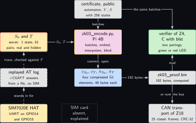
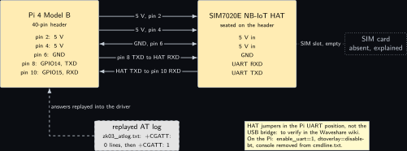
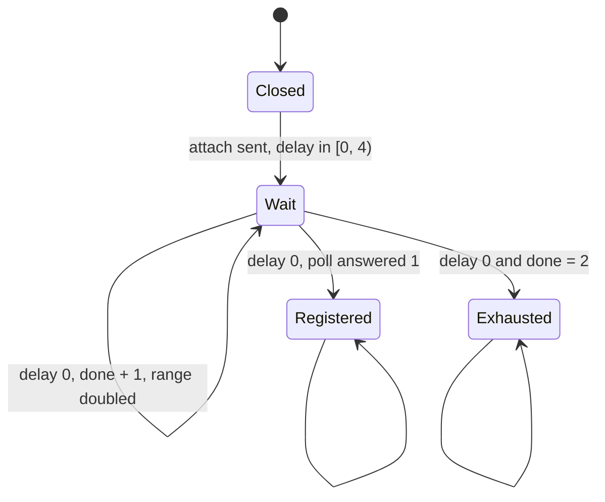
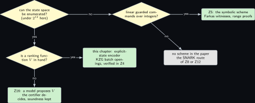
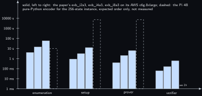

# Project 3. The modem's backoff machine, proved live-free in zero knowledge

> **Board:** Pi 4B with the SIM7020E NB-IoT HAT on the header; no SIM, the AT log is replayed  
> **Language:** Python

> [!IMPORTANT]
> **The question, instanced**
>
> What can a verifier learn from a device without the device revealing itself, and what does it cost on this board? Here the device is the Pi 4B driving the SIM7020E attach machine: a state machine that sends an attach request, waits a random backoff, doubles the backoff on each failure and gives up after three attempts. The verifier learns that the machine never waits forever, and learns nothing about the machine's initial state or its transitions. The cost is the cost of committing to a polynomial of degree 65535 in pure Python.

> **Key facts**
>
> - **Board:** Raspberry Pi 4 Model B Rev 1.4 (8 GB), card A, address \<pi4b\>
> - **Parts:** the SIM7020E NB-IoT HAT on the 40-pin header, its UART on GPIO14 and GPIO15 (header pins 8 and 10) at 115200; no SIM, so the attach machine is exercised against a replayed AT log
> - **Interface:** SSH to the Pi 4B; `/dev/ttyAMA0` to the HAT; a 192-byte proof file handed to [Project 4](04-two-group-elements.md) and [Project 18](18-a-proof-over-the-wire.md)
> - **Language and library:** Python 3.12 or later, the paper's own front-end language \[[1](#references), [2](#references)\]; `py_ecc` for BLS12-381 (version and module names to verify, see the Sources)
> - **Primitive:** the explicit-state scheme's encoder: the Kripke structure, the Buchi automaton of the paper's Figure 2b, the ranking function of its Example 3.4, the three batches of its Equations 7 to 9, the embeddings $`e_1, e_2`$ and the KZG commitments to $`p_{S_0}`$ and $`p_T`$
> - **Secret:** $`S_0`$ and $`T`$ of the modem machine, $`|S_0| = 1`$ and $`|T| = 61`$ (computed)
> - **Public:** $`\phi = \neg\mathrm{FG}\,\mathrm{Wait}`$, the automaton $`\mathcal{A}_{\neg\phi}`$, the ranking function $`V`$, the state space $`S`$ with $`|S| = 256`$ (computed), the commitments $`c_{S_0}, c_T`$ and the proof $`\pi = (\pi_{S_0}, \pi_T)`$
> - **Model:** none
> - **Acceptance:** the proof file is exactly 192 bytes, the prover's and the verifier's batch sizes agree at 16 and 8088 points, every synthetic division leaves remainder zero, and the mutated machine with one fair self-loop is refused by the encoder
> - **Difficulty:** 3 of 5
> - **Effort:** one day for the machine and the batches on the authoring laptop, one day for the commitments on the Pi 4B, most of it waiting for pure Python

## Pitch

The paper's running example is a 3-way handshake with exponential backoff \[[1](#references)\], which is TCP's opening \[[12](#references)\]. The SIM7020E on this bench runs the same shape of machine when it attaches to a network: `AT+CGATT=1`, then a poll of `AT+CGATT?` every second, a random backoff before each retry, a doubled range on each failure, and an exhausted state after the third. A network operator who audits the device may want proof that the device never waits forever, without being told how the device's firmware decides to retry. This chapter is the prover's front end: it writes the machine down as a Kripke structure, enumerates the three batches of hypothetical violations that the public certificate rules out, embeds states and transitions into the scalar field of BLS12-381, commits to the two indicator polynomials under KZG, and produces the two batch openings. The verifier is [Project 4](04-two-group-elements.md); the transport of the 192 bytes over CAN is [Project 18](18-a-proof-over-the-wire.md). Everything here is written in Python because the paper's own encoder is \[[2](#references)\], and every timing cell reads not measured, because a SIM is not on the bench and the pure-Python commitment has not yet run on the board.

## Parts and interface

| **Part** | **Role** | **Interface** | **Address or pin** |
| --- | --- | --- | --- |
| Raspberry Pi 4 Model B | the prover's host: encoder, enumeration, commitments | SSH | \<pi4b\> |
| SIM7020E NB-IoT HAT | the modem whose attach machine is the secret system | UART, 115200, AT commands \[[13](#references)\] | header pins 8 (GPIO14, TXD) and 10 (GPIO15, RXD); 5 V on pins 2 and 4; ground on pin 6 |
| SIM card | absent; the attach never leaves the board | none | none |
| replayed AT log | the stand-in for the network: a text file of `+CGATT` answers fed to the driver | a file on the Pi | `zk03_atlog.txt` |
| `py_ecc` | BLS12-381 arithmetic in pure Python | `pip` in the repository's venv | module `py_ecc.optimized_bls12_381` (to verify) |
| the build laptop, WSL side | authoring checks only; nothing here compiles | LAN | \<build-laptop\> |

## The secret, the statement and the relation

The witness is the pair of polynomials that encode the secret initial states and the secret transition relation, together with the two mask coefficients each of them carries; the statement is the pair of commitments and the three public batches. The paper writes the relation as $`\mathcal{R}_e`$ after its Equation 14 \[[1](#references)\]; with this chapter's sets, and with the commitment written with the arity Definition def:z04\_kzg gives it, it reads

```math
\mathcal{R}_e = \mathsf{PoK}\Big\{\,
    \underbrace{(p_{S_0}, p_T, b_{S_0,0}, b_{S_0,1}, b_{T,0}, b_{T,1})}_{w} ;\;
    \underbrace{(c_{S_0}, c_T, E_{\mathrm{init}}, E_{\mathrm{step}}, E_{\mathrm{fair}})}_{u} \;:\;
    \begin{array}{l}
      \deg p_{S_0} < 256 \;\wedge\; \deg p_T < 2^{16} \\
      \wedge\; \forall e \in E_{\mathrm{init}} .\; p_{S_0}(e) = 0 \;\wedge\;
      \forall e \in E_{\mathrm{step}} \cup E_{\mathrm{fair}} .\; p_T(e) = 0 \\
      \wedge\; \mathsf{Com}\big(p_{S_0} + (b_{S_0,0} + b_{S_0,1} X)(X^{256} - 1)\big) = c_{S_0} \\
      \wedge\; \mathsf{Com}\big(p_T + (b_{T,0} + b_{T,1} X)(X^{2^{16}} - 1)\big) = c_T
    \end{array} \Big\}.
```

*(3.1)*

Two features of the written form are deliberate. The commitment is called with one argument, because $`\mathsf{Com}`$ of Definition def:z04\_kzg is a deterministic function of the polynomial handed to it: all the randomness of this relation lives inside the committed polynomial, as the mask of **Remark Z3.10**, so the witness carries the two mask coefficients of each polynomial and not one opening scalar per polynomial. And the degree bounds belong in the relation because no verifier reads a degree off a single group element, while the soundness argument of [Project 4](04-two-group-elements.md)'s Remark rem:z04\_setup needs them.

**What the relation does not oblige.** Neither conjunct constrains $`p_{S_0}`$ or $`p_T`$ at any point outside the batches, so Equation 3.1 is satisfied by a prover who commits $`p_{S_0} = p_T = 0`$: the zero polynomial vanishes on every set, and the vanishing polynomial of every set divides it. The hypothesis of **Lemma Z3.9**, that $`p_T`$ satisfies the second half of Equation 3.6, is therefore a property of the honest prover's construction below and not an obligation the relation places on a prover. Equation 3.1 is the paper's relation \[[1](#references)\], and what the paper's relation leaves to the encoder is said here rather than left to a reader to notice: the well-formedness of the encoding, that $`p_{S_0}`$ and $`p_T`$ take values in $`\{0, 1\}`$ on the whole interpolation domain, is assumed of the honest prover and is proved nowhere in this volume. Read an accepted proof as a statement about whichever polynomials $`c_{S_0}`$ and $`c_T`$ commit to, and see [Project 4](04-two-group-elements.md) for the same point on the verifier's side.

The specific sets of this project are

```math
\begin{gathered}
\Pi = \{\mathrm{Closed}, \mathrm{Wait}, \mathrm{Registered}, \mathrm{Exhausted}\}, \qquad
  S = \Pi \times \{0, \dots, 15\} \times \{0, 1, 2, 3\}, \qquad |S| = 256, \\
  S_0 = \{(\mathrm{Closed}, 0, 0)\}, \qquad T \subseteq S \times S \text{ with } |T| = 61, \\
  E_{\mathrm{init}} = e_1[B_{\mathrm{init}}] \subset \mathbb{F}_r, \quad
  E_{\mathrm{step}} \cup E_{\mathrm{fair}} = e_2[B_{\mathrm{step}} \cup B_{\mathrm{fair}}] \subset \mathbb{F}_r,
  \quad |E_{\mathrm{init}}| = 16, \quad |E_{\mathrm{step}} \cup E_{\mathrm{fair}}| = 8088,
\end{gathered}
```

where $`\mathbb{F}_r`$ is the scalar field of BLS12-381 and the three cardinalities were computed by the enumeration script on the authoring laptop on Friday 6 November 2026 (the sets $`B_\star`$ are defined in Equations 3.4 to 3.4 below). A state is a triple (mode, delay, done); the mode is one of the four propositions, exclusive; delay is the remaining backoff in poll periods; done is the number of failed attempts. The public state space is deliberately the whole product, 256 triples, although only 33 of them are reachable (computed): the verifier must not learn which, and the batches are enumerated over all of $`S`$ and all of $`S \times S`$.

## The mathematics

**Definition Z3.1 (State transition system, execution, trace, language).** Let $`\Pi`$ be a finite set of atomic propositions and $`\Sigma = 2^\Pi`$. A state transition system is $`\mathcal{M} = (S, S_0, T, \langle\!\langle \cdot \rangle\!\rangle)`$ with a state space $`S`$, initial states $`S_0 \subseteq S`$, a transition relation $`T \subseteq S \times S`$ and an observation function $`\langle\!\langle \cdot \rangle\!\rangle : S \to \Sigma`$. An execution is a sequence $`(s_i)_{i \in \mathbb{N}}`$ with $`s_0 \in S_0`$ and $`(s_i, s_{i+1}) \in T`$ for every $`i \in \mathbb{N}`$; its trace is $`(\langle\!\langle s_i \rangle\!\rangle)_{i \in \mathbb{N}} \in \Sigma^\omega`$; the language $`\mathcal{L}_\mathcal{M} \subseteq \Sigma^\omega`$ is the set of traces of all executions \[[1](#references), [7](#references)\].

**Definition Z3.2 (Nondeterministic Buchi automaton and acceptance).** An automaton is $`\mathcal{A} = (Q, Q_0, \delta, F)`$ with finite $`Q`$, $`Q_0 \subseteq Q`$, $`\delta \subseteq Q \times \Sigma \times Q`$ and fair transitions $`F \subseteq \delta`$. A run of $`\mathcal{A}`$ on $`\sigma = (\sigma_i)_{i \in \mathbb{N}}`$ is a sequence $`(q_i)_{i \in \mathbb{N}}`$ with $`q_0 \in Q_0`$ and $`(q_i, \sigma_i, q_{i+1}) \in \delta`$ for every $`i`$; it is accepting if $`\{\, i \in \mathbb{N} \mid (q_i, \sigma_i, q_{i+1}) \in F \,\}`$ is infinite, which the paper writes as $`\sum_{i=0}^{\infty} \mathbf{1}_F(q_i, \sigma_i, q_{i+1}) = \infty`$. The language $`\mathcal{L}_\mathcal{A}`$ is the set of $`\sigma \in \Sigma^\omega`$ that have an accepting run \[[5](#references), [6](#references)\].

**Definition Z3.3 (Synchronous composition and fair execution).** A fair execution of the synchronous composition of $`\mathcal{M}`$ and $`\mathcal{A}`$ is a sequence $`((s_i, q_i))_{i \in \mathbb{N}}`$ over $`S \times Q`$ such that (i) $`s_0 \in S_0`$ and $`q_0 \in Q_0`$, (ii) $`(s_i, s_{i+1}) \in T`$ and $`(q_i, \langle\!\langle s_i \rangle\!\rangle, q_{i+1}) \in \delta`$ for every $`i`$, and (iii) $`\{\, i \mid (q_i, \langle\!\langle s_i \rangle\!\rangle, q_{i+1}) \in F \,\}`$ is infinite. By Definitions **Definition Z3.1** and **Definition Z3.2**, a trace lies in $`\mathcal{L}_\mathcal{M} \cap \mathcal{L}_\mathcal{A}`$ exactly when it is the trace of the $`S`$-component of a fair execution of the composition: the execution supplies the $`s_i`$, the accepting run supplies the $`q_i`$, and the two conditions read on the same letters $`\sigma_i = \langle\!\langle s_i \rangle\!\rangle`$.

**Definition Z3.4 (The modem machine, instanced).** Let $`\Pi`$ and $`S`$ be as above, with $`\langle\!\langle (m, d, n) \rangle\!\rangle = \{m\}`$, $`S_0 = \{(\mathrm{Closed}, 0, 0)\}`$, and let $`T`$ be the union of the following sets, with $`D_0 = 4`$ the initial backoff range and $`D_n = D_0 \cdot 2^n`$:

```math
\begin{aligned}
&\{\,((\mathrm{Closed}, 0, 0), (\mathrm{Wait}, d, 0)) \mid 0 \le d < D_0\,\} &&\text{attach sent, backoff drawn}\\
  &\{\,((\mathrm{Wait}, d, n), (\mathrm{Wait}, d - 1, n)) \mid 0 \le n \le 2,\; 1 \le d < D_n\,\} &&\text{a poll answered 0}\\
  &\{\,((\mathrm{Wait}, 0, n), (\mathrm{Registered}, 0, n)) \mid 0 \le n \le 2\,\} &&\text{a poll answered 1}\\
  &\{\,((\mathrm{Wait}, 0, n), (\mathrm{Wait}, d, n + 1)) \mid 0 \le n \le 1,\; 0 \le d < D_{n+1}\,\} &&\text{retry, range doubled}\\
  &\{\,((\mathrm{Wait}, 0, 2), (\mathrm{Exhausted}, 0, 3))\,\} &&\text{third failure}\\
  &\{\,((\mathrm{Registered}, 0, n), (\mathrm{Registered}, 0, n)) \mid 0 \le n \le 2\,\} \cup
    \{\,((\mathrm{Exhausted}, 0, 3), (\mathrm{Exhausted}, 0, 3))\,\} &&\text{absorbing}
\end{aligned}
```

Counting: $`4 + (3 + 7 + 15) + 3 + (8 + 16) + 1 + 4 = 61`$. The automaton for $`\neg\phi = \mathrm{FG}\,\mathrm{Wait}`$ is the paper's Figure 2b: $`Q = \{q_0, q_1\}`$, $`Q_0 = \{q_0\}`$, $`\delta = \{(q_0, \sigma, q_0) \mid \sigma \in \Sigma\} \cup \{(q_0, \sigma, q_1), (q_1, \sigma, q_1) \mid \mathrm{Wait} \in \sigma\}`$ and $`F = \{(q_1, \sigma, q_1) \mid \mathrm{Wait} \in \sigma\}`$. The ranking function is the paper's Example 3.4 with its $`2^8`$ read as $`2^4 = 16`$, the largest backoff range here:

```math
V(s, q_1) = \begin{cases}
    3 \cdot 2^4 & \text{if Closed}\\
    2^5 + 1 - 2^4 \cdot \mathrm{done} + \mathrm{delay} & \text{if Wait} \wedge \mathrm{done} \le 2\\
    0 & \text{if Registered or Exhausted}\\
    +\infty & \text{if Wait} \wedge \mathrm{done} = 3
  \end{cases}
  \qquad
  V(s, q_0) = \begin{cases}
    +\infty & \text{if Wait} \wedge \mathrm{done} = 3\\
    3 \cdot 2^4 & \text{otherwise.}
  \end{cases}
```

*(3.2)*

**Theorem Z3.5 (Ranking functions certify emptiness; the paper's Theorem 3.2).** Let $`\Sigma`$ be finite, $`\mathcal{M} = (S, S_0, T, \langle\!\langle \cdot \rangle\!\rangle)`$ a state transition system and $`\mathcal{A} = (Q, Q_0, \delta, F)`$ a nondeterministic Buchi automaton. Suppose $`V : S \times Q \to \mathbb{N} \cup \{+\infty\}`$ satisfies, for every $`s, s' \in S`$ and $`q, q' \in Q`$,

```math
\begin{aligned}
s \in S_0 &\implies \big(q \in Q_0 \implies V(s, q) \ne \infty\big), \\
  (s, s') \in T &\implies \big(V(s, q) \ne \infty \wedge (q, \langle\!\langle s \rangle\!\rangle, q') \in \delta
    \implies V(s, q) \ge V(s', q')\big), \\
  (s, s') \in T &\implies \big(V(s, q) \ne \infty \wedge (q, \langle\!\langle s \rangle\!\rangle, q') \in F
    \implies V(s, q) > V(s', q')\big),
\end{aligned}
```

*(3.3)*

which are the paper's Equations 4, 5 and 6 \[[1](#references)\]. Then $`\mathcal{L}_\mathcal{M} \cap \mathcal{L}_\mathcal{A} = \emptyset`$.

*Proof.* Suppose, for a contradiction, that $`\sigma \in \mathcal{L}_\mathcal{M} \cap \mathcal{L}_\mathcal{A}`$. By **Definition Z3.3** there is a fair execution $`((s_i, q_i))_{i \in \mathbb{N}}`$ of the composition whose $`S`$-component has trace $`\sigma`$: $`s_0 \in S_0`$, $`q_0 \in Q_0`$, $`(s_i, s_{i+1}) \in T`$ and $`(q_i, \langle\!\langle s_i \rangle\!\rangle, q_{i+1}) \in \delta`$ for all $`i`$, and the set $`I = \{\, i \mid (q_i, \langle\!\langle s_i \rangle\!\rangle, q_{i+1}) \in F \,\}`$ is infinite. Write $`v_i = V(s_i, q_i)`$.

Step 1, the base case. Since $`s_0 \in S_0`$ and $`q_0 \in Q_0`$, condition (3.3) gives $`v_0 \ne \infty`$, so $`v_0 \in \mathbb{N}`$.

Step 2, finiteness and monotonicity. We show by induction on $`i`$ that $`v_i \in \mathbb{N}`$ and $`v_{i+1} \le v_i`$. The base $`v_0 \in \mathbb{N}`$ is Step 1. Assume $`v_i \in \mathbb{N}`$. Then $`(s_i, s_{i+1}) \in T`$, $`v_i = V(s_i, q_i) \ne \infty`$ and $`(q_i, \langle\!\langle s_i \rangle\!\rangle, q_{i+1}) \in \delta`$, so condition (3.3) with $`s = s_i`$, $`s' = s_{i+1}`$, $`q = q_i`$, $`q' = q_{i+1}`$ gives $`v_i \ge v_{i+1}`$. Because $`v_i \in \mathbb{N}`$ and no element of $`\mathbb{N}`$ is at least $`+\infty`$, $`v_{i+1} \ne \infty`$, hence $`v_{i+1} \in \mathbb{N}`$, which closes the induction. So $`(v_i)_{i \in \mathbb{N}}`$ is a non-increasing sequence of natural numbers.

Step 3, strict decrease on fair indices. Let $`i \in I`$. Then $`(q_i, \langle\!\langle s_i \rangle\!\rangle, q_{i+1}) \in F`$, $`(s_i, s_{i+1}) \in T`$ and $`v_i \ne \infty`$ by Step 2, so condition (3.3) gives $`v_i > v_{i+1}`$, that is, $`v_{i+1} \le v_i - 1`$ in $`\mathbb{N}`$.

Step 4, the descent. Enumerate $`I`$ in increasing order as $`i_0 < i_1 < i_2 < \cdots`$, which is possible because $`I`$ is infinite. For every $`k`$, Step 3 gives $`v_{i_k + 1} \le v_{i_k} - 1`$, and Step 2 applied along the indices $`i_k + 1 \le i_{k+1}`$ gives $`v_{i_{k+1}} \le v_{i_k + 1}`$. Together, $`v_{i_{k+1}} \le v_{i_k} - 1`$. By induction on $`k`$, $`v_{i_k} \le v_{i_0} - k`$ for every $`k \in \mathbb{N}`$. Take $`k = v_{i_0} + 1`$: then $`v_{i_k} \le -1`$, which contradicts $`v_{i_k} \in \mathbb{N}`$. Hence no such $`\sigma`$ exists and $`\mathcal{L}_\mathcal{M} \cap \mathcal{L}_\mathcal{A} = \emptyset`$. &#9632;

**Corollary Z3.6 (The paper's Corollary 3.3).** If $`\mathcal{A} = \mathcal{A}_{\neg\phi}`$ recognises $`\mathcal{L}_{\neg\phi} = \Sigma^\omega \setminus \mathcal{L}_\phi`$ and $`V`$ satisfies (3.3) to (3.3), then $`\mathcal{M} \models \phi`$.

*Proof.* By **Theorem Z3.5**, $`\mathcal{L}_\mathcal{M} \cap \mathcal{L}_{\neg\phi} = \emptyset`$, so every trace of $`\mathcal{M}`$ lies outside $`\Sigma^\omega \setminus \mathcal{L}_\phi`$, that is, inside $`\mathcal{L}_\phi`$; and $`\mathcal{L}_\mathcal{M} \subseteq \mathcal{L}_\phi`$ is the definition of $`\mathcal{M} \models \phi`$. &#9632;

The certifier does not check (3.3) to (3.3) on the secret $`S_0`$ and $`T`$ directly; it negates the consequents and enumerates, from public data only, the states and transitions that would violate them. These are the paper's Equations 7, 8 and 9:

```math
\begin{aligned}
B_{\mathrm{init}} &= \{\, s \in S \mid \exists q \in Q_0 .\; V(s, q) = \infty \,\}, \\
  B_{\mathrm{step}} &= \{\, (s, s') \in S \times S \mid \exists q, q' .\; V(s, q) \ne \infty \wedge
    (q, \langle\!\langle s \rangle\!\rangle, q') \in \delta \wedge V(s, q) < V(s', q') \,\}, \\
  B_{\mathrm{fair}} &= \{\, (s, s') \in S \times S \mid \exists q, q' .\; V(s, q) \ne \infty \wedge
    (q, \langle\!\langle s \rangle\!\rangle, q') \in F \wedge V(s, q) \le V(s', q') \,\},
\end{aligned}
```

*(3.4)*

where $`V(s, q) < \infty`$ holds for every finite $`V(s, q)`$. The three conditions of the theorem hold exactly when (the paper's Equation 10)

```math
S_0 \cap B_{\mathrm{init}} = \emptyset, \qquad T \cap B_{\mathrm{step}} = \emptyset, \qquad
  T \cap B_{\mathrm{fair}} = \emptyset .
```

*(3.5)*

For the modem machine the enumeration computed $`|B_{\mathrm{init}}| = 16`$ (the sixteen states Wait with done $`= 3`$), $`|B_{\mathrm{step}}| = 7976`$, $`|B_{\mathrm{fair}}| = 5016`$, $`|B_{\mathrm{step}} \cup B_{\mathrm{fair}}| = 8088`$, and all three intersections empty, on Friday 6 November 2026; so **Corollary Z3.6** applies and the modem never waits forever.

**Definition Z3.7 (Embeddings and indicator polynomials).** Let $`r`$ be the order of the BLS12-381 scalar field $`\mathbb{F}_r`$; $`2^{32}`$ divides $`r - 1`$. Let $`\omega_1`$ be a primitive $`256`$-th and $`\omega_2`$ a primitive $`2^{16}`$-th root of unity in $`\mathbb{F}_r`$, and let $`\mathrm{idx} : S \to \{0, \dots, 255\}`$ be the bijection $`\mathrm{idx}(m, d, n) = 64\, m + 4\, d + n`$ with the modes numbered 0 to 3. The embeddings are

```math
e_1(s) = \omega_1^{\mathrm{idx}(s)}, \qquad
  e_2(s, s') = \omega_2^{\mathrm{idx}(s) + 256\, \mathrm{idx}(s')},
```

both injective because the exponents are distinct and smaller than the orders. The indicator polynomials are any $`p_{S_0}, p_T \in \mathbb{F}_r[X]`$ with (the paper's Equations 11 and 12)

```math
\forall s \in S .\; \mathbf{1}_{S_0}(s) = p_{S_0}(e_1(s)), \qquad
  \forall (s, s') \in S \times S .\; \mathbf{1}_T(s, s') = p_T(e_2(s, s')).
```

*(3.6)*

The public evaluation sets are $`E_{\mathrm{init}} = e_1[B_{\mathrm{init}}]`$, $`E_{\mathrm{step}} = e_2[B_{\mathrm{step}}]`$ and $`E_{\mathrm{fair}} = e_2[B_{\mathrm{fair}}]`$.

**Lemma Z3.8 (Lagrange basis over the roots of unity).** Let $`n`$ be a power of two, $`\omega`$ a primitive $`n`$-th root of unity in $`\mathbb{F}_r`$, and for $`0 \le j < n`$ let $`L_j(X) = n^{-1} \sum_{i=0}^{n-1} \omega^{-ij} X^i`$. Then $`L_j(\omega^k) = 1`$ if $`k = j`$ and $`L_j(\omega^k) = 0`$ if $`k \ne j`$, for $`0 \le k < n`$. Consequently, for any $`J \subseteq \{0, \dots, n-1\}`$, the polynomial $`\sum_{j \in J} L_j`$ has degree below $`n`$ and takes the value $`1`$ on $`\{\omega^j \mid j \in J\}`$ and $`0`$ on the other $`n`$-th roots of unity.

*Proof.* $`n`$ is invertible in $`\mathbb{F}_r`$ because $`r`$ is odd and $`n`$ is a power of two. Fix $`j, k`$ and put $`\zeta = \omega^{k - j}`$. Then $`L_j(\omega^k) = n^{-1} \sum_{i=0}^{n-1} \omega^{-ij} \omega^{ik} = n^{-1} \sum_{i=0}^{n-1} \zeta^i`$. If $`k = j`$ then $`\zeta = 1`$, every term is $`1`$, the sum is $`n`$ and $`L_j(\omega^j) = 1`$. If $`k \ne j`$ then $`0 < |k - j| < n`$, so $`\zeta \ne 1`$ because $`\omega`$ is primitive, while $`\zeta^n = \omega^{n(k-j)} = 1`$; multiplying the sum by $`\zeta - 1 \ne 0`$ telescopes it to $`\zeta^n - 1 = 0`$, so the sum is $`0`$ and $`L_j(\omega^k) = 0`$. The consequence follows by summing the $`L_j`$ over $`j \in J`$: at $`\omega^k`$ exactly one summand is $`1`$ when $`k \in J`$ and none otherwise, and the degree of every $`L_j`$ is at most $`n - 1`$. &#9632;

With $`n = 256`$, $`\omega = \omega_1`$ and $`J = \mathrm{idx}[S_0]`$ the lemma produces $`p_{S_0}`$; with $`n = 2^{16}`$, $`\omega = \omega_2`$ and $`J = \{\mathrm{idx}(s) + 256\,\mathrm{idx}(s') \mid (s, s') \in T\}`$ it produces $`p_T`$, of degree at most $`65535`$. This is the construction the code below performs, and it is why the embeddings are roots of unity rather than the integers $`1`$ to $`256`$: the basis has a closed form and no linear system is solved.

**Lemma Z3.9 (Vanishing is disjointness).** Let $`e_2`$ be injective and let $`p_T`$ satisfy the second half of (3.6). Let $`B = B_{\mathrm{step}} \cup B_{\mathrm{fair}}`$ and $`E = e_2[B]`$. Then $`\forall e \in E .\; p_T(e) = 0`$ if and only if $`T \cap B = \emptyset`$. The same holds for $`p_{S_0}`$, $`e_1`$, $`B_{\mathrm{init}}`$ and $`E_{\mathrm{init}}`$.

*Proof.* Only if. Suppose $`p_T`$ vanishes on $`E`$ and, for a contradiction, that $`(s, s') \in T \cap B`$. Then $`e_2(s, s') \in E`$, so $`p_T(e_2(s, s')) = 0`$. But by (3.6), $`p_T(e_2(s, s')) = \mathbf{1}_T(s, s') = 1`$ because $`(s, s') \in T`$, and $`1 \ne 0`$ in a field. Hence $`T \cap B = \emptyset`$.

If. Suppose $`T \cap B = \emptyset`$ and let $`e \in E`$. By definition of the image there is $`(s, s') \in B`$ with $`e = e_2(s, s')`$, and by injectivity it is the only pair in $`S \times S`$ with that image, so (3.6) speaks about this pair and no other: $`p_T(e) = p_T(e_2(s, s')) = \mathbf{1}_T(s, s')`$. Since $`(s, s') \in B`$ and $`T \cap B = \emptyset`$, $`(s, s') \notin T`$ and $`\mathbf{1}_T(s, s') = 0`$. So $`p_T(e) = 0`$ for every $`e \in E`$. Injectivity is also what makes a $`p_T`$ with (3.6) exist at all: **Lemma Z3.8** interpolates one value per distinct point, and two pairs with the same image but different indicator values would admit no polynomial. &#9632;

**Remark Z3.10 (Blinding, and what this chapter does not prove).** A KZG commitment $`g_1^{p(\tau)}`$ to the plain indicator polynomial is binding \[[3](#references)\] but not hiding: with $`|S| = 256`$ a verifier could guess a transition relation, recompute its polynomial and compare commitments. The code adds to each polynomial the mask $`(b_0 + b_1 X)(X^n - 1)`$ with $`b_0, b_1`$ uniform in $`\mathbb{F}_r`$, the technique PLONK uses to blind its wire polynomials \[[4](#references)\]. The mask vanishes on every $`n`$-th root of unity, so (3.6) is unchanged, $`E \subset`$ the domain is still a set of roots, and the batch division of [Project 4](04-two-group-elements.md) stays exact. The hiding argument is short enough to write out. Write $`W = (X^{n} - 1) / Z_E`$, which is a polynomial because $`E`$ is a subset of the $`n`$-th roots of unity, and let $`q_0 = p_0 / Z_E`$ for the unmasked indicator $`p_0`$. The masked polynomial is $`p = p_0 + (b_0 + b_1 X)(X^{n} - 1)`$ and its quotient is $`q = q_0 + (b_0 + b_1 X) W`$, so the verifier's whole view of this polynomial is the pair

```math
\big(c, \pi\big) = \Big( g_1^{\,p_0(\tau) + (b_0 + b_1\tau) (\tau^{n} - 1)},\;
  g_1^{\,q_0(\tau) + (b_0 + b_1\tau) W(\tau)} \Big).
```

Both exponents are affine in the single scalar $`\beta = b_0 + b_1 \tau`$, and the second is the first divided by $`Z_E(\tau)`$, so $`\pi`$ is a deterministic function of $`c`$ and of public data: the view is the one group element $`c`$. If $`\tau^{n} \ne 1`$, which holds except with probability $`n / r`$ over an honest setup, the map $`b_0 \mapsto \beta (\tau^{n} - 1)`$ is a bijection of $`\mathbb{F}_r`$, so $`c`$ is uniform on $`\mathbb{G}_1`$ whatever $`p_0`$ is, and the view is perfectly hiding. The second mask coefficient $`b_1`$ is therefore not needed for one batch opening; $`b_0 (X^{n} - 1)`$ alone suffices and costs one setup power fewer. This volume keeps $`b_1`$ all the same, because dropping it moves the blinded degree from $`65537`$ to $`65536`$, and that changes the setup size, the $`65538`$ $`\mathbb{G}_1`$ powers in [Project 4](04-two-group-elements.md)'s parts table and the pitfall below that turns on the two mask terms: four places, not one line. The paper's own scheme uses a Pedersen-style randomisation of KZG instead, which does not need $`E`$ to lie in the interpolation domain \[[1](#references)\].

## The protocol

The paper's Figure 3, rewritten with this machine's numbers. The setup is shared by both columns; on this bench it is a toy setup whose $`\tau`$ is drawn from `/dev/urandom` by the prover's own script and printed to the setup file, which is why the proof convinces nobody but the bench, see [Project 4](04-two-group-elements.md).

| **Prover (Pi 4B, Python)** | **Verifier ([Project 4](04-two-group-elements.md), C)** |
| --- | --- |
| Input: secret $`S_0`$ ($`1`$ state), $`T`$ ($`61`$ pairs); common input: $`S`$ ($`256`$ states), the automaton ($`2`$ states, $`3`$ transition shapes), $`V`$, the setup ($`65538`$ powers in $`\mathbb{G}_1`$, $`8089`$ in $`\mathbb{G}_2`$) | Input: the common input only |
| Compute $`B_{\mathrm{init}}, B_{\mathrm{step}}, B_{\mathrm{fair}}`$ from $`V`$, $`\delta`$, $`F`$ over $`S`$ and $`S \times S`$: $`16`$, $`7976`$ and $`5016`$ members | The same enumeration, independently: the sizes must agree or the verifier stops |
| Embed: $`E_{\mathrm{init}}`$ ($`16`$ points), $`E_{\mathrm{step}} \cup E_{\mathrm{fair}}`$ ($`8088`$ points) | Embed the same way |
| $`p_{S_0} \leftarrow \sum_{j \in \mathrm{idx}[S_0]} L_j`$ over $`\omega_1`$, degree $`< 256`$, blinded to degree $`257`$; $`p_T \leftarrow \sum L_j`$ over $`\omega_2`$, blinded to degree $`65537`$ |  |
| $`c_{S_0} \leftarrow g_1^{p_{S_0}(\tau)}`$, $`c_T \leftarrow g_1^{p_T(\tau)}`$: two multi-scalar multiplications, $`258`$ and $`65538`$ terms | receive $`c_\mathcal{M} = (c_{S_0}, c_T)`$, $`96`$ bytes (computed: two compressed $`\mathbb{G}_1`$ elements of $`48`$ bytes) |
| $`\pi_{S_0} \leftarrow g_1^{q_{S_0}(\tau)}`$ with $`q_{S_0} = p_{S_0} / Z_{E_{\mathrm{init}}}`$; $`\pi_T \leftarrow g_1^{q_T(\tau)}`$ with $`q_T = p_T / Z_{E_{\mathrm{step}} \cup E_{\mathrm{fair}}}`$, each division by synthetic division root by root, every remainder checked to be $`0`$ | receive $`\pi = (\pi_{S_0}, \pi_T)`$, $`96`$ bytes |
| send the file $`c_{S_0} \Vert c_T \Vert \pi_{S_0} \Vert \pi_T`$, $`192`$ bytes (computed) | check $`e(c_{S_0}, g_2) = e(\pi_{S_0}, g_2^{Z_{E_{\mathrm{init}}}(\tau)})`$ and $`e(c_T, g_2) = e(\pi_T, g_2^{Z_{E_{\mathrm{step}} \cup E_{\mathrm{fair}}}(\tau)})`$; accept iff both hold |

## The code

The encoder prints the three batch sizes before it touches the curve, so that a run on the Pi 4B can be compared with the enumeration on the authoring laptop before the long part starts. Module and function names of `py_ecc` are marked to verify in the prose: `py_ecc.optimized_bls12_381` exports `G1`, `Z1`, `add`, `multiply` and `curve_order` (to verify), and `py_ecc.bls.point_compression` exports `compress_G1` returning an integer in the 48-byte compressed encoding that `blst_p1_uncompress` reads (to verify). The generator $`7`$ of $`\mathbb{F}_r^\times`$, from which both roots of unity are derived, is the one arkworks prints for this field (to verify). The setup reader `read_setup` lives in a 20-line companion file that is not printed.

```python
"""zk03_encode.py: the modem's attach machine, the batches of Equations 7 to 9,
the embeddings, two blinded KZG commitments, two batch openings. Output: 192 bytes."""
import itertools, os
from py_ecc.optimized_bls12_381 import G1, Z1, add, multiply, curve_order as r
from py_ecc.bls.point_compression import compress_G1
from zk03_setup import read_setup

MODES = ("Closed", "Wait", "Registered", "Exhausted")
D0, ATTEMPTS = 4, 3                      # initial backoff range 4, three attempts
DMAX = D0 << (ATTEMPTS - 1)              # 16: the public delay range is [0, DMAX)
S = [(m, d, n) for m in MODES for d in range(DMAX) for n in range(4)]   # |S| = 256
IDX = {s: i for i, s in enumerate(S)}; INF = None   # idx = 64 m + 4 d + n; INF is +infinity

def V(s, q):                             # Example 3.4 with 2^8 read as DMAX = 2^4
    m, d, n = s
    if m == "Wait" and n == 3: return INF
    if q == 0 or m == "Closed": return 3 * DMAX
    return 2 * DMAX + 1 - DMAX * n + d if m == "Wait" else 0

def delta(q, s):                         # Figure 2b: q0 loops on true; Wait leads to q1
    return ([0] if q == 0 else []) + ([1] if s[0] == "Wait" else [])
FAIR = {(1, 1)}                          # the self loop on q1 is the only fair transition

def secret_T():                          # the prover's T; the verifier never sees this
    T = {(("Closed", 0, 0), ("Wait", d, 0)) for d in range(D0)}
    T |= {(("Wait", 0, ATTEMPTS - 1), ("Exhausted", 0, 3)), (("Exhausted", 0, 3),) * 2}
    for n in range(ATTEMPTS):
        T |= {(("Wait", d, n), ("Wait", d - 1, n)) for d in range(1, D0 << n)}
        T |= {(("Wait", 0, n), ("Registered", 0, n)), (("Registered", 0, n),) * 2}
        if n + 1 < ATTEMPTS:
            T |= {(("Wait", 0, n), ("Wait", d, n + 1)) for d in range(D0 << (n + 1))}
    return T
S0 = {("Closed", 0, 0)}

def batches():                           # Equations 7 to 9, from public data only
    b_init = {s for s in S if V(s, 0) is INF}
    b_step, b_fair = set(), set()
    for s, t in itertools.product(S, S):
        for q in (0, 1):
            v = V(s, q)
            if v is INF: continue
            for q2 in delta(q, s):
                w = V(t, q2)
                if w is INF or v < w: b_step.add((s, t))
                if (q, q2) in FAIR and (w is INF or v <= w): b_fair.add((s, t))
    return b_init, b_step, b_fair

W1, W2 = pow(7, (r - 1) // 256, r), pow(7, (r - 1) // 65536, r)   # 7 generates F_r^*: verify
e1 = lambda s: pow(W1, IDX[s], r)
e2 = lambda s, t: pow(W2, IDX[s] + 256 * IDX[t], r)

def indicator_poly(J, n, w):             # sum over j in J of L_j, Lemma Lagrange basis
    steps = [pow(w, -j, r) for j in J]; cur = [1] * len(J); ninv = pow(n, -1, r); a = []
    for _ in range(n):                   # coefficient i is (1/n) sum_j w^(-ij)
        a.append(ninv * sum(cur) % r); cur = [c * st % r for c, st in zip(cur, steps)]
    return a

def blind(p, n):                         # add (b0 + b1 X)(X^n - 1): same values on the domain
    b0, b1 = (int.from_bytes(os.urandom(32), "big") % r for _ in range(2))
    p = p + [0, 0]; p[0] = (p[0] - b0) % r; p[1] = (p[1] - b1) % r
    p[n] = (p[n] + b0) % r; p[n + 1] = (p[n + 1] + b1) % r; return p

def div_root(p, e):                      # p = (X - e) q + rem by synthetic division
    q, acc = [0] * (len(p) - 1), 0
    for k in range(len(p) - 1, 0, -1):
        acc = (acc * e + p[k]) % r; q[k - 1] = acc
    return q, (acc * e + p[0]) % r

def commit(p, srs):                      # g1^p(tau) as a multi-scalar multiplication
    c = Z1
    for a, g in zip(p, srs):
        if a: c = add(c, multiply(g, a))
    return c

def open_batch(p, E, srs):
    for e in E:
        p, rem = div_root(p, e); assert rem == 0, "p does not vanish on E: refused"
    return commit(p, srs)

if __name__ == "__main__":
    b_init, b_step, b_fair = batches()
    print("zk03 batches", len(b_init), len(b_step), len(b_fair), len(b_step | b_fair))
    srs, _, _ = read_setup("zk03_setup.bin"); T = secret_T()   # 65538 powers of tau in G1
    e_init = [e1(s) for s in b_init]; e_tr = [e2(s, t) for (s, t) in b_step | b_fair]
    p_s0 = blind(indicator_poly([IDX[s] for s in S0], 256, W1), 256)
    p_t = blind(indicator_poly([IDX[s] + 256 * IDX[t] for (s, t) in T], 65536, W2), 65536)
    c_s0, c_t = commit(p_s0, srs), commit(p_t, srs)
    pi_s0, pi_t = open_batch(p_s0, e_init, srs), open_batch(p_t, e_tr, srs)
    out = b"".join(compress_G1(x).to_bytes(48, "big") for x in (c_s0, c_t, pi_s0, pi_t))
    open("zk03_proof.bin", "wb").write(out); print("zk03 proof bytes", len(out))
```

```bash
# Pi 4B over ssh, in the repository's venv; the setup runs once and takes long in pure Python
cd ~/zk-bench/zk03 && source ../.venv/bin/activate
python zk03_setup.py 65538 8089 > zk03_setup.log      # toy tau, G1 and G2 powers, omega
python zk03_encode.py | tee zk03_encode.log           # prints the batch sizes first
ls -l zk03_proof.bin                                  # must read 192
```

## The model, if any

None. The ranking function is the paper's, scaled; [Project 16](16-the-model-proposes-a-ranking-function-the-certifier.md) is where a model proposes one.

## Real, modelled, absent

- **have:** real: the Pi 4B, the SIM7020E HAT seated on its header, the enumeration of the three batches and the check of Equation (3.5), computed on the authoring laptop on Friday 6 November 2026 in 0.09 s by `time.time` around the call; the Lagrange basis, the synthetic division and the blinding checked on a 97-element field by the same script
- **learn:** modelled: the attach machine runs against a replayed AT log, a text file of `+CGATT: 0` and `+CGATT: 1` answers, because no SIM is on the bench; the setup is a toy whose $`\tau`$ is known to the script; every timing bar in the benchmark figure that is not the paper's is the order of magnitude pure Python is expected to take and is drawn dashed; the `py_ecc` names are to verify against the installed version
- **absent:** absent: a SIM, so the machine never attaches to a network and the AT log is replayed; a multi-party setup ceremony, so the commitment binds only against a prover who does not read the setup log; the paper's Rust back-end \[[2](#references)\], which this chapter does not use so that every line of the encoder is on the page

## System architecture



*Figure 3.1. The explicit-state pipeline, prover side. On the left a stop-outlined secret block holding $`S_0`$ and $`T`$ (real and hidden) and a dashed block for the replayed AT log that exercises the same machine. In the middle the Python encoder on the Pi 4B, outlined as the prover; above it a grey public block with the certificate (the automaton, $`V`$, the state space $`S`$); the encoder emits two kernel-blue commitment blocks, $`c_{S_0}`$ and $`c_T`$, and two more for $`\pi_{S_0}`$ and $`\pi_T`$, joined into one grey 192-byte proof file. On the right the verifier of [Project 4](04-two-group-elements.md) in its green outline reading the file and the same certificate, and below it the CAN transport of [Project 18](18-a-proof-over-the-wire.md) as a grey external block. At the bottom the SIM7020E HAT as a solid hardware block with the SIM beside it as a dotted absent block.*

Read the figure as two copies of the same enumeration, one on each side of the proof file. The prover's side holds the only secret; the verifier's side holds everything else twice, once from the certificate and once recomputed, and the two must agree before a pairing is evaluated.

## Wiring



*Figure 3.2. The SIM7020E HAT on the Pi 4B header. The Pi 4B as a solid hardware block on the left with five header pins called out: pin 2 (5 V), pin 4 (5 V), pin 6 (ground), pin 8 (GPIO14, TXD) and pin 10 (GPIO15, RXD). The HAT as a solid hardware block on the right with its UART RXD, TXD, 5 V and ground lines drawn across to those pins; the HAT's UART selection jumpers are noted as to verify against the Waveshare wiki. Below the HAT, a dotted absent block for the SIM and a dashed modelled block for the replayed AT log that enters the driver in place of the modem's answers.*

| **Signal** | **From** | **To** | **Note** |
| --- | --- | --- | --- |
| TXD | Pi GPIO14, header pin 8 | HAT UART RXD | the Pi transmits AT commands; the HAT's jumper block must select the Pi UART and not the USB bridge (to verify in \[[13](#references)\]) |
| RXD | HAT UART TXD | Pi GPIO15, header pin 10 | the modem's answers; with no SIM the attach answers `+CGATT: 0` forever, which is itself a trace of the machine |
| 5 V | header pins 2 and 4 | HAT supply | the NB-IoT module's transmit peaks are far below the 4G HAT's; the HAT is seated, never on flying leads |
| ground | header pin 6 | HAT ground | through the header |
| PWRKEY | a GPIO named on the HAT's silkscreen | the module's power key | pulse length and pin to verify in \[[13](#references)\]; the driver does not assume one |

On the Pi 4B the primary UART on GPIO14 and GPIO15 is `/dev/ttyAMA0` only when `enable_uart=1` is set and Bluetooth is moved off the PL011 with `dtoverlay=disable-bt`; the serial console must be removed from `cmdline.txt` or the console reads the modem's answers before the driver does.

## Sequence and states

```mermaid
sequenceDiagram
  participant L as AT log (replayed)
  participant M as modem machine (secret)
  participant E as encoder, Pi 4B
  participant V as verifier (Z4)
  L->>M: +CGATT: 0 ... +CGATT: 1
  M->>M: Closed, Wait(d, n), Registered
  E->>E: enumerate B_init, B_step, B_fair (16, 7976, 5016)
  E->>E: embed, interpolate p_S0 and p_T, blind
  E->>E: commit c_S0, c_T; open on E_init, E_step u E_fair
  E->>V: zk03_proof.bin, 192 bytes
  V->>V: enumerate the same batches, compare sizes
  V->>E: accept or reject (Z4)
```



## Decision tree



*Figure 3.3. Which scheme encodes which system. The root diamond asks whether the state space can be enumerated, under $`2^{12}`$ states on this bench; yes leads to a second diamond asking whether a ranking function is already in hand; yes leads to the leaf for this chapter, the explicit-state encoder with KZG batch openings, no leads to the leaf for [Project 16](16-the-model-proposes-a-ranking-function-the-certifier.md) where a model proposes one and the certifier decides. No at the root leads to a third diamond asking whether the system is linear guarded commands; yes leads to the symbolic scheme of [Project 5](05-farkas-witnesses-for-a-joystick-program.md), no to a grey leaf saying that the paper has no scheme for it and naming the SNARK route of [Project 8](08-a-ranking-function-as-a-circuit.md).*

## Benchmark



*Figure 3.4. Enumeration, setup, prover and verifier time on a log scale from 1 ms to 10000 s. In each group three solid bars are the paper's Table 1 rows for exb\_i2a3, exb\_i4a3 and exb\_i8a3 on the paper's AWS c6g.8xlarge, attributed; the fourth, dashed bar is the order of magnitude this chapter's pure-Python encoder is expected to take on the Pi 4B for its 256-state instance, not measured. The verifier group has no Pi bar because the verifier is the C program of [Project 4](04-two-group-elements.md).*

| **Quantity** | **Paper, i4a3** | **This instance** | **Pi 4B** | **Instrument** |
| --- | --- | --- | --- | --- |
| $`\vert S\vert `$ | $`2^{8.6}`$ | 256, $`2^{8}`$ | same | the paper's Table 1; the enumeration script |
| $`\sum \vert E_\star\vert `$ | $`2^{13.8}`$ | 8104, $`2^{12.98}`$ | same | the paper's Table 1; the enumeration script, Friday 6 November 2026 |
| $`\vert T\vert `$ | not printed | 61 | same | counted in **Definition Z3.4** and by the script |
| enumeration | 14 s | 0.09 s on the authoring laptop | not measured | `time.time` around the call; the paper's figure is its machine's |
| setup | 3 s | 65538 $`\mathbb{G}_1`$ and 8089 $`\mathbb{G}_2`$ powers | not measured, expected hours in pure Python | wall clock of `zk03_setup.py` |
| prover | 2 s | two commitments, two openings | not measured, expected hours | wall clock of `zk03_encode.py` |
| verifier | 160 ms | [Project 4](04-two-group-elements.md) | see [Project 4](04-two-group-elements.md) | [Project 4](04-two-group-elements.md) |
| proof size | two group elements | 192 bytes | 192 bytes | computed: four compressed $`\mathbb{G}_1`$ elements |

The paper's row is for a machine with $`|S| = 2^{8.6}`$ and $`\sum|E_\star| = 2^{13.8}`$ \[[1](#references)\]; this instance is close in both, so the paper's prover time is the right order for a Rust back-end on a 32-core machine, and the Pi 4B's pure-Python figure, when it exists, is expected to be slower by the ratio that [Project 1](01-the-price-list.md) measures for a $`\mathbb{G}_1`$ scalar multiplication in Python against Rust.

## Steps

**Step 1.** On the authoring laptop, write the machine, run the enumeration without `py_ecc`, and record the three batch sizes and the three empty intersections; commit.

**Step 2.** On the Pi 4B over ssh, `git pull --ff-only`, create the venv in the repository root, `pip install py_ecc`, print the installed version and write it into the chapter's Sources in place of the to-verify mark.

**Step 3.** On the Pi 4B, run `zk03_encode.py` once with the curve part commented out and confirm the batch sizes 16, 7976, 5016 and 8088 match the laptop's.

**Step 4.** On the Pi 4B, seat the SIM7020E HAT, set `enable_uart=1` and `dtoverlay=disable-bt`, remove the console from `cmdline.txt`, reboot, and replay `zk03_atlog.txt` through the driver; record the visited states and check each visited pair is in $`T`$ of **Definition Z3.4**.

**Step 5.** On the Pi 4B, run `zk03_setup.py` with a wall clock and the throttle register read before and after; the run is long and the Pi 4B has no thermal window to respect but the register must still read `0x0` at both ends.

**Step 6.** On the Pi 4B, run `zk03_encode.py`, keep the log, and check the file size is 192; copy `zk03_proof.bin` and `zk03_setup.bin` to the directory [Project 4](04-two-group-elements.md) reads.

**Step 7.** Mutate: add the pair $`((\mathrm{Wait}, 0, 2), (\mathrm{Wait}, 0, 2))`$ to $`T`$, which is in $`B_{\mathrm{fair}}`$ because $`V`$ does not decrease on it, rerun, and confirm the assertion in `open_batch` fires.

## Acceptance test

The chapter passes when (i) the enumeration on the Pi 4B prints 16, 7976, 5016 and 8088, equal to the laptop's; (ii) `zk03_proof.bin` is exactly 192 bytes and [Project 4](04-two-group-elements.md) decompresses all four elements into $`\mathbb{G}_1`$; (iii) [Project 4](04-two-group-elements.md) accepts; (iv) the mutated machine of Step 7 is refused with the remainder assertion, so that the test can fail; (v) the replayed AT log drives the machine through states whose every consecutive pair is in $`T`$. It fails if any batch size differs between the two machines, if the file has any other length, if the mutated machine produces a file at all, or if a timing cell is filled from the authoring laptop and labelled as the Pi.

## Variants

**The certificate checked on a microcontroller in C#.** The swap is the machine that evaluates the certificate: the ranking function $`V`$ of (3.2) and the Buchi transition relation $`\delta`$ are evaluated not by this chapter's Python on the Pi 4B but by managed C# on the Joy-it SBC-ESP8266-PROG under the .NET nanoFramework \[[11](#references)\], so the check runs on the same class of part that runs firmware. Only the enumeration moves: no pairing library exists for that runtime, so the two KZG commitments and the batch openings stay on the Pi 4B in Python, and what the module hands over is four counters and nothing else. The arithmetic says it fits: the step and fair conditions of (3.4) and (3.4) range over $`|S|^2 = 65536`$ ordered pairs of states against $`|Q|^2 = 4`$ pairs of automaton states, which is $`262144`$ condition evaluations, computed, and the initial condition of (3.4) over $`|S| = 256`$ states; none of the enumerated points needs to be stored on the module, because only the four sizes leave it. What it buys is a testable claim rather than a faster one, because the module must print the same $`16`$, $`7976`$, $`5016`$ and $`8088`$ that the Pi prints, and one disagreement is a defect in one of the two encoders rather than a matter of opinion. Choose it when the question is whether a part with no operating system can evaluate a public certificate at all, and keep this chapter's Python when the question is the cost of the commitment. The brief has the module manage a Wi-Fi mesh and broadcast its proof to neighbouring nodes \[[10](#references)\]; nothing in this volume goes outward, so the module sits on the single USB link to the build laptop and the verifier is [Project 4](04-two-group-elements.md) on the bench.

## Pitfalls

- The commitment is one multi-scalar multiplication of 65538 terms in pure Python; [Project 1](01-the-price-list.md) names the cost of one $`\mathbb{G}_1`$ scalar multiplication, and the expected total is hours, not minutes. The batch sizes print first so a wrong machine is caught before the wait.
- `pow(w, -j, r)` with a negative exponent needs Python 3.8 or later; an older interpreter raises `ValueError` at the first basis polynomial.
- The compressed encoding of `py_ecc` and the one `blst_p1_uncompress` reads must be the same 48-byte convention with the flag bits in the top byte; the acceptance test of [Project 4](04-two-group-elements.md) round-trips the generator through both before any proof is read.
- The toy setup prints $`\tau`$; anyone who reads the setup log can open any commitment to any polynomial, which is the point of the remark on the ceremony in [Project 4](04-two-group-elements.md).
- The blinding changes the degree from $`65535`$ to $`65537`$; a setup with only $`65536`$ powers makes `zip` in `commit` drop the two mask terms in silence, and the pairing check of [Project 4](04-two-group-elements.md) then fails for a reason that looks like a wrong proof.
- On the Pi 4B the PL011 belongs to Bluetooth unless `disable-bt` is set; the mini UART that remains changes baud with the core clock and loses characters at 115200 under load.
- The global state space must be the full product of 256 triples, not the 33 reachable states: enumerating only reachable states would reveal $`T`$ through the batch sizes.

## Languages and libraries not chosen

- Rust with `ark-bls12-381` 0.6.0 \[[8](#references)\]: the paper's own back-end and the language of [Project 1](01-the-price-list.md) and [Project 11](11-the-provers-cost.md); faster by the factor [Project 1](01-the-price-list.md) measures, but then the encoder and the prover would be two programs in two languages, and this chapter wants one page of source.
- C with `blst` v0.3.17 \[[9](#references)\]: the verifier's language in [Project 4](04-two-group-elements.md); an encoder in C would need its own big-integer polynomial arithmetic.
- Julia with `Nemo.jl`: exact field arithmetic with an NTT for the price of a second runtime on the Pi; it is the language of [Project 6](06-folding-and-the-salem-spencer-schedule.md), where the exact combinatorics matter more than the curve.

## Sources

- [arxiv.org/abs/2605.00487](https://arxiv.org/abs/2605.00487) (verified Friday 6 November 2026), the paper: Section 3, Theorem 3.2, Example 3.4, Figures 2 and 3, Table 1.
- [github.com/aiverification/zkmc](https://github.com/aiverification/zkmc) (verified Friday 6 November 2026), the paper's encoder in Python and its back-ends in Rust.
- [waveshare.com/wiki/SIM7020E\_NB-IoT\_HAT](https://www.waveshare.com/wiki/SIM7020E_NB-IoT_HAT) (to verify), the HAT's jumpers, PWRKEY and AT command set.
- [pypi.org/project/py-ecc](https://pypi.org/project/py-ecc/) (to verify), the package whose version is to be read on the Pi 4B and written here.

<a id="references"></a>

## References

1. Pascal Berrang, Mirco Giacobbe, Jacob Swales and Xiao Yang. Zero-Knowledge Model Checking. arXiv:2605.00487v2 \[cs.CR\], version 1 submitted Friday 1 May 2026, version 2 Tuesday 8 September 2026. [arxiv.org/abs/2605.00487](https://arxiv.org/abs/2605.00487) (verified Friday 6 November 2026).
2. aiverification. zkmc: monorepo for the zkmc toolchain, proving termination of guarded-command programs and exporting the obligations as zero-knowledge proofs. Python encoder, Rust explicit and symbolic back-ends, MIT licence, 141 commits, 5 stars when read. [github.com/aiverification/zkmc](https://github.com/aiverification/zkmc) (verified Friday 6 November 2026).
3. Aniket Kate, Gregory M. Zaverucha and Ian Goldberg. Constant-size commitments to polynomials and their applications. In ASIACRYPT 2010, LNCS 6477, pages 177 to 194. Springer, 2010. [doi:10.1007/978-3-642-17373-8\_11](https://doi.org/10.1007/978-3-642-17373-8_11) (to verify).
4. Ariel Gabizon, Zachary J. Williamson and Oana Ciobotaru. PLONK: permutations over Lagrange-bases for oecumenical noninteractive arguments of knowledge. IACR Cryptology ePrint Archive, report 2019/953. [eprint.iacr.org/2019/953](https://eprint.iacr.org/2019/953) (to verify).
5. Moshe Y. Vardi and Pierre Wolper. An automata-theoretic approach to automatic program verification (preliminary report). In LICS 1986, pages 332 to 344. IEEE Computer Society, 1986. (to verify)
6. Moshe Y. Vardi. Verification of concurrent programs: the automata-theoretic framework. Annals of Pure and Applied Logic, 51(1 to 2), pages 79 to 98, 1991. [doi:10.1016/0168-0072(91)90066-U](https://doi.org/10.1016/0168-0072(91)90066-U) (to verify).
7. Christel Baier and Joost-Pieter Katoen. Principles of Model Checking. MIT Press, 2008. (to verify)
8. arkworks contributors. arkworks: a Rust ecosystem for zkSNARK programming. The ark-bls12-381 crate is at version 0.6.0, updated Sunday 26 April 2026, 25.3 million downloads. The licence is not recorded here because it has not been read; read it from the crate's own licence field and from the repository's LICENSE file (to verify). [crates.io, ark-bls12-381](https://crates.io/api/v1/crates/ark-bls12-381) (verified Friday 6 November 2026).
9. Supranational. blst: a BLS12-381 signature and pairing library in C and assembly. Release v0.3.17, Friday 24 July 2026. The licence is not recorded here because it has not been read; read it from the repository's LICENSE file (to verify). [github.com/supranational/blst, latest release](https://api.github.com/repos/supranational/blst/releases/latest) (verified Friday 6 November 2026).
10. Advanced hardware-software architectures for edge artificial intelligence and zero-knowledge model checking. A design brief of twenty project sketches, read on Friday 6 November 2026 and held locally at `a local design brief`. It is the input to this second edition and is not a published source; where its hardware claims disagree with the bench, the bench is followed and the disagreement is stated.
11. .NET nanoFramework contributors. nanoFramework: a managed runtime for constrained microcontrollers, including the ESP32 and ESP8266 families. [nanoframework.net](https://www.nanoframework.net/) (to verify).
12. Jon Postel. Transmission Control Protocol. RFC 793, September of 1981. [rfc-editor.org/info/rfc793](https://www.rfc-editor.org/info/rfc793) (to verify).
13. Waveshare. SIM7020E NB-IoT HAT wiki. [waveshare.com/wiki/SIM7020E\_NB-IoT\_HAT](https://www.waveshare.com/wiki/SIM7020E_NB-IoT_HAT) (to verify).

---

[Previous](02-a-sensor-reading-committed-on-the-microcontroller.md) &nbsp;&nbsp;|&nbsp;&nbsp; [Contents](../CONTENTS.md) &nbsp;&nbsp;|&nbsp;&nbsp; [Next](04-two-group-elements.md)
