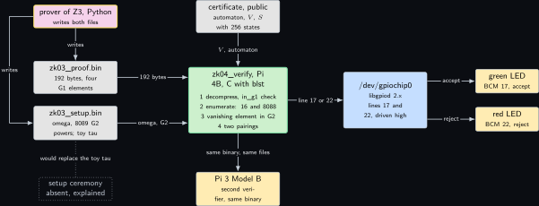
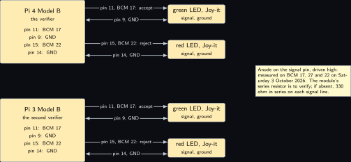
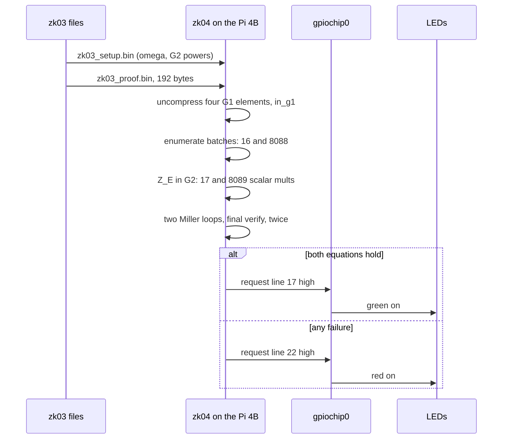
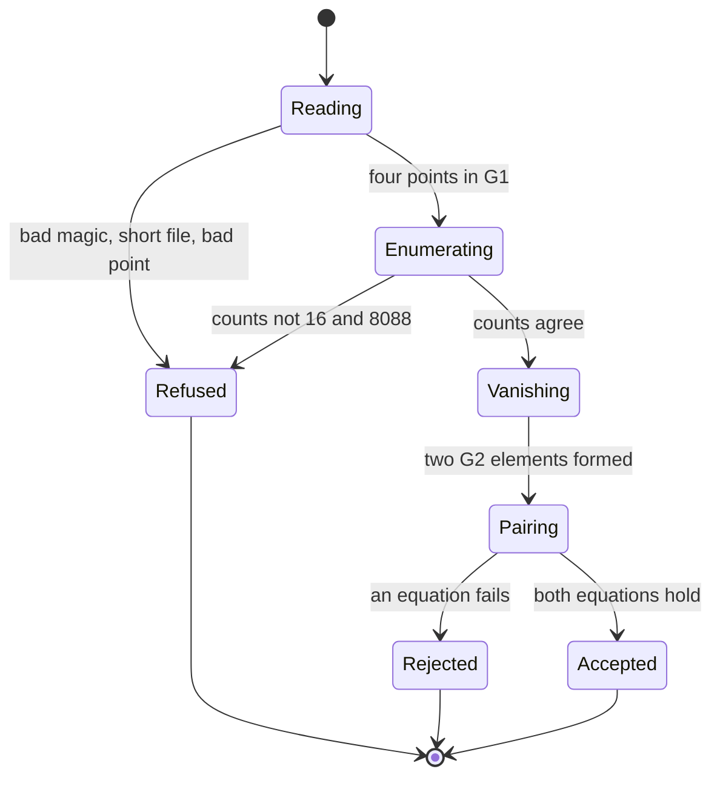
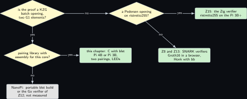
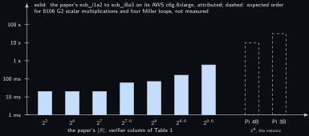

# Project 4. Two group elements: the KZG batch verifier in C

> **Board:** Pi 4B as the verifier, Pi 3B as a second verifier; green and red LEDs on BCM 17 and 22; the proof file of Z3  
> **Language:** C

> [!IMPORTANT]
> **The question, instanced**
>
> What can a verifier learn from a device without the device revealing itself, and what does it cost on this board? Here the board is the verifier. It holds no secret at all: it reads a 192-byte file, recomputes the public batches that the certificate of [Project 3](03-the-modems-backoff-machine.md) rules out, evaluates two pairing equations and lights one of two LEDs. What it learns is that the committed machine never waits forever; what it costs is two pairings plus one multi-scalar multiplication in $\mathbb{G}_2$ whose size is the number of hypothetical violations, 8088 here.

> **Key facts**
>
> - **Board:** Raspberry Pi 4 Model B Rev 1.4 (8 GB), card A, address \<pi4b\>; Raspberry Pi 3 Model B Rev 1.2 (1 GB) as a second verifier running the same binary
> - **Parts:** two Joy-it LEDs: green on BCM 17 (header pin 11) for accept, red on BCM 22 (header pin 15) for reject, grounds on pins 9 and 14; the files `zk03_proof.bin` (192 bytes) and `zk03_setup.bin` from [Project 3](03-the-modems-backoff-machine.md)
> - **Interface:** SSH to both Pis; the two files by `scp` or, in [Project 18](18-a-proof-over-the-wire.md), over the CAN bus; the verdict on the LEDs and on `stdout`
> - **Language and library:** C17 with `blst` v0.3.17 \[[7](#references)\] (pairing API: `blst_p1_affine`, `blst_miller_loop`, `blst_final_exp`, `blst_fp12_finalverify`) and `libgpiod` 2.x for the LEDs (names to verify)
> - **Primitive:** KZG batch opening and its verification: the vanishing check of the paper's relation $R_{\mathrm{eval}}$ \[[1](#references), [2](#references)\]
> - **Secret:** none on this board
> - **Public:** $c_{S_0}, c_T$, the sets $E_{\mathrm{init}}$ (16 points) and $E_{\mathrm{step}} \cup E_{\mathrm{fair}}$ (8088 points), the proof $\pi = (\pi_{S_0}, \pi_T)$, the setup
> - **Model:** none
> - **Acceptance:** the generator of $\mathbb{G}_1$ round-trips through the prover's compression and `blst_p1_uncompress`; the verifier prints the batch sizes 16 and 8088; the honest file lights green; the file with one flipped byte lights red; the verdict time is printed by `clock_gettime`
> - **Difficulty:** 3 of 5
> - **Effort:** one evening on the build laptop for the `blst` cross build and the sysroot, one evening on the two Pis

## Pitch

The paper's explicit-state scheme ends in one sentence: the proof is two group elements regardless of state-space size \[[1](#references)\]. This chapter is that sentence as a C program. It takes the four compressed $\mathbb{G}_1$ elements [Project 3](03-the-modems-backoff-machine.md) wrote, the public certificate, and the setup, and it answers accept or reject. Its mathematics is the one theorem that makes a batch opening work: a polynomial that vanishes on a set of points is divisible by the vanishing polynomial of that set, and bilinearity lets the verifier check the division with two pairings and never see the polynomial. The LEDs are not decoration: a verifier that only prints is a verifier whose verdict can be edited in the terminal, and the green and red lines are the part of the board a photograph can attest. The second Pi is there to show that the verdict does not depend on which board computes it; its time cells read not measured until the run, like the first's.

## Parts and interface

| **Part** | **Role** | **Interface** | **Address or pin** |
| --- | --- | --- | --- |
| Raspberry Pi 4 Model B | the verifier | SSH | \<pi4b\>; `/dev/gpiochip0` |
| Raspberry Pi 3 Model B Rev 1.2 | the second verifier, same binary | SSH; its card and OS word size to be read on the day | `/dev/gpiochip0` |
| green LED, Joy-it | accept | GPIO, driven high | BCM 17, header pin 11; ground pin 9 |
| red LED, Joy-it | reject, and any refusal before the pairings | GPIO, driven high | BCM 22, header pin 15; ground pin 14 |
| `zk03_proof.bin` | $c_{S_0} \\| c_T \\| \pi_{S_0} \\| \pi_T$, 192 bytes | file | from [Project 3](03-the-modems-backoff-machine.md) by `scp`, or from [Project 18](18-a-proof-over-the-wire.md) over CAN |
| `zk03_setup.bin` | the toy setup: $\omega$, 65538 $\mathbb{G}_1$ powers, 8089 $\mathbb{G}_2$ powers | file | from [Project 3](03-the-modems-backoff-machine.md) |
| `blst` v0.3.17 | pairings, $\mathbb{G}_2$ arithmetic, field arithmetic | static library, cross built | \[[7](#references)\] |
| `libgpiod` 2.x | the LED lines | the Pi's own package, linked through a sysroot | (to verify) |
| the build laptop, WSL side | every compile | LAN | \<build-laptop\> |

## The secret, the statement and the relation

The verifier holds no witness. It decides membership in the statement side of the paper's evaluation relation \[[1](#references)\], written for a vanishing set:

$$
R_{\mathrm{eval}} = \mathsf{PoK}\Big\{\, \underbrace{(p, b)}_{w} ;\; \underbrace{(c_p, E)}_{u} \;:\;
    c_p = \mathsf{Com}(p; b) \;\wedge\; \forall e \in E .\; p(e) = 0 \,\Big\}, \tag{4.1}
$$

twice: once with $u_1 = (c_{S_0}, E_{\mathrm{init}})$ and $\pi_{S_0}$, once with $u_2 = (c_T, E_{\mathrm{step}} \cup E_{\mathrm{fair}})$ and $\pi_T$. The sets of this project are

$$
\begin{gathered}
u \in \mathbb{G}_1 \times \mathbb{G}_1 \times 2^{\mathbb{F}_r} \times 2^{\mathbb{F}_r} \times \mathbb{G}_1 \times \mathbb{G}_1, \qquad
  |E_{\mathrm{init}}| = 16, \qquad |E_{\mathrm{step}} \cup E_{\mathrm{fair}}| = 8088, \\
  \mathsf{Verify} : \mathbb{G}_1 \times 2^{\mathbb{F}_r} \times \mathbb{G}_1 \to \{0, 1\}, \qquad
  \mathsf{Verify}(c, E, \pi) = \big[\, e(c, g_2) = e(\pi, g_2^{Z_E(\tau)}) \,\big],
\end{gathered}
$$

and the verdict is $\mathsf{Verify}(c_{S_0}, E_{\mathrm{init}}, \pi_{S_0}) \wedge \mathsf{Verify}(c_T, E_{\mathrm{step}} \cup E_{\mathrm{fair}}, \pi_T)$. The sets $E_\star$ are not read from the file: the verifier recomputes them from the certificate exactly as [Project 3](03-the-modems-backoff-machine.md) does, and refuses if its counts differ from the prover's printed 16 and 8088.

## The mathematics

**Definition Z4.1 (Bilinear pairing).** Let $\mathbb{G}_1, \mathbb{G}_2, \mathbb{G}_T$ be cyclic groups of prime order $r$ with generators $g_1, g_2$ and $g_T = e(g_1, g_2)$. A pairing is a map $e : \mathbb{G}_1 \times \mathbb{G}_2 \to \mathbb{G}_T$ that is bilinear, $e(g_1^a, g_2^b) = e(g_1, g_2)^{ab}$ for all $a, b \in \mathbb{F}_r$, and non-degenerate, $e(g_1, g_2) \ne 1$ \[[4](#references)\]. On BLS12-381 a $\mathbb{G}_1$ element compresses to 48 bytes and a $\mathbb{G}_2$ element to 96 bytes \[[7](#references)\], which is why the proof file of [Project 3](03-the-modems-backoff-machine.md) is $4 \times 48 = 192$ bytes (computed).

**Definition Z4.2 (KZG commit, open, batch open).** Let $\tau \in \mathbb{F}_r$ be the setup secret and $\mathsf{sp} = \big((g_1^{\tau^i})_{0 \le i \le d},\, (g_2^{\tau^i})_{0 \le i \le m}\big)$ the public setup \[[2](#references)\]. For $p(X) = \sum_{i=0}^{d} a_i X^i \in \mathbb{F}_r[X]$:

$$
\begin{aligned}
\mathsf{Com}(p) &= \prod_{i=0}^{d} \big(g_1^{\tau^i}\big)^{a_i} = g_1^{p(\tau)}, \\
  \mathsf{Open}(p, z) &= g_1^{q_z(\tau)} \text{ with } q_z(X) = \frac{p(X) - p(z)}{X - z}, \qquad
    \text{checked by } e\big(c_p \cdot g_1^{-p(z)}, g_2\big) = e\big(\pi, g_2^{\tau} \cdot g_2^{-z}\big), \\
  \mathsf{BatchOpen}(p, E) &= g_1^{q(\tau)} \text{ with } q(X) = \frac{p(X)}{Z_E(X)}, \quad
    Z_E(X) = \prod_{e \in E}(X - e), \qquad \text{checked by } e(c_p, g_2) = e(\pi, g_2^{Z_E(\tau)}). \tag{4.2}
\end{aligned}
$$

Equation (4.2) is the special case of KZG batch opening in which every claimed value is zero, the case the paper's Section 4 singles out \[[1](#references)\]; it needs $|E| \le m$ so that $g_2^{Z_E(\tau)}$ can be formed from the setup.

**Theorem Z4.3 (Correctness of the vanishing check).** Let $E \subseteq \mathbb{F}_r$ be a finite set of distinct elements and $p \in \mathbb{F}_r[X]$ with $\deg p \le d$. If $p(e) = 0$ for every $e \in E$, then (i) $Z_E$ divides $p$ in $\mathbb{F}_r[X]$, and (ii) with $q = p / Z_E$ and $\pi = g_1^{q(\tau)}$ the equation $e(\mathsf{Com}(p), g_2) = e(\pi, g_2^{Z_E(\tau)})$ holds. Hence an honest prover is always accepted.

*Proof.* (i) By induction on $|E|$. If $E = \emptyset$ then $Z_E = 1$ and the claim is trivial. Let $|E| \ge 1$, pick $e \in E$ and put $E' = E \setminus \{e\}$. Division with remainder in $\mathbb{F}_r[X]$ by the monic polynomial $X - e$ gives unique $q_1 \in \mathbb{F}_r[X]$ and $\rho \in \mathbb{F}_r$ with $p(X) = (X - e)\, q_1(X) + \rho$, the remainder being a constant because its degree is below $1$. Evaluating at $X = e$ gives $p(e) = 0 \cdot q_1(e) + \rho = \rho$, and $p(e) = 0$ by hypothesis, so $\rho = 0$ and $p = (X - e)\, q_1$. Now $q_1$ vanishes on $E'$: for $e' \in E'$ we have $0 = p(e') = (e' - e)\, q_1(e')$ with $e' - e \ne 0$ because the elements of $E$ are distinct, and a field has no zero divisors, so $q_1(e') = 0$. The induction hypothesis applied to $q_1$ and $E'$ gives $q_1 = Z_{E'}\, q$ for some $q \in \mathbb{F}_r[X]$, and therefore $p = (X - e)\, Z_{E'}\, q = Z_E\, q$, since $Z_E = (X - e)\, Z_{E'}$ by definition.

(ii) By (i), $p(X) = Z_E(X)\, q(X)$ as polynomials, so in particular at the setup secret, $p(\tau) = Z_E(\tau)\, q(\tau)$ in $\mathbb{F}_r$. Then, using Equation (4.2) and bilinearity twice,

$$
\begin{aligned}
e(\mathsf{Com}(p), g_2) &= e\big(g_1^{p(\tau)}, g_2\big) = e(g_1, g_2)^{p(\tau)}
    = e(g_1, g_2)^{q(\tau)\, Z_E(\tau)} \\
  &= e\big(g_1^{q(\tau)}, g_2^{Z_E(\tau)}\big) = e\big(\pi, g_2^{Z_E(\tau)}\big),
\end{aligned}
$$

which is the verifier's equation. An honest prover computes exactly this $\pi$, so the check passes. &#9632;

**Lemma Z4.4 (The vanishing element is public and cheap).** Given $E$ with $|E| = n \le m$ and the setup, the coefficients $z_0, \dots, z_n$ of $Z_E$ are computable with $n(n+1)/2$ multiplications and as many additions in $\mathbb{F}_r$, and $g_2^{Z_E(\tau)}$ with $n + 1$ scalar multiplications and $n$ additions in $\mathbb{G}_2$, that is, $O(n)$ group operations; neither step uses $\tau$ or any secret.

*Proof.* Order $E = \{e_1, \dots, e_n\}$ and let $Z_k = \prod_{i \le k}(X - e_i)$, so $Z_0 = 1$ and $Z_n = Z_E$. If $Z_{k-1} = \sum_{j=0}^{k-1} z_j X^j$ then

$$
Z_k = (X - e_k)\, Z_{k-1} = \sum_{j=0}^{k-1} z_j X^{j+1} - e_k \sum_{j=0}^{k-1} z_j X^j
      = z_{k-1} X^{k} + \sum_{j=1}^{k-1} (z_{j-1} - e_k z_j) X^j - e_k z_0,
$$

so step $k$ costs $k$ multiplications by $e_k$ and $k - 1$ subtractions; summing $k = 1, \dots, n$ gives $n(n+1)/2$ multiplications and $n(n-1)/2$ subtractions. Then, with the setup elements $h_j = g_2^{\tau^j}$ for $j \le n \le m$,

$$
g_2^{Z_E(\tau)} = g_2^{\sum_{j=0}^{n} z_j \tau^j} = \prod_{j=0}^{n} \big(g_2^{\tau^j}\big)^{z_j}
  = \prod_{j=0}^{n} h_j^{z_j},
$$

one scalar multiplication per term and one group addition to fold each product in, which is $n + 1$ scalar multiplications and $n$ additions. Every input is public. &#9632;

**Remark Z4.5 (The trusted setup and the assumption the bench cannot buy).** Soundness of Equation (4.2), the statement that a prover who does not hold a vanishing $p$ cannot produce an accepted $\pi$, rests on the $q$-strong Diffie-Hellman assumption in the bilinear group and on $\tau$ being unknown to every party \[[2](#references)\]; the paper assumes the setup is produced by a multi-party powers-of-tau ceremony and treats it as part of $\mathsf{sp}$ \[[1](#references)\]. The setup this chapter reads was written by [Project 3](03-the-modems-backoff-machine.md)'s own script, which drew $\tau$ from `/dev/urandom` and printed it. So the verdict below is correct as a computation and worthless as a proof to anyone but the bench: whoever reads the setup log can open $c_T$ to a polynomial that vanishes anywhere. The acceptance test keeps this visible by also running a forged proof made with the printed $\tau$, which must be accepted, so that nobody mistakes the green LED for a security claim.

## The protocol

The verifier's algorithm, each step refusing with the red LED on failure.

1. Read the setup header: magic, the counts $n_1 = 65538$ and $n_2 = 8089$, and $\omega$, a primitive $2^{16}$-th root of unity, as 32 little-endian bytes; skip the $\mathbb{G}_1$ powers, decompress the $n_2$ elements of $\mathbb{G}_2$.
2. Read the 192-byte proof file; decompress the four $\mathbb{G}_1$ elements and check each lies in the prime-order subgroup with `blst_p1_affine_in_g1`; a point that decompresses but is not in $\mathbb{G}_1$ is a refusal, not an input.
3. Build the power table $\omega^i$ for $i < 2^{16}$ by $65535$ field multiplications; the $256$-th roots for $e_1$ are $\omega^{256 i}$.
4. Enumerate $B_{\mathrm{init}}$ over $S$ and $B_{\mathrm{step}} \cup B_{\mathrm{fair}}$ over $S \times S$ from $V$ and the automaton, exactly the loops of [Project 3](03-the-modems-backoff-machine.md); print the two counts and compare with 16 and 8088.
5. For each batch compute $Z_E$ and $g_2^{Z_E(\tau)}$ by Lemma **Lemma Z4.4**: 16 and 8088 roots, so 17 and 8089 scalar multiplications in $\mathbb{G}_2$ (computed).
6. Two Miller loops per batch and one final verification: accept iff both equations of Theorem **Theorem Z4.3** hold.
7. Drive BCM 17 high on accept, BCM 22 high on reject or on any earlier refusal; print the verdict and the elapsed time from `clock_gettime`.

## The code

Names from the `blst` C API as read in `bindings/blst.h` of v0.3.17: `blst_p1_uncompress`, `blst_p2_uncompress`, `blst_p1_affine_in_g1`, `blst_fr_mul`, `blst_fr_add`, `blst_fr_cneg`, `blst_scalar_from_fr`, `blst_p2_mult`, `blst_p2_add_or_double`, `blst_miller_loop`, `blst_fp12_finalverify` (to verify on the day against the header); `blst_final_exp` followed by `blst_fp12_is_equal` is the two-call form of the last check. That a zero-filled `blst_p2` is the identity is to verify in the same header. The `libgpiod` 2.x calls are marked to verify in the listing.

```c
/* zk04_verify.c: KZG batch verifier for zk03's 192-byte proof. C17, blst v0.3.17, libgpiod 2.x */
#include <stdio.h>
#include <stdlib.h>
#include <string.h>
#include <stdint.h>
#include <time.h>
#include <gpiod.h>
#include "blst.h"
enum { CLOSED, WAIT, REGISTERED, EXHAUSTED, NS = 256, NP = NS * NS, DMAX = 16, INF = -1 };
static const uint64_t ONE[4] = {1, 0, 0, 0};

static int rank(int i, int q) {                        /* Example 3.4 with 2^8 read as 16 */
    int m = i / 64, d = (i / 4) % 16, n = i % 4;
    if (m == WAIT && n == 3) return INF;
    if (q == 0 || m == CLOSED) return 3 * DMAX;
    return m == WAIT ? 2 * DMAX + 1 - DMAX * n + d : 0;
}
static void batches(uint8_t *binit, uint8_t *btr) {    /* B_init; B_step u B_fair */
    for (int i = 0; i < NS; i++) binit[i] = rank(i, 0) == INF;
    for (int i = 0; i < NS; i++) for (int j = 0; j < NS; j++) for (int q = 0; q < 2; q++) {
        int v = rank(i, q); if (v == INF) continue;
        for (int q2 = 0; q2 < 2; q2++) {               /* Figure 2b: q0 loops; Wait leads to q1 */
            if (!((q == 0 && q2 == 0) || (q2 == 1 && i / 64 == WAIT))) continue;
            int w = rank(j, q2), fair = q == 1 && q2 == 1;
            if (w == INF || v < w || (fair && v == w)) btr[i + NS * j] = 1;
        }
    }
}
/* g2^{Z_E(tau)} with Z_E = prod (X - pw[stride i]) over the marked i: the lemma on Z_E */
static void vanishing_g2(const uint8_t *mark, size_t n, const blst_fr *pw, size_t stride,
                         const blst_p2_affine *srs2, size_t nsrs2, blst_p2_affine *out) {
    blst_fr *z = calloc(n + 2, sizeof *z), ne, t; size_t deg = 0; blst_fr_from_uint64(&z[0], ONE);
    for (size_t i = 0; i < n; i++) {
        if (!mark[i]) continue;
        blst_fr_cneg(&ne, &pw[stride * i], 1); z[deg + 1] = z[deg];       /* times (X - e) */
        for (size_t k = deg; k >= 1; k--) {
            blst_fr_mul(&t, &z[k], &ne); blst_fr_add(&z[k], &z[k - 1], &t);
        }
        blst_fr_mul(&z[0], &z[0], &ne); deg++;
    }
    if (deg >= nsrs2) { fprintf(stderr, "zk04 setup has too few G2 powers\n"); exit(2); }
    blst_p2 acc, p; blst_scalar sc; memset(&acc, 0, sizeof acc);          /* identity: to verify */
    for (size_t k = 0; k <= deg; k++) {
        blst_scalar_from_fr(&sc, &z[k]); blst_p2_from_affine(&p, &srs2[k]);
        blst_p2_mult(&p, &p, sc.b, 255); blst_p2_add_or_double(&acc, &acc, &p);
    }
    blst_p2_to_affine(out, &acc); free(z);
}
static int check(const blst_p1_affine *c, const blst_p1_affine *pi, const blst_p2_affine *zE) {
    blst_fp12 l, r;                                    /* e(c, g2) == e(pi, g2^{Z_E(tau)}) */
    blst_miller_loop(&l, blst_p2_affine_generator(), c); blst_miller_loop(&r, zE, pi);
    return blst_fp12_finalverify(&l, &r);
}
static int led(unsigned line, int rc) {                /* libgpiod 2.x names: to verify */
    struct gpiod_line_settings *s = gpiod_line_settings_new();
    gpiod_line_settings_set_direction(s, GPIOD_LINE_DIRECTION_OUTPUT);
    gpiod_line_settings_set_output_value(s, GPIOD_LINE_VALUE_ACTIVE);
    struct gpiod_line_config *cfg = gpiod_line_config_new();
    gpiod_line_config_add_line_settings(cfg, &line, 1, s);
    if (!gpiod_chip_request_lines(gpiod_chip_open("/dev/gpiochip0"), NULL, cfg)) perror("zk04");
    return rc;                                         /* the line is held until exit */
}
int main(void) {
    struct timespec t0, t1; clock_gettime(CLOCK_MONOTONIC, &t0); blst_p1_affine el[4];
    uint8_t hdr[44], b96[96], pf[192]; uint32_t n1, n2; blst_scalar sc; blst_fr omega;
    FILE *f = fopen("zk03_setup.bin", "rb");
    if (!f || fread(hdr, 1, 44, f) != 44 || memcmp(hdr, "ZK03", 4)) return led(22, 2);
    memcpy(&n1, hdr + 4, 4); memcpy(&n2, hdr + 8, 4);
    blst_scalar_from_lendian(&sc, hdr + 12); blst_fr_from_scalar(&omega, &sc);
    fseek(f, 48L * n1, SEEK_CUR); blst_p2_affine *srs2 = malloc(n2 * sizeof *srs2), z1, z2;
    for (uint32_t i = 0; i < n2; i++)
        if (fread(b96, 1, 96, f) != 96 || blst_p2_uncompress(&srs2[i], b96)) return led(22, 2);
    fclose(f); f = fopen("zk03_proof.bin", "rb");
    if (!f || fread(pf, 1, 192, f) != 192 || fgetc(f) != EOF) return led(22, 2);
    for (int i = 0; i < 4; i++)                        /* decompress, then the subgroup check */
        if (blst_p1_uncompress(&el[i], pf + 48 * i) || !blst_p1_affine_in_g1(&el[i]))
            return led(22, 1);
    blst_fr *pw = malloc(NP * sizeof *pw); blst_fr_from_uint64(&pw[0], ONE);
    for (size_t i = 1; i < NP; i++) blst_fr_mul(&pw[i], &pw[i - 1], &omega);      /* omega^i */
    static uint8_t binit[NS], btr[NP]; batches(binit, btr); size_t a = 0, b = 0;
    for (size_t i = 0; i < NP; i++) b += btr[i], a += i < NS ? binit[i] : 0;
    printf("zk04 batches %zu %zu\n", a, b);             /* must print 16 8088 */
    vanishing_g2(binit, NS, pw, 256, srs2, n2, &z1);   /* omega^256 is the 256-th root for e1 */
    vanishing_g2(btr, NP, pw, 1, srs2, n2, &z2);
    int ok = check(&el[0], &el[2], &z1) && check(&el[1], &el[3], &z2);
    clock_gettime(CLOCK_MONOTONIC, &t1);
    printf("zk04 verdict=%s ms=%.1f\n", ok ? "accept" : "reject",
           (t1.tv_sec - t0.tv_sec) * 1e3 + (t1.tv_nsec - t0.tv_nsec) / 1e6);
    return led(ok ? 17 : 22, ok ? 0 : 1);
}
```

```bash
# build laptop, WSL: blst and the verifier cross built for aarch64; the sysroot is
# the Pi's own /usr/include and /usr/lib/aarch64-linux-gnu, copied once with rsync, for gpiod
cd ~/zk-bench/zk04 && (cd blst && CC=aarch64-linux-gnu-gcc ./build.sh)
aarch64-linux-gnu-gcc -std=c17 -O2 --sysroot=$HOME/pi-sysroot -I blst/bindings \
    zk04_verify.c blst/libblst.a -lgpiod -o zk04
scp zk04 <user>@<pi4b>:~/zk04 && scp zk04 <user>@<pi3b>:~/zk04
```

## The model, if any

None. A verifier that consulted a model would be a verifier with a second opinion, and the volume's rule is that the proof decides.

## Real, modelled, absent

- **have:** real: the Pi 4B, the Pi 3B, the two LEDs measured on BCM 17 and 22 on Saturday 3 October 2026 as anode on the signal pin and driven high, `blst` at the release read on Friday 6 November 2026, the proof file layout of 192 bytes
- **learn:** modelled: the dashed bars in the benchmark figure are the orders of magnitude `blst`'s published aarch64 timings suggest for 8089 $\mathbb{G}_2$ scalar multiplications and two pairings on a Cortex-A72 and a Cortex-A53, not measured; the Pi 3B's card and OS word size are to be read on the day, and a 32-bit OS would need the portable `blst` build and a second binary
- **absent:** absent: a setup ceremony, so Remark **Remark Z4.5** applies and the green LED is a computation, not a guarantee; a fan on the Pi 3B, which matters only if a run exceeds four minutes; a photograph of the LEDs, which is the record the acceptance test asks for and which does not yet exist

## System architecture



*Figure 4.1. The verifier's data path. On the left two grey public blocks, the 192-byte proof file and the setup file, and above them the prover of [Project 3](03-the-modems-backoff-machine.md) in its yellow outline as the source of both; a dotted grey block beside the setup marks the absent ceremony. In the middle the verifier program on the Pi 4B in its green outline, drawn as one block with its four stages named: decompress and subgroup check, enumerate the batches, vanishing element in $\mathbb{G}_2$, two pairings; above it the public certificate that feeds the enumeration. On the right a kernel-blue block for `/dev/gpiochip0` and two solid hardware blocks for the green and red LEDs; below, the Pi 3B as a second solid hardware block running the same binary, fed by the same two files.*

Read the figure as a function of public inputs only: nothing enters the verifier that the prover would not publish, and the only state the verifier leaves behind is one LED line held high until the process exits.

## Wiring



*Figure 4.2. The LEDs on the Pi 4B and on the Pi 3B. Each Pi as a solid hardware block with four header pins called out: pin 11 (BCM 17), pin 9 (ground), pin 15 (BCM 22) and pin 14 (ground). To the right of each, the green LED module wired signal to pin 11 and ground to pin 9, and the red LED module wired signal to pin 15 and ground to pin 14, both as solid hardware blocks. A note says the Joy-it modules carry their own series resistor, to verify on the module, and that the lines are driven high.*

| **Signal** | **From** | **To** | **Note** |
| --- | --- | --- | --- |
| accept | BCM 17, header pin 11 | green LED signal pin | driven high on accept; measured on Saturday 3 October 2026 as anode on the signal pin |
| ground | header pin 9 | green LED ground pin |  |
| reject | BCM 22, header pin 15 | red LED signal pin | driven high on reject and on every refusal before the pairings |
| ground | header pin 14 | red LED ground pin |  |
| series resistor | on the Joy-it module |  | to verify on the module; if absent, 330 ohm in series on each signal line |
| same four | the Pi 3B's header | its own two LEDs | the same offsets on `gpiochip0`; the header numbering is the same on both boards |

## Sequence and states





## Decision tree



*Figure 4.3. Which verifier for which proof. The root diamond asks whether the proof is a KZG batch opening, two $\mathbb{G}_1$ elements; yes leads to a second diamond asking whether the board has a pairing library with assembly for its core; yes leads to the leaf for this chapter, C with blst on the Pi 4B or the Pi 3B, no leads to a grey leaf naming the NanoPi with the portable build or the Go verifier of [Project 12](12-a-plonk-gate-for-the-inductive-step.md), time not measured. No at the root leads to a third diamond asking whether the proof is a Pedersen opening on ristretto255; yes leads to the Zig verifier of [Project 15](15-a-zig-verifier-of-pedersen-openings.md), no to the leaf for the SNARK verifiers of [Project 8](08-a-ranking-function-as-a-circuit.md) and [Project 13](13-the-obligation-in-noir.md).*

## Benchmark



*Figure 4.4. Verifier time against state-space size, log scale from 1 ms to 100 s. Seven solid bars are the paper's Table 1 verifier column for exb\_i1a2 through exb\_i8a3 on its AWS c6g.8xlarge, attributed, placed at the paper's $\|S\|$ from $2^5$ to $2^{9.6}$; two dashed bars at $\|S\| = 2^8$ are the expected orders for this chapter's instance on the Pi 4B and the Pi 3B, not measured. The column is constant only in its two pairings; the rest grows with the batch size, which is why the paper's bars rise.*

| **Quantity** | **Paper, i4a3** | **Pi 4B** | **Pi 3B** | **Instrument** |
| --- | --- | --- | --- | --- |
| verifier, total | 160 ms | not measured | not measured | `clock_gettime`, printed by the binary; the paper's figure is its machine's |
| of which pairings | not printed | not measured | not measured | two Miller loops and one final verification per batch, timed separately in a second run |
| $\mathbb{G}_2$ scalar multiplications | not printed | 8106 (computed) | 8106 (computed) | $17 + 8089$, Lemma **Lemma Z4.4** |
| $\mathbb{F}_r$ multiplications for $Z_E$ | not printed | about $3.3 \times 10^7$ (computed) | same | $8088 \cdot 8089 / 2$ plus $16 \cdot 17 / 2$, Lemma **Lemma Z4.4** |
| proof read |  | 192 bytes | 192 bytes | computed; the file length is checked, not assumed |
| setup read |  | 8089 $\mathbb{G}_2$ decompressions | same | `blst_p2_uncompress` |
| throttle word |  | not read yet | not read yet | `vcgencmd get_throttled` before and after |

The paper's verifier column runs from 20 ms at $|S| = 2^5$ to 590 ms at $|S| = 2^{9.6}$ \[[1](#references)\]; on the paper's machine the pairings are a small constant inside those figures and the growth is the batch work. On the Pi the same split holds, and [Project 1](01-the-price-list.md)'s price list is the number that turns 8106 scalar multiplications in $\mathbb{G}_2$ into seconds.

## Steps

**Step 1.** On the authoring laptop, write `zk04_verify.c` and the build line; commit.

**Step 2.** On the build laptop in WSL, `git pull --ff-only`, clone `blst` at v0.3.17, build it with the aarch64 cross compiler, copy the Pi 4B's `/usr/include` and `/usr/lib/aarch64-linux-gnu` into a sysroot with `rsync`, and build `zk04`.

**Step 3.** On the Pi 4B over ssh, round-trip the $\mathbb{G}_1$ generator: have [Project 3](03-the-modems-backoff-machine.md)'s Python write `compress_G1(G1)` to a file and a five-line C program read it with `blst_p1_uncompress` and compare with `blst_p1_affine_generator()`; the chapter does not continue until they agree.

**Step 4.** On the Pi 4B, wire the two LEDs, read `vcgencmd get_throttled`, run `zk04` on the honest files, photograph the green LED, read the register again, keep the two printed lines.

**Step 5.** On the Pi 4B, flip one byte of a copy of the proof file with `printf` and `dd`, run again, photograph the red LED, keep the lines.

**Step 6.** On the Pi 4B, forge: with the $\tau$ printed in [Project 3](03-the-modems-backoff-machine.md)'s setup log, let the Python write $\pi_T' = g_1^{p'(\tau) / Z_E(\tau)}$ for a $p'$ that is the indicator of a machine that does wait forever; run, and record that the green LED lights, which is Remark **Remark Z4.5** made visible.

**Step 7.** On the Pi 3B over ssh, copy the binary and both files, wire its LEDs, and repeat the honest and the flipped runs; a run longer than four minutes is not measured, thermal.

## Acceptance test

The chapter passes when (i) the generator round-trip of Step 3 agrees byte for byte; (ii) `zk04` prints `batches 16 8088` on both Pis; (iii) the honest file prints `accept` and the green LED is photographed; (iv) the flipped file prints `reject` or exits 1 at decompression and the red LED is photographed; (v) the forged file of Step 6 prints `accept`, recorded as the expected failure of a toy setup; (vi) the Pi 4B's two runs of the honest file agree in time within 10 percent with the throttle word `0x0` at both reads. It fails if the counts differ from [Project 3](03-the-modems-backoff-machine.md)'s, if the flipped file is accepted, if a time cell is filled from the build laptop, or if the Pi 3B's run exceeded four minutes.

## Variants

**The verifier as a zkVM guest.** The swap is what the board produces: the same two pairing equations are compiled to RISC-V and executed inside a zero-knowledge virtual machine \[[9](#references)\], so the artefact is no longer the word `accept` on a terminal but a proof that the verifier ran and accepted, which is the design brief's third sketch \[[8](#references)\]. In the parts this replaces `blst`'s aarch64 assembly with a portable build for the guest's instruction set, and it moves the green and red LEDs from this verifier to whichever board checks the guest's proof. What it buys is a verdict a third party can check without watching the board, and the artefact stays small: a Groth16 proof over BLS12-381 is two compressed $\mathbb{G}_1$ elements of 48 bytes and one compressed $\mathbb{G}_2$ element of 96 bytes, so $48 + 48 + 96 = 192$ bytes, computed, exactly the length of the file this chapter already reads \[[3](#references)\]. What it costs is the whole difference between running a program and proving it, because every guest instruction becomes committed trace rows; [Project 21](21-a-zero-knowledge-virtual-machine-on-the-bench.md) counts that factor rather than assuming it, and its cells read **not measured** until the guest has run on this bench. Choose it when the party that must be convinced cannot watch the board, and keep this chapter's C verifier when that party is the one asking the question. The brief carries the wrapped proof outward over an LTE link from a 4G HAT; no SIM is on the bench and nothing in this volume goes outward, so the guest's proof is a file checked on the Pi 4B beside the prover.

## Pitfalls

- `blst_p1_uncompress` does not check subgroup membership; a point on the curve but outside $\mathbb{G}_1$ decompresses without error and makes the pairing equation meaningless. The `in_g1` call is the check, and it costs one more scalar multiplication per element.
- The compressed encoding's top three bits are flags; a prover that writes big-endian integers without them produces 48 bytes that decompress to the wrong point or to an error, and the generator round-trip of Step 3 is what catches it.
- Scalars enter `blst_p2_mult` as little-endian bytes; $\omega$ written big-endian by Python is a different field element and every batch point is wrong, which the counts cannot see because the counts do not depend on $\omega$.
- The setup must hold at least $8089$ powers in $\mathbb{G}_2$; one too few is an exit with code 2, by the check in `vanishing_g2`, not a silent wrong element.
- `gpiochip0` is the SoC's GPIO chip on the Pi 4B and the Pi 3B; on a Pi 5 it would not be, and there is no Pi 5 on this bench.
- The printed time includes reading 8089 $\mathbb{G}_2$ elements from the card; a second run that times the pairings alone is the number a price list wants.
- The Pi 3B has no fan; a run that approaches four minutes is reported as not measured, thermal, and the binary prints the throttle word for that reason.

## Languages and libraries not chosen

- Rust with `ark-bls12-381` 0.6.0 \[[5](#references)\]: the paper's own verifier and [Project 1](01-the-price-list.md)'s harness; slower pairings on aarch64 than `blst`'s assembly by a factor [Project 1](01-the-price-list.md) measures, and this chapter wants the verifier readable in one C file.
- Go with `gnark-crypto` \[[6](#references)\]: one-flag cross compilation to the NanoPi, used in [Project 12](12-a-plonk-gate-for-the-inductive-step.md); on the Pi 4B it adds a runtime the verifier does not need.
- Python with `py_ecc`: a pure-Python pairing is seconds, not milliseconds; the language of the encoder in [Project 3](03-the-modems-backoff-machine.md), never of a verifier.

## Sources

- [arxiv.org/abs/2605.00487](https://arxiv.org/abs/2605.00487) (verified Friday 6 November 2026), the paper: Section 4, the relation $R_{\mathrm{eval}}$, Figure 3, Table 1.
- [github.com/supranational/blst, latest release](https://api.github.com/repos/supranational/blst/releases/latest) (verified Friday 6 November 2026), v0.3.17.
- [doi:10.1007/978-3-642-17373-8\_11](https://doi.org/10.1007/978-3-642-17373-8_11) (to verify), Kate, Zaverucha and Goldberg, the commitment scheme and its batch opening.
- [git.kernel.org, libgpiod](https://git.kernel.org/pub/scm/libs/libgpiod/libgpiod.git/) (to verify), the 2.x request API used for the LEDs.

<a id="references"></a>

## References

1. Pascal Berrang, Mirco Giacobbe, Jacob Swales and Xiao Yang. Zero-Knowledge Model Checking. arXiv:2605.00487v2 \[cs.CR\], version 1 submitted Friday 1 May 2026, version 2 Tuesday 8 September 2026. [arxiv.org/abs/2605.00487](https://arxiv.org/abs/2605.00487) (verified Friday 6 November 2026).
2. Aniket Kate, Gregory M. Zaverucha and Ian Goldberg. Constant-size commitments to polynomials and their applications. In ASIACRYPT 2010, LNCS 6477, pages 177 to 194. Springer, 2010. [doi:10.1007/978-3-642-17373-8\_11](https://doi.org/10.1007/978-3-642-17373-8_11) (to verify).
3. Jens Groth. On the size of pairing-based non-interactive arguments. In EUROCRYPT 2016, LNCS 9666, pages 305 to 326. Springer, 2016. [doi:10.1007/978-3-662-49896-5\_11](https://doi.org/10.1007/978-3-662-49896-5_11) (to verify).
4. Steven D. Galbraith, Kenneth G. Paterson and Nigel P. Smart. Pairings for cryptographers. Discrete Applied Mathematics, 156(16), pages 3113 to 3121, 2008. [doi:10.1016/j.dam.2007.12.010](https://doi.org/10.1016/j.dam.2007.12.010) (to verify).
5. arkworks contributors. arkworks: a Rust ecosystem for zkSNARK programming. The ark-bls12-381 crate is at version 0.6.0, updated Sunday 26 April 2026, 25.3 million downloads. [crates.io, ark-bls12-381](https://crates.io/api/v1/crates/ark-bls12-381) (verified Friday 6 November 2026).
6. Consensys. gnark: a fast zk-SNARK library in Go. Release v0.16.4, Wednesday 7 October 2026, carrying a high-severity soundness fix in emulated elliptic-curve scalar multiplication and a BW6-761 pairing fix. [github.com/Consensys/gnark, latest release](https://api.github.com/repos/Consensys/gnark/releases/latest) (verified Friday 6 November 2026).
7. Supranational. blst: a BLS12-381 signature and pairing library in C and assembly. Release v0.3.17, Friday 24 July 2026. [github.com/supranational/blst, latest release](https://api.github.com/repos/supranational/blst/releases/latest) (verified Friday 6 November 2026).
8. Advanced hardware-software architectures for edge artificial intelligence and zero-knowledge model checking. A design brief of twenty project sketches, read on Friday 6 November 2026 and held locally at `a local design brief`. It is the input to this second edition and is not a published source; where its hardware claims disagree with the bench, the bench is followed and the disagreement is stated.
9. Succinct Labs. SP1: a zero-knowledge virtual machine that proves the execution of a RISC-V binary. Release v6.10.0, Friday 23 October 2026. [github.com/succinctlabs/sp1](https://github.com/succinctlabs/sp1) (verified Friday 6 November 2026).

---

[Previous](03-the-modems-backoff-machine.md) &nbsp;&nbsp;|&nbsp;&nbsp; [Contents](../CONTENTS.md) &nbsp;&nbsp;|&nbsp;&nbsp; [Next](05-farkas-witnesses-for-a-joystick-program.md)
