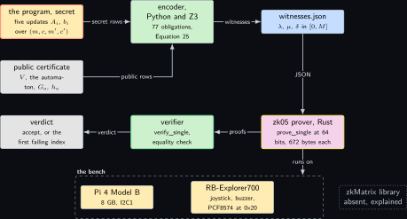
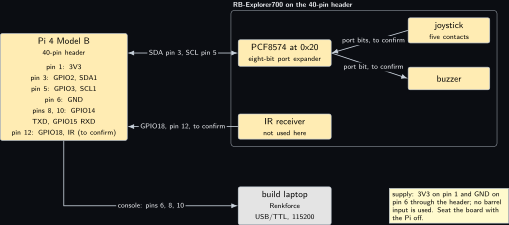
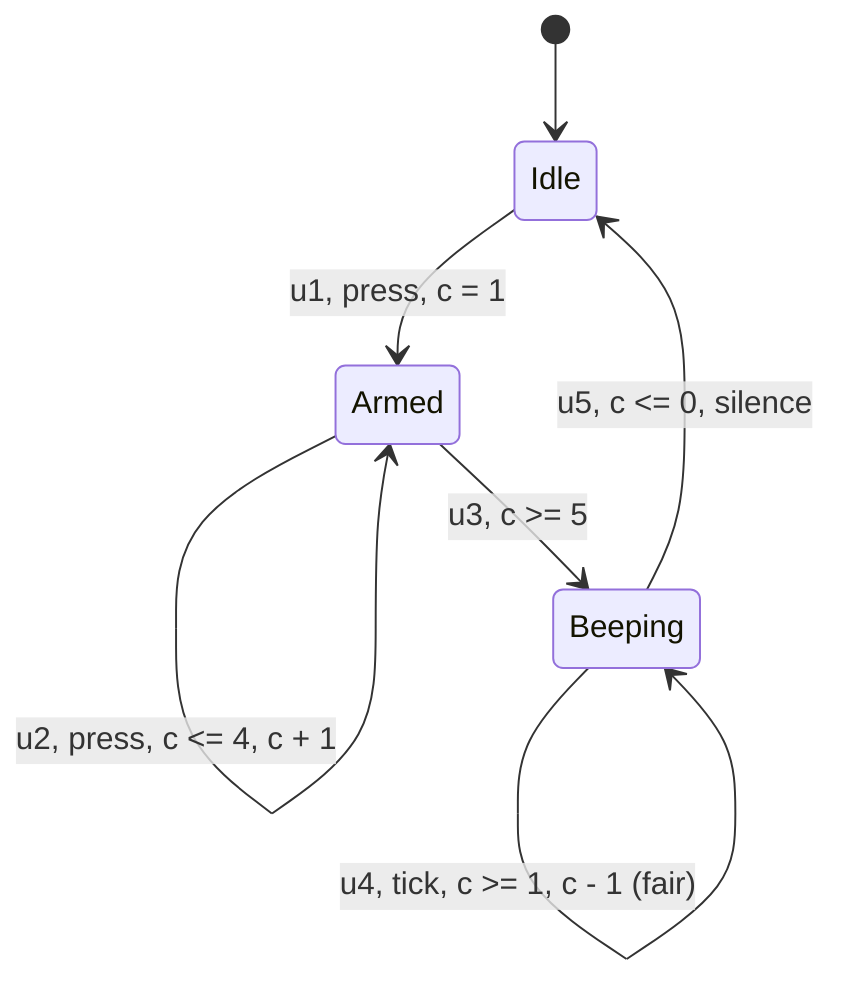
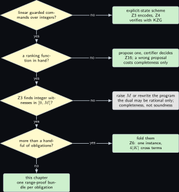

# Project 5. Farkas witnesses for a joystick program

> **Board:** Pi 4B with the JOY-iT RB-Explorer700: joystick, buzzer, PCF8574 at 0x20; the Renkforce console cable  
> **Language:** Rust

> [!IMPORTANT]
> **The question, instanced**
>
> What can a verifier learn from a device without the device revealing itself, and what does it cost on this board? Here the device runs a five-rule guarded-command program on the Explorer700's joystick and buzzer, and the verifier learns that the buzzer never sounds forever without learning the five rules: the program's update matrices stay secret, the ranking function and the automaton are public, and what crosses the wire is a set of Farkas witnesses proved in range with Bulletproofs on the Pi 4B.

> **Key facts**
>
> - **Board:** Raspberry Pi 4 Model B Rev 1.4 (8 GB), Raspberry Pi OS trixie, kernel 6.18.50+rpt-rpi-v8
> - **Parts:** the JOY-iT RB-Explorer700 on the 40-pin header (joystick and buzzer through the PCF8574 at 0x20, port bits to confirm on the silkscreen), the Renkforce USB/TTL cable as the console
> - **Interface:** I2C1 on header pins 3 and 5 for the PCF8574; SSH or the console on pins 6, 8 and 10
> - **Language and library:** Rust with `bulletproofs` 5.0.0 \[[9](#references)\] (`RangeProof::prove_single` and `verify_single`) over ristretto255; a Python harness with `z3-solver` (version to verify) \[[8](#references)\] derives the witnesses, as the paper's own encoder does \[[2](#references)\]
> - **Primitive:** the symbolic scheme of the paper \[[1](#references)\], Equations 15 to 25: guarded commands, a piecewise-linear ranking function, the obligations 19 to 21 in the uniform form 22, the dual 24, the integer witnesses 25 and their range proofs
> - **Secret:** the five update matrices $`A_i`$ and bounds $`b_i`$ of the program
> - **Public:** the ranking function $`V`$, the automaton $`\mathcal{A}_{\neg\phi}`$, the public rows $`G_i, h_i`$ of every obligation, the bound $`M`$
> - **Model:** none
> - **Acceptance:** the harness finds an integer witness for every one of the 77 obligations (count computed below), every witness entry lies in $`[0, 2^{32}]`$, which is the harness's own narrower choice inside the $`[0, 2^{64})`$ the range proofs establish, every range proof verifies, and a witness with one entry raised by 1 fails the equality check
> - **Difficulty:** 4 of 5
> - **Effort:** two evenings for the encoder and the Z3 harness on the authoring laptop, one evening for the Rust prover on the build laptop, one afternoon on the Pi 4B with the Explorer700

## Pitch

The program is small enough to read in a minute: a joystick press arms the device, five presses start the buzzer, and the buzzer counts down to silence. The property is one line of temporal logic, that the buzzer does not sound forever. What makes the chapter worth a board is that the paper's symbolic scheme lets the device keep the program to itself and still convince a verifier of the property \[[1](#references)\]. The verifier holds the public half of the certificate, a ranking function over the program's two integer variables and a two-state automaton for the negated property, and the device holds the five update rules as matrices. Each proof obligation of the paper's Theorem 3.2 becomes a system of linear inequalities with a secret block and a public block, Farkas’ lemma turns the infeasibility of each system into the existence of a non-negative witness, and the device proves it holds such witnesses in the integer range $`[0, M]`$ without showing the rows they multiply. The chapter derives the witnesses with Z3 exactly as the paper's front-end does, proves their ranges with the `bulletproofs` crate on the Pi 4B, and counts what that costs; the matrix-product half of the proof, the paper's zkmm, has no library on this bench and is marked as such.

## Parts and interface

| **Part** | **Role** | **Interface** | **Address or pin** |
| --- | --- | --- | --- |
| Raspberry Pi 4 Model B | the prover and, in the acceptance test, its own verifier | SSH, or the Renkforce cable at 115200 | header pins 6, 8, 10 |
| JOY-iT RB-Explorer700 | carries the joystick and the buzzer the program reads and drives \[[14](#references)\] | stacked on the 40-pin header | 3V3 pin 1, GND pin 6 |
| PCF8574 on the Explorer700 | eight-bit port expander behind the joystick contacts and the buzzer; the port bits are to confirm on the silkscreen | I2C1, SDA GPIO2, SCL GPIO3 | 0x20; header pins 3 and 5 |
| IR receiver on the Explorer700 | not used by this program | one GPIO | GPIO18, pin 12, to confirm |
| the build laptop, WSL side | compiles the Rust prover for aarch64 and runs the Z3 harness | LAN | \<build-laptop\> |

## The secret, the statement and the relation

The program's state is $`x = (m, c) \in \mathbb{Z}^2`$: the mode $`m`$ (0 idle, 1 armed, 2 beeping) and the counter $`c`$. Over the stacked vector $`y = (x, x') = (m, c, m', c') \in \mathbb{Z}^4`$ the five guarded updates are systems $`A_i y \le b_i`$ in the paper's Equation 16, each written with every equality as a pair of inequalities. In words: $`u_1`$ arms on a press from idle ($`m = 0 \to m' = 1, c' = 1`$); $`u_2`$ counts a press while armed ($`m = 1 \wedge c \le 4 \to m' = 1, c' = c + 1`$); $`u_3`$ starts the buzzer at the fifth press ($`m = 1 \wedge c \ge 5 \to m' = 2, c' = 5`$); $`u_4`$ counts the buzzer down ($`m = 2 \wedge c \ge 1 \to m' = 2, c' = c - 1`$); $`u_5`$ silences it ($`m = 2 \wedge c \le 0 \to m' = 0, c' = 0`$). The initial condition is $`S_0 = \{x \mid A_0 x \le b_0\} = \{(0, 0)\}`$, Equation 15.

The witness is the family of secret rows, the statement is everything the verifier is given, and the relation is the paper's $`\mathcal{R}_{\mathsf{f}}`$ restricted to one obligation (its Equation 25, before folding):

```math
\begin{aligned}
w &= \big(\, \{A_i, b_i\}_{i=0}^{5},\; \{r_{A_i}, r_{b_i}\}_{i=0}^{5},\;
       \{\lambda_o, \mu_o, \delta_o\}_{o \in \mathrm{Obl}} \,\big), \\
  u &= \big(\, V,\; \mathcal{A}_{\neg\phi},\; \{G_o, h_o\}_{o \in \mathrm{Obl}},\; M,\;
       \{c_{A_i}, c_{b_i}\}_{i=0}^{5} \,\big), \\
  \mathcal{R}_{05} &= \Big\{\, (w, u) \;\Big|\;
     \forall o \in \mathrm{Obl}:\;
     A_{s(o)}^\top \lambda_o = -\,G_o^\top \mu_o \;\wedge\;
     \delta_o = -\,b_{s(o)}^\top \lambda_o - h_o^\top \mu_o - 1 \notag \\
   &\qquad\quad \wedge\; \lambda_o, \mu_o, \delta_o \in [0, M] \;\wedge\;
     A_i, b_i \in [-M, M] \;\wedge\; c_{A_i} = \mathsf{Com}(A_i; r_{A_i}) \;\wedge\;
     c_{b_i} = \mathsf{Com}(b_i; r_{b_i}) \,\Big\}.
\end{aligned}
```

*(5.1)*

Here $`\mathrm{Obl}`$ is the set of the 77 obligations enumerated in the next subsection and $`s(o)`$ names the update (or $`S_0`$) whose rows are the secret block of obligation $`o`$. The bound is $`M = 2^{64}`$ and not the paper's nominal $`2^{32}`$: the only range proof this chapter runs is at 64 bits, so $`2^{64}`$ is the bound the proof establishes, and Corollary **Corollary Z5.8** is applied at that bound below.

Two things are checked, and only one of them is proved in zero knowledge. From the proof the verifier learns that every obligation is infeasible, without learning the rows. On public data alone, before reading the proof, the verifier checks the three well-formedness conditions of Definition **Definition Z5.2** on $`V`$: the cases are pairwise disjoint, they cover $`\mathbb{Z}^d`$, and every finite case is non-negative on its region. The third is not a formality; the paper's Theorem 3.2 draws its contradiction from the well-foundedness of $`\mathbb{N}`$, so a $`V`$ with a negative finite case admits an infinite descent and certifies nothing, and the first two are what make $`V`$ a function at all. Only with both checks in hand does Theorem 3.2 give that the program satisfies $`\phi`$. For this chapter's $`V`$ the three are immediate and are verified in the next subsection. What the public certificate does reveal is said plainly in the Pitfalls: $`V`$ names the counter's range $`[0, 5]`$.

## The mathematics

**Definition Z5.1 (Linear guarded-command program).** A linear guarded-command program over integer variables $`x \in \mathbb{Z}^d`$ is a pair $`(A_0 x \le b_0,\; \{A_i [x\; x']^\top \le b_i\}_{i=1}^{n})`$ with $`A_0 \in \mathbb{Z}^{k_0 \times d}`$, $`A_i \in \mathbb{Z}^{k_i \times 2d}`$ and integer bounds; its state transition system has $`S = \mathbb{Z}^d`$, $`S_0 = \{x \mid A_0 x \le b_0\}`$ and $`T = \bigcup_{i=1}^{n} \{(x, x') \mid A_i [x\; x']^\top \le b_i\}`$. This is the paper's Equations 15 and 16 \[[1](#references)\]; the form descends from the guarded commands of \[[7](#references)\]. The joystick program has $`d = 2`$, $`n = 5`$, $`k_0 = 4`$, and $`k_i \in \{6, 7, 7, 7, 7\}`$.

**Definition Z5.2 (Piecewise-linear ranking function).** For an automaton state $`q`$, $`V(x, q)`$ is given by finitely many polyhedral cases $`C^{(q)}_j x \le d^{(q)}_j \Rightarrow V = w^{(q)}_j x + u^{(q)}_j`$ (finite cases, $`j = 1, \dots, m_q`$) and $`E^{(q)}_k x \le f^{(q)}_k \Rightarrow V = +\infty`$ (infinite cases, $`k = 1, \dots, l_q`$), the paper's Equation 18, such that the cases are pairwise disjoint, jointly cover $`\mathbb{Z}^d`$, and every finite case is non-negative on its region.

The property is $`\phi = \neg\,\mathrm{FG}\,\mathsf{beeping}`$ with the atomic predicate $`\mathsf{beeping} \equiv (m = 2)`$, i.e. $`P^{\mathsf{beeping}} = [\,-1\; 0;\; 1\; 0\,]`$ and $`r^{\mathsf{beeping}} = (-2, 2)`$ in the paper's Equation 17. The automaton for $`\neg\phi = \mathrm{FG}\,\mathsf{beeping}`$ is the paper's Figure 2b with the label renamed: $`Q = \{q_0, q_1\}`$, $`Q_0 = \{q_0\}`$, $`\delta = \{(q_0, \mathsf{true}, q_0),\; (q_0, \mathsf{beeping}, q_1),\; (q_1, \mathsf{beeping}, q_1)\}`$ and $`F = \{(q_1, \mathsf{beeping}, q_1)\}`$. The ranking function is

```math
V(x, q_0) = \begin{cases} 6 & \text{if } 0 \le c \le 5 \\ +\infty & \text{if } c \ge 6
    \\ +\infty & \text{if } c \le -1 \end{cases}
  \qquad
  V(x, q_1) = \begin{cases} c + 1 & \text{if } m \ge 2 \wedge 0 \le c \le 5 \\
    0 & \text{if } m \le 1 \wedge 0 \le c \le 5 \\ +\infty & \text{if } c \ge 6 \\
    +\infty & \text{if } c \le -1 \end{cases}
```

*(5.2)*

so $`m_{q_0} = 1`$, $`l_{q_0} = 2`$, $`m_{q_1} = 2`$, $`l_{q_1} = 2`$. The three well-formedness checks of Definition **Definition Z5.2** are immediate over the integers: $`m \ge 2`$ and $`m \le 1`$ are disjoint and cover $`\mathbb{Z}`$, the three $`c`$-ranges are disjoint and cover $`\mathbb{Z}`$, and $`c + 1 \ge 1`$ on $`0 \le c \le 5`$.

**Definition Z5.3 (The obligations in uniform form).** The paper's Equations 19 to 21 produce, for this program, $`l_{q_0} |Q_0| = 2`$ initiation obligations, $`\sum_{(q,\sigma,q') \in \delta} n \, m_q \, l_{q'} = 10 + 10 + 20 = 40`$ inductive-step obligations and $`\sum_{(q,\sigma,q') \in \delta} n \, m_q \, m_{q'} = 5 + 10 + 20 = 35`$ ranking obligations, 77 in all (computed from the paper's count formula; the harness prints the same number). Each is a statement of the form of the paper's Equation 22,

```math
\forall y:\; \underbrace{A_s y \le b_s}_{\text{secret}} \implies
  \underbrace{C_p y \le d_p \implies E_p y \not\le f_p}_{\text{public}},
```

*(5.3)*

whose negation (Equation 23) is the infeasibility of $`A_s y \le b_s \wedge G_p y \le h_p`$ with $`G_p = [C_p^\top\; E_p^\top]^\top`$ and $`h_p = (d_p, f_p)`$. For an initiation obligation $`A_s = A_0`$ and $`G_p = E^{(q_0)}_k`$; for an inductive-step obligation $`A_s = A_i`$ and the public rows are $`P^{\sigma}`$ on $`x`$, $`C^{(q)}_j`$ on $`x`$ and $`E^{(q')}_k`$ on $`x'`$; for a ranking obligation the last public row is the paper's Equation 21, $`w^{(q)}_j x - w^{(q')}_k x' \le u^{(q')}_k - u^{(q)}_j + \mathbf{1}_F(q, \sigma, q') - 1`$.

**Theorem Z5.4 (Farkas’ lemma, inequality form).** Let $`A \in \mathbb{Q}^{k \times d}`$ and $`b \in \mathbb{Q}^k`$. Exactly one of the following holds: (i) there is $`y \in \mathbb{Q}^d`$ with $`A y \le b`$; (ii) there is $`\lambda \in \mathbb{Q}^k`$ with $`\lambda \ge 0`$, $`A^\top \lambda = 0`$ and $`b^\top \lambda < 0`$ \[[6](#references)\].

The theorem is stated, not proved: the direction the verifier relies on is (ii) excludes (i), which is the next theorem and is proved in full; the direction that (i) failing forces (ii) is what makes the prover's search complete over the rationals, and it is cited.

**Theorem Z5.5 (Soundness of a Farkas witness).** Let $`A \in \mathbb{Q}^{k \times d}`$, $`b \in \mathbb{Q}^k`$, $`C \in \mathbb{Q}^{k' \times d}`$, $`d \in \mathbb{Q}^{k'}`$. If there exist $`\lambda \in \mathbb{Q}^k`$ and $`\mu \in \mathbb{Q}^{k'}`$ with $`\lambda \ge 0`$, $`\mu \ge 0`$, $`A^\top \lambda + C^\top \mu = 0`$ and $`b^\top \lambda + d^\top \mu < 0`$, then no $`y \in \mathbb{Q}^d`$ satisfies $`A y \le b`$ and $`C y \le d`$.

*Proof.* Suppose $`y`$ satisfies both systems. For each row $`i`$ of $`A`$ we have $`(A y)_i \le b_i`$ and $`\lambda_i \ge 0`$, so $`\lambda_i (A y)_i \le \lambda_i b_i`$; summing over $`i`$ gives $`\lambda^\top A y \le \lambda^\top b`$. The same argument on $`C y \le d`$ with $`\mu \ge 0`$ gives $`\mu^\top C y \le \mu^\top d`$. Adding the two,

```math
(A^\top \lambda + C^\top \mu)^\top y \;=\; \lambda^\top A y + \mu^\top C y
  \;\le\; b^\top \lambda + d^\top \mu \;<\; 0 .
```

The left-hand side is $`0^\top y = 0`$ by the hypothesis $`A^\top \lambda + C^\top \mu = 0`$, so $`0 < 0`$, a contradiction. Hence no such $`y`$ exists. &#9632;

Applied to Definition **Definition Z5.3** with $`(A, b) = (A_s, b_s)`$ and $`(C, d) = (G_p, h_p)`$ this is the paper's Equation 24: a pair $`(\lambda_s, \mu_s)`$ with $`A_s^\top \lambda_s + G_p^\top \mu_s = 0`$ and $`b_s^\top \lambda_s + h_p^\top \mu_s < 0`$ certifies the obligation. The paper then restricts to integers in $`[0, M]`$ and writes the strict inequality as a third range (its Equation 25):

```math
\lambda_s, \mu_s \in [0, M] \;\wedge\;
  \delta_s := -\,b_s^\top \lambda_s - h_p^\top \mu_s - 1 \in [0, M] \;\wedge\;
  A_s^\top \lambda_s = -\,G_p^\top \mu_s .
```

*(5.4)*

The equality is checked over $`\mathbb{Z}_p`$ by the commitment arithmetic, and the next lemma is what lets a check over $`\mathbb{Z}_p`$ stand for a check over $`\mathbb{Z}`$.

**Definition Z5.6 (Canonical signed lift).** For an odd prime $`p`$ let $`\ell : \mathbb{Z}_p \to \mathbb{Z}`$ map a residue class to its unique representative in the interval $`(-p/2, \, p/2)`$. For every integer $`a`$ with $`|a| < p/2`$, $`\ell(a \bmod p) = a`$.

**Lemma Z5.7 (Bounded integer encoding).** Let $`A \in \mathbb{Z}^{k \times d}`$ with every entry in $`[-M, M]`$, $`\lambda \in \mathbb{Z}^k`$ with every entry in $`[0, M]`$, and $`\alpha \in \mathbb{Z}_p^d`$ with $`A^\top \lambda \equiv \alpha \pmod p`$ entrywise. If $`k M^2 < p / 2`$ then $`A^\top \lambda = \ell(\alpha)`$ over $`\mathbb{Z}`$, entrywise. More generally, if $`a, g \in \mathbb{Z}`$ satisfy $`a \equiv g \pmod p`$, $`|a| \le B_1`$, $`|g| \le B_2`$ and $`B_1 + B_2 < p`$, then $`a = g`$.

*Proof.* Fix a column $`j`$ and write $`a_j = (A^\top \lambda)_j = \sum_{i=1}^{k} A_{ij} \lambda_i`$ over $`\mathbb{Z}`$. Each term satisfies $`|A_{ij} \lambda_i| = |A_{ij}| \cdot \lambda_i \le M \cdot M`$, so by the triangle inequality $`|a_j| \le k M^2 < p / 2`$. The residue of $`a_j`$ modulo $`p`$ is $`\alpha_j`$ by hypothesis, and $`a_j`$ lies in $`(-p/2, p/2)`$, so $`a_j`$ is the unique representative of the class of $`\alpha_j`$ in that interval, i.e. $`a_j = \ell(\alpha_j)`$ by Definition **Definition Z5.6**. For the general statement, $`p`$ divides $`a - g`$ and $`|a - g| \le |a| + |g| \le B_1 + B_2 < p`$; the only multiple of $`p`$ of absolute value below $`p`$ is $`0`$, so $`a = g`$. &#9632;

**Corollary Z5.8 (The equality of Equation 5.4 holds over the integers).** With $`k_s`$ secret rows and $`k_p`$ public rows whose entries are bounded by $`M_G`$, if $`k_s M^2 + k_p M_G M + M + 1 < p`$ then $`A_s^\top \lambda_s \equiv -G_p^\top \mu_s \pmod p`$ with $`\lambda_s, \mu_s \in [0, M]`$ implies $`A_s^\top \lambda_s = -G_p^\top \mu_s`$ over $`\mathbb{Z}`$, and likewise $`\delta_s \in [0, M]`$ over $`\mathbb{Z}_p`$ gives $`b_s^\top \lambda_s + h_p^\top \mu_s \le -1`$ over $`\mathbb{Z}`$. This is the integer layer of the paper's proof sketch of Theorem 5.1, whose hypothesis $`k_s M^2 + k_p M_G M + 1 < p`$ the corollary strengthens by $`M`$.

*Proof.* Apply the general statement of Lemma **Lemma Z5.7** to $`a = (A_s^\top \lambda_s)_j`$ and $`g = -(G_p^\top \mu_s)_j`$ with $`B_1 = k_s M^2`$ and $`B_2 = k_p M_G M`$; the sum is below $`p`$ by hypothesis, so $`a = g`$ for every column $`j`$. For the second claim take $`a = -b_s^\top \lambda_s - h_p^\top \mu_s - 1`$ over $`\mathbb{Z}`$, bounded in absolute value by $`B_1 = k_s M^2 + k_p M_G M + 1`$, and $`g = \ell(\delta_s) \in [0, M]`$, bounded by $`B_2 = M`$; again $`B_1 + B_2 < p`$ by hypothesis, so $`a = g \ge 0`$, and $`b_s^\top \lambda_s + h_p^\top \mu_s = -1 - a \le -1`$. &#9632;

For this chapter $`k_s \le 7`$, $`k_p \le 9`$, the public entries are bounded by $`M_G = 6`$, and the group is ristretto255 with $`p = 2^{252} + 27742317777372353535851937790883648493`$. The library proves ranges of $`2^n`$ for $`n \in \{8, 16, 32, 64\}`$ only, so the chapter proves $`n = 64`$ and applies the lemma with the bound the proof actually establishes, $`B = 2^{64}`$, and not with the paper's nominal $`2^{32}`$, which no proof in this chapter certifies. Corollary **Corollary Z5.8**'s hypothesis at $`B`$ is $`k_s B^2 + k_p M_G B + B + 1`$, and $`7 \cdot 2^{128} + 54 \cdot 2^{64} + 2^{64} + 1 < 2^{131} < p`$, computed by hand from the bounds above. The relation of Equation 5.1 is therefore read with $`M = 2^{64}`$ throughout: the verifier of this chapter learns that every witness entry lies in $`[0, 2^{64})`$, which is what the integer layer needs, and not that it lies in $`[0, 2^{32}]`$, which the keyfacts’ acceptance line asks the Z3 harness to arrange on the prover's side as a matter of completeness only.

**Example Z5.9 (A witness by hand).** Take the ranking obligation for $`u_4`$ under the fair transition $`(q_1, \mathsf{beeping}, q_1)`$ with the finite case $`m \ge 2 \wedge 0 \le c \le 5`$ on both sides. The secret rows include $`c' - c \le -1`$ (half of $`c' = c - 1`$). The last public row is Equation 21 with $`w_j = w_k = (0, 1)`$, $`u_j = u_k = 1`$ and $`\mathbf{1}_F = 1`$: $`c - c' \le 1 - 1 + 1 - 1 = 0`$. Put $`\lambda = 1`$ on the secret row, $`\mu = 1`$ on the ranking row, zero elsewhere. Then $`A_s^\top \lambda + G_p^\top \mu = (0, -1, 0, 1) + (0, 1, 0, -1) = 0`$, $`b_s^\top \lambda + h_p^\top \mu = -1 + 0 = -1 < 0`$, and $`\delta_s = 1 - 0 - 1 = 0 \in [0, M]`$. The sum of the two rows reads $`0 \le -1`$, which no $`y`$ satisfies: the buzzer's counter strictly decreases on every fair step.

**Remark Z5.11.** Completeness is not guaranteed and the paper says so: Farkas’ lemma promises a rational witness, and Equation 5.4 asks for an integer one in $`[0, M]`$. For this program every witness is a 0/1 combination of at most three rows, as in the example, so Z3 finds them all; a program with large coefficients may need a scaled witness that exceeds $`M`$, which costs completeness and never soundness (Theorem **Theorem Z5.5** holds for any non-negative witness).

## The protocol

The steps follow the paper's Figures 4 and 5 for one obligation at a time; the folding of all 77 into one is [Project 6](06-folding-and-the-salem-spencer-schedule.md).

1. **Encode (device side, Python).** Build the 77 obligations of Definition **Definition Z5.3** from the five updates, the automaton and $`V`$; for each, ask Z3 for integers $`\lambda_s, \mu_s \in [0, M]`$ satisfying Equation 5.4; write `witnesses.json`. Refuse to continue if any obligation has no witness.
2. **Commit (prover).** Commit to every entry of $`A_i + M`$ and $`b_i + M`$ under a Pedersen commitment on ristretto255 (Theorems thm:z01\_hiding and thm:z01\_binding); the two-tier matrix commitment of the paper's Section 5.1 is the zkMatrix layer \[[5](#references)\] and is marked **learn** below.
3. **Range (prover).** For every entry of $`A_i + M`$, $`b_i + M`$, $`\lambda_s`$, $`\mu_s`$ and $`\delta_s`$, run `RangeProof::prove_single` at 64 bits on the Pi 4B with a fresh blinding scalar and a transcript domain of `zk05 range`; keep the proof bytes and the committed value.
4. **Equality (prover).** Prove $`A_s^\top \lambda_s = -G_p^\top \mu_s`$ over the commitments: the paper's zkmm for the secret product and zkeq for the public one. On this bench the harness checks the equation in the clear from the JSON, so this step is **learn** until [Project 7](07-the-esp32-proves-one-secret-behind-two-public.md)'s Chaum-Pedersen proof and a zkMatrix port exist.
5. **Verify (verifier).** For each proof run `verify_single` against the committed value with the same domain; reject on the first failure and print its index. Check the equality proofs. Accept only if all 77 obligations pass.

## The code

The Z3 harness is the paper's own front-end role in Python; it shows the solver core and the five updates, and the enumeration of the 77 obligations from the tables above is the part left to the reader's loop.

```python
# zk05_farkas.py: integer Farkas witnesses (Equation 25) for one obligation, via Z3
import json, sys
from z3 import Int, Solver, Sum, sat

M = 2**32
def eq(row, k):                 # an equality as two inequalities over y = (m, c, m', c')
    return [(row, k), ([-a for a in row], -k)]
UPDATES = {                     # secret rows: coefficients on y, then the bound
    "u1": eq([1,0,0,0], 0) + eq([0,0,1,0], 1) + eq([0,0,0,1], 1),
    "u2": eq([1,0,0,0], 1) + [([0,1,0,0], 4)] + eq([0,0,1,0], 1) + eq([0,-1,0,1], 1),
    "u3": eq([1,0,0,0], 1) + [([0,-1,0,0], -5)] + eq([0,0,1,0], 2) + eq([0,0,0,1], 5),
    "u4": eq([1,0,0,0], 2) + [([0,-1,0,0], -1)] + eq([0,0,1,0], 2) + eq([0,1,0,-1], 1),
    "u5": eq([1,0,0,0], 2) + [([0,1,0,0], 0)] + eq([0,0,1,0], 0) + eq([0,0,0,1], 0),
}
def witness(secret, public):
    lam = [Int("l%d" % i) for i in range(len(secret))]
    mu = [Int("m%d" % i) for i in range(len(public))]
    s = Solver()
    for v in lam + mu:
        s.add(v >= 0, v <= M)
    for col in range(4):                       # A_s^T lambda + G_p^T mu = 0, column by column
        s.add(Sum([lam[i] * r[0][col] for i, r in enumerate(secret)]
                  + [mu[i] * r[0][col] for i, r in enumerate(public)]) == 0)
    delta = -Sum([lam[i] * r[1] for i, r in enumerate(secret)]
                 + [mu[i] * r[1] for i, r in enumerate(public)]) - 1
    s.add(delta >= 0, delta <= M)
    if s.check() != sat:
        return None
    mod = s.model()
    val = lambda v: mod.eval(v, model_completion=True).as_long()
    return {"lambda": [val(v) for v in lam], "mu": [val(v) for v in mu], "delta": val(delta)}

# the obligation of Example: u4 under the fair loop, ranking row c - c' <= 0
public = [([-1,0,0,0], -2), ([1,0,0,0], 2),            # sigma = beeping at x
          ([-1,0,0,0], -2), ([0,-1,0,0], 0), ([0,1,0,0], 5),   # finite case j at x
          ([0,0,-1,0], -2), ([0,0,0,-1], 0), ([0,0,0,1], 5),   # finite case k at x'
          ([0,1,0,-1], 0)]                                     # Equation 21, fair
print(json.dumps(witness(UPDATES["u4"], public)))
```

The prover reads the JSON, shifts the signed entries by $`M`$, proves every range at 64 bits and verifies its own proofs, printing one line that names the binary.

```rust
use bulletproofs::{BulletproofGens, PedersenGens, RangeProof};
use curve25519_dalek::scalar::Scalar;
use merlin::Transcript;
use serde::Deserialize;

const M: i64 = 1 << 32;      // the paper's bound; [0, 2M] fits no API width, so 64 bits
const BITS: usize = 64;      // prove_single accepts 8, 16, 32 or 64

#[derive(Deserialize)]
struct Obligation { id: u32, lambda: Vec<i64>, mu: Vec<i64>, delta: i64 }
#[derive(Deserialize)]
struct Witnesses { a_entries: Vec<i64>, b_entries: Vec<i64>, obligations: Vec<Obligation> }

fn prove_then_verify(v: u64, bp: &BulletproofGens, pc: &PedersenGens) -> Result<usize, String> {
    let blinding = Scalar::random(&mut rand::thread_rng());
    let mut pt = Transcript::new(b"zk05 range");
    let (proof, committed) = RangeProof::prove_single(bp, pc, &mut pt, v, &blinding, BITS)
        .map_err(|e| format!("prove: {:?}", e))?;
    let bytes = proof.to_bytes();
    let mut vt = Transcript::new(b"zk05 range");
    RangeProof::from_bytes(&bytes).map_err(|e| format!("decode: {:?}", e))?
        .verify_single(bp, pc, &mut vt, &committed, BITS)
        .map_err(|e| format!("verify: {:?}", e))?;
    Ok(bytes.len())
}

fn main() {
    let path = std::env::args().nth(1).expect("usage: zk05 witnesses.json");
    let w: Witnesses = serde_json::from_str(&std::fs::read_to_string(path).unwrap()).unwrap();
    let pc = PedersenGens::default();
    let bp = BulletproofGens::new(BITS, 1);
    let (mut proofs, mut bytes) = (0usize, 0usize);
    let t0 = std::time::Instant::now();
    for v in w.a_entries.iter().chain(w.b_entries.iter()) {
        assert!(-M <= *v && *v <= M, "matrix entry outside [-M, M]");
        bytes += prove_then_verify((*v + M) as u64, &bp, &pc).unwrap();
        proofs += 1;
    }
    for ob in &w.obligations {
        for v in ob.lambda.iter().chain(ob.mu.iter()).chain(std::iter::once(&ob.delta)) {
            assert!(0 <= *v && *v <= M, "obligation {} witness outside [0, M]", ob.id);
            bytes += prove_then_verify(*v as u64, &bp, &pc).unwrap();
            proofs += 1;
        }
    }
    let ms = t0.elapsed().as_secs_f64() * 1e3;
    println!("zk05 obligations={} proofs={} bytes={} ms_total={:.1} ms_per_proof={:.2}",
             w.obligations.len(), proofs, bytes, ms, ms / proofs as f64);
}
```

```bash
# authoring laptop: the harness, witnesses.json for the 77 obligations
python -m pip install z3-solver && python zk05_farkas.py > witnesses.json
# build laptop, WSL: the prover for the Pi 4B
cargo build --release --target aarch64-unknown-linux-gnu
scp target/aarch64-unknown-linux-gnu/release/zk05 witnesses.json <user>@<pi4b>:~/
# on the Pi 4B over ssh: the port expander must answer at 0x20 before the program runs
i2cdetect -y 1 && i2cget -y 1 0x20 && ./zk05 witnesses.json
```

The manifest pins `bulletproofs = "5.0.0"` and the `curve25519-dalek` version that crate depends on (4.1, to verify on its crates.io dependency line), not the 5.0.0 of [Project 1](01-the-price-list.md): the `Scalar` type must be the one the crate was built against. `merlin`, `serde`, `serde_json` and `rand` complete the manifest.

## The model, if any

None. The ranking function is written by hand in Equation 5.2; the chapter where a model proposes one and the certifier decides is [Project 16](16-the-model-proposes-a-ranking-function-the-certifier.md).

## Real, modelled, absent

- **have:** real: the Pi 4B, the Explorer700 with its PCF8574 answering at 0x20, the `bulletproofs` crate at 5.0.0 read on Friday 6 November 2026, Z3 through `z3-solver`; the 77 obligations and their witnesses, which exist on paper by Example **Example Z5.9** and its siblings and are produced by the harness
- **learn:** modelled: the matrix-product proof (the paper's zkmm on zkMatrix) and the equality proof zkeq have no library on this bench, so the equality of Equation 5.4 is checked in the clear from the JSON; the chapter's proof is zero knowledge for the ranges only until that layer exists. The joystick and buzzer port bits on the PCF8574 are to confirm on the silkscreen. Every timing bar below is drawn dashed
- **absent:** absent: a logic analyser, so the I2C transactions to 0x20 are checked by `i2cget` replies only; a second board as an independent verifier, so the Pi 4B verifies its own proofs in the acceptance test and [Project 4](04-two-group-elements.md)'s LEDs are not lit here

## System architecture



*Figure 5.1. The data path of one obligation. Top row: the secret program as a stop-outlined block holding the five update matrices, a solid arrow carrying their rows into the encoder, a green user-space block running Python and Z3, and a solid arrow from the encoder to a blue commitment-coloured block holding the witnesses JSON. Second row: the public certificate, a grey block with the ranking function and the two-state automaton, whose arrow enters the encoder from below with the public rows; the Rust prover zk05 under the witnesses block with the accent outline, taking the JSON from above; the verifier to its left with the green outline, receiving the range proofs; and a grey verdict block at the far left. Bottom, inside a dashed layer named the bench: the Pi 4B and the Explorer700 as solid hardware blocks, with the prover's "runs on" arrow dropping onto the layer, and to the right a dotted grey block for the absent zkMatrix library.*

Read the figure as two halves that never meet except through the JSON: the encoder sees the secret rows and the public rows and emits only witnesses; the prover sees witnesses and rows and emits only commitments and proofs; the verifier sees proofs and the public certificate and emits a verdict.

## Wiring



*Figure 5.2. The Explorer700 on the Pi 4B. On the left the Pi 4 Model B as a solid hardware block listing the header pins the chapter uses: pin 1 for 3V3, pin 3 for GPIO2 as SDA1, pin 5 for GPIO3 as SCL1, pin 6 for ground, pins 8 and 10 for the console, pin 12 for GPIO18 to the IR receiver marked to confirm. On the right a solid box labelled as the Explorer700 on the 40-pin header, holding the PCF8574 at 0x20, the joystick with its five contacts, the buzzer and the IR receiver; a two-headed bus line carries SDA and SCL from the Pi to the expander, and single lines from the expander to the joystick and to the buzzer are labelled with their port bits as to confirm on the silkscreen. Below, the Renkforce cable to the build laptop drawn as a grey external block, with the note that the board is fed through the header alone.*

| **Signal** | **From** | **To** | **Note** |
| --- | --- | --- | --- |
| SDA1 | Pi GPIO2, header pin 3 | PCF8574 SDA | the Pi's on-board pull-ups; address 0x20 answers to `i2cdetect -y 1` |
| SCL1 | Pi GPIO3, header pin 5 | PCF8574 SCL | 100 kHz default |
| joystick | PCF8574 port bits | five contacts | bits to confirm on the silkscreen and in the vendor's example; read as a byte, active low to confirm |
| buzzer | PCF8574 port bit | buzzer driver | bit to confirm; the program writes it in mode 2 only |
| IR | IR receiver | Pi GPIO18, header pin 12 | to confirm; unused by this program |
| 3V3, GND | Pi header pins 1 and 6 | Explorer700 | the only supply; no barrel input is used |
| console | Pi header pins 6, 8, 10 | Renkforce USB/TTL to the build laptop | 115200; GND, TXD GPIO14, RXD GPIO15 |

## Sequence and states

```mermaid
sequenceDiagram
  participant E as encoder, Python and Z3
  participant P as zk05 prover, Pi 4B
  participant V as verifier
  E->>E: 77 obligations in the form of Equation 22
  E->>E: Z3 finds lambda, mu, delta in [0, M] for each
  E->>P: witnesses.json, or a refusal naming the obligation
  P->>V: commitments to A_i + M and b_i + M
  loop every entry and witness, 1484 at most
    P->>P: prove_single at 64 bits, fresh blinding
  end
  P->>V: proofs and committed values
  V->>V: verify_single on each; equality check
  V-->>P: accept, or the index of the first failure
```



## Decision tree



*Figure 5.3. When the symbolic scheme and a per-obligation proof are the right tool. The root diamond asks whether the system is a linear guarded-command program over integers; no leads to a leaf naming the explicit-state scheme of Z3 and Z4. Yes leads to a diamond asking whether a ranking function is in hand; no leads to a leaf saying to propose one and let the certifier decide, as in Z16. Yes leads to a diamond asking whether Z3 finds integer witnesses in the range; no leads to a grey leaf saying to raise the bound or rewrite the program, since the dual may admit only rational solutions and the loss is completeness, not soundness. Yes leads to a last diamond asking whether there are more than a handful of obligations; yes leads to a leaf naming the fold of Z6, no to the leaf of this chapter, one range-proof bundle per obligation.*

## Benchmark


*Figure 5.4. Expected cost on the Pi 4B, log scale in milliseconds, drawn dashed because nothing has been measured on this bench: from left to right, one Z3 call per obligation on the authoring laptop, one 64-bit `prove_single`, one `verify_single`, and the whole run of 1484 proofs. A solid bar replaces a dashed one when the run has happened and the acceptance test has passed.*

| **Quantity** | **Value** | **Where** | **Instrument** |
| --- | --- | --- | --- |
| obligations | 77 | this program | computed from the paper's count formula; the harness prints it |
| range proofs, at most | 1484 | this program | computed: 175 matrix and bound entries plus at most 17 witness entries per obligation |
| bytes per 64-bit range proof | 672 | crate format | computed: $`2 \lceil \log_2 64 \rceil + 9 = 21`$ elements of 32 bytes \[[3](#references)\] |
| proof bytes, at most | 997248 | this program | computed: $`1484 \times 672`$ |
| Z3 time per obligation | not measured | authoring laptop | `time.perf_counter` around `check()` |
| prove\_single, 64 bits | not measured | Pi 4B | `Instant`, 64 repeats, throttle word 0x0 before and after |
| verify\_single, 64 bits | not measured | Pi 4B | the same |
| whole run, 1484 proofs | not measured | Pi 4B | the `zk05` line |
| Farkas extraction, the paper's | 3 s to 4 s | the paper's AWS c6g.8xlarge | the paper's Table 1, rows `exb_i*`, attributed \[[1](#references)\] |

The paper's Farkas column is the only measured figure here, and it belongs to its machine and its benchmarks of 217 to 303 obligations; the 77 of this program are a smaller task on a slower board, and the ratio is for the run to report.

## Steps

**Step 1.** On the authoring laptop, write the five updates, the automaton and Equation 5.2 into the harness, enumerate the 77 obligations, and run Z3; the harness must print 77 witnesses and refuse otherwise.

**Step 2.** On the authoring laptop, check Example **Example Z5.9** against the harness's output for that obligation: the printed $`\lambda`$ and $`\mu`$ must be a non-negative combination that sums to $`0 \le -1`$, and $`\delta`$ must be 0 or another value in $`[0, M]`$.

**Step 3.** On the build laptop in WSL, pin the crates, build for `aarch64-unknown-linux-gnu`, and copy the binary and the JSON to the Pi 4B.

**Step 4.** On the Pi 4B over ssh, seat the Explorer700 with the board off, power up, and read `i2cdetect -y 1`: 0x20 must answer, with 0x48, 0x68 and 0x76 or 0x77 beside it.

**Step 5.** On the Pi 4B, read the port byte with `i2cget -y 1 0x20` while pressing each joystick direction, and record which bit each contact clears; write the bits into the wiring table in place of "to confirm".

**Step 6.** On the Pi 4B, read `vcgencmd get_throttled`, run `./zk05 witnesses.json`, read it again, and keep the `zk05` line.

**Step 7.** On the Pi 4B, edit one $`\lambda`$ entry in the JSON by $`+1`$ and run again: the equality check must fail and name the obligation; a run that still accepts is a defect in the harness, not a pass.

## Acceptance test

The chapter passes when the harness prints exactly 77 witnesses with every entry in $`[0, 2^{32}]`$, which the harness arranges on the prover's side and which is narrower than the $`[0, 2^{64})`$ an accepted proof establishes, the prover prints `proofs=` at most 1484 with `bytes=` equal to 672 times that count, every `verify_single` succeeds, the throttle word reads `0x0` on both reads, and the mutated JSON of the last step is rejected with the index of the obligation. It fails if any obligation has no integer witness, if any proof is rejected on an honest run, if the mutated run is accepted, or if the PCF8574 does not answer at 0x20 so that the program itself cannot run.

## Variants

**An analog signature as the secret.** The swap is the source of the guarded commands: instead of the Explorer700's joystick and buzzer, the rules describe power regimes read from a voltage trace captured by the MCC 118 on the Pi 4B \[[13](#references)\], which is the design brief's second sketch \[[10](#references)\]. The cryptography is the control and is unchanged: the ranking function of (5.2), the Farkas witnesses of Theorem **Theorem Z5.5** and the range proofs over ristretto255 are the same, while the secret moves from five update matrices over two integer variables to the regime transition rules fitted to the trace. A ternary-weight model \[[11](#references), [12](#references)\] proposes the regime label of each window and the Z3 harness \[[8](#references)\] certifies that the labelled trace satisfies the guards, so a wrong proposal costs completeness and never soundness, for the reason [Project 16](16-the-model-proposes-a-ranking-function-the-certifier.md) proves. The arithmetic sets the size of the problem: the MCC 118 takes one sample every 10 microseconds, so a 60 s capture on one channel is $`6000000`$ samples and windows of $`1024`$ samples give $`5859`$ whole labels, computed, against the $`77`$ obligations this chapter already counts. Choose it when the property is about a physical regime that a button press cannot express, and keep the joystick when the point is that the program is small enough to read in a minute. Two bench corrections apply: the brief's plant is an industrial installation that is not on this bench, so the trace is replayed from a logged file and the plant is drawn as a dotted grey absent block; and the brief's 100 kS/s is the MCC 118's aggregate across the channels in use rather than a per-channel rate, so every per-channel figure reads **not measured, aggregate rate** until the capture exists.

## Pitfalls

- A 64-bit range proof establishes $`v \in [0, 2^{64})`$, not $`v \in [0, 2^{33}]`$; the integer lift still holds because the lemma is applied with $`B = 2^{64}`$, but a reader who copies the paper's $`M = 2^{32}`$ into the lemma without noticing the wider proof has a gap in the argument, not in the proof.
- The two-tier matrix commitment is what ties the per-entry range proofs to the matrix the equality proof uses; without it (this bench) the ranges and the equality are proved about values the verifier has no reason to believe are the same, so the chapter's claim is honest only with the **learn** mark above.
- The public certificate leaks what it states: $`V`$ names $`0 \le c \le 5`$ and the automaton names $`m = 2`$ as the beeping mode. The paper's Remark 2.2 says the specification and the certificate may reveal structure of a secret system; here the counter's limit is in the open.
- `prove_single` runs one proof per value; the crate's `prove_multiple` aggregates $`k`$ values, $`k`$ a power of two, into $`2 \log_2 (64 k) + 9`$ elements, which for an obligation's 17 values padded to 32 is $`2 \cdot 11 + 9 = 31`$ elements against $`17 \times 21 = 357`$ (computed); the chapter keeps the single form because the per-value commitments are what the equality layer will open.
- The crate's `Scalar` comes from the `curve25519-dalek` version it depends on; mixing it with the 5.0.0 pinned in [Project 1](01-the-price-list.md) fails to compile with a type mismatch, which is the right failure and is not to be worked around with a cast.

## Languages and libraries not chosen

- Python for the prover: the harness is Python because the paper's encoder is; a pure Python range proof would be minutes per proof, and the volume's rule keeps Python to the front end.
- Rust with a hand-written Bulletproofs: the inner-product argument of \[[4](#references)\] is a hundred lines, but a pinned crate with 3.1 million downloads is the better instrument for a cost figure.
- C with a range proof built on `blst`: no range-proof layer exists there, and the paper's own back-end is Rust \[[2](#references)\].
- Noir with `assert` on the ranges, the route of [Project 13](13-the-obligation-in-noir.md): a SNARK proves the whole obligation at once, at the cost of a circuit-specific prover that is slower than a range proof on a Pi by a factor to measure.

## Sources

- [arxiv.org/abs/2605.00487](https://arxiv.org/abs/2605.00487) (verified Friday 6 November 2026), the paper: Section 5, Equations 15 to 25, Figure 4 and Appendix C.
- [github.com/aiverification/zkmc](https://github.com/aiverification/zkmc) (verified Friday 6 November 2026), the paper's encoder and back-ends.
- [crates.io, bulletproofs 5.0.0](https://crates.io/api/v1/crates/bulletproofs) (verified Friday 6 November 2026).
- [doi:10.1007/978-3-540-78800-3\_24](https://doi.org/10.1007/978-3-540-78800-3_24) (to verify), Z3.
- [joy-it.net, RB-Explorer700](https://www.joy-it.net/de/products/RB-Explorer700) (to verify), the board and its silkscreen.

<a id="references"></a>

## References

1. Pascal Berrang, Mirco Giacobbe, Jacob Swales and Xiao Yang. Zero-Knowledge Model Checking. arXiv:2605.00487v2 \[cs.CR\], version 1 submitted Friday 1 May 2026, version 2 Tuesday 8 September 2026. [arxiv.org/abs/2605.00487](https://arxiv.org/abs/2605.00487) (verified Friday 6 November 2026).
2. aiverification. zkmc: monorepo for the zkmc toolchain, proving termination of guarded-command programs and exporting the obligations as zero-knowledge proofs. Python encoder, Rust explicit and symbolic back-ends, MIT licence, 141 commits, 5 stars when read. [github.com/aiverification/zkmc](https://github.com/aiverification/zkmc) (verified Friday 6 November 2026).
3. Benedikt Bunz, Jonathan Bootle, Dan Boneh, Andrew Poelstra, Pieter Wuille and Greg Maxwell. Bulletproofs: short proofs for confidential transactions and more. In IEEE Symposium on Security and Privacy 2018, pages 315 to 334. IEEE, 2018. [doi:10.1109/SP.2018.00020](https://doi.org/10.1109/SP.2018.00020) (to verify).
4. Jonathan Bootle, Andrea Cerulli, Pyrros Chaidos, Jens Groth and Christophe Petit. Efficient zero-knowledge arguments for arithmetic circuits in the discrete log setting. In EUROCRYPT 2016, LNCS 9666, pages 327 to 357. Springer, 2016. [doi:10.1007/978-3-662-49896-5\_12](https://doi.org/10.1007/978-3-662-49896-5_12) (to verify).
5. Mingshu Cong, Tsz Hon Yuen and Siu-Ming Yiu. zkMatrix: batched short proof for committed matrix multiplication. In AsiaCCS 2024. ACM, 2024. [doi:10.1145/3634737.3645014](https://doi.org/10.1145/3634737.3645014) (to verify).
6. Julius Farkas. Theorie der einfachen Ungleichungen. Journal fur die reine und angewandte Mathematik, 124, pages 1 to 27, 1902. [doi:10.1515/crll.1902.124.1](https://doi.org/10.1515/crll.1902.124.1) (to verify).
7. Orna Grumberg, Nissim Francez, Johann A. Makowsky and Willem P. de Roever. A proof rule for fair termination of guarded commands. Information and Control, 66(1 to 2), pages 83 to 102, 1985. [doi:10.1016/S0019-9958(85)80014-0](https://doi.org/10.1016/S0019-9958(85)80014-0) (to verify).
8. Leonardo de Moura and Nikolaj Bjørner. Z3: an efficient SMT solver. In TACAS 2008, LNCS 4963, pages 337 to 340. Springer, 2008. [doi:10.1007/978-3-540-78800-3\_24](https://doi.org/10.1007/978-3-540-78800-3_24) (to verify).
9. dalek cryptography and zkcrypto contributors. bulletproofs: a pure-Rust implementation of Bulletproofs using Ristretto. Version 5.0.0, updated Tuesday 4 June 2024, 3.1 million downloads. [crates.io, bulletproofs](https://crates.io/api/v1/crates/bulletproofs) (verified Friday 6 November 2026).
10. Advanced hardware-software architectures for edge artificial intelligence and zero-knowledge model checking. A design brief of twenty project sketches, read on Friday 6 November 2026 and held locally at `a local design brief`. It is the input to this second edition and is not a published source; where its hardware claims disagree with the bench, the bench is followed and the disagreement is stated.
11. Shuming Ma, Hongyu Wang, Lingxiao Ma, Lei Wang, Wenhui Wang, Shaohan Huang, Li Dong, Ruiping Wang, Jilong Xue and Furu Wei. The era of 1-bit LLMs: all large language models are in 1.58 bits. arXiv:2402.17764, submitted Tuesday 27 February 2024; every weight is ternary, in the set with the three values minus one, zero and one. [arxiv.org/abs/2402.17764](https://arxiv.org/abs/2402.17764) (verified Friday 6 November 2026).
12. Microsoft. BitNet: the official inference framework for 1-bit large language models, in C++, MIT licence, 41466 stars when read. [github.com/microsoft/BitNet](https://github.com/microsoft/BitNet) (verified Friday 6 November 2026).
13. Measurement Computing. MCC 118 voltage measurement DAQ HAT for Raspberry Pi, user's guide. The channel count, the resolution and the aggregate sample rate are deliberately not quoted here, because no page was fetched for them and the witness criterion of chapters Z1 and Z2 depends on the sample period. The first number to read on the day the witness is first used is the aggregate rate and the per-channel rate that follows from it, and until it is read every figure that rests on a 10 microsecond sample period is marked learn in the chapter that uses it. [digilent.com, MCC 118](https://digilent.com/shop/mcc-118-128-voltage-measurement-daq-hat-for-raspberry-pi/) (to verify).
14. Joy-it. RB-Explorer700 expansion board, product page. [joy-it.net/de/products/RB-Explorer700](https://www.joy-it.net/de/products/RB-Explorer700) (to verify).

---

[Previous](04-two-group-elements.md) &nbsp;&nbsp;|&nbsp;&nbsp; [Contents](../CONTENTS.md) &nbsp;&nbsp;|&nbsp;&nbsp; [Next](06-folding-and-the-salem-spencer-schedule.md)
