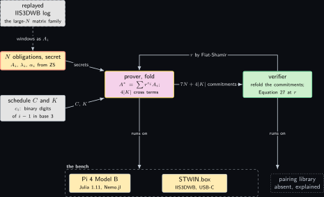
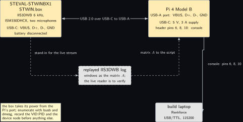
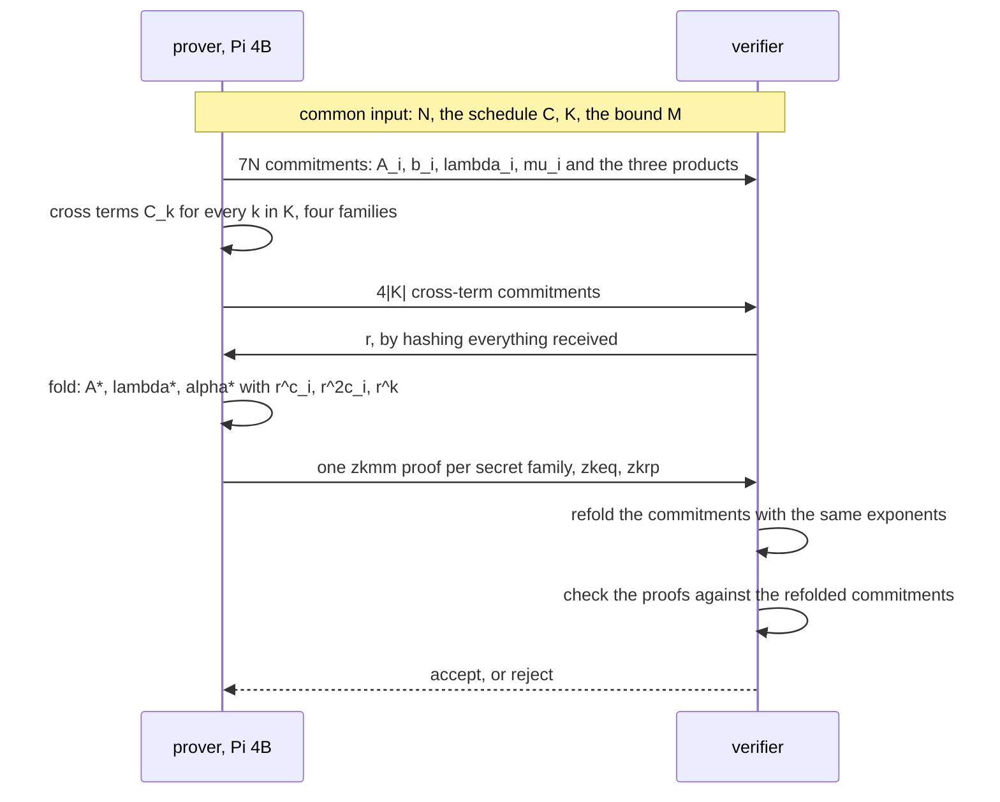
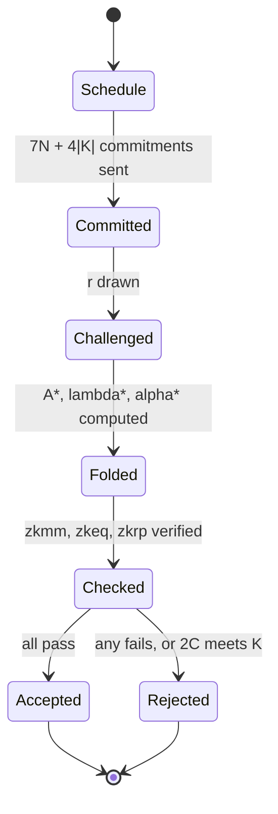
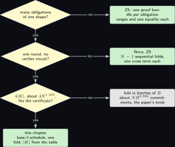
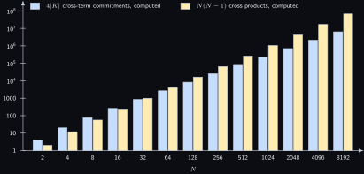

# Project 6. Folding and the Salem-Spencer schedule, computed exactly

> **Board:** Pi 4B; the STEVAL-STWINBX1 STWIN.box over USB-C as the source of a large family of committed matrices, replayed from a log  
> **Language:** Julia

> [!IMPORTANT]
> **The question, instanced**
>
> What can a verifier learn from a device without the device revealing itself, and what does it cost on this board? Here the device holds $N$ secret matrix-vector products, one per obligation of [Project 5](05-farkas-witnesses-for-a-joystick-program.md), and the verifier learns that all $N$ hold by checking one folded product instead of $N$; the price is $4|K|$ extra commitments, where $K$ is the set of cross-term exponents of the paper's schedule, and this chapter computes $|K|$ exactly for $N = 2^k$, $k = 1$ to $13$, proves why the schedule is sound, and checks the folding identity over the field on this board.

> **Key facts**
>
> - **Board:** Raspberry Pi 4 Model B Rev 1.4 (8 GB), Raspberry Pi OS trixie, kernel 6.18.50+rpt-rpi-v8
> - **Parts:** the STEVAL-STWINBX1 STWIN.box (IIS3DWB at 6 kHz) over USB-C, whose vibration windows supply a family of real integer matrices for the large-$N$ runs, replayed from a log and drawn dashed; the Renkforce USB/TTL cable as the console
> - **Interface:** USB-C from the STWIN.box to a USB-A port of the Pi; SSH or the console on header pins 6, 8 and 10
> - **Language and library:** Julia 1.11 (version and the Linux aarch64 archive to verify) with `Nemo.jl` (version to verify) for $\mathbb{F}_p$ and exact integers; no pairing library
> - **Primitive:** the one-shot folding of the paper's Section 5.2 \[[1](#references)\]: Equations 26 to 28, Figure 5 and Theorem 5.1
> - **Secret:** the per-obligation $A_i$ and $\lambda_i$ (and $b_i$, $\mu_i$, which fold the same way)
> - **Public:** the exponent schedule $C$, the challenge $r$, the folded commitments and the $4|K|$ cross-term commitments
> - **Model:** none
> - **Acceptance:** the script prints $|K|$ for the thirteen sizes equal to the table below, admissibility true for every size, the identity of Equation 27 true at a random $r$ for $N = 8$ and false after one $\alpha_i$ is altered; the Pi 4B's table and the build laptop's are identical
> - **Difficulty:** 3 of 5
> - **Effort:** one evening for the script on the authoring laptop, one afternoon to install Julia on the Pi 4B and run it, one hour to enumerate the STWIN.box over USB-C

## Pitch

[Project 5](05-farkas-witnesses-for-a-joystick-program.md) ends with 77 obligations, each a matrix-vector product the prover must show it holds. The paper's Section 5.2 folds any number $N$ of such products into one by weighing each with a power $r^{c_i}$ of a challenge and multiplying the two sums; the product of the sums contains the $N$ diagonal terms the verifier wants and $N(N-1)$ cross terms it does not, and the prover commits to the cross terms grouped by exponent before the challenge is known \[[1](#references)\]. Whether that is sound depends entirely on the exponents: no diagonal exponent $2c_i$ may coincide with a cross exponent $c_j + c_k$, which is the statement that $C$ contains no three-term arithmetic progression, a Salem-Spencer set \[[5](#references)\]. The paper's schedule reads the binary digits of $i - 1$ as base-3 digits and bounds the number of distinct cross exponents by $3^{\lceil \log_2 N \rceil}$. This chapter proves the carry-free argument behind it, proves the Schwartz-Zippel lemma that turns the exponent condition into a soundness bound, writes Equation 27 out in full, and computes $|K|$ exactly in Julia for $N = 2$ to $8192$ with plain integer arithmetic, then checks the folding identity over the ristretto255 scalar field with `Nemo.jl` on the Pi 4B. The computed $|K|$ figures are measured facts whose instrument is the script, and [Project 9](09-nova-versus-one-shot-folding-on-a-pi.md) prices Nova against them.

## Parts and interface

| **Part** | **Role** | **Interface** | **Address or pin** |
| --- | --- | --- | --- |
| Raspberry Pi 4 Model B | runs the script; the prover and the verifier of the fold | SSH, or the Renkforce cable at 115200 | header pins 6, 8, 10 |
| STEVAL-STWINBX1 STWIN.box | source of a large family of integer matrices: one IIS3DWB window per obligation, replayed from a log on this bench | USB-C to the Pi's USB-A; VBUS, D+, D-, GND | enumerates as a USB device; VID:PID to verify with `lsusb` |
| Julia 1.11 with Nemo.jl | exact integers for the schedule, $\mathbb{F}_p$ for the identity | the `julia` binary for Linux aarch64 | version to verify |
| the build laptop, WSL side | runs the same script for the cross-check of the table | LAN | \<build-laptop\> |

## The secret, the statement and the relation

Index the obligations by $i \in [N]$ and abbreviate, as the paper does, $A_i = A_{s,i}^\top$, $b_i = -b_{s,i}^\top$, $G_i = -G_{p,i}^\top$, $h_i = -h_{p,i}^\top$, so that the equality of [Project 5](05-farkas-witnesses-for-a-joystick-program.md)'s Equation 25 becomes the four families of the paper's Equation 26:

$$
\underbrace{A_i \lambda_i = \alpha_i, \quad b_i \lambda_i = \beta_i}_{\text{secret, secret}}
  \qquad
  \underbrace{G_i \mu_i = \alpha_i, \quad h_i \mu_i = \gamma_i}_{\text{public, secret}} \tag{6.1}
$$

with $A_i \in \mathbb{Z}_p^{d \times n_i}$, $\lambda_i \in \mathbb{Z}_p^{n_i}$ and $\alpha_i \in \mathbb{Z}_p^{d}$. The chapter treats the first family in full; the other three fold identically. The witness and the statement of the folded instance are

$$
\begin{aligned}
w &= \big(\thinspace  \lbrace A_i, \lambda_i, \alpha_i\rbrace _{i \in [N]},\thickspace  \lbrace C^A_k\rbrace _{k \in K},\thickspace 
       \text{randomness} \thinspace \big), \cr 
  u &= \big(\thinspace  C = \lbrace c_1, \dots, c_N\rbrace ,\thickspace  r,\thickspace 
       \lbrace c_{A_i}, c_{\lambda_i}, c_{\alpha_i}\rbrace _{i \in [N]},\thickspace  \lbrace c_{C^A_k}\rbrace _{k \in K} \thinspace \big),
\end{aligned}
$$

and the relation the verifier checks, the paper's $\mathcal{R}_{\mathsf{f}}$ after the fold, is

$$
\mathcal{R}_{06} = \Big\lbrace \thinspace  (w, u) \thickspace \Big|\thickspace 
    A^* \lambda^* = \alpha^* \thickspace \wedge\thickspace  2C \cap K = \emptyset \thickspace \wedge\thickspace 
    \text{every } c_\star \text{ opens to its value} \thinspace \Big\rbrace , \tag{6.2}
$$

where $A^* = \sum_i r^{c_i} A_i$, $\lambda^* = \sum_i r^{c_i} \lambda_i$, $K = \lbrace c_i + c_j \mid i \ne j\rbrace$, and $\alpha^* = \sum_i r^{2c_i} \alpha_i + \sum_{k \in K} r^k C^A_k$ with $C^A_k = \sum_{c_i + c_j = k,\thinspace i \ne j} A_i \lambda_j$. The verifier never sees an $A_i$ or a $\lambda_i$; it recomputes the folded commitments from the per-obligation ones by the homomorphism of Theorem thm:z01\_hiding's scheme and asks for one zkmm run on the folded triple instead of $N$. On this bench the commitment layer has no pairing library, so the script checks $A^* \lambda^* = \alpha^*$ on the values; that is said again under **learn**.

## The mathematics

**Definition Z6.1 (Exponent schedule and cross-term set).** An exponent schedule for $N$ obligations is a set $C = \lbrace c_1, \dots, c_N\rbrace \subset \mathbb{N}$ of $N$ distinct non-negative integers. Its cross-term set is $K = \lbrace \thinspace c_i + c_j \mid i, j \in [N],\thickspace i \ne j \thinspace \rbrace$ and its diagonal set is $2C = \lbrace \thinspace 2c_i \mid i \in [N] \thinspace \rbrace$. The schedule is admissible if $2C \cap K = \emptyset$, the paper's Equation 28.

**Definition Z6.2 (Salem-Spencer set).** A set $S \subset \mathbb{N}$ is 3-AP-free, or a Salem-Spencer set, if there are no $a, b, c \in S$ with $a \ne c$ and $a + c = 2b$ \[[5](#references), [6](#references)\].

**Lemma Z6.3 (Admissible means 3-AP-free).** A schedule $C$ is admissible if and only if it is 3-AP-free.

*Proof.* Suppose $C$ is not admissible: some $2c_k \in K$, so $2c_k = c_i + c_j$ with $i \ne j$. Since the $c_i$ are distinct, $i \ne j$ gives $c_i \ne c_j$, so $(a, b, c) = (c_i, c_k, c_j)$ is a three-term progression with $a \ne c$ in $C$, and $C$ is not 3-AP-free. Conversely, suppose $a, b, c \in C$ with $a \ne c$ and $a + c = 2b$; write $a = c_i$, $c = c_j$, $b = c_k$. From $a \ne c$ follows $i \ne j$, so $a + c = c_i + c_j \in K$, and $2b = 2c_k \in 2C$; hence $2C \cap K \ne \emptyset$ and $C$ is not admissible. &#9632;

**Theorem Z6.4 (Integers with base-3 digits in $\lbrace 0, 1\rbrace$ form a Salem-Spencer set).** Let $S_3 = \lbrace \thinspace \sum_{t \ge 0} a_t 3^t \mid a_t \in \lbrace 0, 1\rbrace ,\thickspace \text{finitely many } a_t \ne 0 \thinspace \rbrace$. Then $S_3$ is 3-AP-free.

*Proof.* Let $a, b, c \in S_3$ with $a + c = 2b$, and write their base-3 digits as $a_t, b_t, c_t \in \lbrace 0, 1\rbrace$. Compute $a + c$ digit by digit: at every position $a_t + c_t \in \lbrace 0, 1, 2\rbrace$, which is below 3, so no carry is produced at any position, and the base-3 digits of $a + c$ are exactly $a_t + c_t$. Compute $2b$ the same way: at every position $2 b_t \in \lbrace 0, 2\rbrace$, again below 3, so no carry is produced and the base-3 digits of $2b$ are exactly $2 b_t$. Base-3 representation is unique, so $a + c = 2b$ forces $a_t + c_t = 2 b_t$ at every position $t$. If $b_t = 0$ then $a_t + c_t = 0$ with both terms non-negative, so $a_t = c_t = 0 = b_t$. If $b_t = 1$ then $a_t + c_t = 2$ with both terms at most 1, so $a_t = c_t = 1 = b_t$. In both cases $a_t = b_t = c_t$, so $a = b = c$. Hence every three-term progression in $S_3$ is trivial, which is Definition **Definition Z6.2**. &#9632;

**Definition Z6.5 (The paper's schedule).** For $N \ge 1$ and $i \in [N]$ let $i - 1 = \sum_{t=0}^{k-1} \beta_t 2^t$ with $\beta_t \in \lbrace 0, 1\rbrace$ and $k = \lceil \log_2 N \rceil$ (for $N = 1$ take $k = 0$), and set $c_i = \sum_{t=0}^{k-1} \beta_t 3^t$: the binary digits of $i - 1$ read in base 3. By Theorem **Theorem Z6.4** and Lemma **Lemma Z6.3** the schedule $C = \lbrace c_1, \dots, c_N\rbrace$ is admissible; it is a set of $N$ distinct integers because the map from binary strings to base-3 values is injective.

**Lemma Z6.6 (Size of the cross-term set).** For the schedule of Definition **Definition Z6.5** with $k = \lceil \log_2 N \rceil$, $N - 1 \le |K| \le 3^k - 1 < 3^{\lceil \log_2 N \rceil}$.

*Proof.* Upper bound. Every $c_i$ has at most $k$ base-3 digits, each 0 or 1, so $0 \le c_i \le \sum_{t=0}^{k-1} 3^t = (3^k - 1)/2$. For $i \ne j$ at most one of $c_i, c_j$ is 0, so $c_i + c_j \ge 1$, and $c_i + c_j \le 3^k - 1$. Hence $K \subseteq \lbrace 1, 2, \dots, 3^k - 1\rbrace$ and $|K| \le 3^k - 1$. Lower bound. The $N - 1$ sums $c_1 + c_j$ for $j \ne 1$ are pairwise distinct because the $c_j$ are, and each lies in $K$, so $|K| \ge N - 1$. &#9632;

For $N = 2^k$ the upper bound reads $3^k - 1 = N^{\log_2 3} - 1$, about $N^{1.585}$; the table in the Benchmark shows $|K|$ rising from a third of $3^k$ at $k = 1$ to $0.995$ of it at $k = 13$ (computed by the script), so the bound is close to the count the schedule produces, and the lower bound $N - 1$ is what [Project 9](09-nova-versus-one-shot-folding-on-a-pi.md) compares against Nova.

**Lemma Z6.7 (Schwartz-Zippel).** Let $\mathbb{F}$ be a field, $S \subseteq \mathbb{F}$ finite and non-empty, and $f \in \mathbb{F}[x_1, \dots, x_n]$ a non-zero polynomial of total degree at most $d$. If $r_1, \dots, r_n$ are chosen independently and uniformly from $S$, then $\Pr[f(r_1, \dots, r_n) = 0] \le d / |S|$ \[[2](#references), [3](#references)\].

*Proof.* By induction on $n$. Base case $n = 1$. A non-zero univariate polynomial of degree $d$ has at most $d$ roots in $\mathbb{F}$: by induction on $d$, a polynomial of degree 0 is a non-zero constant with no roots; if $f$ has degree $d \ge 1$ and a root $a$, polynomial division gives $f(x) = (x - a) q(x)$ with $q$ of degree $d - 1$, and any root $b \ne a$ of $f$ satisfies $(b - a) q(b) = 0$ with $b - a \ne 0$, so $q(b) = 0$; $q$ has at most $d - 1$ roots by the inner induction, so $f$ has at most $d$. The probability that a uniform $r_1 \in S$ hits one of at most $d$ roots is at most $d / |S|$. Inductive step. Let $n \ge 2$ and write $f = \sum_{i=0}^{m} x_1^i f_i(x_2, \dots, x_n)$ with $m$ the largest power of $x_1$ whose coefficient $f_m$ is a non-zero polynomial; $f_m$ has total degree at most $d - m$. Let $E$ be the event $f_m(r_2, \dots, r_n) = 0$. By the induction hypothesis applied to $f_m$ in $n - 1$ variables, $\Pr[E] \le (d - m) / |S|$. Conditioned on $\neg E$, the univariate polynomial $g(x_1) = f(x_1, r_2, \dots, r_n)$ has leading coefficient $f_m(r_2, \dots, r_n) \ne 0$, so it is non-zero of degree exactly $m$, and by the base case $\Pr[g(r_1) = 0 \mid \neg E] \le m / |S|$, since $r_1$ is independent of $r_2, \dots, r_n$. Therefore

$$
\Pr[f(r) = 0] \thickspace \le\thickspace  \Pr[E] + \Pr[f(r) = 0 \wedge \neg E]
  \thickspace \le\thickspace  \frac{d - m}{|S|} + \Pr[g(r_1) = 0 \mid \neg E]
  \thickspace \le\thickspace  \frac{d - m}{|S|} + \frac{m}{|S|} \thickspace =\thickspace  \frac{d}{|S|} .
$$ &#9632;

**Theorem Z6.8 (Equation 27 of the paper, expanded).** Let $C$ be any schedule, $r \in \mathbb{Z}_p$, $A^* = \sum_{i=1}^{N} r^{c_i} A_i$ and $\lambda^* = \sum_{j=1}^{N} r^{c_j} \lambda_j$. Then

$$
A^* \lambda^* \thickspace =\thickspace  \sum_{i=1}^{N} r^{2 c_i} A_i \lambda_i
  \thickspace +\thickspace  \sum_{k \in K} r^{k} C^A_k,
  \qquad C^A_k = \sum_{\substack{i \ne j \cr  c_i + c_j = k}} A_i \lambda_j . \tag{6.3}
$$

If moreover $A_i \lambda_i = \alpha_i$ for every $i$, then $A^* \lambda^* = \alpha^*$ with $\alpha^* = \sum_i r^{2c_i} \alpha_i + \sum_{k \in K} r^k C^A_k$.

*Proof.* Matrix-vector multiplication is bilinear, so

$$
\begin{aligned}
A^* \lambda^*
  &= \Big( \sum_{i=1}^{N} r^{c_i} A_i \Big) \Big( \sum_{j=1}^{N} r^{c_j} \lambda_j \Big)
   = \sum_{i=1}^{N} \sum_{j=1}^{N} r^{c_i} r^{c_j} A_i \lambda_j
   = \sum_{i=1}^{N} \sum_{j=1}^{N} r^{c_i + c_j} A_i \lambda_j \cr 
  &= \sum_{i=1}^{N} r^{c_i + c_i} A_i \lambda_i
   \thickspace +\thickspace  \sum_{\substack{i, j \in [N] \cr  i \ne j}} r^{c_i + c_j} A_i \lambda_j
   = \sum_{i=1}^{N} r^{2 c_i} A_i \lambda_i
   \thickspace +\thickspace  \sum_{k \in K} \thickspace  \sum_{\substack{i \ne j \cr  c_i + c_j = k}} r^{k} A_i \lambda_j ,
\end{aligned}
$$

where the last step groups the ordered pairs $(i, j)$ with $i \ne j$ by the value $k = c_i + c_j$, which by Definition **Definition Z6.1** ranges exactly over $K$, and every ordered pair falls into exactly one group. Factoring $r^k$ out of each group gives $r^k C^A_k$, which is Equation 6.3. Substituting $\alpha_i$ for $A_i \lambda_i$ in the diagonal sum gives the second claim. &#9632;

**Theorem Z6.9 (Field-layer soundness of the fold).** Let $C$ be admissible with $c_{\max} = \max_i c_i$, and let the prover commit to $\lbrace A_i, \lambda_i, \alpha_i\rbrace _{i}$ and to vectors $\lbrace D_k\rbrace _{k \in K}$ of its choosing before $r$ is drawn uniformly from $\mathbb{Z}_p$. If $A_i \lambda_i \ne \alpha_i$ for some $i$, then

$$
\Pr_r\Big[\thinspace  A^* \lambda^* = \sum_{i} r^{2c_i} \alpha_i + \sum_{k \in K} r^k D_k \thinspace \Big]
  \thickspace \le\thickspace  \frac{2 c_{\max}}{p} .
$$

*Proof.* Subtract the right-hand side from the left and use Theorem **Theorem Z6.8**: the difference is the vector-valued polynomial $P(X) = \sum_{i} X^{2c_i} (A_i \lambda_i - \alpha_i) + \sum_{k \in K} X^k (C^A_k - D_k)$, and the event is $P(r) = 0$. Pick $i_0$ with $A_{i_0} \lambda_{i_0} \ne \alpha_{i_0}$ and a coordinate $t$ where they differ, and let $P_t$ be the $t$-th coordinate of $P$, a polynomial in $\mathbb{Z}_p[X]$. Its monomials are $X^{2c_i}$ for $i \in [N]$ and $X^k$ for $k \in K$. The exponents $2c_i$ are pairwise distinct because the $c_i$ are, and no $2c_i$ equals any $k \in K$ because $C$ is admissible; so the coefficient of $X^{2c_{i_0}}$ in $P_t$ is exactly $(A_{i_0} \lambda_{i_0} - \alpha_{i_0})_t \ne 0$, whatever the $D_k$ are. Hence $P_t$ is a non-zero polynomial. Its degree is at most $\max(2 c_{\max}, \max K)$, and $\max K = c_{\max} + c' < 2 c_{\max}$ for the second-largest $c'$, so the degree is at most $2 c_{\max}$. By Lemma **Lemma Z6.7** with $n = 1$, $S = \mathbb{Z}_p$ and $d = 2 c_{\max}$, $\Pr[P_t(r) = 0] \le 2 c_{\max} / p$, and $P(r) = 0$ implies $P_t(r) = 0$. &#9632;

For the paper's schedule $c_{\max} = (3^k - 1)/2$, so the bound is $(3^k - 1)/p$: for $N = 8192$ and ristretto255's $p$ it is below $2^{21} / 2^{252} = 2^{-231}$ (computed). The paper's Theorem 5.1 adds the knowledge errors of zkmm, zkeq and zkrp and the binding error; the integer layer, which makes the per-obligation ranges meaningful, is [Project 5](05-farkas-witnesses-for-a-joystick-program.md)'s Lemma lem:z05\_encoding and does not depend on $N$.

## The protocol

The paper's Figure 5, for the secret-secret family, with this chapter's numbers.

1. **Common input.** The schedule $C$ of Definition **Definition Z6.5** for $N$, hence $K$; the bound $M$; the setup. Both parties compute $C$ and $K$ with the script, which is why they are public and exact.
2. **Prover, commit.** For every $i \in [N]$ commit to $A_i$, $b_i$, $\lambda_i$, $\mu_i$, $\alpha_i$, $\beta_i$, $\gamma_i$ under the two-tier Pedersen scheme; send the $7N$ commitments. This is [Project 5](05-farkas-witnesses-for-a-joystick-program.md)'s commit step, done once.
3. **Prover, cross terms.** For every $k \in K$ compute $C^A_k$, $C^b_k$, $C^G_k$, $C^h_k$ by Theorem **Theorem Z6.8**, commit to them, and send the $4|K|$ commitments.
4. **Challenge.** $r = H(\text{all commitments})$ by Fiat-Shamir; the script draws $r$ uniformly instead and prints it.
5. **Prover, fold.** Compute $A^*$, $\lambda^*$, $b^*$, $\mu^*$ and the folded right-hand sides $\alpha^*$, $\beta^*$, $\gamma^*$; run zkmm once on $(A^*, \lambda^*, \alpha^*)$ and once on $(b^*, \mu^*, \beta^*)$, zkeq once on the public families, zkrp on the per-obligation ranges.
6. **Verifier.** Recompute the folded commitments from the $7N + 4|K|$ received ones by the homomorphism, with exponents $r^{c_i}$, $r^{2c_i}$ and $r^k$; check the zkmm, zkeq and zkrp proofs; accept.

## The code

The script does three things and prints one `zk06` line per result: the schedule and $|K|$ for $N = 2^k$ with plain `Int` arithmetic, the admissibility check of Equation 28, and the identity of Equation 6.3 over $\mathbb{F}_p$ for a small instance, once honestly and once with one $\alpha_i$ altered.

```julia
# zk06_fold.jl: the base-3 schedule, |K| exactly, and Equation 27 over F_p
using Nemo

# the binary digits of i - 1, read as base-3 digits (Definition of the paper's schedule)
schedule(N) = [parse(Int, string(i - 1, base = 2), base = 3) for i in 1:N]

function crossterms(C)                     # K = {c_i + c_j : i != j}, as a sorted vector
    top = 2 * maximum(C)
    seen = falses(top + 1)                 # index k + 1 marks the sum k
    for i in eachindex(C), j in eachindex(C)
        i == j && continue
        seen[C[i] + C[j] + 1] = true
    end
    return [k for k in 0:top if seen[k + 1]]
end

admissible(C, K) = (kset = Set(K); all(!(2c in kset) for c in C))   # Equation 28

println("zk06 schedule: N, |K|, 4|K|, N(N-1), 3^k, admissible, |K| < 3^k")
for k in 1:13
    N = 2^k
    C = schedule(N)
    K = crossterms(C)
    println("zk06 N=$N K=$(length(K)) fourK=$(4 * length(K)) pairs=$(N * (N - 1)) ",
            "bound=$(3^k) admissible=$(admissible(C, K)) under=$(length(K) < 3^k)")
end

# Equation 27 over F_p at a random challenge: N = 8, d by n matrices, entries in [-M, M]
p = ZZ(2)^252 + ZZ("27742317777372353535851937790883648493")   # the ristretto255 order
F = GF(p)
M = 2^32
N = 8; d = 4; n = 7
C = schedule(N); K = crossterms(C)
A = [matrix(F, rand(-M:M, d, n)) for i in 1:N]
lam = [matrix(F, rand(0:M, n, 1)) for i in 1:N]
alpha = [A[i] * lam[i] for i in 1:N]
r = rand(F)
println("zk06 challenge r=", r)
Astar = sum(r^C[i] * A[i] for i in 1:N)
lstar = sum(r^C[i] * lam[i] for i in 1:N)
cross = Dict(k => zero_matrix(F, d, 1) for k in K)
for i in 1:N, j in 1:N
    i == j && continue
    cross[C[i] + C[j]] += A[i] * lam[j]
end
folded(alpha) = sum(r^(2 * C[i]) * alpha[i] for i in 1:N) + sum(r^k * cross[k] for k in K)
println("zk06 eq27 honest: ", Astar * lstar == folded(alpha))
alpha[3] += matrix(F, reshape([1; zeros(Int, d - 1)], d, 1))   # one wrong obligation
println("zk06 eq27 after altering alpha_3: ", Astar * lstar == folded(alpha))
```

```bash
# build laptop, WSL: the reference table
julia -e 'using Pkg; Pkg.add("Nemo")' && julia zk06_fold.jl | tee zk06_host.log
# on the Pi 4B over ssh: the Linux aarch64 archive of Julia 1.11 from julialang.org
# (archive name to verify), unpacked under ~/julia, then the same two lines
~/julia/bin/julia -e 'using Pkg; Pkg.add("Nemo")'
~/julia/bin/julia zk06_fold.jl | tee zk06_pi4b.log
diff <(grep '^zk06 N=' zk06_host.log) <(grep '^zk06 N=' zk06_pi4b.log) && echo same
```

Names to verify against the Nemo documentation: `GF` on a `ZZRingElem` modulus, `matrix` on a Julia integer matrix, `zero_matrix`, and `rand` on the field; the integer part of the script uses no library at all. The pair loop for $N = 8192$ visits $67100672$ ordered pairs (computed), which is seconds on the Pi 4B and is the only part of the script whose time is worth reading.

## The model, if any

None. The schedule is a formula and the fold is an identity; nothing here is proposed.

## Real, modelled, absent

- **have:** real: the Pi 4B; the STWIN.box as a USB device; the thirteen values of $|K|$ and the two identity checks, which the script computes exactly on any machine and which this chapter prints as computed facts; the schedule $C$ for every $N$
- **learn:** modelled: the IIS3DWB stream that supplies the large-$N$ matrix family is replayed from a log, since the STWIN.box's USB protocol and the Linux-side reader are to verify; the commitment layer is absent (no pairing library in Julia on this bench), so the fold is checked on values, not on commitments; Julia's aarch64 archive name and the Nemo version are to verify
- **absent:** absent: a pairing library for the two-tier commitments, so the $4|K|$ commitments are counted and not produced; a second board as an independent verifier; a measured fold time, which would need the commitment layer to mean anything

## System architecture



*Figure 6.1. The one-shot fold. Top row, left to right: the $N$ obligations as a stop-outlined secret block holding $A_i$, $\lambda_i$ and $\alpha_i$, with a dashed block beneath it for the replayed IIS3DWB windows that supply the large-$N$ family; the public schedule $C$ and its cross-term set $K$ as a grey block, computed by both parties; the prover with the accent outline, folding with $r^{c_i}$ and committing to $4\vert K\vert $ cross terms; and the verifier with the green outline, recomputing the folded commitments and checking Equation 27 at $r$. A solid arrow carries the secrets and a solid arrow the schedule into the prover; the prover sends $7N + 4\vert K\vert $ commitments and the folded proofs to the verifier. Below, inside a dashed layer named the bench: the Pi 4B as a solid hardware block running the Julia script, the STWIN.box as a solid hardware block over USB-C, and a dotted grey block for the absent pairing library.*

Read the figure as a count: $N$ secrets enter, $7N + 4|K|$ commitments leave, and the verifier's work is one proof check plus $O(N + |K|)$ exponentiations to fold the commitments, which is the paper's complexity claim for this section.

## Wiring



*Figure 6.2. The STWIN.box and the Pi 4B. On the left the STWIN.box as a solid hardware block naming its sensors and its USB-C connector with the four lines used, VBUS, D+, D- and GND; a solid line to the Pi 4B's USB-A port on the right, with the Pi as a solid hardware block naming its own USB-C supply and the console pins 6, 8 and 10. Between them a dashed block for the replayed log, the software stand-in for the live stream, feeding the script as a matrix $A$ of IIS3DWB windows; below, the console cable to the build laptop as a grey external block.*

| **Signal** | **From** | **To** | **Note** |
| --- | --- | --- | --- |
| VBUS, GND | Pi 4B USB-A port | STWIN.box USB-C | the box is powered from the port; its own battery stays disconnected |
| D+, D- | STWIN.box USB-C | Pi 4B USB-A | USB 2.0 data; enumeration checked with `lsusb`, VID:PID to verify |
| IIS3DWB windows | the box's firmware | the script, as a matrix $A$ | replayed from a log on this bench; drawn dashed |
| 5 V supply | the Pi's USB-C power input | Pi 4B | 5 V, 3 A supply; nothing else on the header |
| console | Pi header pins 6, 8, 10 | Renkforce USB/TTL to the build laptop | 115200; GND, TXD GPIO14, RXD GPIO15 |

## Sequence and states





## Decision tree



*Figure 6.3. When the one-shot fold is the right tool. The root diamond asks whether there are many obligations of one shape; no leads to a leaf naming Z5, one proof bundle per obligation. Yes leads to a diamond asking whether the fold must finish in one round without a verifier circuit; no leads to a leaf naming Nova in Z9, $N - 1$ sequential folds with one cross term each. Yes leads to a diamond asking whether $4\vert K\vert $ commitments, about $4 N^{1.585}$, fit the certificate budget; no leads to a grey leaf saying to fold in batches of $B$ for about $N B^{0.585}$ commitments, the paper's tuning knob. Yes leads to the leaf of this chapter, the base-3 schedule and one fold.*

## Benchmark



*Figure 6.4. The cross-term count, computed exactly by the script and therefore drawn solid: for each $N = 2^k$, $k = 1$ to $13$, a blue bar for $4\vert K\vert $ and a yellow bar for $N(N - 1)$, on a log scale. The pairwise count overtakes the commitment count at $N = 32$ and is ten times larger at $N = 8192$: the fold replaces $N(N-1)$ cross products in the proof by $4\vert K\vert $ commitments in the certificate, and the prover still computes every one of the products.*

| $N$ | $\vert K\vert $ | $4\vert K\vert $ | $N(N-1)$ | $3^{k}$ | **Instrument** |
| --- | --- | --- | --- | --- | --- |
| 2 | 1 | 4 | 2 | 3 | computed, `zk06_fold.jl`, any machine |
| 4 | 5 | 20 | 12 | 9 | computed, the same |
| 8 | 19 | 76 | 56 | 27 | computed, the same |
| 16 | 65 | 260 | 240 | 81 | computed, the same |
| 32 | 211 | 844 | 992 | 243 | computed, the same |
| 64 | 665 | 2660 | 4032 | 729 | computed, the same |
| 128 | 2059 | 8236 | 16256 | 2187 | computed, the same |
| 256 | 6305 | 25220 | 65280 | 6561 | computed, the same |
| 512 | 19171 | 76684 | 261632 | 19683 | computed, the same |
| 1024 | 58025 | 232100 | 1047552 | 59049 | computed, the same |
| 2048 | 175099 | 700396 | 4192256 | 177147 | computed, the same |
| 4096 | 527345 | 2109380 | 16773120 | 531441 | computed, the same |
| 8192 | 1586131 | 6344524 | 67100672 | 1594323 | computed, the same |

| **Quantity** | **Value** | **Where** | **Instrument** |
| --- | --- | --- | --- |
| schedule and $\vert K\vert $, $N = 8192$ | not measured | Pi 4B | `@time` around the loop; throttle word 0x0 before and after |
| identity check, $N = 8$ | not measured | Pi 4B | `@time` |
| fold with commitments | not measured, no pairing library | Pi 4B | none until the layer exists |
| symbolic prover, folded | 1 min for 217 to 303 obligations | the paper's AWS c6g.8xlarge | the paper's Table 1, rows `exb_i*`, attributed \[[1](#references)\] |
| symbolic verifier, folded | 10 s for the same rows | the paper's AWS c6g.8xlarge | the paper's Table 1, attributed \[[1](#references)\] |

The values of the first table are in the keyfacts as the acceptance criterion: a run that prints a different $|K|$ for any $N$ is wrong, on whichever machine it ran, and the two logs are compared line by line.

## Steps

**Step 1.** On the authoring laptop, write the script and the thirteen expected values into the acceptance test; do not run it there, the laptop authors and never computes a result that is published.

**Step 2.** On the build laptop in WSL, install Julia 1.11 and Nemo, run the script, and keep `zk06_host.log`; the thirteen `zk06 N=` lines must match the table.

**Step 3.** On the Pi 4B over ssh, unpack the Linux aarch64 archive of Julia (name to verify), install Nemo, read `vcgencmd get_throttled`, run the script with `@time` around the $N = 8192$ loop, read the register again, and keep `zk06_pi4b.log`.

**Step 4.** On the Pi 4B, run the `diff` of the shell block; it must print `same`.

**Step 5.** On the Pi 4B, plug the STWIN.box into a USB-A port, read `lsusb` and `dmesg`, and record the VID:PID and the device node; replace "to verify" in the wiring table. The stream reader remains modelled until a Linux-side tool is read.

**Step 6.** On the Pi 4B, run the identity check three times with different seeds; each run must print `honest: true` and `after altering alpha_3: false`, and print the challenge it drew.

## Acceptance test

The chapter passes when both logs hold thirteen `zk06 N=` lines whose $|K|$ values are 1, 5, 19, 65, 211, 665, 2059, 6305, 19171, 58025, 175099, 527345 and 1586131 in that order, every line reads `admissible=true` and `under=true`, the two logs agree line by line, and three identity runs each print true then false. It fails if any $|K|$ differs by one, if any schedule is found inadmissible, if an altered $\alpha_3$ still passes (which would mean the challenge was not random or the cross terms were recomputed after the alteration), or if the Pi 4B's throttle register changed during the run.

## Variants

**The polynomial evaluation offloaded to the Nucleo.** The Pi 4B keeps the schedule and the fold, and the batch evaluation points of the cross-term polynomial travel over the Renkforce USB/TTL cable to the NUCLEO-H7A3ZI-Q, which stands in for a trace-generation accelerator and returns the evaluated terms \[[8](#references), [7](#references)\]. One layer is swapped: the field arithmetic of the evaluation moves to a Cortex-M7 at 280 MHz while Julia keeps the schedule, the admissibility check of Definition **Definition Z6.1** and the identity of Equation 6.3. The bilinear pairing stays on the Pi 4B, because no pairing library is built for this microcontroller on this bench, so the brief's picture of a microcontroller returning a group element in $\mathbb{G}_T$ is not what this variant does. The link is the cost: for $N = 8$ the four families hold $4|K| = 76$ cross terms of $d = 4$ field elements each, which is 304 scalars of 32 bytes, and 9728 bytes at 115200 baud with ten bits per byte is 0.84 s (computed), longer than the evaluation being offloaded. Choose it when the question under study is where the trace-generation cost sits rather than how quickly the fold finishes, since the cable makes that cost visible as an interval of its own. The brief's source of the matrix family is the DFROBOT SEN0032 accelerometer, which is retired from every plan on this bench since Saturday 24 October 2026 because its header is unsoldered and six scans of it were empty, so the windows come from the STWIN.box's IIS3DWB as they do everywhere else in this chapter.

**Folding a Kalman filter's obligations.** The $N$ obligations become the gain computations of a Kalman filter over its last 1000 epochs, so that an auditor is convinced the gain was formed correctly without being shown the covariances \[[9](#references), [7](#references)\]. Nothing in the schedule changes: the obligations are still matrix-vector products of the shape of Equation 6.1, and the filter says only where they come from. Padding 1000 epochs to $N = 1024$ puts the schedule at $k = 10$, and this chapter's own table gives $4|K| = 232100$ cross-term commitments against $N(N-1) = 1047552$ ordered products (both computed), which is the whole argument for folding a run that long. Choose it when the secret is a filter's internal state rather than a program's transitions, since the obligations are then produced by one routine and share one shape, which the schedule needs. The brief stacks the X-NUCLEO-IKS4A1 and the X-NUCLEO-IKS5A1 on the STEVAL-STWINBX1 to feed the filter, which this bench cannot do: the STWIN.box is a USB-C device with no Arduino header, so those shields fit the Nucleo's Arduino header one at a time, or reach a Pi I2C bus on flying leads. The brief also sends the finished proof outward over a radio link; nothing in this volume goes outward, and the verifier is the Pi 4B on the bench.

## Pitfalls

- The cross terms are committed before $r$ is known, and the acceptance test's false result depends on it: a script that recomputes `cross` after altering $\alpha_3$ tests nothing, because Theorem **Theorem Z6.8** is an identity for any $A_i$, $\lambda_i$; only the $\alpha_i$ were altered here, and the cross terms stayed.
- The fold argues over $\mathbb{Z}_p$ and a folded witness is uniform in $\mathbb{Z}_p$; the ranges of Equation 25 are stated per obligation and never on $\lambda^*$. A reader who range-proves the folded vector has proved nothing about any $\lambda_i$.
- $|K| \ge N - 1$ for every schedule, not only this one (Lemma **Lemma Z6.6**), so no choice of $C$ brings the certificate below $4(N - 1)$ cross-term commitments; Behrend's construction \[[4](#references)\] gives denser 3-AP-free sets, which lowers $c_{\max}$ and the soundness bound, not $|K|$ below its floor.
- `parse(Int, s, base = 3)` on a binary string is the schedule only because the string holds no digit 2; a schedule written from a decimal string would not be 3-AP-free, and the admissibility line is the check that catches it.
- A `BitVector` of length $2 c_{\max} + 1$ is $1.6$ million bits at $N = 8192$ (computed); a `Set{Int}` of the same sums is a hundred times larger in memory and slower on the Pi, which is why the script marks sums in a vector.

## Languages and libraries not chosen

- Python with `sympy`: exact integers too, but the $67$ million pair loop at $N = 8192$ is minutes in pure Python and seconds in Julia; the volume keeps Python to the front end.
- Rust with `ark-ff`: the right choice once the commitment layer exists, and [Project 9](09-nova-versus-one-shot-folding-on-a-pi.md) is in Rust for that reason; for an exact count and an identity check the REPL and the big-integer field of Nemo are the shorter path.
- C with GMP: no shorter than Julia for this and without a field type; it would be the board choice if the schedule had to run on the Nucleo, which it never does.

## Sources

- [arxiv.org/abs/2605.00487](https://arxiv.org/abs/2605.00487) (verified Friday 6 November 2026), the paper: Section 5.2, Equations 26 to 28, Figure 5, Theorem 5.1 and Appendix C.
- [doi:10.1073/pnas.28.12.561](https://doi.org/10.1073/pnas.28.12.561) (to verify), Salem and Spencer.
- [doi:10.1073/pnas.32.12.331](https://doi.org/10.1073/pnas.32.12.331) (to verify), Behrend.
- [doi:10.1145/322217.322225](https://doi.org/10.1145/322217.322225) (to verify), Schwartz.
- [julialang.org/downloads](https://julialang.org/downloads/) (to verify), the Linux aarch64 archive.
- [github.com/Nemocas/Nemo.jl](https://github.com/Nemocas/Nemo.jl) (to verify).
- [st.com, STEVAL-STWINBX1](https://www.st.com/en/evaluation-tools/steval-stwinbx1.html) (to verify).

<a id="references"></a>

## References

1. Pascal Berrang, Mirco Giacobbe, Jacob Swales and Xiao Yang. Zero-Knowledge Model Checking. arXiv:2605.00487v2 \[cs.CR\], version 1 submitted Friday 1 May 2026, version 2 Tuesday 8 September 2026. [arxiv.org/abs/2605.00487](https://arxiv.org/abs/2605.00487) (verified Friday 6 November 2026).
2. Jacob T. Schwartz. Fast probabilistic algorithms for verification of polynomial identities. Journal of the ACM, 27(4), pages 701 to 717, 1980. [doi:10.1145/322217.322225](https://doi.org/10.1145/322217.322225) (to verify).
3. Richard Zippel. Probabilistic algorithms for sparse polynomials. In EUROSAM 1979, LNCS 72, pages 216 to 226. Springer, 1979. [doi:10.1007/3-540-09519-5\_73](https://doi.org/10.1007/3-540-09519-5_73) (to verify).
4. Felix A. Behrend. On sets of integers which contain no three terms in arithmetical progression. Proceedings of the National Academy of Sciences, 32(12), pages 331 to 332, 1946. [doi:10.1073/pnas.32.12.331](https://doi.org/10.1073/pnas.32.12.331) (to verify).
5. Raphael Salem and Donald C. Spencer. On sets of integers which contain no three terms in arithmetical progression. Proceedings of the National Academy of Sciences, 28(12), pages 561 to 563, 1942. [doi:10.1073/pnas.28.12.561](https://doi.org/10.1073/pnas.28.12.561) (to verify).
6. Paul Erdős and Paul Turan. On some sequences of integers. Journal of the London Mathematical Society, 11(4), pages 261 to 264, 1936. [doi:10.1112/jlms/s1-11.4.261](https://doi.org/10.1112/jlms/s1-11.4.261) (to verify).
7. Advanced hardware-software architectures for edge artificial intelligence and zero-knowledge model checking. A design brief of twenty project sketches, read on Friday 6 November 2026 and held locally at `a local design brief`. It is the input to this second edition and is not a published source; where its hardware claims disagree with the bench, the bench is followed and the disagreement is stated.
8. Jieran Cui, Zhengkai Wen, Haowen Fang, Yinan Zhu, Jia Xiong, Cheng Ni, Mingchi Zhang, Nan Guan and Xi Wang. ZK-Tracer: a high-performance heterogeneous accelerator for zero-knowledge virtual machine trace generation. arXiv:2605.25493, submitted Monday 25 May 2026, revised Tuesday 26 May 2026. [arxiv.org/abs/2605.25493](https://arxiv.org/abs/2605.25493) (verified Friday 6 November 2026).
9. Rudolf E. Kalman. A new approach to linear filtering and prediction problems. Journal of Basic Engineering, 82(1), pages 35 to 45, 1960. [doi:10.1115/1.3662552](https://doi.org/10.1115/1.3662552) (to verify).

---

[Previous](05-farkas-witnesses-for-a-joystick-program.md) &nbsp;&nbsp;|&nbsp;&nbsp; [Contents](../CONTENTS.md) &nbsp;&nbsp;|&nbsp;&nbsp; [Next](07-the-esp32-proves-two-commitments-open-to-one.md)
