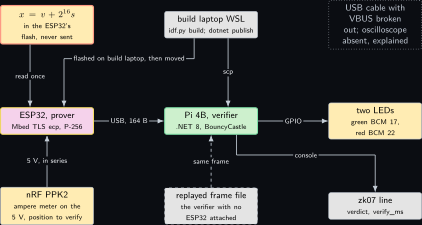
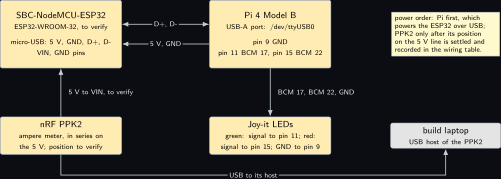
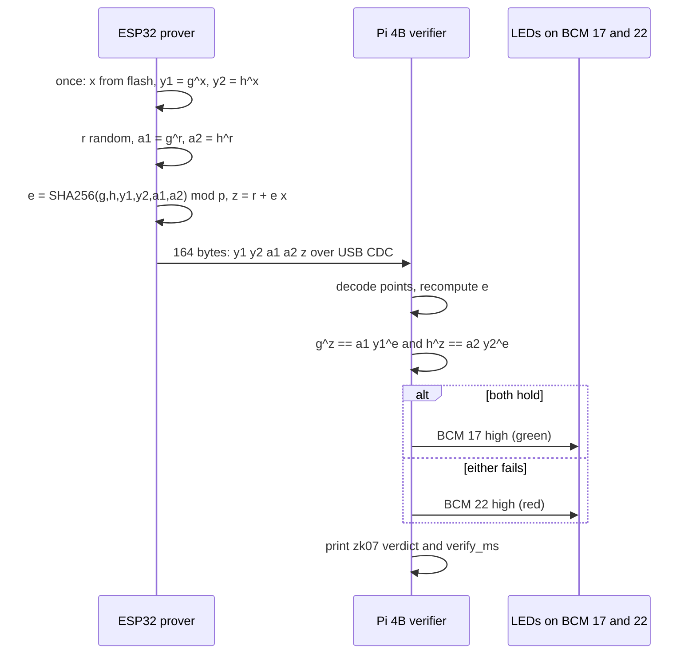
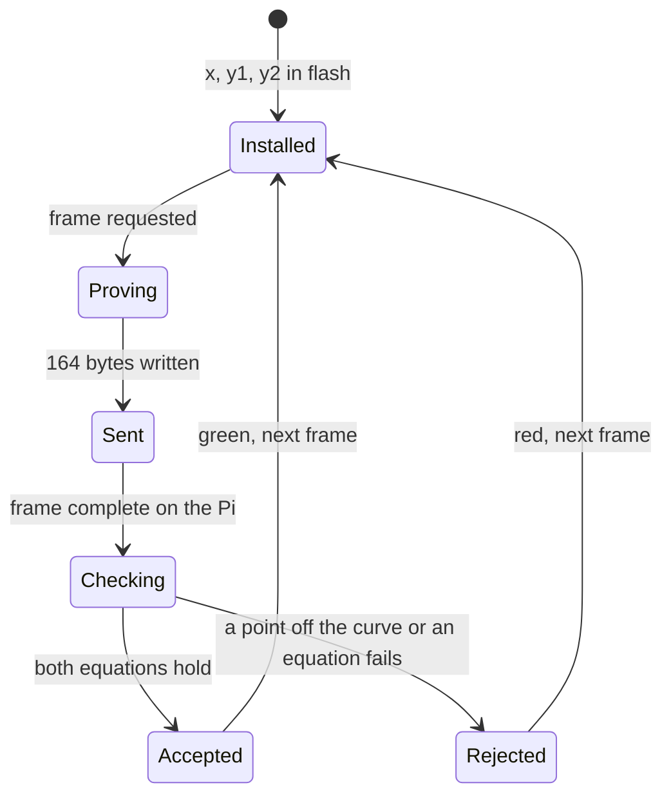
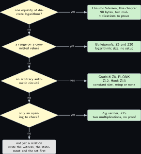

# Project 7. The ESP32 proves two commitments open to one calibration constant

> **Board:** SBC-NodeMCU-ESP32 as prover over USB CDC, Pi 4B as verifier, PPK2 on the ESP32's supply, green and red LEDs on BCM 17 and 22  
> **Language:** C#

> [!IMPORTANT]
> **The question, instanced**
>
> What can a verifier learn from a device without the device revealing itself, and what does it cost on this board? Here the device is the ESP32, the thing it holds is one scalar $x$ that pads its calibration offset, and the thing the verifier learns is exactly one bit: that the two public group elements $y_1 = g^x$ and $y_2 = h^x$ were formed from the same $x$. The proof is three objects long, the prover does two scalar multiplications and one hash, and the verifier four scalar multiplications; the cost on the ESP32 is what the PPK2 is for.

> **Key facts**
>
> - **Board:** SBC-NodeMCU-ESP32 (ESP32-WROOM-32 module, to verify on the silkscreen) as the prover; Raspberry Pi 4 Model B Rev 1.4 (8 GB) as the verifier
> - **Parts:** the ESP32 on its micro-USB cable into a USB-A port of the Pi 4B; the nRF PPK2 as ampere meter on the ESP32's 5 V line, position to verify; two Joy-it LEDs, green on BCM 17 (header pin 11) and red on BCM 22 (header pin 15), measured on Saturday 3 October 2026; the build laptop for both builds
> - **Interface:** USB CDC at 115200 baud, `/dev/ttyUSB0` on the Pi (the bridge chip on the NodeMCU is to verify); GPIO for the verdict
> - **Language and library:** C# on .NET 8 for linux-arm64 (to verify that the SDK tarball runs on Raspberry Pi OS trixie) with the BouncyCastle.Cryptography NuGet package (`Org.BouncyCastle.Math.EC`, version to verify) for the verifier; C under ESP-IDF (version to verify) with Mbed TLS `ecp` on P-256 for the prover snippet
> - **Primitive:** the paper's zkeq, which reduces its commitment-consistency statement to a proof of discrete-logarithm equality \[[1](#references)\]; the sigma protocol of Chaum and Pedersen \[[5](#references)\] made non-interactive by Fiat and Shamir \[[4](#references)\]
> - **Secret:** $x \in \mathbb{Z}_p$, the padded calibration offset held in the ESP32's flash
> - **Public:** $(g, h, y_1, y_2)$ with $y_1 = g^x$ and $y_2 = h^x$: two commitments without randomness that must open to one value
> - **Model:** none
> - **Acceptance:** a transcript produced on the ESP32 is accepted by the C# verifier and lights the green LED; a transcript with one byte of $z$ changed is rejected and lights the red LED; a transcript built for $y_2 = h^{x'}$ with $x' \ne x$ is rejected; the verifier's median time over 64 repeats has a spread under 5 percent
> - **Difficulty:** 3 of 5
> - **Effort:** one evening for the ESP-IDF prover on the build laptop, one evening for the .NET verifier and the GPIO, a third session for the PPK2 position and the energy figure

## Pitch

The paper's symbolic scheme commits to a secret matrix column by column and must then convince the verifier that one committed vector is the image of another under a public matrix; its routine zkeq does this by hashing the public bases together and reducing the statement to a proof that two discrete logarithms are equal \[[1](#references)\]. This chapter builds that one reduction on the smallest board on the bench. The ESP32 holds a scalar $x$; it publishes $y_1 = g^x$ and $y_2 = h^x$ for two bases whose relative logarithm nobody knows, and then proves, in a single 98-byte message, that both were formed from the same $x$, without sending $x$. The Pi 4B runs the verifier in C# because a verifier is a host-side program that reads a serial port, drives two GPIO lines and prints a line, and .NET on linux-arm64 does all three in one binary; the prover is C because it runs on a microcontroller and the volume's rule says so. The mathematics is the sigma-protocol trio that every later chapter leans on: completeness, special soundness with an explicit extractor, and honest-verifier zero knowledge with an explicit simulator.

## Parts and interface

| **Part** | **Role** | **Interface** | **Address or pin** |
| --- | --- | --- | --- |
| SBC-NodeMCU-ESP32 | the prover; holds $x$, computes $y_1, y_2, a_1, a_2, z$ | micro-USB to the Pi 4B, USB CDC at 115200 | `/dev/ttyUSB0` on the Pi; VIN and GND pins for the PPK2 |
| Raspberry Pi 4 Model B | the verifier; .NET 8, BouncyCastle, GPIO | USB-A port; SSH from the build laptop | header pins 9 (GND), 11 (BCM 17), 15 (BCM 22) |
| Joy-it LED, green | accept | GPIO, driven high | signal to pin 11, ground to pin 9 |
| Joy-it LED, red | reject | GPIO, driven high | signal to pin 15, ground to pin 9 |
| nRF PPK2 | ampere meter for the ESP32's energy per proof | USB to the build laptop | in series on the ESP32's 5 V; the position is to verify (see Wiring) |
| the build laptop, WSL side | builds the ESP-IDF image and the .NET binary; hosts the PPK2 | USB and LAN |  |

## The secret, the statement and the relation

Let $\mathbb{G}$ be the group of points of the curve P-256 (secp256r1), which has prime order; this chapter writes that order $p$ to match Definition def:z01\_pedersen, and never needs the curve's coordinate field. Let $g$ be the standard base point and $h$ a second point obtained by hashing a fixed label to the curve by try-and-increment, so that $\log_g h$ is known to nobody; Section [Project 2](02-a-sensor-reading-committed-on-the-microcontroller.md) derives its $h$ the same way. The witness and the statement are

$$
\mathcal{R}_{\mathrm{eq}} = \big\{\, (x ;\; (g, h, y_1, y_2)) \in \mathbb{Z}_p \times \mathbb{G}^4
    \;:\; y_1 = g^x \;\wedge\; y_2 = h^x \,\big\}. \tag{7.1}
$$

The paper's relation $\mathcal{R}_{\mathsf{zkeq}}$ carries several commitments $c^{(j)}$ with public matrices $A^{(j)}$ and randomness $r^{(j)}$, and its Figure 4 extracts bases $\hat g_i$ from the setup and hashes the first messages into one challenge \[[1](#references)\]; Equation ((7.1)) is the case of one matrix equal to the identity and no randomness, which is the kernel that the batched version repeats.

On the bench the secret is tied to a sensor. The calibration offset $v$ of Section [Project 2](02-a-sensor-reading-committed-on-the-microcontroller.md)'s accelerometer is a 16-bit integer; the ESP32 holds $x = v + 2^{16} s$ with $s$ drawn once from its hardware random number generator and stored beside $v$ in flash. The chapter's theorems are about $x$; what they say and do not say about $v$ is in Remark **Remark Z7.6**.

## The mathematics

**Definition Z7.1 (Sigma protocol).** Let $\mathcal{R} \subseteq W \times U$ be a relation and $E$ a finite challenge set. A sigma protocol for $\mathcal{R}$ is a three-move protocol between a prover $\mathcal{P}$ holding $(w, u) \in \mathcal{R}$ and a verifier $\mathcal{V}$ holding $u$: $\mathcal{P}$ sends a commitment $a$, $\mathcal{V}$ sends a challenge $e \leftarrow E$ chosen uniformly, $\mathcal{P}$ sends a response $z$, and $\mathcal{V}$ applies a deterministic predicate $\mathsf{V}(u, a, e, z) \in \{0, 1\}$. A triple $(a, e, z)$ with $\mathsf{V}(u, a, e, z) = 1$ is an accepting transcript. The protocol is *complete* if an honest $\mathcal{P}$ always produces an accepting transcript; *special sound* if there is an efficient extractor $\mathsf{Ext}$ which, from any two accepting transcripts $(a, e, z)$ and $(a, e', z')$ for the same $u$ with $e \ne e'$, outputs $w$ with $(w, u) \in \mathcal{R}$; and *honest-verifier zero knowledge* if there is an efficient simulator $\mathsf{Sim}$ which on input $(u, e)$ outputs $(a, e, z)$ whose distribution equals the distribution of an honest transcript with challenge $e$ \[[6](#references), [7](#references)\].

**Definition Z7.2 (The Chaum-Pedersen protocol).** For $\mathcal{R}_{\mathrm{eq}}$ of Equation ((7.1)) with $E = \mathbb{Z}_p$: $\mathcal{P}$ draws $r \leftarrow \mathbb{Z}_p$ uniformly and sends $a = (a_1, a_2) = (g^r, h^r)$; $\mathcal{V}$ sends $e \leftarrow \mathbb{Z}_p$; $\mathcal{P}$ sends $z = r + e x \bmod p$; $\mathcal{V}$ accepts iff

$$
g^z = a_1 \, y_1^{\,e} \qquad \text{and} \qquad h^z = a_2 \, y_2^{\,e}. \tag{7.2}
$$

This is the protocol of Chaum and Pedersen \[[5](#references)\].

**Theorem Z7.3 (Chaum-Pedersen is a sigma protocol).** The protocol of Definition **Definition Z7.2** is complete, special sound with the extractor $x = (z - z')(e - e')^{-1} \bmod p$, and honest-verifier zero knowledge with the simulator that draws $z$ and sets $a_1 = g^z y_1^{-e}$, $a_2 = h^z y_2^{-e}$.

*Proof.* *Completeness.* Let $(x, (g, h, y_1, y_2)) \in \mathcal{R}_{\mathrm{eq}}$, so $y_1 = g^x$ and $y_2 = h^x$, and let $z = r + ex \bmod p$. Since $g$ has order $p$, exponents may be reduced modulo $p$, and

$$
\begin{aligned}
g^{z} &= g^{r + ex} = g^{r} \, g^{ex} = g^{r} \, (g^{x})^{e} = a_1 \, y_1^{\,e}, \\
  h^{z} &= h^{r + ex} = h^{r} \, h^{ex} = h^{r} \, (h^{x})^{e} = a_2 \, y_2^{\,e},
\end{aligned}
$$

which are the two equations of ((7.2)). So an honest transcript is always accepted.

*Special soundness.* Let $(a_1, a_2, e, z)$ and $(a_1, a_2, e', z')$ be accepting with $e \ne e'$. From the first equation of ((7.2)) for both transcripts, $g^{z} = a_1 y_1^{e}$ and $g^{z'} = a_1 y_1^{e'}$. Dividing,

$$
g^{z - z'} = y_1^{\,e - e'}.
$$

Because $p$ is prime and $e \ne e'$ in $\mathbb{Z}_p$, the element $e - e'$ is invertible; write $x^\ast = (z - z')(e - e')^{-1} \bmod p$. Raising both sides to the power $(e - e')^{-1}$, which is legitimate because exponents of elements of a group of order $p$ live in $\mathbb{Z}_p$,

$$
g^{x^\ast} = \big(g^{z - z'}\big)^{(e - e')^{-1}} = \big(y_1^{\,e - e'}\big)^{(e - e')^{-1}}
  = y_1 .
$$

The same two steps on the second equation of ((7.2)) give $h^{z - z'} = y_2^{\,e - e'}$ and hence $h^{x^\ast} = y_2$. So $(x^\ast, (g, h, y_1, y_2)) \in \mathcal{R}_{\mathrm{eq}}$, and the extractor computed $x^\ast$ with one subtraction, one inversion and one product in $\mathbb{Z}_p$. Note that the extractor never used that $a_1$ and $a_2$ were formed with the same $r$: the two equations of ((7.2)) bind them through the shared $z$ and $e$ alone.

*Honest-verifier zero knowledge.* Fix the statement $u = (g, h, y_1, y_2)$ with $y_1 = g^x$, $y_2 = h^x$, and a challenge $e$. An honest transcript with challenge $e$ is $(g^r, h^r, e, r + ex)$ for $r$ uniform in $\mathbb{Z}_p$. The map $r \mapsto z = r + ex$ is a bijection of $\mathbb{Z}_p$ (its inverse is $z \mapsto z - ex$), so $z$ is uniform in $\mathbb{Z}_p$, and given $z$ the commitment is determined: $a_1 = g^{r} = g^{z - ex} = g^z y_1^{-e}$ and $a_2 = h^{r} = h^{z - ex} = h^z y_2^{-e}$. The simulator draws $z \leftarrow \mathbb{Z}_p$ uniformly and outputs $(g^z y_1^{-e}, h^z y_2^{-e}, e, z)$. Both distributions are the image of the uniform distribution on $z \in \mathbb{Z}_p$ under the same map $z \mapsto (g^z y_1^{-e}, h^z y_2^{-e}, e, z)$, so they are identical, not merely indistinguishable. The simulator used $u$ and $e$ and never $x$. &#9632;

**Lemma Z7.4 (Cost of one verification).** Checking ((7.2)) costs four scalar multiplications and two point additions in $\mathbb{G}$, or two double-scalar multiplications; the prover's work per proof is two scalar multiplications, one hash and one multiply-add in $\mathbb{Z}_p$.

*Proof.* Each side of each equation of ((7.2)) is one scalar multiplication ($g^z$, $y_1^{e}$, $h^z$, $y_2^{e}$) and the right-hand sides need one addition each to form $a_1 y_1^{e}$ and $a_2 y_2^{e}$: four multiplications and two additions. Rewriting the first equation as $g^{z} y_1^{-e} a_1^{-1} = 1$ makes it one double-scalar multiplication plus a negation, which Straus’ trick evaluates in one pass over the bits of $z$ and $e$; the second equation likewise. The prover computes $a_1 = g^r$ and $a_2 = h^r$ (two multiplications), hashes six encoded points, and forms $z = r + ex \bmod p$ (one product and one sum in $\mathbb{Z}_p$); $y_1$ and $y_2$ are computed once when $x$ is installed, not per proof. &#9632;

**Remark Z7.5 (Fiat-Shamir).** On the bench there is no interactive verifier in the middle of a USB cable, so the challenge is $e = H(g \,\|\, h \,\|\, y_1 \,\|\, y_2 \,\|\, a_1 \,\|\, a_2) \bmod p$ with $H$ SHA-256 over the compressed encodings, exactly as the paper's Figure 4 hashes the first messages with the commitments \[[1](#references)\]. The verifier recomputes $e$ and applies ((7.2)). In the random oracle model the special soundness of Theorem **Theorem Z7.3** turns into a proof of knowledge for the non-interactive version through the forking argument of Fiat and Shamir \[[4](#references)\] and Bellare and Rogaway \[[3](#references)\]; the HVZK simulator becomes a full zero-knowledge simulator because the verifier no longer chooses anything \[[2](#references)\]. Including $y_1$ and $y_2$ in the hash is what stops a transcript for one statement from being replayed for another.

**Remark Z7.6 (What is hidden about the calibration offset).** Theorem **Theorem Z7.3** says the transcript reveals nothing about $x$ beyond the statement. The statement itself, $y_1 = g^x$, hides $x$ only in the computational sense: if $x$ were the bare 16-bit offset $v$, an observer would recover it in at most $2^{16}$ scalar multiplications by trying every value, which is minutes on the Pi 4B. That is why the ESP32 pads $x = v + 2^{16} s$. No theorem in this volume says that the low 16 bits of a discrete logarithm are hidden by $g^x$; Theorem thm:z01\_hiding is about the Pedersen form $g^v h^r$ and is perfect. The clean statement, "two Pedersen commitments open to the same $v$", is the relation $\{((v, r_1, r_2); (c_1, c_2)) : c_1 = g^v h^{r_1} \wedge c_2 = g^v h^{r_2}\}$, which the same three-move shape proves with one more response scalar; it is the next step after the acceptance test passes, and the extractor and simulator are the ones above with $r_1, r_2$ carried along.

## The protocol

| **Prover, ESP32 (C, Mbed TLS)** | **Verifier, Pi 4B (C#, BouncyCastle)** |
| --- | --- |
| Once: load P-256; derive $h$ from the label `zk07-h` by try-and-increment; read $v$ and $s$ from flash, $x = v + 2^{16} s \bmod p$; compute $y_1 = g^x$, $y_2 = h^x$. | Once: load P-256 from `ECNamedCurveTable`; derive the same $h$; open `/dev/ttyUSB0`; open BCM 17 and BCM 22 as outputs, both low. |
| Per proof: $r \leftarrow \mathbb{Z}_p$ from `esp_fill_random`; $a_1 = g^r$, $a_2 = h^r$ with randomised projective coordinates. | Wait for 164 bytes: $y_1, y_2, a_1, a_2$ compressed (33 bytes each) and $z$ (32 bytes, big-endian). |
| $e = \mathrm{SHA256}(g \\| h \\| y_1 \\| y_2 \\| a_1 \\| a_2) \bmod p$. | Decode the four points (a point off the curve is a reject); check $0 \le z < p$. |
| $z = r + e x \bmod p$; write $y_1 \\| y_2 \\| a_1 \\| a_2 \\| z$, 164 bytes, to the CDC port. | Recompute $e$ over the same six encodings. |
| Erase $r$. | Check $g^z = a_1 y_1^{e}$ and $h^z = a_2 y_2^{e}$; green on BCM 17 if both hold, red on BCM 22 otherwise; print one `zk07` line with the verdict and the Stopwatch time. |

The 164 bytes are the 66-byte statement part $(y_1, y_2)$ that the verifier needs once, plus the 98-byte proof $(a_1, a_2, z)$; the verifier re-reads $y_1, y_2$ every time so that a frame can be checked on its own with no state on the Pi.

## The code

The verifier is one file. BouncyCastle's `ECPoint` is immutable and keeps projective coordinates until `Normalize()` is called, which is why both sides of each equation are normalised before `Equals`. The names `System.IO.Ports` and `System.Device.Gpio` are NuGet packages (to verify that both run on linux-arm64 under .NET 8 on Raspberry Pi OS trixie).

```csharp
using System;
using System.Diagnostics;
using System.IO.Ports;
using System.Security.Cryptography;
using System.Device.Gpio;
using Org.BouncyCastle.Asn1.X9;
using Org.BouncyCastle.Math;
using Org.BouncyCastle.Math.EC;

// zk07 verifier: Chaum-Pedersen over P-256, frame = y1 | y2 | a1 | a2 (33 bytes each) | z.
static class Zk07
{
    static readonly X9ECParameters P256 = ECNamedCurveTable.GetByName("secp256r1");
    static readonly BigInteger N = P256.N;

    static byte[] Enc(ECPoint p) => p.Normalize().GetEncoded(true);

    static BigInteger Challenge(params ECPoint[] pts)
    {
        using var sha = IncrementalHash.CreateHash(HashAlgorithmName.SHA256);
        foreach (var p in pts) sha.AppendData(Enc(p));
        return new BigInteger(1, sha.GetHashAndReset()).Mod(N);
    }

    static bool Verify(ECPoint g, ECPoint h, ECPoint y1, ECPoint y2,
                       ECPoint a1, ECPoint a2, BigInteger z)
    {
        if (z.SignValue < 0 || z.CompareTo(N) >= 0) return false;
        BigInteger e = Challenge(g, h, y1, y2, a1, a2);
        ECPoint lhs1 = g.Multiply(z).Normalize();
        ECPoint rhs1 = a1.Add(y1.Multiply(e)).Normalize();
        ECPoint lhs2 = h.Multiply(z).Normalize();
        ECPoint rhs2 = a2.Add(y2.Multiply(e)).Normalize();
        return lhs1.Equals(rhs1) && lhs2.Equals(rhs2);
    }

    static int Main(string[] args)
    {
        ECCurve curve = P256.Curve;
        ECPoint g = P256.G;
        ECPoint h = curve.DecodePoint(Convert.FromHexString(args[0]));   // zk07-h, derived
        using var port = new SerialPort("/dev/ttyUSB0", 115200) { ReadTimeout = 5000 };
        port.Open();
        var frame = new byte[4 * 33 + 32];
        int got = 0;
        while (got < frame.Length) got += port.Read(frame, got, frame.Length - got);
        ECPoint y1 = curve.DecodePoint(frame[0..33]);
        ECPoint y2 = curve.DecodePoint(frame[33..66]);
        ECPoint a1 = curve.DecodePoint(frame[66..99]);
        ECPoint a2 = curve.DecodePoint(frame[99..132]);
        var z = new BigInteger(1, frame[132..164]);
        var sw = Stopwatch.StartNew();
        bool ok = Verify(g, h, y1, y2, a1, a2, z);
        sw.Stop();
        using var gpio = new GpioController();
        gpio.OpenPin(17, PinMode.Output);
        gpio.OpenPin(22, PinMode.Output);
        gpio.Write(17, ok ? PinValue.High : PinValue.Low);
        gpio.Write(22, ok ? PinValue.Low : PinValue.High);
        Console.WriteLine($"zk07 verdict={(ok ? "accept" : "reject")} "
                          + $"verify_ms={sw.Elapsed.TotalMilliseconds:F2}");
        return ok ? 0 : 1;
    }
}
```

The prover's core on the ESP32, under ESP-IDF with Mbed TLS. `mbedtls_ecp_mul` takes a random-number callback and uses it to randomise the projective coordinates, which is the library's own countermeasure against timing and power analysis; the PPK2 trace in the benchmark is taken with that countermeasure on, because a trace without it would be of a different program. The names below are read from the Mbed TLS headers shipped with ESP-IDF and are marked to verify against the version pinned on the build laptop.

```c
#include "mbedtls/ecp.h"
#include "mbedtls/bignum.h"
#include "mbedtls/sha256.h"
#include "esp_random.h"
#include <string.h>

static int rng(void *ctx, unsigned char *out, size_t len)
{
    (void)ctx; esp_fill_random(out, len); return 0;
}

/* zk07 prover: out = a1 | a2 (compressed, 33 bytes each) | z (32 bytes); 0 on success */
int zk07_prove(mbedtls_ecp_group *grp, const mbedtls_ecp_point *h, const mbedtls_mpi *x,
               const unsigned char stmt[132], unsigned char out[98])
{
    mbedtls_mpi r, e, z; mbedtls_ecp_point a1, a2; size_t n; unsigned char buf[198], dig[32];
    mbedtls_mpi_init(&r); mbedtls_mpi_init(&e); mbedtls_mpi_init(&z);
    mbedtls_ecp_point_init(&a1); mbedtls_ecp_point_init(&a2);
    int rc = mbedtls_ecp_gen_privkey(grp, &r, rng, NULL);                 /* r uniform in [1, p) */
    if (!rc) rc = mbedtls_ecp_mul(grp, &a1, &r, &grp->G, rng, NULL);      /* a1 = r G */
    if (!rc) rc = mbedtls_ecp_mul(grp, &a2, &r, h, rng, NULL);            /* a2 = r H */
    memcpy(buf, stmt, 132);                                                /* G | H | Y1 | Y2 */
    if (!rc) rc = mbedtls_ecp_point_write_binary(grp, &a1, MBEDTLS_ECP_PF_COMPRESSED,
                                                 &n, buf + 132, 33);
    if (!rc) rc = mbedtls_ecp_point_write_binary(grp, &a2, MBEDTLS_ECP_PF_COMPRESSED,
                                                 &n, buf + 165, 33);
    if (!rc) rc = mbedtls_sha256(buf, 198, dig, 0);                        /* e = H(...) */
    if (!rc) rc = mbedtls_mpi_read_binary(&e, dig, 32);
    if (!rc) rc = mbedtls_mpi_mod_mpi(&e, &e, &grp->N);
    if (!rc) rc = mbedtls_mpi_mul_mpi(&z, &e, x);                          /* z = e x      */
    if (!rc) rc = mbedtls_mpi_add_mpi(&z, &z, &r);                         /*   + r        */
    if (!rc) rc = mbedtls_mpi_mod_mpi(&z, &z, &grp->N);                    /*   mod p      */
    memcpy(out, buf + 132, 66);
    if (!rc) rc = mbedtls_mpi_write_binary(&z, out + 66, 32);
    mbedtls_mpi_free(&r); mbedtls_mpi_free(&e); mbedtls_mpi_free(&z);     /* r is erased */
    mbedtls_ecp_point_free(&a1); mbedtls_ecp_point_free(&a2);
    return rc;
}
```

```bash
# build laptop, WSL: the ESP32 image, then the verifier for the Pi 4B
idf.py set-target esp32 && idf.py build && idf.py -p /dev/ttyUSB0 flash
dotnet publish -c Release -r linux-arm64 --self-contained -o out/zk07
scp -r out/zk07 <user>@<pi4b>:~/zk07
# on the Pi 4B over ssh, with the ESP32 moved to its USB-A port
~/zk07/zk07 <hex of h>
```

## The model, if any

None. A sigma protocol has nothing for a model to propose; its challenge is a hash and its response is a field equation.

## Real, modelled, absent

- **have:** real: the SBC-NodeMCU-ESP32 and its USB cable, the Pi 4B, the two LEDs on the pins measured on Saturday 3 October 2026, the PPK2, Mbed TLS inside ESP-IDF, and BouncyCastle on .NET 8 once the linux-arm64 SDK is confirmed on trixie
- **learn:** modelled: every bar of the benchmark figure is the order of magnitude expected from a 240 MHz core doing P-256 in software and from a Cortex-A72 doing it in managed code, drawn dashed; the replayed transcript file lets the verifier run with no ESP32 attached, and the PPK2 series position on the ESP32's 5 V is to be settled before the first energy figure
- **absent:** absent: a USB cable with its VBUS line broken out, and a soldering iron to make one, so the PPK2 cannot yet sit in series on a USB-powered board; an oscilloscope; a second ESP32 to play an honest verifier interactively, which the Fiat-Shamir form does not need

## System architecture



*Figure 7.1. The data path of one proof. Top row: the secret $x$ in the stop-coloured outline above the prover, build laptop in grey above the verifier with its two build arrows, and a dotted grey block for what is absent. Middle row, left to right: the ESP32 as the prover in the yellow outline with Mbed TLS, a solid arrow to the Pi 4B as the verifier in the green outline carrying the 164-byte frame, and a solid arrow from the verifier to the two LEDs in hardware yellow. Bottom row: the PPK2 in series on the ESP32's supply with its position marked to verify, a dashed replayed-transcript block feeding the verifier when no ESP32 is attached, and the public verdict line the verifier prints.*

Read the figure as one secret that never crosses the cable: what crosses is $(y_1, y_2)$, which is the statement, and $(a_1, a_2, z)$, which Theorem **Theorem Z7.3** says is simulatable from the statement alone.

## Wiring



*Figure 7.2. The ESP32 into the Pi 4B over USB, the PPK2 in series on the ESP32's 5 V, and the two LEDs on the Pi's header. Left, the NodeMCU with its micro-USB (5 V, GND, D+, D-) and its VIN and GND pins called out; right, the Pi 4B with the USB-A port that becomes `/dev/ttyUSB0` and header pins 9, 11 and 15. Below the NodeMCU the PPK2 in ampere-meter mode on the 5 V line with the note that the position is to verify; below the Pi the two Joy-it LEDs; at the far right the build laptop as the PPK2's USB host with the power order note.*

| **Signal** | **From** | **To** | **Note** |
| --- | --- | --- | --- |
| USB data, D+ and D- | NodeMCU micro-USB | Pi 4B USB-A | the bridge chip enumerates as `/dev/ttyUSB0`; its type is read from the board (to verify) |
| USB 5 V and GND | Pi 4B USB-A | NodeMCU micro-USB | the ESP32 is powered by the Pi; the Pi's own supply is its USB-C |
| 5 V, metered | USB 5 V | NodeMCU VIN through the PPK2 | position to verify: either the PPK2 in ampere-meter mode on a cable whose VBUS is interrupted, or the PPK2 in source-meter mode at 5.0 V into VIN with a data-only USB connection; the bench has neither cable yet, so the energy cell reads not measured |
| green LED | Pi header pin 11, BCM 17 | LED signal pin | accept; ground on pin 9 |
| red LED | Pi header pin 15, BCM 22 | LED signal pin | reject; ground on pin 9 |
| PPK2 USB | PPK2 | build laptop | the PPK2's host; its trace carries the proof's energy |

## Sequence and states





## Decision tree



*Figure 7.3. Which proof for which statement. The root diamond asks whether the statement is one equality of discrete logarithms; yes leads to the Chaum-Pedersen leaf of this chapter. No leads to a diamond asking whether the statement is a range on a committed value; yes leads to the Bulletproofs leaf of Sections [Project 5](05-farkas-witnesses-for-a-joystick-program.md) and [Project 20](20-the-occupancy-counter-that-proves-it-stayed-under.md). No leads to a diamond asking whether the statement is an arbitrary arithmetic circuit; yes leads to the circuit leaf naming Groth16, PLONK and Honk of Sections [Project 8](08-a-ranking-function-as-a-circuit.md), [Project 12](12-a-plonk-gate-for-the-inductive-step.md) and [Project 13](13-the-obligation-in-noir.md). No leads to a last diamond asking whether only an opening is checked; yes leads to the Zig verifier of Section [Project 15](15-a-zig-verifier-of-pedersen-openings.md), no to the grey leaf that says the statement is not yet written as a relation.*

## Benchmark


*Figure 7.4. Expected time per step, log scale in milliseconds, drawn as dashed bars because nothing has been measured on this bench: one P-256 scalar multiplication on the ESP32, the whole proof on the ESP32 (two multiplications and one hash), the 164-byte frame at 115200 baud, and the verification on the Pi 4B (four multiplications). The serial bar is a computed figure, not a measurement, and is drawn dashed for that reason; a solid bar replaces a dashed one when a run has happened and the acceptance test has passed.*

| **Quantity** | **Value** | **Status** | **Instrument** |
| --- | --- | --- | --- |
| proof size $(a_1, a_2, z)$ | 98 bytes | computed: $33 + 33 + 32$ | none; two compressed points and one scalar |
| frame size | 164 bytes | computed: $98 + 66$ | none |
| frame time at 115200 baud | 14.2 ms | computed: $164 \cdot 10 / 115200$ s | none; eight data bits, one start, one stop |
| scalar multiplication, ESP32 | not measured |  | `esp_timer_get_time` around one `mbedtls_ecp_mul`, 64 repeats |
| prover time, ESP32 | not measured |  | `esp_timer_get_time` around `zk07_prove`, 64 repeats |
| energy per proof, ESP32 | not measured | PPK2 position to verify | PPK2 ampere meter, 64 proofs in one trace |
| verifier time, Pi 4B | not measured |  | `Stopwatch` in the verifier, 64 repeats, `get_throttled` 0x0 before and after |

For scale, the only measured number near this primitive is the paper's: its symbolic verifier, which runs the batched zkeq among other checks, took 10 s for 217 obligations on the paper's AWS `c6g.8xlarge` \[[1](#references)\]; that number is attributed to that machine and is not a prediction for the Pi.

## Steps

**Step 1.** On the authoring laptop, write the ESP-IDF project (the prover above, a main loop that answers one byte on the CDC port with one 164-byte frame) and the .NET project with the three NuGet references pinned; commit.

**Step 2.** On the build laptop in WSL, `git pull --ff-only`, build the ESP32 image, plug the ESP32 into the build laptop and flash it; read the bridge chip's name from `dmesg` and record it.

**Step 3.** On the build laptop, `dotnet publish` for linux-arm64 and copy the output to the Pi 4B.

**Step 4.** Move the ESP32 to a USB-A port of the Pi 4B; over ssh confirm `/dev/ttyUSB0` and read `vcgencmd get_throttled`.

**Step 5.** On the Pi over ssh, run the verifier 64 times; keep the 64 `zk07` lines; read the throttle register again.

**Step 6.** On the Pi, replay a saved frame with one byte of $z$ changed, and a frame built for a different $x'$ in $y_2$; both must print reject and light the red LED.

**Step 7.** On the build laptop, once a cable with the VBUS line interrupted exists, put the PPK2 in series, record 64 proofs in one trace, and compute the energy per proof as the integral between the frame-request marker and the last byte sent.

## Acceptance test

The chapter passes when 64 honest frames from the ESP32 print `accept` with the green LED on and the red off, the two tampered frames print `reject` with the red LED on, the median `verify_ms` has a median absolute deviation under 5 percent, and the throttle register reads `0x0` on both reads. It fails if any honest frame is rejected, if any tampered frame is accepted, if the prover's $r$ is ever the same in two frames (the frames are logged and $a_1$ compared across all 64), or if the energy cell is filled from a trace taken with the PPK2 in a position not recorded in the wiring table.

## Variants

**The prover in JavaScript on the module.** The ESP32 computes the same Chaum-Pedersen transcript of Definition **Definition Z7.2** under an embedded JavaScript runtime rather than under Mbed TLS in C, and the finished frame leaves over a SIM7020E NB-IoT module on a crossover UART instead of over the USB CDC cable \[[8](#references), [9](#references)\]. The secret changes with it: $x$ pads a crossing count taken from the Adafruit VL53L4CD time-of-flight sensor on I2C at 0x29 \[[10](#references)\], so the one bit the verifier learns is that a published count and a published threshold were formed from the same tally. Not one byte of the frame moves, since it is still $4 \times 33 + 32 = 164$ bytes (computed): the language of the prover and the carrier of the proof both sit below the protocol, and the protocol is unchanged. What the swap costs is prover time, which reads not measured, because no interpreted P-256 scalar multiplication has been timed on this bench and any figure for it would be an order of magnitude written as though it were a reading. Choose it when the point being made is that the primitive is small enough to be written twice in two languages on one module, rather than when the proof has to be cheap. Two bench corrections bite: no SIM card is on the bench, so every cellular figure reads not measured, no SIM, and the AT sequence that would register the module is replayed from a logged file and drawn dashed. The brief publishes the payload to a message broker for city planners, and nothing in this volume goes outward, so the frame reaches the Pi 4B verifier of this chapter over the cable it already uses and the broker is drawn as an absent block.

## Pitfalls

- A point sent uncompressed by the prover and decoded as compressed by the verifier is not a bad proof, it is a framing error; both sides use the 33-byte compressed encoding and the verifier rejects any frame whose first byte of a point is not 0x02 or 0x03.
- Reducing the 256-bit hash modulo $p$ makes $e$ very slightly non-uniform; for P-256 the bias is below $2^{-128}$ and is irrelevant here, but a curve whose order is far from a power of two would need a wider hash.
- `mbedtls_ecp_mul` without the random callback runs without coordinate randomisation; the PPK2 trace of that build is a different experiment and is not published under this chapter's name.
- The NodeMCU draws its 5 V from the Pi's USB port; putting the PPK2 in series means interrupting that line, and until a cable for it exists the energy cell reads not measured rather than a figure taken with the PPK2 on the Pi's side of the port.
- Omitting $y_1, y_2$ from the hash lets a transcript made for one statement be accepted for another with the same $(a_1, a_2, z)$; Remark **Remark Z7.5** is the reason the frame carries them.

## Languages and libraries not chosen

- Rust with `p256` on the Pi: a smaller verifier binary with no runtime, and the language of Sections [Project 1](01-the-price-list.md) and [Project 2](02-a-sensor-reading-committed-on-the-microcontroller.md); C# is kept here because the verifier is the host-side program of the volume and one managed binary carries the serial port, the GPIO and the arithmetic.
- Python with `cryptography` on the Pi: the quickest verifier to write, but the volume's rule reserves Python for the paper's own front-end roles.
- C with Mbed TLS on both sides: one library for prover and verifier, used in Section [Project 4](04-two-group-elements.md)'s style; it would leave the GPIO and the serial port to be written by hand on the Pi.
- `curve25519-dalek` on ristretto255 for the prover: no Mbed TLS build on the ESP32 would be needed for it, but Rust on the ESP32 is a toolchain of its own and the chapter keeps the vendor SDK.

## Sources

- [arxiv.org/abs/2605.00487](https://arxiv.org/abs/2605.00487) (verified Friday 6 November 2026), the paper, its Figure 4 and the zkeq relation.
- [doi:10.1007/3-540-48071-4\_7](https://doi.org/10.1007/3-540-48071-4_7) (to verify), Chaum and Pedersen, the protocol of Definition **Definition Z7.2**.
- [cs.au.dk/~ivan/Sigma.pdf](https://cs.au.dk/ ivan/Sigma.pdf) (to verify), the sigma-protocol notes behind Definition **Definition Z7.1**.
- [github.com/bcgit/bc-csharp](https://github.com/bcgit/bc-csharp) (to verify), BouncyCastle for C#, the `Org.BouncyCastle.Math.EC` namespace.
- [github.com/Mbed-TLS/mbedtls](https://github.com/Mbed-TLS/mbedtls) (to verify), the `ecp` module used by the prover.
- [docs.espressif.com, ESP-IDF for the ESP32](https://docs.espressif.com/projects/esp-idf/en/latest/esp32/) (to verify), the build and flash commands.

<a id="references"></a>

## References

1. Pascal Berrang, Mirco Giacobbe, Jacob Swales and Xiao Yang. Zero-Knowledge Model Checking. arXiv:2605.00487v2 \[cs.CR\], version 1 submitted Friday 1 May 2026, version 2 Tuesday 8 September 2026. [arxiv.org/abs/2605.00487](https://arxiv.org/abs/2605.00487) (verified Friday 6 November 2026).
2. Mihir Bellare and Oded Goldreich. On defining proofs of knowledge. In CRYPTO 1992, LNCS 740, pages 390 to 420. Springer, 1992. [doi:10.1007/3-540-48071-4\_28](https://doi.org/10.1007/3-540-48071-4_28) (to verify).
3. Mihir Bellare and Phillip Rogaway. Random oracles are practical: a paradigm for designing efficient protocols. In CCS 1993, pages 62 to 73. ACM, 1993. [doi:10.1145/168588.168596](https://doi.org/10.1145/168588.168596) (to verify).
4. Amos Fiat and Adi Shamir. How to prove yourself: practical solutions to identification and signature problems. In CRYPTO 1986, LNCS 263, pages 186 to 194. Springer, 1986. [doi:10.1007/3-540-47721-7\_12](https://doi.org/10.1007/3-540-47721-7_12) (to verify).
5. David Chaum and Torben Pryds Pedersen. Wallet databases with observers. In CRYPTO 1992, LNCS 740, pages 89 to 105. Springer, 1992. [doi:10.1007/3-540-48071-4\_7](https://doi.org/10.1007/3-540-48071-4_7) (to verify).
6. Ronald Cramer. Modular design of secure yet practical cryptographic protocols. PhD thesis, University of Amsterdam, 1996. The origin of the sigma-protocol formulation. (to verify)
7. Ivan Damgård. On Sigma-protocols. Lecture notes, Aarhus University, 2002, revised later. [cs.au.dk/~ivan/Sigma.pdf](https://cs.au.dk/ ivan/Sigma.pdf) (to verify).
8. Advanced hardware-software architectures for edge artificial intelligence and zero-knowledge model checking. A design brief of twenty project sketches, read on Friday 6 November 2026 and held locally at `a local design brief`. It is the input to this second edition and is not a published source; where its hardware claims disagree with the bench, the bench is followed and the disagreement is stated.
9. Waveshare. SIM7020E NB-IoT HAT wiki. [waveshare.com/wiki/SIM7020E\_NB-IoT\_HAT](https://www.waveshare.com/wiki/SIM7020E_NB-IoT_HAT) (to verify).
10. STMicroelectronics. VL53L4CD time-of-flight sensor datasheet; Adafruit breakout ADA5396, 1 to 1300 mm. (to verify)

---

[Previous](06-folding-and-the-salem-spencer-schedule.md) &nbsp;&nbsp;|&nbsp;&nbsp; [Contents](../CONTENTS.md) &nbsp;&nbsp;|&nbsp;&nbsp; [Next](08-a-ranking-function-as-a-circuit.md)
