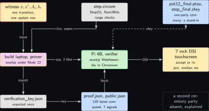
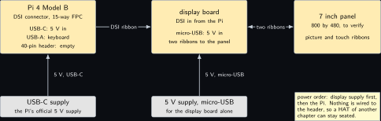
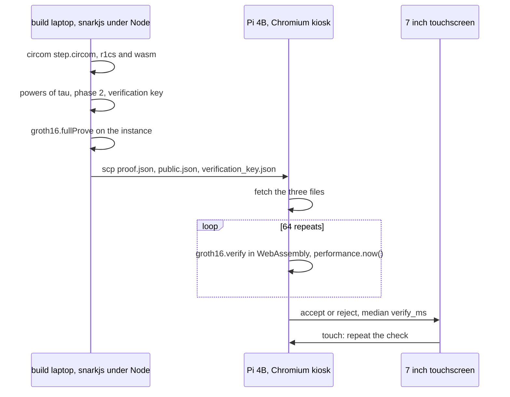
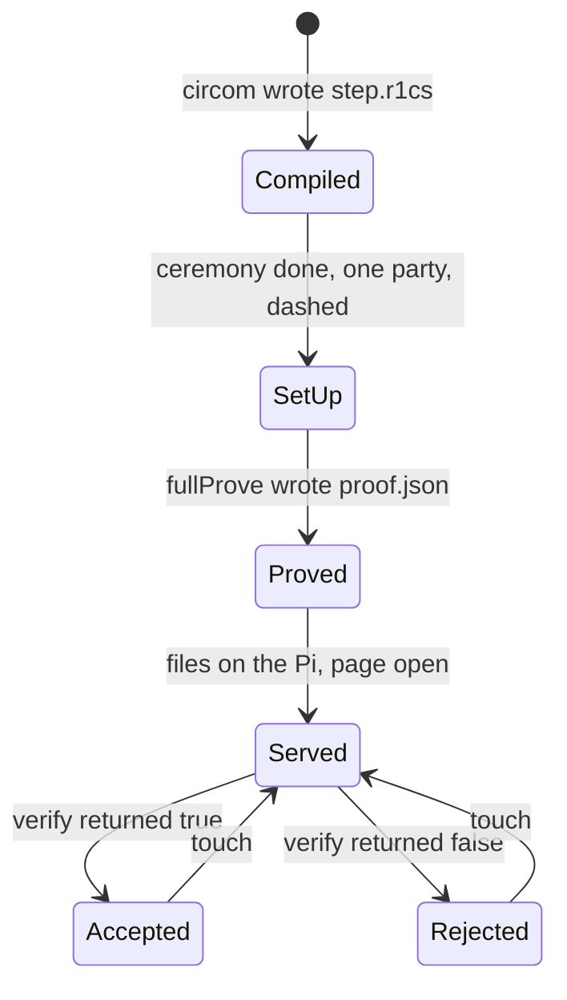
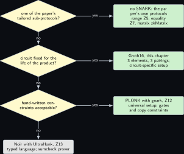

# Project 8. A ranking function as a circuit, verified in a kiosk browser

> **Board:** Pi 4B with the official 7 inch DSI touchscreen in Chromium kiosk mode; the proof made on the build laptop  
> **Language:** JavaScript

> [!IMPORTANT]
> **The question, instanced**
>
> What can a verifier learn from a device without the device revealing itself, and what does it cost on this board? Here the verifier is a browser on a touchscreen, the device is the modem machine of Section [Project 3](03-the-modems-backoff-machine.md) whose transition is secret, and what the browser learns is that one secret transition of that machine obeys the public ranking function: the function did not increase, and on a fair transition it decreased. The proof is three group elements whatever the circuit, and the cost on this board is one WebAssembly verification that the chapter times and nothing else.

> **Key facts**
>
> - **Board:** Raspberry Pi 4 Model B Rev 1.4 (8 GB) as the verifier, with the official Raspberry Pi 7 inch touchscreen on the DSI connector; the build laptop as the prover
> - **Parts:** the touchscreen and its display board, a 5 V supply for the display board, the Pi's own USB-C supply, the Raspberry Pi keyboard on USB for the first boot only; nothing on the 40-pin header
> - **Interface:** DSI ribbon for the picture and the touch; the bench LAN for the proof file; SSH from the build laptop
> - **Language and library:** JavaScript on Node 22 (to verify) with `snarkjs` v0.7.6 \[[6](#references)\] for setup, proving and the browser verifier; `circom` 2.x (to verify the installed minor version) \[[8](#references)\] and `circomlib`'s `Num2Bits` for the circuit
> - **Primitive:** Groth16 over BN254 \[[2](#references)\] of the ranking condition of the paper's Equation 21 for one guarded update and one automaton transition, with range checks \[[1](#references)\]
> - **Secret:** the transition $`x, x'`$ of the modem machine and the row $`A_i, b_i`$ of the guarded update it belongs to
> - **Public:** the ranking pieces $`w_j, u_j, w_k, u_k`$ and the fairness bit $`\mathbf{1}_F`$
> - **Model:** none
> - **Acceptance:** the honest proof shows accept on the touchscreen; the same proof with one public signal changed shows reject; a witness whose transition does not decrease the ranking function fails at witness generation; the verifier's median time over 64 repeats has a spread under 5 percent with the throttle register at 0x0 before and after
> - **Difficulty:** 3 of 5
> - **Effort:** one evening for the circuit and the ceremony on the build laptop, one evening for the kiosk page and the display, a third session for the repeat

## Pitch

The paper's Remark on page 13 says that the relation of its Equation 25 is SNARK-friendly and could be instantiated directly with Groth16 or PLONK, trading prover time for a constant-size proof and a cheap verifier \[[1](#references)\]. This chapter and its two siblings, Sections [Project 12](12-a-plonk-gate-for-the-inductive-step.md) and [Project 13](13-the-obligation-in-noir.md), take that sentence literally and build the same statement three times, in three circuit languages under three proof systems, so that the decision tree at the end of each is drawn from the same relation. The statement is one inductive step of the ranking argument: a secret transition $`(x, x')`$ of a secret guarded update satisfies the update's inequalities, and the public ranking function does not increase across it, and strictly decreases if the automaton transition is fair. Here it is written in Circom, compiled to an R1CS, proved on the build laptop with snarkjs under Groth16, and verified in Chromium on the Pi 4B's touchscreen by the same library compiled to WebAssembly. The language is JavaScript because the verifier is a web page, and the mathematics is the one theorem a reader of any SNARK needs first: an R1CS is satisfied if and only if a quotient polynomial exists.

## Parts and interface

| **Part** | **Role** | **Interface** | **Address or pin** |
| --- | --- | --- | --- |
| Raspberry Pi 4 Model B | the verifier: Chromium in kiosk mode, snarkjs in WebAssembly | SSH; DSI; USB-C 5 V | DSI connector (the 15-way FPC beside the audio jack) |
| 7 inch touchscreen | shows the verdict; touch restarts the check | DSI to the Pi; 5 V on its display board | display board micro-USB, 5 V |
| 5 V supply for the display | powers the display board separately, so that the header stays empty | micro-USB |  |
| Raspberry Pi keyboard | first boot and the kiosk autostart only | USB-A |  |
| the build laptop, WSL side | circom, the ceremony, the proof; serves nothing at run time | LAN |  |

## The secret, the statement and the relation

The three circuit chapters share one statement, written here once and repeated word for word in Sections [Project 12](12-a-plonk-gate-for-the-inductive-step.md) and [Project 13](13-the-obligation-in-noir.md). Let $`n = 2`$ be the number of program variables of the modem machine of Section [Project 3](03-the-modems-backoff-machine.md), $`x = (\mathit{delay}, \mathit{done})`$, and let $`y = (x, x') \in \mathbb{Z}^4`$ be a transition. Every integer in the statement is a signed 16-bit integer, $`I = [-2^{15}, 2^{15} - 1]`$, which is the paper's bounded integer encoding with $`M = 2^{15}`$ \[[1](#references)\]. The witness is the transition and the row of the guarded update it belongs to, the statement is the ranking function's two pieces and the fairness bit, and the relation is

```math
\begin{aligned}
  \mathcal{R}_{\mathrm{step}} = \Big\{\, \big( (x, x', A_i, b_i) ;\; (w_j, u_j, w_k, u_k, f) \big)
    \;:\;\; & x, x' \in I^2,\; A_i \in I^{m \times 4},\; b_i \in I^m,\; f \in \{0, 1\}, \\
    & A_i \begin{bmatrix} x \\ x' \end{bmatrix} \le b_i, \;\;
      (w_j \cdot x + u_j) - (w_k \cdot x' + u_k) \ge f \,\Big\}.
\end{aligned}
```

*(8.1)*

This is the paper's Equation 21 read at one point: the premise $`A_i [x\; x']^\top \le b_i`$ is membership of the transition in the $`i`$-th guarded update of Equation 16, and the conclusion is $`V(x, q) - V(x', q') > \mathbf{1}_F(q, \sigma, q') - 1`$ with $`V`$ the piecewise-linear function of Equation 18, which over integers is $`V(x, q) - V(x', q') \ge f`$ with $`f = \mathbf{1}_F(q, \sigma, q')`$. The case rows $`C_j x \le d_j`$ and $`C_k x' \le d_k`$ of Equation 21 have the same shape as rows of $`A_i`$ and are appended to it in the full build; the printed circuit carries the five rows of the update alone so that it fits on one page.

The concrete instance used in all three chapters is the retry loop of the modem machine: state Wait to state Wait, $`\mathit{delay}' = 2\,\mathit{delay}`$, $`\mathit{done}' = \mathit{done} + 1`$ under the guard $`\mathit{done} \le 2`$, which as rows of $`A_i y \le b_i`$ over $`y = (\mathit{delay}, \mathit{done}, \mathit{delay}', \mathit{done}')`$ reads

```math
A_i = \begin{bmatrix} -2 & 0 & 1 & 0 \\ 2 & 0 & -1 & 0 \\ 0 & -1 & 0 & 1 \\ 0 & 1 & 0 & -1 \\
  0 & 1 & 0 & 0 \end{bmatrix}, \quad
  b_i = \begin{bmatrix} 0 \\ 0 \\ 1 \\ -1 \\ 2 \end{bmatrix}, \quad
  w_j = w_k = (0, -1), \quad u_j = u_k = 3, \quad f = 1,
```

*(8.2)*

so that $`V(x, \mathrm{Wait}) = 3 - \mathit{done}`$ and $`V(x, q) - V(x', q') = \mathit{done}' - \mathit{done} = 1 \ge f`$. The example witness is $`x = (1, 0)`$, $`x' = (2, 1)`$.

**Remark Z8.1 (One step is not the obligation).** The paper's obligation is universal: for all $`y`$, the premise implies the conclusion, and the paper discharges it with a Farkas witness, Section [Project 5](05-farkas-witnesses-for-a-joystick-program.md). Relation (8.1) is one point of that universal statement, the natural object for a device that commits to its transitions one at a time; a circuit for the Farkas form is the same arithmetic, a linear combination that must vanish plus range checks, with the multipliers $`\lambda, \mu`$ as the witness, and the three chapters name it as the next step rather than printing a second circuit.

## The mathematics

Let $`\mathbb{F}`$ be the scalar field of BN254, of prime order $`p`$ with $`p > 2^{253}`$.

**Definition Z8.2 (Rank-1 constraint system).** An R1CS over $`\mathbb{F}`$ with $`m`$ constraints and $`n`$ variables is a triple of matrices $`A, B, C \in \mathbb{F}^{m \times (n + 1)}`$. A vector $`z = (1, z_1, \ldots, z_n) \in \mathbb{F}^{n + 1}`$ whose first entry is the constant $`1`$ *satisfies* the system if

```math
(A z) \circ (B z) = C z,
```

*(8.3)*

where $`\circ`$ is the entrywise product, that is, for every row $`q \in \{1, \ldots, m\}`$, $`\big(\sum_i A_{q,i} z_i\big)\big(\sum_i B_{q,i} z_i\big) = \sum_i C_{q,i} z_i`$. The entries of $`z`$ split into the public statement $`u`$ and the private witness $`w`$; the relation of the system is $`\{(w ; u) : z = (1, u, w) \text{ satisfies } (\text{8.3})\}`$ \[[3](#references)\].

**Definition Z8.3 (Quadratic arithmetic program).** Fix $`m`$ distinct points $`r_1, \ldots, r_m \in \mathbb{F}`$ and the target polynomial $`Z(X) = \prod_{q = 1}^{m} (X - r_q)`$. For each column $`i \in \{0, \ldots, n\}`$ let $`A_i(X), B_i(X), C_i(X) \in \mathbb{F}[X]`$ be the unique polynomials of degree less than $`m`$ with $`A_i(r_q) = A_{q,i}`$, $`B_i(r_q) = B_{q,i}`$, $`C_i(r_q) = C_{q,i}`$ for all $`q`$. The QAP of the R1CS is the tuple $`(Z, \{A_i\}, \{B_i\}, \{C_i\})`$ \[[4](#references)\].

The polynomials exist and are unique by Lagrange interpolation: with the basis

```math
L_q(X) = \prod_{l \ne q} \frac{X - r_l}{r_q - r_l}, \qquad L_q(r_{q'}) =
  \begin{cases} 1 & q' = q \\ 0 & q' \ne q, \end{cases}
```

*(8.4)*

$`A_i(X) = \sum_q A_{q,i} L_q(X)`$ has degree less than $`m`$ and the required values, and two polynomials of degree less than $`m`$ that agree on $`m`$ points differ by a polynomial of degree less than $`m`$ with $`m`$ roots, which is zero.

**Theorem Z8.4 (Satisfiability is divisibility).** Let $`z \in \mathbb{F}^{n+1}`$ with $`z_0 = 1`$ and define

```math
P_z(X) = \Big(\sum_{i=0}^{n} z_i A_i(X)\Big)\Big(\sum_{i=0}^{n} z_i B_i(X)\Big)
         - \sum_{i=0}^{n} z_i C_i(X).
```

*(8.5)*

Then $`z`$ satisfies the R1CS if and only if $`Z(X)`$ divides $`P_z(X)`$ in $`\mathbb{F}[X]`$, that is, if and only if there is $`H(X) \in \mathbb{F}[X]`$ with $`P_z(X) = H(X) Z(X)`$.

*Proof.* First evaluate $`P_z`$ at a point $`r_q`$. By the interpolation property, $`\sum_i z_i A_i(r_q) = \sum_i z_i A_{q,i} = (Az)_q`$, and likewise $`\sum_i z_i B_i(r_q) = (Bz)_q`$ and $`\sum_i z_i C_i(r_q) = (Cz)_q`$, so

```math
P_z(r_q) = (Az)_q (Bz)_q - (Cz)_q \qquad \text{for every } q \in \{1, \ldots, m\}.
```

*(8.6)*

($`\Rightarrow`$) Suppose $`z`$ satisfies the system. Then by (8.3) the right-hand side of (8.6) is $`0`$ for every $`q`$, so each $`r_q`$ is a root of $`P_z`$. By the factor theorem, $`(X - r_1)`$ divides $`P_z`$: write $`P_z = (X - r_1) P^{(1)}`$. Evaluating at $`r_2 \ne r_1`$ gives $`0 = (r_2 - r_1) P^{(1)}(r_2)`$, and since $`r_2 - r_1 \ne 0`$ in a field, $`P^{(1)}(r_2) = 0`$, so $`(X - r_2)`$ divides $`P^{(1)}`$ and $`P_z = (X - r_1)(X - r_2) P^{(2)}`$. Repeating the step for $`r_3, \ldots, r_m`$, each time using that the remaining points are distinct from the ones already divided out, gives $`P_z = Z(X) \, P^{(m)}`$ with $`H = P^{(m)} \in \mathbb{F}[X]`$.

($`\Leftarrow`$) Suppose $`P_z = H Z`$ for some $`H`$. Evaluating at $`r_q`$, $`P_z(r_q) = H(r_q) Z(r_q) = H(r_q) \cdot 0 = 0`$ because $`r_q`$ is a root of its own factor $`(X - r_q)`$ of $`Z`$. By (8.6), $`(Az)_q (Bz)_q - (Cz)_q = 0`$ for every $`q`$, which is (8.3).

The degree of $`P_z`$ is at most $`2(m - 1)`$ and that of $`Z`$ is $`m`$, so $`H`$ has degree at most $`m - 2`$; this is the polynomial the prover commits to. &#9632;

**Lemma Z8.5 (Comparison by bit decomposition).** Let $`k \ge 1`$ with $`2^{k+1} < p`$, and let $`a, b \in \mathbb{Z}`$ with $`|b - a| < 2^k`$. Then $`a \le b`$ as integers if and only if the residue $`(b - a) \bmod p`$ lies in $`\{0, 1, \ldots, 2^k - 1\}`$, that is, if and only if it has a $`k`$-bit binary decomposition $`(b - a) \bmod p = \sum_{t=0}^{k-1} \beta_t 2^t`$ with every $`\beta_t \in \{0, 1\}`$.

*Proof.* ($`\Rightarrow`$) If $`a \le b`$ then $`0 \le b - a < 2^k < p`$, so $`b - a`$ is its own residue modulo $`p`$ and lies in $`[0, 2^k)`$; its binary digits are the $`\beta_t`$.

($`\Leftarrow`$) Suppose $`(b - a) \bmod p \in [0, 2^k)`$ and, for contradiction, $`b < a`$. Then $`-2^k < b - a < 0`$, so the residue is $`p + (b - a) > p - 2^k`$. From $`2^{k+1} < p`$ we get $`p - 2^k > 2^k`$, so the residue exceeds $`2^k`$, which contradicts the assumption. Hence $`a \le b`$.

The decomposition is what `Num2Bits`$`(k)`$ constrains: $`k`$ signals $`\beta_t`$ with $`\beta_t(\beta_t - 1) = 0`$ and one linear equation $`\mathit{in} = \sum_t \beta_t 2^t`$, that is, $`k + 1`$ constraints of the form (8.3). &#9632;

The circuit applies the lemma three times with different $`k`$: every entry $`e`$ of the witness is checked as $`e + 2^{15} \in [0, 2^{16})`$, which is exactly $`e \in I`$ ($`k = 16`$); each row $`A_{i,r} \cdot y \le b_{i,r}`$ is checked with $`k = 34`$, since $`|b_{i,r} - A_{i,r} \cdot y| \le 2^{15} + 4 \cdot 2^{15} \cdot 2^{15} < 2^{34}`$; and the ranking inequality with $`k = 34`$, since $`|(w_j \cdot x + u_j) - (w_k \cdot x' + u_k) - f| \le 2 \cdot 2^{31} + 2 \cdot 2^{15} + 1 < 2^{34}`$. In every case $`2^{35} < p`$ holds with room to spare.

**Remark Z8.6 (The setup and the three elements).** Groth16 \[[2](#references)\] evaluates the QAP at a secret point $`\tau`$ inside the exponent: the setup publishes $`g_1^{\tau^t}`$, $`g_2^{\tau^t}`$ and the circuit-specific terms $`g_1^{(\beta A_i(\tau) + \alpha B_i(\tau) + C_i(\tau))/\delta}`$ for the witness columns and the same with $`\gamma`$ for the public columns, and then $`\tau, \alpha, \beta, \gamma, \delta`$ must be forgotten. The proof is $`\pi = (A, B, C) \in \mathbb{G}_1 \times \mathbb{G}_2 \times \mathbb{G}_1`$ with $`A = g_1^{\alpha + \sum_i z_i A_i(\tau) + r\delta}`$, $`B = g_2^{\beta + \sum_i z_i B_i(\tau) + s\delta}`$, and $`C`$ carrying the witness terms, the quotient $`H(\tau) Z(\tau)/\delta`$ and the blinding $`r, s`$; the verifier checks

```math
e(A, B) = e(g_1^{\alpha}, g_2^{\beta}) \cdot
  e\Big(\prod_{i \in \mathrm{pub}} \big(g_1^{(\beta A_i(\tau) + \alpha B_i(\tau) + C_i(\tau))/\gamma}\big)^{z_i},
  \, g_2^{\gamma}\Big) \cdot e(C, g_2^{\delta}),
```

*(8.7)*

three pairings after the public-input multi-scalar multiplication, because $`e(g_1^{\alpha}, g_2^{\beta})`$ is precomputed in the verification key. Theorem **Theorem Z8.4** is what the equation checks in the exponent: the $`H(\tau)`$ term in $`C`$ exists only if $`Z`$ divides $`P_z`$. On the bench the setup is a one-party ceremony on the build laptop, a software stand-in for the multi-party one a product would need; the chapter draws it dashed and says so. In snarkjs the universal part is the powers-of-tau file (`pot12_final.ptau`, to verify the name for $`2^{12}`$ constraints) and the circuit-specific part the `zkey`.

## The protocol

| **Prover, build laptop (Node 22, snarkjs)** | **Verifier, Pi 4B (Chromium, snarkjs WebAssembly)** |
| --- | --- |
| Once: compile `step.circom` to `step.r1cs` and `step.wasm`; run the powers-of-tau phase for $`2^{12}`$ and the Groth16 phase 2; export `verification_key.json`. | Once: copy `verification_key.json`, `snarkjs.min.js` and the kiosk page to `~/zk08`; start Chromium in kiosk mode on the page. |
| Per proof: write the input (the witness and the public signals, negative entries reduced modulo $`p`$); `groth16.fullProve` computes the witness in WebAssembly and the proof. | Per proof: fetch `proof.json` and `public.json`; call `groth16.verify` with the key; time it with `performance.now()`. |
| Copy `proof.json` and `public.json` to the Pi. | Show accept or reject on the touchscreen in a colour and a word; a touch repeats the check 64 times and shows the median. |

## The code

The circuit. Every product of two signals gets its own intermediate signal, because an R1CS row is one product of two linear forms and a dot product is four of them.

```javascript
pragma circom 2.1.6;
include "circomlib/circuits/bitify.circom";   // Num2Bits; the include path is to verify

// a <= b for integers with |b - a| < 2^k: (b - a) mod p must have k bits, Lemma Z8 cmp
template Leq(k) {
    signal input a;
    signal input b;
    component bits = Num2Bits(k);
    bits.in <== b - a;
}

// one inductive step over y = (x, x'): A y <= b (m rows) and (wj.x + uj) - (wk.x' + uk) >= f
template Step(m) {
    signal input x[2];
    signal input xp[2];
    signal input A[m][4];
    signal input b[m];
    signal input wj[2];
    signal input uj;
    signal input wk[2];
    signal input uk;
    signal input f;
    signal y[4];
    y[0] <== x[0]; y[1] <== x[1]; y[2] <== xp[0]; y[3] <== xp[1];
    // every secret entry is a signed 16-bit integer: e + 2^15 in [0, 2^16)
    component ry[4];
    component rA[m][4];
    component rb[m];
    for (var c = 0; c < 4; c++) { ry[c] = Num2Bits(16); ry[c].in <== y[c] + 32768; }
    for (var r = 0; r < m; r++) {
        rb[r] = Num2Bits(16); rb[r].in <== b[r] + 32768;
        for (var c = 0; c < 4; c++) { rA[r][c] = Num2Bits(16); rA[r][c].in <== A[r][c] + 32768; }
    }
    // the rows: one product signal per entry, then the comparison with k = 34
    signal prod[m][4];
    component row[m];
    for (var r = 0; r < m; r++) {
        for (var c = 0; c < 4; c++) { prod[r][c] <== A[r][c] * y[c]; }
        row[r] = Leq(34);
        row[r].a <== prod[r][0] + prod[r][1] + prod[r][2] + prod[r][3];
        row[r].b <== b[r];
    }
    // the ranking condition: (wj.x + uj) - (wk.x' + uk) - f >= 0
    signal pj[2];
    signal pk[2];
    pj[0] <== wj[0] * x[0];  pj[1] <== wj[1] * x[1];
    pk[0] <== wk[0] * xp[0]; pk[1] <== wk[1] * xp[1];
    component rank = Leq(34);
    rank.a <== pk[0] + pk[1] + uk + f;
    rank.b <== pj[0] + pj[1] + uj;
}
component main {public [wj, uj, wk, uk, f]} = Step(5);
```

The prover script on the build laptop and the verifier page on the Pi share one module; `fe` reduces a signed integer into the field, which is how a negative entry of $`A_i`$ or $`b_i`$ is handed to the witness calculator.

```javascript
// zk08.mjs: prove on the build laptop (node), verify in the kiosk page (snarkjs.min.js, wasm)
import * as snarkjs from "snarkjs";                      // v0.7.6
import { readFileSync, writeFileSync } from "node:fs";

const P = 21888242871839275222246405745257275088548364400416034343698204186575808495617n;
const fe = (v) => (((BigInt(v) % P) + P) % P).toString();
const mapDeep = (a) => Array.isArray(a) ? a.map(mapDeep) : fe(a);

export const instance = {
  x: [1, 0], xp: [2, 1],
  A: [[-2, 0, 1, 0], [2, 0, -1, 0], [0, -1, 0, 1], [0, 1, 0, -1], [0, 1, 0, 0]],
  b: [0, 0, 1, -1, 2],
  wj: [0, -1], uj: 3, wk: [0, -1], uk: 3, f: 1,
};

export async function prove(input) {
  const enc = Object.fromEntries(Object.entries(input).map(([k, v]) => [k, mapDeep(v)]));
  const { proof, publicSignals } = await snarkjs.groth16.fullProve(
    enc, "build/step_js/step.wasm", "build/step_final.zkey");
  writeFileSync("out/proof.json", JSON.stringify(proof));
  writeFileSync("out/public.json", JSON.stringify(publicSignals));
  return { proof, publicSignals };
}

// in the kiosk page: window.snarkjs is the browser build, fetch replaces readFileSync
export async function verifyInBrowser(repeats) {
  const vkey = await (await fetch("verification_key.json")).json();
  const proof = await (await fetch("proof.json")).json();
  const pub = await (await fetch("public.json")).json();
  const times = [];
  let ok = false;
  for (let i = 0; i < repeats; i++) {
    const t0 = performance.now();
    ok = await window.snarkjs.groth16.verify(vkey, pub, proof);
    times.push(performance.now() - t0);
  }
  times.sort((a, b) => a - b);
  const med = times[times.length >> 1];
  document.getElementById("verdict").textContent = ok ? "accept" : "reject";
  document.getElementById("verdict").className = ok ? "ok" : "no";
  document.getElementById("time").textContent = `zk08 verify_ms=${med.toFixed(2)} n=${repeats}`;
  return ok;
}
```

```bash
# build laptop, WSL: compile, one-party ceremony, prove (names to verify)
circom step.circom --r1cs --wasm --sym -o build
snarkjs powersoftau new bn128 12 build/pot12_0000.ptau
snarkjs powersoftau contribute build/pot12_0000.ptau build/pot12_0001.ptau --name=bench
snarkjs powersoftau prepare phase2 build/pot12_0001.ptau build/pot12_final.ptau
snarkjs groth16 setup build/step.r1cs build/pot12_final.ptau build/step_0000.zkey
snarkjs zkey contribute build/step_0000.zkey build/step_final.zkey --name=bench
snarkjs zkey export verificationkey build/step_final.zkey out/verification_key.json
node -e "import('./zk08.mjs').then(m => m.prove(m.instance))"
scp out/*.json <user>@<pi4b>:~/zk08/
# on the Pi 4B over ssh: serve the page and open it in kiosk mode (package name to verify)
cd ~/zk08 && python3 -m http.server 8080 &
chromium --kiosk --noerrdialogs http://localhost:8080/zk08.html
```

## The model, if any

None. The circuit is fixed by the relation and the witness is a transition the machine has taken; nothing is proposed.

## Real, modelled, absent

- **have:** real: the Pi 4B, the 7 inch DSI touchscreen and its display board, snarkjs v0.7.6 read on Friday 6 November 2026 \[[6](#references)\], circom and circomlib, Chromium on Raspberry Pi OS trixie
- **learn:** modelled: the one-party powers-of-tau and phase-2 ceremony on the build laptop is a software stand-in for the multi-party ceremony a product needs, and is drawn dashed; every bar in the benchmark figure is an expected order of magnitude; the constraint count 727 is computed from the template and is to be confirmed by circom's own report
- **absent:** absent: a second party for the ceremony; a hardware timer in the browser finer than `performance.now()`, whose resolution Chromium coarsens, which is why the verifier is timed over 64 repeats; a stacking header, which this chapter does not need since the header stays empty

## System architecture



*Figure 8.1. The data path from circuit to touchscreen. Top row: the secret witness in the stop-coloured outline, the Circom circuit in grey, and the ceremony artefacts in the commitment blue with a dashed outline because the ceremony is one party. Middle row: the build laptop as the prover in the yellow outline running snarkjs under Node, a solid arrow carrying the two JSON files to the Pi 4B as the verifier in the green outline running snarkjs in WebAssembly inside Chromium, and a solid arrow to the touchscreen in hardware yellow. Bottom row: the verification key in grey, the proof in commitment blue with its computed size, and a dotted grey block for the absent multi-party ceremony.*

The witness never leaves the build laptop; the Pi receives the proof, the public signals and the key, and Theorem **Theorem Z8.4** in the exponent is all it checks.

## Wiring



*Figure 8.2. The touchscreen on the Pi 4B with the 40-pin header empty. Left, the Pi 4B with its DSI connector, its USB-C 5 V input and a USB-A port for the keyboard called out; centre, the display board with its DSI ribbon to the Pi and its own micro-USB 5 V input; right, the 7 inch panel on the display board's two ribbons. Below, the two 5 V supplies as grey blocks and the note that nothing is on the header.*

| **Signal** | **From** | **To** | **Note** |
| --- | --- | --- | --- |
| DSI, picture and touch | Pi 4B DSI connector, 15-way FPC | display board DSI | contacts face the board on both ends; the touch controller is reported over the same ribbon (to verify on trixie, where the display is handled by the KMS driver) |
| 5 V, display | 5 V supply, micro-USB | display board micro-USB | separate supply, so that header pins 2, 4 and 6 stay free; the panel's backlight is the larger load |
| 5 V, Pi | Pi USB-C supply | Pi 4B USB-C | the official supply |
| keyboard | Raspberry Pi keyboard | Pi 4B USB-A | first boot and autostart file only |
| LAN | Pi 4B Ethernet | bench LAN | `scp` of the three JSON files from the build laptop |
| 40-pin header |  |  | empty; this chapter uses no GPIO |

## Sequence and states





## Decision tree



*Figure 8.3. Which proof system for the step relation. The root diamond asks whether the statement is one of the paper's tailored sub-protocols (a range, an equality, a matrix product); yes leads to the leaf that says no SNARK, use the paper's own protocols of Sections [Project 5](05-farkas-witnesses-for-a-joystick-program.md) and [Project 7](07-the-esp32-proves-two-commitments-open-to-one.md). No leads to a diamond asking whether the circuit is fixed for the life of the product; yes leads to the Groth16 leaf of this chapter with its three elements and circuit-specific setup. No leads to a diamond asking whether a hand-written constraint system is acceptable; yes leads to the PLONK leaf of Section [Project 12](12-a-plonk-gate-for-the-inductive-step.md) with gnark and a universal setup, no to the Noir leaf of Section [Project 13](13-the-obligation-in-noir.md) with UltraHonk.*

## Benchmark


*Figure 8.4. Expected time per phase, log scale in milliseconds, drawn as dashed bars because nothing has been measured on this bench: the powers-of-tau and phase-2 ceremony on the build laptop, the proof on the build laptop, the verification in Chromium on the Pi 4B, and the verification under Node on the build laptop for comparison. A solid bar replaces a dashed one when the run has happened and the acceptance test has passed.*

| **Quantity** | **Value** | **Status** | **Instrument** |
| --- | --- | --- | --- |
| constraints of `Step(5)` | 727 | computed: $`29 \cdot 17 + 5 \cdot (4 + 35) + 4 + 35`$ | none; to confirm with `snarkjs r1cs info` |
| proof size | 128 bytes | computed: $`2 \cdot 32 + 64`$ for BN254 compressed $`\mathbb{G}_1, \mathbb{G}_2`$ | none; `proof.json` is larger because it is decimal text |
| public signals | 7 field elements | computed: $`2 + 1 + 2 + 1 + 1`$ | none |
| pairings per verification | 3 | computed from (8.7) | none |
| ceremony time, build laptop | not measured |  | `time` around the two snarkjs phases |
| prove time, build laptop | not measured |  | `performance.now()` around `fullProve`, 64 repeats |
| verify time, Pi 4B, Chromium | not measured |  | `performance.now()`, 64 repeats, `get_throttled` 0x0 before and after |
| verify time, build laptop, Node | not measured |  | `performance.now()`, 64 repeats |

For scale, the paper's own figures are for its tailored protocols and not for a SNARK: its symbolic prover took about 1 min and its verifier 10 s for `exb_i4a3` on the paper's AWS `c6g.8xlarge` \[[1](#references)\], and the paper's Remark says a SNARK would move cost from the verifier to the prover; none of those numbers is a prediction for the Pi.

## Steps

**Step 1.** On the authoring laptop, write `step.circom`, `zk08.mjs`, the kiosk page `zk08.html` with a large verdict element and a touch handler, and the `package.json` pinning `snarkjs` at 0.7.6; commit.

**Step 2.** On the build laptop in WSL, `git pull --ff-only`, install circom and Node 22, compile the circuit, and record the constraint count that `snarkjs r1cs info` prints beside the computed 727.

**Step 3.** On the build laptop, run the two ceremony phases and the proof; copy `proof.json`, `public.json`, `verification_key.json`, `snarkjs.min.js` and the page to the Pi 4B.

**Step 4.** On the Pi 4B with the touchscreen attached and the header empty, read `vcgencmd get_throttled`; serve the directory and open the page in kiosk mode.

**Step 5.** On the Pi, touch to run the 64 repeats; read the median from the screen and from the console line; read the throttle register again.

**Step 6.** On the build laptop, change one public signal in a copy of `public.json`, copy it to the Pi, and confirm reject on the screen; then change the witness to $`x' = (2, 0)`$ and confirm that `fullProve` fails at witness generation.

**Step 7.** Repeat the 64 repeats on a second day; a median that moved by more than 15 percent is withdrawn and both figures are printed.

## Acceptance test

The chapter passes when the honest proof shows accept on the touchscreen, the proof with one public signal changed shows reject, the witness $`x' = (2, 0)`$ (no progress of $`\mathit{done}`$) is refused by the witness calculator with an assertion in `Num2Bits`, the circuit's reported constraint count is within 10 of the computed 727, the median `verify_ms` over 64 repeats has a median absolute deviation under 5 percent, and the throttle register reads 0x0 on both reads. It fails if any of those does not hold, or if the page is served from the build laptop rather than from the Pi, because then the WebAssembly might be fetched but the verifier would still run on the Pi while the measurement claims otherwise in the console line.

## Variants

**A distance in range rather than a ranking step.** The circuit proves that the squared Euclidean distance between a live embedding and a registered one lies inside a public bound, which is the brief's e-exam kiosk, instead of proving that a ranking function did not increase \[[7](#references)\]. The Pi 4B, the touchscreen and the keyboard stay, and so do Groth16, circom and snarkjs; what changes is the relation and with it the circuit, which becomes 128 squared differences and one comparison in place of five guarded-command rows and one ranking inequality \[[5](#references)\]. For a 128-dimensional embedding with signed 16-bit entries the squared distance is at most $`128 \cdot 2^{32} = 2^{39}`$, so the comparison needs $`k = 40`$ bits and the circuit counts $`256 \cdot 17 + 128 + 41 = 4521`$ constraints against this chapter's 727, a factor of 6.2 (both computed). That is the cost of the swap at the circuit level only: the per-entry Pedersen opening the brief commits the registered template under is not counted here and would be the larger term, so 4521 is a floor and is written as one. Choose it when the statement is the proximity of two vectors rather than the progress of a machine, since a ranking argument has nothing to say about a distance. No camera is on the bench, so the live embedding is replayed from a logged file and drawn dashed, and what the absence costs is stated plainly: nothing is authenticated here, only compared. The brief then submits the exam answers to a ledger, and nothing in this volume goes outward, so the verdict stops at the touchscreen the chapter already drives.

## Pitfalls

- A negative integer written as `-1` in the input JSON reaches the witness calculator as a JavaScript number; `fe` reduces it into the field first so that the lemma's residue is the one the circuit sees.
- A dot product written as one expression is refused by circom as non-quadratic; each product gets its own signal, which is why `Step(5)` has 24 product signals.
- The range checks are the soundness of the comparison: without the $`k = 16`$ checks on the entries, a witness could use $`A_i`$ entries near $`p`$ and make every row hold modulo $`p`$ while failing over the integers; Lemma **Lemma Z8.5** needs its hypothesis.
- The one-party ceremony is a stand-in; a proof system whose toxic waste is held by the prover proves nothing to anyone else. The chapter draws the artefacts dashed for that reason.
- Chromium's `performance.now()` is coarsened on purpose as a timing side channel defence; a single verification is therefore timed over 64 repeats and reported as a median, never as one reading.
- The official display's touch needs the KMS overlay on trixie; if the panel lights but touch is dead, the `config.txt` overlay is the first check, not the ribbon.

## Languages and libraries not chosen

- Go with `gnark` under PLONK: the same relation with a universal setup and a native verifier, which is Section [Project 12](12-a-plonk-gate-for-the-inductive-step.md); here the verifier had to run in a browser.
- Noir with UltraHonk: the same relation in a typed language with no hand-written bit decomposition, Section [Project 13](13-the-obligation-in-noir.md); its browser verifier exists but was not read on Friday 6 November 2026.
- Rust with `arkworks` Groth16: a native verifier on the Pi with the crates of Section [Project 1](01-the-price-list.md); it would skip the touchscreen page, which is the point here.
- Python with `py_ecc`: a readable verifier in minutes rather than milliseconds; the volume's rule reserves Python for the paper's front-end roles.

## Sources

- [arxiv.org/abs/2605.00487](https://arxiv.org/abs/2605.00487) (verified Friday 6 November 2026), the paper, Equations 16, 18 and 21 and the Remark on Groth16 and PLONK.
- [github.com/iden3/snarkjs, latest release](https://api.github.com/repos/iden3/snarkjs/releases/latest) (verified Friday 6 November 2026), snarkjs v0.7.6.
- [github.com/iden3/circom](https://github.com/iden3/circom) (to verify), the circuit compiler.
- [github.com/iden3/circomlib](https://github.com/iden3/circomlib) (to verify), `bitify.circom` and `Num2Bits`.
- [doi:10.1007/978-3-662-49896-5\_11](https://doi.org/10.1007/978-3-662-49896-5_11) (to verify), Groth16.
- [doi:10.1109/SP.2013.47](https://doi.org/10.1109/SP.2013.47) (to verify), Pinocchio and the QAP.

<a id="references"></a>

## References

1. Pascal Berrang, Mirco Giacobbe, Jacob Swales and Xiao Yang. Zero-Knowledge Model Checking. arXiv:2605.00487v2 \[cs.CR\], version 1 submitted Friday 1 May 2026, version 2 Tuesday 8 September 2026. [arxiv.org/abs/2605.00487](https://arxiv.org/abs/2605.00487) (verified Friday 6 November 2026).
2. Jens Groth. On the size of pairing-based non-interactive arguments. In EUROCRYPT 2016, LNCS 9666, pages 305 to 326. Springer, 2016. [doi:10.1007/978-3-662-49896-5\_11](https://doi.org/10.1007/978-3-662-49896-5_11) (to verify).
3. Eli Ben-Sasson, Alessandro Chiesa, Eran Tromer and Madars Virza. Succinct non-interactive zero knowledge for a von Neumann architecture. In USENIX Security 2014, pages 781 to 796. USENIX Association, 2014. [usenix.org, Security 2014](https://www.usenix.org/conference/usenixsecurity14/technical-sessions/presentation/ben-sasson) (to verify).
4. Bryan Parno, Jon Howell, Craig Gentry and Mariana Raykova. Pinocchio: nearly practical verifiable computation. In IEEE Symposium on Security and Privacy 2013, pages 238 to 252. IEEE, 2013. [doi:10.1109/SP.2013.47](https://doi.org/10.1109/SP.2013.47) (to verify).
5. Geoffroy Couteau, Michael Klooß, Huang Lin and Michael Reichle. Efficient range proofs with transparent setup from bounded integer commitments. In EUROCRYPT 2021, LNCS 12698, pages 247 to 277. Springer, 2021. [doi:10.1007/978-3-030-77883-5\_9](https://doi.org/10.1007/978-3-030-77883-5_9) (to verify).
6. iden3. snarkjs: zkSNARK implementation in JavaScript and WebAssembly. Release v0.7.6, Monday 26 January 2026. [github.com/iden3/snarkjs, latest release](https://api.github.com/repos/iden3/snarkjs/releases/latest) (verified Friday 6 November 2026).
7. Advanced hardware-software architectures for edge artificial intelligence and zero-knowledge model checking. A design brief of twenty project sketches, read on Friday 6 November 2026 and held locally at `a local design brief`. It is the input to this second edition and is not a published source; where its hardware claims disagree with the bench, the bench is followed and the disagreement is stated.
8. iden3. circom: a circuit compiler for zero-knowledge proofs. [github.com/iden3/circom](https://github.com/iden3/circom) (to verify).

---

[Previous](07-the-esp32-proves-two-commitments-open-to-one.md) &nbsp;&nbsp;|&nbsp;&nbsp; [Contents](../CONTENTS.md) &nbsp;&nbsp;|&nbsp;&nbsp; [Next](09-nova-versus-one-shot-folding-on-a-pi.md)
