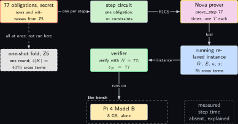
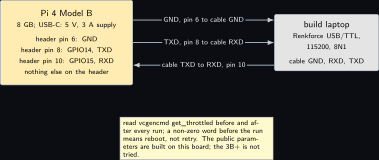
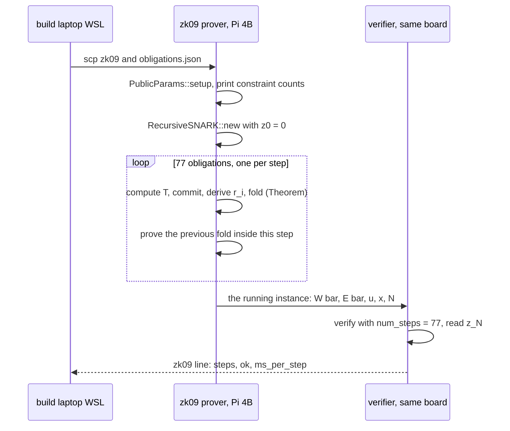
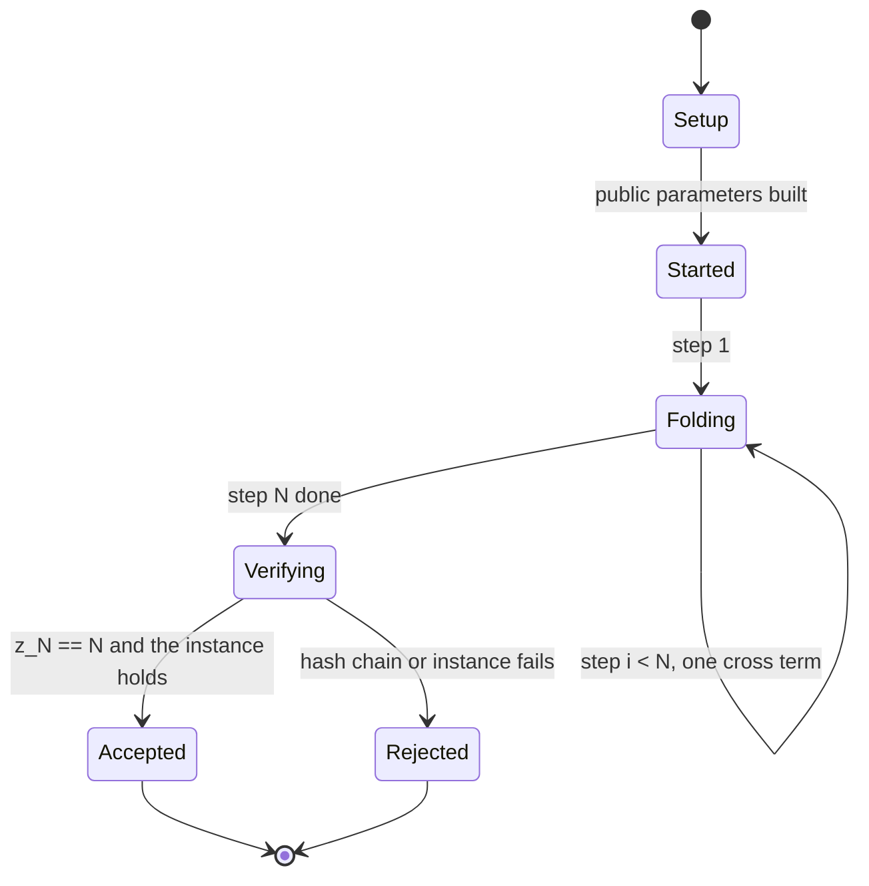
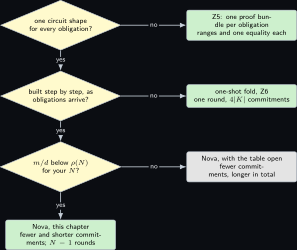

# Project 9. Nova versus one-shot folding on a Pi

> **Board:** Pi 4B alone, with the Renkforce console cable; the 77 obligations of Z5 as input  
> **Language:** Rust

> [!IMPORTANT]
> **The question, instanced**
>
> What can a verifier learn from a device without the device revealing itself, and what does it cost on this board? Here the device holds the same $N$ obligations as [Project 5](05-farkas-witnesses-for-a-joystick-program.md) and folds them the other way: not all at once under one challenge, as [Project 6](06-folding-and-the-salem-spencer-schedule.md) does, but one after another, each step folding one new instance into a running one with a single cross term, as Nova does. The verifier learns the same thing, that all $N$ obligations hold; the chapter prices the two folds against each other in commitments, in multi-scalar multiplication length, in rounds and in field work, with [Project 6](06-folding-and-the-salem-spencer-schedule.md)'s computed $|K|$ on one side and Nova's $N - 1$ on the other.

> **Key facts**
>
> - **Board:** Raspberry Pi 4 Model B Rev 1.4 (8 GB), Raspberry Pi OS trixie, kernel 6.18.50+rpt-rpi-v8, alone
> - **Parts:** the Pi 4B and the Renkforce USB/TTL cable; nothing on the 40-pin header
> - **Interface:** SSH, or the console on header pins 6, 8 and 10
> - **Language and library:** Rust with `nova-snark` 0.76.0 \[[8](#references)\] on the Pasta curves (`PallasEngine`, `VestaEngine`), its `StepCircuit` trait, `RecursiveSNARK::new` and `prove_step`; names marked to verify where the chapter is not certain of the 0.76.0 spelling
> - **Primitive:** Nova's folding of relaxed R1CS \[[4](#references)\], set against the paper's one-shot fold of Section 5.2 \[[1](#references)\]
> - **Secret:** the $N$ witnesses: the secret rows and the Farkas witnesses of every obligation
> - **Public:** the folded relaxed instance (the commitments $\bar W$, $\bar E$, the scalar $u$ and the public input $x$), the step count $N$, the public parameters
> - **Model:** none
> - **Acceptance:** a `RecursiveSNARK` over the 77 obligations verifies with `num_steps` 77 and the constraint count the crate prints is recorded; the same run with one step's $\lambda$ entry raised by 1 fails to verify; the cost table's counts are computed from the formulas below with the printed constraint count
> - **Difficulty:** 4 of 5
> - **Effort:** two evenings for the step circuit on the authoring laptop, one evening to build on the build laptop, one afternoon on the Pi 4B

## Pitch

The paper chooses its one-shot fold over Nova and says why in its related work: Nova scales better with the number of obligations at the cost of many folding rounds, and the one-shot fold trades $4|K|$ cross-term commitments for a single round \[[1](#references)\]. This chapter makes that sentence a table. Nova's object is a relaxed R1CS instance, an ordinary rank-one constraint system with a slack vector $E$ and a scalar $u$ that absorb what a random linear combination of two satisfying assignments would otherwise break; folding two instances costs the prover one commitment to a cross term $T$ and both parties a few scalar multiplications \[[4](#references)\]. Written as a step circuit that checks one obligation of [Project 5](05-farkas-witnesses-for-a-joystick-program.md), Nova proves the 77 obligations in 77 steps and 76 folds, each fold with one cross-term commitment, where [Project 6](06-folding-and-the-salem-spencer-schedule.md)'s schedule folds them in one step with $4|K|$, which for $N = 77$ is $4 \times 1019 = 4076$ (computed by [Project 6](06-folding-and-the-salem-spencer-schedule.md)'s script for this $N$). What Nova pays instead is the verifier circuit folded into every step, about $10^4$ constraints on the Pasta curves (the figure to verify in \[[4](#references)\]), which for an obligation of four columns and seven rows is nearly all of the step. The proposition below says, with those two numbers, which fold does less of which work at which $N$, and the run on the Pi 4B is what will say what a step costs in time.

## Parts and interface

| **Part** | **Role** | **Interface** | **Address or pin** |
| --- | --- | --- | --- |
| Raspberry Pi 4 Model B | the prover and the verifier; 8 GB is what the public parameters need and the 3B+ does not have | SSH, or the Renkforce cable at 115200 | header pins 6, 8, 10 |
| Renkforce USB/TTL cable | the console that prints the `zk09` lines when ssh is down | USB to the build laptop | GND pin 6, TXD GPIO14 pin 8, RXD GPIO15 pin 10 |
| `witnesses.json` from [Project 5](05-farkas-witnesses-for-a-joystick-program.md) | the 77 obligations with their witnesses | a file copied over scp | none |
| the build laptop, WSL side | builds the binary for aarch64; the `nova-snark` build takes minutes | LAN | \<build-laptop\> |

## The secret, the statement and the relation

Fix the step circuit $\mathsf{F}$ that checks one obligation of [Project 5](05-farkas-witnesses-for-a-joystick-program.md): given the secret row block $A_s$, the witnesses $\lambda_s, \mu_s, \delta_s$ and the public block $G_p, h_p$, it enforces $A_s^\top \lambda_s + G_p^\top \mu_s = 0$ and $\delta_s = -b_s^\top \lambda_s - h_p^\top \mu_s - 1$ over the field, and the ranges $\lambda_s, \mu_s, \delta_s \in [0, 2^{64})$ by bit decomposition, and increments a counter carried in the public state $z$. Let $(A, B, C)$ be the R1CS matrices of $\mathsf{F}$ with $m$ constraints. For step $i$ the witness is $W_i$ (every allocated value: rows, witnesses, bits, products), the public input is $x_i = (z_{i-1}, z_i)$, and the pair $(x_i, W_i)$ satisfies the R1CS of Definition **Definition Z9.1** below. The relation Nova proves after $N$ steps is

$$
\mathcal{R}_{09} = \Big\lbrace \thinspace  \big( \lbrace W_i\rbrace _{i=1}^{N} ;\thickspace  (z_0, z_N, N) \big) \thickspace \Big|\thickspace 
    \forall i \in [N]:\thickspace  \mathsf{F}(z_{i-1}; W_i) = z_i \thinspace \Big\rbrace , \tag{9.1}
$$

which with $z_0 = 0$ and $z_N = N$ says that $N$ obligations were checked in sequence. The witness never leaves the device: the verifier receives the folded instance $(\bar W, \bar E, u, x)$ and, in Nova's design, a succinct proof of its satisfiability. The secret rows of the program enter only as entries of $W_i$ under the step's commitment $\bar W_i$ (Theorem thm:z01\_hiding for hiding, with the blinding the crate adds in its zero-knowledge mode, to verify). What is public and what is secret is the same as in [Project 5](05-farkas-witnesses-for-a-joystick-program.md): the public rows $G_p, h_p$ are carried in the clear by a hash chain in $z$ in the full build, a counter in the listing below.

## The mathematics

**Definition Z9.1 (R1CS).** An R1CS structure over a field $\mathbb{F}$ is a triple of matrices $A, B, C \in \mathbb{F}^{m \times (\ell + n_w + 1)}$. An instance is a public input $x \in \mathbb{F}^{\ell}$, a witness is $W \in \mathbb{F}^{n_w}$, and the pair satisfies the structure if, for $z = (W, x, 1)$,

$$
(A z) \circ (B z) = C z ,
$$

where $\circ$ is the entrywise (Hadamard) product of vectors in $\mathbb{F}^m$ \[[3](#references)\].

**Definition Z9.2 (Relaxed R1CS).** For the same structure, a relaxed instance is $(\bar E, u, \bar W, x)$ with $u \in \mathbb{F}$, $x \in \mathbb{F}^{\ell}$ and commitments $\bar E = \mathsf{Com}(E; r_E)$, $\bar W = \mathsf{Com}(W; r_W)$; a witness is $(E, r_E, W, r_W)$ with $E \in \mathbb{F}^m$ and $W \in \mathbb{F}^{n_w}$. The pair satisfies the structure if the commitments open as stated and, for $z = (W, x, u)$,

$$
(A z) \circ (B z) = u \thinspace (C z) + E . \tag{9.2}
$$

An ordinary R1CS pair is a relaxed one with $u = 1$ and $E = 0$ \[[4](#references)\].

**Definition Z9.3 (The cross term).** For two vectors $z_1 = (W_1, x_1, u_1)$ and $z_2 = (W_2, x_2, u_2)$ over one structure,

$$
T \thickspace =\thickspace  (A z_1) \circ (B z_2) \thickspace +\thickspace  (A z_2) \circ (B z_1) \thickspace -\thickspace  u_1 \thinspace (C z_2)
  \thickspace -\thickspace  u_2 \thinspace (C z_1) \thickspace \in\thickspace  \mathbb{F}^m . \tag{9.3}
$$

$T$ depends on $z_1$ and $z_2$ only, not on any challenge.

**Theorem Z9.4 (Folding two relaxed instances).** Let $(E_1, u_1, W_1, x_1)$ and $(E_2, u_2, W_2, x_2)$ satisfy Equation 9.2 for one structure, and let $r \in \mathbb{F}$. Put

$$
z = z_1 + r z_2, \qquad\text{that is}\qquad
  W = W_1 + r W_2,\quad x = x_1 + r x_2,\quad u = u_1 + r u_2,
$$

and $E = E_1 + r T + r^2 E_2$ with $T$ as in Definition **Definition Z9.3**. Then $(E, u, W, x)$ satisfies Equation 9.2.

*Proof.* $A$, $B$ and $C$ are linear, so $A z = A z_1 + r A z_2$ and likewise for $B$ and $C$. The Hadamard product is bilinear, so

$$
\begin{aligned}
(A z) \circ (B z)
  &= (A z_1 + r A z_2) \circ (B z_1 + r B z_2) \notag \cr 
  &= (A z_1) \circ (B z_1)
     + r \thinspace (A z_1) \circ (B z_2) + r \thinspace (A z_2) \circ (B z_1)
     + r^2 (A z_2) \circ (B z_2) . \tag{9.4}
\end{aligned}
$$

By the hypothesis on the two instances, $(A z_1) \circ (B z_1) = u_1 (C z_1) + E_1$ and $(A z_2) \circ (B z_2) = u_2 (C z_2) + E_2$; substituting into Equation 9.4,

$$
(A z) \circ (B z) = u_1 (C z_1) + E_1
     + r \big[ (A z_1) \circ (B z_2) + (A z_2) \circ (B z_1) \big]
     + r^2 u_2 (C z_2) + r^2 E_2 . \tag{9.5}
$$

Now expand the right-hand side of the target equation with $u = u_1 + r u_2$ and $C z = C z_1 + r C z_2$:

$$
u \thinspace (C z) = (u_1 + r u_2)(C z_1 + r C z_2)
  = u_1 (C z_1) + r u_1 (C z_2) + r u_2 (C z_1) + r^2 u_2 (C z_2) . \tag{9.6}
$$

Subtract Equation 9.6 from Equation 9.5. The terms $u_1 (C z_1)$ and $r^2 u_2 (C z_2)$ cancel, and what remains is

$$
\begin{aligned}
(A z) \circ (B z) - u \thinspace (C z)
  &= E_1 + r \big[ (A z_1) \circ (B z_2) + (A z_2) \circ (B z_1)
     - u_1 (C z_2) - u_2 (C z_1) \big] + r^2 E_2 \notag \cr 
  &= E_1 + r T + r^2 E_2 = E ,
\end{aligned}
$$

where the bracket is exactly Equation 9.3. Hence $(A z) \circ (B z) = u (C z) + E$, which is Equation 9.2 for the folded pair. The commitments fold by the homomorphism of Pedersen commitments ([Project 2](02-a-sensor-reading-committed-on-the-microcontroller.md)'s theorem, and Theorem thm:z01\_hiding's scheme): $\bar W = \bar W_1 + r \bar W_2$ and $\bar E = \bar E_1 + r \bar T + r^2 \bar E_2$ with $\bar T = \mathsf{Com}(T; r_T)$, so the verifier folds the instance without seeing $W$, $E$ or $T$. &#9632;

**Remark Z9.8 (Why the slack is needed).** Without $E$ and $u$, the cross terms $r[(A z_1) \circ (B z_2) + (A z_2) \circ (B z_1)]$ in Equation 9.4 would have to vanish for the sum to satisfy an ordinary R1CS, which they do not; the relaxation moves them into $E$, and $u$ scales the constant column so that $z = z_1 + r z_2$ keeps a consistent last entry. The one-shot fold of [Project 6](06-folding-and-the-salem-spencer-schedule.md) does the same thing with $N$ instances at once and absorbs the cross terms into $\alpha^*$ through the $4|K|$ committed $C_k$, with the schedule keeping the diagonal apart from them; Nova absorbs one cross term per fold into $E$ and needs no schedule because two instances have one cross term, which the challenge $r$ separates by degree.

**Remark Z9.9 (Soundness, cited).** Nova's folding scheme is knowledge sound in the random oracle model: from three accepting transcripts with distinct challenges on the same commitments a witness for both instances is extracted, by the same degree argument as Theorem thm:z06\_soundness applied to a polynomial of degree 2 in $r$ \[[4](#references)\]; the final folded instance is then proved satisfiable with a succinct argument, Spartan with an inner-product argument on the Pasta curves in the crate \[[7](#references), [2](#references)\]. The chapter states this and does not re-prove it; its own proof is the completeness identity above and the cost proposition below.

**Proposition Z9.7 (Cost crossover between Nova and the one-shot fold).** Let $N$ obligations each have $d$ columns and at most $n$ rows, so that a cross term of the one-shot fold is a vector of length $d$, and let the Nova step circuit for one obligation have $m$ constraints, so that its cross term $T$ is a vector of length $m$. Let $|K| = |K(N)|$ be [Project 6](06-folding-and-the-salem-spencer-schedule.md)'s count and $\rho(N) = 4|K(N)| / (N - 1)$. Then:

1. **(i)** Cross-term commitments: Nova sends $N - 1$, the one-shot fold $4|K|$, and $N - 1 < 4|K|$ for every $N \ge 2$.
2. **(ii)** Total cross-term commitment length: Nova $(N - 1)\thinspace m$, the one-shot fold $4|K|\thinspace d$. Nova's is the smaller if and only if $m / d < \rho(N)$.
3. **(iii)** Sequential rounds: Nova $N - 1$, each depending on the previous folded instance; the one-shot fold one.
4. **(iv)** Prover field multiplications for cross terms: Nova $(N - 1)\thinspace c_T\thinspace m$ for a constant $c_T$ counting the multiplications per constraint in Equation 9.3; the one-shot fold $N (N - 1)\thinspace d\thinspace n$. Nova's is the smaller if and only if $N > c_T\thinspace m / (d\thinspace n)$.

*Proof.* (i) Lemma lem:z06\_Kbound gives $|K| \ge N - 1$, so $4|K| \ge 4(N - 1) > N - 1$ for $N \ge 2$. (ii) Each Nova cross term is committed with one multi-scalar multiplication of length $m$ and there are $N - 1$ of them; each of the $4|K|$ cross terms of the one-shot fold is committed with one of length $d$. Dividing $(N - 1) m < 4|K| d$ by $(N - 1) d > 0$ gives $m / d < \rho(N)$, and the steps reverse. (iii) Nova's step $i$ hashes the folded instance of step $i - 1$ to derive $r_i$, so the steps form a chain of length $N - 1$; the one-shot fold derives one $r$ from all commitments at once. (iv) Equation 9.3 costs the prover, per constraint, the products that form the four matrix-vector terms and their Hadamard products, a constant $c_T$ per constraint once $A z_i$, $B z_i$, $C z_i$ are formed, so $(N - 1) c_T m$ in all; the one-shot fold forms every $A_i \lambda_j$ with $i \ne j$ by Theorem thm:z06\_eq27, $N (N - 1)$ products of a $d \times n$ matrix by a vector, $d n$ multiplications each. Dividing $(N - 1) c_T m < N (N - 1) d n$ by $(N - 1) d n > 0$ gives $N > c_T m / (d n)$. &#9632;

For [Project 5](05-farkas-witnesses-for-a-joystick-program.md)'s instance $d = 4$, $n \le 7$, and the step has the obligation's own constraints, at most $4 + 33 \times 17 = 565$ for the two equalities and seventeen 64-bit ranges (computed), plus the recursion overhead of about $10^4$ (to verify), so $m \approx 10565$ and $m / d \approx 2641$ (computed from those two figures). The table in the Benchmark lists $\rho(N)$ for $N = 2^k$: it reaches $774.57$ at $N = 8192$ (computed), below $2641$, so by (ii) the one-shot fold commits fewer field elements in total for every $N$ in the table while Nova commits fewer vectors by (i); by (iv) with $c_T = 1$ Nova's field work is the smaller once $N > 10565 / 28 \approx 377$ (computed), that is from $N = 512$ in the table. An obligation with $d = 64$ columns would put $m / d$ near $165$ and cross (ii) at $N = 1024$, where $\rho = 226.88$; every one of these figures moves with the constraint count the crate prints, which is why the acceptance test records it.

## The protocol

Nova's incremental proof, as the crate exposes it, with the obligation circuit as the primary step and the trivial circuit on the secondary curve.

1. **Setup (both parties).** `PublicParams::setup` on one instance of the step circuit and the trivial secondary circuit; the crate prints the constraint counts of both, which are the $m$ of Proposition **Proposition Z9.7**. Both parties run this from the same source, so the parameters are public and reproducible.
2. **Start (prover).** `RecursiveSNARK::new` with $z_0 = (0)$ on the primary side and $(0)$ on the secondary.
3. **Step (prover), $N$ times.** `prove_step` with the $i$-th obligation as the circuit instance: the prover computes $T$, commits to it, derives $r_i$ from the running instance, folds by Theorem **Theorem Z9.4**, and proves inside the next step's circuit that the fold was done correctly.
4. **Verify (verifier).** `verify` with $N$ and $z_0$: the verifier checks the hash chain and the final relaxed instance, returning $z_N$, which must read $N$.
5. **Compress (optional).** `CompressedSNARK::prove` and `verify` turn the running instance into a succinct proof for a verifier that will not keep the public parameters; not needed on one board and marked **learn**.

## The code

One obligation per step; the listing carries the product check, the 64-bit ranges by bit decomposition and the counter, and omits the hash chain for the public rows. Names marked in the prose as to verify are the 0.76.0 spellings of the trait and the two constructors.

```rust
use bellpepper_core::{boolean::AllocatedBit, num::AllocatedNum, ConstraintSystem, SynthesisError};
use ff::PrimeField;
use nova_snark::{
    provider::{PallasEngine, VestaEngine},
    traits::{circuit::{StepCircuit, TrivialCircuit}, snark::default_ck_hint, Engine},
    PublicParams, RecursiveSNARK,
};

type E1 = PallasEngine;
type E2 = VestaEngine;
type F1 = <E1 as Engine>::Scalar;

// one obligation of Z5: the secret row a, the witness lambda, both of length n, and alpha
#[derive(Clone)]
struct Obligation<F: PrimeField> { a: Vec<F>, lambda: Vec<F>, alpha: F }

fn range64<F: PrimeField, CS: ConstraintSystem<F>>(cs: &mut CS, v: &AllocatedNum<F>, tag: &str)
    -> Result<(), SynthesisError> {
    let val = v.get_value().map(|x| x.to_repr());
    let mut lc = bellpepper_core::LinearCombination::<F>::zero();
    let mut coeff = F::ONE;
    for i in 0..64 {
        let bit = val.as_ref().map(|r| (r.as_ref()[i / 8] >> (i % 8)) & 1 == 1);
        let b = AllocatedBit::alloc(cs.namespace(|| format!("{tag} bit {i}")), bit)?;
        lc = lc + (coeff, b.get_variable());
        coeff = coeff.double();
    }
    cs.enforce(|| format!("{tag} bits"), |_| lc, |lc| lc + CS::one(), |lc| lc + v.get_variable());
    Ok(())
}

impl<F: PrimeField> StepCircuit<F> for Obligation<F> {
    fn arity(&self) -> usize { 1 }
    fn synthesize<CS: ConstraintSystem<F>>(&self, cs: &mut CS, z: &[AllocatedNum<F>])
        -> Result<Vec<AllocatedNum<F>>, SynthesisError> {
        let mut acc = AllocatedNum::alloc(cs.namespace(|| "acc0"), || Ok(F::ZERO))?;
        for (j, (aj, lj)) in self.a.iter().zip(&self.lambda).enumerate() {
            let a = AllocatedNum::alloc(cs.namespace(|| format!("a{j}")), || Ok(*aj))?;
            let l = AllocatedNum::alloc(cs.namespace(|| format!("l{j}")), || Ok(*lj))?;
            range64(cs, &l, &format!("l{j}"))?;
            let p = a.mul(cs.namespace(|| format!("p{j}")), &l)?;
            let next = AllocatedNum::alloc(cs.namespace(|| format!("acc{}", j + 1)),
                || Ok(acc.get_value().unwrap_or(F::ZERO) + p.get_value().unwrap_or(F::ZERO)))?;
            cs.enforce(|| format!("sum{j}"), |lc| lc + acc.get_variable() + p.get_variable(),
                       |lc| lc + CS::one(), |lc| lc + next.get_variable());
            acc = next;
        }
        let alpha = AllocatedNum::alloc(cs.namespace(|| "alpha"), || Ok(self.alpha))?;
        cs.enforce(|| "a . lambda = alpha", |lc| lc + acc.get_variable(),
                   |lc| lc + CS::one(), |lc| lc + alpha.get_variable());
        let count = AllocatedNum::alloc(cs.namespace(|| "count"),
            || Ok(z[0].get_value().unwrap_or(F::ZERO) + F::ONE))?;
        cs.enforce(|| "count + 1", |lc| lc + z[0].get_variable() + CS::one(),
                   |lc| lc + CS::one(), |lc| lc + count.get_variable());
        Ok(vec![count])
    }
}

fn fe(v: i64) -> F1 { if v >= 0 { F1::from(v as u64) } else { -F1::from((-v) as u64) } }

fn main() {
    let raw: Vec<(Vec<i64>, Vec<i64>, i64)> =
        serde_json::from_str(&std::fs::read_to_string("obligations.json").unwrap()).unwrap();
    let steps: Vec<Obligation<F1>> = raw.iter().map(|(a, l, al)| Obligation {
        a: a.iter().map(|v| fe(*v)).collect(), lambda: l.iter().map(|v| fe(*v)).collect(),
        alpha: fe(*al) }).collect();
    let c2 = TrivialCircuit::<<E2 as Engine>::Scalar>::default();
    let pp = PublicParams::<E1, E2, Obligation<F1>, TrivialCircuit<<E2 as Engine>::Scalar>>::setup(
        &steps[0], &c2, &*default_ck_hint(), &*default_ck_hint()).unwrap();
    let (m1, m2) = pp.num_constraints();
    println!("zk09 constraints primary={} secondary={}", m1, m2);
    let (z0_1, z0_2) = (vec![F1::ZERO], vec![<E2 as Engine>::Scalar::ZERO]);
    let mut rs = RecursiveSNARK::new(&pp, &steps[0], &c2, &z0_1, &z0_2).unwrap();
    let t0 = std::time::Instant::now();
    for step in &steps { rs.prove_step(&pp, step, &c2).unwrap(); }
    let ms = t0.elapsed().as_secs_f64() * 1e3;
    let ok = rs.verify(&pp, steps.len(), &z0_1, &z0_2).is_ok();
    println!("zk09 steps={} ok={} ms_total={:.1} ms_per_step={:.2}", steps.len(), ok, ms,
             ms / steps.len() as f64);
}
```

```bash
# build laptop, WSL: nova-snark 0.76.0 pinned; the build is minutes, not seconds
cargo build --release --target aarch64-unknown-linux-gnu
scp target/aarch64-unknown-linux-gnu/release/zk09 obligations.json <user>@<pi4b>:~/
# on the Pi 4B over ssh
vcgencmd get_throttled && ./zk09 && vcgencmd get_throttled
```

To verify against the 0.76.0 documentation: the module path of `StepCircuit` and `TrivialCircuit`, the `default_ck_hint` helper and its place under `traits::snark`, the four type parameters of `PublicParams`, the signature of `RecursiveSNARK::new` (whether it takes the two initial states, as written), and whether `num_constraints` is the name of the accessor. `bellpepper-core` and `ff` are pinned to the versions `nova-snark` depends on; the bit extraction in `range64` reads the little-endian representation the Pasta scalars expose through `to_repr`, to verify.

## The model, if any

None. The chapter compares two folds; nothing in it is proposed.

## Real, modelled, absent

- **have:** real: the Pi 4B; the `nova-snark` crate at 0.76.0 read on Friday 6 November 2026; the 77 obligations and their witnesses from [Project 5](05-farkas-witnesses-for-a-joystick-program.md); the counts of Proposition **Proposition Z9.7** (i), (iii) and the $|K|$ side of (ii) and (iv), which are computed exactly
- **learn:** modelled: the recursion overhead of about $10^4$ constraints is a figure from the Nova paper, to verify against what `num_constraints` prints on this build; every crossover number that depends on it moves with it. The hash chain that carries the public rows is omitted from the listing. The compressed proof is not produced. Every timing bar below is drawn dashed
- **absent:** absent: a measured fold time on any board; a second board as an independent verifier; a Pi 3B+ run, which the memory the public parameters need (recorded by the run, against the 3B+'s 905 MB) is expected to rule out before its thermal window does

## System architecture



*Figure 9.1. Two folds of the same obligations. Top row: the 77 obligations of Z5 as a stop-outlined secret block, a solid arrow into the step circuit as a green user-space block, and the Nova prover with the accent outline running `prove_step` 77 times, each step folding one cross term; a solid arrow carries the running relaxed instance, a blue commitment-coloured block holding $\bar W$, $\bar E$, $u$ and $x$, to the verifier with the green outline. Second row, dashed: the one-shot fold of Z6 as a software stand-in on this board, drawn beside the Nova path with its $4\vert K\vert $ cross terms, so that the two certificates can be read against each other; it is not run here. Bottom, inside a dashed layer named the bench: the Pi 4B alone as a solid hardware block, and a dotted grey block for the absent measured time.*

Read the figure as two paths from one secret: Nova's path is long and thin, $N - 1$ steps with one commitment each; the one-shot path is one step and wide, $4|K|$ commitments at once. The verifier at the end of either learns the same statement.

## Wiring



*Figure 9.2. The Pi 4B alone. The board as a solid hardware block with its USB-C supply named and the three console pins called out, GND on pin 6, GPIO14 TXD on pin 8 and GPIO15 RXD on pin 10; the Renkforce USB/TTL cable to the build laptop drawn as a grey external block on the right; a note that the 40-pin header carries nothing else in this chapter and that the throttle register is read before and after every run.*

| **Signal** | **From** | **To** | **Note** |
| --- | --- | --- | --- |
| GND | Pi header pin 6 | Renkforce cable GND | common reference first |
| TXD | Pi GPIO14, header pin 8 | Renkforce cable RXD | 115200, 8N1; the `zk09` lines arrive here when ssh is down |
| RXD | Pi GPIO15, header pin 10 | Renkforce cable TXD | the console's input; cross the pair |
| 5 V supply | the Pi's USB-C power input | Pi 4B | 5 V, 3 A supply; the header's 5 V pins stay unused |
| nothing else |  |  | no HAT, no sensor; the header is free so no overlay claims SPI0 or I2C1 |

## Sequence and states





## Decision tree



*Figure 9.3. Which fold for which task. The root diamond asks whether every obligation has the same circuit shape; no leads to a leaf naming Z5, one proof bundle per obligation. Yes leads to a diamond asking whether the proof may be built step by step as the obligations arrive; no leads to a leaf naming the one-shot fold of Z6, one round and $4\vert K\vert $ commitments. Yes leads to a diamond asking whether $m / d$ is below $\rho(N)$ for the task's $N$; yes leads to the leaf of this chapter, Nova with fewer commitments and shorter ones; no leads to a grey leaf that still names Nova for its $N - 1$ commitments but warns that the total committed length is larger, so the table decides.*

## Benchmark


*Figure 9.4. Expected cost per step on the Pi 4B, log scale in milliseconds, drawn dashed because nothing has been measured on this bench: from left to right, one `prove_step` with the recursion overhead, the `setup` once, the `verify` of 77 steps, and the whole run of 77 steps. A solid bar replaces a dashed one when the run has happened and the acceptance test has passed.*

| $N$ | $N - 1$ | $4\vert K\vert $ | $\rho(N)$ | $c_T m/(dn)$ | **Instrument** |
| --- | --- | --- | --- | --- | --- |
| 2 | 1 | 4 | 4.00 | 377 | computed: $\vert K\vert $ from Z6's script, $\rho$ by division |
| 8 | 7 | 76 | 10.86 | 377 | computed, the same |
| 32 | 31 | 844 | 27.23 | 377 | computed, the same |
| 77 | 76 | 4076 | 53.63 | 377 | computed, the same, for Z5's $N$ |
| 128 | 127 | 8236 | 64.85 | 377 | computed, the same |
| 512 | 511 | 76684 | 150.07 | 377 | computed, the same; Nova's field work smaller from here, with $c_T = 1$ and $m = 10565$ to verify |
| 2048 | 2047 | 700396 | 342.16 | 377 | computed, the same |
| 8192 | 8191 | 6344524 | 774.57 | 377 | computed, the same |

| **Quantity** | **Value** | **Where** | **Instrument** |
| --- | --- | --- | --- |
| constraints per step, $m$ | not measured | Pi 4B | `num_constraints`, printed by the `zk09` line; the paper's $10^4$ overhead to verify |
| prove\_step | not measured | Pi 4B | `Instant` over 77 steps, divided; throttle word 0x0 before and after |
| setup | not measured | Pi 4B | `Instant` once |
| verify, 77 steps | not measured | Pi 4B | `Instant` once |
| peak memory | not measured | Pi 4B | `/usr/bin/time -v`, maximum resident set |
| one-shot fold, 77 obligations | not run here | Z6 | counts only: $4 \times 1019$ commitments, computed |
| symbolic prover, the paper's | 1 min for 217 to 303 obligations | the paper's AWS c6g.8xlarge | the paper's Table 1, attributed \[[1](#references)\] |

## Steps

**Step 1.** On the authoring laptop, write the step circuit and the manifest with `nova-snark = "0.76.0"` and the `bellpepper-core` and `ff` versions it depends on; convert [Project 5](05-farkas-witnesses-for-a-joystick-program.md)'s `witnesses.json` to `obligations.json` with one row per obligation.

**Step 2.** On the build laptop in WSL, build for `aarch64-unknown-linux-gnu`; the first build compiles the Pasta arithmetic and takes minutes; copy the binary and the JSON to the Pi 4B.

**Step 3.** On the Pi 4B over ssh, read `vcgencmd get_throttled`, run `./zk09` under `/usr/bin/time -v`, read the register again, and keep the two `zk09` lines and the maximum resident set size.

**Step 4.** On the Pi 4B, write the printed primary constraint count into Proposition **Proposition Z9.7**'s instance in place of $10565$, recompute $m / d$ and $c_T m / (d n)$, and say whether the crossover row of the table moved.

**Step 5.** On the Pi 4B, raise one $\lambda$ entry of one obligation by 1 in the JSON and run again: `prove_step` or `verify` must fail; a run that prints `ok=true` is a defect in the circuit, not a pass.

**Step 6.** On the build laptop, run the same binary natively and keep its `zk09` line beside the Pi's; the ratio of the two `ms_per_step` figures is the chapter's board-to-laptop factor, reported and not assumed.

## Acceptance test

The chapter passes when the honest run prints `steps=77 ok=true` with the throttle word `0x0` on both reads and a recorded constraint count, the mutated run fails, and the table's counts are recomputed with the printed $m$. It fails if the honest run is rejected, if the mutated run is accepted, if the public parameters do not fit in the Pi 4B's memory (then the chapter says so and the Pi 3B+ is not tried), or if any cell is filled with a laptop figure.

## Variants

**A transparent proof wrapped in a pairing-based one.** The same 77 obligations are proved by a transparent argument with no trusted setup, a STARK over hash-based commitments \[[6](#references)\] built with the toolkit the brief names \[[10](#references)\], and that argument's verifier is then written as one circuit and proved once under Groth16 \[[3](#references)\], which is how the brief's identity node reaches a constant-size artefact \[[9](#references)\]. The whole proof path is swapped: folding disappears, each obligation becomes a block of rows of one execution trace rather than a step of a recursion, and the object the verifier keeps is a pairing proof rather than a running relaxed instance. What it buys is a size that does not move with $N$, 128 bytes and three pairings (computed in [Project 8](08-a-ranking-function-as-a-circuit.md)'s table as $2 \cdot 32 + 64$ over BN254), where the STARK it wraps is measured in kilobytes and the compressed Nova proof of this chapter is not produced at all. What it costs is the wrapping circuit, and that cost is counted rather than measured: its constraints are the hash invocations of the STARK verifier multiplied by the constraint count of one permutation, no such build has been run on this bench, and the cell therefore reads not measured with that reason until the two counts are read from a build. Choose it when a verifier must hold one small artefact and cannot keep public parameters that grow with the run, and accept in exchange a circuit-specific ceremony, which on this bench is the one-party stand-in of [Project 8](08-a-ranking-function-as-a-circuit.md) and is drawn dashed for that reason. The brief puts the node on the NanoPi NEO Air, whose 512 MB is 0.57 of the Pi 3B+'s 905 MB (computed), and this chapter's own acceptance test already expects the public parameters to rule that smaller board out, so the board here stays the Pi 4B. The brief's witness is a template from a UART fingerprint sensor and its verifier is a contract on a ledger; no fingerprint sensor is on the bench and nothing in this volume goes outward, so the witness stays the 77 obligations of [Project 5](05-farkas-witnesses-for-a-joystick-program.md) and the verifier stays on the board.

## Pitfalls

- The step circuit must have the same shape at every step: the public parameters are built from one instance, so every obligation is padded to the same $n$ rows with zero rows and zero witnesses, which the ranges accept and the product ignores.
- Everything not in $z$ is private, including the public rows $G_p, h_p$; a verifier that must know which obligations were checked needs the hash chain in $z$, and a listing without it proves that 77 products of something held.
- The recursion overhead is paid per step however small the obligation; for Z5's four columns it is more than ninety percent of $m$ (computed from the two figures above), which is why Proposition **Proposition Z9.7** (ii) favours the one-shot fold here and would not for an obligation of a few thousand constraints.
- A folded witness is uniform in the field; the ranges are enforced inside each step and never on the running instance, the same point as [Project 6](06-folding-and-the-salem-spencer-schedule.md)'s second pitfall from the other side.
- `verify` returns the final $z$; a test that checks only `is_ok()` and not $z_N = 77$ would accept a run of the right shape and the wrong length.

## Languages and libraries not chosen

- Rust with `ark-ff` and a hand-written fold: Theorem **Theorem Z9.4** is thirty lines, but the recursion that makes Nova incremental is the crate's whole value; a hand fold without it is [Project 6](06-folding-and-the-salem-spencer-schedule.md) in another language.
- ProtoGalaxy \[[5](#references)\]: folds many instances under one challenge like the paper's scheme with a different cross-term structure; no pinned crate was read on Friday 6 November 2026, so it is a sentence here and not a chapter.
- Go with `gnark`: no folding scheme in the release read; the PLONK route is [Project 12](12-a-plonk-gate-for-the-inductive-step.md).
- Noir with Honk, [Project 13](13-the-obligation-in-noir.md): proves one obligation at a time, which is the unfolded baseline both folds are measured against.

## Sources

- [arxiv.org/abs/2605.00487](https://arxiv.org/abs/2605.00487) (verified Friday 6 November 2026), the paper: Section 5.2 and the related work on Nova and ProtoGalaxy.
- [crates.io, nova-snark 0.76.0](https://crates.io/api/v1/crates/nova-snark) (verified Friday 6 November 2026).
- [doi:10.1007/978-3-031-15985-5\_13](https://doi.org/10.1007/978-3-031-15985-5_13) (to verify), Nova.
- [eprint.iacr.org/2023/1106](https://eprint.iacr.org/2023/1106) (to verify), ProtoGalaxy.

<a id="references"></a>

## References

1. Pascal Berrang, Mirco Giacobbe, Jacob Swales and Xiao Yang. Zero-Knowledge Model Checking. arXiv:2605.00487v2 \[cs.CR\], version 1 submitted Friday 1 May 2026, version 2 Tuesday 8 September 2026. [arxiv.org/abs/2605.00487](https://arxiv.org/abs/2605.00487) (verified Friday 6 November 2026).
2. Jonathan Bootle, Andrea Cerulli, Pyrros Chaidos, Jens Groth and Christophe Petit. Efficient zero-knowledge arguments for arithmetic circuits in the discrete log setting. In EUROCRYPT 2016, LNCS 9666, pages 327 to 357. Springer, 2016. [doi:10.1007/978-3-662-49896-5\_12](https://doi.org/10.1007/978-3-662-49896-5_12) (to verify).
3. Jens Groth. On the size of pairing-based non-interactive arguments. In EUROCRYPT 2016, LNCS 9666, pages 305 to 326. Springer, 2016. [doi:10.1007/978-3-662-49896-5\_11](https://doi.org/10.1007/978-3-662-49896-5_11) (to verify).
4. Abhiram Kothapalli, Srinath Setty and Ioanna Tzialla. Nova: recursive zero-knowledge arguments from folding schemes. In CRYPTO 2022, LNCS 13510, pages 359 to 388. Springer, 2022. [doi:10.1007/978-3-031-15985-5\_13](https://doi.org/10.1007/978-3-031-15985-5_13) (to verify).
5. Liam Eagen and Ariel Gabizon. ProtoGalaxy: efficient ProtoStar-style folding of multiple instances. IACR Cryptology ePrint Archive, report 2023/1106. [eprint.iacr.org/2023/1106](https://eprint.iacr.org/2023/1106) (to verify).
6. Eli Ben-Sasson, Iddo Bentov, Yinon Horesh and Michael Riabzev. Scalable, transparent, and post-quantum secure computational integrity. IACR Cryptology ePrint Archive, report 2018/046. [eprint.iacr.org/2018/046](https://eprint.iacr.org/2018/046) (to verify).
7. Srinath Setty. Spartan: efficient and general-purpose zkSNARKs without trusted setup. In CRYPTO 2020, LNCS 12172, pages 704 to 737. Springer, 2020. [doi:10.1007/978-3-030-56877-1\_25](https://doi.org/10.1007/978-3-030-56877-1_25) (to verify).
8. Microsoft Research. nova-snark: high-speed recursive arguments from folding schemes. Version 0.76.0, updated Thursday 3 September 2026. [crates.io, nova-snark](https://crates.io/api/v1/crates/nova-snark) (verified Friday 6 November 2026).
9. Advanced hardware-software architectures for edge artificial intelligence and zero-knowledge model checking. A design brief of twenty project sketches, read on Friday 6 November 2026 and held locally at `a local design brief`. It is the input to this second edition and is not a published source; where its hardware claims disagree with the bench, the bench is followed and the disagreement is stated.
10. Plonky3 contributors. Plonky3: a toolkit for polynomial commitment based proof systems, the backend of several zero-knowledge virtual machines. [github.com/Plonky3/Plonky3](https://github.com/Plonky3/Plonky3) (to verify).

---

[Previous](08-a-ranking-function-as-a-circuit.md) &nbsp;&nbsp;|&nbsp;&nbsp; [Contents](../CONTENTS.md) &nbsp;&nbsp;|&nbsp;&nbsp; [Next](10-the-hardware-hash-unit-commits-to-a-transition.md)
