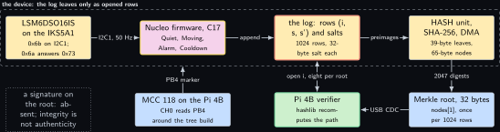
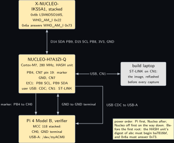
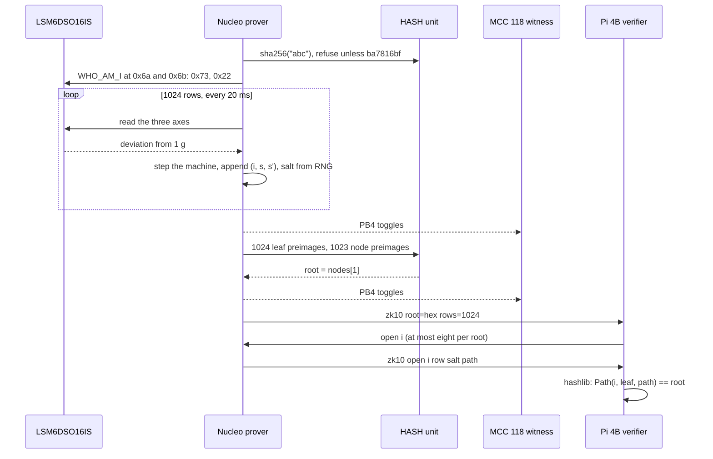
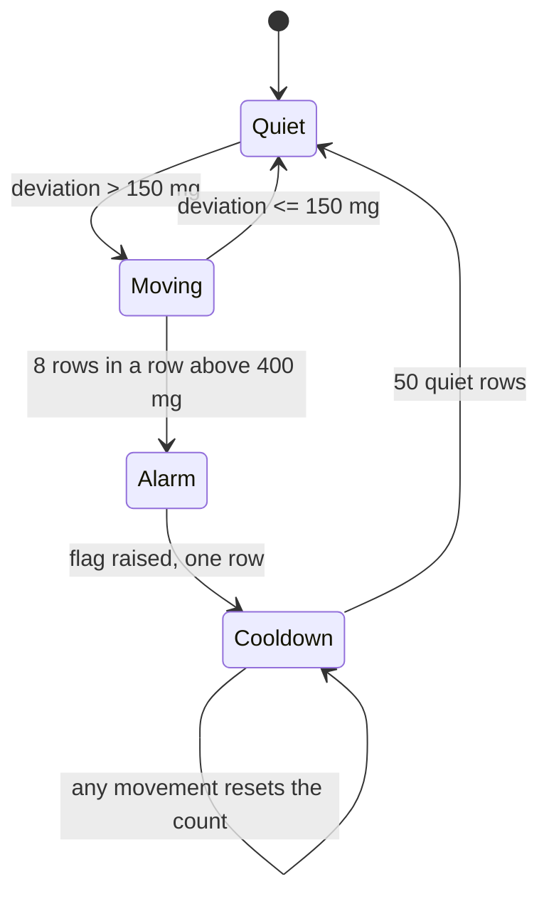
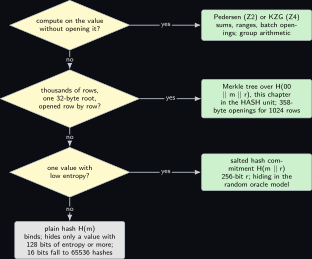

# Project 10. The hardware hash unit commits to a transition log

> **Board:** NUCLEO-H7A3ZI-Q with the X-NUCLEO-IKS5A1 stacked; the STM32H7A3's HASH peripheral; Pi 4B as the verifier over USB CDC; MCC 118 as the witness  
> **Language:** C

> [!IMPORTANT]
> **The question, instanced**
>
> What can a verifier learn from a device without the device revealing itself, and what does it cost on this board? Here the device runs a four-state vibration watchdog on an inertial sensor and keeps a log of every transition it took. What leaves the board is a 32-byte Merkle root over that log, computed by the microcontroller's SHA-256 unit; what the verifier learns is that the log is fixed, and later, for the handful of rows it is allowed to ask about, what those rows say. The cost is the hash unit's throughput against the software routine it replaces, which is "not measured" until the DWT and the MCC 118 agree.

> **Key facts**
>
> - **Board:** NUCLEO-H7A3ZI-Q (STM32H7A3ZI, Cortex-M7 at 280 MHz, hardware HASH unit with SHA-256 and DMA, hardware RNG) as the prover; Raspberry Pi 4 Model B Rev 1.4 (8 GB) as the verifier
> - **Parts:** X-NUCLEO-IKS5A1 on the Arduino header: LSM6DSO16IS at 0x6b and, at 0x6a, an IMU that answers WHO\_AM\_I 0x73 and that no kernel on the bench supports (both measured on a Pi bus on Tuesday 27 October 2026); the MCC 118 on the Pi 4B as the timing witness
> - **Interface:** I2C1 at 400 kHz to the shield; USB CDC from the Nucleo's user USB to the Pi 4B; PB4 on CN7 pin 19 as the marker; the ST-LINK drive `NOD_H7A3ZIQ`
> - **Language and library:** C17 with the STM32H7 HAL: `HAL_HASH_Init`, `HAL_HASHEx_SHA256_Start`, `HAL_HASHEx_SHA256_Start_DMA`, `HAL_HASHEx_SHA256_Finish`, `HAL_RNG_GenerateRandomNumber` (names to verify against the HAL driver sources and RM0455 \[[7](#references)\])
> - **Primitive:** the hash commitment $`H(m \,\|\, r)`$ and a Merkle tree over the device's transition log \[[3](#references)\]
> - **Secret:** the log: the sequence of rows $`(i, s_i, s_{i+1})`$ with their salts $`r_i`$
> - **Public:** the Merkle root, 32 bytes; later, membership openings for at most eight rows per root, each a row, its salt and ten sibling hashes
> - **Model:** none
> - **Acceptance:** the hash unit's digest of the three bytes `abc` equals the published SHA-256 test vector and the Pi's `hashlib` digest byte for byte; in a disclosure run the Pi recomputes the root of 1024 rows and matches it; eight openings verify and two altered openings are refused; and the DWT cycle count and the MCC 118 marker interval agree within 2 percent on the tree build, which is attainable only for an interval of at least 1000 microseconds, that is 280000 cycles at 280 MHz. The resolution is computed, not assumed: the MCC 118 samples one channel every 10 microseconds, so an interval read from two marker edges carries up to two sample periods of quantisation, and for that to be 2 percent or less the interval must exceed 1000 microseconds. This chapter's build is expected to clear the floor but not by much: $`1024 \cdot 1 + 1023 \cdot 2 = 3070`$ compressed blocks is $`3070 \times 64 = 196480`$ bytes, which at the expected HASH throughput of $`10^7`$ to $`10^8`$ bytes per second is 1.96 to 19.6 milliseconds, so the fast end sits at $`20 / 1960 = 1.0`$ percent of the interval, inside the criterion with no margin (all computed). If the build is measured below 1000 microseconds the marker is held over a block of $`N`$ consecutive builds rather than one, as [Project 1](01-the-price-list.md) does for its sub-100-microsecond operations, $`N`$ is chosen so that the block exceeds 1 millisecond, and the published figure names the block size
> - **Difficulty:** 3 of 5
> - **Effort:** one evening for the HAL hash and RNG bring-up on the build laptop, one evening for the state machine and the tree, one afternoon on the bench with the Pi recomputing roots

## Pitch

The paper's commitment to a transition relation is a polynomial commitment, chosen because the verifier must later be convinced of a property of the relation without seeing it \[[1](#references)\]. This chapter asks what the cheapest commitment on the bench buys when the verifier is content with less: a log that cannot be rewritten after the fact, and a few rows of it disclosed on request. A hash commitment $`H(m \,\|\, r)`$ binds a row under collision resistance and hides it under a random oracle, and a Merkle tree turns 1024 such leaves into one 32-byte root with ten-hash openings. The STM32H7A3 computes SHA-256 in a peripheral with its own DMA channel, so the question of cost is sharp: how many bytes per second does the unit hash against the software routine, and does a 39-byte leaf, which is one block, ever benefit from it? The chapter also shows the limit that the paper's Remark 2.2 names \[[1](#references)\]: a hiding commitment protects the log, but the policy of which rows may be opened is a leakage policy that no hash function decides.

## Parts and interface

| **Part** | **Role** | **Interface** | **Address or pin** |
| --- | --- | --- | --- |
| NUCLEO-H7A3ZI-Q | the prover; the HASH unit, the RNG, the state machine, the tree | the ST-LINK drive `NOD_H7A3ZIQ`; the user USB connector for the CDC (name to verify in UM2408 \[[8](#references)\]) | PB4 marker on CN7 pin 19; I2C1 on PB8 (SCL), PB9 (SDA) |
| X-NUCLEO-IKS5A1 | the sensor shield, stacked; its addresses measured on a Pi bus on Tuesday 27 October 2026 | I2C1 at 400 kHz | LSM6DSO16IS at 0x6b, WHO\_AM\_I 0x22; the 0x6a part answers 0x73 and is used only to identify the shield |
| Raspberry Pi 4 Model B | the verifier; recomputes roots and checks openings in Python `hashlib`, the host harness role | USB-A to the Nucleo; SSH from the build laptop | `/dev/ttyACM0` |
| MCC 118 on the Pi 4B | witness of the tree-build interval | SPI0 CE0, free of the CAN overlays | CH0 to PB4, GND terminal to a Nucleo GND |
| the build laptop, WSL side | the `arm-none-eabi` build with the HAL sources | LAN |  |

## The secret, the statement and the relation

The device's state machine has the state set $`S = \{\mathrm{Quiet}, \mathrm{Moving}, \mathrm{Alarm}, \mathrm{Cooldown}\}`$, encoded as the bytes 0 to 3, and its transition relation $`T \subseteq S \times S`$ is driven by the deviation of the acceleration magnitude from 1 g. The log is the vector of rows

```math
m_i = (i, s_i, s_{i+1}) \in [0, 2^{32}) \times S \times S, \qquad i = 0, \dots, n - 1,
```

serialised as six bytes, with $`n = 1024`$ and one row every 20 ms. The witness is $`w = ((m_i, r_i))_{i < n}`$ with salts $`r_i \in \{0, 1\}^{256}`$; the statement is the root $`u = \rho \in \{0, 1\}^{256}`$. With the leaf and node hashes of Definition **Definition Z10.2**,

```math
\mathcal{R}_{\mathrm{root}} = \big\{\, \big(((m_i, r_i))_{i<n}, \rho\big) \;:\;
    \rho = \mathrm{Root}\big((H(\mathtt{00} \,\|\, m_i \,\|\, r_i))_{i<n}\big) \,\big\},
```

*(10.1)*

and the opening relation for one position is

```math
\mathcal{R}_{\mathrm{mem}} = \big\{\, ((m, r, \pi), (\rho, i)) \;:\;
    \mathrm{Path}(i, H(\mathtt{00} \,\|\, m \,\|\, r), \pi) = \rho \,\big\},
```

*(10.2)*

where $`\pi \in (\{0,1\}^{256})^{10}`$ is the list of sibling hashes and $`\mathrm{Path}`$ recomputes the root along position $`i`$. In the paper's terms $`\rho`$ is $`\mathsf{Com}(\mathsf{sp}, \mathcal{M}; r)`$ for the secret relation $`\mathcal{M} = T`$ restricted to the transitions actually taken \[[1](#references)\]; what this commitment cannot do, and the paper's can, is support a proof about $`T`$ without opening rows, which is why the decision tree sends a verifier that needs sums or ranges to [Project 2](02-a-sensor-reading-committed-on-the-microcontroller.md) and [Project 4](04-two-group-elements.md).

## The mathematics

**Definition Z10.1 (Collision resistance).** A function $`H : \{0, 1\}^* \to \{0, 1\}^{2\lambda}`$ is collision resistant if every efficient algorithm outputs a pair $`(x, x')`$ with $`x \ne x'`$ and $`H(x) = H(x')`$ with probability at most $`\mathrm{negl}(\lambda)`$ \[[4](#references)\]. For SHA-256, $`2\lambda = 256`$, and the generic birthday search needs about $`2^{128}`$ evaluations, a number computed from the output length and not a statement about the function's structure.

**Definition Z10.2 (Merkle tree with domain separation).** Let $`n = 2^k`$ and let $`(\ell_0, \dots, \ell_{n-1})`$ be leaves with $`\ell_i = H(\mathtt{00} \,\|\, m_i \,\|\, r_i)`$, where $`m_i`$ is 6 bytes and $`r_i`$ is 32 bytes, so every leaf preimage is 39 bytes and starts with the byte `00`. The nodes are $`N_{0,i} = \ell_i`$ and

```math
N_{j+1, i} = H(\mathtt{01} \,\|\, N_{j, 2i} \,\|\, N_{j, 2i+1}), \qquad 0 \le j < k,
```

so every internal preimage is 65 bytes and starts with `01`; the root is $`\mathrm{Root} = N_{k, 0}`$ \[[3](#references)\]. The authentication path of position $`i`$ is $`\pi_i = (N_{j, \lfloor i / 2^j \rfloor \oplus 1})_{j=0}^{k-1}`$, the sibling at each level, and $`\mathrm{Path}(i, \ell, \pi)`$ sets $`a_0 = \ell`$ and, for $`j = 0, \dots, k - 1`$, $`a_{j+1} = H(\mathtt{01} \,\|\, a_j \,\|\, \pi_j)`$ if bit $`j`$ of $`i`$ is 0 and $`a_{j+1} = H(\mathtt{01} \,\|\, \pi_j \,\|\, a_j)`$ if it is 1, returning $`a_k`$.

**Theorem Z10.3 (The Merkle root is position binding).** Suppose an efficient algorithm $`\mathcal{A}`$ outputs $`(\rho, i, (m, r, \pi), (m', r', \pi'))`$ with $`(m, r) \ne (m', r')`$ and $`\mathrm{Path}(i, H(\mathtt{00} \,\|\, m \,\|\, r), \pi) = \mathrm{Path}(i, H(\mathtt{00} \,\|\, m' \,\|\, r'), \pi') = \rho`$ with probability $`\varepsilon`$. Then there is an efficient algorithm $`\mathcal{B}`$ that outputs a collision of $`H`$ with probability $`\varepsilon`$, performing at most $`2k + 2`$ evaluations of $`H`$ beyond running $`\mathcal{A}`$.

*Proof.* $`\mathcal{B}`$ runs $`\mathcal{A}`$ and, when the two openings verify, recomputes the two chains $`a_0, \dots, a_k`$ and $`a'_0, \dots, a'_k`$ of Definition **Definition Z10.2**, with $`a_0 = H(\mathtt{00} \,\|\, m \,\|\, r)`$ and $`a'_0 = H(\mathtt{00} \,\|\, m' \,\|\, r')`$, which costs $`2k + 2`$ evaluations. Both chains end at $`\rho`$, so $`a_k = a'_k`$.

Case 1: $`a_0 = a'_0`$. The preimages $`x = \mathtt{00} \,\|\, m \,\|\, r`$ and $`x' = \mathtt{00} \,\|\, m' \,\|\, r'`$ have the same length, 39 bytes, with $`m`$ in bytes 1 to 6 and $`r`$ in bytes 7 to 38; since $`(m, r) \ne (m', r')`$ at least one of those bytes differs, so $`x \ne x'`$, and $`H(x) = a_0 = a'_0 = H(x')`$. $`\mathcal{B}`$ outputs $`(x, x')`$.

Case 2: $`a_0 \ne a'_0`$. Let $`j^* = \min \{\, j \in \{0, \dots, k\} \mid a_j = a'_j \,\}`$; the set is non-empty because it contains $`k`$, and $`j^* \ge 1`$ because $`a_0 \ne a'_0`$. Then $`a_{j^* - 1} \ne a'_{j^* - 1}`$. Let $`b`$ be bit $`j^* - 1`$ of $`i`$; it is the same bit for both chains because the position $`i`$ is the same. If $`b = 0`$ the two preimages at level $`j^*`$ are $`y = \mathtt{01} \,\|\, a_{j^*-1} \,\|\, \pi_{j^*-1}`$ and $`y' = \mathtt{01} \,\|\, a'_{j^*-1} \,\|\, \pi'_{j^*-1}`$, which differ in bytes 1 to 32; if $`b = 1`$ they are $`y = \mathtt{01} \,\|\, \pi_{j^*-1} \,\|\, a_{j^*-1}`$ and $`y' = \mathtt{01} \,\|\, \pi'_{j^*-1} \,\|\, a'_{j^*-1}`$, which differ in bytes 33 to 64. In both sub-cases $`y \ne y'`$ and $`H(y) = a_{j^*} = a'_{j^*} = H(y')`$. $`\mathcal{B}`$ outputs $`(y, y')`$.

In every case $`\mathcal{B}`$ outputs a collision whenever $`\mathcal{A}`$ succeeds, so its probability is $`\varepsilon`$. The domain bytes make a leaf preimage and an internal preimage differ in their first byte and in their lengths, 39 against 65, so no collision found by this argument can be an artefact of a leaf hash being read as a node hash. &#9632;

**Corollary Z10.4.** If $`\mathcal{A}`$ outputs two leaf vectors $`(m_i, r_i)_{i<n} \ne (m'_i, r'_i)_{i<n}`$ with the same root, a collision follows with the same probability: take the first position $`i`$ at which the pairs differ and the two paths the vectors determine, and apply Theorem **Theorem Z10.3**.

**Proposition Z10.5 (Hiding needs the salt).** (i) Model $`H`$ as a random oracle. For any $`m_0 \ne m_1`$ of equal length and any adversary that makes at most $`Q`$ oracle queries, the advantage in distinguishing $`H(m_0 \,\|\, r)`$ from $`H(m_1 \,\|\, r)`$ with $`r`$ uniform in $`\{0, 1\}^{2\lambda}`$ is at most $`Q / 2^{2\lambda}`$ \[[2](#references)\]. (ii) Without the salt, a commitment $`H(m)`$ to a value $`m`$ from a set $`M`$ is recovered by $`|M|`$ evaluations of $`H`$; for a 16-bit sample $`|M| = 2^{16} = 65536`$, computed, and for a row of this chapter's log with the index known $`|S \times S| = 16`$.

*Proof.* (i) Let $`b`$ be the hidden bit and $`c = H(m_b \,\|\, r)`$ the value the adversary receives. Call a query $`x`$ a hit if $`x = m_0 \,\|\, r`$ or $`x = m_1 \,\|\, r`$. Because $`m_0`$ and $`m_1`$ have equal length, a fixed string $`x`$ equals $`m_0 \,\|\, r^*`$ for at most one $`r^*`$ and $`m_1 \,\|\, r^{**}`$ for at most one $`r^{**}`$, and not both unless $`m_0 = m_1`$; so a fixed query is a hit for exactly one value of $`r`$ at most, and before the first hit the adversary's view (the value $`c`$, which is a fresh uniform string, and the answers to non-hit queries, which are independent of $`r`$) is independent of $`r`$, so each query hits with probability at most $`2^{-2\lambda}`$. By the union bound over $`Q`$ queries, $`\operatorname{Pr}[\mathrm{Hit}] \le Q / 2^{2\lambda}`$. Conditioned on no hit, $`c`$ is a uniform string independent of $`b`$, so the adversary's output is independent of $`b`$, and

```math
\big|\operatorname{Pr}[\text{output } 1 \mid b = 0] - \operatorname{Pr}[\text{output } 1 \mid b = 1]\big|
  \le \operatorname{Pr}[\mathrm{Hit}] \le Q / 2^{2\lambda}.
```

(ii) The adversary computes $`H(m')`$ for every $`m' \in M`$ and compares with the commitment; the committed $`m`$ is in $`M`$, so one comparison succeeds, after at most $`|M|`$ evaluations. If a second $`m'' \ne m`$ also matched, $`(m, m'')`$ would be a collision, which collision resistance rules out except with negligible probability; so the match is $`m`$. The counts $`2^{16} = 65536`$ and $`4 \cdot 4 = 16`$ are computed from the sizes of the sets. &#9632;

**Lemma Z10.6 (Size of an opening).** For $`n = 2^k`$ leaves the root is 32 bytes for every $`n`$, and an opening of one position is $`6 + 32 + 32k`$ bytes; for $`n = 1024`$, $`k = 10`$ and the opening is 358 bytes, computed. Recomputing it costs $`k + 1`$ evaluations of $`H`$ on one 64-byte block each.

*Proof.* The root is one output of $`H`$, 32 bytes, whatever $`n`$. The opening carries the row, 6 bytes, the salt, 32 bytes, and one sibling per level, $`k`$ of them at 32 bytes each: $`38 + 32k`$. For $`k = 10`$ that is $`38 + 320 = 358`$. The verifier evaluates $`H`$ once on the 39-byte leaf preimage and once per level on a 65-byte node preimage. SHA-256 padding appends at least 9 bytes (the byte `80` and the 8-byte length) and rounds up to 64-byte blocks, so a 39-byte message is one block ($`39 + 9 = 48 \le 64`$) and a 65-byte message is two blocks ($`65 + 9 = 74 \le 128`$); the count of calls is $`k + 1`$ and the count of compressed blocks is $`1 + 2k = 21`$, computed. &#9632;

**Remark Z10.8 (The paper's Remark 2.2, on this board).** The root reveals nothing about the log in the random oracle model (Proposition **Proposition Z10.5**), and each opened row reveals exactly that row. The paper's Remark 2.2 says that the specification $`\phi`$ and the certificate $`v_\phi`$ can themselves determine the secret system, whatever the commitment does \[[1](#references)\]. The analogue here is the opening policy. If the verifier may open every row, the log is public. If it may open only rows with $`(s_i, s_{i+1}) = (\mathrm{Alarm}, \mathrm{Cooldown})`$, it learns every alarm time. The firmware's policy is eight openings per root, by index, and a refusal on the ninth; the policy is public, and it is the user's responsibility in the same sense as $`\phi`$.

## The protocol

1. Prover, at boot: read WHO\_AM\_I at 0x6a and at 0x6b; refuse to start unless they read 0x73 and 0x22, which identifies the IKS5A1 (the IKS4A1 answers 0x70 at 0x6b); initialise the HASH unit with 8-bit data type and the RNG; hash the three bytes `abc` and refuse to start unless the digest begins `ba7816bf`.
2. Prover, every 20 ms for 1024 rows: read the three acceleration axes of the LSM6DSO16IS, compute the deviation of the magnitude from 1 g in milli-g, step the state machine, append the row $`(i, s_i, s_{i+1})`$ and draw its 32-byte salt from the RNG.
3. Prover, after 1024 rows: toggle PB4; hash the 1024 leaves and the 1023 internal nodes in the HASH unit; toggle PB4; send `zk10 root=<64 hex> rows=1024`.
4. Verifier, on the root line: store $`(\rho, t)`$ with the host timestamp.
5. Verifier, on demand: send `open <i>`; the prover answers `zk10 open i=<i> row=<12 hex> salt=<64 hex> path=<640 hex>` for the first eight requests per root and `zk10 refused` afterwards; the verifier recomputes the path with `hashlib` and compares with $`\rho`$.
6. Verifier, in a disclosure run only: send `disclose`; the prover sends every row and salt; the verifier rebuilds the tree and compares the root byte for byte. This run reveals the log and is a test of the implementation, not a use of the commitment.

## The code

The firmware keeps the tree in a heap layout, node $`k`$ with children $`2k`$ and $`2k + 1`$, so that a sibling is `k xor 1` and the path is ten shifts. The clock, I2C and USB initialisation functions are the generated ones and are not printed; `imu_read_reg`, `imu_deviation_mg`, `to_hex_line` and `serve_requests` are four helpers of the same shape as the lines they serve. The HAL names `HAL_HASHEx_SHA256_Start`, the DMA pair, `HASH_DATATYPE_8B` and `CDC_Transmit_FS` are to verify against the HAL and USB device library versions read on the day.

```c
#include <stdint.h>
#include <string.h>
#include "stm32h7xx_hal.h"
#include "usbd_cdc_if.h"          /* CDC_Transmit_FS from the ST USB device library */

#define ROWS   1024u              /* a power of two: ten levels */
#define LEVELS 10u

enum state { QUIET = 0, MOVING = 1, ALARM = 2, COOLDOWN = 3 };
struct row { uint32_t idx; uint8_t s; uint8_t s_next; };

static HASH_HandleTypeDef hhash;
static RNG_HandleTypeDef  hrng;
static struct row rows[ROWS];
static uint8_t    salt[ROWS][32];
static uint8_t    nodes[2 * ROWS][32];   /* nodes[1] is the root; leaves at ROWS + i */

uint8_t  imu_read_reg(uint8_t addr, uint8_t reg);
uint32_t imu_deviation_mg(void);
size_t   to_hex_line(uint8_t *out, size_t cap, const char *prefix, const uint8_t d[32],
                     uint32_t rows);   /* returns the byte count written, CR LF included */
void     serve_requests(void);            /* open i (eight per root), disclose */

static void sha256(const uint8_t *in, uint32_t len, uint8_t out[32])
{
    /* one block per call here; HAL_HASHEx_SHA256_Start_DMA and _Finish for long buffers */
    if (HAL_HASHEx_SHA256_Start(&hhash, (uint8_t *)in, len, out, 100) != HAL_OK) for (;;) {}
}

static void row_bytes(const struct row *r, uint8_t out[6])
{
    out[0] = (uint8_t)r->idx;        out[1] = (uint8_t)(r->idx >> 8);
    out[2] = (uint8_t)(r->idx >> 16); out[3] = (uint8_t)(r->idx >> 24);
    out[4] = r->s;                    out[5] = r->s_next;
}

static void leaf_hash(uint32_t i, uint8_t out[32])
{
    uint8_t pre[39];
    pre[0] = 0x00;
    row_bytes(&rows[i], pre + 1);
    memcpy(pre + 7, salt[i], 32);
    sha256(pre, sizeof pre, out);
}

static void node_hash(const uint8_t l[32], const uint8_t r[32], uint8_t out[32])
{
    uint8_t pre[65];
    pre[0] = 0x01;
    memcpy(pre + 1, l, 32);
    memcpy(pre + 33, r, 32);
    sha256(pre, sizeof pre, out);
}

static void build_tree(void)
{
    for (uint32_t i = 0; i < ROWS; i++) leaf_hash(i, nodes[ROWS + i]);
    for (uint32_t k = ROWS - 1; k >= 1; k--)
        node_hash(nodes[2 * k], nodes[2 * k + 1], nodes[k]);
}

void path_of(uint32_t i, uint8_t out[LEVELS][32])   /* siblings, leaf level first */
{
    uint32_t k = ROWS + i;
    for (uint32_t j = 0; j < LEVELS; j++) { memcpy(out[j], nodes[k ^ 1u], 32); k >>= 1; }
}

static void fill_salt(uint32_t i)
{
    for (int w = 0; w < 8; w++) {
        uint32_t x;
        if (HAL_RNG_GenerateRandomNumber(&hrng, &x) != HAL_OK) for (;;) {}
        memcpy(salt[i] + 4 * w, &x, 4);
    }
}

static enum state step(enum state s, uint32_t dev_mg, uint32_t *run)
{
    switch (s) {
    case QUIET:    return dev_mg > 150u ? MOVING : QUIET;
    case MOVING:   *run = dev_mg > 400u ? *run + 1 : 0;
                   if (*run >= 8u) return ALARM;
                   return dev_mg > 150u ? MOVING : QUIET;
    case ALARM:    *run = 0; return COOLDOWN;
    default:       *run = dev_mg < 150u ? *run + 1 : 0;
                   return *run >= 50u ? QUIET : COOLDOWN;
    }
}

int main(void)
{
    static const uint8_t abc[3] = { 'a', 'b', 'c' };
    uint8_t digest[32], line[96];
    HAL_Init(); SystemClock_Config(); MX_GPIO_Init(); MX_I2C1_Init(); MX_USB_DEVICE_Init();
    __HAL_RCC_HASH_CLK_ENABLE(); __HAL_RCC_RNG_CLK_ENABLE();
    hhash.Instance = HASH;                   /* without this the handle's register base is 0 */
    hhash.Init.DataType = HASH_DATATYPE_8B;
    hrng.Instance = RNG;
    if (HAL_HASH_Init(&hhash) != HAL_OK || HAL_RNG_Init(&hrng) != HAL_OK) for (;;) {}
    sha256(abc, 3, digest);
    static const uint8_t want[4] = { 0xba, 0x78, 0x16, 0xbf };   /* SHA-256("abc") */
    if (memcmp(digest, want, 4) != 0) for (;;) {}
    if (imu_read_reg(0x6a, 0x0f) != 0x73 || imu_read_reg(0x6b, 0x0f) != 0x22) for (;;) {}
    enum state s = QUIET; uint32_t run = 0;
    for (uint32_t i = 0; i < ROWS; i++) {
        enum state n = step(s, imu_deviation_mg(), &run);
        rows[i] = (struct row){ .idx = i, .s = (uint8_t)s, .s_next = (uint8_t)n };
        fill_salt(i);
        s = n;
        HAL_Delay(20);
    }
    HAL_GPIO_TogglePin(GPIOB, GPIO_PIN_4);
    build_tree();
    HAL_GPIO_TogglePin(GPIOB, GPIO_PIN_4);
    /* "zk10 root=" is 10 bytes, the digest is 64 hex, " rows=1024\r\n" is 12: 86 in all */
    size_t n_line = to_hex_line(line, sizeof line, "zk10 root=", nodes[1], ROWS);
    CDC_Transmit_FS(line, (uint16_t)n_line);
    for (;;) serve_requests();
}
```

```bash
# build laptop, WSL: the firmware volume's arm-none-eabi toolchain and HAL sources
arm-none-eabi-gcc -std=c17 -mcpu=cortex-m7 -mthumb -mfpu=fpv5-d16 -mfloat-abi=hard -O2 \
  -DSTM32H7A3xxQ -DUSE_HAL_DRIVER -Ihal/inc -Iusb/inc -c zk10.c -o zk10.o
# link with the HAL, the USB device library objects and the startup file, then:
arm-none-eabi-objcopy -O binary zk10.elf zk10.bin
cp zk10.bin /mnt/<drive>/        # NOD_H7A3ZIQ; reflash immediately before every capture
# the Pi 4B over ssh: the root line, then the known answer and a path check in Python
python3 -c "import hashlib; print(hashlib.sha256(b'abc').hexdigest()[:8])"
```

The last line prints `ba7816bf`, the first eight hex digits of the SHA-256 test vector for `abc` published with the standard (reference to be added, see the wanted list); the firmware refuses to start unless the HASH unit prints the same, which is the one test that catches a wrong data-type swap setting before it has signed a thousand rows.

## The model, if any

None. The log is produced by the state machine and committed by arithmetic; nothing is proposed.

## Real, modelled, absent

- **have:** real: the Nucleo with its HASH and RNG units, the IKS5A1 with the LSM6DSO16IS at 0x6b and the 0x73 part at 0x6a (both measured on Tuesday 27 October 2026), the Pi 4B, the MCC 118 live since Friday 9 October 2026
- **learn:** modelled: every bar in the benchmark figure is the order of magnitude from the reference manual's cycles-per-block figure for the HASH unit (to verify in RM0455 \[[7](#references)\]) against a software SHA-256 count of about 15 to 20 cycles per byte on a Cortex-M7, drawn dashed; the HAL function names and the generated initialisation are to be read from the HAL sources before the build
- **absent:** absent: a signature on the root, so the root's integrity over USB is not authenticity ([Project 18](18-a-proof-over-the-wire.md) says what a signature adds); a kernel driver for the 0x6a part, so the Pi cannot cross-read that sensor and the firmware uses it only to identify the shield; an oscilloscope, so the tree-build marker is witnessed at 10 microseconds; a timer-driven sampling loop, so the listing's period is 20 ms plus the work and the row count is a count of periods rather than elapsed time

## System architecture



*Figure 10.1. The device and its one public value. Inside a dashed layer labelled as the device, one row of four solid blocks: the LSM6DSO16IS in hardware yellow feeding the firmware block with the yellow prover outline, which runs the four-state machine; the stop-outlined secret block holding the rows and salts; and at the row's end the HASH unit as a solid hardware block in which the 39-byte leaf preimages and 65-byte node preimages are hashed. Below the layer, outside it, the public side: the root drops out of the HASH unit as a kernel-blue commitment block and reaches the Pi 4B verifier with the green outline over USB CDC; a two-headed arrow between the verifier and the secret block above it carries the open requests, limited to eight per root, and their replies; the MCC 118 in kernel blue witnesses the tree-build marker at the layer's edge; and a dotted grey block says that a signature on the root is absent.*

## Wiring



*Figure 10.2. The IKS5A1 stacked on the Nucleo, the marker and the ground down to the MCC 118 on the Pi 4B, the CDC line from the Nucleo's user USB to the Pi's USB-A, and the build laptop on the ST-LINK for the image. The shield block names its two addresses and the WHO\_AM\_I bytes that identify it; the Nucleo block names PB4 on CN7 pin 19, the GND, I2C1 on PB8 and PB9 through the Arduino D15 and D14 positions (to verify), and the user USB. The note gives the power order and the one check that must pass before the first root.*

| **Signal** | **From** | **To** | **Note** |
| --- | --- | --- | --- |
| I2C1 SDA | Nucleo PB9, Arduino D14 | IKS5A1 SDA | pin mapping to verify against UM2408 \[[8](#references)\]; the shield carries the pull-ups |
| I2C1 SCL | Nucleo PB8, Arduino D15 | IKS5A1 SCL | 400 kHz; open drain |
| 3V3 and GND | Nucleo Arduino power pins | IKS5A1 | through the stacked header |
| marker | Nucleo PB4, CN7 pin 19 | MCC 118 CH0 | toggles before and after the tree build; a build of 2047 hashes is many 10 microsecond samples wide |
| ground | Nucleo GND, CN7 | MCC 118 GND terminal | common reference for the marker |
| USB CDC | Nucleo user USB connector | Pi 4B USB-A | `/dev/ttyACM0`; the root line, the open replies, the disclosure run |
| ST-LINK | Nucleo CN1 | build laptop | the image, and the reflash before every capture |

## Sequence and states





The second diagram is the device's own machine, the thing the log records: each arrow taken is one row $`(i, s_i, s_{i+1})`$, and a row with $`s_i = s_{i+1}`$ is a self-loop, which the log records too, so that the row count is a count of sampling periods. It is not elapsed time unless the period is held by a timer. The listing above closes its loop with `HAL_Delay(20)` after the sensor read and the eight random-number draws, so the period is 20 ms plus the work and plus up to one millisecond of `HAL_Delay` granularity, and the drift accumulates over 1024 rows. The $`1024 \times 20 = 20.48`$ seconds that step 4 waits for is therefore a floor and not an estimate (computed), and the state machine's two counters, eight rows above 400 mg and fifty quiet rows, are the 160 ms and the one second the Pitch claims only if the period is held. The per-row period is **not measured, no run and no timer in the listing to measure it against**; driving the sampling loop from a hardware timer at 50 Hz and refusing a run with a missed period is the repair, and it is recorded in the absent list above rather than written into the listing.

## Decision tree



*Figure 10.3. Which commitment for a log. The root diamond asks whether the verifier must compute on the committed value without opening it, sums or ranges; yes leads right to the Pedersen and KZG leaf ([Project 2](02-a-sensor-reading-committed-on-the-microcontroller.md), [Project 4](04-two-group-elements.md)). No drops to a diamond asking whether thousands of rows must be committed in 32 bytes and opened row by row; yes leads to the Merkle tree of this chapter in the HASH unit. No drops to a diamond asking whether the single value has low entropy; yes leads to the salted hash commitment with 256 bits of randomness, and no to the grey leaf of a plain hash, which binds and hides only values with 128 bits of entropy or more.*

## Benchmark


*Figure 10.4. Expected SHA-256 throughput on the Nucleo at 280 MHz, log scale in bytes per second, drawn as dashed bars because none has been measured: the software routine and the HASH unit with DMA on a long buffer, then the two again on the chapter's 39-byte leaves where a HAL call per leaf dominates, and the Pi 4B's `hashlib` as the host reference. The heights are orders of magnitude from the reference manual's cycles per block against a software cycles-per-byte count; a solid bar replaces a dashed one when the DWT count and the MCC 118 interval agree, and its caption names the record.*

| **Quantity** | **Expected** | **Value** | **Instrument** |
| --- | --- | --- | --- |
| HASH unit, long buffer, DMA | $`10^7`$ to $`10^8`$ B/s | not measured | DWT around a 64 kB buffer, 64 repeats, median |
| software SHA-256, long buffer | $`10^7`$ B/s | not measured | DWT, the same buffer, the same repeats; the routine is the one of the firmware volume |
| HASH unit, one 39-byte leaf | $`10^6`$ to $`10^7`$ B/s | not measured | DWT around one `HAL_HASHEx_SHA256_Start` call |
| tree build, 1024 rows | 2047 calls | not measured, no run | DWT and the MCC 118 marker; must agree within 2 percent, which needs an interval over 1000 microseconds, that is 280000 cycles at 280 MHz, or a block of $`N`$ builds under one marker |
| root check on the Pi 4B | under 10 ms | not measured | `time.perf_counter` around `hashlib`, 64 repeats |
| opening, bytes | 358 | computed | Lemma **Lemma Z10.6** |

The paper's Table 1 has no column for a hash commitment; the paper hashes only inside its Fiat-Shamir transform, and its figures stay attributed to its AWS `c6g.8xlarge` \[[1](#references)\].

## Steps

**Step 1.** On the authoring laptop, write `zk10.c` and the four helpers against the HAL headers of the firmware volume's tree; commit.

**Step 2.** On the build laptop in WSL, `git pull --ff-only`, generate or reuse the clock, I2C1 and USB device initialisation for the H7A3, build, convert, and copy the binary to `NOD_H7A3ZIQ`; reflash immediately before every capture.

**Step 3.** On the bench, stack the IKS5A1 with the board off; wire PB4 and a GND to the MCC 118 on the Pi 4B; connect the user USB to the Pi 4B; power the Pi first.

**Step 4.** On the Pi 4B over ssh, confirm `/dev/spidev0.0` exists, open the CDC port, and wait about 21 s for the first root line; a board that stays silent has refused at the known-answer test or the WHO\_AM\_I test, and the ST-LINK console says which.

**Step 5.** On the Pi 4B, capture CH0 around the tree build and compare the marker interval with the DWT count that the root line carries.

**Step 6.** On the Pi 4B, open eight rows and check each path with `hashlib`; alter one row's `s_next` and one salt byte in two copies and confirm two refusals; ask for a ninth row and confirm the refusal line.

**Step 7.** On the Pi 4B, run one disclosure, rebuild the tree in Python and compare the root byte for byte; a mismatch is a data-type swap or a byte-order error in the firmware, not a cryptographic event.

## Acceptance test

The chapter passes when the HASH unit's digest of `abc` begins `ba7816bf` and equals `hashlib`'s 32 bytes, when one disclosure run of 1024 rows rebuilds in Python to the root the board sent, when eight openings verify and the two altered ones are refused, when the ninth request is refused, and when the DWT count of the tree build divided by 280 MHz agrees with the MCC 118 interval within 2 percent, the interval being over 1000 microseconds so that the instrument's two sample periods of quantisation are inside that 2 percent, or else the marker being held over a block of $`N`$ builds whose size is published beside the figure. It fails if any digest differs in one byte, if an altered opening verifies, if the board starts against WHO\_AM\_I bytes other than 0x73 and 0x22, or if two roots over different logs ever coincide, which by Corollary **Corollary Z10.4** would be a SHA-256 collision and would be reported as such.

## Variants

**A model's frame sequence committed.** The leaves stop being the device's own state transitions and become the hashes of the frames an on-device inference runtime consumed \[[6](#references), [5](#references)\], so what the root fixes is the input sequence of a classifier rather than the trace of a watchdog. Each leaf preimage grows from the chapter's 39 bytes to 73, namely the domain byte, a four-byte index, the 32-byte frame digest, a four-byte latency in microseconds and the 32-byte salt, and the step relation the verifier later asks about is that consecutive indices differ by one and that every latency is under a public bound. SHA-256 pads a 73-byte message to two 64-byte blocks, since $`73 + 9 = 82`$, which is above 64 and at most 128, so the tree build over 1024 leaves costs $`1024 \cdot 2 + 1023 \cdot 2 = 4094`$ compressed blocks against this chapter's $`1024 \cdot 1 + 1023 \cdot 2 = 3070`$, a factor of 1.33 (all computed). An opening grows the same way, to $`40 + 32 + 32 \cdot 10 = 392`$ bytes against 358 (computed), because the row is now forty bytes wide. The honest limit is that the root alone does not say the sequence was unbroken: Theorem **Theorem Z10.3** binds a position and nothing more, so the ordering claim is discharged either by opening every row, which discloses the log, or by a circuit over the committed leaves of the kind [Project 8](08-a-ranking-function-as-a-circuit.md) builds. Choose it when the audited question is whether a model consumed every frame in order and inside a latency bound, rather than whether a log was rewritten after the fact. No camera is on this bench, so the frames are a replayed set drawn dashed, and the absence costs the variant its claim to authenticity, since the root then fixes what was read from a file and not what a sensor saw. The brief sends the finished proof to a supervisor on a factory floor, and nothing in this volume goes outward, so the root and its openings reach the Pi 4B verifier of this chapter over the USB CDC line it already uses.

## Pitfalls

- The HAL's hash API changed across versions: older drivers expose `HAL_HASHEx_SHA256_Start`, newer ones a single `HAL_HASH_Start` with an algorithm field in the init structure (to verify); pin the HAL version in the build and name it in the record.
- The data type setting decides how the unit swaps bytes within a word; a wrong setting produces a 32-byte digest that is wrong and looks right, which is why the `abc` test runs before anything is committed.
- DMA on the Cortex-M7 crosses the data cache: a buffer handed to `HAL_HASHEx_SHA256_Start_DMA` must be cleaned from the cache first or placed in a non-cacheable region, or the unit hashes stale bytes.
- A leaf preimage and a node preimage must not be confusable; the domain byte and the different lengths make them distinct, and dropping the byte to save one would reopen the known second-preimage structure of unprefixed trees.
- $`n`$ must be a power of two for the heap layout; a shorter log is padded with a fixed sentinel leaf, never by duplicating the last leaf, which would let two different logs share a root.
- A row's salt is drawn per row; one salt for all rows turns Proposition **Proposition Z10.5** (ii) back on, since a row with the index known has 16 possible values.
- The IKS4A1 and the IKS5A1 both answer at 0x6b; only the pair of WHO\_AM\_I bytes tells them apart, and the firmware refuses rather than reading the wrong register map.
- The MCC 118 needs SPI0 CE0 free of the CAN overlays; `ls /dev/spidev0.0` is the check.

## Languages and libraries not chosen

- Rust with the `sha2` crate: software only, and no binding to the HASH unit in `stm32h7xx-hal` (to verify), so the comparison this chapter is about could not be drawn; [Project 2](02-a-sensor-reading-committed-on-the-microcontroller.md) stays in Rust because its library has no C equivalent on the board.
- C++17: nothing here needs a class, and the HAL is C.
- Zig on a freestanding target: possible, with every peripheral written as register access; the HAL's hash and USB drivers are the reason the chapter is C.
- Python: on the Pi only, as the host harness that recomputes roots, which the language rule allows.

## Sources

- [arxiv.org/abs/2605.00487](https://arxiv.org/abs/2605.00487) (verified Friday 6 November 2026), the paper; Remark 2.2 on specification-induced leakage.
- [github.com/aiverification/zkmc](https://github.com/aiverification/zkmc) (verified Friday 6 November 2026), the paper's code; its Fiat-Shamir hashing is the only hash in the schemes.
- [digilent.com, MCC 118](https://digilent.com/shop/mcc-118-128-voltage-measurement-daq-hat-for-raspberry-pi/) (to verify).

<a id="references"></a>

## References

1. Pascal Berrang, Mirco Giacobbe, Jacob Swales and Xiao Yang. Zero-Knowledge Model Checking. arXiv:2605.00487v2 \[cs.CR\], version 1 submitted Friday 1 May 2026, version 2 Tuesday 8 September 2026. [arxiv.org/abs/2605.00487](https://arxiv.org/abs/2605.00487) (verified Friday 6 November 2026).
2. Mihir Bellare and Phillip Rogaway. Random oracles are practical: a paradigm for designing efficient protocols. In CCS 1993, pages 62 to 73. ACM, 1993. [doi:10.1145/168588.168596](https://doi.org/10.1145/168588.168596) (to verify).
3. Ralph C. Merkle. A digital signature based on a conventional encryption function. In CRYPTO 1987, LNCS 293, pages 369 to 378. Springer, 1988. [doi:10.1007/3-540-48184-2\_32](https://doi.org/10.1007/3-540-48184-2_32) (to verify).
4. Jonathan Katz and Yehuda Lindell. Introduction to Modern Cryptography, second edition. CRC Press, 2014. (to verify)
5. Advanced hardware-software architectures for edge artificial intelligence and zero-knowledge model checking. A design brief of twenty project sketches, read on Friday 6 November 2026 and held locally at `a local design brief`. It is the input to this second edition and is not a published source; where its hardware claims disagree with the bench, the bench is followed and the disagreement is stated.
6. PyTorch. ExecuTorch: an on-device inference runtime for PyTorch models. Release v1.5.1, Wednesday 23 September 2026. [github.com/pytorch/executorch](https://github.com/pytorch/executorch) (verified Friday 6 November 2026).
7. STMicroelectronics. RM0455, STM32H7A3/7B3 and STM32H7B0 advanced Arm-based 32-bit MCUs, reference manual. (to verify)
8. STMicroelectronics. UM2408, STM32H7 Nucleo-144 boards (MB1363) user manual. (to verify)

---

[Previous](09-nova-versus-one-shot-folding-on-a-pi.md) &nbsp;&nbsp;|&nbsp;&nbsp; [Contents](../CONTENTS.md) &nbsp;&nbsp;|&nbsp;&nbsp; [Next](11-the-provers-cost.md)
