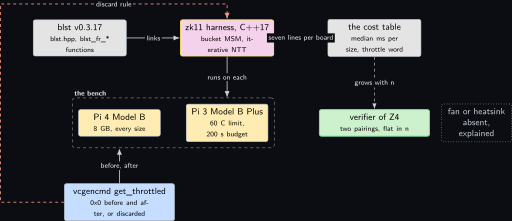
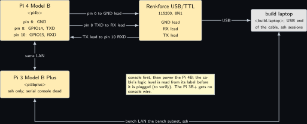
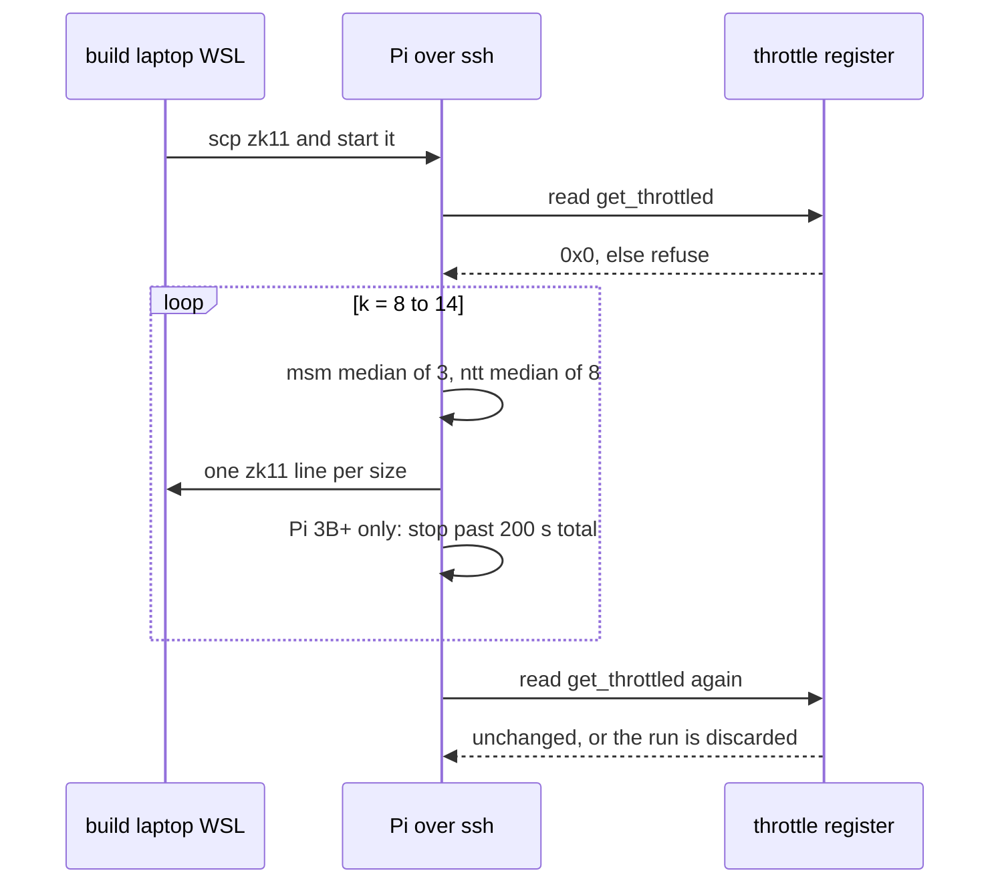
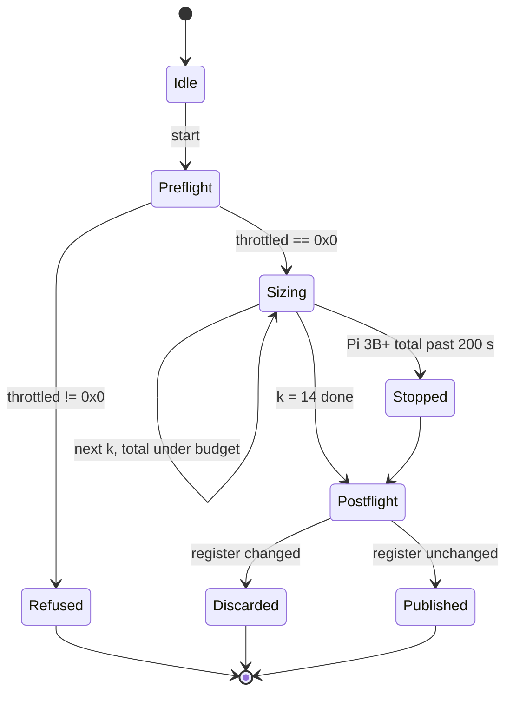
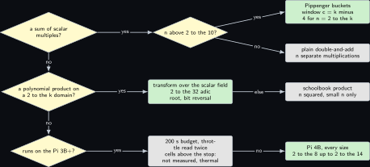

# Project 11. The prover's cost: multi-scalar multiplication and FFT on two Pis

> **Board:** Pi 4B and Pi 3B+ over ssh; the Renkforce cable on the Pi 4B console; the build laptop as the build host  
> **Language:** C++

> [!IMPORTANT]
> **The question, instanced**
>
> What can a verifier learn from a device without the device revealing itself, and what does it cost on this board? This chapter answers only the second half, for the two operations that set the prover's bill in both of the paper's schemes: the multi-scalar multiplication behind every KZG and Pedersen commitment, and the number-theoretic transform behind every polynomial product and quotient. It measures them at seven sizes on the Pi 4B, and on the Pi 3B+ for as long as its four-minute thermal window allows.

> **Key facts**
>
> - **Board:** Raspberry Pi 4 Model B Rev 1.4 (8 GB, address \<pi4b\>) and Raspberry Pi 3 Model B Plus Rev 1.3 (905 MB, 1.4 GHz, soft limit 60 C, no fan, address \<pi3bplus\>)
> - **Parts:** the two Pis, the Renkforce USB/TTL cable on the Pi 4B's header pins 6, 8 and 10, build laptop (\<build-laptop\>) as the build host and the cable's USB end
> - **Interface:** ssh over the bench LAN the bench subnet to both boards; the Pi 4B's serial console at 115200 through the cable; the Pi 3B+ has no working serial console
> - **Language and library:** C++17 against `blst` v0.3.17 \[[7](#references)\] through its C++ header `blst.hpp` for $\mathbb{G}_1$ and its C functions `blst_fr_*` for the scalar field; the transform is written by hand in this chapter
> - **Primitive:** the two costs that dominate every prover of the paper \[[1](#references)\]: a multi-scalar multiplication of size $n$ in $\mathbb{G}_1$ and a transform of size $n$ over $\mathbb{F}_r$, the pair that \[[5](#references)\] compares against sumcheck
> - **Secret:** none; this chapter is a cost instrument
> - **Public:** the cost table: median milliseconds per operation and size, per board, with the throttle word before and after, or **not measured** with the reason
> - **Model:** none
> - **Acceptance:** one `zk11` line per size on the Pi 4B for $n = 2^8$ to $2^{14}$ with `vcgencmd get_throttled` at `0x0` before and after; on the Pi 3B+ the same lines up to the size at which the running total passes 200 s, and **not measured, thermal** above it; the transform of a known vector inverts back to the input, else the run is void
> - **Difficulty:** 3 of 5
> - **Effort:** one evening on the build laptop for the `blst` build and the harness, one afternoon per board, a second day for the repeat

## Pitch

The paper says where its explicit-state prover spends its time: committing to the transition polynomial $p_T$, whose degree is $O(|S|^2)$, and producing the batch evaluation proof, both in time $O(|S|^2)$ on its AWS `c6g.8xlarge` \[[1](#references)\]. A KZG commitment is one multi-scalar multiplication of the setup points by the coefficients \[[2](#references)\], Lemma lem:z01\_counts; a Pedersen vector commitment of the symbolic scheme is another \[[3](#references)\]; and the quotient polynomial behind every batch opening is a division that a transform makes quasi-linear. So the whole bill of the prover, on any board, is a count of multi-scalar multiplications and transforms multiplied by what each costs there. This chapter builds the two from their definitions, proves the counts that the textbook asserts, and measures the two on the boards that can run them, with the Pi 3B+'s cells above its thermal window reading **not measured, thermal** and never a number taken under throttling.

## Parts and interface

| **Part** | **Role** | **Interface** | **Address or pin** |
| --- | --- | --- | --- |
| Raspberry Pi 4 Model B | the board that runs every size; its 8 GB hold the $2^{14}$ buckets with room to spare | ssh, and the Renkforce cable at 115200 | \<pi4b\>; header pins 6 (GND), 8 (GPIO14, TXD), 10 (GPIO15, RXD) |
| Raspberry Pi 3 Model B Plus | the thermally limited board; the harness stops itself at 200 s of running total | ssh only; its serial console is dead | \<pi3bplus\> |
| Renkforce USB/TTL cable | the Pi 4B console, so a run that loses the network still prints its lines | USB to the build laptop | cable GND to pin 6, cable RX to pin 8, cable TX to pin 10 |
| the build laptop, WSL side | builds `libblst.a` and the harness for aarch64; holds the cable's USB end | bench LAN | \<build-laptop\> |

## The secret, the statement and the relation

There is no witness in this chapter; the relations it measures are the two that every prover of the volume evaluates in the open on its own side. Writing $\mathbb{G}_1$ additively, as `blst` does, a commitment $g^v$ of [Project 1](01-the-price-list.md) is the point $v P$, and the multi-scalar relation is

$$
\mathcal{R}_{\mathrm{msm}} = \Big\{\, \big((a_1, \ldots, a_n), (P_1, \ldots, P_n), Q\big)
  \in [0, 2^b)^n \times \mathbb{G}_1^n \times \mathbb{G}_1 \;:\; Q = \sum_{i=1}^{n} a_i P_i \,\Big\}, \tag{11.1}
$$

with $b = 255$ for the scalar field $\mathbb{F}_r$ of BLS12-381. The transform relation is

$$
\mathcal{R}_{\mathrm{ntt}} = \Big\{\, (a, \hat a) \in \mathbb{F}_r^{n} \times \mathbb{F}_r^{n} \;:\;
  \hat a_k = \sum_{j=0}^{n-1} a_j \omega^{jk} \text{ for } 0 \le k < n \,\Big\}, \tag{11.2}
$$

for a fixed primitive $n$-th root of unity $\omega \in \mathbb{F}_r$. What the chapter publishes is the partial function

$$
\mathrm{cost} : \{\text{Pi 4B}, \text{Pi 3B+}\} \times \{\mathsf{msm}, \mathsf{ntt}\}
  \times \{2^8, 2^9, \ldots, 2^{14}\} \rightharpoonup \mathbb{R}_{\ge 0},
$$

undefined exactly on the cells that read **not measured**.

## The mathematics

**Definition Z11.1 (Multi-scalar multiplication and the bucket method).** Let $\mathbb{G}_1$ be a group of prime order $r$ written additively, let $P_1, \ldots, P_n \in \mathbb{G}_1$ and let $a_1, \ldots, a_n \in [0, 2^b)$. The multi-scalar multiplication is $Q = \sum_{i=1}^{n} a_i P_i$. Fix a window width $c$ with $1 \le c \le b$ and let $w = \lceil b / c \rceil$. Write every scalar in base $2^c$,

$$
a_i = \sum_{j=0}^{w-1} a_{i,j}\, 2^{cj}, \qquad a_{i,j} \in [0, 2^c). \tag{11.3}
$$

For each window $j$ and each digit value $k \in [1, 2^c)$ the *bucket* is $B_{j,k} = \sum_{i : a_{i,j} = k} P_i$ and the *window sum* is $S_j = \sum_{k=1}^{2^c - 1} k\, B_{j,k}$. The bucket method, due to Pippenger, computes the buckets, then the window sums, then $Q = \sum_{j=0}^{w-1} 2^{cj} S_j$.

**Theorem Z11.2 (Cost of the bucket method).** Counting one group addition or one doubling as one operation, the bucket method computes $Q$ in at most

$$
\Big\lceil \frac{b}{c} \Big\rceil \big( n + 2^{c+1} + 1 \big) + b + c \tag{11.4}
$$

operations. The leading term is $(b/c)(n + 2^c)$ up to the factor two on the bucket term.

*Proof.* First the identity. Substituting Equation (11.3) and exchanging the two finite sums,

$$
Q = \sum_{i=1}^{n} \Big( \sum_{j=0}^{w-1} a_{i,j} 2^{cj} \Big) P_i
    = \sum_{j=0}^{w-1} 2^{cj} \sum_{i=1}^{n} a_{i,j} P_i .
$$

Grouping the inner sum by the value $k$ of the digit $a_{i,j}$, and dropping $k = 0$ because it contributes $0 \cdot P_i$,

$$
\sum_{i=1}^{n} a_{i,j} P_i = \sum_{k=1}^{2^c - 1} k \sum_{i : a_{i,j} = k} P_i
  = \sum_{k=1}^{2^c - 1} k\, B_{j,k} = S_j ,
$$

so $Q = \sum_j 2^{cj} S_j$ as claimed. Now the count, in three parts per window and one part for the combination.

(i) Buckets. Each point $P_i$ with $a_{i,j} \ne 0$ is added into exactly one bucket, so the $2^c - 1$ buckets of window $j$ cost at most $n$ additions. (Placing the first point into an empty bucket is a copy, not an addition; counting it as one is an upper bound.)

(ii) Window sum. Let $K = 2^c - 1$ and define the suffix sums $R_K = B_{j,K}$ and $R_k = R_{k+1} + B_{j,k}$ for $k = K-1$ down to $1$, so that $R_k = \sum_{l=k}^{K} B_{j,l}$; and the running totals $T_K = R_K$, $T_k = T_{k+1} + R_k$, so that $T_1 = \sum_{k=1}^{K} R_k$. Exchanging sums once more,

$$
T_1 = \sum_{k=1}^{K} \sum_{l=k}^{K} B_{j,l} = \sum_{l=1}^{K} \Big( \sum_{k=1}^{l} 1 \Big)
  B_{j,l} = \sum_{l=1}^{K} l\, B_{j,l} = S_j .
$$

The suffix sums cost $K - 1$ additions and the running totals $K - 1$ more, together $2(2^c - 2) < 2^{c+1}$.

(iii) Combination. Set $Q \leftarrow S_{w-1}$ and, for $j = w-2$ down to $0$, set $Q \leftarrow 2^c Q + S_j$ by $c$ doublings and one addition; after the last step $Q = \sum_{j} 2^{cj} S_j$ by Horner's rule. This costs $(w - 1)(c + 1)$ operations.

Adding the parts: $w\,(n + 2^{c+1}) + (w-1)(c+1) \le w\,(n + 2^{c+1}) + wc + w$. Since $w = \lceil b/c \rceil < b/c + 1$, we have $wc < b + c$, so the total is below $w\,(n + 2^{c+1} + 1) + b + c$, which is Equation (11.4). &#9632;

**Corollary Z11.3 (The window that makes it quasi-linear).** With $c = \lceil \log_2 n \rceil$ the bucket method costs at most $\lceil b / c \rceil (5n + 1) + b + c$ operations, which is $O(nb / \log n)$ as $n$ grows; the plain method of $n$ separate double-and-add scalar multiplications costs up to $2nb + n$.

*Proof.* With $c = \lceil \log_2 n \rceil$ we have $2^c < 2n$, so $2^{c+1} < 4n$ and $n + 2^{c+1} + 1 < 5n + 1$; substitute into Equation (11.4). For fixed $b$ the term $\lceil b/c \rceil (5n + 1)$ is at most $(b / \log_2 n + 1)(5n + 1)$, which is $O(nb / \log n)$, and $b + c$ is $O(\log n)$. The plain method performs, per scalar, $b$ doublings and at most $b$ additions, then $n - 1$ additions to combine, at most $2nb + n$. &#9632;

**Remark Z11.7.** For $b = 255$ and $n = 2^{14}$ the bound Equation (11.4) evaluates, computed, to $479\,523$ operations at $c = 10$ ($w = 26$, $26 \cdot 18\,433 + 265$), against $8\,372\,224$ for the plain method, a factor of about $17$. The harness below uses $c = k - 4$ for $n = 2^k$, which is $10$ at $2^{14}$, because the window of the corollary is the asymptotic choice and Equation (11.4) is smaller a little below it; the measured ratio between the two methods is a cell of the table, not this number.

**Definition Z11.5 (Number-theoretic transform).** Let $\mathbb{F}$ be a field and $n \ge 1$ an integer such that $\mathbb{F}$ holds a primitive $n$-th root of unity $\omega$, that is $\omega^n = 1$ and $\omega^m \ne 1$ for $0 < m < n$. The transform of $a = (a_0, \ldots, a_{n-1}) \in \mathbb{F}^n$ is $\hat a_k = \sum_{j=0}^{n-1} a_j \omega^{jk}$ for $0 \le k < n$. For $\mathbb{F} = \mathbb{F}_r$ with $r$ the order of BLS12-381's $\mathbb{G}_1$, $r - 1 = 2^{32} \cdot t$ with $t$ odd, so a primitive $2^k$-th root exists for every $k \le 32$ as $g^{(r-1)/2^k}$ for a generator $g$ of $\mathbb{F}_r^\times$; the low 32 bits of $r - 1$ are zero and the generator $g = 7$ is read from the arkworks field definition \[[6](#references)\] (to verify).

**Lemma Z11.6 (Cooley and Tukey's split, and the count).** Let $n = 2m$ and let $\omega$ be a primitive $n$-th root of unity. For $0 \le k < m$ put $E_k = \sum_{j=0}^{m-1} a_{2j}\, (\omega^2)^{jk}$ and $O_k = \sum_{j=0}^{m-1} a_{2j+1}\, (\omega^2)^{jk}$, the transforms of the even and the odd entries under $\omega^2$, which is a primitive $m$-th root. Then

$$
\hat a_k = E_k + \omega^k O_k, \qquad \hat a_{k+m} = E_k - \omega^k O_k . \tag{11.5}
$$

Consequently, for $n = 2^s$, the transform costs $M(n) = \tfrac{n}{2} \log_2 n$ multiplications and $A(n) = n \log_2 n$ additions or subtractions in $\mathbb{F}$, not counting the powers of $\omega$.

*Proof.* Split the defining sum by the parity of $j$:

$$
\hat a_k = \sum_{j=0}^{m-1} a_{2j}\, \omega^{2jk} + \sum_{j=0}^{m-1} a_{2j+1}\, \omega^{(2j+1)k}
  = \sum_{j=0}^{m-1} a_{2j}\, (\omega^2)^{jk} + \omega^k \sum_{j=0}^{m-1} a_{2j+1}\, (\omega^2)^{jk}
  = E_k + \omega^k O_k ,
$$

which is the first half of Equation (11.5) and holds for every $k$, also for $k \ge m$. For the second half, $\omega^m$ satisfies $(\omega^m)^2 = \omega^n = 1$, so $\omega^m$ is a root of $x^2 - 1 = (x - 1)(x + 1)$ in a field and is $1$ or $-1$; it is not $1$ because $0 < m < n$ and $\omega$ is primitive; hence $\omega^m = -1$ and $\omega^{k+m} = -\omega^k$. Also $(\omega^2)^{j(k+m)} = (\omega^2)^{jk} (\omega^{2m})^{j} = (\omega^2)^{jk}$, so $E_{k+m} = E_k$ and $O_{k+m} = O_k$. Substituting $k + m$ into the first half gives $\hat a_{k+m} = E_k - \omega^k O_k$. That $\omega^2$ is a primitive $m$-th root follows from $(\omega^2)^m = 1$ and, for $0 < l < m$, $(\omega^2)^l = \omega^{2l} \ne 1$ because $0 < 2l < n$.

Counts, by induction on $s$ where $n = 2^s$. Base $s = 0$: $n = 1$, $\hat a_0 = a_0$, no operations, and $\tfrac{1}{2} \log_2 1 = 0 = 1 \cdot \log_2 1$. Step: assume $M(m) = \tfrac{m}{2} \log_2 m$ and $A(m) = m \log_2 m$ for $m = 2^{s}$. Computing $\hat a$ for $n = 2m$ by Equation (11.5) takes the two half-size transforms, then for each of the $m$ values of $k$ one multiplication $\omega^k O_k$, one addition and one subtraction. So

$$
\begin{aligned}
M(2m) &= 2 M(m) + m = m \log_2 m + m = m (\log_2 m + 1) = m \log_2 (2m) = \tfrac{2m}{2} \log_2 (2m), \\
  A(2m) &= 2 A(m) + 2m = 2m \log_2 m + 2m = 2m (\log_2 m + 1) = 2m \log_2 (2m),
\end{aligned}
$$

which are the claimed forms at $n = 2m$. &#9632;

The harness evaluates the lemma iteratively: a bit-reversal permutation followed by $\log_2 n$ passes of butterflies, which performs exactly the operations the induction counts. For $n = 2^{14}$ that is, computed, $114\,688$ multiplications and $229\,376$ additions, against $2^{28}$ multiplications for the defining sum.

## The protocol

This is a measurement protocol, written so that it can fail.

1. On each board read `vcgencmd get_throttled` and refuse to start unless it reads `0x0`.
2. For $k = 8$ to $14$, with $n = 2^k$: draw $n$ scalars of 255 bits and $n$ points $a_i P$ from a seeded generator, run the bucket method three times and keep the median; draw a vector of $n$ field elements, run the transform eight times and keep the median.
3. Before timing, transform a vector, apply the inverse transform (the same code with $\omega^{-1}$ and a final division by $n$) and compare with the input; a mismatch voids the run.
4. After each size, print one `zk11` line; on the Pi 3B+ stop when the running total passes 200 s, so that the run ends inside the four-minute window with margin.
5. Read the throttle register again; discard the whole run if it changed.

## The code

The harness builds against `blst`'s C++ header for the group and its C functions for the field; the names `blst::P1::add`, `blst::P1::dbl`, `blst::P1::mult`, `blst_fr_mul`, `blst_fr_sqr`, `blst_fr_add`, `blst_fr_sub` and `blst_fr_from_uint64` are read from the v0.3.17 headers \[[7](#references)\] (to verify), and so is the fact that a default-constructed `blst::P1` is the point at infinity (to verify). The throttle word is read by the shell around the run, as the protocol says, so that the listing stays under the page.

```cpp
// z11.cc: Pippenger MSM in G1 of BLS12-381 through blst.hpp, and an iterative NTT over Fr.
#include <blst.hpp>
#include <algorithm>
#include <array>
#include <chrono>
#include <cstdint>
#include <cstdio>
#include <random>
#include <vector>
using clk = std::chrono::steady_clock;
using Scalar = std::array<uint64_t, 4>;
static const uint64_t R_MINUS_1[4] = {0xffffffff00000000ULL, 0x53bda402fffe5bfeULL,
                                      0x3339d80809a1d805ULL, 0x73eda753299d7d48ULL};
static blst_fr fr_from(uint64_t x) {
  uint64_t limbs[4] = {x, 0, 0, 0}; blst_fr out; blst_fr_from_uint64(&out, limbs); return out;
}
static blst_fr fr_pow(blst_fr base, const uint64_t e[4]) {   // square and multiply, 256 bits
  blst_fr acc = fr_from(1);
  for (int i = 255; i >= 0; --i) {
    blst_fr_sqr(&acc, &acc);
    if ((e[i / 64] >> (i % 64)) & 1) blst_fr_mul(&acc, &acc, &base);
  }
  return acc;
}
static blst_fr root_of_unity(unsigned k) {   // 7^((r-1)/2^k) for 1 <= k <= 31 (to verify)
  uint64_t e[4];
  for (int i = 0; i < 4; ++i)
    e[i] = (R_MINUS_1[i] >> k) | (i < 3 ? R_MINUS_1[i + 1] << (64 - k) : 0);
  return fr_pow(fr_from(7), e);
}
static void ntt(std::vector<blst_fr>& a, const blst_fr& omega) {   // in place, natural order
  size_t n = a.size();
  for (size_t i = 1, j = 0; i < n; ++i) {                            // bit reversal
    size_t bit = n >> 1; for (; j & bit; bit >>= 1) j ^= bit;
    if ((j ^= bit) > i) std::swap(a[i], a[j]);
  }
  for (size_t len = 2; len <= n; len <<= 1) {
    uint64_t e[4] = {n / len, 0, 0, 0}; blst_fr wlen = fr_pow(omega, e);
    for (size_t i = 0; i < n; i += len) {
      blst_fr w = fr_from(1);
      for (size_t j = 0; j < len / 2; ++j) {
        blst_fr u = a[i + j], v;
        blst_fr_mul(&v, &a[i + j + len / 2], &w);
        blst_fr_add(&a[i + j], &u, &v);                               // E_k + w^k O_k
        blst_fr_sub(&a[i + j + len / 2], &u, &v);                     // E_k - w^k O_k
        blst_fr_mul(&w, &w, &wlen);
      }
    }
  }
}
static unsigned digit(const Scalar& s, unsigned pos, unsigned c) {   // c-bit window at pos
  unsigned lo = pos / 64, sh = pos % 64; uint64_t v = s[lo] >> sh;
  if (sh + c > 64 && lo + 1 < 4) v |= s[lo + 1] << (64 - sh);
  return (unsigned)(v & ((1u << c) - 1));
}
static blst::P1 msm(const std::vector<blst::P1>& P, const std::vector<Scalar>& a, unsigned c) {
  const unsigned w = (255 + c - 1) / c; blst::P1 q;                 // q: infinity (to verify)
  for (int j = (int)w - 1; j >= 0; --j) {
    for (unsigned d = 0; d < c; ++d) q.dbl();
    std::vector<blst::P1> bucket(1u << c);
    for (size_t i = 0; i < P.size(); ++i)
      if (unsigned k = digit(a[i], j * c, c)) bucket[k].add(P[i]);
    blst::P1 run, sum;                       // suffix sums R_k and running totals T_k
    for (unsigned k = (1u << c) - 1; k >= 1; --k) { run.add(bucket[k]); sum.add(run); }
    q.add(sum);
  }
  return q;
}
template <class F> static double median_ms(unsigned reps, F f) {
  std::vector<double> t;
  for (unsigned r = 0; r < reps; ++r) { auto t0 = clk::now(); f();
    t.push_back(std::chrono::duration<double, std::milli>(clk::now() - t0).count()); }
  std::sort(t.begin(), t.end()); return t[t.size() / 2];
}
int main() {
  std::mt19937_64 rng(11); auto t_start = clk::now();
  for (unsigned k = 8; k <= 14; ++k) {
    size_t n = size_t(1) << k;
    std::vector<Scalar> a(n); std::vector<blst::P1> P(n); std::vector<blst_fr> v(n);
    for (size_t i = 0; i < n; ++i) {
      for (auto& l : a[i]) l = rng(); a[i][3] &= 0x7fffffffffffffffULL;   // 255 bits
      P[i] = blst::P1::generator().mult((const blst::byte*)a[i].data(), 255);
      v[i] = fr_from(rng());
    }
    unsigned c = k > 4 ? k - 4 : 1; double tm = median_ms(3, [&] { msm(P, a, c); });
    blst_fr omega = root_of_unity(k); double tn = median_ms(8, [&] { ntt(v, omega); });
    std::printf("zk11 n=%zu c=%u msm_ms=%.2f ntt_ms=%.3f\n", n, c, tm, tn);
    if (std::chrono::duration<double>(clk::now() - t_start).count() > 200) break;
  }
}
```

```bash
# build laptop WSL, with an aarch64 cross compiler; blst builds its own static lib
git clone https://github.com/supranational/blst && (cd blst && CC=aarch64-linux-gnu-gcc ./build.sh)
aarch64-linux-gnu-g++ -std=c++17 -O2 -I blst/bindings z11.cc blst/libblst.a -o zk11
scp zk11 <user>@<pi4b>:~/zk11
```

The scalars are drawn as 255-bit integers and not reduced modulo $r$; for a timing run that is immaterial, because the bucket method reads digits and never the residue, but a commitment built from them would have to reduce first. The inverse-transform check of the protocol is the same `ntt` call with $\omega^{-1}$ from `blst_fr_inverse` (to verify) and a final multiplication by $n^{-1}$; it is left out of the listing to keep it under the page.

## The model, if any

None. A cost instrument has nothing for a model to propose.

## Real, modelled, absent

- **have:** real: the two Pis, `blst` at v0.3.17 as read on Friday 6 November 2026 \[[7](#references)\], the Renkforce cable on the Pi 4B console, the bench LAN
- **learn:** modelled: every bar in the benchmark figure is the order of magnitude that Theorem **Theorem Z11.2** and Lemma **Lemma Z11.6** predict from the counts and a guessed cost per group addition; it is drawn dashed and is replaced by a solid bar only when the run has happened; the generator $7$ and the headers’ C++ names are to verify on the day
- **absent:** absent: a fan or heatsink for the Pi 3B+, so its cells above the 200 s running total read "not measured, thermal"; the NanoPi, whose 512 MB cannot hold $2^{14}$ Jacobian points with $2^{10}$ buckets beside them and which is not in this chapter; the Nucleo, where no chapter needs a multi-scalar multiplication

## System architecture



*Figure 11.1. The cost instrument. Along the top, three blocks: the pinned library blst v0.3.17 in the grey public style, the zk11 harness in C++ with the prover's yellow outline because it runs the prover's two operations, and the cost table in grey; solid arrows carry the library into the harness and the harness's lines into the table. Below, inside a dashed layer labelled as the bench, two solid hardware blocks, the Pi 4 Model B with its 8 GB and the Pi 3 Model B Plus with its 60 C soft limit and 200 s budget, and to their right a dotted grey block for the absent fan. At the bottom left, a kernel-blue block for the throttle register read before and after, with a stop-coloured dashed arrow up the left edge to the harness carrying the discard rule; at the bottom right, the verifier of project Z4 with its green outline and the note that its two pairings do not move with n, the contrast the whole chapter is about.*

Read the figure as one harness, one witness and one contrast. The harness is the same binary on both boards; the witness is the throttle register, read twice; the contrast is the verifier block, whose cost is flat in $n$ while the harness's grows as the two counts say.

## Wiring



*Figure 11.2. The two boards and their two paths to the build laptop. On the left the Pi 4 Model B as a solid hardware block with three header pins called out, pin 6 GND, pin 8 GPIO14 TXD and pin 10 GPIO15 RXD; in the middle the Renkforce USB/TTL cable as a solid hardware block with its three leads, GND to pin 6, RX to pin 8 and TX to pin 10; on the right the build laptop as a solid grey block holding the cable's USB end and the ssh sessions. Below, the Pi 3 Model B Plus as a solid hardware block with no console wire, only its LAN address, and the note that its serial console is dead. A double-headed bus line at the bottom is the bench LAN the bench subnet joining the three addresses \<pi4b\>, \<pi3bplus\> and \<build-laptop\>.*

| **Signal** | **From** | **To** | **Note** |
| --- | --- | --- | --- |
| console GND | Pi 4B header pin 6 | cable GND lead | common reference; connect it first |
| console TXD | Pi 4B header pin 8, GPIO14 | cable RX lead | the Pi transmits, the cable receives; 115200, 8N1, `enable_uart=1` in `config.txt` |
| console RXD | Pi 4B header pin 10, GPIO15 | cable TX lead | 3.3 V logic on the cable side is to be read from the cable's label before it is plugged (to verify) |
| ssh | build laptop \<build-laptop\> | Pi 4B \<pi4b\>, Pi 3B+ \<pi3bplus\> | the only path to the Pi 3B+; its serial console is dead |
| USB | cable | build laptop | the console that still prints when the LAN drops |

## Sequence and states





## Decision tree



*Figure 11.3. Which method and which board for which operation. The root diamond asks whether the operation is a sum of scalar multiples; yes leads to a second diamond asking whether n is above 2 to the 10, with yes leading to the Pippenger leaf with the window rule and no to the plain double-and-add leaf; no at the root leads to a third diamond asking whether the operation is a polynomial product or evaluation on a power-of-two domain, with yes leading to the transform leaf over the scalar field and no to a grey leaf for the schoolbook product. A fourth diamond under the third asks whether the run is on the Pi 3B+; yes leads to a grey leaf with the 200 s budget and the throttle rule, no to the Pi 4B leaf that runs every size.*

## Benchmark


*Figure 11.4. Expected cost per size, log scale in milliseconds, drawn as dashed bars because nothing has been measured on this bench; from left to right the seven sizes $2^8$ to $2^{14}$, each with three bars for the multi-scalar multiplication on the Pi 4B, the same on the Pi 3B+, and the transform on the Pi 4B; the Pi 3B+ bar is missing from $2^{12}$ upwards and the word thermal stands in its place, which is where the 200 s budget is expected to stop the run. A solid bar replaces a dashed one when the run has happened and the caption of the replacing figure names the record.*

| **$n$** | **msm, Pi 4B** | **msm, Pi 3B+** | **ntt, Pi 4B** | **ntt, Pi 3B+** | **Instrument** |
| --- | --- | --- | --- | --- | --- |
| $2^8$ | not measured | not measured | not measured | not measured | steady\_clock, median of 3 and of 8 |
| $2^9$ | not measured | not measured | not measured | not measured | same |
| $2^{10}$ | not measured | not measured | not measured | not measured | same |
| $2^{11}$ | not measured | not measured | not measured | not measured | same |
| $2^{12}$ | not measured | not measured, thermal | not measured | not measured, thermal | same; the 3B+ budget is expected to stop here |
| $2^{13}$ | not measured | not measured, thermal | not measured | not measured, thermal | same |
| $2^{14}$ | not measured | not measured, thermal | not measured | not measured, thermal | same |

The split of the Pi 3B+ column at $2^{12}$ is the harness's budget rule applied to the expected bars, not a measurement; the run moves the split to wherever the 200 s total is actually passed, and the cells above it keep reading **not measured, thermal** until a heatsink is bought. For scale, the only measured numbers in this chapter are the paper's: its explicit-state prover took 2 s for `exb_i4a3` with $\sum |E_\star| = 2^{13.8}$ on its AWS `c6g.8xlarge` with 32 cores \[[1](#references)\]; that size is one multi-scalar multiplication of about the chapter's largest row, on a machine that is not on this bench.

## Steps

**Step 1.** On the authoring laptop, write `z11.cc` and the build line; commit.

**Step 2.** On the build laptop in WSL, `git pull --ff-only`, clone `blst` at v0.3.17, build `libblst.a` with the aarch64 cross compiler, build `zk11`, and copy it to both Pis.

**Step 3.** On the Pi 4B over ssh, read `vcgencmd get_throttled`, run the inverse transform check, run `zk11`, read the register again, keep the seven lines.

**Step 4.** On the Pi 3B+ over ssh, the same; the harness stops itself past 200 s; note the last $k$ printed, which fixes where the thermal split of the table sits.

**Step 5.** On the build laptop, open the Pi 4B console through the cable before the run so that the lines survive a dropped ssh session.

**Step 6.** Repeat both boards on a second day; a cell whose second-day median differs by more than 15 percent is withdrawn and both figures are printed.

## Acceptance test

The chapter passes when the Pi 4B has seven `zk11` lines with the throttle word `0x0` before and after, the inverse-transform check returned the input bit for bit, the medians are non-decreasing in $n$ for both operations (a decrease is a timing fault, not a result), and the Pi 3B+ has its lines up to the budget with the same two throttle reads. It fails if any Pi 3B+ line was printed after the 200 s total, if the register changed on either board, if a multi-scalar multiplication at $2^{14}$ is reported faster than at $2^{13}$, or if a cell is filled from a laptop.

## Variants

**The active branch of a decision tree.** The instrument is unchanged, C++17 against `blst` on the two Pis, and the workload moves from a bare multi-scalar multiplication to the brief's predictive-maintenance sketch: a random forest \[[9](#references)\] reads a vibration window, and the device proves which branch of each tree was taken without disclosing a single threshold \[[8](#references)\]. Each comparison on the path from a root to a leaf is one linear inequality over the feature vector, so a branch is a polyhedron and the proof is the Farkas witness \[[4](#references)\] that the committed features lie inside it, which is the certifier of [Project 16](16-the-model-proposes-a-ranking-function-the-certifier.md) with a forest placed in front of it. The cost is a count this chapter can already price: a forest of 16 trees of depth 6 carries $16 \times 6 = 96$ inequalities, computed, so the commitment over them is a multi-scalar multiplication of 96 points, shorter than the $2^8$ row that begins the table above, computed, and its time is read from the low end of that table rather than measured a second time. Choose this variant when the question is what a device may state about its own condition, and keep the chapter's own route when the question is what the prover's two primitives cost in isolation. The brief's vibration source is the DFROBOT ADXL345, which was retired from every plan on Saturday 24 October 2026 because its header is not soldered and six scans of its bus came back empty with the supply and return verified at the module's own rows, so the window here comes from the LSM6DSV16X at 0x6b of an X-NUCLEO-IKS4A1 on flying leads to a Pi I2C bus. No motor is on this bench either, so the brief's certificate that a machine needs servicing within 50 hours is a statement about a model and not a measurement, the feature window is replayed from a logged file and drawn dashed, and the maintenance contractor of the brief is a verifier process on the same bench, because nothing in this volume goes outward.

## Pitfalls

- A bucket vector of $2^{10}$ Jacobian points is 144 kB per window and is reallocated $26$ times per multiplication; that is fine on the Pi 4B and visible in the Pi 3B+'s 905 MB only through its cache, but a bucket width above $c = 16$ would not fit and the harness never asks for one.
- The shift `<< (64 - k)` in `root_of_unity` is undefined for $k = 0$; the harness only calls it for $k$ from 8 to 14.
- `get_throttled` is sticky: a bit set in an earlier session stays set until a reboot, so a non-zero read before the run means reboot, not retry.
- The Pi 3B+'s serial console is dead; a run that drops its ssh session there loses its lines, which is why the harness prints after every size and not at the end.
- A 255-bit scalar that is not reduced modulo $r$ is a valid input to the bucket method but not to a commitment; the two uses must not be confused when the harness is reused in [Project 4](04-two-group-elements.md).

## Languages and libraries not chosen

- Rust with `ark-bls12-381` 0.6.0 \[[6](#references)\]: carries its own Pippenger and radix-2 transform, and is the instrument of [Project 1](01-the-price-list.md); here the point is to write both from their definitions so that the counts of the two proofs are the code's.
- C with `blst`'s C API only: the same assembly underneath, used in [Project 4](04-two-group-elements.md); C++17 adds the vector of buckets and the lambda-timed repeats without a second allocator.
- Go with `gnark-crypto`: has a tuned multi-scalar multiplication for BLS12-381 and is the choice of [Project 12](12-a-plonk-gate-for-the-inductive-step.md); its scheduler would sit between the timer and the operation.
- Python with `py_ecc`: a $2^{14}$ multi-scalar multiplication would take minutes before the Pi 3B+'s window closes.

## Sources

- [arxiv.org/abs/2605.00487](https://arxiv.org/abs/2605.00487) (verified Friday 6 November 2026), the paper, its complexity paragraph and Table 1.
- [github.com/supranational/blst, latest release](https://api.github.com/repos/supranational/blst/releases/latest) (verified Friday 6 November 2026), v0.3.17.
- [arxiv.org/abs/2606.16146](https://arxiv.org/abs/2606.16146) (verified Friday 6 November 2026), the transform against sumcheck in hardware.
- [crates.io, ark-bls12-381](https://crates.io/api/v1/crates/ark-bls12-381) (verified Friday 6 November 2026), where the generator $7$ of $\mathbb{F}_r^\times$ is to be read from the source.

<a id="references"></a>

## References

1. Pascal Berrang, Mirco Giacobbe, Jacob Swales and Xiao Yang. Zero-Knowledge Model Checking. arXiv:2605.00487v2 \[cs.CR\], version 1 submitted Friday 1 May 2026, version 2 Tuesday 8 September 2026. [arxiv.org/abs/2605.00487](https://arxiv.org/abs/2605.00487) (verified Friday 6 November 2026).
2. Aniket Kate, Gregory M. Zaverucha and Ian Goldberg. Constant-size commitments to polynomials and their applications. In ASIACRYPT 2010, LNCS 6477, pages 177 to 194. Springer, 2010. [doi:10.1007/978-3-642-17373-8\_11](https://doi.org/10.1007/978-3-642-17373-8_11) (to verify).
3. Torben P. Pedersen. Non-interactive and information-theoretic secure verifiable secret sharing. In CRYPTO 1991, LNCS 576, pages 129 to 140. Springer, 1991. [doi:10.1007/3-540-46766-1\_9](https://doi.org/10.1007/3-540-46766-1_9) (to verify).
4. Julius Farkas. Theorie der einfachen Ungleichungen. Journal fur die reine und angewandte Mathematik, 124, pages 1 to 27, 1902. [doi:10.1515/crll.1902.124.1](https://doi.org/10.1515/crll.1902.124.1) (to verify).
5. Jianqiao Mo, Alhad Daftardar, Barath GaneshKumar, Kaiyue Guo, Hong Wang, Benedikt Bunz, Siddharth Garg and Brandon Reagen. When proofs meet hardware: comparing NTT and SumCheck in zero-knowledge systems. arXiv:2606.16146, submitted Monday 15 June 2026. [arxiv.org/abs/2606.16146](https://arxiv.org/abs/2606.16146) (verified Friday 6 November 2026).
6. arkworks contributors. arkworks: a Rust ecosystem for zkSNARK programming. The ark-bls12-381 crate is at version 0.6.0, updated Sunday 26 April 2026, 25.3 million downloads. [crates.io, ark-bls12-381](https://crates.io/api/v1/crates/ark-bls12-381) (verified Friday 6 November 2026).
7. Supranational. blst: a BLS12-381 signature and pairing library in C and assembly. Release v0.3.17, Friday 24 July 2026. [github.com/supranational/blst, latest release](https://api.github.com/repos/supranational/blst/releases/latest) (verified Friday 6 November 2026).
8. Advanced hardware-software architectures for edge artificial intelligence and zero-knowledge model checking. A design brief of twenty project sketches, read on Friday 6 November 2026 and held locally at `a local design brief`. It is the input to this second edition and is not a published source; where its hardware claims disagree with the bench, the bench is followed and the disagreement is stated.
9. Leo Breiman. Random forests. Machine Learning, 45(1), pages 5 to 32, 2001. [doi:10.1023/A:1010933404324](https://doi.org/10.1023/A:1010933404324) (to verify).

---

[Previous](10-the-hardware-hash-unit-commits-to-a-transition.md) &nbsp;&nbsp;|&nbsp;&nbsp; [Contents](../CONTENTS.md) &nbsp;&nbsp;|&nbsp;&nbsp; [Next](12-a-plonk-gate-for-the-inductive-step.md)
