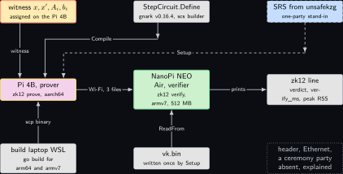
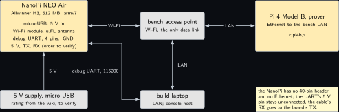
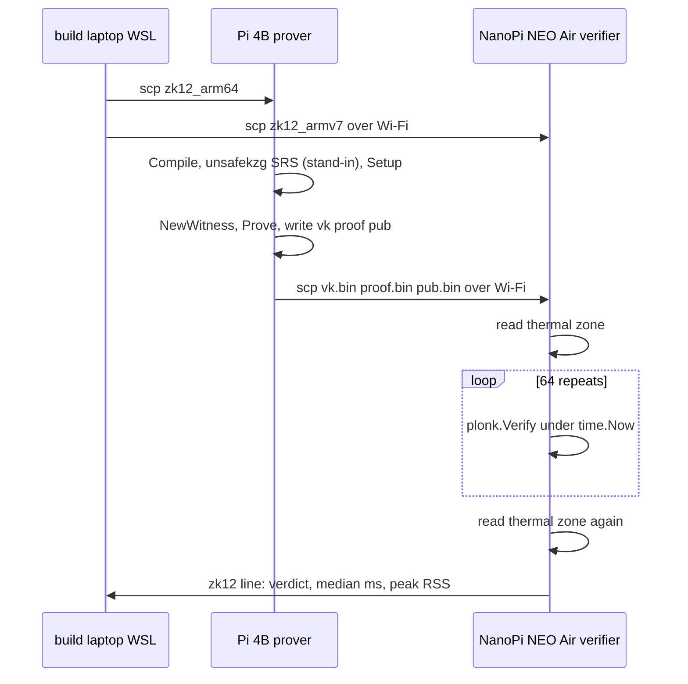
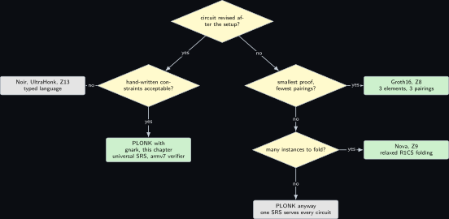

# Project 12. A PLONK gate for the inductive step, verified on the NanoPi

> **Board:** NanoPi NEO Air as the verifier over Wi-Fi, Pi 4B as the prover; no 40-pin header on the verifier  
> **Language:** Go

> [!IMPORTANT]
> **The question, instanced**
>
> What can a verifier learn from a device without the device revealing itself, and what does it cost on this board? The board is the smallest Linux machine on the bench, four Cortex-A7 cores and 512 MB with no header and no Ethernet, and what it learns is the same single fact as in Section [Project 8](08-a-ranking-function-as-a-circuit.md): one secret transition of the modem machine obeys the public ranking function. The proof system changes to PLONK, whose setup is universal and whose constraints are gates with copy wires rather than rank-1 rows, and the cost question becomes whether a pairing-based verifier fits on an armv7 board at all.

> **Key facts**
>
> - **Board:** NanoPi NEO Air (Allwinner H3, four Cortex-A7, 512 MB, armv7, 8 GB eMMC, no 40-pin header) as the verifier; Raspberry Pi 4 Model B Rev 1.4 (8 GB) as the prover
> - **Parts:** the NanoPi on its micro-USB 5 V, its on-board Wi-Fi with the u.FL antenna (to verify on the board); the Pi 4B on the bench LAN; the Renkforce USB/TTL cable on the NanoPi's 4-pin debug UART for the first boot only (pin order to verify in the wiki \[[9](#references)\]); the build laptop for both cross builds
> - **Interface:** SSH over Wi-Fi to the NanoPi, SSH to the Pi 4B; `scp` of the proof, the verifying key and the public witness
> - **Language and library:** Go 1.23 (to verify) with `gnark` v0.16.4 \[[5](#references)\], `gnark-crypto` at the version `gnark`'s module file pins (to verify), curve BN254, the PLONK backend; the verifier is built with `GOOS=linux GOARCH=arm GOARM=7`
> - **Primitive:** PLONK's gate constraint and permutation argument \[[2](#references)\] for the inductive-step obligation of the paper's Equations 20 and 21 \[[1](#references)\], the statement of Section [Project 8](08-a-ranking-function-as-a-circuit.md)
> - **Secret:** the transition $`x, x'`$ of the modem machine and the row $`A_i, b_i`$ of the guarded update it belongs to
> - **Public:** the ranking pieces $`w_j, u_j, w_k, u_k`$, the fairness bit $`\mathbf{1}_F`$, and the digest $`h`$ of the guard row of the published program
> - **Model:** none
> - **Acceptance:** the honest proof verifies on the NanoPi; the proof with one public value changed is rejected; the witness $`x' = (2, 0)`$ is refused by the prover with a failed range constraint; the honest witness under an increasing public ranking function is refused on the ranking gate alone, which is the only case that reaches the conclusion; the verifier's median time over 64 repeats has a spread under 5 percent and its peak resident memory is under 200 MB; the NanoPi's thermal zone is read before and after
> - **Difficulty:** 3 of 5
> - **Effort:** one evening for the circuit and the prover on the Pi 4B, one evening for the armv7 cross build and the NanoPi's Wi-Fi, a third session for the repeat

## Pitch

The paper remarks that its uniform obligation could be handed to Groth16 or PLONK directly, accepting a heavier prover for a constant-size proof \[[1](#references)\]. Section [Project 8](08-a-ranking-function-as-a-circuit.md) did the Groth16 half in a browser. This chapter does the PLONK half with `gnark` in Go, because Go cross-compiles to armv7 with three environment variables and no second toolchain, and because the verifier here must run on the NanoPi NEO Air, the one board on the bench that no other chapter can use as a Linux verifier: it has no header, so it cannot light an LED, and no Ethernet, so it talks only over Wi-Fi. The release read on Friday 6 November 2026 is v0.16.4, whose note carries a high-severity soundness fix in emulated elliptic-curve scalar multiplication and a BW6-761 pairing fix \[[5](#references)\]; this circuit uses neither, but a verifier built from a version with a soundness defect is a verifier that may accept a proof of a false statement, which is the one failure a zero-knowledge chapter cannot explain away, so the module file pins the exact version and the chapter says why. The mathematics is the lemma that makes PLONK's wires work: a product over a permuted index set is the identity if and only if the vector is invariant under the permutation.

## Parts and interface

| **Part** | **Role** | **Interface** | **Address or pin** |
| --- | --- | --- | --- |
| NanoPi NEO Air | the verifier; `zk12 verify` cross-built for armv7 | SSH over Wi-Fi; micro-USB 5 V | Wi-Fi address read from the router; no header |
| Raspberry Pi 4 Model B | the prover; compiles the circuit, makes the SRS stand-in, proves | SSH, Ethernet |  |
| Renkforce USB/TTL cable | the NanoPi's console for the first boot | 4-pin debug UART, 115200, 3.3 V | GND, TX, RX in the order the wiki prints (to verify) |
| the build laptop, WSL side | `go build` for aarch64 and for armv7 | LAN |  |

## The secret, the statement and the relation

The statement is the one of Section [Project 8](08-a-ranking-function-as-a-circuit.md), repeated word for word so that the three circuit chapters prove the same thing. Let $`n = 2`$ be the number of program variables of the modem machine of Section [Project 3](03-the-modems-backoff-machine.md), $`x = (\mathit{delay}, \mathit{done})`$, and let $`y = (x, x') \in \mathbb{Z}^4`$ be a transition. Every integer in the statement is a signed 16-bit integer, $`I = [-2^{15}, 2^{15} - 1]`$, which is the paper's bounded integer encoding with $`M = 2^{15}`$ \[[1](#references)\]. The witness is the transition and the row of the guarded update it belongs to, the statement is the ranking function's two pieces, the fairness bit and the digest of the guard row, and the relation is

```math
\begin{aligned}
  \mathcal{R}_{\mathrm{step}} = \Big\{\, \big( (x, x', A_i, b_i) ;\;
      (w_j, u_j, w_k, u_k, f, h) \big)
    \;:\;\; & x, x' \in I^2,\; A_i \in I^{m \times 4},\; b_i \in I^m,\; f \in \{0, 1\}, \\
    & h = H(A_i, b_i), \;\;
      A_i \begin{bmatrix} x \\ x' \end{bmatrix} \le b_i, \;\;
      (w_j \cdot x + u_j) - (w_k \cdot x' + u_k) \ge f \,\Big\}.
\end{aligned}
```

*(12.1)*

The public digest $`h`$ binds the secret guard row to the published program, and the relation is unsound without it. $`H`$ is a collision-resistant hash over $`\mathbb{F}`$, and $`h = H(A_i, b_i)`$ is published once with the circuit as the digest of the guarded update of the program of Section [Project 3](03-the-modems-backoff-machine.md) that the transition belongs to. If $`h`$ is left out, $`A_i`$ and $`b_i`$ are free witness values: a prover takes $`A_i = 0`$ and $`b_i = 0`$, every row of the premise reads $`0 \le 0`$, the entry range checks pass, and the only obligation left is the ranking inequality, which the prover then satisfies by choosing $`x`$ and $`x'`$ freely, so an accepted proof says nothing about the modem machine. With $`h`$ on the statement side the premise is a claim about the published program and not about inequalities the prover liked. The three chapters instantiate $`H`$ with the hash their own toolchain ships, named in each listing and marked to verify, so a digest made for one chapter is not a digest for another.

This is the paper's Equation 21 read at one point: the premise $`A_i [x\; x']^\top \le b_i`$ is membership of the transition in the $`i`$-th guarded update of Equation 16, and the conclusion is $`V(x, q) - V(x', q') > \mathbf{1}_F(q, \sigma, q') - 1`$ with $`V`$ the piecewise-linear function of Equation 18, which over integers is $`V(x, q) - V(x', q') \ge f`$ with $`f = \mathbf{1}_F(q, \sigma, q')`$. Equation 20, the preservation of finiteness, has the same premise and a conclusion of the same shape (a public row that must not hold), and is appended as further rows in the full build. The concrete instance is the retry command of Section [Project 8](08-a-ranking-function-as-a-circuit.md), whose instance equation (eq:z08\_instance) it repeats: the five printed rows over $`y = (\mathit{delay}, \mathit{done}, \mathit{delay}', \mathit{done}')`$, which pin $`\mathit{delay} = 0`$ and $`\mathit{done}' = \mathit{done} + 1`$ under the guard $`\mathit{done} \le 1`$, with $`b_i = (0, 0, 1, -1, 1)`$, $`w_j = w_k = (0, -1)`$, $`u_j = u_k = 3`$, $`f = 1`$, and the witness $`x = (0, 0)`$, $`x' = (3, 1)`$, which is a transition of the machine of Section [Project 3](03-the-modems-backoff-machine.md) because $`3 < D_1 = 8`$. Remark rem:z08\_step on one step against the universal obligation applies here unchanged.

Rows 3 and 4 pin $`\mathit{done}' = \mathit{done} + 1`$, so $`(w_j \cdot x + u_j) - (w_k \cdot x' + u_k) = \mathit{done}' - \mathit{done} = 1`$ for every witness that satisfies the premise, and with $`f \in \{0, 1\}`$ the conclusion then holds by construction on this instance whatever the witness is. Two consequences follow for the negative tests. A case that changes the witness cannot reach the ranking constraint, because the premise refuses it first; and the public $`f = 2`$ cannot reach it either, because the boolean constraint on $`f`$ refuses that before the comparison. The case that does reach it keeps the honest witness and $`f = 1`$ and makes the public ranking function increase across the transition, $`w_j = w_k = (0, 1)`$ with $`u_j = u_k = 3`$, which satisfies every premise row and the boolean constraint and then fails the ranking inequality alone, since $`(0 + 3) - (1 + 3) = -1 < 1`$. All three chapters run that case, and the $`f = 2`$ case beside it as the test of the boolean constraint. Without the first of the two the conclusion, which is the thing all three chapters exist to prove, is exercised by no test.

Lemma lem:z08\_cmp's hypothesis for the ranking row, $`|(w_j \cdot x + u_j) - (w_k \cdot x' + u_k) - f| < 2^{34}`$, is derived from $`w_j, w_k \in I^2`$, $`u_j, u_k \in I`$ and $`f \in \{0, 1\}`$. Of those five public signals the circuit constrains one: `api.AssertIsLessOrEqual(c.F, 1)` below is the boolean constraint on $`f`$ and is part of the relation. The four ranking coefficients are not range-checked, so for them the hypothesis is not enforced by the proof. A public $`w`$ of large magnitude makes the field value handed to `api.ToBinary` a small residue of a difference that is negative over the integers, and the comparison then holds in the circuit and fails in $`\mathbb{Z}`$. Enforcing the hypothesis is therefore the verifier's obligation: the party that holds the verifying key must also hold the ranking function of the published program and refuse a public witness that is not it. The listing below reads `pub.bin` from disk and does not make that comparison, which is recorded as absent rather than claimed; Section [Project 8](08-a-ranking-function-as-a-circuit.md)'s kiosk page carries the comparison written out. A deployment that cannot pin the four coefficients must put the four $`k = 16`$ checks into the circuit instead and pay their gates.

## The mathematics

Let $`\mathbb{F}`$ be the scalar field of BN254 and let $`n`$ be a power of two dividing $`|\mathbb{F}| - 1`$, so that $`\mathbb{F}`$ has a primitive $`n`$-th root of unity $`\omega`$ and the multiplicative subgroup $`H = \{1, \omega, \ldots, \omega^{n-1}\}`$ of order $`n`$. For a vector $`v \in \mathbb{F}^n`$ write $`v(X)`$ for the unique polynomial of degree less than $`n`$ with $`v(\omega^i) = v_i`$, which exists by the Lagrange argument of Section [Project 8](08-a-ranking-function-as-a-circuit.md).

**Definition Z12.1 (PLONK gate equation).** A PLONK circuit with $`n`$ gates over $`\mathbb{F}`$ is given by five selector vectors $`q_L, q_R, q_O, q_M, q_C \in \mathbb{F}^n`$. Three wire vectors $`a, b, c \in \mathbb{F}^n`$ satisfy the gate equation if for every $`i \in \{0, \ldots, n - 1\}`$

```math
q_{L,i}\, a_i + q_{R,i}\, b_i + q_{O,i}\, c_i + q_{M,i}\, a_i b_i + q_{C,i} = 0,
```

*(12.2)*

equivalently, if the polynomial $`q_L(X) a(X) + q_R(X) b(X) + q_O(X) c(X) + q_M(X) a(X) b(X) + q_C(X)`$ vanishes on $`H`$, equivalently, by the argument of Theorem thm:z08\_qap with the points $`r_i = \omega^i`$, if $`Z_H(X) = X^n - 1 = \prod_{i}(X - \omega^i)`$ divides it \[[2](#references)\].

The selectors are the circuit; the wires are the witness. An addition gate is $`(q_L, q_R, q_O, q_M, q_C) = (1, 1, -1, 0, 0)`$, so that $`a_i + b_i - c_i = 0`$; a multiplication gate is $`(0, 0, -1, 1, 0)`$; a boolean gate on $`a_i`$ is $`(-1, 0, 0, 1, 0)`$, so that $`a_i^2 - a_i = 0`$; a constant gate is $`(1, 0, 0, 0, -k)`$. The bit decomposition of Lemma lem:z08\_cmp, which `api.ToBinary` emits, is $`k`$ boolean gates and a chain of addition gates with constant multipliers, which `gnark`'s builder packs into its wider custom gates (the exact gate count is read from the compiled system, not computed here).

**Definition Z12.2 (Copy constraints and the wire permutation).** Concatenate the three wire vectors into $`v = (a, b, c) \in \mathbb{F}^{3n}`$, indexed by $`\{1, \ldots, 3n\}`$. The circuit's copy constraints say which positions must carry the same value: a permutation $`\sigma`$ of $`\{1, \ldots, 3n\}`$ whose cycles are the sets of positions that are one and the same variable. The copy constraints hold if and only if $`v_{\sigma(i)} = v_i`$ for every $`i`$.

**Lemma Z12.3 (Grand product).** Let $`N \ge 1`$, $`v \in \mathbb{F}^N`$ and $`\sigma`$ a permutation of $`\{1, \ldots, N\}`$. Then $`v_{\sigma(i)} = v_i`$ for all $`i`$ if and only if

```math
\prod_{i=1}^{N} \big(v_i + \beta\, i + \gamma\big) \;=\; \prod_{i=1}^{N} \big(v_i + \beta\, \sigma(i) + \gamma\big)
```

*(12.3)*

holds as an identity of polynomials in $`\mathbb{F}[\beta, \gamma]`$. Moreover, if the identity fails, then for $`\beta, \gamma`$ drawn uniformly and independently from $`\mathbb{F}`$ the two sides are equal with probability at most $`N / |\mathbb{F}|`$.

*Proof.* (*If.*) Suppose $`v_{\sigma(i)} = v_i`$ for all $`i`$. Then for every $`i`$ the factor $`v_i + \beta \sigma(i) + \gamma`$ equals $`v_{\sigma(i)} + \beta \sigma(i) + \gamma`$. Since $`\sigma`$ is a bijection of $`\{1, \ldots, N\}`$, substituting $`j = \sigma(i)`$ runs $`j`$ over the same set exactly once, so

```math
\prod_{i=1}^{N} \big(v_i + \beta\, \sigma(i) + \gamma\big)
  = \prod_{i=1}^{N} \big(v_{\sigma(i)} + \beta\, \sigma(i) + \gamma\big)
  = \prod_{j=1}^{N} \big(v_j + \beta\, j + \gamma\big),
```

which is (12.3).

(*Only if.*) Suppose (12.3) holds in $`\mathbb{F}[\beta, \gamma]`$. Each factor $`v + \beta\, t + \gamma`$ with $`t \in \{1, \ldots, N\}`$ is a polynomial of total degree one, hence irreducible, and it is monic in $`\gamma`$; two such factors $`v + \beta t + \gamma`$ and $`v' + \beta t' + \gamma`$ are equal as polynomials if and only if $`t = t'`$ and $`v = v'`$, because the coefficient of $`\beta`$ is $`t`$ and the constant term is $`v`$. The ring $`\mathbb{F}[\beta, \gamma]`$ is a unique factorisation domain, so the two sides of (12.3), being equal, have the same multiset of monic irreducible factors. Hence the multiset $`\{(v_i, i) : 1 \le i \le N\}`$ equals the multiset $`\{(v_i, \sigma(i)) : 1 \le i \le N\}`$. Fix $`j`$. On the left, exactly one pair has second coordinate $`j`$, namely $`(v_j, j)`$. On the right, the pairs with second coordinate $`j`$ are those $`i`$ with $`\sigma(i) = j`$, and since $`\sigma`$ is a bijection there is exactly one, $`i = \sigma^{-1}(j)`$. The two multisets agree, so $`(v_j, j) = (v_{\sigma^{-1}(j)}, j)`$, that is, $`v_j = v_{\sigma^{-1}(j)}`$ for every $`j`$. Writing $`j = \sigma(i)`$ gives $`v_{\sigma(i)} = v_i`$ for every $`i`$.

(*The probability bound.*) If the identity fails, the difference of the two sides is a nonzero polynomial in $`\mathbb{F}[\beta, \gamma]`$ of total degree at most $`N`$, each side being a product of $`N`$ factors of degree one. By the Schwartz-Zippel lemma, proved in Section [Project 6](06-folding-and-the-salem-spencer-schedule.md) \[[3](#references), [4](#references)\], a nonzero polynomial of total degree at most $`N`$ vanishes at a uniformly random point of $`\mathbb{F}^2`$ with probability at most $`N / |\mathbb{F}|`$. &#9632;

**Remark Z12.4 (How PLONK uses the lemma).** With $`N = 3n`$ and the index $`i`$ encoded as the point $`\omega^i`$ on $`H`$ for the $`a`$ wires, $`k_1 \omega^i`$ for the $`b`$ wires and $`k_2 \omega^i`$ for the $`c`$ wires, with $`k_1, k_2`$ chosen so that the three cosets are disjoint, the prover does not send the product; it sends a commitment to the accumulator $`z(X)`$ with $`z(1) = 1`$ and

```math
\begin{aligned}
\phi_i  &= (a_i + \beta \omega^i + \gamma)(b_i + \beta k_1 \omega^i + \gamma)
             (c_i + \beta k_2 \omega^i + \gamma), \\
  \phi'_i &= (a_i + \beta \sigma_a(\omega^i) + \gamma)(b_i + \beta \sigma_b(\omega^i) + \gamma)
             (c_i + \beta \sigma_c(\omega^i) + \gamma), \\
  z(\omega^{i+1}) &= z(\omega^{i}) \cdot \phi_i / \phi'_i,
\end{aligned}
```

*(12.4)*

so that $`z(\omega^{n}) = z(1) = 1`$ is exactly (12.3) after the challenges $`\beta, \gamma`$ have been drawn, which is why the proof is called a grand product. The verifier checks the recurrence and the boundary as polynomial identities on $`H`$ through KZG openings at one random point, the primitive of Section [Project 4](04-two-group-elements.md); $`\beta`$ and $`\gamma`$ come from the Fiat-Shamir hash of the wire commitments, as in Section [Project 7](07-the-esp32-proves-one-secret-behind-two-public.md). The setup is a universal structured reference string that depends only on an upper bound on $`n`$, not on the circuit, which is the difference from Section [Project 8](08-a-ranking-function-as-a-circuit.md) the decision tree turns on \[[2](#references)\].

## The protocol

| **Prover, Pi 4B (Go, gnark, aarch64)** | **Verifier, NanoPi NEO Air (Go, gnark, armv7)** |
| --- | --- |
| Once: `frontend.Compile` with the `scs` builder; an SRS from `unsafekzg.NewSRS` (a one-party stand-in, drawn dashed); `plonk.Setup` gives the proving and verifying keys; write `vk.bin`. | Once: receive `vk.bin`; read the thermal zone. |
| Per proof: assign the witness and the public values; `frontend.NewWitness`; `plonk.Prove`; write `proof.bin` and the public part as `pub.bin`. | Per proof: receive `proof.bin` and `pub.bin`; `plonk.Verify` 64 times under `time.Now`; print one `zk12` line with the verdict, the median and the peak resident memory. |

## The code

One file, two modes. The circuit is the `Define` method; everything that is not the circuit is serialisation. Negative assignments are reduced into the field by `gnark`'s witness builder (to verify on v0.16.4); the range gates then make the comparison honest by Lemma lem:z08\_cmp.

```go
package main

import ("fmt"; "io"; "os"; "sort"; "time")
import (
	"github.com/consensys/gnark-crypto/ecc"
	"github.com/consensys/gnark-crypto/ecc/bn254/fr"
	frmimc "github.com/consensys/gnark-crypto/ecc/bn254/fr/mimc"
	"github.com/consensys/gnark/backend/plonk"
	"github.com/consensys/gnark/backend/witness"
	"github.com/consensys/gnark/frontend"
	"github.com/consensys/gnark/frontend/cs/scs"
	"github.com/consensys/gnark/std/hash/mimc" // the in-circuit hash; gadget name to verify
	"github.com/consensys/gnark/test/unsafekzg"
)
const M = 1 << 15 // every entry is a signed 16-bit integer; shifted by M for the range gate
// StepCircuit is the relation shared with Z8 and Z13: A y <= b over y = (x, x'), and
// (wj.x + uj) - (wk.x' + uk) >= f, every entry in [-M, M - 1], with the public digest
// RowHash = H(A, b) binding the secret guard row to the published program. Without that
// binding a prover takes A = 0 and b = 0, satisfies every row of the premise trivially, and
// the proof says nothing about the modem machine.
type StepCircuit struct {
	X, Xp     [2]frontend.Variable
	A         [5][4]frontend.Variable
	B         [5]frontend.Variable
	Wj, Wk    [2]frontend.Variable `gnark:",public"`
	Uj, Uk, F frontend.Variable    `gnark:",public"`
	RowHash   frontend.Variable    `gnark:",public"`
}

func int16Range(api frontend.API, v frontend.Variable) { api.ToBinary(api.Add(v, M), 16) }

// leq asserts a <= b for integers with |b - a| < 2^k: (b - a) must fit in k bits.
func leq(api frontend.API, a, b frontend.Variable, k int) { api.ToBinary(api.Sub(b, a), k) }

func (c *StepCircuit) Define(api frontend.API) error {
	y := []frontend.Variable{c.X[0], c.X[1], c.Xp[0], c.Xp[1]}
	for col := 0; col < 4; col++ { int16Range(api, y[col]) }
	// h = H(A, b): the public binding of the guard row to the published program
	h, err := mimc.NewMiMC(api)
	if err != nil { return err }
	for r := 0; r < 5; r++ {
		for col := 0; col < 4; col++ { h.Write(c.A[r][col]) }
		h.Write(c.B[r])
	}
	api.AssertIsEqual(h.Sum(), c.RowHash)
	for r := 0; r < 5; r++ {
		int16Range(api, c.B[r])
		dot := frontend.Variable(0)
		for col := 0; col < 4; col++ {
			int16Range(api, c.A[r][col])
			dot = api.Add(dot, api.Mul(c.A[r][col], y[col]))
		}
		leq(api, dot, c.B[r], 34)
	}
	vj := api.Add(api.Mul(c.Wj[0], c.X[0]), api.Mul(c.Wj[1], c.X[1]), c.Uj)
	vk := api.Add(api.Mul(c.Wk[0], c.Xp[0]), api.Mul(c.Wk[1], c.Xp[1]), c.Uk)
	api.AssertIsLessOrEqual(c.F, 1) // f in {0, 1}: the field has no negatives to exclude
	leq(api, api.Add(vk, c.F), vj, 34)
	return nil
}

func must[T any](v T, err error) T { if err != nil { panic(err) }; return v }
func must2[A, B any](a A, b B, err error) (A, B) { if err != nil { panic(err) }; return a, b }

// rowDigest is the same hash out of circuit, over the same entries in the same order; the
// package path and the encoding of a negative entry are to verify on v0.16.4
func feBytes(v int64) []byte { var e fr.Element; e.SetInt64(v); bs := e.Bytes(); return bs[:] }
func rowDigest(a [5][4]int64, b [5]int64) []byte {
	h := frmimc.NewMiMC()
	for r := 0; r < 5; r++ {
		for col := 0; col < 4; col++ { h.Write(feBytes(a[r][col])) }
		h.Write(feBytes(b[r]))
	}
	return h.Sum(nil)
}

// the retry command of the modem machine of Z3: delay = 0, done' = done + 1, guard done <= 1
var rowsA = [5][4]int64{{1, 0, 0, 0}, {-1, 0, 0, 0}, {0, -1, 0, 1}, {0, 1, 0, -1}, {0, 1, 0, 0}}
var rowsB = [5]int64{0, 0, 1, -1, 1}
var instance = StepCircuit{X: [2]frontend.Variable{0, 0}, Xp: [2]frontend.Variable{3, 1},
	A: [5][4]frontend.Variable{{1, 0, 0, 0}, {-1, 0, 0, 0}, {0, -1, 0, 1},
		{0, 1, 0, -1}, {0, 1, 0, 0}},
	B: [5]frontend.Variable{0, 0, 1, -1, 1}, Wj: [2]frontend.Variable{0, -1}, Uj: 3,
	Wk: [2]frontend.Variable{0, -1}, Uk: 3, F: 1, RowHash: rowDigest(rowsA, rowsB)}
func main() {
	field := ecc.BN254.ScalarField()
	if os.Args[1] == "prove" { // Pi 4B, aarch64: compile, SRS stand-in, setup, prove, write
		ccs := must(frontend.Compile(field, scs.NewBuilder, &StepCircuit{}))
		srs, srsLagrange := must2(unsafekzg.NewSRS(ccs)) // bench stand-in, not a ceremony
		pk, vk := must2(plonk.Setup(ccs, srs, srsLagrange))
		w := must(frontend.NewWitness(&instance, field))
		proof := must(plonk.Prove(ccs, pk, w))
		pub := must(w.Public())
		outs := map[string]io.WriterTo{"vk.bin": vk, "proof.bin": proof, "pub.bin": pub}
		for name, obj := range outs {
			f := must(os.Create(name))
			must(obj.WriteTo(f))
			f.Close()
		}
		fmt.Println("zk12 proved constraints=", ccs.GetNbConstraints())
		return
	}
	vk, proof := plonk.NewVerifyingKey(ecc.BN254), plonk.NewProof(ecc.BN254) // NanoPi, armv7
	pub := must(witness.New(field))
	ins := map[string]io.ReaderFrom{"vk.bin": vk, "proof.bin": proof, "pub.bin": pub}
	for name, obj := range ins {
		f := must(os.Open(name))
		must(obj.ReadFrom(f))
		f.Close()
	}
	ms, ok := []float64{}, true
	for i := 0; i < 64; i++ {
		t0 := time.Now()
		if err := plonk.Verify(proof, vk, pub); err != nil { ok = false }
		ms = append(ms, float64(time.Since(t0).Microseconds())/1000)
	}
	sort.Float64s(ms)
	fmt.Printf("zk12 verdict=%v verify_ms=%.2f n=64\n", ok, ms[32])
}
```

```bash
# build laptop, WSL: go.mod pins github.com/consensys/gnark v0.16.4
GOOS=linux GOARCH=arm64 go build -o zk12_arm64 . && scp zk12_arm64 <user>@<pi4b>:~/zk12
GOOS=linux GOARCH=arm GOARM=7 go build -o zk12_armv7 . && scp zk12_armv7 pi@<nanopi>:~/zk12
# on the Pi 4B over ssh, then on the NanoPi over ssh (Wi-Fi)
./zk12 prove && scp vk.bin proof.bin pub.bin pi@<nanopi>:~/
cat /sys/class/thermal/thermal_zone0/temp && /usr/bin/time -v ./zk12 verify
```

## The model, if any

None. The circuit is fixed by the relation and the witness is a transition the machine has taken; nothing is proposed.

## Real, modelled, absent

- **have:** real: the NanoPi NEO Air with its Wi-Fi, the Pi 4B, `gnark` v0.16.4 read on Friday 6 November 2026 \[[5](#references)\], the Go cross-compiler on the build laptop, the Renkforce cable for the NanoPi's console
- **learn:** modelled: the SRS from `unsafekzg` is a one-party stand-in for a universal ceremony and is drawn dashed; every bar in the benchmark figure is an expected order of magnitude; the gate count is read from the compiled system when the run happens, not computed here
- **absent:** absent: an Ethernet port and a 40-pin header on the NanoPi, so the verdict is a console line and never an LED; a fan, so a NanoPi run that warms the H3 past the point where its governor throttles is "not measured, thermal" by the same rule as the Pi 3B+; a ceremony party; a comparison in the verifier between the public witness it reads from `pub.bin` and the statement of the published program, which is the party that must enforce Lemma lem:z08\_cmp's hypothesis on the four ranking coefficients and which Section [Project 8](08-a-ranking-function-as-a-circuit.md)'s page writes out

## System architecture



*Figure 12.1. The data path from the Go source to the NanoPi's console line. Top row: the secret witness in the stop-coloured outline, the circuit's `Define` in grey, and the SRS stand-in in commitment blue with a dashed outline. Middle row: the Pi 4B as the prover in the yellow outline, a solid arrow over Wi-Fi carrying three binary files to the NanoPi NEO Air as the verifier in the green outline, and the `zk12` line in grey as what the NanoPi prints. Bottom row: the build laptop in grey cross-building both binaries, the verifying key in grey, and a dotted grey block for the absent header, Ethernet and ceremony party.*

The NanoPi holds no secret and no proving key; what it holds is a verifying key and a binary, and **Lemma Z12.3** says what the binary's one random point buys.

## Wiring



*Figure 12.2. The NanoPi NEO Air with no header. Left, the NanoPi with its micro-USB 5 V input, its on-board Wi-Fi with the u.FL antenna, and the 4-pin debug UART called out; the Renkforce cable from that UART to the build laptop for the first boot, with the pin order marked to verify; centre, the bench Wi-Fi as the only data link; right, the Pi 4B on Ethernet and the build laptop on the LAN. Below, the NanoPi's 5 V supply and the note that the board has no 40-pin header and no Ethernet.*

| **Signal** | **From** | **To** | **Note** |
| --- | --- | --- | --- |
| 5 V | USB supply, micro-USB | NanoPi micro-USB | the board's only supply; 2 A rated supply (to verify in the wiki) |
| Wi-Fi | NanoPi on-board module, u.FL antenna | bench access point | the only data link; the address is read from the router, not assumed |
| debug UART | NanoPi 4-pin header: GND, 5 V, TX, RX (order to verify) | Renkforce cable, 3.3 V levels, to the build laptop | first boot only; TX to the cable's RX and RX to its TX; the 5 V pin is left unconnected |
| Ethernet | Pi 4B | bench LAN | the prover's link; `scp` to the NanoPi crosses the access point |
| 40-pin header |  |  | the NanoPi has none; nothing to wire |

## Sequence and states

```mermaid
stateDiagram-v2
  [*] --> Compiled : scs builder done
  Compiled --> SetUp : SRS stand-in, keys written
  SetUp --> Proved : proof.bin written on the Pi
  Proved --> Received : three files on the NanoPi
  Received --> Accepted : Verify returned nil 64 times
  Received --> Rejected : Verify returned an error
  Received --> Thermal : zone rose past the governor's limit
  Accepted --> [*]
  Rejected --> [*]
  Thermal --> [*]
```





## Decision tree



*Figure 12.3. Which proof system when the circuit may still change. The root diamond asks whether the circuit will be revised after the setup; yes leads to a diamond asking whether hand-written constraints are acceptable, whose yes is the PLONK leaf of this chapter with its universal SRS and whose no is the Noir leaf of Section [Project 13](13-the-obligation-in-noir.md). The root's no leads to a diamond asking whether the smallest proof and the fewest pairings are wanted; yes is the Groth16 leaf of Section [Project 8](08-a-ranking-function-as-a-circuit.md); no leads to a diamond asking whether many instances are to be folded, whose yes is the Nova leaf of Section [Project 9](09-nova-versus-one-shot-folding-on-a-pi.md) and whose no returns to the PLONK leaf, in grey, because one SRS then serves every circuit.*

## Benchmark


*Figure 12.4. Expected time per phase, log scale in milliseconds, drawn as dashed bars because nothing has been measured on this bench: compile and setup on the Pi 4B, the proof on the Pi 4B, the verification on the NanoPi NEO Air, and the verification on the Pi 4B for comparison. A solid bar replaces a dashed one when the run has happened and the acceptance test has passed.*

| **Quantity** | **Value** | **Status** | **Instrument** |
| --- | --- | --- | --- |
| constraints of `StepCircuit` | not measured | read, not computed | `ccs.GetNbConstraints()` printed by `zk12 prove` |
| proof size | not measured | read, not computed | `ls -l proof.bin`; constant in the circuit size by construction |
| compile and setup, Pi 4B | not measured |  | `time.Now` around both, one run |
| prove time, Pi 4B | not measured |  | `time.Now` around `plonk.Prove`, 8 repeats, `get_throttled` 0x0 before and after |
| verify time, NanoPi | not measured |  | `time.Now`, 64 repeats, thermal zone before and after |
| peak memory, NanoPi | not measured | under 200 MB is the bound | `/usr/bin/time -v`, maximum resident set size |
| verify time, Pi 4B | not measured |  | `time.Now`, 64 repeats |

For scale, the paper's symbolic scheme verified 217 obligations in 10 s on its AWS `c6g.8xlarge` \[[1](#references)\], with its tailored protocols and not a SNARK; that number is attributed to that machine and is not a prediction for either board here.

## Steps

**Step 1.** On the authoring laptop, write `main.go` and a `go.mod` pinning `github.com/consensys/gnark v0.16.4`; commit.

**Step 2.** On the build laptop in WSL, `git pull --ff-only`, `go mod download`, build the aarch64 binary for the Pi 4B and the armv7 binary for the NanoPi; copy each to its board.

**Step 3.** On the Pi 4B over ssh, read `vcgencmd get_throttled`, run `zk12 prove`, record the constraint count it prints, read the register again; copy the three files to the NanoPi over Wi-Fi.

**Step 4.** On the NanoPi over ssh, read `/sys/class/thermal/thermal_zone0/temp`, run `/usr/bin/time -v ./zk12 verify`, keep the `zk12` line and the maximum resident set size, read the thermal zone again.

**Step 5.** On the Pi 4B, change one public value in a second assignment, re-prove, copy only the new `pub.bin` beside the old proof, and confirm that the NanoPi prints a reject; then set $`x' = (2, 0)`$ and confirm that `plonk.Prove` fails on the range gate.

**Step 6.** On the Pi 4B, keep the honest witness and $`f = 1`$ and set the public ranking function to the increasing one, $`w_j = w_k = (0, 1)`$ with $`u_j = u_k = 3`$; confirm that `plonk.Prove` fails on the ranking gate and on no premise row, which is the only case that reaches the conclusion. Then set the public $`f = 2`$ and confirm that it fails on `api.AssertIsLessOrEqual(c.F, 1)` instead.

**Step 7.** Repeat the 64 verifications on a second day; a median that moved by more than 15 percent is withdrawn and both figures are printed.

## Acceptance test

The chapter passes when the honest proof prints `verdict=true` on the NanoPi, the proof with the mismatched public witness prints `verdict=false`, the witness $`x' = (2, 0)`$ makes `plonk.Prove` return an error naming an unsatisfied constraint, the honest witness under the increasing public ranking function $`w_j = w_k = (0, 1)`$ makes it fail on the ranking gate and on no premise row, the honest witness with the public $`f = 2`$ makes it fail on the boolean constraint on $`f`$, the median `verify_ms` over 64 repeats has a median absolute deviation under 5 percent, the maximum resident set size is under 200 MB, the NanoPi's thermal zone after the run is below the value at which its governor throttles (to read from the running kernel's trip points), and the Pi 4B's throttle register reads 0x0 on both reads. It fails if the verifier was run on the Pi 4B and the number copied into the NanoPi cell, or if the SRS was regenerated between proving and verifying, since `unsafekzg` draws a fresh secret each time and the old proof would then be rejected for the wrong reason.

## Variants

**TinyGo on the microcontroller.** The language stays Go and the toolchain changes: TinyGo compiles through LLVM to a Cortex-M target directly \[[7](#references)\], so the field and curve arithmetic behind the gate constraint runs on the NUCLEO-H7A3ZI-Q rather than on a Linux board, and the nRF PPK2 \[[8](#references)\] meters it in ampere-meter mode, which is the brief's smart-meter sketch \[[6](#references)\]. More than the host is swapped: `gnark`'s frontend builds its circuit by reflection over the standard library's big integers and does not compile under TinyGo, so what moves to the microcontroller is the arithmetic written out by hand, and that rewrite is marked learn rather than claimed. Memory arithmetic decides how much of the prover may follow it, because a PLONK prover keeps on the order of ten polynomials of length $`4n`$ over a 32-byte field: at the chapter's own $`n = 2^{12}`$ that is $`16384 \times 32 = 524288`$ bytes for each one and about 5120 kB in all, computed, against the part's 1312 kB of SRAM, which is short by a factor of about four; at $`n = 2^9`$ the same count gives 64 kB each and about 640 kB in all, computed, which fits with room for the stack. Choose this variant when the interesting quantity is the energy a proof costs rather than the seconds it takes, and keep the chapter's own route when the question is whether a pairing verifier fits on an armv7 Linux board. The instrument fixes where the variant can live: the PPK2 cannot source or meter a Raspberry Pi under load, and the Nucleo, an ESP32 and an NB-IoT module are the only loads it may carry here, so the brief's profiling sits on the Nucleo and on neither of this chapter's two boards. Every current figure reads **not measured** until the PPK2 has been wired to the Nucleo and a capture taken, and the brief's closed loop that retunes the STM32H7A3 clock from those captures is left out, since a clock changed inside a timed window measures the governor and not the proof.

## Pitfalls

- `unsafekzg.NewSRS` draws its secret from a fixed seed or a fresh one depending on the version (to verify); either way it is the prover who holds the toxic waste, so the bench proof convinces nobody but the bench. The product form is a ceremony SRS loaded with `kzg.SRS.ReadFrom`.
- On armv7 `gnark-crypto`'s field arithmetic takes its pure Go path, not the assembly it has for amd64 and arm64 (to verify); the NanoPi's verifier is therefore slower than a clock ratio would predict, and the data figure says order of magnitude, not ratio.
- A negative literal assigned to a `frontend.Variable` is reduced into the field; a negative literal that reaches `api.ToBinary` without the `+ M` shift is a 254-bit number and the gate fails for the right reason, which is the behaviour the acceptance test's $`x' = (2, 0)`$ case relies on.
- The three circuits are presented as one relation written three times. They are not the same constraint system. The typed route of Section [Project 13](13-the-obligation-in-noir.md) gets its integer windows from the compiler and so protects the comparison against an out-of-range public coefficient, where Sections [Project 8](08-a-ranking-function-as-a-circuit.md) and **Project 12** rest on the verifier pinning those coefficients inside $`I`$. The boolean constraint on $`f`$ is enforced by all three only with the line the Circom template now carries. And the three instantiate the relation's hash $`H`$ with the gadget their own toolchain ships, so the digest $`h`$ is not portable between them. A relation repeated word for word in prose is not a relation repeated in constraints, and the three chapters list their differences here rather than claiming none.
- `api.AssertIsLessOrEqual(v, bound)` with a constant bound decomposes $`v`$ over the field's full bit length (to verify); it is used only for $`f`$, where the bound is tiny. The row comparisons use the explicit $`k`$-bit decomposition so that Lemma lem:z08\_cmp's hypothesis is visible in the code.
- The NanoPi's Wi-Fi drops under sustained transfer on some access points; the three files are small, but `scp` is retried and the checksums compared before a verify is believed.
- The NanoPi's Wi-Fi power saving can add hundreds of milliseconds to the first packet of an ssh session; it changes nothing in a verify timed with `time.Now` inside the binary, which is why the instrument is the binary's own clock and not the ssh round trip.

## Languages and libraries not chosen

- JavaScript with `snarkjs` under PLONK: the same backend exists in snarkjs and would reuse Section [Project 8](08-a-ranking-function-as-a-circuit.md)'s page; it has no armv7 story without a browser on the NanoPi.
- Rust with `arkworks` or `halo2`: a native verifier for armv7 needs the `armv7-unknown-linux-gnueabihf` target of Section [Project 1](01-the-price-list.md), which works; Go was chosen for the one-flag cross build and for `gnark`'s PLONK with KZG.
- C with a hand-written PLONK verifier over `blst`: the smallest binary and the language of Section [Project 4](04-two-group-elements.md), at the cost of writing the verifier's polynomial checks by hand, which is a chapter of its own.
- Noir with UltraHonk: the typed route, Section [Project 13](13-the-obligation-in-noir.md); `bb` has no armv7 build read on Friday 6 November 2026.

## Sources

- [arxiv.org/abs/2605.00487](https://arxiv.org/abs/2605.00487) (verified Friday 6 November 2026), the paper, Equations 20 and 21 and the Remark on Groth16 and PLONK.
- [github.com/Consensys/gnark, latest release](https://api.github.com/repos/Consensys/gnark/releases/latest) (verified Friday 6 November 2026), v0.16.4 and its soundness fix.
- [eprint.iacr.org/2019/953](https://eprint.iacr.org/2019/953) (to verify), the PLONK paper, the gate equation and the permutation argument.
- [wiki.friendlyelec.com, NanoPi NEO Air](https://wiki.friendlyelec.com/wiki/index.php/NanoPi_NEO_Air) (to verify), the debug UART pin order and the supply rating.
- [github.com/Consensys/gnark-crypto](https://github.com/Consensys/gnark-crypto) (to verify), the field and curve arithmetic and its per-architecture paths.

<a id="references"></a>

## References

1. Pascal Berrang, Mirco Giacobbe, Jacob Swales and Xiao Yang. Zero-Knowledge Model Checking. arXiv:2605.00487v2 \[cs.CR\], version 1 submitted Friday 1 May 2026, version 2 Tuesday 8 September 2026. [arxiv.org/abs/2605.00487](https://arxiv.org/abs/2605.00487) (verified Friday 6 November 2026).
2. Ariel Gabizon, Zachary J. Williamson and Oana Ciobotaru. PLONK: permutations over Lagrange-bases for oecumenical noninteractive arguments of knowledge. IACR Cryptology ePrint Archive, report 2019/953. [eprint.iacr.org/2019/953](https://eprint.iacr.org/2019/953) (to verify).
3. Jacob T. Schwartz. Fast probabilistic algorithms for verification of polynomial identities. Journal of the ACM, 27(4), pages 701 to 717, 1980. [doi:10.1145/322217.322225](https://doi.org/10.1145/322217.322225) (to verify).
4. Richard Zippel. Probabilistic algorithms for sparse polynomials. In EUROSAM 1979, LNCS 72, pages 216 to 226. Springer, 1979. [doi:10.1007/3-540-09519-5\_73](https://doi.org/10.1007/3-540-09519-5_73) (to verify).
5. Consensys. gnark: a fast zk-SNARK library in Go. Release v0.16.4, Wednesday 7 October 2026, carrying a high-severity soundness fix in emulated elliptic-curve scalar multiplication and a BW6-761 pairing fix. The licence is not recorded here because it has not been read; read it from the repository's LICENSE file (to verify). [github.com/Consensys/gnark, latest release](https://api.github.com/repos/Consensys/gnark/releases/latest) (verified Friday 6 November 2026).
6. Advanced hardware-software architectures for edge artificial intelligence and zero-knowledge model checking. A design brief of twenty project sketches, read on Friday 6 November 2026 and held locally at `a local design brief`. It is the input to this second edition and is not a published source; where its hardware claims disagree with the bench, the bench is followed and the disagreement is stated.
7. TinyGo contributors. TinyGo: a Go compiler for microcontrollers and WebAssembly, on LLVM. Release v0.44.0, Wednesday 28 October 2026. [github.com/tinygo-org/tinygo](https://github.com/tinygo-org/tinygo) (verified Friday 6 November 2026).
8. Nordic Semiconductor. Power Profiler Kit II user guide. No sample rate is quoted here, for the same reason: chapter Z19 integrates energy over a window and that integration depends on the rate, so the rate is read from the guide on the day of the first capture and the reading is written into the chapter's steps. A rate printed in a benchmark table before that reading has no source in this list. (to verify)
9. FriendlyElec. NanoPi NEO Air wiki. [wiki.friendlyelec.com, NanoPi NEO Air](https://wiki.friendlyelec.com/wiki/index.php/NanoPi_NEO_Air) (to verify).

---

[Previous](11-the-provers-cost.md) &nbsp;&nbsp;|&nbsp;&nbsp; [Contents](../CONTENTS.md) &nbsp;&nbsp;|&nbsp;&nbsp; [Next](13-the-obligation-in-noir.md)
