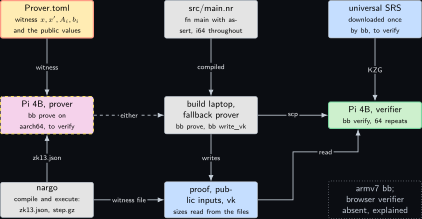
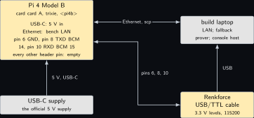
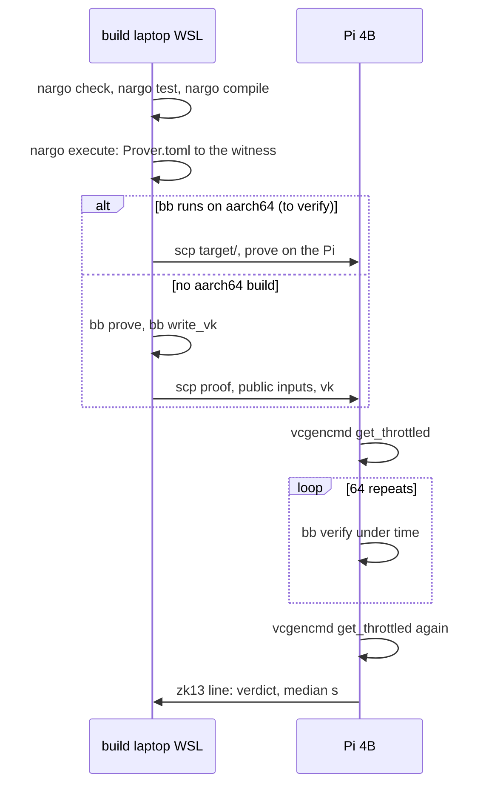
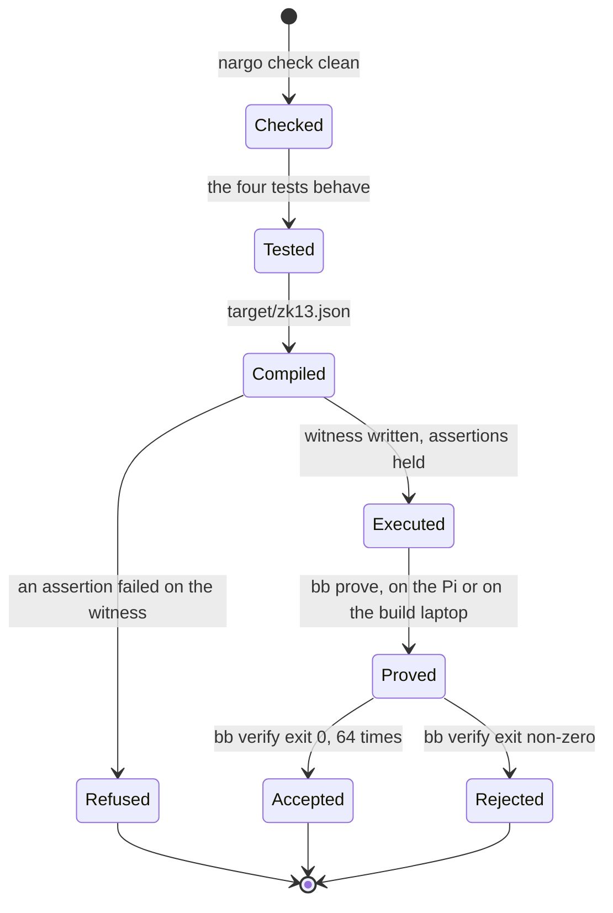
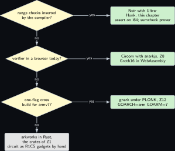

# Project 13. The obligation in Noir, proved with UltraHonk

> **Board:** Pi 4B alone; Barretenberg on aarch64 Linux to verify, else the proof is made on the build laptop and only verified on the Pi  
> **Language:** Noir

> [!IMPORTANT]
> **The question, instanced**
>
> What can a verifier learn from a device without the device revealing itself, and what does it cost on this board? The statement is the one of Sections [Project 8](08-a-ranking-function-as-a-circuit.md) and [Project 12](12-a-plonk-gate-for-the-inductive-step.md), one secret transition of the modem machine obeying the public ranking function, written for the third time, now in a typed language whose compiler inserts the range checks the two earlier chapters wrote by hand. The proof system changes again, to UltraHonk, whose prover runs a sumcheck instead of a large polynomial division, and the cost question is whether that prover runs on the Pi 4B at all, or only its verifier.

> **Key facts**
>
> - **Board:** Raspberry Pi 4 Model B Rev 1.4 (8 GB), alone
> - **Parts:** the Pi 4B, its USB-C supply, Ethernet to the bench LAN, the Renkforce USB/TTL cable on header pins 6, 8 and 10 for the console; the build laptop as the fallback prover
> - **Interface:** SSH; the serial console at 115200 on BCM 14 and 15
> - **Language and library:** Noir v1.0.0 \[[5](#references)\] with `nargo`; Barretenberg's `bb` as the backend, version to verify, with an aarch64 Linux binary to verify; if there is none, the proof is made on the build laptop and the Pi verifies, marked learn
> - **Primitive:** sumcheck-based proving (Honk) \[[3](#references), [2](#references)\] of the uniform obligation of the paper's Equation 22 written as a Noir program with `assert` \[[1](#references)\], the statement of Section [Project 8](08-a-ranking-function-as-a-circuit.md)
> - **Secret:** the transition $`x, x'`$ of the modem machine and the row $`A_i, b_i`$ of the guarded update it belongs to
> - **Public:** the ranking pieces $`w_j, u_j, w_k, u_k`$, the fairness bit $`\mathbf{1}_F`$, and the digest $`h`$ of the guard row of the published program
> - **Model:** none
> - **Acceptance:** `nargo test` passes on the instance; the honest proof verifies with `bb verify` on the Pi; the proof with one public value changed is rejected; the witness $`x' = (2, 0)`$ is refused by `nargo execute` on the fourth row assertion `dot <= b[r]`; the honest witness under an increasing public ranking function is refused on the ranking assertion `vj - vk >= f` alone, which is the only case that reaches the conclusion; the verifier's median time over 64 repeats has a spread under 5 percent with the throttle register at 0x0 before and after
> - **Difficulty:** 2 of 5 for the program, 4 of 5 for the backend on the board
> - **Effort:** one evening for the program and the tests on the build laptop, one session for `bb` on the Pi, a third for the repeat

## Pitch

The paper's Equation 22 writes every obligation in one uniform shape, a universal implication between systems of linear inequalities, and its Equation 25 is the SNARK-friendly form the paper's Remark says Groth16 or PLONK could take directly \[[1](#references)\]. This chapter writes the per-transition instance of that shape as a Noir program: a `main` with signed integers and `assert`, nothing else. Noir's compiler turns each comparison into the bit decomposition of Lemma lem:z08\_cmp on its own, which is why the program is a third the length of the Circom template and has no `Num2Bits` in it. The backend is Barretenberg's UltraHonk, whose prover replaces the quotient polynomial of Sections [Project 8](08-a-ranking-function-as-a-circuit.md) and [Project 12](12-a-plonk-gate-for-the-inductive-step.md) by a sumcheck over the Boolean hypercube of gate indices; the hardware comparison of NTT against sumcheck provers read on Friday 6 November 2026 is the reason that difference matters on a small board \[[4](#references)\]. The mathematics is the sumcheck protocol itself with its soundness bound $`dv/|\mathbb{F}|`$, proved by induction over the rounds, and a count of what the prover does per round.

## Parts and interface

| **Part** | **Role** | **Interface** | **Address or pin** |
| --- | --- | --- | --- |
| Raspberry Pi 4 Model B | verifier, and prover if `bb` runs on aarch64 | SSH, Ethernet | \<pi4b\> |
| Renkforce USB/TTL cable | the console, for a run that is watched without the network | header pins 6 (GND), 8 (TXD, BCM 14), 10 (RXD, BCM 15), 115200 | cable RX to pin 8, cable TX to pin 10, cable GND to pin 6 |
| the build laptop, WSL side | `nargo` and `bb` for x86-64; the fallback prover | LAN |  |

## The secret, the statement and the relation

The statement is the one of Section [Project 8](08-a-ranking-function-as-a-circuit.md), repeated word for word so that the three circuit chapters prove the same thing. Let $`n = 2`$ be the number of program variables of the modem machine of Section [Project 3](03-the-modems-backoff-machine.md), $`x = (\mathit{delay}, \mathit{done})`$, and let $`y = (x, x') \in \mathbb{Z}^4`$ be a transition. Every integer in the statement is a signed 16-bit integer, $`I = [-2^{15}, 2^{15} - 1]`$, which is the paper's bounded integer encoding with $`M = 2^{15}`$ \[[1](#references)\]. The witness is the transition and the row of the guarded update it belongs to, the statement is the ranking function's two pieces, the fairness bit and the digest of the guard row, and the relation is

```math
\begin{aligned}
  \mathcal{R}_{\mathrm{step}} = \Big\{\, \big( (x, x', A_i, b_i) ;\;
      (w_j, u_j, w_k, u_k, f, h) \big)
    \;:\;\; & x, x' \in I^2,\; A_i \in I^{m \times 4},\; b_i \in I^m,\; f \in \{0, 1\}, \\
    & h = H(A_i, b_i), \;\;
      A_i \begin{bmatrix} x \\ x' \end{bmatrix} \le b_i, \;\;
      (w_j \cdot x + u_j) - (w_k \cdot x' + u_k) \ge f \,\Big\}.
\end{aligned}
```

*(13.1)*

The public digest $`h`$ binds the secret guard row to the published program, and the relation is unsound without it. $`H`$ is a collision-resistant hash over $`\mathbb{F}`$, and $`h = H(A_i, b_i)`$ is published once with the circuit as the digest of the guarded update of the program of Section [Project 3](03-the-modems-backoff-machine.md) that the transition belongs to. If $`h`$ is left out, $`A_i`$ and $`b_i`$ are free witness values: a prover takes $`A_i = 0`$ and $`b_i = 0`$, every row of the premise reads $`0 \le 0`$, the entry range checks pass, and the only obligation left is the ranking inequality, which the prover then satisfies by choosing $`x`$ and $`x'`$ freely, so an accepted proof says nothing about the modem machine. With $`h`$ on the statement side the premise is a claim about the published program and not about inequalities the prover liked. The three chapters instantiate $`H`$ with the hash their own toolchain ships, named in each listing and marked to verify, so a digest made for one chapter is not a digest for another.

This is the paper's Equation 21 read at one point: the premise $`A_i [x\; x']^\top \le b_i`$ is membership of the transition in the $`i`$-th guarded update of Equation 16, and the conclusion is $`V(x, q) - V(x', q') > \mathbf{1}_F(q, \sigma, q') - 1`$ with $`V`$ the piecewise-linear function of Equation 18, which over integers is $`V(x, q) - V(x', q') \ge f`$ with $`f = \mathbf{1}_F(q, \sigma, q')`$. In the paper's uniform form, Equation 22, the premise is $`A_s y \le b_s`$ with $`A_s, b_s`$ secret and the conclusion is a public row that must not hold; the program below asserts the premise and the negation of that row, which is the conclusion. The concrete instance is the retry command of Section [Project 8](08-a-ranking-function-as-a-circuit.md), whose instance equation (eq:z08\_instance) it repeats: the five printed rows over $`y = (\mathit{delay}, \mathit{done}, \mathit{delay}', \mathit{done}')`$, which pin $`\mathit{delay} = 0`$ and $`\mathit{done}' = \mathit{done} + 1`$ under the guard $`\mathit{done} \le 1`$, with $`b_i = (0, 0, 1, -1, 1)`$, $`w_j = w_k = (0, -1)`$, $`u_j = u_k = 3`$, $`f = 1`$, and the witness $`x = (0, 0)`$, $`x' = (3, 1)`$, which is a transition of the machine of Section [Project 3](03-the-modems-backoff-machine.md) because $`3 < D_1 = 8`$. Remark rem:z08\_step on one step against the universal obligation applies here unchanged.

Rows 3 and 4 pin $`\mathit{done}' = \mathit{done} + 1`$, so $`(w_j \cdot x + u_j) - (w_k \cdot x' + u_k) = \mathit{done}' - \mathit{done} = 1`$ for every witness that satisfies the premise, and with $`f \in \{0, 1\}`$ the conclusion then holds by construction on this instance whatever the witness is. Two consequences follow for the negative tests. A case that changes the witness cannot reach the ranking constraint, because the premise refuses it first; and the public $`f = 2`$ cannot reach it either, because the boolean constraint on $`f`$ refuses that before the comparison. The case that does reach it keeps the honest witness and $`f = 1`$ and makes the public ranking function increase across the transition, $`w_j = w_k = (0, 1)`$ with $`u_j = u_k = 3`$, which satisfies every premise row and the boolean constraint and then fails the ranking inequality alone, since $`(0 + 3) - (1 + 3) = -1 < 1`$. All three chapters run that case, and the $`f = 2`$ case beside it as the test of the boolean constraint. Without the first of the two the conclusion, which is the thing all three chapters exist to prove, is exercised by no test.

Of the five public signals, the typed route constrains the comparison itself: every `i64` operation below is range-checked by the compiler, so Lemma lem:z08\_cmp's hypothesis for the ranking row does not rest on the four ranking coefficients being in $`I`$, which is the one place where this chapter's constraint system is stronger than those of Sections [Project 8](08-a-ranking-function-as-a-circuit.md) and [Project 12](12-a-plonk-gate-for-the-inductive-step.md).

## The mathematics

**Definition Z13.1 (The sumcheck protocol).** Let $`g \in \mathbb{F}[X_1, \ldots, X_v]`$ have degree at most $`d`$ in each variable, and let the prover claim

```math
H = \sum_{b_1 \in \{0,1\}} \sum_{b_2 \in \{0,1\}} \cdots \sum_{b_v \in \{0,1\}} g(b_1, b_2, \ldots, b_v).
```

*(13.2)*

The verifier has oracle access to $`g`$ at one point of its choice. The protocol has $`v`$ rounds. In round $`i \in \{1, \ldots, v\}`$ the prover sends a univariate polynomial $`g_i(X)`$ of degree at most $`d`$, claimed to equal

```math
s_i(X) = \sum_{b_{i+1}, \ldots, b_v \in \{0,1\}} g(r_1, \ldots, r_{i-1}, X, b_{i+1}, \ldots, b_v),
```

*(13.3)*

where $`r_1, \ldots, r_{i-1}`$ are the challenges of the earlier rounds. The verifier checks $`g_1(0) + g_1(1) = H`$ in round 1 and $`g_i(0) + g_i(1) = g_{i-1}(r_{i-1})`$ in round $`i > 1`$, rejecting on failure, then draws $`r_i \leftarrow \mathbb{F}`$ uniformly and sends it. After round $`v`$ the verifier queries the oracle once for $`g(r_1, \ldots, r_v)`$ and accepts if and only if it equals $`g_v(r_v)`$ \[[3](#references), [2](#references)\].

**Theorem Z13.2 (Completeness and soundness of sumcheck).** If $`H`$ equals the sum (13.2) and the prover sends $`g_i = s_i`$ in every round, the verifier accepts with probability $`1`$. If $`H`$ does not equal the sum, then whatever polynomials the prover sends, the verifier accepts with probability at most $`dv / |\mathbb{F}|`$.

*Proof.* *Completeness.* With $`g_i = s_i`$: in round 1, $`s_1(0) + s_1(1) = \sum_{b_1} \sum_{b_2, \ldots, b_v} g(b_1, \ldots, b_v) = H`$ by (13.2). In round $`i > 1`$, $`s_i(0) + s_i(1) = \sum_{b_i} \sum_{b_{i+1}, \ldots, b_v} g(r_1, \ldots, r_{i-1}, b_i, \ldots, b_v) = s_{i-1}(r_{i-1})`$ by (13.3) with $`X = r_{i-1}`$. After round $`v`$, $`s_v(r_v) = g(r_1, \ldots, r_v)`$ by (13.3) with an empty inner sum. Every check passes, whatever the challenges. The degree bound holds because fixing all variables but $`X_i`$ leaves a polynomial of degree at most $`d`$ in $`X_i`$, and a sum of such polynomials has degree at most $`d`$.

*Soundness, by induction on $`v`$.* The claim is: for every $`v \ge 1`$, every $`g`$ of degree at most $`d`$ in each variable, and every $`H`$ different from the sum (13.2), every prover strategy makes the verifier accept with probability at most $`dv / |\mathbb{F}|`$.

*Base case $`v = 1`$.* The sum is $`g(0) + g(1) \ne H`$. The prover sends some $`g_1`$ of degree at most $`d`$. If $`g_1(0) + g_1(1) \ne H`$ the verifier rejects at once. Otherwise $`g_1(0) + g_1(1) = H \ne g(0) + g(1)`$, so $`g_1 \ne g`$ as polynomials. The verifier accepts if and only if $`g_1(r_1) = g(r_1)`$, that is, if and only if $`r_1`$ is a root of the nonzero polynomial $`g_1 - g`$, which has degree at most $`d`$ and therefore at most $`d`$ roots in $`\mathbb{F}`$. For $`r_1`$ uniform in $`\mathbb{F}`$ this happens with probability at most $`d / |\mathbb{F}|`$, which is $`dv / |\mathbb{F}|`$ for $`v = 1`$.

*Inductive step.* Let $`v \ge 2`$ and assume the claim for $`v - 1`$. Let $`H`$ differ from the sum. The prover sends $`g_1`$. If $`g_1(0) + g_1(1) \ne H`$ the verifier rejects. Otherwise, since the honest round polynomial $`s_1`$ of (13.3) satisfies $`s_1(0) + s_1(1) = \sum_{b} g(b) \ne H = g_1(0) + g_1(1)`$, we have $`g_1 \ne s_1`$ as polynomials, both of degree at most $`d`$. Let $`E`$ be the event $`g_1(r_1) = s_1(r_1)`$. As in the base case, $`r_1`$ must be a root of the nonzero polynomial $`g_1 - s_1`$ of degree at most $`d`$, so $`\operatorname{Pr}[E] \le d / |\mathbb{F}|`$.

Condition on the complement of $`E`$, that is, on $`g_1(r_1) \ne s_1(r_1)`$. From round 2 on, the protocol is exactly the sumcheck protocol for the $`(v-1)`$-variate polynomial $`g'(X_2, \ldots, X_v) = g(r_1, X_2, \ldots, X_v)`$, which has degree at most $`d`$ in each variable, with the claimed sum $`H' = g_1(r_1)`$: round 2 checks $`g_2(0) + g_2(1) = g_1(r_1)`$, the later rounds check the same recurrence, and the final oracle query is $`g(r_1, \ldots, r_v) = g'(r_2, \ldots, r_v)`$. The true sum of $`g'`$ over $`\{0,1\}^{v-1}`$ is $`s_1(r_1)`$ by (13.3), and $`s_1(r_1) \ne g_1(r_1) = H'`$ on the complement of $`E`$. By the induction hypothesis the verifier accepts this residual protocol with probability at most $`d(v - 1) / |\mathbb{F}|`$, whatever the prover does from round 2 on; the prover's freedom to choose $`g_1`$ after seeing nothing, and $`g_2, \ldots`$ after seeing $`r_1`$, is exactly the freedom the hypothesis quantifies over.

Putting the two together with the union bound,

```math
\operatorname{Pr}[\text{accept}] \;\le\; \operatorname{Pr}[E] + \operatorname{Pr}[\text{accept} \mid \neg E]
  \;\le\; \frac{d}{|\mathbb{F}|} + \frac{d(v-1)}{|\mathbb{F}|} \;=\; \frac{dv}{|\mathbb{F}|},
```

which is the claim for $`v`$. &#9632;

**Lemma Z13.3 (Prover cost for a multilinear polynomial).** Let $`g`$ be multilinear ($`d = 1`$) and given by the table of its $`2^v`$ values on $`\{0,1\}^v`$. Then the honest prover computes every round polynomial $`g_i = s_i`$ with fewer than $`4 \cdot 2^v`$ field additions and multiplications in total, that is, $`O(2^v)`$.

*Proof.* Keep a table $`T_{i-1}`$ holding $`g(r_1, \ldots, r_{i-1}, b)`$ for $`b \in \{0,1\}^{v-i+1}`$; $`T_0`$ is the given table of $`2^v`$ values. Because $`s_i`$ has degree at most one, it is determined by $`s_i(0)`$ and $`s_i(1)`$, and by (13.3) each is a sum of $`2^{v-i}`$ entries of $`T_{i-1}`$: those with $`b_i = 0`$ and those with $`b_i = 1`$. That is $`2 \cdot 2^{v-i}`$ additions. After $`r_i`$ arrives, the next table is $`T_i(b) = (1 - r_i)\, T_{i-1}(0, b) + r_i\, T_{i-1}(1, b)`$ for $`b \in \{0,1\}^{v-i}`$, which is correct because $`g`$ is affine in $`X_i`$ when the other variables are fixed, and costs two multiplications and one addition per entry, $`3 \cdot 2^{v-i}`$ operations. The total over the $`v`$ rounds is

```math
\sum_{i=1}^{v} \big(2 \cdot 2^{v-i} + 3 \cdot 2^{v-i}\big)
  = 5 \sum_{i=1}^{v} 2^{v-i} = 5\,(2^{v} - 1) < 5 \cdot 2^{v}.
```

Counting the $`3 \cdot 2^{v-i}`$ fold of the last round as unnecessary, since no table is needed after round $`v`$, leaves fewer than $`4 \cdot 2^v`$ operations; either count is $`O(2^v)`$, linear in the size of the table and with no transform in sight. &#9632;

**Remark Z13.4 (Honk and the program).** UltraHonk keeps PLONK's gate relation of Definition def:z12\_gate but indexes the $`n = 2^v`$ gates by the Boolean hypercube rather than by roots of unity: each wire vector becomes a multilinear polynomial on $`\{0,1\}^v`$, the gate relation becomes a polynomial $`g`$ of small degree $`d`$ in each variable (a product of a few multilinears), and the prover shows that $`g`$ sums to zero over the hypercube with Theorem **Theorem Z13.2**, randomised by a Lagrange-like weighting so that a zero sum means every gate is satisfied. The final oracle query is answered by opening the committed multilinear wire polynomials at the random point with a polynomial commitment scheme (the names of the opening protocol in the `bb` version on the bench are to verify). Lemma **Lemma Z13.3** is the reason this prover has no NTT: its cost is linear in $`2^v`$, where the quotient of Section [Project 12](12-a-plonk-gate-for-the-inductive-step.md) needs transforms of size a small multiple of $`n`$ \[[4](#references)\]. The Noir program never sees any of this; it sees a `main` with assertions, and the sumcheck's soundness bound $`dv / |\mathbb{F}|`$ with $`|\mathbb{F}| > 2^{253}`$ and $`dv`$ in the hundreds is a probability below $`2^{-240}`$, which the chapter states as computed. That bound is Theorem **Theorem Z13.2**'s, for the interactive protocol with an honest oracle. It is not the soundness of the artefact `bb verify` accepts, which adds the binding error of the polynomial commitment scheme, the Fiat-Shamir term, and the trust in the universal SRS, and none of those three has been read for the `bb` version on the bench.

## The protocol

| **Prover (Pi 4B if `bb` runs there, else the build laptop)** | **Verifier, Pi 4B** |
| --- | --- |
| Once: `nargo check`, `nargo test`, `nargo compile` to `target/zk13.json`; `bb write_vk` for the verifying key. | Once: receive `target/vk`. |
| Per proof: write `Prover.toml` with the witness and the public values; `nargo execute` to the witness file; `bb prove` with the UltraHonk scheme to `target/proof` and the public inputs file. | Per proof: receive the proof and the public inputs; run `bb verify` 64 times under `time`; print one `zk13` line with the verdict and the median. |

## The code

The program. Every integer is an `i64`, wide enough that no product or sum of the relation overflows, and Noir constrains `i64` arithmetic and comparison with range checks of its own, so the only explicit bounds are the signed 16-bit windows the relation asks for. The syntax is Noir v1.0.0's as read on Friday 6 November 2026; the attribute and the integer forms are to verify against the compiler on the build laptop.

```rust
// zk13: one inductive step of the ranking argument, the relation shared with Z8 and Z12.
// Every entry is a signed 16-bit integer carried in an i64; Noir range-checks i64 arithmetic.
global M: i64 = 32768;

fn in_i16(v: i64) {
    assert(v >= -M);
    assert(v < M);
}

// h = H(a, b): the public binding of the guard row to the published program. Without it a
// prover takes a = 0 and b = 0, satisfies every row of the premise trivially, and the proof
// says nothing about the modem machine. The stdlib path and the arity-5 entry point are to
// verify against v1.0.0.
fn row_digest(a: [[i64; 4]; 5], b: [i64; 5]) -> Field {
    let mut rows: [Field; 5] = [0; 5];
    for r in 0..5 {
        rows[r] = std::hash::poseidon::bn254::hash_5(
            [a[r][0] as Field, a[r][1] as Field, a[r][2] as Field, a[r][3] as Field,
             b[r] as Field]);
    }
    std::hash::poseidon::bn254::hash_5(rows)
}

fn main(
    x: [i64; 2],
    xp: [i64; 2],
    a: [[i64; 4]; 5],
    b: [i64; 5],
    wj: pub [i64; 2],
    uj: pub i64,
    wk: pub [i64; 2],
    uk: pub i64,
    f: pub i64,
    h: pub Field,
) {
    let y: [i64; 4] = [x[0], x[1], xp[0], xp[1]];
    for c in 0..4 {
        in_i16(y[c]);
    }
    // the guard row is the published program's row, not one the prover chose
    assert(row_digest(a, b) == h);
    // the premise: the transition lies in the guarded update, A y <= b row by row
    for r in 0..5 {
        in_i16(b[r]);
        let mut dot: i64 = 0;
        for c in 0..4 {
            in_i16(a[r][c]);
            dot += a[r][c] * y[c];
        }
        assert(dot <= b[r]);
    }
    // the conclusion: V(x, q) - V(x', q') >= f, with f = 1 on a fair transition
    let vj = wj[0] * x[0] + wj[1] * x[1] + uj;
    let vk = wk[0] * xp[0] + wk[1] * xp[1] + uk;
    assert((f == 0) | (f == 1));
    assert(vj - vk >= f);
}

// the retry command of the modem machine of Z3: delay = 0, done' = done + 1, guard done <= 1
global ROWS_A: [[i64; 4]; 5] = [[1, 0, 0, 0], [-1, 0, 0, 0], [0, -1, 0, 1],
                                [0, 1, 0, -1], [0, 1, 0, 0]];
global ROWS_B: [i64; 5] = [0, 0, 1, -1, 1];

#[test]
fn test_retry_step() {
    let h = row_digest(ROWS_A, ROWS_B);
    main([0, 0], [3, 1], ROWS_A, ROWS_B, [0, -1], 3, [0, -1], 3, 1, h);
}

// This case fails on the premise, not on the conclusion: with x' = (2, 0) the four rows read
// 0 <= 0, 0 <= 0, 0 <= 1 and 0 <= -1, and the fourth refuses the witness first. The message
// is pinned so that a pass for another reason is not read as a pass.
#[test(should_fail_with = "dot <= b[r]")]
fn test_no_progress() {
    let h = row_digest(ROWS_A, ROWS_B);
    main([0, 0], [2, 0], ROWS_A, ROWS_B, [0, -1], 3, [0, -1], 3, 1, h);
}

// This case is the only one that reaches the conclusion: the honest witness satisfies every
// row and the boolean constraint, and the increasing public ranking function (0, 1) with
// uj = uk = 3 gives vj - vk = 3 - 4 = -1, which fails the ranking assertion alone.
#[test(should_fail_with = "vj - vk >= f")]
fn test_ranking_conclusion() {
    let h = row_digest(ROWS_A, ROWS_B);
    main([0, 0], [3, 1], ROWS_A, ROWS_B, [0, 1], 3, [0, 1], 3, 1, h);
}

// f = 2 does not reach the ranking assertion: the boolean constraint refuses it first. The
// case is kept because that constraint is part of the relation and nothing else tests it.
#[test(should_fail_with = "(f == 0) | (f == 1)")]
fn test_f_not_boolean() {
    let h = row_digest(ROWS_A, ROWS_B);
    main([0, 0], [3, 1], ROWS_A, ROWS_B, [0, -1], 3, [0, -1], 3, 2, h);
}
```

```bash
# build laptop WSL, or the Pi 4B if bb has an aarch64 build (flags to verify)
nargo check && nargo test && nargo compile
nargo execute step                      # Prover.toml -> target/step.gz
bb prove --scheme ultra_honk -b target/zk13.json -w target/step.gz -o target
bb write_vk --scheme ultra_honk -b target/zk13.json -o target
# on the Pi 4B over ssh: the verifier, 64 repeats, throttle register before and after
vcgencmd get_throttled
# Each invocation pays process start and an SRS load, so this measures a command and not
# a verification. The number is kept, labelled as such, and a second number is taken from
# inside one process so that it can be set beside Z8's in-page groth16.verify and Z12's
# in-process plonk.Verify. The wrapper is the repository's own bb_verify_loop, which loads
# the key once and calls the library's verify 64 times, printing one millisecond figure per
# call; until that wrapper exists, the in-process cell reads "not measured, the wrapper is
# not written" with this as its reason.
for i in $(seq 64); do /usr/bin/time -f "%e" bb verify --scheme ultra_honk \
  -k target/vk -p target/proof -i target/public_inputs; done 2> zk13_process_times.txt
./bb_verify_loop --scheme ultra_honk -k target/vk -p target/proof \
  -i target/public_inputs -n 64 > zk13_times.txt   # in-process, name to verify
vcgencmd get_throttled
```

## The model, if any

None. The program is the relation and the witness is a transition the machine has taken; nothing is proposed.

## Real, modelled, absent

- **have:** real: the Pi 4B, Noir v1.0.0 read on Friday 6 November 2026 \[[5](#references)\], `nargo` on the build laptop, the Renkforce cable on the console pins measured in Section [Project 1](01-the-price-list.md)
- **learn:** modelled: `bb` on aarch64 Linux is to verify; until it is confirmed the prover block on the Pi is drawn dashed and the proof is made on the build laptop, with the Pi as verifier only; every bar in the benchmark figure is an expected order of magnitude; the gate count is read from `bb gates` when the run happens
- **absent:** absent: an armv7 build of `bb`, so the NanoPi of Section [Project 12](12-a-plonk-gate-for-the-inductive-step.md) cannot verify a Honk proof; a Noir browser verifier read on the day, so the touchscreen of Section [Project 8](08-a-ranking-function-as-a-circuit.md) stays with Groth16; a ceremony, since UltraHonk's KZG commitment needs a universal SRS, which `bb` downloads from a published ceremony (to verify the source and its size)

## System architecture



*Figure 13.1. The data path from the Noir source to the verdict. Top row: the secret witness in `Prover.toml` in the stop-coloured outline, the program `main.nr` in grey, and the universal SRS in commitment blue, downloaded by `bb`. Middle row: the prover in the yellow outline drawn dashed on the Pi 4B because `bb` on aarch64 is to verify, with the build laptop in grey beside it as the fallback prover; a solid arrow carrying the proof, the public inputs and the key to the Pi 4B as the verifier in the green outline; and the `zk13` line in grey. Bottom row: `nargo` in grey producing the compiled circuit and the witness, and a dotted grey block for the absent armv7 build and the absent browser verifier.*

Whichever machine proves, the Pi verifies, and the number the chapter publishes is the verifier's; the prover's number is published only with the machine that produced it.

## Wiring



*Figure 13.2. The Pi 4B alone. The board with its USB-C 5 V input, its Ethernet to the bench LAN, and header pins 6, 8 and 10 called out for the Renkforce console cable to the build laptop; below it the supply and the microSD card A; at the right the build laptop on the LAN as the fallback prover and the console host. Nothing else is on the header.*

| **Signal** | **From** | **To** | **Note** |
| --- | --- | --- | --- |
| 5 V | USB-C supply | Pi 4B USB-C | the official supply |
| console TXD | Pi header pin 8, BCM 14 | Renkforce cable RX | 115200, 3.3 V levels; the serial console is enabled in `config.txt` |
| console RXD | Pi header pin 10, BCM 15 | Renkforce cable TX |  |
| ground | Pi header pin 6 | Renkforce cable GND | common reference |
| Ethernet | Pi 4B | bench LAN | `scp` from the build laptop; \<pi4b\> |
| microSD | card A | Pi 4B | Raspberry Pi OS trixie, kernel 6.18.50+rpt-rpi-v8 |
| other header pins |  |  | empty |

## Sequence and states





## Decision tree



*Figure 13.3. Which circuit language for the step relation. The root diamond asks whether the range checks should be inserted by a compiler rather than written by hand; yes leads to the Noir leaf of this chapter with UltraHonk. No leads to a diamond asking whether the verifier must run in a browser today; yes leads to the Circom and snarkjs leaf of Section [Project 8](08-a-ranking-function-as-a-circuit.md). No leads to a diamond asking whether a one-flag cross build for armv7 is needed; yes leads to the gnark leaf of Section [Project 12](12-a-plonk-gate-for-the-inductive-step.md), no to the grey leaf naming the Rust crates of Section [Project 1](01-the-price-list.md) with the circuit written as R1CS gadgets.*

## Benchmark


*Figure 13.4. Expected time per phase, log scale in milliseconds, drawn as dashed bars because nothing has been measured on this bench: compile and witness on the build laptop, the proof on the build laptop, the proof on the Pi 4B if `bb` runs there, and the verification on the Pi 4B. A solid bar replaces a dashed one when the run has happened and the acceptance test has passed; the Pi prover bar is removed, not measured, if no aarch64 build exists.*

| **Quantity** | **Value** | **Status** | **Instrument** |
| --- | --- | --- | --- |
| gates of `main` | not measured | read, not computed | `bb gates` on `target/zk13.json` |
| sumcheck rounds $`v`$ | $`\lceil \log_2 n \rceil`$ | computed once $`n`$ is read | none |
| sumcheck soundness bound $`dv / \vert \mathbb{F}\vert `$ | below $`2^{-240}`$ | computed for $`dv < 2^{13}`$ and $`\vert \mathbb{F}\vert > 2^{253}`$; this is Theorem **Theorem Z13.2**'s bound for the interactive sumcheck with an honest oracle, and not the soundness of the artefact `bb verify` accepts. The deployed error adds the binding error of the polynomial commitment scheme, the Fiat-Shamir term, which in the random oracle model grows with the number of queries a prover may make, and the trust in the universal SRS; none of those three has been read for the `bb` version on the bench, so the artefact's own bound reads **not read** | none |
| proof size | not measured | read, not computed | `ls -l target/proof` |
| compile and witness, build laptop | not measured |  | `time` around `nargo` |
| prove time, build laptop | not measured |  | `time` around `bb prove`, 8 repeats |
| prove time, Pi 4B | not measured | `bb` on aarch64 to verify | `time`, 8 repeats, `get_throttled` 0x0 before and after |
| verify time, Pi 4B, whole `bb verify` process | not measured | process timing: each repeat pays process start, dynamic linking and an SRS read from disk, so it is not comparable with the in-page `groth16.verify` figure of Section [Project 8](08-a-ranking-function-as-a-circuit.md) or the in-process `plonk.Verify` figure of Section [Project 12](12-a-plonk-gate-for-the-inductive-step.md) | `/usr/bin/time` around the command, 64 repeats, `get_throttled` 0x0 before and after |
| verify time, Pi 4B, inside one process | not measured, because the `bb_verify_loop` wrapper that loads the key once and calls the library's verify 64 times is not written | this is the cell the two sibling chapters’ figures may be set beside | the wrapper's own clock, 64 calls in one process, `get_throttled` 0x0 before and after |

For scale, the paper's symbolic prover took about 1 min and its verifier 10 s for `exb_i4a3` on its AWS `c6g.8xlarge` \[[1](#references)\], with tailored protocols and not a SNARK; those numbers are attributed to that machine and predict nothing for the Pi.

## Steps

**Step 1.** On the authoring laptop, write `Nargo.toml`, `src/main.nr` and `Prover.toml` for the instance; commit.

**Step 2.** On the build laptop in WSL, `git pull --ff-only`, install `nargo` v1.0.0 and `bb` with their installers, run `nargo check`, `nargo test` (the four tests must behave as named), `nargo compile` and `nargo execute`; record the gate count from `bb gates`.

**Step 3.** On the build laptop, try the `bb` installer's aarch64 Linux artefact (to verify that one exists); if it does, copy it to the Pi 4B with the `target` directory; if not, run `bb prove` and `bb write_vk` on the build laptop and copy the proof, the public inputs and the key.

**Step 4.** On the Pi 4B over ssh, read `vcgencmd get_throttled`, run `bb verify` 64 times under `time`, read the register again, and compute the median.

**Step 5.** On the build laptop, change one public value in a copy of the public inputs file, copy it to the Pi and confirm a non-zero exit from `bb verify`; then set $`x' = (2, 0)`$ in `Prover.toml` and confirm that `nargo execute` fails on the fourth row assertion `dot <= b[r]`, which is where it fails: with $`y = (0, 0, 2, 0)`$ the fourth row $`(0, 1, 0, -1)`$ gives $`\mathit{done} - \mathit{done}' = 0`$ against $`b_4 = -1`$, so the premise is refused before the conclusion is reached.

**Step 6.** On the build laptop, keep the honest witness and $`f = 1`$ and set the public ranking function in `Prover.toml` to the increasing one, $`w_j = w_k = (0, 1)`$ with $`u_j = u_k = 3`$; confirm that `nargo execute` fails on the ranking assertion `vj - vk >= f` and on no row assertion, which is the only case that reaches the conclusion. Then set the public $`f = 2`$ and confirm that it fails on `(f == 0) | (f == 1)` instead.

**Step 7.** Repeat the 64 verifications on a second day; a median that moved by more than 15 percent is withdrawn and both figures are printed.

## Acceptance test

The chapter passes when `nargo test` reports the first test passing and the three negative `should_fail_with` tests failing on the messages they name, the honest proof makes `bb verify` exit 0 on the Pi 4B 64 times, the proof with one changed public value makes it exit non-zero, the witness $`x' = (2, 0)`$ makes `nargo execute` fail on the fourth row assertion `dot <= b[r]`, the honest witness under the increasing public ranking function $`w_j = w_k = (0, 1)`$ makes it fail on the ranking assertion `vj - vk >= f` and on no row assertion, the honest witness with the public $`f = 2`$ makes it fail on `(f == 0) | (f == 1)`, the median verify time over 64 repeats has a median absolute deviation under 5 percent, and the throttle register reads 0x0 on both reads. It fails if any of those does not hold, or if a prover time taken on the build laptop is written into the Pi 4B's row of the benchmark table, or if the whole process timing of `bb verify` is set beside the in-page figure of Section [Project 8](08-a-ranking-function-as-a-circuit.md) or the in-process figure of Section [Project 12](12-a-plonk-gate-for-the-inductive-step.md) as though the three were one quantity.

## Variants

**The same obligation as a RISC-V program.** Nothing about the statement changes and the compiler does: the `main` above is rewritten as a small Rust guest, compiled to RISC-V and proved by a zero-knowledge virtual machine, SP1 \[[7](#references)\] with RISC Zero \[[8](#references)\] as the second instrument, so that one obligation is carried once by a domain-specific circuit and once by a general machine and the two can be priced against each other on identical inputs; this is the brief's telemetry sketch, whose filter is likewise a Rust routine compiled to RISC-V and proved rather than shown \[[6](#references)\]. The circuit side is countable from the listing above: the program makes about 64 signed comparisons, 58 of them inside `in_i16` and the rest the five row bounds and the ranking step, and Noir decomposes each `i64` comparison over 64 bits, so the gate count sits on the order of $`64 \times 64 = 4096`$ range-check gates, computed, and `bb gates` reports the exact figure. The machine side is countable in a different unit: the same arithmetic is roughly 200 RISC-V instructions, computed from the five rows of four columns of multiply-and-add and the comparisons around them, and a zero-knowledge virtual machine commits one trace row per executed cycle across every column of its instruction set, so the constant that multiplies those 200 rows, and not the program's own length, is the whole comparison; [Project 21](21-a-zero-knowledge-virtual-machine-on-the-bench.md) counts that constant and is where this variant is carried out in full. Choose this variant when the question is which proving style a statement should be written in, and keep the chapter's own route when the typed circuit is already the answer and the cost of the verifier on the board is what is wanted. The brief runs its guest on a Raspberry Pi 3B+ behind a SIM7600E-H 4G HAT and sends the proof over LTE; no SIM card is on this bench, that HAT is seated by no project here because its transmit peaks exceed 1 A, and nothing in this volume goes outward in any case, so the proof is made on the build laptop, carried over the bench LAN, and verified on the Pi 4B. The brief's 192-byte Groth16 wrap of the machine proof is recorded as a claim to verify and never as a measurement, and both proof sizes read **not measured** until the two toolchains have been run on the same instance.

## Pitfalls

- A comparison on `Field` in Noir is not an integer comparison; the program uses `i64` throughout so that every `<=` is the constrained integer one, which is the compiler doing Lemma lem:z08\_cmp's decomposition.
- `i32` would overflow: a row's dot product reaches $`2^{32}`$ in magnitude, and Noir's overflow check would then refuse an honest witness; `i64` has the room.
- The `bb` command line changed between its 0.x releases (scheme flags, output directories, the separate public-inputs file); the lines above are marked to verify and the repository's script is the one that was run.
- A test marked `should_fail` that passes because of a typo in the witness is a test that cannot fail; both negative tests use `should_fail_with` so that the message is pinned to the assertion the case is meant to reach, and each is run once with the honest witness to see it pass before it is committed with its own failing input.
- The three circuits are presented as one relation written three times. They are not the same constraint system. The typed route of Section **Project 13** gets its integer windows from the compiler and so protects the comparison against an out-of-range public coefficient, where Sections [Project 8](08-a-ranking-function-as-a-circuit.md) and [Project 12](12-a-plonk-gate-for-the-inductive-step.md) rest on the verifier pinning those coefficients inside $`I`$. The boolean constraint on $`f`$ is enforced by all three only with the line the Circom template now carries. And the three instantiate the relation's hash $`H`$ with the gadget their own toolchain ships, so the digest $`h`$ is not portable between them. A relation repeated word for word in prose is not a relation repeated in constraints, and the three chapters list their differences here rather than claiming none.
- `bb` downloads the SRS on first use; on the Pi behind the bench LAN that download is done once on the build laptop and the file copied, so that a verify is never timed with a download inside it.
- The Pi 4B's throttle register is read before and after the 64 repeats, like every chapter; a Honk verify is short, but the first `bb` start loads the SRS and is discarded as warm-up.

## Languages and libraries not chosen

- Circom with `snarkjs`: the browser verifier and the Groth16 proof of three elements, Section [Project 8](08-a-ranking-function-as-a-circuit.md); here the point is the compiler's own range checks.
- Go with `gnark`: the armv7 verifier and the universal SRS, Section [Project 12](12-a-plonk-gate-for-the-inductive-step.md); `gnark` has no Honk backend read on Friday 6 November 2026.
- Rust with `arkworks` and a hand-written sumcheck: the most instructive route and the one the lemma above describes; it would be a prover written from scratch, which is a different chapter.
- Lean 4: a proof that the program implies the obligation, Section [Project 14](14-theorem-3-2-in-lean-4.md)'s style; it checks the mathematics, not a device.

## Sources

- [arxiv.org/abs/2605.00487](https://arxiv.org/abs/2605.00487) (verified Friday 6 November 2026), the paper, Equations 21, 22 and 25.
- [github.com/noir-lang/noir, latest release](https://api.github.com/repos/noir-lang/noir/releases/latest) (verified Friday 6 November 2026), Noir v1.0.0.
- [arxiv.org/abs/2606.16146](https://arxiv.org/abs/2606.16146) (verified Friday 6 November 2026), NTT against sumcheck in hardware.
- [doi:10.1145/146585.146605](https://doi.org/10.1145/146585.146605) (to verify), the sumcheck protocol.
- [doi:10.1561/3300000030](https://doi.org/10.1561/3300000030) (to verify), the textbook proof the theorem above follows.
- [github.com/AztecProtocol/aztec-packages](https://github.com/AztecProtocol/aztec-packages) (to verify), Barretenberg and the `bb` command line.

<a id="references"></a>

## References

1. Pascal Berrang, Mirco Giacobbe, Jacob Swales and Xiao Yang. Zero-Knowledge Model Checking. arXiv:2605.00487v2 \[cs.CR\], version 1 submitted Friday 1 May 2026, version 2 Tuesday 8 September 2026. [arxiv.org/abs/2605.00487](https://arxiv.org/abs/2605.00487) (verified Friday 6 November 2026).
2. Justin Thaler. Proofs, arguments, and zero-knowledge. Foundations and Trends in Privacy and Security, 4(2 to 4), pages 117 to 660, 2022. [doi:10.1561/3300000030](https://doi.org/10.1561/3300000030) (to verify).
3. Carsten Lund, Lance Fortnow, Howard Karloff and Noam Nisan. Algebraic methods for interactive proof systems. Journal of the ACM, 39(4), pages 859 to 868, 1992. [doi:10.1145/146585.146605](https://doi.org/10.1145/146585.146605) (to verify).
4. Jianqiao Mo, Alhad Daftardar, Barath GaneshKumar, Kaiyue Guo, Hong Wang, Benedikt Bunz, Siddharth Garg and Brandon Reagen. When proofs meet hardware: comparing NTT and SumCheck in zero-knowledge systems. arXiv:2606.16146, submitted Monday 15 June 2026. [arxiv.org/abs/2606.16146](https://arxiv.org/abs/2606.16146) (verified Friday 6 November 2026).
5. Aztec. Noir: a domain-specific language for zero-knowledge circuits. Release v1.0.0, Thursday 29 October 2026; 1431 stars when read. The licence is not recorded here because it has not been read; read it from the repository's LICENSE file (to verify). [github.com/noir-lang/noir, latest release](https://api.github.com/repos/noir-lang/noir/releases/latest) (verified Friday 6 November 2026).
6. Advanced hardware-software architectures for edge artificial intelligence and zero-knowledge model checking. A design brief of twenty project sketches, read on Friday 6 November 2026 and held locally at `a local design brief`. It is the input to this second edition and is not a published source; where its hardware claims disagree with the bench, the bench is followed and the disagreement is stated.
7. Succinct Labs. SP1: a zero-knowledge virtual machine that proves the execution of a RISC-V binary. Release v6.10.0, Friday 23 October 2026. The licence is not recorded here because it has not been read; read it from the repository's LICENSE file (to verify). [github.com/succinctlabs/sp1](https://github.com/succinctlabs/sp1) (verified Friday 6 November 2026).
8. RISC Zero. risc0: a RISC-V zero-knowledge virtual machine and proof system. Release v3.0.6, Friday 17 July 2026. The licence is not recorded here because it has not been read; read it from the repository's LICENSE file (to verify). [github.com/risc0/risc0](https://github.com/risc0/risc0) (verified Friday 6 November 2026).

---

[Previous](12-a-plonk-gate-for-the-inductive-step.md) &nbsp;&nbsp;|&nbsp;&nbsp; [Contents](../CONTENTS.md) &nbsp;&nbsp;|&nbsp;&nbsp; [Next](14-theorem-3-2-in-lean-4.md)
