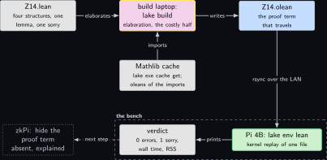
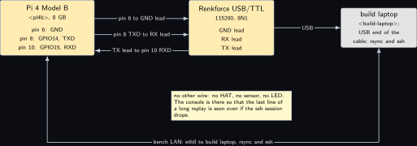
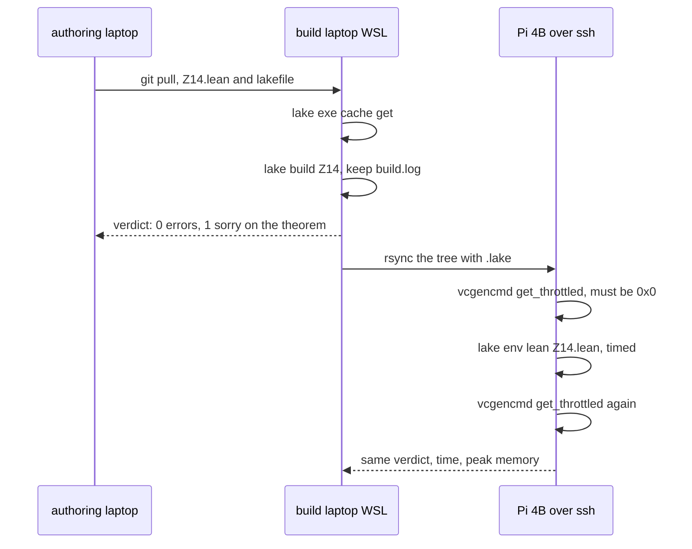
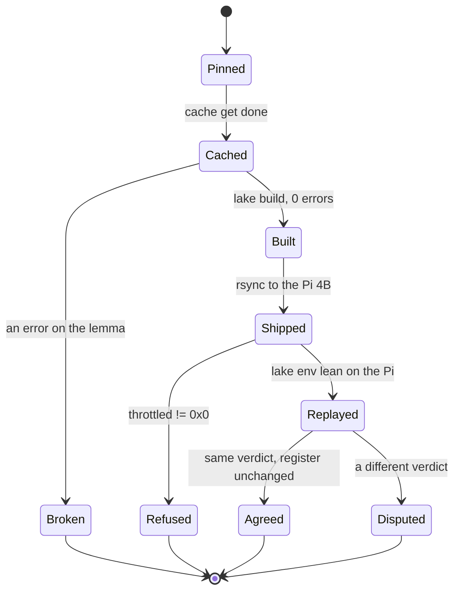
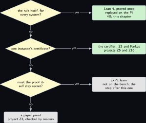

# Project 14. Theorem 3.2 in Lean 4: the descent lemma machine checked, the rule stated

> **Board:** Pi 4B alone over ssh; the Renkforce cable on its console; the build laptop elaborates, the Pi checks  
> **Language:** Lean 4

> [!IMPORTANT]
> **The question, instanced**
>
> What can a verifier learn from a device without the device revealing itself, and what does it cost on this board? Every zero-knowledge proof in this volume rests on one sentence of the paper: if a ranking function exists, the system satisfies its specification. This chapter turns that sentence into a Lean 4 statement, proves the lemma it rests on with tactics that a kernel checks, and asks what it costs to replay that check on the Pi 4B, so that the next step, hiding the proof itself, has a checked object to hide.

> **Key facts**
>
> - **Board:** Raspberry Pi 4 Model B Rev 1.4 (8 GB, Raspberry Pi OS trixie, kernel 6.18.50+rpt-rpi-v8, address \<pi4b\>)
> - **Parts:** the Pi 4B, the Renkforce USB/TTL cable on its header pins 6, 8 and 10, the build laptop (\<build-laptop\>) as the build host that elaborates and holds the Mathlib cache
> - **Interface:** ssh over the bench LAN; the serial console at 115200
> - **Language and library:** Lean 4 (version pinned by the project's `lean-toolchain`, to verify on the day) \[[5](#references)\] with Mathlib (the revision of the same day, to verify); the lemma itself needs only core Lean's `omega` and `induction`
> - **Primitive:** the certifier's soundness: the paper's Theorem 3.2 \[[1](#references)\], whose proof is written in [Project 3](03-the-modems-backoff-machine.md) and stated here for a machine; zkPi \[[6](#references)\] is the next step, proving a Lean theorem in zero knowledge
> - **Secret:** none; a formal proof is public, and that is the point of this chapter
> - **Public:** the theorem, its proof term, and the kernel's verdict on the Pi 4B
> - **Model:** none
> - **Acceptance:** `lake build` on the build laptop ends with no error and exactly one `sorry` warning, on the theorem and never on the lemma; `lake env lean Z14.lean` on the Pi 4B reproduces the same verdict with the throttle word `0x0` before and after; a deliberately broken hypothesis makes the lemma fail
> - **Difficulty:** 4 of 5
> - **Effort:** one day on the build laptop for the toolchain and the Mathlib cache, one evening for the lemma, one afternoon for the Pi, open-ended for the theorem

## Pitch

The paper's certifier accepts a public pair, a Buchi automaton for the negated property and a ranking function $`V`$, and its soundness is Theorem 3.2: if $`V`$ satisfies three conditions, the composed system has no fair execution, so the system satisfies the property \[[1](#references)\]. Every proof of the volume is sound only if that theorem is true, and its proof is a paper proof in [Project 3](03-the-modems-backoff-machine.md). A paper proof is checked by readers; a Lean proof is checked by a kernel of a few thousand lines, and zkPi \[[6](#references)\] shows that a kernel check can itself be the relation of a zero-knowledge proof. So this chapter states the transition system, the automaton, the fair execution and the ranking function as Lean structures, proves the one lemma the theorem rests on, that no sequence in $`\mathbb{N}`$ can be non-increasing and still decrease infinitely often, and leaves the theorem's remaining step, the construction of the finite-valued sequence that the lemma consumes, as a marked gap. The cost question is honest: elaboration happens on the build laptop, because a Mathlib cache is not something a Pi fetches in an afternoon, and the Pi 4B only re-elaborates one file against the copied olean tree, which is the check a verifier would replay.

## Parts and interface

| **Part** | **Role** | **Interface** | **Address or pin** |
| --- | --- | --- | --- |
| Raspberry Pi 4 Model B | the checker; its 8 GB are what let it map Mathlib's olean tree (to verify) | ssh, and the Renkforce cable at 115200 | \<pi4b\>; header pins 6 (GND), 8 (GPIO14, TXD), 10 (GPIO15, RXD) |
| Renkforce USB/TTL cable | the console, so a check that takes long still prints its last line | USB to the build laptop | cable GND to pin 6, cable RX to pin 8, cable TX to pin 10 |
| the build laptop, WSL side | `elan`, `lake`, the Mathlib cache; elaborates the file and ships the olean tree | bench LAN | \<build-laptop\> |
| Mathlib, software | the library of the day (to verify); only `Mathlib.Tactic` is imported | `lake exe cache get` | none |

## The secret, the statement and the relation

There is no witness to hide. The relation this chapter instantiates is the one zkPi hides later \[[6](#references)\]: a proof term $`\pi`$ and a statement $`\theta`$ are related when the kernel accepts $`\pi`$ as a proof of $`\theta`$,

```math
\mathcal{R}_{\mathrm{kernel}} = \{\, (\pi, \theta) \;:\; \mathsf{Check}(\pi, \theta) = 1 \,\},
```

*(14.1)*

and the statement of this chapter is $`\theta =`$ Theorem **Theorem Z14.6** with $`\pi`$ public. In the volume's relation, Equation 2 of the paper, the chapter sits inside the word $`\mathsf{Cert}`$: the certifier's verdict $`v_\phi`$ is trustworthy exactly because $`\theta`$ holds, and the sets involved are the ones below: a state space $`S`$, an automaton state space $`Q`$, the values $`\mathbb{N} \cup \{\infty\}`$ of $`V`$, and the index set $`\mathbb{N}`$ of an execution.

## The mathematics

**Definition Z14.1 (State transition system, trace, language).** A state transition system over an alphabet $`\Sigma`$ is $`\mathcal{M} = (S, S_0, T, \langle\!\langle \cdot \rangle\!\rangle)`$ with $`S_0 \subseteq S`$, $`T \subseteq S \times S`$ and an observation function $`\langle\!\langle \cdot \rangle\!\rangle : S \to \Sigma`$. An execution is a sequence $`(s_i)_{i \in \mathbb{N}}`$ with $`s_0 \in S_0`$ and $`(s_i, s_{i+1}) \in T`$ for all $`i`$; its trace is $`(\langle\!\langle s_i \rangle\!\rangle)_{i \in \mathbb{N}} \in \Sigma^\omega`$, and $`\mathcal{L}_\mathcal{M}`$ is the set of traces of all executions \[[1](#references)\].

**Definition Z14.2 (Nondeterministic Buchi automaton with fair transitions).** $`\mathcal{A} = (Q, Q_0, \delta, F)`$ with $`Q_0 \subseteq Q`$, $`\delta \subseteq Q \times \Sigma \times Q`$ and $`F \subseteq \delta`$. A run on $`\sigma \in \Sigma^\omega`$ is $`(q_i)_{i \in \mathbb{N}}`$ with $`q_0 \in Q_0`$ and $`(q_i, \sigma_i, q_{i+1}) \in \delta`$ for all $`i`$; it is accepting if $`\{\, i \in \mathbb{N} : (q_i, \sigma_i, q_{i+1}) \in F \,\}`$ is infinite, and $`\mathcal{L}_\mathcal{A}`$ is the set of words with an accepting run \[[2](#references)\].

**Definition Z14.3 (Fair execution of the composition).** A fair execution of the synchronous composition of $`\mathcal{M}`$ and $`\mathcal{A}`$ is a sequence $`((s_i, q_i))_{i \in \mathbb{N}}`$ in $`S \times Q`$ such that (i) $`s_0 \in S_0`$ and $`q_0 \in Q_0`$, (ii) $`(s_i, s_{i+1}) \in T`$ and $`(q_i, \langle\!\langle s_i \rangle\!\rangle, q_{i+1}) \in \delta`$ for all $`i`$, and (iii) the set $`\{\, i : (q_i, \langle\!\langle s_i \rangle\!\rangle, q_{i+1}) \in F \,\}`$ is infinite.

**Definition Z14.4 (Ranking function).** $`V : S \times Q \to \mathbb{N} \cup \{\infty\}`$ is a ranking function for the fair termination of the composition if, for all $`s, s' \in S`$ and $`q, q' \in Q`$,

```math
\begin{aligned}
s \in S_0 &\implies \big( q \in Q_0 \implies V(s, q) \ne \infty \big),  \\
  (s, s') \in T &\implies \big( V(s, q) \ne \infty \wedge (q, \langle\!\langle s
  \rangle\!\rangle, q') \in \delta \implies V(s, q) \ge V(s', q') \big),  \\
  (s, s') \in T &\implies \big( V(s, q) \ne \infty \wedge (q, \langle\!\langle s
  \rangle\!\rangle, q') \in F \implies V(s, q) > V(s', q') \big),
\end{aligned}
```

*(14.2)*

which are Equations 4, 5 and 6 of the paper \[[1](#references)\]. In Equations 14.2 and 14.2 the premise $`V(s, q) \ne \infty`$ makes the left side a natural number, and the conclusion is read on $`\mathbb{N}`$: $`V(s', q')`$ is finite and the comparison holds between two natural numbers. That is how the Lean code below reads it, with the conclusion naming a finite value $`n'`$.

**Lemma Z14.5 (No infinite descent in $`\mathbb{N}`$).** There is no sequence $`(n_i)_{i \in \mathbb{N}}`$ in $`\mathbb{N}`$ that is non-increasing, $`n_{i+1} \le n_i`$ for all $`i`$, and strictly decreases at infinitely many indices, that is, with $`D = \{\, i \in \mathbb{N} : n_{i+1} < n_i \,\}`$ infinite.

*Proof.* Suppose such a sequence exists. First an auxiliary fact: for $`a \le b`$, $`n_b \le n_a`$. By induction on $`b`$: if $`b = 0`$ then $`a = 0`$ and $`n_0 \le n_0`$; if $`a \le b + 1`$ then either $`a = b + 1`$, and $`n_{b+1} \le n_{b+1}`$, or $`a \le b`$, and $`n_{b+1} \le n_b \le n_a`$ by the hypothesis and the induction hypothesis.

Because $`D`$ is infinite, it can be enumerated increasingly as $`i_0 < i_1 < i_2 < \cdots`$. We claim that for every $`k \in \mathbb{N}`$,

```math
n_{i_k + 1} + (k + 1) \le n_0 .
```

*(14.3)*

By induction on $`k`$. For $`k = 0`$: $`i_0 \in D`$ gives $`n_{i_0 + 1} + 1 \le n_{i_0}`$, and the auxiliary fact with $`0 \le i_0`$ gives $`n_{i_0} \le n_0`$; together $`n_{i_0 + 1} + 1 \le n_0`$. For the step, assume Equation 14.3 at $`k`$. Since $`i_k < i_{k+1}`$ we have $`i_k + 1 \le i_{k+1}`$, so the auxiliary fact gives $`n_{i_{k+1}} \le n_{i_k + 1}`$; and $`i_{k+1} \in D`$ gives $`n_{i_{k+1} + 1} + 1 \le n_{i_{k+1}}`$. Chaining the three inequalities,

```math
n_{i_{k+1} + 1} + (k + 2) \le n_{i_{k+1}} + (k + 1) \le n_{i_k + 1} + (k + 1) \le n_0 ,
```

which is Equation 14.3 at $`k + 1`$. Now take $`k = n_0`$: Equation 14.3 reads $`n_{i_{n_0} + 1} + n_0 + 1 \le n_0`$, that is $`n_{i_{n_0} + 1} + 1 \le 0`$. No natural number satisfies this, because $`0`$ is the least element of $`\mathbb{N}`$; this is the well-foundedness of $`\mathbb{N}`$ in the form the proof needs, and the contradiction proves the lemma. &#9632;

**Theorem Z14.6 (The ranking-function rule, Theorem 3.2 of the paper).** Let $`\mathcal{M}`$ and $`\mathcal{A}`$ be as in Definitions **Definition Z14.1** and **Definition Z14.2**. If a ranking function $`V`$ in the sense of Definition **Definition Z14.4** exists, then the composition has no fair execution, and therefore $`\mathcal{L}_\mathcal{M} \cap \mathcal{L}_\mathcal{A} = \emptyset`$.

*Proof.* Suppose $`\sigma \in \mathcal{L}_\mathcal{M} \cap \mathcal{L}_\mathcal{A}`$. Then there is an execution $`(s_i)`$ of $`\mathcal{M}`$ with trace $`\sigma`$, so $`\sigma_i = \langle\!\langle s_i \rangle\!\rangle`$, and an accepting run $`(q_i)`$ of $`\mathcal{A}`$ on $`\sigma`$. The pair sequence $`((s_i, q_i))`$ satisfies (i), (ii) and (iii) of Definition **Definition Z14.3**, so it is a fair execution of the composition; it suffices to show that none exists.

Let $`((s_i, q_i))`$ be a fair execution and put $`m_i = V(s_i, q_i) \in \mathbb{N} \cup \{\infty\}`$. We show by induction on $`i`$ that $`m_i \ne \infty`$. For $`i = 0`$, (i) gives $`s_0 \in S_0`$ and $`q_0 \in Q_0`$, so Equation 14.2 gives $`m_0 \ne \infty`$. For the step, assume $`m_i \ne \infty`$; (ii) gives $`(s_i, s_{i+1}) \in T`$ and $`(q_i, \langle\!\langle s_i \rangle\!\rangle, q_{i+1}) \in \delta`$, so Equation 14.2 applies and yields a finite $`m_{i+1}`$ with $`m_{i+1} \le m_i`$. Hence $`(m_i)`$ is a sequence in $`\mathbb{N}`$ and non-increasing. At every index $`i`$ of the infinite set of (iii), the transition is in $`F`$, so Equation 14.2 applies and gives $`m_{i+1} < m_i`$. So $`(m_i)`$ is non-increasing and strictly decreases at infinitely many indices, which Lemma **Lemma Z14.5** rules out. Hence no fair execution exists and $`\mathcal{L}_\mathcal{M} \cap \mathcal{L}_\mathcal{A} = \emptyset`$. &#9632;

**Remark Z14.8.** The rule is the fair-termination rule of Grumberg, Francez, Makowsky and de Roever \[[3](#references)\] read through the automata-theoretic approach \[[2](#references)\]; the paper's own proof is sketched on its page 17 and written out in [Project 3](03-the-modems-backoff-machine.md). What Lean adds is not a new argument but a kernel that refuses a gap: in the listing below the lemma is closed by `omega` at the two places where the prose says "chaining" and "no natural number satisfies this", and the theorem's remaining step, the construction of the finite-valued sequence from `c4` and `c5`, is the marked `sorry`.

## The protocol

The prover here is the build laptop's elaborator and the verifier is the Pi 4B's kernel; the proof object between them is the olean file.

1. On the build laptop, pin the toolchain in `lean-toolchain` and Mathlib in `lakefile` at the revision read on the day, fetch the cache, and run `lake build`; keep the full log.
2. The verdict is read from the log: zero errors, and the only warning is the `declaration uses 'sorry'` on `no_fair_execution`. A warning on `no_infinite_descent` fails the step.
3. Copy the project tree with its `.lake` directory to the Pi 4B over ssh; note the tree size from `du -sh`.
4. On the Pi 4B, read `vcgencmd get_throttled`, run `lake env lean Z14.lean`, time it with `/usr/bin/time -v`, read the register again. The Pi re-elaborates the one file against the copied oleans; the stronger replay of the whole environment through the kernel, `lean4checker`, is a second run (to verify that the tool builds on aarch64).
5. Break the lemma on purpose, by weakening `mono` to `n (i + 1) <= n i + 1`, and confirm that both machines report an error; a check that cannot fail is not a check.

## The code

Lean 4 is read here in ASCII: `forall`, `exists`, `->`, `<=` and `/\` are the accepted spellings of the usual symbols, and the focusing dot is written as a period (to verify that the current toolchain still accepts the ASCII dot). Infinity is `none` in `Option Nat`, so every condition that concludes a comparison first names the finite value.

```lean
-- Z14.lean: the ranking-function rule of Theorem 3.2, with the descent lemma proved.
import Mathlib.Tactic

namespace ZKMC

/-- A state transition system over states `S`, observed in the alphabet `Sigma`. -/
structure TS (S Sigma : Type) where
  init : S -> Prop
  trans : S -> S -> Prop
  obs : S -> Sigma

/-- A nondeterministic Buechi automaton whose fair transitions are a subset of delta. -/
structure NBA (Q Sigma : Type) where
  init : Q -> Prop
  delta : Q -> Sigma -> Q -> Prop
  fair : Q -> Sigma -> Q -> Prop
  fairSub : forall q a q', fair q a q' -> delta q a q'

/-- A fair execution of the synchronous composition: conditions (i), (ii) and (iii). -/
structure FairExec {S Q Sigma : Type} (M : TS S Sigma) (A : NBA Q Sigma) where
  s : Nat -> S
  q : Nat -> Q
  init : M.init (s 0) /\ A.init (q 0)
  step : forall i, M.trans (s i) (s (i + 1)) /\ A.delta (q i) (M.obs (s i)) (q (i + 1))
  fairInf : forall k, exists i, k <= i /\ A.fair (q i) (M.obs (s i)) (q (i + 1))

/-- A ranking function; `none` stands for infinity; the paper's (4), (5) and (6). -/
structure Ranking {S Q Sigma : Type} (M : TS S Sigma) (A : NBA Q Sigma) where
  V : S -> Q -> Option Nat
  c4 : forall s q, M.init s -> A.init q -> exists n, V s q = some n
  c5 : forall s s' q q' n, M.trans s s' -> V s q = some n -> A.delta q (M.obs s) q' ->
    exists n', V s' q' = some n' /\ n' <= n
  c6 : forall s s' q q' n, M.trans s s' -> V s q = some n -> A.fair q (M.obs s) q' ->
    exists n', V s' q' = some n' /\ n' < n

/-- Non-increasing at every step gives non-increasing over every interval. -/
theorem le_of_mono (n : Nat -> Nat) (mono : forall i, n (i + 1) <= n i) :
    forall a b, a <= b -> n b <= n a := by
  intro a b hab
  induction b with
  | zero =>
    have h0 : a = 0 := Nat.le_zero.mp hab
    subst h0
    exact Nat.le_refl _
  | succ b ih =>
    rcases Nat.lt_or_eq_of_le hab with h | h
    . exact Nat.le_trans (mono b) (ih (Nat.le_of_lt_succ h))
    . subst h
      exact Nat.le_refl _

/-- Lemma: no sequence in Nat is non-increasing and strictly decreasing infinitely often. -/
theorem no_infinite_descent (n : Nat -> Nat)
    (mono : forall i, n (i + 1) <= n i)
    (inf : forall k, exists i, k <= i /\ n (i + 1) < n i) : False := by
  -- after j strict decreases the value is at most n 0 - j: the claim of the prose
  have key : forall j, exists i, n i + j <= n 0 := by
    intro j
    induction j with
    | zero => exact Exists.intro 0 (by omega)
    | succ j ih =>
      cases ih with
      | intro i hi =>
        cases inf i with
        | intro i' hi' =>
          have hle : n i' <= n i := le_of_mono n mono i i' hi'.1
          have hdec : n (i' + 1) < n i' := hi'.2
          exact Exists.intro (i' + 1) (by omega)
  cases key (n 0 + 1) with
  | intro i hi => omega

/-- Theorem 3.2: with a ranking function there is no fair execution. The gap is the single
`sorry` below, and it consists of three steps. First, finiteness along the execution: an
induction on `i` using `c4` at zero and `c5` at the step, giving a natural number `m i` with
`V (e.s i) (e.q i) = some (m i)` at every index. Second, monotonicity and descent: rewriting
through that finiteness and reading `c5` and `c6`, which gives `m (i + 1) <= m i` at every
index and `m (i + 1) < m i` at the infinitely many fair indices `fairInf` supplies. Third,
the hand-over of `m` to `no_infinite_descent`, which is the only one of the three that is
bookkeeping. The first step is a recursive construction over the existential of `c5`, so it
needs either a choice principle or a reformulation of `V` through a total projection; that
is why the gap is a step of proof and not an assembly. -/
theorem no_fair_execution {S Q Sigma : Type} (M : TS S Sigma) (A : NBA Q Sigma)
    (R : Ranking M A) (e : FairExec M A) : False := by
  sorry

end ZKMC
```

```bash
# build laptop, WSL: toolchain from lean-toolchain, Mathlib oleans from the cache
lake new z14 math && cd z14 && lake exe cache get        # template name to verify
lake build Z14 2>&1 | tee build.log
# the board over ssh: ship the tree, re-elaborate the one file against the copied oleans
rsync -a z14/ <user>@<pi4b>:~/z14/
ssh <user>@<pi4b> 'cd z14 && vcgencmd get_throttled && lake env lean Z14.lean'
```

What is expected to compile, marked for the day it is run: the four structures and `le_of_mono` are plain Lean 4 and should elaborate on any recent toolchain (**learn:** to confirm); `no_infinite_descent` relies on `omega` reading the two inequalities `hle` and `hdec` beside `hi`, which is within what `omega` decides (**learn:** to confirm); `no_fair_execution` compiles with the `sorry` warning and is the open step. The alternative route the brief names, well-founded recursion on `Nat.lt_wfRel`, would replace the counting argument of `key` by `WellFounded.fix`; the counting argument was chosen because it is the prose proof line for line.

## The model, if any

None. A proof assistant proposes nothing; it refuses or accepts, and here it is the checker.

## Real, modelled, absent

- **have:** real: the Pi 4B with its 8 GB and the trixie image, the Renkforce cable, the build laptop with WSL, the paper's Theorem 3.2 read on Friday 6 November 2026 and the lemma's proof above, which is complete on paper
- **learn:** modelled: every bar in the benchmark figure is an expected order of magnitude for a Mathlib cache fetch, a build and a replay, drawn dashed; whether the toolchain's aarch64 binaries install through `elan` on trixie, whether olean files built on x86-64 load on aarch64 without a rebuild, and whether the ASCII dot is still accepted are all to verify; the `sorry` is a declared gap
- **absent:** absent: zkPi \[[6](#references)\], the step that would hide the proof term, which is not built here and is drawn dotted; the Pi 3B+, whose 905 MB cannot map Mathlib's olean tree (to verify), so its column reads "not measured, memory"

## System architecture



*Figure 14.1. The elaborate-then-replay path. Along the top, three blocks: the Lean source Z14.lean in the grey public style, build laptop's elaboration with the prover's yellow outline because it produces the proof object, and the olean file with the proof term in kernel blue as the committed object that travels; solid arrows carry the source into the elaborator and the elaborator's output into the olean block. Below the elaborator, a solid grey block for the Mathlib cache feeding it the oleans of the imports. Along the bottom, inside a dashed layer labelled as the bench, the Pi 4B's kernel replay with the verifier's green outline, fed by the olean block from above and writing the verdict block in grey to its left; at the bottom left a dotted grey block for zkPi, the absent step that would hide the proof term.*

Read the figure as one proof object crossing one wire. Elaboration is the expensive half and happens where the cache is; the replay is the cheap half and happens on the board, which is the division a verifier of [Project 4](04-two-group-elements.md) would also make.

## Wiring



*Figure 14.2. The Pi 4B alone. On the left the Pi 4 Model B as a solid hardware block with its three console pins called out, pin 6 GND, pin 8 GPIO14 TXD and pin 10 GPIO15 RXD; in the middle the Renkforce USB/TTL cable as a solid hardware block with its three leads on three horizontal runs; on the right the build laptop as a solid grey block holding the cable's USB end and the ssh session that copies the olean tree. Below, a double-headed bus line for the bench LAN between the Pi's Ethernet jack and the build laptop, with the note that no other wire is needed for this chapter.*

| **Signal** | **From** | **To** | **Note** |
| --- | --- | --- | --- |
| console GND | Pi 4B header pin 6 | cable GND lead | common reference; connect it first |
| console TXD | Pi 4B header pin 8, GPIO14 | cable RX lead | 115200, 8N1; `enable_uart=1` in `config.txt`; the last line of a long replay survives a dropped ssh session here |
| console RXD | Pi 4B header pin 10, GPIO15 | cable TX lead | 3.3 V logic on the cable side, read from its label before it is plugged (to verify) |
| bench LAN | Pi 4B Ethernet jack, `eth0`, \<pi4b\> | build laptop \<build-laptop\> | the olean tree and the ssh session; the tree size is noted from `du -sh` |
| USB | cable | build laptop | the console reader |

## Sequence and states





## Decision tree



*Figure 14.3. Which checker for which claim. The root diamond asks whether the claim is the rule itself, for every system and automaton; yes leads to the Lean leaf, proved once and replayed on the Pi, this chapter. No leads to a second diamond asking whether the claim is one instance's certificate; yes leads to the certifier leaf, Z3 and Farkas witnesses in projects Z5 and Z16. No leads to a third diamond asking whether the proof itself must stay secret; yes leads to a grey zkPi leaf marked learn and not on the bench, no leads to a grey leaf for the paper proof of project Z3.*

## Benchmark


*Figure 14.4. Expected wall time per step, log scale in seconds, drawn as dashed bars because none has been measured on this bench; from left to right the Mathlib cache fetch on the build laptop, the build of the one file on the build laptop, the copy of the olean tree to the Pi 4B over the bench LAN, the replay on the Pi 4B, and the replay on the Pi 3B+, which has no bar and the word memory in its place. A solid bar replaces a dashed one when the run has happened and the caption of the replacing figure names the record.*

| **Step** | **build laptop** | **Pi 4B** | **Pi 3B+** | **Instrument** |
| --- | --- | --- | --- | --- |
| cache fetch | not measured | no, done on the build laptop | no | `time`, once |
| `lake build Z14` | not measured | no | no | `time`, once |
| olean tree size | not measured | same tree | not copied | `du -sh` |
| replay `lake env lean` | not measured | not measured | not measured, memory | `/usr/bin/time -v`, wall and peak RSS |
| replay peak memory | not measured | not measured | not measured, memory | `/usr/bin/time -v` |
| `lean4checker` replay | not measured | not measured, tool to verify | no | `time`, once |

The only measured number this chapter can quote is the paper's, and it is not about Lean: the explicit-state certifier's obligations for `exb_i4a3` were discharged on the paper's AWS `c6g.8xlarge` as part of a 2 s prover run \[[1](#references)\]; the rule those obligations rest on is the theorem above, and its check costs the same whatever the instance.

## Steps

**Step 1.** On the authoring laptop, write `Z14.lean`, the `lakefile` and `lean-toolchain`; commit.

**Step 2.** On the build laptop in WSL, install `elan`, `git pull --ff-only`, run `lake exe cache get` and `lake build Z14`; keep `build.log` and read the verdict from it.

**Step 3.** On the build laptop, weaken `mono` as the protocol says, rebuild, confirm the error, restore the file, rebuild.

**Step 4.** On the build laptop, `rsync` the project tree with its `.lake` directory to the Pi 4B; note `du -sh`.

**Step 5.** On the Pi 4B over ssh, with the console open through the cable on the build laptop, read `vcgencmd get_throttled`, run `lake env lean Z14.lean` under `/usr/bin/time -v`, read the register again, keep wall time and peak RSS.

**Step 6.** On the Pi 4B, try `lean4checker` on the environment; if it does not build on aarch64, the cell says so.

**Step 7.** Repeat the replay on a second day; a wall time that differs by more than 15 percent is withdrawn and both figures are printed.

## Acceptance test

The chapter passes when `build.log` on the build laptop holds zero errors and exactly one `sorry` warning naming `no_fair_execution`, the weakened lemma produced an error on both machines, the Pi 4B's replay ended with the same verdict with the throttle word `0x0` on both reads, and its peak RSS was under 6 GB so that the replay did not swap. It fails if the lemma carries a warning, if the Pi's verdict differs from the build laptop's, if the replay was taken with a non-zero throttle word, or if any cell is filled with a laptop figure.

## Variants

**The checker's own run proved in zero knowledge.** The object proved changes from the lemma to the checking of the lemma: instead of publishing the proof term and letting a reader replay `lake env lean`, the kernel's run becomes the relation of a zero-knowledge argument, which is the zkPi construction \[[6](#references)\] and the one step this chapter's own route leaves open. What it buys is the thing a public proof cannot offer, a convincing demonstration that a stated theorem has been checked by Lean 4 \[[5](#references)\] without the proof term being shown, and it is the framing the brief puts at the head of its mathematics, that a zero-knowledge argument sits between computational burden, disclosure and public verifiability \[[7](#references)\]. What it costs is a prover over every inference step the kernel visits, so the secret of this chapter moves from **none** to the proof term, and the acceptance test's bound becomes a floor rather than a ceiling: the replay here is capped at 6 GB of peak resident set on an 8 GB Pi 4B, a prover that commits to each of those steps cannot be smaller than the check it covers, and $`8 - 6 = 2`$ GB of headroom, computed, is what remains on the board before it swaps. That arithmetic is the reason the proving side belongs on the build laptop's 24 GB with the Pi 4B verifying, drawn dashed, exactly as [Project 21](21-a-zero-knowledge-virtual-machine-on-the-bench.md) places a zero-knowledge virtual machine on this bench. Choose this variant when the proof term is itself the thing to be withheld, for instance when the theorem is about a system whose model is private, and keep the chapter's own route whenever the proof is meant to be read, which is the normal case for mathematics. Every number here reads **not measured**, because no prover of a Lean kernel run has been built on this bench and the construction's own reported costs are a claim to verify against its paper rather than a figure to copy.

## Pitfalls

- The toolchain in `lean-toolchain` and the Mathlib revision must match; a cache fetched for another toolchain rebuilds Mathlib from source, which on the build laptop's eight cores is hours and on the Pi is not attempted.
- `omega` reads hypotheses, not conjunctions: `hi'.2` must be named as `hdec` before the call, which is why the listing does so.
- `induction b` must generalise `hab`, which depends on `b`; Lean 4 does this on its own, but if the hypothesis is introduced after the induction it is a different proof.
- A `sorry` is a warning, not an error; a log scan that only counts errors would pass a file whose lemma is also sorried, so the acceptance test counts the warnings by name.
- The replay on the Pi maps every imported olean; the first run after the copy is slower by the page cache than the second, so the recorded time is the second run and the pitfall is written beside the cell.

## Languages and libraries not chosen

- Rocq: an equally small kernel and a longer history of verified model checkers; Lean 4 is chosen because zkPi \[[6](#references)\] targets its kernel, so the proof object built here is the one the next step would hide.
- Isabelle/HOL: a larger trusted base and no route into a zero-knowledge relation that this volume cites.
- Z3 \[[4](#references)\]: decides one instance's obligations in [Project 5](05-farkas-witnesses-for-a-joystick-program.md) and returns no proof object a kernel replays; it is the certifier, not the checker of the rule.
- A paper proof only, as in [Project 3](03-the-modems-backoff-machine.md): the same argument, checked by readers; this chapter adds the kernel.

## Sources

- [arxiv.org/abs/2605.00487](https://arxiv.org/abs/2605.00487) (verified Friday 6 November 2026), the paper, Theorem 3.2 and its sketch on page 17.
- [doi:10.1007/978-3-030-79876-5\_37](https://doi.org/10.1007/978-3-030-79876-5_37) (to verify), the Lean 4 system description.
- [doi:10.1145/3658644.3670322](https://doi.org/10.1145/3658644.3670322) (to verify), zkPi.
- [doi:10.1016/S0019-9958(85)80014-0](https://doi.org/10.1016/S0019-9958(85)80014-0) (to verify), the fair-termination proof rule.

<a id="references"></a>

## References

1. Pascal Berrang, Mirco Giacobbe, Jacob Swales and Xiao Yang. Zero-Knowledge Model Checking. arXiv:2605.00487v2 \[cs.CR\], version 1 submitted Friday 1 May 2026, version 2 Tuesday 8 September 2026. [arxiv.org/abs/2605.00487](https://arxiv.org/abs/2605.00487) (verified Friday 6 November 2026).
2. Moshe Y. Vardi and Pierre Wolper. An automata-theoretic approach to automatic program verification (preliminary report). In LICS 1986, pages 332 to 344. IEEE Computer Society, 1986. (to verify)
3. Orna Grumberg, Nissim Francez, Johann A. Makowsky and Willem P. de Roever. A proof rule for fair termination of guarded commands. Information and Control, 66(1 to 2), pages 83 to 102, 1985. [doi:10.1016/S0019-9958(85)80014-0](https://doi.org/10.1016/S0019-9958(85)80014-0) (to verify).
4. Leonardo de Moura and Nikolaj Bjørner. Z3: an efficient SMT solver. In TACAS 2008, LNCS 4963, pages 337 to 340. Springer, 2008. [doi:10.1007/978-3-540-78800-3\_24](https://doi.org/10.1007/978-3-540-78800-3_24) (to verify).
5. Leonardo de Moura and Sebastian Ullrich. The Lean 4 theorem prover and programming language. In CADE 2021, LNCS 12699, pages 625 to 635. Springer, 2021. [doi:10.1007/978-3-030-79876-5\_37](https://doi.org/10.1007/978-3-030-79876-5_37) (to verify).
6. Evan Laufer, Alex Ozdemir and Dan Boneh. zkPi: proving Lean theorems in zero-knowledge. In CCS 2024, pages 4301 to 4315. ACM, 2024. [doi:10.1145/3658644.3670322](https://doi.org/10.1145/3658644.3670322) (to verify).
7. Advanced hardware-software architectures for edge artificial intelligence and zero-knowledge model checking. A design brief of twenty project sketches, read on Friday 6 November 2026 and held locally at `a local design brief`. It is the input to this second edition and is not a published source; where its hardware claims disagree with the bench, the bench is followed and the disagreement is stated.

---

[Previous](13-the-obligation-in-noir.md) &nbsp;&nbsp;|&nbsp;&nbsp; [Contents](../CONTENTS.md) &nbsp;&nbsp;|&nbsp;&nbsp; [Next](15-a-zig-verifier-of-pedersen-openings.md)
