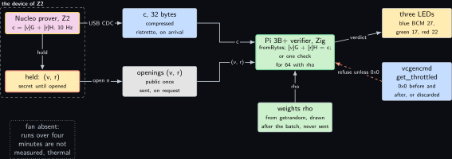
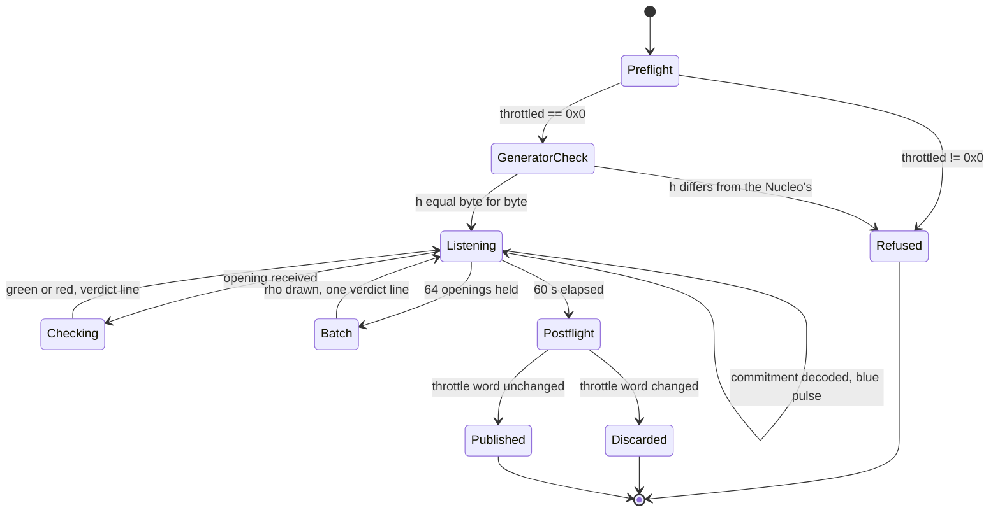
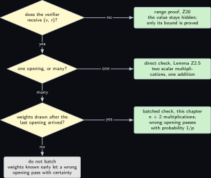

# Project 15. A Zig verifier of Pedersen openings for the Pi 3B+

> **Board:** Pi 3B+ as the verifier; NUCLEO-H7A3ZI-Q as the prover of Z2; blue, green and red LEDs on BCM 27, 17 and 22  
> **Language:** Zig

> [!IMPORTANT]
> **The question, instanced**
>
> What can a verifier learn from a device without the device revealing itself, and what does it cost on this board? Here the board is the verifier, the thermally limited Pi 3B+, and the device is the Nucleo of [Project 2](02-a-sensor-reading-committed-on-the-microcontroller.md), which sends a 32-byte commitment ten times a second and opens one on request. The verifier learns, per opening, that the sample behind that commitment is the one now disclosed and no other; across a batch of openings it learns the same thing with half the group arithmetic, at a risk of one in $p$ that the random weights let a wrong opening through. The cost is openings per second inside a four-minute window, "not measured" until the throttle register has read `0x0` on both sides of a run.

> **Key facts**
>
> - **Board:** Raspberry Pi 3 Model B Plus Rev 1.3 (905 MB, 1.4 GHz, 60 C soft limit, no fan) as the verifier; NUCLEO-H7A3ZI-Q as the prover
> - **Parts:** the Nucleo running the firmware of [Project 2](02-a-sensor-reading-committed-on-the-microcontroller.md); three Joy-it LEDs, blue on BCM 27, green on BCM 17, red on BCM 22, anode on the signal pin; a USB cable from the Nucleo's user USB to the Pi
> - **Interface:** USB CDC at `/dev/ttyACM0`; SSH to \<pi3bplus\> from the build laptop (the Pi 3B+'s serial console is dead); the LEDs through `pinctrl`
> - **Language and library:** Zig 0.14 (version to verify) with `std.crypto.ecc.Ristretto255`, which implements the group of RFC 9496 \[[6](#references)\], `std.crypto.hash.sha2.Sha512` and `std.crypto.random`; cross-compiled on the build laptop with `-Dtarget=aarch64-linux-gnu`
> - **Primitive:** verification of a Pedersen opening, and a batched check under uniform random weights, of the commitment the paper's symbolic scheme uses \[[1](#references)\]
> - **Secret:** none on this board; the prover holds $(v, r)$ until it opens
> - **Public:** $c$ on arrival, then $(v, r)$ on request; the verdict, on an LED and in a line
> - **Model:** none
> - **Acceptance:** the $h$ derived here equals the Nucleo's byte for byte; 64 correct openings accept and 64 openings altered by one accept-refuse pair each are refused, singly and in a batch; every timed run is under 60 s with the throttle word `0x0` before and after
> - **Difficulty:** 2 of 5
> - **Effort:** one evening for the cross build and the generator check on the build laptop, one afternoon on the bench with the LEDs and the four-minute windows

## Pitch

A commitment is worth what its opening check costs the party that holds no secret. In [Project 2](02-a-sensor-reading-committed-on-the-microcontroller.md) the Nucleo pays two scalar multiplications to commit; here the Pi 3B+ pays the same two to check, and when openings arrive in batches it can pay $n + 2$ for $n$ of them instead of $2n$, by weighting each with a random scalar drawn after the batch is complete. The chapter proves that this saves work without costing soundness beyond $1/p$, shows the arithmetic by which a prover who learns the weights early passes with a wrong opening, and writes the verifier in Zig because its standard library carries ristretto255 with no dependency to pin, which matters on a board with 905 MB and a thermal limit four minutes away. The one thing the chapter cannot assume is that two libraries derive the same $h$ from the same label: that equality is the first line of the acceptance test, and until it holds no opening is checked.

## Parts and interface

| **Part** | **Role** | **Interface** | **Address or pin** |
| --- | --- | --- | --- |
| Raspberry Pi 3 Model B Plus | the verifier; every run under four minutes | SSH to \<pi3bplus\>; the serial console is dead | USB-A for the Nucleo; header pins 11, 13, 15, 9 |
| NUCLEO-H7A3ZI-Q | the prover of [Project 2](02-a-sensor-reading-committed-on-the-microcontroller.md), reflashed from the build laptop before every capture | user USB connector to the Pi; CN1 to the build laptop | `/dev/ttyACM0` on the Pi |
| Joy-it LED, blue | a commitment arrived and decoded | GPIO, drive high | BCM 27, header pin 13 |
| Joy-it LED, green | an opening accepted | GPIO, drive high | BCM 17, header pin 11 |
| Joy-it LED, red | an opening refused | GPIO, drive high | BCM 22, header pin 15 |
| ground | the LEDs’ cathodes | header | pin 9 |
| the build laptop, WSL side | the cross build; `zig build -Dtarget=aarch64-linux-gnu` | LAN |  |

The three BCM numbers are the ones measured with these LEDs on Saturday 3 October 2026; the LED modules carry their own series resistors and light when the pin is driven high.

## The secret, the statement and the relation

The verifier holds no witness. It decides membership in two relations. The single opening relation is that of [Project 2](02-a-sensor-reading-committed-on-the-microcontroller.md),

$$
\mathcal{R}_{\mathrm{open}} = \big\{\, ((v, r), c) \in (\mathbb{Z}_p \times \mathbb{Z}_p) \times \mathbb{G}
    \;:\; c = g^v h^r \,\big\}, \tag{15.1}
$$

with the parse condition $v < 2^{16}$ checked beside it, a condition on the format and not on the cryptography, since $v$ is disclosed. The batch relation for $n$ openings is the product

$$
\mathcal{R}_{\mathrm{open}}^{n} = \big\{\, \big((v_i, r_i)_{i=1}^{n}, (c_i)_{i=1}^{n}\big)
    \;:\; \forall i \in \{1, \dots, n\} .\; c_i = g^{v_i} h^{r_i} \,\big\}, \tag{15.2}
$$

and the question is whether $n$ group equations can be decided by one. In the paper's Figure 4 the verifier of `zkeq` checks products of commitments raised to challenge powers in exactly this way, with challenges from the Fiat-Shamir hash \[[1](#references)\]; here the challenges are the verifier's own random draws, which is the interactive form, and the lemma below is the reason the paper's verifier can afford a batch of obligations at all.

## The mathematics

**Definition Z15.1 (The batched opening check).** Given $(c_i, v_i, r_i)_{i=1}^{n}$, the verifier draws $\rho_1, \dots, \rho_n$ independent and uniform in $\mathbb{Z}_p$ after all $n$ openings have arrived, and accepts if and only if

$$
\prod_{i=1}^{n} c_i^{\rho_i} \;=\; g^{\sum_{i=1}^{n} \rho_i v_i} \; h^{\sum_{i=1}^{n} \rho_i r_i}, \tag{15.3}
$$

the exponents on the right reduced modulo $p$.

**Lemma Z15.2 (A random linear combination catches a wrong opening).** If every $(v_i, r_i)$ opens $c_i$, the check of Equation (15.3) accepts. If some $(v_j, r_j)$ does not open $c_j$, the check accepts with probability exactly $1/p$ over the choice of $\rho_1, \dots, \rho_n$.

*Proof.* For each $i$ let $e_i = c_i \, g^{-v_i} h^{-r_i} \in \mathbb{G}$. By Lemma lem:z02\_prime the group is cyclic of prime order $p$ with generator $g$, so every element is a power of $g$; write $e_i = g^{d_i}$ with $d_i \in \mathbb{Z}_p$ (the verifier cannot compute $d_i$, but it exists). Then $(v_i, r_i)$ opens $c_i$ if and only if $e_i = 1$, that is, $d_i = 0$. Dividing the left side of Equation (15.3) by the right side and using that $\mathbb{G}$ is abelian,

$$
\begin{aligned}
\prod_{i=1}^{n} c_i^{\rho_i} \cdot g^{-\sum_i \rho_i v_i} h^{-\sum_i \rho_i r_i}
  &= \prod_{i=1}^{n} \big( c_i^{\rho_i} g^{-\rho_i v_i} h^{-\rho_i r_i} \big)
   = \prod_{i=1}^{n} \big( c_i g^{-v_i} h^{-r_i} \big)^{\rho_i} \\
  &= \prod_{i=1}^{n} e_i^{\rho_i} = \prod_{i=1}^{n} g^{\rho_i d_i} = g^{\sum_{i=1}^{n} \rho_i d_i},
\end{aligned}
$$

so the check accepts if and only if $\sum_{i=1}^{n} \rho_i d_i = 0$ in $\mathbb{Z}_p$, because $g$ has order $p$. If every $d_i = 0$ the sum is 0 for every choice of $\rho$: the check accepts. Now suppose $d_j \ne 0$ for some $j$. Fix the values of $\rho_i$ for all $i \ne j$ and let $S = \sum_{i \ne j} \rho_i d_i$. The condition becomes $\rho_j d_j = -S$, and since $d_j$ is invertible in the field $\mathbb{Z}_p$ it has exactly one solution, $\rho_j = -S d_j^{-1}$. The variable $\rho_j$ is uniform in $\mathbb{Z}_p$ and independent of the other $\rho_i$, so for every fixing of the others the condition holds with probability exactly $1/p$, and averaging over the fixings gives exactly $1/p$. &#9632;

**Remark Z15.7.** The lemma is the degree-one case of the Schwartz-Zippel lemma proved in [Project 6](06-folding-and-the-salem-spencer-schedule.md) \[[2](#references), [3](#references)\]: the polynomial $\sum_i \rho_i d_i$ in the variables $\rho_i$ is non-zero of total degree 1, so it vanishes on a uniform point of $\mathbb{Z}_p^n$ with probability at most $1/p$; here the bound is attained exactly. With $p > 2^{252}$ the probability is below $2^{-252}$, computed, and smaller than the probability that a single scalar multiplication on the Pi is corrupted by a bit flip in memory, which the board cannot detect and the chapter does not model.

**Proposition Z15.4 (Weights known in advance let a wrong opening pass).** If the prover learns $\rho_1$ and $\rho_2$ before sending its openings, it can send two openings of which at least one is wrong and still pass the batched check with certainty.

*Proof.* Let $(v_1, r_1)$ and $(v_2, r_2)$ be the true openings of $c_1$ and $c_2$, and let $\delta \in \mathbb{Z}_p$, $\delta \ne 0$. The prover sends $(v_1 + \delta, r_1)$ for $c_1$ and $(v_2 - \rho_1 \delta \rho_2^{-1}, r_2)$ for $c_2$, with $\rho_2 \ne 0$ (if $\rho_2 = 0$ the second opening is unconstrained and any value passes). In the notation of the proof of Lemma **Lemma Z15.2**, $e_1 = c_1 g^{-v_1 - \delta} h^{-r_1} = g^{-\delta}$, so $d_1 = -\delta$, and $e_2 = c_2 g^{-v_2 + \rho_1 \delta \rho_2^{-1}} h^{-r_2} = g^{\rho_1 \delta \rho_2^{-1}}$, so $d_2 = \rho_1 \delta \rho_2^{-1}$. Then

$$
\rho_1 d_1 + \rho_2 d_2 = -\rho_1 \delta + \rho_2 \rho_1 \delta \rho_2^{-1}
  = -\rho_1 \delta + \rho_1 \delta = 0,
$$

and the check accepts although the first opening is wrong by $\delta$ and the second by $-\rho_1 \delta \rho_2^{-1}$. This is why the weights are drawn after the last opening of the batch has been received and are never written to the CDC port. &#9632;

**Lemma Z15.5 (Cost of the batched check).** Checking $n$ openings one by one costs $2n$ scalar multiplications, $n$ group additions and $n$ comparisons. The batched check costs $n + 2$ scalar multiplications, $n$ group additions, one comparison and $2n$ multiplications with $2n - 2$ additions in $\mathbb{Z}_p$. For $n = 64$ the scalar multiplications are 128 against 66, computed.

*Proof.* One by one: each check is Lemma lem:z02\_open\_cost, two multiplications, one addition and one comparison, times $n$. Batched: the left side of Equation (15.3) is $n$ multiplications $[\rho_i] c_i$ and $n - 1$ additions to accumulate them; the two exponents on the right are $2n$ field multiplications $\rho_i v_i$ and $\rho_i r_i$ with $2(n - 1)$ field additions; the right side is two multiplications $[\sum \rho_i v_i] G$ and $[\sum \rho_i r_i] H$ and one addition; the comparison is one. Totals: $n + 2$ scalar multiplications, $n$ group additions, one comparison. For $n = 64$: $2 \cdot 64 = 128$ against $64 + 2 = 66$. &#9632;

**Remark Z15.8 (Constant time, on the side that has no secret).** The library's scalar multiplication runs in constant time with respect to the scalar; on the verifier that costs and protects nothing, because $v$ and $r$ are public once sent and the $\rho_i$ are used once and discarded. The timing that matters on this board is thermal: a run that drives the Pi 3B+ past its soft limit is throttled, and a throttled figure is not a figure. Every benchmark loop here is bounded to 60 s and the throttle word is read before and after.

## The protocol

1. Verifier, at start: read `vcgencmd get_throttled` and refuse unless `0x0`; derive $h = \mathrm{fromUniform}(\mathrm{SHA\text{-}512}(\mathsf{label}))$ with the label of [Project 2](02-a-sensor-reading-committed-on-the-microcontroller.md); print its 32-byte encoding; the operator compares it with the encoding the Nucleo prints at boot, and the run stops here on a mismatch.
2. Verifier, on each `zk02 seq=<n> cyc=<k> c=<hex>` line: decode the 32 bytes with `Ristretto255.fromBytes`; refuse a non-canonical encoding; store $c$ under $n$ in a table of 64; pulse the blue LED.
3. Verifier, every tenth commitment or on the operator's key: send `open <n>`.
4. Verifier, on `zk02 open seq=<n> v=<v> r=<hex>`: check $v < 2^{16}$; compute $[v]G + [r]H$ and compare with the stored $c_n$; light green for 200 ms on accept, red on refuse; print `zk15 seq=<n> verdict=accept` or `reject`.
5. Verifier, in batch mode: collect 64 openings, then draw $\rho_1, \dots, \rho_{64}$ from `std.crypto.random`, evaluate Equation (15.3) and print one verdict line for the batch; on a refusal, fall back to the single checks to name the sequence numbers that fail.
6. Verifier, at the end of a timed run: read the throttle word again and discard the run if it changed.

## The code

The verifier is one file. The library refuses a scalar multiplication whose result is the identity, and $v = 0$ is a legal sample, so $[v]G$ is computed as $[v + 1]G - G$. The names `Ristretto255.scalar`, `fromUniform`, `equivalent`, `readUntilDelimiterOrEof` and `std.process.Child.run` are to verify against the Zig version read on the day; the identity refusal of `mul` is to verify too.

```zig
const std = @import("std");
const R = std.crypto.ecc.Ristretto255;
const scalar = R.scalar;
const Sha512 = std.crypto.hash.sha2.Sha512;

const label = "zk02 pedersen h, bench volume, v1";

fn secondGenerator() R {
    var wide: [64]u8 = undefined;
    Sha512.hash(label, &wide, .{});
    return R.fromUniform(wide);
}

fn scalarFromU32(x: u32) [32]u8 {
    var s = [_]u8{0} ** 32;
    std.mem.writeInt(u32, s[0..4], x, .little);
    return s;
}

/// [v]G without the identity: v = 0 is a legal sample, so compute [v + 1]G - G.
fn valuePart(v: u16) !R {
    const g = R.basePoint;
    const gv1 = try g.mul(scalarFromU32(@as(u32, v) + 1));
    return gv1.sub(g);
}

const Opening = struct { seq: u32, c: R, v: u16, r: [32]u8 };

fn verifyOne(h: R, o: Opening) !bool {
    const lhs = (try valuePart(o.v)).add(try h.mul(o.r));
    return lhs.equivalent(o.c);
}

fn verifyBatch(h: R, os: []const Opening) !bool {
    var acc: ?R = null;
    var sv = [_]u8{0} ** 32;
    var sr = [_]u8{0} ** 32;
    for (os) |o| {
        var wide: [64]u8 = undefined;
        std.crypto.random.bytes(&wide); // drawn now, after the whole batch has arrived
        const rho = scalar.reduce64(wide);
        const term = try o.c.mul(rho);
        acc = if (acc) |a| a.add(term) else term;
        sv = scalar.add(sv, scalar.mul(rho, scalarFromU32(o.v)));
        sr = scalar.add(sr, scalar.mul(rho, o.r));
    }
    const rhs = (try R.basePoint.mul(sv)).add(try h.mul(sr));
    return acc.?.equivalent(rhs);
}

fn led(a: std.mem.Allocator, bcm: []const u8, on: bool) !void {
    const argv = [_][]const u8{ "pinctrl", "set", bcm, "op", if (on) "dh" else "dl" };
    _ = try std.process.Child.run(.{ .allocator = a, .argv = &argv });
}

fn field(line: []const u8, key: []const u8) ?[]const u8 {
    var it = std.mem.tokenizeScalar(u8, line, ' ');
    while (it.next()) |tok| if (std.mem.startsWith(u8, tok, key)) return tok[key.len..];
    return null;
}

pub fn main() !void {
    var gpa = std.heap.GeneralPurposeAllocator(.{}){};
    const a = gpa.allocator();
    const h = secondGenerator();
    std.debug.print("zk15 h={s}\n", .{std.fmt.bytesToHex(h.toBytes(), .lower)});
    const port = try std.fs.openFileAbsolute("/dev/ttyACM0", .{ .mode = .read_write });
    defer port.close();
    var table: [64]Opening = undefined;
    var buf: [192]u8 = undefined;
    while (try port.reader().readUntilDelimiterOrEof(&buf, '\n')) |line| {
        if (std.mem.startsWith(u8, line, "zk02 seq=")) {
            const seq = try std.fmt.parseInt(u32, field(line, "seq=").?, 10);
            var cb: [32]u8 = undefined;
            _ = try std.fmt.hexToBytes(&cb, field(line, "c=").?);
            table[seq % 64] = .{ .seq = seq, .c = try R.fromBytes(cb), .v = 0, .r = undefined };
            try led(a, "27", true);
            try led(a, "27", false);
        } else if (std.mem.startsWith(u8, line, "zk02 open ")) {
            const seq = try std.fmt.parseInt(u32, field(line, "seq=").?, 10);
            var o = table[seq % 64];
            if (o.seq != seq) continue;
            o.v = try std.fmt.parseInt(u16, field(line, "v=").?, 10);
            _ = try std.fmt.hexToBytes(&o.r, field(line, "r=").?);
            const ok = verifyOne(h, o) catch false;
            try led(a, if (ok) "17" else "22", true);
            const verdict: []const u8 = if (ok) "accept" else "reject";
            std.debug.print("zk15 seq={d} verdict={s}\n", .{ seq, verdict });
        }
    }
}
```

```bash
# build laptop, WSL: cross build for the Pi 3B+ (aarch64), ReleaseSafe
zig version
zig build -Dtarget=aarch64-linux-gnu -Doptimize=ReleaseSafe
scp zig-out/bin/zk15 <user>@<pi3bplus>:~/zk15
# the Pi 3B+ over ssh: throttle word first, then the verifier, then the throttle word again
vcgencmd get_throttled
./zk15 | tee zk15_$(date +%Y%m%d_%H%M%S).log
vcgencmd get_throttled
```

`verifyBatch` is called by the timed harness, twenty lines that fill a slice of 64 openings from the log and time both checks with `std.time.Timer`; they are not printed. A `mul` that returns an error because its result is the identity is a rejection of that opening, which is correct for $r = 0$ (the prover never draws it except with probability $1/p$) and impossible for $v$ by the construction above.

## The model, if any

None. The verdict is a group equation, and nothing is proposed.

## Real, modelled, absent

- **have:** real: the Pi 3B+ (card B, \<pi3bplus\>), the Nucleo with the firmware of [Project 2](02-a-sensor-reading-committed-on-the-microcontroller.md), the three LEDs on the BCM numbers measured on Saturday 3 October 2026, and ristretto255 in the Zig standard library
- **learn:** modelled: every bar in the benchmark figure is the order of magnitude a Cortex-A53 at 1.4 GHz is expected to reach for a ristretto255 scalar multiplication, drawn dashed; the Zig version, the `pinctrl` invocation on trixie, and the agreement between `fromUniform` and the Nucleo's `hash_from_bytes` are to be established on the day, and the chapter stays marked learn until the two $h$ encodings have been compared
- **absent:** absent: a fan for the Pi 3B+, so every timed run is bounded to 60 s and any run that trips the soft limit is "not measured, thermal"; the Pi 3B+'s serial console, so the board is reached over SSH only; a signature on the openings, so a wrong opening is refused but not attributed

## System architecture



*Figure 15.1. The verifier and what reaches it. At the left, inside a dashed layer labelled as the device of Z2, the Nucleo prover with the yellow outline and below it the stop-outlined secret block holding (v, r). To the right of the layer, the kernel-blue commitment block carrying c at 10 Hz and, below it, the grey public block carrying the openings (v, r) once they are sent. Both feed the Pi 3B+ verifier with the green outline at the centre right, which checks one opening or a batch; beneath it a green user-space block holds the weights rho, drawn after the batch and never sent. At the far right the three LEDs as a solid hardware block receive the verdict, and the throttle register, in kernel blue, feeds the stop-coloured dashed refusal rule into the verifier. A dotted grey block at the bottom left says the fan is absent.*

## Wiring


*Figure 15.2. The Pi 3B+ at the left as a solid hardware block with four header pins called out: BCM 17 on pin 11 for green, BCM 27 on pin 13 for blue, BCM 22 on pin 15 for red, and GND on pin 9; four lines run to the LED block on the right, three signals and one ground. Below the Pi, the Nucleo as a solid hardware block whose user USB goes up into the Pi's USB-A as the CDC line, and whose CN1 goes right to the build laptop for the image; the build laptop also reaches the Pi over the LAN, drawn around the top. The note gives the power order and the bench rule about the Pi's throttle word.*

| **Signal** | **From** | **To** | **Note** |
| --- | --- | --- | --- |
| blue | Pi BCM 27, header pin 13 | LED anode | pulsed on each decoded commitment |
| green | Pi BCM 17, header pin 11 | LED anode | 200 ms on an accepted opening |
| red | Pi BCM 22, header pin 15 | LED anode | 200 ms on a refused opening |
| ground | Pi header pin 9 | LED cathodes | the modules carry their series resistors |
| USB CDC | Nucleo user USB connector | Pi USB-A | `/dev/ttyACM0`; the only `ttyACM` on this Pi, since CN1 goes to the build laptop |
| ST-LINK | Nucleo CN1 | build laptop | the image of [Project 2](02-a-sensor-reading-committed-on-the-microcontroller.md), reflashed before every capture; the Nucleo is powered from this cable |
| SSH | build laptop | Pi 3B+, \<pi3bplus\> | the only console this board has |

## Sequence and states

```mermaid
sequenceDiagram
  participant N as Nucleo prover
  participant V as Pi 3B+ verifier
  participant L as LEDs
  V->>V: throttle word 0x0, else refuse
  V->>V: h from the label; print it, compare by hand
  loop every 100 ms
    N->>V: zk02 seq=n cyc=k c=hex
    V->>V: fromBytes, store under n
    V->>L: blue pulse, BCM 27
  end
  V->>N: open n
  N->>V: zk02 open seq=n v=.. r=hex
  V->>V: [v]G + [r]H == c
  V->>L: green BCM 17 or red BCM 22
  V->>V: 64 openings: draw rho, one check
  V->>V: throttle word again, discard if changed
```



## Decision tree



*Figure 15.3. How to check what arrives. The root diamond asks whether the verifier receives the opening (v, r) at all; no leads right to the leaf of a range proof in [Project 20](20-the-occupancy-counter-that-proves-it-stayed-under.md), where the value stays hidden and only its bound is proved. Yes drops to a diamond asking whether one opening or many are to be checked; one leads right to the direct check of Lemma lem:z02\_open\_cost. Many drops to a diamond asking whether the weights are drawn after the last opening has arrived; yes leads right to the batched check of this chapter with $n + 2$ multiplications, no leads to the grey leaf that forbids batching, by Proposition **Proposition Z15.4**.*

## Benchmark


*Figure 15.4. Expected openings per second on the Pi 3B+, log scale, drawn as dashed bars because none has been measured: the single check, then the batched check for batches of 8, 64 and 512 openings, each bar the rate the counts of Lemma **Lemma Z15.5** imply for one expected scalar multiplication time on a Cortex-A53 at 1.4 GHz. The batched bars approach twice the single rate and never exceed it. A solid bar replaces a dashed one when a run under 60 s with the throttle word unchanged has happened, and its caption names the record.*

| **Quantity** | **Expected** | **Pi 3B+** | **Instrument** |
| --- | --- | --- | --- |
| one opening check | under 2 ms | not measured | `std.time.Timer`, 64 repeats, median and median absolute deviation; run under 60 s |
| batch of 64, one check | under 70 ms | not measured | the same timer around `verifyBatch`; run under 60 s |
| openings per second, single | about $10^3$ | not measured | computed from the first row once it exists |
| openings per second, batched | under twice the single rate | not measured | computed from the second row; Lemma **Lemma Z15.5** gives the ceiling |
| scalar multiplications, 64 openings | 128 against 66 | computed | Lemma **Lemma Z15.5** |
| throttle word | `0x0` | not read yet | `vcgencmd get_throttled` before and after every run |

The paper's Table 1 reports the symbolic verifier at 10 s for 217 obligations on its AWS `c6g.8xlarge`, a figure that contains thousands of weighted products of this kind and is attributed to that machine \[[1](#references)\]; no cell above borrows it.

## Steps

**Step 1.** On the authoring laptop, write `zk15.zig`, the `build.zig` that names the executable and the target option, and the twenty-line timed harness; commit.

**Step 2.** On the build laptop in WSL, `git pull --ff-only`, print `zig version` into the record, build with `-Dtarget=aarch64-linux-gnu -Doptimize=ReleaseSafe`, and copy the binary to the Pi 3B+ over ssh.

**Step 3.** On the build laptop, reflash the Nucleo with the image of [Project 2](02-a-sensor-reading-committed-on-the-microcontroller.md), then move its user USB cable to the Pi 3B+; power order Pi first.

**Step 4.** On the Pi 3B+ over ssh, read the throttle word, start the verifier, and compare the `zk15 h=` line with the `h=` line the Nucleo prints on its ST-LINK console; stop here on a mismatch and record it as the chapter's first finding.

**Step 5.** On the Pi 3B+, let 64 commitments arrive, request 64 openings, and confirm 64 green verdicts; replay the log with every $v$ raised by one through the harness and confirm 64 red verdicts; run the batch on both logs.

**Step 6.** On the Pi 3B+, run the timed harness for 60 s at each size, reading the throttle word before and after each; discard any window whose word changed.

**Step 7.** Repeat the whole set on a second day; a cell whose second-day median differs by more than 15 percent is withdrawn and both figures are printed.

## Acceptance test

The chapter passes when the two $h$ encodings are equal byte for byte, when 64 correct openings produce 64 accept lines and the batch over them one accept line, when the 64 altered openings produce 64 reject lines and the batch over them one reject line, when the blue LED pulses on every decoded commitment and the green or red LED follows every verdict, and when every timed cell comes from a window under 60 s with the throttle word `0x0` before and after. It fails if the generator check is skipped, if any altered opening is accepted singly or in a batch, if the weights are drawn before the last opening of a batch has arrived, or if any cell comes from a run that tripped the soft limit.

## Variants

**The opening carried as a picture.** The group arithmetic is untouched and the transport changes: the commitment and its opening are drawn as a QR code on the Waveshare 3.5 inch RPi LCD (A) \[[7](#references)\] and read back by a second board, so a verifier needs no network, no serial line and no shared file system, which is the brief's public monitor showing its proof to whoever is standing in front of it \[[5](#references)\]. The capacity arithmetic decides what may travel that way: one opening is a 32-byte ristretto255 commitment \[[6](#references)\], a 32-byte blinding scalar and a sample below $2^{16}$ in two bytes, so $32 + 2 + 32 = 66$ bytes, computed, and a version 5 code at error correction level M holds 84 bytes, which leaves 18 bytes spare, computed. The picture also has to be legible: version 5 is 37 modules square and 45 with its four-module quiet zone, the display's short side is 320 pixels, and $320 / 45 = 7$ whole pixels per module, computed, against the two to three a decoder needs. The same arithmetic settles the brief's larger ambition: the largest code, version 40 at level L, holds 2953 bytes, which is $2953 / 66 = 44$ whole openings, computed, but version 40 is 177 modules and 185 with its quiet zone, so $320 / 185 = 1$ whole pixel per module, computed, and it is the display and not the code that binds, which is why a succinct proof of several kilobytes never goes on this screen and a batch beyond a handful of openings stays on the USB CDC line. Choose this variant when the verifier is a stranger with no account on the bench LAN, and keep the chapter's own route whenever throughput matters, since one picture per opening caps the rate at the display's refresh. No camera is on this bench, so the second board is a decoder run over a framebuffer dump taken on the same Pi, drawn dashed, with the optical path dotted grey and absent, and every rate here reads **not measured** for the same reason. One 40-pin HAT sits on a Pi header at a time and this chapter's Pi 3B+ carries none, so the display's carrier may go on; it covers header pins 27 to 40, and the three LEDs on BCM 27, 17 and 22 at header pins 13, 11 and 15 stay reachable beneath it.

## Pitfalls

- The identity refusal: the library's `mul` returns an error when the product is the identity, and a sample of $v = 0$ is legal; computing $[v + 1]G - G$ avoids it for $v$, and for $r$ an error is a correct rejection.
- Two one-way maps: `fromUniform` here and `hash_from_bytes` on the Nucleo must agree, which is a property of two implementations of one specification and is not assumed; the generator check is the first line of every run.
- Weights drawn early: Proposition **Proposition Z15.4** is the reason the batch code draws $\rho$ inside the loop over a slice that is already complete, and the reason the weights never appear on the CDC port or in the log.
- `pinctrl` per LED event forks a process; at 10 Hz this is fine, in the timed loop the LEDs are off, because a fork inside a timed window is a measurement of the kernel, not of the check.
- The four-minute window: a 60 s run per size with a pause between sizes keeps the board under its soft limit; the throttle word, read after, is the proof, and a sticky bit set earlier means reboot, not retry.
- Two `ttyACM` devices appear if CN1 is also plugged into the Pi; keep CN1 on the build laptop.
- A version drift in Zig between the build on the build laptop and the chapter's text is caught by printing `zig version` into the record, which the first step requires.

## Languages and libraries not chosen

- Rust with `curve25519-dalek` 5.0.0 \[[4](#references)\]: the prover's own library, so the generator check would compare an implementation with itself; the chapter wants a second implementation on the verifier.
- C with `libsodium`'s ristretto255 functions: a second implementation too, and the choice if Zig's standard library disagreed with the Nucleo on $h$; the delta is a package to install on the Pi against nothing to install.
- Go with `filippo.io/edwards25519`: no ristretto255 encoding in the standard module (to verify), so a third-party package would be the dependency the chapter avoids.
- Python with `py_ecc` or a pure-Python ristretto: minutes where the Pi 3B+ has four, and the language rule keeps Python to the host harness.

## Sources

- [arxiv.org/abs/2605.00487](https://arxiv.org/abs/2605.00487) (verified Friday 6 November 2026), the paper; Figure 4 for the batched equality checks of `zkeq`.
- [crates.io, curve25519-dalek 5.0.0](https://crates.io/api/v1/crates/curve25519-dalek) (verified Friday 6 November 2026), the prover's library whose $h$ this verifier must reproduce.
- [ziglang.org/download](https://ziglang.org/download/) (to verify), the Zig release page from which the version is pinned on the day.

<a id="references"></a>

## References

1. Pascal Berrang, Mirco Giacobbe, Jacob Swales and Xiao Yang. Zero-Knowledge Model Checking. arXiv:2605.00487v2 \[cs.CR\], version 1 submitted Friday 1 May 2026, version 2 Tuesday 8 September 2026. [arxiv.org/abs/2605.00487](https://arxiv.org/abs/2605.00487) (verified Friday 6 November 2026).
2. Jacob T. Schwartz. Fast probabilistic algorithms for verification of polynomial identities. Journal of the ACM, 27(4), pages 701 to 717, 1980. [doi:10.1145/322217.322225](https://doi.org/10.1145/322217.322225) (to verify).
3. Richard Zippel. Probabilistic algorithms for sparse polynomials. In EUROSAM 1979, LNCS 72, pages 216 to 226. Springer, 1979. [doi:10.1007/3-540-09519-5\_73](https://doi.org/10.1007/3-540-09519-5_73) (to verify).
4. dalek cryptography contributors. curve25519-dalek: group operations on ristretto255 and Curve25519. Version 5.0.0, updated Monday 6 July 2026, 318.9 million downloads. [crates.io, curve25519-dalek](https://crates.io/api/v1/crates/curve25519-dalek) (verified Friday 6 November 2026).
5. Advanced hardware-software architectures for edge artificial intelligence and zero-knowledge model checking. A design brief of twenty project sketches, read on Friday 6 November 2026 and held locally at `a local design brief`. It is the input to this second edition and is not a published source; where its hardware claims disagree with the bench, the bench is followed and the disagreement is stated.
6. Henry de Valence, Jack Grigg, Mike Hamburg, Isis Lovecruft, George Tankersley and Filippo Valsorda. The ristretto255 and decaf448 groups. RFC 9496, 2023. [rfc-editor.org/info/rfc9496](https://www.rfc-editor.org/info/rfc9496) (verified Friday 6 November 2026).
7. Waveshare. 3.5 inch RPi LCD (A) wiki. [waveshare.com/wiki/3.5inch\_RPi\_LCD\_(A)](https://www.waveshare.com/wiki/3.5inch_RPi_LCD_(A)) (to verify).

---

[Previous](14-theorem-3-2-in-lean-4.md) &nbsp;&nbsp;|&nbsp;&nbsp; [Contents](../CONTENTS.md) &nbsp;&nbsp;|&nbsp;&nbsp; [Next](16-the-model-proposes-a-ranking-function-the-certifier.md)
