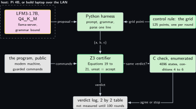
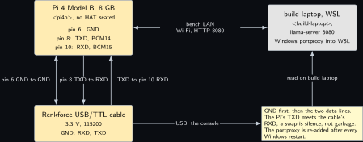
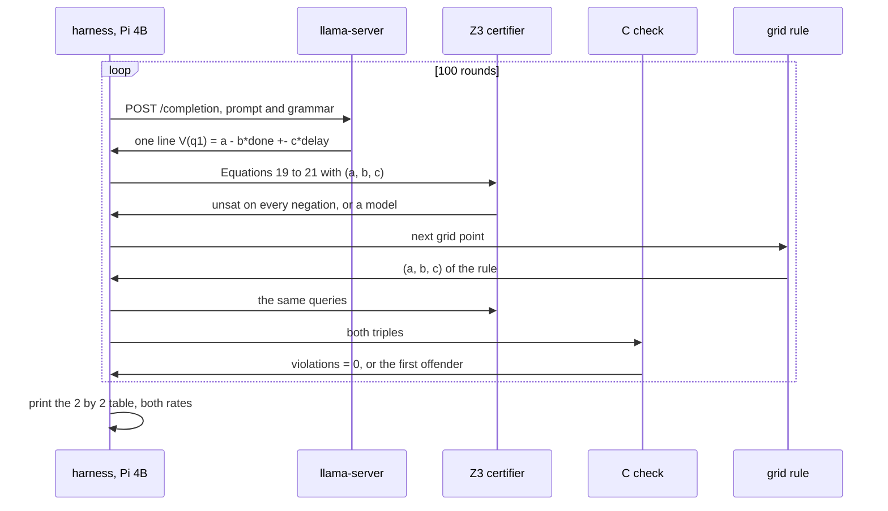
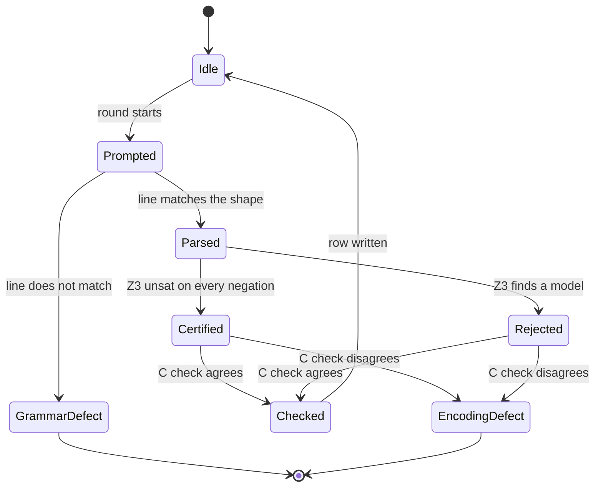
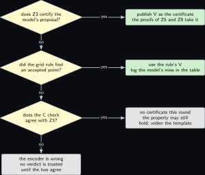

# Project 16. The model proposes a ranking function; the certifier decides

> **Board:** Pi 4B running llama-server, or the build laptop serving over the bench LAN; Z3 on the Pi as the certifier; the modem machine of Z3 as the program  
> **Language:** Python and C

> [!IMPORTANT]
> **The question, instanced**
>
> What can a verifier learn from a device without the device revealing itself, and what does it cost on this board? This chapter asks the question of the certificate rather than of the device: a language model writes a candidate ranking function for the modem machine of [Project 3](03-the-modems-backoff-machine.md), Z3 checks the three obligations of the paper's Equations 19 to 21 against it, and the chapter proves that nothing about where the candidate came from can make a wrong certificate pass. The cost is counted in completeness, and in seconds per proposal.

> **Key facts**
>
> - **Board:** Raspberry Pi 4 Model B Rev 1.4 (8 GB) as the certifier and, by default, as the model host; the build laptop (WSL, \<build-laptop\>) as the alternative model host over the bench LAN
> - **Parts:** the Pi 4B with no HAT on its header, the Renkforce USB/TTL cable on header pins 6, 8 and 10 for the console, the bench Wi-Fi
> - **Interface:** HTTP to `llama-server` on port 8080 (local, or through the Windows portproxy of the build laptop); SSH to the Pi; the console cable at 115200
> - **Language and library:** Python for the harness, with `z3-solver` (version to verify) \[[2](#references)\] and the standard library's `urllib`; C17 for the acceptance check on the enumerated instance; `llama.cpp` at the sibling volume's pin \[[8](#references)\]
> - **Primitive:** certification of a proposed piecewise-linear ranking function, the paper's Equations 18 to 23 \[[1](#references)\]
> - **Secret:** none in this chapter's own proof; the program, the proposals and the verdicts are all public, and the point is completeness
> - **Public:** the guarded-command program of the modem machine, the automaton of the paper's Figure 2b, every proposed $V$, every verdict, the $2 \times 2$ agreement table
> - **Model:** LiquidAI/LFM3-1.7B in its official GGUF \[[7](#references), [6](#references)\] (Q4\_K\_M; the file size is read from the model card) as the Pi 4B default; Qwen2.5-0.5B as the small rung; the model proposes, Z3 decides
> - **Acceptance:** at least 100 proposals per model, every one parsed by the grammar, every one certified or rejected by Z3 with the C check agreeing on the enumerated instance in every case; the agreement table printed with both marginal rates; the verdict for the paper's own certificate of Example 3.4 is accept
> - **Difficulty:** 3 of 5
> - **Effort:** one evening for the Z3 encoding and the C check, one evening for the grammar and the harness, one afternoon on the Pi for the 100 proposals per model

## Pitch

The paper's certificate is public: an automaton for the negated property and a ranking function $V$ that is finite on initial states, non-increasing on every transition and strictly decreasing on fair ones \[[1](#references)\]. Finding $V$ is the creative step; checking it is mechanical. The paper's own front-end hands the obligations to an SMT solver, and in this chapter the creative step is handed to a small language model running on the Pi 4B, bounded by a grammar so that it can only ever emit a formula of one fixed shape. The chapter then does two things that the sibling volume's chapters do for every model: it names the control rule that would be used if there were no model (enumerate a small grid of coefficients and certify each), and it prints the agreement between the two over at least 100 proposals. What makes this chapter belong in a zero-knowledge volume rather than a model volume is the theorem it proves: the certifier's acceptance is exactly the hypothesis of the paper's Theorem 3.2, whose proof in [Project 3](03-the-modems-backoff-machine.md) mentions no proposer, so a wrong proposal is rejected and costs completeness and never soundness. Everything numeric about the model reads "not measured" until the run has happened.

## Parts and interface

| **Part** | **Role** | **Interface** | **Address or pin** |
| --- | --- | --- | --- |
| Raspberry Pi 4 Model B | the certifier (Z3 under Python) and the default model host | SSH; the console cable at 115200 | \<pi4b\>; header pins 6, 8, 10 |
| the build laptop, WSL side | the alternative model host; `llama-server` behind a Windows portproxy | HTTP over the bench Wi-Fi | \<build-laptop\>, port 8080 |
| `llama-server` | serves the GGUF and applies the grammar at sampling time | POST `/completion` with a `grammar` field | port 8080 on either host |
| LFM3-1.7B GGUF | the default proposer | loaded by `llama-server` | file size: read it from the model card \[[7](#references)\] |
| Qwen2.5-0.5B GGUF | the small rung | the same | file size: read it from the model card |
| Z3 under Python | the certifier: Equations 19 to 21 as unsatisfiability queries | the `z3` module, version to verify | on the Pi 4B |
| the C check | evaluates the three conditions of Theorem 3.2 on the enumerated instance of 4096 states | a binary built on the build laptop | on the Pi 4B |
| Renkforce USB/TTL cable | the Pi's console, in case the Wi-Fi drops under load | 3.3 V TTL at 115200 | GND pin 6, TXD pin 8, RXD pin 10 |

## The secret, the statement and the relation

This chapter proves nothing in zero knowledge, so there is no witness to hide. Its relation is the certification relation that every proof of the symbolic scheme rests on. Let $\mathcal{M}$ be the modem machine of [Project 3](03-the-modems-backoff-machine.md) written as linear guarded commands over the integer variables $(\mathsf{st}, \mathsf{done}, \mathsf{delay})$, let $\mathcal{A}$ be the automaton of the paper's Figure 2b for $\neg\phi$ with $\phi = \neg\mathrm{FG}\,\mathsf{Wait}$, and let $\mathcal{V}$ be the template family

$$
\mathcal{V} = \{\, V_{a,b,c} \mid (a, b, c) \in \mathbb{Z}^3 \,\}, \qquad
  V_{a,b,c}(x, q_1) = a - b \cdot \mathsf{done} + c \cdot \mathsf{delay}
  \quad \text{on } \mathsf{Wait} \wedge \mathsf{done} \le 2, \tag{16.1}
$$

with the remaining cases of $V_{a,b,c}$ fixed as in the paper's Example 3.4: $3 \cdot 2^8$ on $\mathsf{Closed}$ in $q_1$ and everywhere in $q_0$, $0$ on $\mathsf{Established}$ and $\mathsf{Exhausted}$, and $+\infty$ on $\mathsf{Wait} \wedge \mathsf{done} = 3$ in both automaton states. The set the certifier decides is

$$
\mathrm{Acc}(\mathcal{M}, \mathcal{A}) = \{\, V \in \mathcal{V} \mid \mathsf{Cert}(\mathcal{M}, (\mathcal{A}, V)) = 1 \,\}, \tag{16.2}
$$

and the two proposers are functions into $\mathcal{V}$: the model $P_{\mathrm{llm}} : \mathrm{Prompts} \to \mathcal{V}$ and the control rule $P_{\mathrm{grid}} : \{1, \ldots, |G|\} \to \mathcal{V}$ that walks a finite grid $G \subset \mathbb{Z}^3$. The statement a later chapter proves in zero knowledge is $V \in \mathrm{Acc}(\mathcal{M}, \mathcal{A})$ for a committed $\mathcal{M}$; this chapter establishes that the set on the right does not depend on which of the two functions produced $V$.

## The mathematics

The paper allows the ranking function to be given per automaton state as a piecewise-linear function over polyhedral regions, its Equation 18, and derives three families of proof obligations from the three conditions of Theorem 3.2 \[[1](#references)\]. Restated for this volume, with $x$ the current state, $x'$ the next, $\sigma = \langle\!\langle x \rangle\!\rangle$, and the guarded updates $A_i [x\; x']^\top \le b_i$:

$$
\begin{aligned}
A_0 x \le b_0 \;&\Longrightarrow\; E^{(q)}_k x \not\le f^{(q)}_k
    \quad \text{for every } q \in Q_0 \text{ and every infinite case } k,
     \\
  A_i \begin{bmatrix} x \\ x' \end{bmatrix} \le b_i
    \;\Longrightarrow\; \Big( P^{(\sigma)} x \le r^{(\sigma)} \wedge C^{(q)}_j x \le d^{(q)}_j
    \;\Longrightarrow\; E^{(q')}_k x' \not\le f^{(q')}_k \Big),
     \\
  A_i \begin{bmatrix} x \\ x' \end{bmatrix} \le b_i
    \;\Longrightarrow\; \Big( \text{cases } j, k \text{ hold}
    \;\Longrightarrow\; w^{(q)}_j x + u^{(q)}_j \ge w^{(q')}_k x' + u^{(q')}_k
    + \mathbf{1}_F(q, \sigma, q') \Big). \tag{16.3}
\end{aligned}
$$

These are the paper's Equations 19, 20 and 21. Every one has the uniform shape of its Equation 22, $\forall y : A_s y \le b_s \Longrightarrow C_p y \le d_p \Longrightarrow E_p y \not\le f_p$, whose negation, Equation 23, is the satisfiability of $A_s y \le b_s \wedge C_p y \le d_p \wedge E_p y \le f_p$; an unsatisfiable negation is a discharged obligation.

**Definition Z16.1 (The certifier).** Let $\mathcal{M} = (S_0, T)$ be given by linear guarded commands as in the paper's Equations 15 and 16, let $\mathcal{A} = (Q, Q_0, \delta, F)$ be a nondeterministic Buchi automaton over $\Sigma = 2^\Pi$ with atomic predicates given by linear inequalities, and let $V$ be a piecewise-linear function of the shape of Equation 18. The *certifier* $\mathsf{Cert}(\mathcal{M}, (\mathcal{A}, V)) \in \{0, 1\}$ returns $1$ if and only if (i) the case constraints of $V$ are pairwise disjoint, (ii) they jointly cover $S \times Q$, (iii) every finite case is non-negative on its region, and (iv) every instance of ((16.3)), ((16.3)) and ((16.3)) holds, that is, every negation of the form of Equation 23 is unsatisfiable over the integers.

**Theorem Z16.2 (Soundness is independent of the proposer).** Let $\mathcal{M}$, $\mathcal{A}_{\neg\phi}$ be as above and let $P$ be any function whose values are piecewise-linear functions of the shape of Equation 18: a language model, a grid enumeration, a person, or an adversary who knows $\mathcal{M}$. If $V = P(\xi)$ for some input $\xi$ and $\mathsf{Cert}(\mathcal{M}, (\mathcal{A}_{\neg\phi}, V)) = 1$, then $\mathcal{M} \models \phi$.

*Proof.* Write $Q$ for the automaton states. Conditions (i) to (iii) of Definition **Definition Z16.1** make $V : S \times Q \to \mathbb{N} \cup \{+\infty\}$ a total function with a non-negative codomain, which is the type demanded by Theorem 3.2 of the paper; the proof of that theorem is written out in [Project 3](03-the-modems-backoff-machine.md) and is not repeated here. It remains to show that (iv) gives the three hypotheses (4), (5) and (6) of that theorem.

Hypothesis (4): let $s \in S_0$ and $q \in Q_0$. Then $A_0 s \le b_0$ by Equation 15, and ((16.3)) says that no infinite case $k$ of $V(\cdot, q)$ is satisfied by $s$; by (ii) some case is satisfied, so it is a finite one, and $V(s, q) \ne \infty$.

Hypothesis (5): let $(s, s') \in T$, so $A_i [s\; s']^\top \le b_i$ for some guarded update $i$ by Equation 16; let $V(s, q) \ne \infty$ and $(q, \langle\!\langle s \rangle\!\rangle, q') \in \delta$. Since $V(s, q)$ is finite, $s$ satisfies some finite case $j$ of $V(\cdot, q)$, and $\langle\!\langle s \rangle\!\rangle = \sigma$ means $P^{(\sigma)} s \le r^{(\sigma)}$ by the paper's Equation 17. Then ((16.3)) says $s'$ satisfies no infinite case of $V(\cdot, q')$, so by (ii) it satisfies a finite case $k$, and ((16.3)) for the pair $(j, k)$ gives $V(s, q) = w^{(q)}_j s + u^{(q)}_j \ge w^{(q')}_k s' + u^{(q')}_k + \mathbf{1}_F(q, \sigma, q') = V(s', q') + \mathbf{1}_F(q, \sigma, q')$. The indicator is $0$ or $1$, so $V(s, q) \ge V(s', q')$.

Hypothesis (6): the same derivation with $(q, \sigma, q') \in F$, where the indicator is $1$, gives $V(s, q) \ge V(s', q') + 1 > V(s', q')$.

Theorem 3.2 now yields $\mathcal{L}_\mathcal{M} \cap \mathcal{L}_{\mathcal{A}_{\neg\phi}} = \emptyset$, and since $\mathcal{L}_{\mathcal{A}_{\neg\phi}} = \Sigma^\omega \setminus \mathcal{L}_\phi$ this is $\mathcal{L}_\mathcal{M} \subseteq \mathcal{L}_\phi$, that is $\mathcal{M} \models \phi$ (the paper's Corollary 3.3).

Nowhere in the three derivations does $\xi$ or $P$ occur: every hypothesis used is a property of the triple $(\mathcal{M}, \mathcal{A}_{\neg\phi}, V)$ alone. Formally, Theorem 3.2 is the inclusion $\mathrm{Acc}(\mathcal{M}, \mathcal{A}_{\neg\phi}) \subseteq \{\, V \mid \mathcal{L}_\mathcal{M} \cap \mathcal{L}_{\mathcal{A}_{\neg\phi}} = \emptyset \,\}$ between two sets of functions, and $V = P(\xi)$ is merely one element of the left-hand set. &#9632;

**Remark Z16.8.** The theorem has a converse direction that it does not claim. If the certifier rejects a proposal, nothing follows about $\mathcal{M}$: the paper's Remark 2.1 says a negative outcome does not imply $\mathcal{M} \not\models \phi$, and this is exactly the room in which a model can cost completeness. A proposer that is wrong every time leaves the verifier with no certificate and the property unproved; it never leaves the verifier with a false certificate.

**Definition Z16.4 (The agreement table).** Fix a run of $n$ rounds. In round $t$ the model proposes $V^{\mathrm{llm}}_t$ and the control rule proposes the next grid point $V^{\mathrm{grid}}_t$; both are certified. Let $m_t, g_t \in \{0, 1\}$ be the two verdicts. The agreement table is the $2 \times 2$ contingency

$$
n_{11} = |\{ t : m_t = 1, g_t = 1 \}|,\quad
  n_{10} = |\{ t : m_t = 1, g_t = 0 \}|,\quad
  n_{01} = |\{ t : m_t = 0, g_t = 1 \}|,\quad
  n_{00} = |\{ t : m_t = 0, g_t = 0 \}|, \tag{16.4}
$$

with $n_{11} + n_{10} + n_{01} + n_{00} = n$. The model's acceptance rate is $k_{\mathrm{llm}} / n$ with $k_{\mathrm{llm}} = n_{11} + n_{10}$, the rule's is $k_{\mathrm{grid}} / n$ with $k_{\mathrm{grid}} = n_{11} + n_{01}$, and the agreement rate is $(n_{11} + n_{00}) / n$.

**Proposition Z16.5 (Completeness loss).** Over a run of $n$ rounds with $k_{\mathrm{llm}}$ model proposals accepted and $k_{\mathrm{grid}}$ rule proposals accepted: (a) the model adds over the control rule, in the sense that replacing the rule by the model raises the number of certified rounds, exactly when $n_{10} > n_{01}$, equivalently when $k_{\mathrm{llm}} / n > k_{\mathrm{grid}} / n$; (b) the procedure that tries the model first and falls back to the rule certifies $n_{11} + n_{10} + n_{01}$ rounds, which is at least $\max(k_{\mathrm{llm}}, k_{\mathrm{grid}})$, so the model as a first attempt never costs completeness against the rule alone.

*Proof.* (a) By Definition **Definition Z16.4**, $k_{\mathrm{llm}} - k_{\mathrm{grid}} = (n_{11} + n_{10}) - (n_{11} + n_{01}) = n_{10} - n_{01}$, so $k_{\mathrm{llm}} > k_{\mathrm{grid}}$ if and only if $n_{10} > n_{01}$, and dividing both sides by $n > 0$ preserves the inequality. (b) A round is certified by the fallback procedure when $m_t = 1$ or $g_t = 1$; the three cells $n_{11}, n_{10}, n_{01}$ are exactly those rounds and are disjoint, so the count is their sum. Since $n_{01} \ge 0$ the sum is at least $n_{11} + n_{10} = k_{\mathrm{llm}}$, and since $n_{10} \ge 0$ it is at least $n_{11} + n_{01} = k_{\mathrm{grid}}$. &#9632;

**Lemma Z16.6 (Enumeration decides the obligations on a finite box).** Let the state variables range over the finite box $B = \{\mathsf{Closed}, \mathsf{Wait}, \mathsf{Established}, \mathsf{Exhausted}\} \times [0, 3] \times [0, 255]$, so $|B| = 4 \cdot 4 \cdot 256 = 4096$. Then $\mathsf{Cert}(\mathcal{M}, (\mathcal{A}, V)) = 1$ if and only if the three conditions (4), (5), (6) of Theorem 3.2 hold at every $s \in S_0$, every $(s, s') \in T \cap B^2$ and every automaton transition, and this is decided by at most $|T \cap B^2| \cdot |\delta|$ evaluations of $V$.

*Proof.* Each obligation ((16.3)) to ((16.3)) is a universally quantified implication over $y = (x, x')$ with $x, x' \in B$. Over a finite domain a universal statement is the conjunction of its instances, so it holds if and only if every instance holds, and an instance is checked by evaluating finitely many linear inequalities. The proof of Theorem **Theorem Z16.2** shows the instances of ((16.3)) to ((16.3)) at $(s, s', q, q')$ are equivalent to (4), (5), (6) at the same point; conversely, (5) and (6) at a point where $V(s, q)$ is finite give, by the uniqueness of the case $k$ satisfied by $s'$ under (i) and (ii), the finiteness of $V(s', q')$ and the linear inequality of ((16.3)). The bound counts one evaluation of $V$ at $(s, q)$ and one at $(s', q')$ per transition pair, the initial condition being one evaluation per element of $S_0 \times Q_0$, which is dominated. &#9632;

The lemma is the reason the chapter carries a C program as well as a Z3 harness: on the enumerated instance the two decide the same set, and a round on which they disagree is a defect in one encoding, found before any verdict is trusted.

**Example Z16.9 (The paper's certificate is in the template family).** Example 3.4 of the paper gives $V(\cdot, q_1) = 2^9 + 1 - 2^8 \cdot \mathsf{done} + \mathsf{delay}$ on $\mathsf{Wait} \wedge \mathsf{done} \le 2$, that is $V_{513, 256, 1}$ in ((16.1)), with the sign of the $\mathsf{delay}$ term positive because $\mathsf{delay}$ counts down by one on the fair self-loop. A template with a negative sign on that term admits no certified point on this machine: on the tick transition $V$ would rise by $c$. The grammar below therefore carries a sign on the delay term, so that the paper's own certificate lies in its language.

## The protocol

This is a certification protocol with two proposers and one judge, written so that it can fail.

1. The harness loads the guarded commands of the modem machine (the same source as [Project 3](03-the-modems-backoff-machine.md)) and the automaton of Figure 2b, and builds the Z3 queries of ((16.3)) to ((16.3)) once; the coefficients $(a, b, c)$ are the only free symbols.
2. Round $t$: the harness posts the prompt and the grammar to `llama-server`, receives one line, and parses it; a line the regular expression does not match is a grammar defect and stops the run.
3. The harness substitutes $(a, b, c)$ into the queries and asks Z3; `unsat` on every negated obligation is accept.
4. The harness takes the next grid point as the control rule's proposal and certifies it the same way.
5. The C binary evaluates the same $(a, b, c)$ pairs on the enumerated 4096-state instance; a disagreement with Z3 stops the run.
6. After $n \ge 100$ rounds the harness prints the table of Definition **Definition Z16.4** with both marginal rates and the agreement rate, one row per model.

## The code

The harness asks for one proposal and certifies it. The prompt names the machine in the words of the paper's Example 3.1, and the grammar is the one printed under the model subsection below.

```python
import json, re, sys, urllib.request
from z3 import Ints, Solver, And, Or, Not, Implies, unsat

URL = sys.argv[1] if len(sys.argv) > 1 else "http://127.0.0.1:8080/completion"
GRAMMAR = open("z16_rank.gbnf").read()
PROMPT = ("Program: states Closed, Wait, Established, Exhausted. In Wait the counter "
          "delay counts down to 0; then done rises by one and delay is resampled "
          "below 256; after done reaches 2 the next timeout goes to Exhausted. "
          "Propose a ranking function V(q1) on Wait that decreases on every step.\n")
SHAPE = re.compile(r"V\(q1\) = (\d+) - (\d+)\*done ([+-]) (\d+)\*delay")

def propose():
    body = json.dumps({"prompt": PROMPT, "grammar": GRAMMAR, "n_predict": 40,
                       "temperature": 0.7, "seed": -1}).encode()
    req = urllib.request.Request(URL, body, {"Content-Type": "application/json"})
    with urllib.request.urlopen(req, timeout=180) as r:
        text = json.load(r)["content"].strip()
    m = SHAPE.fullmatch(text)
    if m is None:
        sys.exit("grammar defect: " + repr(text))
    a, b, c = int(m[1]), int(m[2]), int(m[4])
    return a, b, (c if m[3] == "+" else -c)

def certify(a, b, c):
    """Equations 19 to 21 for the modem machine, q1 on Wait, q0 fixed at 768.
    Every obligation is an implication; the run is accepted when the disjunction
    of their negations (Equation 23) is unsat."""
    done, delay, done2, delay2 = Ints("done delay done2 delay2")
    box = And(0 <= done, done <= 2, 0 <= delay, delay <= 255)
    v, v2 = a - b * done + c * delay, a - b * done2 + c * delay2
    tick = And(delay >= 1, delay2 == delay - 1, done2 == done)
    retry = And(delay == 0, done <= 1, done2 == done + 1, 0 <= delay2, delay2 <= 255)
    exhaust = And(delay == 0, done == 2)          # next state Exhausted, V = 0
    obligations = [
        Implies(box, v >= 0),                      # finite cases are non-negative
        Implies(box, 768 >= v),                    # q0 to q1 entry: V(q0) = 3 * 2^8
        Implies(And(box, tick), v > v2),           # fair self-loop on q1, Eq 21
        Implies(And(box, retry), And(v > v2, v2 >= 0)),
        Implies(And(box, exhaust), v > 0),         # retry from done = 2
        Implies(box, v > 0),                       # synack to Established, V = 0
    ]
    s = Solver()
    s.add(Or([Not(o) for o in obligations]))
    return s.check() == unsat

if __name__ == "__main__":
    a, b, c = propose()
    print(f"z16 proposal a={a} b={b} c={c} verdict={'accept' if certify(a, b, c) else 'reject'}")
    print(f"z16 paper a=513 b=256 c=1 verdict={'accept' if certify(513, 256, 1) else 'reject'}")
```

The C check is the same decision taken by enumeration, as Lemma **Lemma Z16.6** allows; it takes the three coefficients on its command line and exits non-zero on the first violated condition, printing where.

```c
#include <stdio.h>
#include <stdlib.h>
#include <limits.h>
enum { CLOSED, WAIT, EST, EXH };
#define INF LONG_MAX
static long a, b, c;                 /* V(q1) on Wait = a - b*done + c*delay */

static long V(int q, int st, int done, int delay) {
    if (st == WAIT && done == 3) return INF;        /* the template's infinite case */
    if (q == 0 || st == CLOSED) return 3 * 256;
    if (st == WAIT) return a - b * done + c * delay;
    return 0;                                      /* Established, Exhausted */
}
static int wait_obs(int st) { return st == WAIT; }

/* one composed check: (s,s') in T, (q,<s>,q') in delta; fair iff q == q' == 1 */
static int step(int st, int dn, int dl, int st2, int dn2, int dl2, long *bad) {
    static const int Q[3][2] = {{0, 0}, {0, 1}, {1, 1}};      /* (q, q') pairs */
    for (int i = 0; i < 3; i++) {
        int q = Q[i][0], q2 = Q[i][1];
        if (q2 == 1 && !wait_obs(st)) continue;             /* needs <s> = Wait */
        long v = V(q, st, dn, dl), v2 = V(q2, st2, dn2, dl2);
        if (v == INF) continue;                             /* premise of (5), (6) */
        int fair = (q == 1 && q2 == 1);
        if (v2 == INF || v < v2 || (fair && v == v2)) { (*bad)++;
            printf("violation st=%d done=%d delay=%d -> st=%d done=%d delay=%d q=%d q'=%d\n",
                   st, dn, dl, st2, dn2, dl2, q, q2); return 1; }
    }
    return 0;
}

int main(int argc, char **argv) {
    if (argc != 4) return 2;
    a = atol(argv[1]); b = atol(argv[2]); c = atol(argv[3]);
    long bad = 0;
    if (V(0, CLOSED, 0, 0) == INF) bad++;                   /* condition (4) */
    for (int d = 0; d <= 63; d++) step(CLOSED, 0, 0, WAIT, 0, d, &bad);
    for (int dn = 0; dn <= 2; dn++) for (int dl = 0; dl <= 255; dl++) {
        if (dl >= 1) step(WAIT, dn, dl, WAIT, dn, dl - 1, &bad);     /* tick */
        step(WAIT, dn, dl, EST, dn, dl, &bad);                       /* synack */
        if (dl == 0 && dn <= 1)
            for (int d2 = 0; d2 <= 255; d2++) step(WAIT, dn, 0, WAIT, dn + 1, d2, &bad);
        if (dl == 0 && dn == 2) step(WAIT, 2, 0, EXH, 3, 0, &bad);  /* exhausted */
    }
    step(EST, 0, 0, EST, 0, 0, &bad); step(EXH, 3, 0, EXH, 3, 0, &bad);
    printf("z16 check a=%ld b=%ld c=%ld violations=%ld\n", a, b, c, bad);
    return bad ? 1 : 0;
}
```

```bash
# build laptop, WSL: the C check is cross built for the Pi 4B, the harness is copied
aarch64-linux-gnu-gcc -std=c17 -O2 -Wall -o z16_check z16_check.c
scp z16_check z16_harness.py z16_rank.gbnf <user>@<pi4b>:~/z16/
# on the Pi 4B over ssh, with llama-server on the Pi or on the build laptop
python3 z16_harness.py http://<build-laptop>:8080/completion
./z16_check 513 256 1
```

The retry command carries the over-approximation $0 \le \mathsf{delay}' \le 255$ in place of the paper's $\mathsf{delay}' < 2^{6 + \mathsf{done}'}$, which is not linear in $\mathsf{done}'$; the paper's certificate $V_{513, 256, 1}$ is still accepted, because on a retry $V$ falls by $256$ and rises by at most $255$.

## The model, if any

LiquidAI/LFM3-1.7B in its official GGUF \[[7](#references)\], taken from the trending list read on Friday 6 November 2026 \[[6](#references)\], Q4\_K\_M with the file size read from the model card, served by `llama-server` on the Pi 4B with 8 GB; the small rung is Qwen2.5-0.5B from the sibling volume's ladder. The model proposes one line under the grammar below, and only that line; Z3 decides. Every rule sits on one line, because the `llama.cpp` parser ends a rule body at the end of its line.

```gbnf
root ::= "V(q1) = " int " - " int "*done " sign " " int "*delay"
sign ::= "+" | "-"
int  ::= [0-9] | [1-9] [0-9] | [1-9] [0-9] [0-9] | [1-9] [0-9] [0-9] [0-9]
```

The control rule is the grid $G = \{256, 512, 513, 768, 1024\} \times \{1, 128, 255, 256, 257\} \times \{-2, -1, 0, 1, 2\}$ of 125 points, walked in order and certified one per round. The theorem that says a wrong proposal cannot cost soundness is Theorem **Theorem Z16.2**; the proposition that says what it can cost is Proposition **Proposition Z16.5**. The table has one row per model and every cell reads "not measured" until the 100 rounds have run:

| **Model** | $n_{11}$ | $n_{10}$ | $n_{01}$ | $n_{00}$ | **rates** | **Instrument** |
| --- | --- | --- | --- | --- | --- | --- |
| LFM3-1.7B, Q4\_K\_M | not measured | not measured | not measured | not measured | llm, grid, agreement: not measured | the harness log, $n \ge 100$ |
| Qwen2.5-0.5B | not measured | not measured | not measured | not measured | not measured | the same |
| grid alone |  |  |  |  | $k_{\mathrm{grid}} / 125$: computed once the encoding is final | the harness log |

The rule's own rate is printed on the same rows as the model's, because a model rate on its own is the class balance of the grid and says nothing.

## Real, modelled, absent

- **have:** real: the Pi 4B with 8 GB, build laptop on the bench LAN, the console cable, the paper's Example 3.4 as a known-accepted point, Z3 under Python, the `llama.cpp` pin of the sibling volume
- **learn:** modelled: the acceptance rates in the benchmark figure are the shape the acceptance test expects and are drawn dashed; the file sizes of the two GGUFs are read from their model cards before the first run; the `z3-solver` version on trixie is to verify; the portproxy on the build laptop must be re-checked after every Windows restart
- **absent:** absent: a measured agreement table, because no round has run; a second guarded-command program, so the completeness figure is for one machine only; a GPU, so the per-proposal time on the Pi is bounded by its four Cortex-A72 cores

## System architecture



*Figure 16.1. Two proposers, one judge. Along the top, left to right: the language model block with its yellow outline, served by llama-server, inside a dashed layer that names the two possible hosts (the Pi 4B, or the build laptop over the LAN); the Python harness in user-space green that posts the prompt and the grammar and parses one line; the control rule block with its green outline that walks the 125-point grid. In the middle row: the public program block holding the modem machine as guarded commands, the Z3 certifier with the verifier's green outline evaluating Equations 19 to 21, and the C check in user-space green that enumerates the 4096 states. At the bottom, a public block for the verdict log and the 2 by 2 table, marked not measured. Solid arrows carry the proposal from each proposer into the harness, the coefficients from the harness into the certifier, the guarded commands into the certifier, the same coefficients from the certifier into the C check with the question whether the verdicts agree, and the verdict into the log.*

Read the figure as a judge with two witnesses: the certifier is the judge, and the C check is the second witness that must agree with it on the enumerated instance before any verdict is written into the table.

## Wiring



*Figure 16.2. No HAT sits on the header in this chapter. On the left the Pi 4B as a solid hardware block with its three console pins called out: GND on pin 6, TXD (BCM14) on pin 8, RXD (BCM15) on pin 10. Below it the Renkforce USB/TTL cable as a solid hardware block, joined by three vertical lines: pin 6 to the cable's GND, pin 8 to the cable's RXD, pin 10 to the cable's TXD, the crossing named on the lines. On the right the build laptop as a solid grey block; a double-headed bus arrow between the Pi and the build laptop carries the bench LAN the bench LAN over Wi-Fi with llama-server on port 8080 behind the Windows portproxy, and a solid arrow from the cable's USB end reaches the build laptop as the console.*

| **Signal** | **From** | **To** | **Note** |
| --- | --- | --- | --- |
| console GND | Pi 4B header pin 6 | Renkforce cable GND | common reference first, before either data line |
| console TXD | Pi 4B header pin 8, BCM14 | Renkforce cable RXD | the Pi transmits, the cable receives; a swap shows as silence, not as garbage |
| console RXD | Pi 4B header pin 10, BCM15 | Renkforce cable TXD | 3.3 V TTL only; the cable is the 3.3 V variant |
| HTTP 8080 | Pi 4B, \<pi4b\> | build laptop, \<build-laptop\> | over the bench Wi-Fi; the Windows portproxy forwards 8080 into WSL, and must be re-added after a restart |
| power | the Pi's own USB-C supply |  | the PPK2 cannot meter a Pi under load, so no energy figure is claimed here |

## Sequence and states





## Decision tree



*Figure 16.3. What to do with a verdict. The root diamond asks whether Z3 certifies the model's proposal; yes leads to a leaf that publishes V as the certificate for the proofs of Z5 and Z8 to take. No leads to a second diamond asking whether the grid rule found an accepted point this round; yes leads to a leaf that uses the rule's V and logs the model's miss in the table. No leads to a third diamond asking whether the C check agrees with Z3 on the enumerated instance; yes leads to a grey leaf saying there is no certificate and the property may still hold, so the template is widened; no leads to a grey leaf saying the encoder is wrong and no verdict is trusted until the two agree.*

## Benchmark


*Figure 16.4. Expected acceptance and agreement rates in percent, drawn as dashed bars because no round has run on this bench; from left to right three groups for LFM3-1.7B, Qwen2.5-0.5B and the grid rule alone, each with two bars: the share of proposals certified and the share of lines the grammar produced in the expected shape, the second being 100 by construction of the grammar. A solid bar replaces a dashed one when the 100 rounds have run and the acceptance test has passed; the caption of the replacing figure names the log.*

| **Quantity** | **LFM3-1.7B** | **Qwen2.5-0.5B** | **grid** | **Instrument** |
| --- | --- | --- | --- | --- |
| proposals certified, of 100 | not measured | not measured | computed, see text | the harness log |
| agreement rate with the grid | not measured | not measured |  | the harness log, Definition **Definition Z16.4** |
| seconds per proposal on the Pi 4B | not measured | not measured |  | `time.monotonic` around the POST; `vcgencmd get_throttled` 0x0 before and after |
| seconds per proposal on the build laptop | not measured | not measured |  | the same, over the LAN |
| Z3 time per certification | not measured | not measured | not measured | `time.monotonic` around `s.check()` |
| C check time, 4096 states | not measured |  |  | `clock_gettime` in the binary |
| model file size | read it from the model card | read it from the model card |  | the Hugging Face page \[[7](#references)\] |

The paper's Table 1 reports the symbolic verifier at 10 s for 217 obligations on its AWS `c6g.8xlarge` \[[1](#references)\]; that is a cost of the zero-knowledge proof of a certificate, not of finding one, and it is not copied into any cell above.

## Steps

**Step 1.** On the authoring laptop, write the harness, the grammar and the C check; commit. Nothing is compiled here.

**Step 2.** On the build laptop in WSL, `git pull --ff-only`, cross build the C check for aarch64, and copy the three files to the Pi 4B.

**Step 3.** On the build laptop, download the two GGUFs, read and record each file size from its model card, and start `llama-server` on port 8080 with the LFM3 file; add the Windows portproxy for 8080 into WSL and confirm it from the Pi with one POST.

**Step 4.** On the Pi 4B over ssh, install `z3-solver` into a venv and record the version; run the harness once with the paper's coefficients and confirm the verdict is accept and the C check prints zero violations.

**Step 5.** On the Pi 4B, read `vcgencmd get_throttled`, run 100 rounds against the build laptop, read the register again, and keep the log.

**Step 6.** On the Pi 4B, start `llama-server` locally with the same GGUF and repeat the 100 rounds; then swap in Qwen2.5-0.5B and repeat.

**Step 7.** On the authoring laptop, replace the "not measured" cells by the log's figures with the log's name, and redraw the benchmark figure solid.

## Acceptance test

The chapter passes when, for each of the two models, 100 rounds exist in the log, every line matched the shape, every verdict of Z3 was matched by the C check, the paper's own certificate $V_{513, 256, 1}$ was accepted in a dedicated round, and the table prints $n_{11}, n_{10}, n_{01}, n_{00}$ with both marginal rates. It fails if any line failed to parse, if Z3 and the C check disagreed on any round, if the throttle register changed during a Pi-hosted run, or if a rate is printed without the grid's own rate beside it.

## Variants

**A one-bit model as the proposer.** The floating-point model behind the HTTP call is replaced by a ternary-weight one, BitNet b1.58, whose every weight is minus one, zero or one \[[4](#references)\], served by its own inference framework \[[5](#references)\] on the same Pi 4B; the prompt, the grammar, the Z3 queries, the grid rule and the C check are untouched, so the only thing that changes is the stream of proposals. What it buys is memory: at 1.58 bits per weight a model of 1.7 billion weights holds its weights in 335.8 megabytes, against 956.3 megabytes for the same weight count at the 4.5 bits per weight a Q4\_K\_M file averages, a factor of 2.85 (computed from the weight count and the bits per weight, not from a file read on this bench). What it does not change is the theorem, and that is the point of writing the variant down: Theorem **Theorem Z16.2** quantifies over every function whose values lie in the template family of ((16.1)), so a ternary proposer enters its proof exactly where a floating-point one did, which is nowhere, and the acceptance set $\mathrm{Acc}(\mathcal{M}, \mathcal{A})$ of ((16.2)) is the same set of functions. What can move is the acceptance rate, which is completeness and is read from Proposition **Proposition Z16.5** with the grid's own rate on the same rows. Choose this variant when the proposer has to share the Pi 4B's 8 GB with the certifier rather than sit on the build laptop, and not because a ternary model is expected to propose better certificates. It is the brief's projects 2, 10 and 19 \[[3](#references)\], and [Project 24](24-a-one-bit-model.md) builds the ternary linear layer, counts its additions and subtractions against the floating-point product, and states the quantisation limit, none of which is repeated here. The brief reads its one-bit model beside an MCC 118 capture at 100 kS/s across eight channels; on this bench that rate is the aggregate across the channels in use, so eight channels sample at 12.5 kS/s each (computed), and the brief's medical framing of its project 10 is not taken up, because nothing in this volume diagnoses anything.

## Pitfalls

- A GBNF rule body ends at the end of its line; a long alternation written over two lines without a trailing `|` becomes two rules and the parser reports the second as unknown. Every rule above is one line.
- The sign of the delay term is not a detail: with the paper's machine the delay counts down on the fair step, so a template that only subtracts it is empty, and a 0 percent acceptance rate would then be a property of the grammar, not of the model.
- A rate without the rule's rate on the same rows is the class balance: if 7 of 125 grid points are certified, a model that proposes random grid points scores 5.6 percent and has learned nothing.
- The over-approximation $\mathsf{delay}' \le 255$ on the retry makes the set of accepted $V$ smaller than the paper's exact machine would; a proposal rejected here might be accepted by a finer encoding, and the chapter says so rather than calling it wrong.
- `llama-server` applies the grammar at sampling time but still stops at `n_predict`; a budget shorter than the longest line the grammar admits produces a legal prefix, which the regular expression then refuses. The budget of 40 tokens is above the longest line.

## Languages and libraries not chosen

- C with the `llama.cpp` C API in place of HTTP: the sibling volume's loop; here the host may be the build laptop, so the harness talks HTTP and the C is kept for the check.
- Rust with a Z3 binding: the certifier is the paper's own Python front-end role, and the `z3` module is the shortest path to the paper's queries.
- Lean 4: the machine-checked Theorem 3.2 is [Project 14](14-theorem-3-2-in-lean-4.md); a checked proof of the certifier's soundness is the next step after this chapter, not a substitute for it.
- Spot: translating the sentence to the automaton is [Project 17](17-from-a-sentence-to-a-b-uchi-automaton.md); this chapter takes the automaton of Figure 2b as given.

## Sources

- [arxiv.org/abs/2605.00487](https://arxiv.org/abs/2605.00487) (verified Friday 6 November 2026), Theorem 3.2, Example 3.4 and Equations 18 to 23.
- [huggingface.co/models, trending](https://huggingface.co/models?pipeline_tag=text-generationsort=trending) (verified Friday 6 November 2026), the list the default model is taken from.
- [huggingface.co/LiquidAI/LFM3-1.7B-GGUF](https://huggingface.co/LiquidAI/LFM3-1.7B-GGUF) (to verify), the model card the file size is read from.
- [github.com/ggml-org/llama.cpp/releases](https://github.com/ggml-org/llama.cpp/releases) (to verify), the server and its grammar parser.
- [github.com/aiverification/zkmc](https://github.com/aiverification/zkmc) (verified Friday 6 November 2026), the paper's own encoder, whose obligations the harness mirrors.

<a id="references"></a>

## References

1. Pascal Berrang, Mirco Giacobbe, Jacob Swales and Xiao Yang. Zero-Knowledge Model Checking. arXiv:2605.00487v2 \[cs.CR\], version 1 submitted Friday 1 May 2026, version 2 Tuesday 8 September 2026. [arxiv.org/abs/2605.00487](https://arxiv.org/abs/2605.00487) (verified Friday 6 November 2026).
2. Leonardo de Moura and Nikolaj Bjørner. Z3: an efficient SMT solver. In TACAS 2008, LNCS 4963, pages 337 to 340. Springer, 2008. [doi:10.1007/978-3-540-78800-3\_24](https://doi.org/10.1007/978-3-540-78800-3_24) (to verify).
3. Advanced hardware-software architectures for edge artificial intelligence and zero-knowledge model checking. A design brief of twenty project sketches, read on Friday 6 November 2026 and held locally at `a local design brief`. It is the input to this second edition and is not a published source; where its hardware claims disagree with the bench, the bench is followed and the disagreement is stated.
4. Shuming Ma, Hongyu Wang, Lingxiao Ma, Lei Wang, Wenhui Wang, Shaohan Huang, Li Dong, Ruiping Wang, Jilong Xue and Furu Wei. The era of 1-bit LLMs: all large language models are in 1.58 bits. arXiv:2402.17764, submitted Tuesday 27 February 2024; every weight is ternary, in the set with the three values minus one, zero and one. [arxiv.org/abs/2402.17764](https://arxiv.org/abs/2402.17764) (verified Friday 6 November 2026).
5. Microsoft. BitNet: the official inference framework for 1-bit large language models, in C++, MIT licence, 41466 stars when read. [github.com/microsoft/BitNet](https://github.com/microsoft/BitNet) (verified Friday 6 November 2026).
6. Hugging Face, trending text-generation models, read on the day: LiquidAI/LFM3-1.7B and its official GGUF, Qwen3.5-4B derivatives, NVIDIA Nemotron-3.5-Bolt-E4B-4GB, prism-ml Ternary-Bonsai-2-27B GGUF, XHToken Spark-X2.6-4B, and the DeepSeek-V4.1-Flash GGUF quantisations. [huggingface.co/models, trending](https://huggingface.co/models?pipeline_tag=text-generationsort=trending) (verified Friday 6 November 2026).
7. Liquid AI. LFM3-1.7B-GGUF, the official llama.cpp quantisations of LFM3-1.7B. [huggingface.co/LiquidAI/LFM3-1.7B-GGUF](https://huggingface.co/LiquidAI/LFM3-1.7B-GGUF) (to verify).
8. ggml-org. llama.cpp, release v0.6.0 at commit d8123504, the pin of the sibling EdgeLLM volume. [github.com/ggml-org/llama.cpp/releases](https://github.com/ggml-org/llama.cpp/releases) (to verify).

---

[Previous](15-a-zig-verifier-of-pedersen-openings.md) &nbsp;&nbsp;|&nbsp;&nbsp; [Contents](../CONTENTS.md) &nbsp;&nbsp;|&nbsp;&nbsp; [Next](17-from-a-sentence-to-a-b-uchi-automaton.md)
