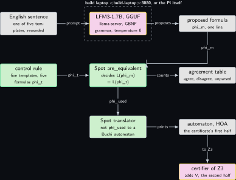
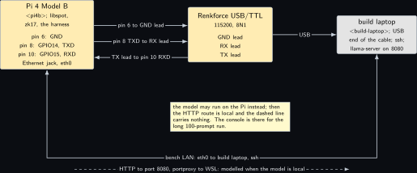
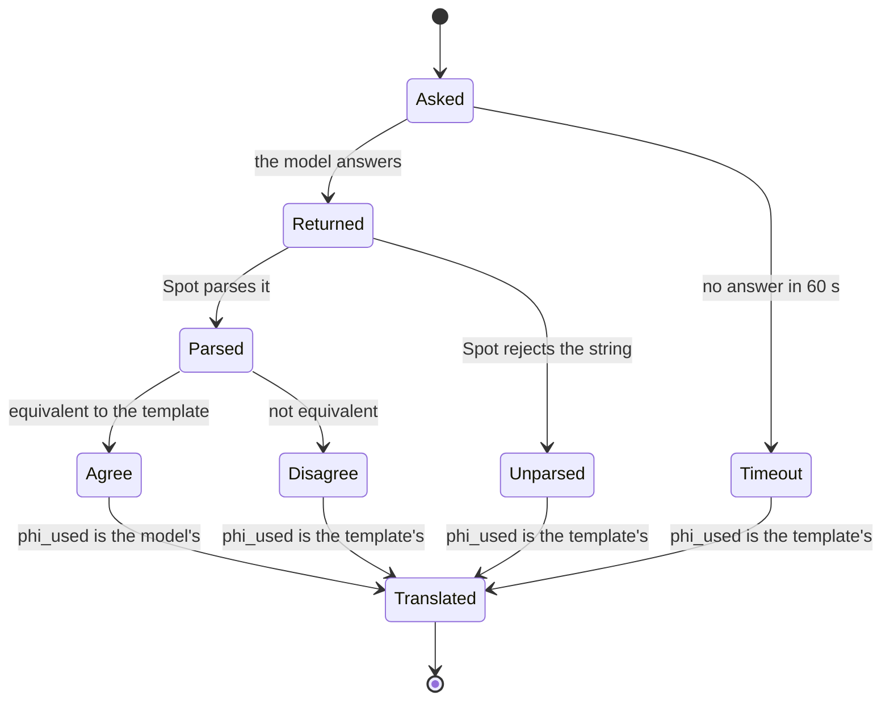
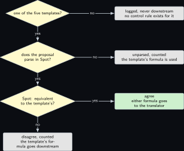

# Project 17. From a sentence to a Buchi automaton with Spot

> **Board:** Pi 4B with libspot; the build laptop serving the model over the bench LAN; the Renkforce cable on the Pi 4B console  
> **Language:** C++

> [!IMPORTANT]
> **The question, instanced**
>
> What can a verifier learn from a device without the device revealing itself, and what does it cost on this board? The verifier of this volume learns that a secret system satisfies a public formula $`\phi`$; before any proof, somebody has to write $`\phi`$ and build the automaton $`\mathcal{A}_{\neg\phi}`$ that is half of the certificate. This chapter lets a language model propose $`\phi`$ from an English sentence, lets Spot decide whether the proposal means what the sentence's template means, and builds the automaton on the Pi 4B; a wrong proposal costs agreement and never soundness, and the theorem that says so is proved.

> **Key facts**
>
> - **Board:** Raspberry Pi 4 Model B Rev 1.4 (8 GB, Raspberry Pi OS trixie, address \<pi4b\>)
> - **Parts:** the Pi 4B, build laptop (\<build-laptop\>) serving the model with `llama-server` on port 8080 through a portproxy, or the model on the Pi itself, the Renkforce USB/TTL cable on the Pi 4B's header pins 6, 8 and 10
> - **Interface:** ssh over the bench LAN; HTTP to the model on port 8080; the serial console at 115200
> - **Language and library:** C++17 against `libspot` \[[7](#references), [5](#references)\], whose release on Tuesday 3 November 2026 is 2.16.2, from the Debian packages `spot` and `libspot-dev` (the version trixie carries, to verify, and it is older than the upstream release); the model through `llama.cpp` \[[10](#references)\] with a GBNF grammar
> - **Primitive:** LTL to a nondeterministic Buchi automaton, the first half of the paper's certificate $`v_\phi = (\mathcal{A}_{\neg\phi}, V)`$ \[[1](#references)\]
> - **Secret:** none; $`\phi`$ and $`\mathcal{A}_{\neg\phi}`$ are public by the paper's design
> - **Public:** the formula, the automaton in HOA, and the agreement table between the model and the template rule
> - **Model:** LiquidAI/LFM3-1.7B in its official GGUF \[[9](#references), [8](#references)\] as the default; Qwen2.5-Coder-1.5B as the alternative; file sizes read from the model cards
> - **Acceptance:** for each of the five templates the program prints an HOA automaton for the negated formula, Spot reports the template's formula equivalent to a hand-written variant and not equivalent to a deliberately wrong one, and the Figure 2b automaton of the paper is reported equivalent to `FG Wait`; the agreement table over 100 prompts per model is filled or reads not measured
> - **Difficulty:** 3 of 5
> - **Effort:** one evening for Spot on the Pi and the program, one afternoon for the grammar and the model harness, one afternoon per model for the 100 prompts

## Pitch

The paper's certificate is public: a Buchi automaton for the complement of the specification, and a ranking function over the composed state space \[[1](#references)\]. Its Example 3.4 writes the property "the system does not wait forever" as $`\neg \mathrm{FG}\,\mathrm{Wait}`$ and draws the two-state automaton of its Figure 2b for the complement. Writing such a formula is the one step of the pipeline that a person does by hand, and it is the step where a language model is tempting and dangerous: tempting because the sentence is English, dangerous because a formula that reads well and means something else would be certified faithfully for the wrong property. So this chapter puts the model where the volume's rule puts it: it proposes, under a grammar that admits only LTL over the four propositions of the modem machine of [Project 3](03-the-modems-backoff-machine.md), and Spot decides, by the equivalence check that automata theory makes exact \[[3](#references)\], whether the proposal means what the template means. The formula that goes downstream is the template's unless Spot says the two are equivalent, which is why the theorem at the end of the mathematics section holds without any assumption about the model.

## Parts and interface

| **Part** | **Role** | **Interface** | **Address or pin** |
| --- | --- | --- | --- |
| Raspberry Pi 4 Model B | runs `libspot`, the program and the prompt harness; can also run the model with `llama-server` | ssh, HTTP client, the Renkforce cable | \<pi4b\>; header pins 6 (GND), 8 (GPIO14, TXD), 10 (GPIO15, RXD); Ethernet jack `eth0` |
| the build laptop, WSL side | serves the model on port 8080 with a Windows portproxy to WSL, as the sibling volume does; builds nothing for this chapter, the Pi compiles against the packages | bench LAN | \<build-laptop\>:8080 |
| Renkforce USB/TTL cable | the Pi 4B console | USB to the build laptop | cable GND to pin 6, cable RX to pin 8, cable TX to pin 10 |
| LFM3-1.7B GGUF, software | the default proposer, Q4\_K\_M file (size from the model card) \[[9](#references)\] | HTTP, `/completion` with a grammar | none |
| Qwen2.5-Coder-1.5B GGUF, software | the alternative proposer, from the sibling volume's ladder | same | none |

## The secret, the statement and the relation

Nothing is hidden in this chapter. The relation it builds is the one the certificate's first half must satisfy,

```math
\mathcal{R}_{\mathrm{cert}} = \{\, (\phi, \mathcal{A}) \;:\; \mathcal{L}_\mathcal{A} = \Sigma^\omega \setminus
  \mathcal{L}_\phi \,\},
```

*(17.1)*

with $`\Sigma = 2^\Pi`$ over the propositions $`\Pi = \{\mathrm{Closed}, \mathrm{Wait}, \mathrm{Registered}, \mathrm{Exhausted}\}`$ of the modem machine of [Project 3](03-the-modems-backoff-machine.md), which are the four modes of its state triple; the observation function of that machine sends a state to the singleton of its mode, so exactly one of the four holds at every index of every trace. The statement is public on both sides: $`\phi`$ is read by the verifier and $`\mathcal{A}`$ is checked by the verifier against it, which Spot's translator produces and its equivalence check confirms. The model's output $`\phi_m`$ enters only the second relation of the chapter,

```math
\mathcal{R}_{\mathrm{agree}} = \{\, (\phi_m, \phi_t) \;:\; \mathcal{L}_{\phi_m} = \mathcal{L}_{\phi_t} \,\},
```

*(17.2)*

which is decidable and which Spot decides.

## The mathematics

**Definition Z17.1 (Infinite words and LTL).** Let $`\Pi`$ be a finite set of atomic propositions and $`\Sigma = 2^\Pi`$. An infinite word is $`\sigma = \sigma_0 \sigma_1 \sigma_2 \cdots \in \Sigma^\omega`$ and $`\sigma[i..]`$ is the suffix $`\sigma_i \sigma_{i+1} \cdots`$. LTL formulas over $`\Pi`$ are built by $`\phi ::= p \mid \neg\phi \mid \phi \wedge \phi \mid \mathrm{X}\phi \mid \phi\,\mathrm{U}\,\phi`$ with $`p \in \Pi`$, and the derived operators $`\mathrm{F}\phi = \mathrm{true}\,\mathrm{U}\,\phi`$ and $`\mathrm{G}\phi = \neg\mathrm{F}\neg\phi`$ \[[2](#references)\]. Satisfaction $`\sigma \models \phi`$ is defined by

```math
\begin{aligned}
\sigma \models p &\iff p \in \sigma_0, \qquad
  \sigma \models \neg\phi \iff \sigma \not\models \phi, \qquad
  \sigma \models \phi \wedge \psi \iff \sigma \models \phi \text{ and } \sigma \models \psi, \\
  \sigma \models \mathrm{X}\phi &\iff \sigma[1..] \models \phi, \\
  \sigma \models \phi\,\mathrm{U}\,\psi &\iff \exists j \ge 0 .\; \sigma[j..] \models \psi
    \text{ and } \forall i < j .\; \sigma[i..] \models \phi .
\end{aligned}
```

Unfolding the derived operators, $`\sigma \models \mathrm{F}\phi`$ iff $`\exists j .\; \sigma[j..] \models \phi`$, and $`\sigma \models \mathrm{G}\phi`$ iff $`\forall j .\; \sigma[j..] \models \phi`$. The language of $`\phi`$ is $`\mathcal{L}_\phi = \{\, \sigma \in \Sigma^\omega : \sigma \models \phi \,\}`$.

**Definition Z17.2 (Nondeterministic Buchi automaton).** $`\mathcal{A} = (Q, Q_0, \delta, F)`$ with $`Q`$ finite, $`Q_0 \subseteq Q`$, $`\delta \subseteq Q \times \Sigma \times Q`$ and fair transitions $`F \subseteq \delta`$, as the paper defines it \[[1](#references)\]. A run on $`\sigma`$ is $`(q_i)_{i \in \mathbb{N}}`$ with $`q_0 \in Q_0`$ and $`(q_i, \sigma_i, q_{i+1}) \in \delta`$ for all $`i`$; it is accepting if $`\{\, i : (q_i, \sigma_i, q_{i+1}) \in F \,\}`$ is infinite; $`\mathcal{L}_\mathcal{A}`$ is the set of words with an accepting run.

**Theorem Z17.3 (Set algebra of model checking).** For every LTL formula $`\phi`$ and every language $`\mathcal{L}_\mathcal{M} \subseteq \Sigma^\omega`$: (a) $`\mathcal{L}_{\neg\phi} = \Sigma^\omega \setminus \mathcal{L}_\phi`$; (b) $`\mathcal{L}_\mathcal{M} \subseteq \mathcal{L}_\phi`$ if and only if $`\mathcal{L}_\mathcal{M} \cap \mathcal{L}_{\neg\phi} = \emptyset`$.

*Proof.* (a) By **Definition Z17.1**, $`\sigma \models \neg\phi`$ iff $`\sigma \not\models \phi`$, so $`\sigma \in \mathcal{L}_{\neg\phi}`$ iff $`\sigma \notin \mathcal{L}_\phi`$ iff $`\sigma \in \Sigma^\omega \setminus \mathcal{L}_\phi`$. (b) Write $`A = \mathcal{L}_\mathcal{M}`$ and $`B = \mathcal{L}_\phi`$; by (a) the claim is $`A \subseteq B`$ iff $`A \cap (\Sigma^\omega \setminus B) = \emptyset`$. If $`A \subseteq B`$ and $`\sigma \in A \cap (\Sigma^\omega \setminus B)`$, then $`\sigma \in A \subseteq B`$ and $`\sigma \notin B`$, a contradiction, so the intersection is empty. Conversely, if the intersection is empty and $`\sigma \in A`$, then $`\sigma \notin \Sigma^\omega \setminus B`$, so $`\sigma \in B`$; hence $`A \subseteq B`$. &#9632;

**Theorem Z17.4 (Vardi and Wolper, stated).** For every LTL formula $`\phi`$ there is a nondeterministic Buchi automaton $`\mathcal{A}_\phi`$ with $`\mathcal{L}_{\mathcal{A}_\phi} = \mathcal{L}_\phi`$ and at most $`2^{O(|\phi|)}`$ states; consequently $`\mathcal{L}_\mathcal{M} \subseteq \mathcal{L}_\phi`$ is decided by checking $`\mathcal{L}_\mathcal{M} \cap \mathcal{L}_{\mathcal{A}_{\neg\phi}} = \emptyset`$, and the equivalence of two formulas is decided by two such emptiness checks \[[3](#references), [4](#references)\].

The theorem is not proved here; it is what Spot implements, and its translator and its equivalence check are the two calls the code makes \[[5](#references)\]. What is proved is the one automaton the paper draws.

**Lemma Z17.5 (The automaton of the paper's Figure 2b).** Let $`\mathcal{A}`$ have $`Q = \{q_0, q_1\}`$, $`Q_0 = \{q_0\}`$,

```math
\delta = \{\, (q_0, a, q_0) : a \in \Sigma \,\} \cup \{\, (q_0, a, q_1) : \mathrm{Wait} \in a \,\}
  \cup \{\, (q_1, a, q_1) : \mathrm{Wait} \in a \,\}, \qquad
  F = \{\, (q_1, a, q_1) : \mathrm{Wait} \in a \,\}.
```

Then $`\mathcal{L}_\mathcal{A} = \{\, \sigma \in \Sigma^\omega : \{ i : \mathrm{Wait} \notin \sigma_i \} \text{ is finite} \,\} = \mathcal{L}_{\mathrm{FG}\,\mathrm{Wait}}`$.

*Proof.* First the second equality. $`\sigma \models \mathrm{FG}\,\mathrm{Wait}`$ iff there is $`j`$ with $`\sigma[j..] \models \mathrm{G}\,\mathrm{Wait}`$ iff there is $`j`$ such that for all $`i \ge j`$, $`\mathrm{Wait} \in \sigma_i`$, iff the set $`\{ i : \mathrm{Wait} \notin \sigma_i \}`$ is contained in $`\{0, \ldots, j - 1\}`$ for some $`j`$, iff that set is finite.

Now $`\mathcal{L}_\mathcal{A} \subseteq \mathcal{L}_{\mathrm{FG}\,\mathrm{Wait}}`$. Let $`(q_i)`$ be an accepting run on $`\sigma`$. Fair transitions are the self-loops on $`q_1`$ only, so the run visits $`q_1`$ at some index $`i_0`$. The only transitions leaving $`q_1`$ are those self-loops, each requiring $`\mathrm{Wait} \in \sigma_i`$; so for every $`i \ge i_0`$, $`q_i = q_1`$ by induction on $`i`$ (the run is in $`q_1`$ at $`i_0`$, and from $`q_1`$ it can only go to $`q_1`$), and the transition taken at $`i`$ is $`(q_1, \sigma_i, q_1) \in \delta`$, which forces $`\mathrm{Wait} \in \sigma_i`$. Hence $`\{ i : \mathrm{Wait} \notin \sigma_i \} \subseteq \{0, \ldots, i_0 - 1\}`$ is finite.

Conversely, let $`\mathrm{Wait} \in \sigma_i`$ for all $`i \ge j`$. Define $`q_i = q_0`$ for $`i \le j`$ and $`q_i = q_1`$ for $`i > j`$. This is a run: $`q_0 \in Q_0`$; for $`i < j`$ the transition $`(q_0, \sigma_i, q_0)`$ is in $`\delta`$ for every letter; at $`i = j`$ the transition $`(q_0, \sigma_j, q_1)`$ is in $`\delta`$ because $`\mathrm{Wait} \in \sigma_j`$; for $`i > j`$ the transition $`(q_1, \sigma_i, q_1)`$ is in $`\delta`$ because $`\mathrm{Wait} \in \sigma_i`$. Every transition at $`i > j`$ is in $`F`$, so infinitely many fair transitions are taken and the run is accepting. Hence $`\sigma \in \mathcal{L}_\mathcal{A}`$. &#9632;

**Theorem Z17.6 (A wrong proposal cannot cost soundness).** Let $`\phi_t`$ be the template's formula for a sentence, let $`\phi_m`$ be any formula the grammar admits, and let the decision rule be: $`\phi_{\mathrm{used}} = \phi_m`$ if Spot's equivalence check reports $`\mathcal{L}_{\phi_m} = \mathcal{L}_{\phi_t}`$, and $`\phi_{\mathrm{used}} = \phi_t`$ otherwise. Assume two things. First, the equivalence check is correct: it reports equivalence exactly when the two languages are equal. Second, the translator is sound for the certificate, that is, for every formula $`\psi`$ it is given, the automaton it returns satisfies $`\mathcal{L}_{\mathcal{A}_{\neg\psi}} \supseteq \Sigma^\omega \setminus \mathcal{L}_{\psi}`$. The reverse inclusion $`\mathcal{L}_{\mathcal{A}_{\neg\psi}} \subseteq \Sigma^\omega \setminus \mathcal{L}_{\psi}`$ is not needed for the conclusion below; a translator that returns too large a language costs only completeness, because it makes the emptiness check harder to satisfy, while a translator that returns too small a language costs soundness, because a system whose traces all violate $`\psi`$ in a way the automaton misses would still pass. Then $`\mathcal{L}_{\phi_{\mathrm{used}}} = \mathcal{L}_{\phi_t}`$, and if the certifier accepts a certificate $`(\mathcal{A}_{\neg\phi_{\mathrm{used}}}, V)`$ for a system $`\mathcal{M}`$, then $`\mathcal{M} \models \phi_t`$. A proposal that is not equivalent changes only the agreement count, never the property that is certified.

*Proof.* Two cases. If the check reports equivalence, then by its correctness $`\mathcal{L}_{\phi_m} = \mathcal{L}_{\phi_t}`$, and $`\phi_{\mathrm{used}} = \phi_m`$, so $`\mathcal{L}_{\phi_{\mathrm{used}}} = \mathcal{L}_{\phi_t}`$. Otherwise $`\phi_{\mathrm{used}} = \phi_t`$ and the equality is trivial. In both cases, by **Theorem Z17.3**(a), $`\mathcal{L}_{\neg\phi_{\mathrm{used}}} = \Sigma^\omega \setminus \mathcal{L}_{\phi_{\mathrm{used}}} = \Sigma^\omega \setminus \mathcal{L}_{\phi_t}`$. By the second hypothesis of the theorem, the translator is correct in the direction soundness uses, that is $`\mathcal{L}_{\mathcal{A}_{\neg\phi_{\mathrm{used}}}} \supseteq \mathcal{L}_{\neg\phi_{\mathrm{used}}}`$. **Theorem Z17.4** is an existence statement and does not by itself say that the automaton this program printed has that language; the assumption is named so that a reader knows which component the chain of soundness rests on. The certifier's acceptance of $`(\mathcal{A}_{\neg\phi_{\mathrm{used}}}, V)`$ is exactly the hypothesis of the paper's Theorem 3.2, proved in [Project 3](03-the-modems-backoff-machine.md) and stated for a machine in [Project 14](14-theorem-3-2-in-lean-4.md), whose conclusion is $`\mathcal{L}_\mathcal{M} \cap \mathcal{L}_{\mathcal{A}_{\neg\phi_{\mathrm{used}}}} = \emptyset`$. The containment just named gives $`\Sigma^\omega \setminus \mathcal{L}_{\phi_t} = \mathcal{L}_{\neg\phi_{\mathrm{used}}} \subseteq \mathcal{L}_{\mathcal{A}_{\neg\phi_{\mathrm{used}}}}`$, so emptiness of the larger intersection carries to $`\mathcal{L}_\mathcal{M} \cap (\Sigma^\omega \setminus \mathcal{L}_{\phi_t}) = \emptyset`$, which is the only direction the conclusion needs. By **Theorem Z17.3**(b) this is $`\mathcal{L}_\mathcal{M} \subseteq \mathcal{L}_{\phi_t}`$, which is $`\mathcal{M} \models \phi_t`$. The model's output entered only through the check; a non-equivalent $`\phi_m`$ left $`\phi_{\mathrm{used}} = \phi_t`$ and incremented the disagreement count. &#9632;

## The protocol

1. The harness on the Pi 4B sends one sentence at a time to `llama-server` with the grammar below and temperature 0; it writes the returned string, one per line, in the order of the templates.
2. The program parses each line with Spot; a line that does not parse is counted as unparsed and the template's formula is used.
3. For a line that parses, Spot's equivalence check decides $`\mathcal{L}_{\phi_m} = \mathcal{L}_{\phi_t}`$; agree or disagree is counted, and $`\phi_{\mathrm{used}}`$ follows the rule of **Theorem Z17.6**.
4. The translator builds $`\mathcal{A}_{\neg\phi_{\mathrm{used}}}`$ as a transition-based Buchi automaton and prints it in HOA with its state and edge counts; that file is the first half of the certificate handed to [Project 3](03-the-modems-backoff-machine.md).
5. The run is repeated for 100 prompts per model, 20 per template with five rewordings each, and the $`2 \times 2`$ table of agree and disagree against the template rule is filled, or reads not measured.

## The code

The names `spot::parse_formula`, `spot::parse_infix_psl`, `spot::translator`, `spot::postprocessor::Buchi`, `spot::are_equivalent`, `spot::print_hoa` and the `num_states` and `num_edges` accessors are read from the headers of Spot 2.16.2 \[[7](#references)\] (to verify, because the Debian package is older); the transition-based output type is chosen because the paper's automata carry fairness on transitions.

```cpp
// z17.cc: five sentence templates, their LTL formulas, the model's proposals, Spot's verdict.
#include <spot/tl/parse.hh>
#include <spot/tl/formula.hh>
#include <spot/twaalgos/translate.hh>
#include <spot/twaalgos/hoa.hh>
#include <spot/twaalgos/contains.hh>
#include <cstdio>
#include <fstream>
#include <iostream>
#include <string>
#include <vector>

struct Template { const char* sentence; const char* formula; };
static const std::vector<Template> kTemplates = {
  {"The system does not wait forever.", "!FG Wait"},
  {"Once registered, the connection stays registered.", "G(Registered -> G Registered)"},
  {"The system eventually leaves the closed state.", "F !Closed"},
  {"Every wait is eventually followed by registered or exhausted.",
   "G(Wait -> F(Registered | Exhausted))"},
  {"The system is never both registered and exhausted.", "G !(Registered & Exhausted)"},
};

// The automaton for the negated property: the certificate's first half, transition-based.
static spot::twa_graph_ptr negated_automaton(spot::formula phi) {
  spot::translator trans;
  trans.set_type(spot::postprocessor::Buchi);                  // (to verify)
  trans.set_pref(spot::postprocessor::Small);
  return trans.run(spot::formula::Not(phi));
}

int main(int argc, char** argv) {
  // argv[1]: one proposed formula per line, in template order, written by the harness
  // that asked the model under the GBNF grammar; absent file: templates only.
  std::ifstream proposals(argc > 1 ? argv[1] : "/dev/null");
  int agree = 0, disagree = 0, unparsed = 0;
  for (size_t i = 0; i < kTemplates.size(); ++i) {
    spot::formula phi_t = spot::parse_formula(kTemplates[i].formula);
    spot::formula phi_used = phi_t;                 // the template's, unless equivalent
    const char* verdict = "template";
    std::string line;
    if (std::getline(proposals, line)) {
      spot::parsed_formula pf = spot::parse_infix_psl(line);
      if (pf.format_errors(std::cerr)) {
        ++unparsed; verdict = "unparsed";
      } else if (spot::are_equivalent(pf.f, phi_t)) {   // decided, never assumed
        ++agree; phi_used = pf.f; verdict = "agree";
      } else {
        ++disagree; verdict = "disagree";
      }
    }
    spot::twa_graph_ptr aut = negated_automaton(phi_used);
    std::printf("zk17 template=%zu states=%u edges=%u model=%s\n", i + 1,
                aut->num_states(), aut->num_edges(), verdict);
    spot::print_hoa(std::cout, aut) << '\n';
  }
  std::printf("zk17 agree=%d disagree=%d unparsed=%d\n", agree, disagree, unparsed);
  return 0;
}
```

```bash
# the board over ssh: Spot from the Debian packages, the program built on the Pi itself
sudo apt install spot libspot-dev                   # availability on trixie to verify
g++ -std=c++17 -O2 z17.cc -lspot -lbddx -o zk17     # link line to verify against the package
./zk17 proposals.txt | tee z17_run.log
```

The Figure 2b check of the acceptance test is a sixth call: the lemma's automaton is written by hand in HOA, parsed with `spot::parse_aut` (to verify), and compared with the translation of `FG Wait` by `spot::are_equivalent` on two automata; the lemma says the answer, and the run says whether Spot agrees with the lemma.

## The model, if any

The default proposer is LiquidAI/LFM3-1.7B in its official GGUF \[[9](#references)\], the first entry of the trending list read on Friday 6 November 2026 \[[8](#references)\], at the Q4\_K\_M quantisation whose file size is read from the model card; the alternative is Qwen2.5-Coder-1.5B from the sibling volume's ladder, chosen because the task is a formal syntax and a code-tuned model is the natural comparison. Either runs under `llama-server` \[[10](#references)\] on the build laptop over the bench LAN, or on the Pi 4B itself, whose 8 GB hold a 1.7 B model at four bits with room. The prompt is the sentence, the four proposition names, and one example; the output is constrained by this grammar, every rule on one line:

```gbnf
root ::= ws f ws
f ::= atom | "(" ws f ws bin ws f ws ")" | un ws f
bin ::= "&" | "|" | "->" | "U" | "R" | "W"
un ::= "!" | "X" | "F" | "G"
atom ::= "Wait" | "Closed" | "Registered" | "Exhausted" | "true" | "false"
ws ::= [ \t]*
```

The grammar admits only LTL over the four propositions with binary operators in parentheses, so every output parses in Spot or is a grammar fault, and a model cannot return the sentence, an explanation, or a proposition the machine does not have. The operator set is wider than the syntax of **Definition Z17.1**, which builds formulas from negation, conjunction, $`\mathrm{X}`$ and $`\mathrm{U}`$ alone: disjunction, implication, $`\mathrm{F}`$, $`\mathrm{G}`$, the release $`\mathrm{R}`$ and the weak until $`\mathrm{W}`$ are all definable from those, and Spot reads them, so the grammar is a superset of the definition's notation and not of its logic. The control rule is the table of five templates; the model's formula is accepted iff Spot says it is equivalent to the template's, which is **Theorem Z17.6**.

| **No.** | **Sentence template** | **Template formula $`\phi_t`$** | **An equivalent form Spot accepts** |
| --- | --- | --- | --- |
| 1 | The system does not wait forever. | `!FG Wait` | `GF !Wait` |
| 2 | Once registered, the connection stays registered. | `G(Registered -> G Registered)` | `G(!Registered \| G Registered)` |
| 3 | The system eventually leaves the closed state. | `F !Closed` | `!G Closed` |
| 4 | Every wait is eventually followed by registered or exhausted. | `G(Wait -> F(Registered \| Exhausted))` | `G(!Wait \| F Registered \| F Exhausted)` |
| 5 | The system is never both registered and exhausted. | `G !(Registered & Exhausted)` | `G(!Registered \| !Exhausted)` |

Two remarks about the templates belong beside them. The fifth, mutual exclusion of the two terminal modes, is valid on every trace of this machine for a reason that has nothing to do with the machine's transitions: the observation function of [Project 3](03-the-modems-backoff-machine.md) sends a state to the singleton of its mode, so no letter of any trace contains two propositions and the formula is true of every word in $`\Sigma^\omega`$. Its negation automaton has an empty language, the emptiness check is trivial, and the constant $`V = 0`$ certifies it; the template is in the set to exercise the equivalence check and not because its certificate says anything. The other four are genuine, and of them only the first has a ranking function anywhere in this volume, namely the one of [Project 3](03-the-modems-backoff-machine.md) for $`\neg\,\mathrm{FG}\,\mathsf{Wait}`$. Step 4 of the protocol therefore hands [Project 3](03-the-modems-backoff-machine.md) an automaton for whichever template was used, and for four of the five the second half of the certificate, the ranking function, is still owed; [Project 16](16-the-model-proposes-a-ranking-function-the-certifier.md) proposes ranking functions only for the first.

| **Model** | **agree** | **disagree** | **unparsed** | **Instrument** |
| --- | --- | --- | --- | --- |
| LFM3-1.7B, Q4\_K\_M | not measured | not measured | not measured | `zk17` counts over 100 prompts, 20 per template |
| Qwen2.5-Coder-1.5B | not measured | not measured | not measured | same |
| template rule alone | 100 | 0 | 0 | by construction; the constant baseline every rate is read against |

The last row is the baseline that makes a rate readable: a model that returned the template verbatim would score 100 agreements, so an agreement count is reported beside the number of rewordings that are not the template's own sentence, and never alone.

## Real, modelled, absent

- **have:** real: the Pi 4B, build laptop with the portproxy route the sibling volume proved, the paper's Example 3.4 and Figure 2b read on Friday 6 November 2026, the five templates, the lemma and the theorem above
- **learn:** modelled: every bar in the benchmark figure is an expected order of magnitude for a translation, an equivalence check and a model round trip, drawn dashed; Spot's version on trixie, the `Buchi` output type, the link line and the `parse_aut` name are to verify; the model's file sizes are to be read from the model cards
- **absent:** absent: the agreement table, not measured until the 100 prompts have run; any sentence outside the five templates, for which no control rule exists and whose formula therefore never goes downstream; the ranking function $`V`$, which is [Project 16](16-the-model-proposes-a-ranking-function-the-certifier.md)'s half of the certificate

## System architecture



*Figure 17.1. The model proposes and Spot decides. Along the top, the English sentence in the grey public style, the language model block with the yellow outline and its grammar, and the proposed formula in grey; a dashed layer around the model block names the two places it may run, build laptop on port 8080 or the Pi itself. In the middle row, the control-rule block with the green rule outline holding the five templates, and to its right the equivalence check with the verifier's green outline, fed by the proposal from above and by the template from the left, writing the agreement table in grey to its right. Along the bottom, the translator as a user-space block fed by the formula that the check lets through, producing the automaton of the negated formula in grey, which goes to the certifier of project Z3 drawn with the prover's yellow outline.*

Read the figure as two paths that meet at one diamond-shaped decision drawn as a block: the model's path ends at the check, and only the template's path, or a proposal the check has made equal to it, continues to the translator.

## Wiring



*Figure 17.2. The Pi 4B and the build laptop over the bench LAN. On the left the Pi 4 Model B as a solid hardware block with its three console pins called out, pin 6 GND, pin 8 GPIO14 TXD and pin 10 GPIO15 RXD, and its Ethernet jack; in the middle the Renkforce USB/TTL cable with its three leads on three horizontal runs; on the right the build laptop as a solid grey block holding the cable's USB end, the ssh session and llama-server on port 8080 behind the portproxy. Below, a double-headed bus line for the bench LAN, and a dashed arrow along it for the HTTP route to port 8080 that is a software stand-in when the model runs on the Pi itself.*

| **Signal** | **From** | **To** | **Note** |
| --- | --- | --- | --- |
| console GND | Pi 4B header pin 6 | cable GND lead | common reference; connect it first |
| console TXD | Pi 4B header pin 8, GPIO14 | cable RX lead | 115200, 8N1; `enable_uart=1` in `config.txt` |
| console RXD | Pi 4B header pin 10, GPIO15 | cable TX lead | 3.3 V logic on the cable side, read from its label before it is plugged (to verify) |
| bench LAN | Pi 4B Ethernet jack, `eth0`, \<pi4b\> | build laptop \<build-laptop\> | ssh, and HTTP to port 8080 when the model is served from the build laptop; the Windows portproxy to WSL is the sibling volume's recipe |
| USB | cable | build laptop | the console reader |

## Sequence and states

```mermaid
sequenceDiagram
  participant H as harness on the Pi 4B
  participant M as llama-server, port 8080
  participant Z as zk17 with libspot
  loop five templates, twenty prompts each
    H->>M: sentence, grammar, temperature 0
    M-->>H: one formula string
  end
  H->>Z: proposals.txt, one line per template
  Z->>Z: parse; unparsed counted, template kept
  Z->>Z: are_equivalent(phi_m, phi_t)
  Z->>Z: translate not phi_used, print HOA
  Z-->>H: zk17 lines: states, edges, verdict
  Z-->>H: zk17 agree, disagree, unparsed
```



## Decision tree



*Figure 17.3. What happens to a sentence. The root diamond asks whether the sentence is one of the five templates; no leads to a grey leaf, the model's formula is logged and never goes downstream because no control rule exists. Yes leads to a second diamond asking whether the grammar-bound proposal parses in Spot; no leads to a grey leaf, unparsed is counted and the template's formula is used. Yes leads to a third diamond asking whether Spot says the proposal is equivalent to the template's formula; yes leads to the agree leaf, either formula goes to the translator, no leads to a grey leaf, disagree is counted and the template's formula goes downstream.*

## Benchmark


*Figure 17.4. Expected wall time per template, log scale in milliseconds, drawn as dashed bars because none has been measured on this bench; from left to right the five templates, each with three bars for the translation of the negated formula on the Pi 4B, the equivalence check on the Pi 4B, and the model's round trip for one proposal over the LAN. A solid bar replaces a dashed one when the run has happened and the caption of the replacing figure names the record.*

| **No.** | **states of $`\mathcal{A}_{\neg\phi_t}`$** | **translate, Pi 4B** | **equivalent, Pi 4B** | **model round trip** | **Instrument** |
| --- | --- | --- | --- | --- | --- |
| 1 | not measured; the lemma's automaton has 2 | not measured | not measured | not measured | `zk17` line; `steady_clock` around each call; the harness's HTTP timer |
| 2 | not measured | not measured | not measured | not measured | same |
| 3 | not measured | not measured | not measured | not measured | same |
| 4 | not measured | not measured | not measured | not measured | same |
| 5 | not measured | not measured | not measured | not measured | same |

The state counts are Spot's output and are reported as computed facts once the program has run; the lemma fixes the language of template 1's automaton and not its size, because Spot may return a different automaton of the same language. The only measured number this chapter can quote is the paper's: its explicit-state pipeline enumerated and proved `exb_i4a3` in 2 s on its AWS `c6g.8xlarge` \[[1](#references)\], with the automaton of Figure 2b as the certificate's first half.

## Steps

**Step 1.** On the authoring laptop, write `z17.cc`, the grammar file and the five templates; commit.

**Step 2.** On the Pi 4B over ssh, install `spot` and `libspot-dev`, read the version with `ltl2tgba --version`, build `zk17`, and run it with no proposals file: five HOA automata and five template verdicts.

**Step 3.** On the Pi 4B, run the hand-written Figure 2b automaton against `FG Wait` and the five equivalent and five wrong variants of the control table; every answer must match the table.

**Step 4.** On the build laptop, start `llama-server` with the LFM3-1.7B GGUF on port 8080 and the portproxy; from the Pi, one `curl` with the grammar must return a formula.

**Step 5.** On the Pi 4B, run the harness for 100 prompts, then `zk17` on the proposals; fill the agreement table for LFM3-1.7B.

**Step 6.** Repeat with Qwen2.5-Coder-1.5B; fill its row.

**Step 7.** On the Pi 4B, time each translator and equivalence call with `steady_clock`, read `vcgencmd get_throttled` before and after.

## Acceptance test

The chapter passes when `zk17` prints five HOA automata whose formulas are the templates’ negations, Spot reports each template's formula equivalent to its listed variant and not equivalent to a wrong variant (template 1 against `FG Wait` itself, template 5 against `G(Registered & Exhausted)`), the hand-written Figure 2b automaton is reported equivalent to `FG Wait`, and the agreement table holds 100 counted prompts per model with agree plus disagree plus unparsed equal to 100. It fails if any wrong variant is reported equivalent, if any proposal that disagreed reached the translator, or if a cell is filled with a number taken from another machine.

## Variants

**The automaton evaluated against a live point cloud.** Spot still builds $`\mathcal{A}_{\neg\phi}`$ on the Pi 4B \[[7](#references)\], but instead of stopping at the HOA file the pipeline hands the automaton to a Julia program that steps it while a navigation routine runs, against a point cloud read from the X-NUCLEO-53L8A1's 8 by 8 time-of-flight array, and the property checked is the deadlock state of the brief's fifteenth sketch \[[6](#references)\] rather than the modem machine's waiting state. The observation at each frame is the evaluation of the atoms over 64 zone distances, so one frame of 16-bit distances is 128 bytes and a window of 1000 frames is 128 kilobytes held for the run (computed from the zone count and the sample width), and that window is what the automaton's acceptance has to be decided over. The cost sits in the sensor rather than in the mathematics: the 8 by 8 part's ultra lite driver is licence gated and reaches the device as a 90 kilobyte firmware upload, so the part is marked learn with that cost and no frame rate is stated as achieved here, the brief's 60 Hz included. What does not change is the decision procedure: Spot's equivalence check still decides whether a proposed formula means the template's formula, so the chapter's theorem carries over with no new hypothesis about the Julia side. Choose this variant when the question is whether a running routine ever enters the deadlock state, and keep the chapter's own route when the automaton in HOA is itself the deliverable. The brief drives the same part over SPI at 20 MHz and reports the result to a swarm control server; on this bench the part reaches the Pi's I2C bus on flying leads because the three X-NUCLEO shields fit one at a time, and nothing in this volume goes outward, so the verifier is a second process on the Pi 4B.

## Pitfalls

- A grammar that pins only a character class admits the instruction and a constant; this one pins the operator set and the four propositions, so a proposal that is not LTL is a grammar fault, and a constant proposal shows as 20 identical lines per template.
- Spot's equivalence check is exact for LTL and exponential in the worst case; the five templates are small, and a proposal with many nested operators may take seconds on the Pi, which is a cell, not a surprise.
- `!FG Wait` and `!F G Wait` parse the same; `!FGWait` parses as the negation of `F` of `GWait`, a proposition the machine does not have; the grammar's whitespace rule and the atom list are what prevent it.
- A transition-based automaton and a state-based one of the same language differ in size; the `states` cell names the output type beside the number.
- The agreement rate is read beside the constant baseline row, as the sibling volume learned: a rate without its constant on the same prompts is the prompt mix, not the model.

## Languages and libraries not chosen

- Python with Spot's own bindings: the same library, one import, and the natural harness language; the volume's rule is that logic that could run on a board is not Python, so the harness that talks HTTP may be Python and the decision is C++.
- Rust: no mature LTL-to-automaton crate with an exact equivalence check that this volume cites; Spot is the reference implementation \[[5](#references)\].
- A hand-written tableau construction in C: possible, and the proof of **Theorem Z17.4** would then be owed; the chapter cites it instead and proves the one automaton it needs.
- Lean 4, as in [Project 14](14-theorem-3-2-in-lean-4.md): a verified translator is a research project, not an afternoon.

## Sources

- [arxiv.org/abs/2605.00487](https://arxiv.org/abs/2605.00487) (verified Friday 6 November 2026), the paper, Example 3.4 and Figure 2b.
- [doi:10.1007/978-3-031-13188-2\_9](https://doi.org/10.1007/978-3-031-13188-2_9) (to verify), Spot 2.0 to 2.10.
- [huggingface.co/models, trending](https://huggingface.co/models?pipeline_tag=text-generationsort=trending) (verified Friday 6 November 2026), the list the default model is taken from.
- [huggingface.co/LiquidAI/LFM3-1.7B-GGUF](https://huggingface.co/LiquidAI/LFM3-1.7B-GGUF) (to verify), the model card the file size is read from.
- [github.com/ggml-org/llama.cpp/releases](https://github.com/ggml-org/llama.cpp/releases) (to verify), llama-server.

<a id="references"></a>

## References

1. Pascal Berrang, Mirco Giacobbe, Jacob Swales and Xiao Yang. Zero-Knowledge Model Checking. arXiv:2605.00487v2 \[cs.CR\], version 1 submitted Friday 1 May 2026, version 2 Tuesday 8 September 2026. [arxiv.org/abs/2605.00487](https://arxiv.org/abs/2605.00487) (verified Friday 6 November 2026).
2. Amir Pnueli. The temporal logic of programs. In FOCS 1977, pages 46 to 57. IEEE Computer Society, 1977. [doi:10.1109/SFCS.1977.32](https://doi.org/10.1109/SFCS.1977.32) (to verify).
3. Moshe Y. Vardi and Pierre Wolper. An automata-theoretic approach to automatic program verification (preliminary report). In LICS 1986, pages 332 to 344. IEEE Computer Society, 1986. (to verify)
4. Moshe Y. Vardi. Verification of concurrent programs: the automata-theoretic framework. Annals of Pure and Applied Logic, 51(1 to 2), pages 79 to 98, 1991. [doi:10.1016/0168-0072(91)90066-U](https://doi.org/10.1016/0168-0072(91)90066-U) (to verify).
5. Alexandre Duret-Lutz, Etienne Renault, Maximilien Colange, Florian Renkin, Alexandre Gbaguidi Aisse, Philipp Schlehuber-Caissier, Thomas Medioni, Antoine Martin, Jerome Dubois, Clement Gillard and Henrich Lauko. From Spot 2.0 to Spot 2.10: what's new? In CAV 2022, LNCS 13372, pages 174 to 187. Springer, 2022. [doi:10.1007/978-3-031-13188-2\_9](https://doi.org/10.1007/978-3-031-13188-2_9) (to verify).
6. Advanced hardware-software architectures for edge artificial intelligence and zero-knowledge model checking. A design brief of twenty project sketches, read on Friday 6 November 2026 and held locally at `a local design brief`. It is the input to this second edition and is not a published source; where its hardware claims disagree with the bench, the bench is followed and the disagreement is stated.
7. Spot contributors. Spot: a C++20 library for LTL, omega-automata manipulation and model checking. Version 2.16.2, released Tuesday 3 November 2026, GNU GPL version 3. [spot.lre.epita.fr](https://spot.lre.epita.fr/) (verified Friday 6 November 2026).
8. Hugging Face, trending text-generation models, read on the day: LiquidAI/LFM3-1.7B and its official GGUF, Qwen3.5-4B derivatives, NVIDIA Nemotron-3.5-Bolt-E4B-4GB, prism-ml Ternary-Bonsai-2-27B GGUF, XHToken Spark-X2.6-4B, and the DeepSeek-V4.1-Flash GGUF quantisations. [huggingface.co/models, trending](https://huggingface.co/models?pipeline_tag=text-generationsort=trending) (verified Friday 6 November 2026).
9. Liquid AI. LFM3-1.7B-GGUF, the official llama.cpp quantisations of LFM3-1.7B. [huggingface.co/LiquidAI/LFM3-1.7B-GGUF](https://huggingface.co/LiquidAI/LFM3-1.7B-GGUF) (to verify).
10. ggml-org. llama.cpp, release v0.6.0 at commit d8123504, the pin of the sibling EdgeLLM volume. [github.com/ggml-org/llama.cpp/releases](https://github.com/ggml-org/llama.cpp/releases) (to verify).

---

[Previous](16-the-model-proposes-a-ranking-function-the-certifier.md) &nbsp;&nbsp;|&nbsp;&nbsp; [Contents](../CONTENTS.md) &nbsp;&nbsp;|&nbsp;&nbsp; [Next](18-a-proof-over-the-wire.md)
