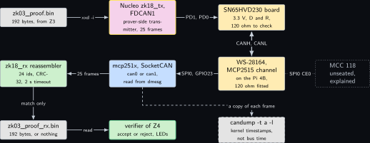
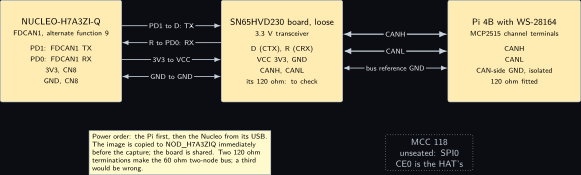
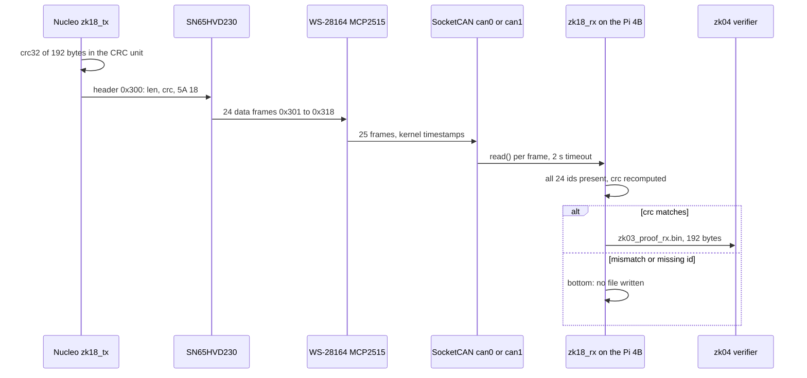
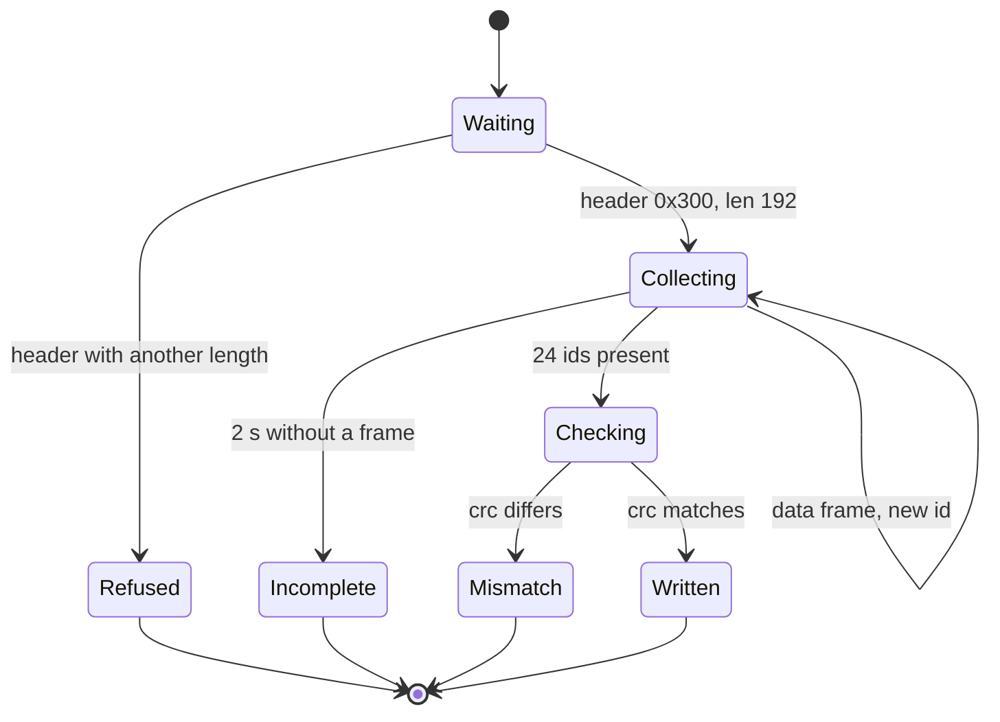
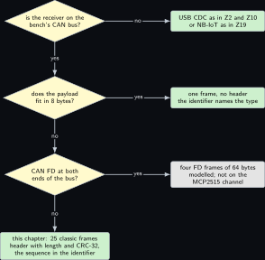

# Project 18. A proof over the wire: KZG elements in CAN frames

> **Board:** Pi 4B with the WS-28164 HAT (MCP2515 side) as the verifier; NUCLEO-H7A3ZI-Q FDCAN1 on PD0 and PD1 through the loose SN65HVD230 board as the prover-side transmitter  
> **Language:** C

> [!IMPORTANT]
> **The question, instanced**
>
> What can a verifier learn from a device without the device revealing itself, and what does it cost on this board? Here the question is narrowed to the wire: the 192 bytes that [Project 3](03-the-modems-backoff-machine.md) produced and [Project 4](04-two-group-elements.md) checks have to cross a classic CAN bus from a microcontroller to the verifier, eight bytes at a time. What the verifier learns is only what the bytes already say; what it costs is 25 frames, between 5.55 and 6.75 ms of bus time at 500 kbit/s (computed), and a CRC-32 that tells a damaged payload from an intact one but cannot tell a stranger's payload from the prover's.

> **Key facts**
>
> - **Board:** Raspberry Pi 4 Model B Rev 1.4 (8 GB), card A, address \<pi4b\>, with the Waveshare WS-28164 HAT; NUCLEO-H7A3ZI-Q (STM32H7A3ZI, Cortex-M7 at 280 MHz), shared between volumes, reflashed immediately before every capture
> - **Parts:** the HAT's MCP2515 channel (SPI0 CE0, interrupt GPIO23, 16 MHz crystal, 120 ohm fitted) with its SN65HVD230; the loose SN65HVD230 board at 3.3 V for the Nucleo; jumpers; the MCC 118 unseated because its SPI0 CE0 is the HAT's
> - **Interface:** SocketCAN on the Pi, `can0` or `can1` after reading `dmesg`, 500 kbit/s; FDCAN1 on PD0 (RX) and PD1 (TX) on the Nucleo; the ST-LINK drive `NOD_H7A3ZIQ` and the USB CDC console
> - **Language and library:** C17: SocketCAN (`PF_CAN`, `SOCK_RAW`) on the Pi; the STM32H7 HAL FDCAN and CRC drivers on the Nucleo (`HAL_FDCAN_AddMessageToTxFifoQ`, `HAL_CRC_Calculate`, names to verify in the HAL headers and RM0455 \[[7](#references)\])
> - **Primitive:** proof transport: two compressed $\mathbb{G}_1$ elements of 48 bytes plus two commitments of 48 bytes, 192 bytes (computed), segmented into one header frame and 24 data frames of 8 bytes, the sequence carried in the identifier, integrity by CRC-32
> - **Secret:** none in the transport; the 192 bytes are public by construction
> - **Public:** the 25 frames, the identifiers 0x300 to 0x318, the CRC-32
> - **Model:** none
> - **Acceptance:** one run of `candump` records exactly 25 frames; the reassembler prints `match` and the written file is byte-identical to `zk03_proof.bin` under `cmp`; a sender built to skip one frame yields `incomplete` and no file; a sender built with one flipped byte yields `MISMATCH` and no file; [Project 4](04-two-group-elements.md) accepts the reassembled file
> - **Difficulty:** 3 of 5
> - **Effort:** one evening for the Nucleo firmware on the build laptop, one for the Pi side, one on the bus with the two mutations

## Pitch

A proof that is two group elements regardless of state-space size \[[1](#references)\] is a proof that fits in a few CAN frames, and a device that proves something about itself will often sit on a bus and nowhere else. This chapter moves the 192-byte file of [Project 3](03-the-modems-backoff-machine.md) from the Nucleo, which stands in for the prover's device, to the Pi 4B that runs the verifier of [Project 4](04-two-group-elements.md), over the one classic CAN bus this bench has proven: the WS-28164's MCP2515 channel, exercised as a two-node bus on Tuesday 7 October 2026. The mathematics is deliberately modest and deliberately exact: a reassembly function, an integrity lemma that says what a CRC-32 does and does not guarantee under a stated error model, and a bus-time proposition with every bit of every field written out, because a round figure for bus time is a claim and the field widths of ISO 11898-1 \[[5](#references)\] are not. The chapter also says in one remark what the CRC cannot do: it cannot tell the verifier who sent the bytes, and a signature would.

## Parts and interface

| **Part** | **Role** | **Interface** | **Address or pin** |
| --- | --- | --- | --- |
| Raspberry Pi 4 Model B | the verifier's host; runs the reassembler and [Project 4](04-two-group-elements.md) | SSH | \<pi4b\> |
| WS-28164 HAT, MCP2515 channel | the bus node on the Pi: MCP2515 at 16 MHz with an SN65HVD230, 120 ohm fitted \[[9](#references)\] | SPI0 CE0, interrupt GPIO23; SocketCAN | `can0` or `can1`, read from `dmesg` after every boot |
| NUCLEO-H7A3ZI-Q | the prover-side transmitter: holds the 192 bytes in flash and sends 25 frames | FDCAN1, the ST-LINK drive, USB CDC | PD0 FDCAN1\_RX, PD1 FDCAN1\_TX; Zio connector positions to verify in UM2408 \[[8](#references)\] |
| SN65HVD230 board, loose | the Nucleo's transceiver at 3.3 V \[[10](#references)\] | TTL to the Nucleo, CANH and CANL to the HAT | D to PD1, R to PD0, 3V3, GND; its own 120 ohm to check |
| MCC 118 | unseated: its SPI0 CE0 is the HAT's | none | none |
| `candump` from `can-utils` | the record of every frame with a kernel timestamp | the Pi's package | `candump -t a -l` |
| the build laptop, WSL side | every compile: the Nucleo image and the Pi binary | LAN | \<build-laptop\> |

## The secret, the statement and the relation

The transport proves nothing in zero knowledge; its relation is a plain function and its inverse. Let $N = 192$ and $\mathcal{B} = \lbrace 0,1\rbrace ^{8N}$ be the payload space, let $\mathcal{I} = \lbrace 0, \dots, 2^{11} - 1\rbrace$ be the standard identifiers and $\mathcal{F} = \mathcal{I} \times \lbrace 0,1\rbrace ^{64}$ the classic data frames with eight data bytes. The segmentation function and the transport relation are

$$
\begin{gathered}
\mathrm{seg} : \mathcal{B} \to \mathcal{F}^{25}, \qquad
  \mathrm{seg}(x) = \big((\mathrm{0x300}, h(x)),\thinspace  (\mathrm{0x301}, x_{0..7}),\thinspace  \dots,\thinspace 
    (\mathrm{0x318}, x_{184..191})\big), \cr 
  h(x) = \mathrm{len}(x)_{2} \thinspace \Vert \thinspace  \mathrm{crc}_{32}(x)_{4} \thinspace \Vert \thinspace  \mathrm{5A}\thinspace \mathrm{18}, \qquad
  \mathcal{R}_{\mathrm{tx}} = \lbrace \thinspace  (x, F) \in \mathcal{B} \times \mathcal{F}^{25} \mid F = \mathrm{seg}(x) \thinspace \rbrace ,
\end{gathered}
$$

where $x_{a..b}$ are bytes $a$ to $b$ of $x$, the subscripts on $h$ are byte counts and the last two bytes are a fixed tag. The verifier's side is a reassembly function on multisets of received frames, $\mathrm{reasm} : \mathrm{Multiset}(\mathcal{F}) \to \mathcal{B} \cup \lbrace \bot\rbrace$, defined in the mathematics below, and the statement the chapter makes is $\mathrm{reasm}(\mathrm{seg}(x)) = x$ for every $x$, together with a bound on $\Pr[\mathrm{reasm}(F') \notin \lbrace x, \bot\rbrace ]$ for a damaged $F'$. The specific instance is $x = c_{S_0} \Vert c_T \Vert \pi_{S_0} \Vert \pi_T$ from [Project 3](03-the-modems-backoff-machine.md).

## The mathematics

**Definition Z18.1 (CRC-32 as polynomial arithmetic).** Identify a bit string $m = m_0 m_1 \cdots m_{n-1}$ with the polynomial $m(X) = \sum_{i} m_i X^{n-1-i} \in \mathbb{F}_2[X]$. Let $G(X)$ be the IEEE 802.3 generator of degree 32, written $\mathrm{0x04C11DB7}$ with the leading $X^{32}$ implicit; $G(0) = 1$. The raw remainder is $\rho(m) = m(X)\thinspace X^{32} \bmod G(X)$, a polynomial of degree below 32. The conventional CRC-32 adds an initial value, reflects input bytes and the output, and complements the result; for messages of one fixed length $n$ these steps compose to $\mathrm{crc}_{32}(m) = L(m) \oplus c_n$, where $L$ is $\mathbb{F}_2$-linear in $m$ (a bit permutation followed by $\rho$ followed by a bit permutation) and $c_n$ depends on $n$ only \[[5](#references)\]. The check value of the string `123456789` is $\mathrm{0xCBF43926}$, which the acceptance test uses to confirm that the Pi's table and the Nucleo's hardware unit compute the same function.

**Definition Z18.2 (Reassembly function).** For a multiset $F'$ of received frames, $\mathrm{reasm}(F')$ is computed as follows. If $F'$ holds no frame with identifier 0x300 whose last two data bytes are 5A 18, or if the first such frame carries a length other than 192, the result is $\bot$. Otherwise let $\ell = 192$ and $\gamma$ be the length and CRC fields of that header. If for some $k \in \lbrace 0, \dots, 23\rbrace$ no frame with identifier $\mathrm{0x301} + k$ is present, the result is $\bot$. Otherwise let $y$ be the concatenation of the data of the first frame received for each identifier $\mathrm{0x301} + k$ in order of $k$. If $\mathrm{crc}_{32}(y) \ne \gamma$ the result is $\bot$; else the result is $y$.

**Lemma Z18.3 (Integrity of the reassembled payload).** Let $x \in \mathcal{B}$ be sent and $F'$ received. (i) If $F' = \mathrm{seg}(x)$ then $\mathrm{reasm}(F') = x$. (ii) If $\mathrm{reasm}(F') = y \ne \bot$ with $y \ne x$ and the header arrived intact, then the error pattern $e = x \oplus y$ satisfies $G(X) \mid e(X)$ in $\mathbb{F}_2[X]$. (iii) Under the uniform error model, in which $e$ is uniform over the $2^{8N} - 1$ nonzero patterns of $8N = 1536$ bits, the probability that a wrong payload is accepted is exactly $(2^{8N - 32} - 1)/(2^{8N} - 1)$, which is smaller than $2^{-32}$.

*Proof.* (i) $\mathrm{seg}(x)$ holds the header with tag 5A 18, length 192 and $\gamma = \mathrm{crc}_{32}(x)$, and one frame for each of the 24 identifiers, so the concatenation $y$ in Definition **Definition Z18.2** is $x_{0..7} \Vert \cdots \Vert x_{184..191} = x$ and $\mathrm{crc}_{32}(y) = \gamma$; the result is $x$.

(ii) Acceptance means $\mathrm{crc}_{32}(y) = \gamma = \mathrm{crc}_{32}(x)$ with $x$ and $y$ of the same length $n = 8N$. By Definition **Definition Z18.1**, $L(y) \oplus c_n = L(x) \oplus c_n$, hence $L(y) = L(x)$, hence $L(x \oplus y) = 0$ by linearity, that is, $L(e) = 0$. $L$ is a bit permutation $P_1$, then $\rho$, then a bit permutation $P_2$; $P_2$ is a bijection, so $\rho(P_1 e) = 0$, which says $G(X) \mid (P_1 e)(X)\thinspace X^{32}$. Because $G(0) = 1$, $X$ does not divide $G$, so $G$ and $X^{32}$ are coprime and $G(X) \mid (P_1 e)(X)$. Writing $e$ for the pattern in the transmitted bit order, which is $P_1 e$ by the choice of $P_1$, this is $G(X) \mid e(X)$.

(iii) By (ii) a wrong payload is accepted exactly when $e$ is a nonzero multiple of $G$ of degree below $n$. The multiples of $G$ of degree below $n$ are the polynomials $G(X)\thinspace h(X)$ with $\deg h < n - 32$; there are $2^{n-32}$ choices of $h$, one of which is $h = 0$, so there are $2^{n-32} - 1$ nonzero multiples. Under the uniform model each of the $2^n - 1$ nonzero patterns is equally likely, so the probability is $(2^{n-32} - 1)/(2^n - 1)$. Finally $(2^{n-32} - 1)/(2^n - 1) < 2^{n-32}/2^n = 2^{-32}$, because for $0 < a < b$ one has $(a - 1)/(b - 1) < a/b$, as $b(a - 1) = ab - b < ab - a = a(b - 1)$. &#9632;

**Remark Z18.4 (What the model leaves out).** The uniform model is the one under which the bound is exact and it is not the bus. A CAN bus damages bits in bursts, and every frame already carries the 15-bit CRC of ISO 11898-1, an acknowledgement slot and an error-frame mechanism that makes the transmitter repeat a frame that any node rejected \[[5](#references)\]; so most error patterns never reach the application. What the application CRC covers is what the bus CRC cannot: a frame that was never sent, which Definition **Definition Z18.2** catches by the missing identifier and not by the CRC; a frame delivered to the wrong buffer by a software fault between the driver and the file; and a header that lies about the length. A real figure for the residual error rate of this bus is not computed here and not measured; it would need an error injector and a counter, and the bench has neither.

**Proposition Z18.5 (Bus time of the transport, computed).** At 500 kbit/s one bit lasts $2\ \mu$s. A classic CAN data frame with an 11-bit identifier and eight data bytes occupies at least 111 and at most 135 bit times including the inter-frame space. The 25 frames of $\mathrm{seg}(x)$ therefore occupy between 2775 and 3375 bit times, that is, between 5.55 ms and 6.75 ms, on an otherwise idle bus with no retransmission; the payload efficiency is at best $1536 / 2775 = 55.4$ percent. An ISO 15765-2 segmentation with the sequence number in the data would need 28 frames and at least 3108 bit times, 6.22 ms. Four CAN FD frames with 64-byte data fields at 500 kbit/s arbitration and 2 Mbit/s data would need about 1.1 ms (to verify against the field widths of ISO 11898-1:2015), and are not available on the MCP2515 channel this chapter uses.

*Proof.* Field by field, from ISO 11898-1 \[[5](#references)\]. The fixed fields of a classic base-format data frame are: start of frame 1, identifier 11, RTR 1, IDE 1, reserved r0 1, DLC 4, data $8 \times 8 = 64$, CRC sequence 15, CRC delimiter 1, acknowledge slot 1, acknowledge delimiter 1, end of frame 7; in total

$$
1 + 11 + 1 + 1 + 1 + 4 + 64 + 15 + 1 + 1 + 1 + 7 = 108 \text{ bits},
$$

followed by the inter-frame space of 3 bits before the next start of frame, so 111 bit times at least. Bit stuffing inserts a complementary bit after every five equal consecutive bits from the start of frame to the end of the CRC sequence, a stretch of $1 + 11 + 1 + 1 + 1 + 4 + 64 + 15 = 98$ bits; after the first stuff bit each further one can come at the earliest after four more bits, so at most $\lfloor (98 - 1)/4 \rfloor = 24$ stuff bits are inserted, and the frame occupies at most $108 + 24 + 3 = 135$ bit times. Hence $25 \times 111 = 2775$ and $25 \times 135 = 3375$ bit times, and at $2\ \mu$s per bit $5550\ \mu$s and $6750\ \mu$s. The payload is $192 \times 8 = 1536$ bits, so $1536 / 2775 = 0.5535$. For ISO 15765-2 \[[6](#references)\], the first frame carries 6 data bytes after a two-byte length and each consecutive frame carries 7 after a one-byte sequence field; $192 = 6 + 7 \times 26 + 4$, so 26 full consecutive frames leave 4 bytes for a 27th, giving $1 + 27 = 28$ frames and $28 \times 111 = 3108$ bit times, $6216\ \mu$s. For CAN FD the arbitration-rate fields are start of frame 1, identifier 11, RRS 1, IDE 1, FDF 1, reserved 1, BRS 1 before the rate switch and acknowledge slot 1, acknowledge delimiter 1, end of frame 7, inter-frame space 3 after it, $17 + 12 = 29$ bits at $2\ \mu$s, $58\ \mu$s; the data-rate fields for 64 data bytes are ESI 1, DLC 4, data 512, stuff count 4, CRC-21 21, its six fixed stuff bits, CRC delimiter 1, $549$ bits at $0.5\ \mu$s, $274.5\ \mu$s, so one full frame is about $332\ \mu$s before dynamic stuffing; a fourth frame with 8 data bytes has data-rate fields $1 + 4 + 64 + 4 + 17 + 5 + 1 = 96$ bits, $48\ \mu$s, so $106\ \mu$s; the sum $3 \times 332 + 106 = 1102\ \mu$s is the figure quoted, marked to verify because the FD field widths were taken from memory of the standard and not from its text on the day. &#9632;

**Remark Z18.6 (Integrity is not authenticity).** The CRC is linear and public: any node on the bus can send 25 frames with identifiers 0x300 to 0x318, a consistent length and a matching CRC, and $\mathrm{reasm}$ will return its payload. The bus has no notion of sender. A BLS signature \[[2](#references)\] by the prover on the 192 bytes would add one compressed $\mathbb{G}_1$ element of 48 bytes, six more data frames (computed: $48 / 8$), and one more pairing equation at the verifier, $e(\sigma, g_2) = e(H(x), \mathrm{pk})$ with $H$ hashing to $\mathbb{G}_1$; then $\mathrm{reasm}$ would return $x$ only to a verifier who also holds the prover's public key, which is a key-distribution problem this bench has not solved and this chapter does not claim to. It is marked learn below.

## The protocol

1. On the build laptop, `xxd -i zk03_proof.bin` turns the 192 bytes into a C array linked into the Nucleo image; the image is copied to the ST-LINK drive immediately before the capture, because the board is shared.
2. On the Pi 4B, after a boot, `dmesg` names which of `can0` and `can1` is the MCP2515; that interface is brought up at 500 kbit/s and `candump -t a -l` is started on it, then `zk18_rx`.
3. The Nucleo computes $\mathrm{crc}_{32}$ of the array in its CRC unit, sends the header frame 0x300, then the 24 data frames 0x301 to 0x318 through the three-deep transmit FIFO, waiting for a free slot before each.
4. The Pi's reassembler collects frames by identifier, refuses a header with a length other than 192, stops when all 24 data identifiers are present or after 2 s without a frame, recomputes the CRC and writes the file only on a match.
5. [Project 4](04-two-group-elements.md) reads the written file; the chapter ends when its verdict is the same as for the file delivered by `scp`.

## The code

Two listings, the receiver on the Pi and the sender on the Nucleo. On the Pi, `struct can_frame` carries its length in the member `len` since Linux 5.11, with `can_dlc` as the older name of the same byte (to verify on the 6.18 kernel). On the Nucleo, `HAL_FDCAN_AddMessageToTxFifoQ`, `HAL_FDCAN_GetTxFifoFreeLevel`, `FDCAN_DLC_BYTES_8`, `FDCAN_CLASSIC_CAN` and `HAL_CRC_Calculate` are the HAL's names as remembered and are to verify against the headers of the installed HAL; the CRC unit's input and output bit reversal, byte input format and the final complement are to verify against RM0455 \[[7](#references)\] with the check value of Definition **Definition Z18.1**.

```c
/* zk18_rx.c: SocketCAN receiver and reassembler for the 192-byte proof of zk03. C17.
 * Header id 0x300: len (2, big-endian) | crc32 (4, big-endian) | 5A 18; data ids 0x301 + k. */
#include <stdio.h>
#include <string.h>
#include <stdint.h>
#include <unistd.h>
#include <net/if.h>
#include <sys/ioctl.h>
#include <sys/socket.h>
#include <sys/time.h>
#include <linux/can.h>
#include <linux/can/raw.h>
#define HDR_ID 0x300u
#define NDATA 24                                          /* 192 / 8 */

static uint32_t crc32_ieee(const uint8_t *p, size_t n) {  /* reflected table-free form */
    uint32_t c = 0xFFFFFFFFu;
    for (size_t i = 0; i < n; i++) {
        c ^= p[i];
        for (int k = 0; k < 8; k++) c = (c >> 1) ^ (0xEDB88320u & (0u - (c & 1u)));
    }
    return ~c;                                            /* 123456789 -> 0xCBF43926 */
}
int main(int argc, char **argv) {                         /* zk18_rx <can0|can1> <out.bin> */
    struct sockaddr_can addr = { .can_family = AF_CAN }; struct ifreq ifr; struct can_frame fr;
    struct timeval tv = { .tv_sec = 2 };                  /* no frame for 2 s: incomplete */
    int s = socket(PF_CAN, SOCK_RAW, CAN_RAW);
    snprintf(ifr.ifr_name, IFNAMSIZ, "%s", argc > 1 ? argv[1] : "can0");
    if (s < 0 || ioctl(s, SIOCGIFINDEX, &ifr) < 0) { perror("zk18 interface"); return 2; }
    addr.can_ifindex = ifr.ifr_ifindex; setsockopt(s, SOL_SOCKET, SO_RCVTIMEO, &tv, sizeof tv);
    if (bind(s, (struct sockaddr *)&addr, sizeof addr) < 0) { perror("zk18 bind"); return 2; }
    uint8_t buf[NDATA * 8], have[NDATA] = {0}; uint32_t want = 0; int len = -1, got = 0;
    while (got < NDATA || len < 0) {
        if (read(s, &fr, sizeof fr) != sizeof fr) {
            printf("zk18 incomplete: %d of %d data frames, header %s\n", got, NDATA,
                   len < 0 ? "missing" : "seen");
            return 1;                                     /* reasm returns bottom */
        }
        uint32_t id = fr.can_id & CAN_SFF_MASK;
        if (fr.can_id & (CAN_EFF_FLAG | CAN_RTR_FLAG | CAN_ERR_FLAG) || fr.len != 8) continue;
        if (id == HDR_ID && fr.data[6] == 0x5A && fr.data[7] == 0x18 && len < 0) {
            len = fr.data[0] << 8 | fr.data[1];
            want = (uint32_t)fr.data[2] << 24 | fr.data[3] << 16 | fr.data[4] << 8 | fr.data[5];
            if (len != NDATA * 8) { printf("zk18 length %d refused\n", len); return 1; }
        } else if (id > HDR_ID && id <= HDR_ID + NDATA && !have[id - HDR_ID - 1]) {
            memcpy(buf + 8 * (id - HDR_ID - 1), fr.data, 8); have[id - HDR_ID - 1] = 1; got++;
        }
    }
    uint32_t crc = crc32_ieee(buf, sizeof buf);
    printf("zk18 frames=%d crc=%08x want=%08x %s\n", got + 1, crc, want,
           crc == want ? "match" : "MISMATCH");
    if (crc != want) return 1;                            /* bottom: no file is written */
    FILE *f = fopen(argc > 2 ? argv[2] : "zk03_proof.bin", "wb");
    if (!f || fwrite(buf, 1, sizeof buf, f) != sizeof buf) { perror("zk18 write"); return 2; }
    return fclose(f);
}
```

```c
/* zk18_tx.c: the Nucleo sends the 192-byte proof in 25 classic frames on FDCAN1 (PD0 RX,
 * PD1 TX) at 500 kbit/s; CRC-32 from the hardware CRC unit. STM32H7 HAL names: to verify. */
#include "stm32h7xx_hal.h"
extern FDCAN_HandleTypeDef hfdcan1;      /* MX_FDCAN1_Init: classic, 500 kbit/s, PD0/PD1 AF9 */
extern CRC_HandleTypeDef hcrc;           /* MX_CRC_Init: 0x04C11DB7, byte input, reversed */
extern const uint8_t zk03_proof[192];    /* xxd -i zk03_proof.bin, linked on the build laptop */

static HAL_StatusTypeDef send8(uint32_t id, const uint8_t *d) {
    FDCAN_TxHeaderTypeDef h = {
        .Identifier = id, .IdType = FDCAN_STANDARD_ID, .TxFrameType = FDCAN_DATA_FRAME,
        .DataLength = FDCAN_DLC_BYTES_8, .ErrorStateIndicator = FDCAN_ESI_ACTIVE,
        .BitRateSwitch = FDCAN_BRS_OFF, .FDFormat = FDCAN_CLASSIC_CAN,
        .TxEventFifoControl = FDCAN_NO_TX_EVENTS, .MessageMarker = 0 };
    uint32_t t0 = HAL_GetTick();
    while (HAL_FDCAN_GetTxFifoFreeLevel(&hfdcan1) == 0)   /* the FIFO is three deep */
        if (HAL_GetTick() - t0 > 100) return HAL_TIMEOUT;   /* nobody acknowledged */
    return HAL_FDCAN_AddMessageToTxFifoQ(&hfdcan1, &h, (uint8_t *)d);
}
static uint32_t crc32_hw(const uint8_t *p, uint32_t n) {   /* byte format; final complement */
    return ~HAL_CRC_Calculate(&hcrc, (uint32_t *)p, n);     /* here, not in the unit */
}
int zk18_send(void) {                    /* called 2 s after boot and on the user button */
    uint32_t crc = crc32_hw(zk03_proof, sizeof zk03_proof);
    uint8_t hdr[8] = { sizeof zk03_proof >> 8, sizeof zk03_proof & 0xFF,
                       crc >> 24, crc >> 16, crc >> 8, crc, 0x5A, 0x18 };
    if (HAL_FDCAN_Start(&hfdcan1) != HAL_OK) return -1;
    if (send8(0x300, hdr) != HAL_OK) return -2;
    for (uint32_t k = 0; k < 24; k++)
        if (send8(0x301 + k, zk03_proof + 8 * k) != HAL_OK) return -(int)(3 + k);
    return 25;                           /* queued; the bus acknowledgement is the receipt */
}
```

```bash
# build laptop, WSL: the array, the Pi binary, the Nucleo image
xxd -i zk03_proof.bin | sed 's/unsigned char/const uint8_t/' > zk18_proof_array.c
aarch64-linux-gnu-gcc -std=c17 -O2 -Wall zk18_rx.c -o zk18_rx && scp zk18_rx <user>@<pi4b>:~/
make -C nucleo_zk18 && cp nucleo_zk18/build/zk18.bin /mnt/d/   # NOD_H7A3ZIQ, letter to check
# Pi 4B over ssh: which channel is the MCP2515 this boot, then up at 500 kbit/s
dmesg | grep -i mcp251 ; sudo ip link set can0 up type can bitrate 500000
candump -t a -l can0 & ./zk18_rx can0 zk03_proof_rx.bin && cmp zk03_proof_rx.bin zk03_proof.bin
```

## The model, if any

None. The transport carries bytes it does not interpret.

## Real, modelled, absent

- **have:** real: the WS-28164 on the Pi 4B with its MCP2515 channel proven as a two-node classic bus on Tuesday 7 October 2026; the loose SN65HVD230 board; the Nucleo's FDCAN1 on PD0 and PD1; the 192-byte file; the frame counts and bit counts of Proposition **Proposition Z18.5**, computed
- **learn:** modelled: the CAN FD figure of the proposition, which this bus cannot carry because the MCP2515 is a classic controller; the kernel timestamps of `candump`, which are software timestamps at the driver's receive and not the bus occupancy, drawn dashed; the signature of Remark **Remark Z18.6**; the Zio connector positions of PD0 and PD1, to verify in UM2408 \[[8](#references)\]
- **absent:** absent: the MCC 118, unseated because the HAT's overlays own SPI0, so no witness of the bus timing exists on this bench; an oscilloscope or logic analyser that could show a frame; an error injector for Remark **Remark Z18.4**; a second node to contend for arbitration

## System architecture



*Figure 18.1. The transport path. On the left the proof file of [Project 3](03-the-modems-backoff-machine.md) as a grey public block turned into a C array by xxd on the build laptop, then the Nucleo firmware in its yellow prover outline holding the array and the sender. From it, a solid hardware chain: the loose SN65HVD230 board, the two-wire bus drawn as a double line labelled CANH and CANL with 120 ohm at each end, the WS-28164's MCP2515 channel on the Pi 4B. Then a kernel-blue block for the mcp251x driver and SocketCAN exposing can0 or can1, a user-space green block for the reassembler with its CRC-32 check, a grey block for the reassembled file, and the verifier of [Project 4](04-two-group-elements.md) in its green outline. Below the bus, a dashed block for candump's kernel timestamps as the only clock, and a dotted grey block for the unseated MCC 118.*

Read the figure left to right as the 192 bytes changing form and never changing value: a file, an array, 25 frames, a socket, a file again. The only decision on the path is the reassembler's, and it has three outcomes, not two.

## Wiring



*Figure 18.2. The Nucleo to the HAT over the transceiver. The NUCLEO-H7A3ZI-Q as a solid hardware block with PD1 (FDCAN1 TX), PD0 (FDCAN1 RX), a 3V3 pin and a GND pin called out; the loose SN65HVD230 board as a solid hardware block with D, R, 3V3, GND on its logic side and CANH, CANL on its bus side, its own 120 ohm marked to check; the Pi 4B with the WS-28164 as a solid hardware block with the MCP2515 channel's screw terminals CANH, CANL and the isolated ground, its 120 ohm fitted. Four logic lines on the left, two bus lines and one ground reference on the right; a note on the power order and on the MCC 118 being unseated.*

| **Signal** | **From** | **To** | **Note** |
| --- | --- | --- | --- |
| FDCAN1 TX | Nucleo PD1, alternate function 9 | SN65HVD230 D (CTX) | Zio position to verify in UM2408 \[[8](#references)\] |
| FDCAN1 RX | SN65HVD230 R (CRX) | Nucleo PD0, alternate function 9 | the transceiver drives 3.3 V logic; no level shifter |
| 3V3 | Nucleo 3V3 pin, CN8 | SN65HVD230 VCC | the board's Rs pin to GND for full slew rate, position to verify on the board \[[10](#references)\] |
| GND | Nucleo GND, CN8 | SN65HVD230 GND | logic-side reference |
| CANH | SN65HVD230 CANH | HAT CAN terminal H, MCP2515 channel | twisted with CANL; which terminal block is the MCP2515 channel is read from the HAT's silkscreen \[[9](#references)\] |
| CANL | SN65HVD230 CANL | HAT CAN terminal L, MCP2515 channel |  |
| bus reference | SN65HVD230 GND | HAT isolated CAN-side GND terminal | the HAT is isolated; without this wire the bus has no common reference; terminal name to verify on the silkscreen |
| termination |  |  | the HAT's 120 ohm is fitted; the SN65HVD230 board's 120 ohm, if fitted, completes a correctly terminated two-node bus of 60 ohm; if absent, one 120 ohm across CANH and CANL at the transceiver |

## Sequence and states





## Decision tree



*Figure 18.3. Which transport for a proof. The root diamond asks whether the receiver sits on the bench's CAN bus; no leads to a leaf naming USB CDC as in [Project 2](02-a-sensor-reading-committed-on-the-microcontroller.md) and [Project 10](10-the-hardware-hash-unit-commits-to-a-transition.md) or NB-IoT as in [Project 19](19-a-commitment-over-nb-iot-and-the-energy.md). Yes leads to a second diamond asking whether the payload fits in 8 bytes; yes leads to a leaf for one frame with no header. No leads to a third diamond asking whether CAN FD is available at both ends; yes leads to a grey leaf for four FD frames, modelled and not on this bus; no leads to the leaf for this chapter, 25 classic frames with a CRC-32 header.*

## Benchmark


*Figure 18.4. Bus time for the 192 bytes on a linear scale in milliseconds, every bar dashed because every figure is computed from field widths and none is measured: classic CAN, 25 frames, 5.55 ms without stuff bits and 6.75 ms with the maximum; ISO 15765-2 style, 28 frames, 6.22 ms; CAN FD, four frames, about 1.1 ms, marked to verify; and an empty dashed outline for the candump timestamp span, the only clock on this bench, which has not yet been read.*

| **Quantity** | **Value** | **Kind** | **Instrument** |
| --- | --- | --- | --- |
| payload | 192 bytes, 1536 bits | computed | four compressed $\mathbb{G}_1$ elements of 48 bytes |
| frames, this chapter | 25 | computed | $1 + 192 / 8$ |
| frames, ISO 15765-2 style | 28 | computed | Proposition **Proposition Z18.5** |
| bits per frame | 111 to 135 | computed | ISO 11898-1 field widths and the stuffing bound |
| bus time, this chapter | 5.55 to 6.75 ms | computed | $2775$ and $3375$ bit times at $2\ \mu$s |
| bus time, CAN FD, 4 frames | about 1.1 ms | computed, to verify | not available on the MCP2515 channel |
| candump span, first to last frame | not measured |  | kernel timestamps, `candump -t a`; a software clock at the driver, not the bus |
| retries | not measured |  | `ip -details -statistics link show`, bus-off and error counters before and after |
| frames lost in 20 runs | not measured |  | `zk18_rx` exit codes over 20 runs |

## Steps

**Step 1.** On the authoring laptop, write the two listings and the CubeMX configuration notes: FDCAN1 on PD0 and PD1 at alternate function 9, nominal bit timing for 500 kbit/s from the FDCAN kernel clock, classic frames, CRC unit with byte input and reversal; commit.

**Step 2.** On the build laptop in WSL, `git pull --ff-only`, generate the array from `zk03_proof.bin`, build the Nucleo image with `arm-none-eabi-gcc` and the Pi binary with `aarch64-linux-gnu-gcc`, copy the binary to the Pi 4B.

**Step 3.** On the Pi 4B over ssh, unseat the MCC 118, seat the WS-28164, enable the HAT's overlays in `config.txt`, reboot, read `dmesg` for the MCP2515's interface name, and bring that interface up at 500 kbit/s; `ls /dev/spidev0.0` must fail now, which is the sign that the HAT owns the bus.

**Step 4.** On the bench, wire the Nucleo to the SN65HVD230 board and the board to the HAT's MCP2515 terminals with the bus reference, per the wiring table; power the Pi first, then the Nucleo from its USB.

**Step 5.** On the build laptop, copy the image to `NOD_H7A3ZIQ` immediately before the capture and open the USB CDC console; the board is shared and whatever it ran before is gone.

**Step 6.** On the Pi 4B, start `candump -t a -l` and `zk18_rx`; press the Nucleo's user button; keep the `candump` log and the printed line; `cmp` the written file against the original; run [Project 4](04-two-group-elements.md) on it.

**Step 7.** Mutate twice on the build laptop: an image that skips frame 0x30C, and an image with byte 100 of the array complemented and the CRC computed over the original; capture both and keep the two printed lines, `incomplete` and `MISMATCH`.

**Step 8.** Repeat Step 6 twenty times and count exit codes; a run with a lost frame is a counted fact, not a failure of the chapter.

## Acceptance test

The chapter passes when (i) the Pi's `crc32_ieee` and the Nucleo's CRC unit both give $\mathrm{0xCBF43926}$ for `123456789`, printed on the CDC console and by a test build of the receiver; (ii) one `candump` log holds exactly 25 frames with identifiers 0x300 to 0x318 and no error frames; (iii) `zk18_rx` prints `match` and `cmp` is silent; (iv) [Project 4](04-two-group-elements.md) prints `accept` on the reassembled file; (v) the skipping image yields `incomplete: 23 of 24` and no file; (vi) the flipped image yields `MISMATCH` and no file; (vii) over 20 runs the number of `incomplete` outcomes is recorded, whatever it is. It fails if a file is ever written on a mismatch, if the two CRC implementations disagree on the check value, if the MCC 118 is found seated with the HAT, or if a bus-time cell is filled from Proposition **Proposition Z18.5** and labelled as measured.

## Variants

**The bus side on the Erlang virtual machine.** The C sender and receiver are replaced by Elixir on Nerves \[[4](#references)\], with the frames taken apart by binary pattern matching and the pairing check of [Project 4](04-two-group-elements.md) kept in a Rust native function, so the language of the bus side changes and the cryptography does not. Two numbers follow from the swap. The first is transport: moving from the HAT's MCP2515 channel to its MCP2518FD channel on SPI0 CE1 lets one data frame carry 64 bytes, so the 192 bytes of the proof fit in three data frames and one header frame, 4 frames against this chapter's 25, a reduction of 21 frames (computed from the byte counts and the field widths, not measured on the bus). The second is the runtime: the Erlang virtual machine expects a native function to return within about one millisecond before it has to yield its scheduler, and two pairings do not, so the verification runs as a dirty native function and that scheduling cost is counted rather than measured, no run having happened on this bench. Choose this variant when the node has to keep the interface up across a decoder process that stops, because a supervision tree restarts the process while the socket stays open, which is what [Project 23](23-elixir-and-nerves.md) develops with the theorem that a restart cannot replay a committed frame. It is the brief's eighth and twentieth sketches \[[3](#references)\], with two corrections: the brief seats the WS-28164 on a Raspberry Pi 3B+, and this HAT is for the Pi 4B and the Pi 5, so the Pi 4B carries it here; and the brief broadcasts the certificate to a vehicle gateway, while nothing in this volume goes outward and the verifier is the second node on the bench bus.

## Pitfalls

- `can0` and `can1` swap between boots on this HAT; the interface name is read from `dmesg` every time, never remembered from the last session.
- The HAT's overlays claim SPI0 CE0 and CE1; the MCC 118 shares CE0 and must be unseated, not merely unused, and `ls /dev/spidev0.0` is the check.
- The WS-28164 is isolated: the SN65HVD230 board's ground must be tied to the HAT's CAN-side ground terminal, or the differential pair has no common-mode reference and the bus works until it does not.
- Two 120 ohm terminations on a two-node bus are correct; a third, from a transceiver board that also carries one, pulls the bus to 40 ohm and raises the error counters.
- The SN65HVD230's Rs pin selects slew rate; left floating on some boards it limits the slope and 500 kbit/s shows as stuff errors.
- `struct can_frame` on this kernel exposes `len`; code written against `can_dlc` compiles and reads the same byte, but a mixed source is a source that confuses the next reader.
- The hardware CRC unit computes over 32-bit words in its default configuration, and without input and output reversal and the final complement it is not the CRC-32 the Pi computes; the check value is the test, run before any proof is sent.
- The FDCAN kernel clock must be configured; with the default clock tree the nominal bit timing computed for 500 kbit/s is wrong and the Pi sees nothing, not even errors.
- The Nucleo is shared between volumes: whatever the ST-LINK drive held before this capture is unknown, and the image is copied immediately before every run.
- `candump` timestamps are taken when the driver hands the frame to the kernel, after the MCP2515's interrupt and an SPI read; the span between the first and the last is an upper bound on the bus time, and not the bus time.

## Languages and libraries not chosen

- Rust with `socketcan` on the Pi and `embassy-stm32` on the Nucleo: one language for both ends, but the volume's microcontroller rule here is C against the vendor HAL, so that the FDCAN register names match RM0455 \[[7](#references)\] on the page.
- Python with `python-can` on the Pi: the quickest receiver to write and the slowest to timestamp; nothing a verifier runs is Python in this volume.
- ISO 15765-2 through the kernel's `isotp` socket \[[6](#references)\]: a standard segmentation with flow control, 28 frames instead of 25 and a protocol the Nucleo would have to implement too; this chapter's identifiers-as-sequence design is simpler and is not a standard, which the prose says.

## Sources

- [arxiv.org/abs/2605.00487](https://arxiv.org/abs/2605.00487) (verified Friday 6 November 2026), the paper: the two-element proof of Section 4.
- [kernel.org, SocketCAN documentation](https://www.kernel.org/doc/html/latest/networking/can.html) (to verify), `PF_CAN`, `struct can_frame`, the raw socket.
- [ti.com, SN65HVD230 datasheet](https://www.ti.com/lit/ds/symlink/sn65hvd230.pdf) (to verify), the Rs pin and the 3.3 V logic levels.
- ISO 11898-1:2015 \[[5](#references)\] and ISO 15765-2:2016 \[[6](#references)\], the frame formats and the segmentation compared against; no URL, the standards are not on the web.
- The WS-28164 wiki \[[9](#references)\], the channel assignment and the terminal names; its URL is wanted in the references and is not invented here.

<a id="references"></a>

## References

1. Pascal Berrang, Mirco Giacobbe, Jacob Swales and Xiao Yang. Zero-Knowledge Model Checking. arXiv:2605.00487v2 \[cs.CR\], version 1 submitted Friday 1 May 2026, version 2 Tuesday 8 September 2026. [arxiv.org/abs/2605.00487](https://arxiv.org/abs/2605.00487) (verified Friday 6 November 2026).
2. Dan Boneh, Ben Lynn and Hovav Shacham. Short signatures from the Weil pairing. In ASIACRYPT 2001, LNCS 2248, pages 514 to 532. Springer, 2001. [doi:10.1007/3-540-45682-1\_30](https://doi.org/10.1007/3-540-45682-1_30) (to verify).
3. Advanced hardware-software architectures for edge artificial intelligence and zero-knowledge model checking. A design brief of twenty project sketches, read on Friday 6 November 2026 and held locally at `a local design brief`. It is the input to this second edition and is not a published source; where its hardware claims disagree with the bench, the bench is followed and the disagreement is stated.
4. Nerves Project. Nerves: an embedded Elixir platform on the Erlang virtual machine. Release v1.15.1, Saturday 24 October 2026. [github.com/nerves-project/nerves](https://github.com/nerves-project/nerves) (verified Friday 6 November 2026).
5. ISO 11898-1:2015. Road vehicles, controller area network (CAN), part 1: data link layer and physical signalling. International Organization for Standardization, 2015. (to verify)
6. ISO 15765-2:2016. Road vehicles, diagnostic communication over CAN, part 2: transport protocol and network layer services. International Organization for Standardization, 2016. (to verify)
7. STMicroelectronics. RM0455, STM32H7A3/7B3 and STM32H7B0 advanced Arm-based 32-bit MCUs, reference manual. (to verify)
8. STMicroelectronics. UM2408, STM32H7 Nucleo-144 boards (MB1363) user manual. (to verify)
9. Waveshare. Isolated RS232, RS485, CAN and CAN FD expansion HAT for Raspberry Pi, product WS-28164, wiki. (to verify)
10. Texas Instruments. SN65HVD230 3.3 V CAN transceiver datasheet. (to verify)

---

[Previous](17-from-a-sentence-to-a-b-uchi-automaton.md) &nbsp;&nbsp;|&nbsp;&nbsp; [Contents](../CONTENTS.md) &nbsp;&nbsp;|&nbsp;&nbsp; [Next](19-a-commitment-over-nb-iot-and-the-energy.md)
