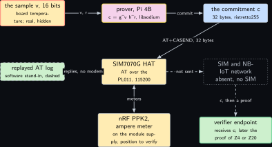
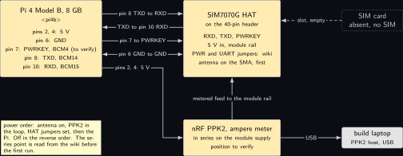
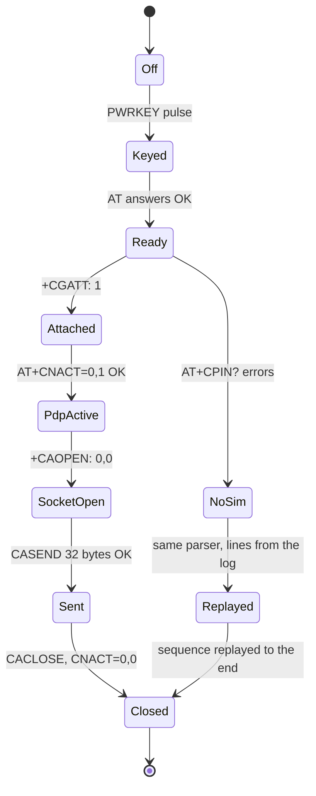
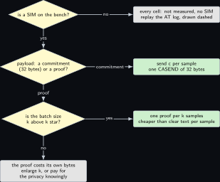

# Project 19. A commitment over NB-IoT and the energy per proof byte

> **Board:** Pi 4B with the SIM7070G Cat-M, NB-IoT and GPRS HAT on its header; the nRF PPK2 as the ampere meter on the module supply; no SIM on the bench  
> **Language:** C

> [!IMPORTANT]
> **The question, instanced**
>
> What can a verifier learn from a device without the device revealing itself, and what does it cost on this board? Here the cost is energy and the board is a battery-class radio: a Pi 4B commits to one sensor sample with a Pedersen commitment, hands the 32 bytes to a SIM7070G over its UART, and the module would carry them over NB-IoT to a verifier that later receives the proof of [Project 4](04-two-group-elements.md) or [Project 20](20-the-occupancy-counter-that-proves-its-committed-count.md). The verifier's view is the commitment and the proof bytes and nothing about the sample; the chapter prices that privacy in joules per byte, and every joule reads "not measured, no SIM" until a card arrives.

> **Key facts**
>
> - **Board:** Raspberry Pi 4 Model B Rev 1.4 (8 GB), \<pi4b\>, with the SIM7070G HAT seated on its 40-pin header (one HAT per header, so nothing else is seated)
> - **Parts:** the SIM7070G Cat-M, NB-IoT and GPRS HAT with its antenna, the nRF PPK2 in ampere-meter mode on the HAT's module supply (position to verify from the wiki), build laptop as the PPK2 host over USB, jumpers; no SIM card
> - **Interface:** AT commands over the PL011 at 115200 on header pins 8 and 10, reached as `/dev/serial0`; PWRKEY on BCM4, header pin 7 (to verify); the PPK2 over USB to the build laptop
> - **Language and library:** C17 with POSIX `termios` for the UART and `libsodium` (version to verify) for the ristretto255 commitment; no other library
> - **Primitive:** commitment transport, the paper's $`c_\mathcal{M}`$ leaving the device \[[1](#references)\], priced by the energy per payload byte on a narrowband radio
> - **Secret:** the committed value $`v \in [0, 2^{16})`$, here the board's own temperature sample, and its randomness $`r \in \mathbb{Z}_p`$
> - **Public:** $`c = g^v h^r`$ on ristretto255, the AT dialogue, the byte counts, and later the proof of [Project 4](04-two-group-elements.md) or [Project 20](20-the-occupancy-counter-that-proves-its-committed-count.md)
> - **Model:** none
> - **Acceptance:** with a SIM: the attach, PDP, socket and send sequence completes with `OK` on every step and the PPK2 trace shows the four windows, each energy figure with a repeat spread under 10 percent over five sends; without a SIM: the driver reaches `AT+CPIN?` on the live modem, stops with the reason "no SIM", and replays the whole sequence from the log with the same parser, line for line, with the one declared exception of the `AT+CASEND` prompt, which a log read line by line cannot carry
> - **Difficulty:** 3 of 5
> - **Effort:** one evening for the driver and the replay log on the host, one afternoon on the Pi with the HAT and the PPK2, a second afternoon when a SIM exists

## Pitch

The paper's prover sends one commitment and one proof; the paper's Table 1 prices them in seconds on a 32-core machine \[[1](#references)\]. On a device that lives on a battery and talks over NB-IoT, the price that matters is joules, and the shape of that price is a fixed cost per transmission (power on, attach, activate a PDP context, open a socket) plus a cost per byte. This chapter writes the cost model down as a definition, proves the lemma that says when a proof sent once per $`k`$ samples is cheaper than sending the samples themselves, and proves the proposition that says what the verifier sees in each case: the sample, or a group element that is uniformly distributed whatever the sample was. Then it builds the smallest honest C driver for the SIM7070G that can run the sequence: one AT query open at a time, the parser design of the sibling volume, a replay mode that reads the modem's lines from a log so the sequence is exercised with no SIM, and a PPK2 in series with the module's supply as the instrument that will, one day, turn "not measured, no SIM" into a number.

## Parts and interface

| **Part** | **Role** | **Interface** | **Address or pin** |
| --- | --- | --- | --- |
| Raspberry Pi 4 Model B | the prover: samples, commits, drives the modem | SSH over the bench Wi-Fi | \<pi4b\> |
| SIM7070G HAT | the radio; AT over UART; its own power selection and UART jumpers are read from the wiki \[[8](#references)\] | PL011 at 115200 | TXD pin 8 (BCM14), RXD pin 10 (BCM15), PWRKEY pin 7 (BCM4, to verify), 5 V pins 2 and 4, GND pin 6 |
| antenna | the HAT's SMA antenna; fitted before any power on | SMA |  |
| SIM card | absent; every cellular cell reads "not measured, no SIM" |  |  |
| nRF PPK2 | the instrument: ampere meter in series with the module supply, 100 kS/s | USB to the build laptop | the series position is to verify on the wiki \[[7](#references)\] |
| the build laptop, WSL side | every compile; the PPK2 host; the replay log lives here too | LAN, USB | \<build-laptop\> |
| the verifier endpoint | a UDP listener on a public address the operator can reach; absent on this bench, so the driver logs what it would send | UDP | host and port on the command line |

## The secret, the statement and the relation

The witness is the sample and the randomness, the statement is the commitment, and the relation is the opening relation of ristretto255 Pedersen commitments:

```math
\mathcal{R}_{\mathrm{open}} = \{\, ((v, r), c) \;:\; v \in [0, 2^{16}),\; r \in \mathbb{Z}_p,\;
  c = g^v h^r \,\},
```

*(19.1)*

with $`g`$ the ristretto255 base point and $`h`$ derived by hashing to the group so that $`\log_g h`$ is unknown to the device \[[3](#references), [4](#references)\]. What this chapter adds to the relation is the channel: the device's output is a byte string, and the verifier's view is a function of that string and of the time it arrived. Write $`\mathrm{View}_{\mathrm{clear}}(v) = \{v\}`$ for the strategy that sends the sample, and $`\mathrm{View}_{\mathrm{com}}(v, r) = \{c\}`$ with $`c = g^v h^r`$ for the strategy that sends the commitment. The quantity the chapter prices is the energy of producing each view on the SIM7070G, as a function of the payload length in bytes.

## The mathematics

**Definition Z19.1 (Energy per transmission).** Let a transmission of $`n`$ payload bytes on the module consist of a fixed sequence (power key, attach, PDP activation, socket open, socket close) and the transfer of the payload. Its energy is modelled as

```math
E(n) = E_{\mathrm{attach}} + n \cdot e_{\mathrm{byte}},
```

*(19.2)*

where $`E_{\mathrm{attach}}`$ is the energy of the fixed sequence and $`e_{\mathrm{byte}}`$ the marginal energy per payload byte, both measured as $`U \int I \, dt`$ over the respective window of a PPK2 current trace, with $`I`$ the current metered by the PPK2 and $`U`$ the voltage at the node the PPK2 is wired into, which is the 5 V feed to the HAT of the wiring table and not the module rail downstream of the HAT's own regulator. Those are two nodes and two energies; this chapter prices the first, the energy the Pi's 5 V rail delivers to the HAT, and $`U`$ is read at that node with the meter in the loop rather than taken from the wiki. Both constants are "not measured, no SIM" on this bench; the lemma below is about their ratio, not their values.

**Lemma Z19.2 (Per-sample energy and the two crossovers).** Let a sample be $`s`$ bytes in the clear and let a proof that covers $`k`$ samples be $`b`$ bytes. Consider three strategies: (A) send every sample in the clear, one transmission per sample; (B) send one proof of $`b`$ bytes per $`k`$ samples; (C) send the $`k`$ samples in the clear in one transmission per $`k`$ samples. Under (19.2) the energy per sample is

```math
\begin{aligned}
E_A &= E_{\mathrm{attach}} + s \, e_{\mathrm{byte}},  \\
  E_B(k) &= \frac{E_{\mathrm{attach}}}{k} + \frac{b \, e_{\mathrm{byte}}}{k},  \\
  E_C(k) &= \frac{E_{\mathrm{attach}}}{k} + s \, e_{\mathrm{byte}},
\end{aligned}
```

*(19.3)*

and (i) $`E_B(k) < E_A`$ if and only if $`k > k^{*}`$ with

```math
k^{*} = \frac{E_{\mathrm{attach}} + b \, e_{\mathrm{byte}}}{E_{\mathrm{attach}} + s \, e_{\mathrm{byte}}},
```

*(19.4)*

(ii) $`E_B(k) < E_C(k)`$ if and only if $`k > b / s`$, and (iii) for every $`k`$, $`E_B(k) - E_C(k) = (b - k s) \, e_{\mathrm{byte}} / k`$.

*Proof.* Strategy (A) makes one transmission of $`n = s`$ bytes per sample, so (19.2) gives (19.3) directly. Strategy (B) makes one transmission of $`n = b`$ bytes per $`k`$ samples, so the energy per $`k`$ samples is $`E_{\mathrm{attach}} + b \, e_{\mathrm{byte}}`$, and dividing by $`k`$ gives (19.3). Strategy (C) makes one transmission of $`n = k s`$ bytes per $`k`$ samples, energy $`E_{\mathrm{attach}} + k s \, e_{\mathrm{byte}}`$, and dividing by $`k`$ gives (19.3).

(i) $`E_B(k) < E_A`$ reads $`(E_{\mathrm{attach}} + b \, e_{\mathrm{byte}}) / k < E_{\mathrm{attach}} + s \, e_{\mathrm{byte}}`$. Both sides are positive since the energies are positive, so multiplying by $`k > 0`$ and dividing by the right-hand side preserves the inequality and gives $`k > k^{*}`$ as in (19.4). If $`b \le s`$ then $`k^{*} \le 1`$ and every $`k \ge 1`$ satisfies it, with equality only when $`b = s`$ and $`k = 1`$.

(ii) and (iii) Subtracting (19.3) from (19.3), the attach terms cancel: $`E_B(k) - E_C(k) = b \, e_{\mathrm{byte}} / k - s \, e_{\mathrm{byte}} = (b - k s) \, e_{\mathrm{byte}} / k`$, which is (iii). Since $`e_{\mathrm{byte}} / k > 0`$, the difference is negative exactly when $`b - k s < 0`$, that is $`k > b / s`$, which is (ii). &#9632;

**Remark Z19.7.** Part (iii) is the chapter's price tag. Against batched clear text, the privacy of a batch costs exactly $`(b - k s) \, e_{\mathrm{byte}}`$ joules, the energy of the proof bytes beyond the sample bytes; the attach cost is paid by both. With the range proofs of [Project 20](20-the-occupancy-counter-that-proves-its-committed-count.md), counted there as 960 bytes for two single 8-bit proofs or 544 bytes for the aggregated pair, and $`s = 2`$ bytes per 16-bit sample, the proof route beats batched clear text only past $`k = 480`$ or $`k = 272`$ samples per batch. With the KZG proof of [Project 4](04-two-group-elements.md) at two $`\mathbb{G}_1`$ elements plus two commitments, $`b = 192`$ bytes, the crossover is $`k = 96`$.

**Definition Z19.4 (The verifier's view and its consistent set).** For a view $`\omega`$ of the channel, the consistent set is $`S(\omega) = \{\, v' \in [0, 2^{16}) \mid \exists r' \in \mathbb{Z}_p .\; \omega \text{ is the view produced by } (v', r') \,\}`$, the set of samples the verifier cannot rule out after seeing $`\omega`$.

**Proposition Z19.5 (What each strategy reveals).** (a) $`S(\mathrm{View}_{\mathrm{clear}}(v)) = \{v\}`$. (b) For every $`v`$ and every $`r`$, $`S(\mathrm{View}_{\mathrm{com}}(v, r)) = [0, 2^{16})`$, the whole message space. (c) For $`r`$ uniform in $`\mathbb{Z}_p`$ the distribution of $`\mathrm{View}_{\mathrm{com}}(v, r)`$ is the same for every $`v`$, so no test on the view, however expensive, separates two samples. (d) The byte cost of (b) over (a) is $`32 - s`$ bytes per sample on the wire, and $`b`$ bytes per batch when the proof travels too.

*Proof.* (a) The view is the sample itself; a sample $`v'`$ produces the view $`\{v'\}`$, which equals $`\{v\}`$ if and only if $`v' = v`$.

(b) Let $`c = g^v h^r`$ be the view. For any $`v' \in [0, 2^{16})`$ we ask for $`r'`$ with $`g^{v'} h^{r'} = c`$, that is $`h^{r'} = c \, g^{-v'}`$. By the proof of Theorem thm:z01\_hiding the map $`r' \mapsto h^{r'}`$ is a bijection from $`\mathbb{Z}_p`$ onto $`\mathbb{G}`$, because $`p`$ is prime and $`h \ne 1`$; so the element $`c \, g^{-v'} \in \mathbb{G}`$ has exactly one preimage $`r' = \log_h(c \, g^{-v'})`$, and $`(v', r')`$ produces the same view. Hence every $`v'`$ lies in $`S(c)`$.

(c) This is Theorem thm:z01\_hiding: for each $`v`$ the random variable $`g^v h^r`$ with $`r`$ uniform is uniform on $`\mathbb{G}`$, and the uniform distribution on $`\mathbb{G}`$ does not depend on $`v`$. Two identical distributions give identical acceptance probabilities to every test.

(d) A ristretto255 element encodes in 32 bytes \[[4](#references)\], against $`s`$ bytes for the sample; a proof adds its own $`b`$ bytes once per batch, which Lemma **Lemma Z19.2** prices. &#9632;

**Remark Z19.8.** The proposition is about the payload. The verifier, and anyone on the path, still sees when a transmission happens and how long it is; the paper's Remark 2.2 and its paragraph on side channels make the same reservation \[[1](#references)\]. A device that sends only when a threshold is crossed reveals the crossing by the act of sending, whatever the payload hides. The binding half, Theorem thm:z01\_binding, is what makes the later proof mean anything: the device cannot open $`c`$ to a second sample once the proof has been checked against it.

## The protocol

The transport protocol, written as the AT dialogue it is, with the PPK2 windows named. Every command name is taken from the SIM7070G's command set as the wiki and the sibling volume use it and is marked to verify against the module's AT manual.

1. Power: the HAT's PWR jumper in the position that lets BCM4 drive PWRKEY (to verify); the driver pulls PWRKEY low for about one second and releases it (to verify); the PPK2 window **boot** opens here.
2. `AT` until `OK`; `AT+CMEE=2`; `AT+CPIN?`. With no SIM the reply is an error and the driver stops here with the reason "no SIM" and switches to the replay log.
3. `AT+CNMP=38` and `AT+CMNB=2` to prefer LTE and NB-IoT (to verify); `AT+CSQ`; `AT+CGATT?` until `+CGATT: 1`; the window **attach** closes here.
4. `AT+CNACT=0,1` to activate the PDP context (to verify); `AT+CNACT?` for the address; the window **pdp**.
5. `AT+CAOPEN=0,0,"UDP","<host>",<port>` (to verify); the window **socket**.
6. Commit: $`v`$ is read from `/sys/class/thermal/thermal_zone0/temp` as a 16-bit integer in tenths of a degree; $`r`$ is 32 random bytes; $`c = g^v h^r`$ in 32 bytes.
7. `AT+CASEND=0,32`, the prompt, the 32 bytes, `OK` (to verify); the window **send**; then `AT+CACLOSE=0` and `AT+CNACT=0,0`.
8. The PPK2 trace is cut at the four window marks the driver prints with its own monotonic clock, and each window's energy is $`U \int I \, dt`$.

## The code

The driver keeps one query open at a time and treats any line that is neither the awaited answer nor a final result as unsolicited, which is the parser design of the sibling volume's cellular chapters. In replay mode the modem's lines come from a file, so the whole sequence runs with no SIM and the parser is exercised line by line, with one exception named under the listing: the `AT+CASEND` prompt is not a line and the replay cannot reproduce it.

```c
/* z19_at.c: SIM7070G over /dev/serial0, one query at a time, replay from a log when
   no modem answers. Command names marked to verify against the SIM7070 AT manual. */
#include <fcntl.h>
#include <sodium.h>
#include <stdio.h>
#include <string.h>
#include <termios.h>
#include <time.h>
#include <unistd.h>

typedef enum { AT_OK, AT_ERR, AT_TIMEOUT } at_result;
typedef struct { int fd; FILE *replay; char line[256]; } at_port;

static double now_s(void) {
    struct timespec t; clock_gettime(CLOCK_MONOTONIC, &t);
    return t.tv_sec + t.tv_nsec / 1e9;
}
static int at_open(at_port *p, const char *dev, const char *log) {
    p->replay = log ? fopen(log, "r") : NULL;
    if (p->replay) { p->fd = -1; return 0; }
    p->fd = open(dev, O_RDWR | O_NOCTTY);
    if (p->fd < 0) return -1;
    struct termios t; tcgetattr(p->fd, &t); cfmakeraw(&t);
    cfsetispeed(&t, B115200); cfsetospeed(&t, B115200);
    t.c_cc[VMIN] = 0; t.c_cc[VTIME] = 5;                  /* 0.5 s read slices */
    return tcsetattr(p->fd, TCSANOW, &t);
}
static int at_readline(at_port *p, double deadline) {    /* one line, CR LF stripped */
    size_t n = 0; char ch;
    if (p->replay) return fgets(p->line, sizeof p->line, p->replay) ? 0 : -1;
    while (now_s() < deadline) {
        if (read(p->fd, &ch, 1) != 1) continue;
        if (ch == '\n') { p->line[n] = 0; return n ? 0 : at_readline(p, deadline); }
        if (ch != '\r' && n + 1 < sizeof p->line) p->line[n++] = ch;
    }
    return -1;
}
/* the sibling parser's rule: the awaited answer is matched by prefix, OK and ERROR end
   the query, every other line is unsolicited and is printed but never matched */
static at_result at_query(at_port *p, const char *cmd, const char *want, double timeout) {
    if (p->fd >= 0) dprintf(p->fd, "%s\r", cmd);
    printf("%.3f > %s\n", now_s(), cmd);
    double deadline = now_s() + timeout;
    for (;;) {
        if (at_readline(p, deadline) < 0) return AT_TIMEOUT;
        p->line[strcspn(p->line, "\r\n")] = 0;
        printf("%.3f < %s\n", now_s(), p->line);
        if (!strcmp(p->line, "OK")) return AT_OK;
        if (!strncmp(p->line, "ERROR", 5) || !strncmp(p->line, "+CME ERROR", 10)) return AT_ERR;
        if (want && !strncmp(p->line, want, strlen(want))) continue;    /* the answer */
        if (p->line[0] == '+') printf("        (unsolicited, kept out of the match)\n");
    }
}
/* AT+CASEND: write the command, read characters until the two-character prompt "> " has
   been seen (no line terminator follows it), write the payload, then wait for a final
   result in the ordinary line-oriented way. Command name and prompt to verify against the
   SIM7070 AT manual. */
static at_result at_send_payload(at_port *p, const unsigned char *payload, size_t n,
                                 double timeout) {
    char cmd[32]; int seen = 0; char ch;
    snprintf(cmd, sizeof cmd, "AT+CASEND=0,%zu", n);
    if (p->fd >= 0) dprintf(p->fd, "%s\r", cmd);
    printf("%.3f > %s\n", now_s(), cmd);
    double deadline = now_s() + timeout;
    while (seen < 2 && now_s() < deadline) {               /* '>' then ' ' */
        if (p->replay) { if (!fgets(p->line, sizeof p->line, p->replay)) return AT_TIMEOUT;
                         if (strchr(p->line, '>')) seen = 2; continue; }
        if (read(p->fd, &ch, 1) != 1) continue;
        seen = (seen == 0 && ch == '>') ? 1 : (seen == 1 && ch == ' ') ? 2 : 0;
    }
    if (seen < 2) return AT_TIMEOUT;
    if (p->fd >= 0 && write(p->fd, payload, n) != (ssize_t)n) return AT_ERR;
    return at_query(p, "", NULL, timeout);                 /* the final OK */
}
/* c = g^(v+1) h^r / g, because the library refuses a scalar multiplication whose result is
   the identity and v = 0 is a legal temperature sample; the same device as project Z15. */
static int commit(unsigned char c[32], unsigned v) {
    unsigned char r[32], s[32] = {0}, seed[64], h[32], gv[32], hr[32], g1[32], one[32] = {0};
    crypto_core_ristretto255_scalar_random(r);
    unsigned w = v + 1u;                                   /* 1 <= w <= 65536 */
    s[0] = w & 0xff; s[1] = (w >> 8) & 0xff; s[2] = (w >> 16) & 0xff;
    one[0] = 1;
    /* h is a hash to the group of a fixed label: the label is hashed first, which is what
       from_hash expects and what the relation at the head of this chapter states. */
    crypto_hash_sha512(seed, (const unsigned char *)"z19 pedersen h", 14);
    if (crypto_core_ristretto255_from_hash(h, seed) != 0) return -1;
    if (crypto_scalarmult_ristretto255_base(gv, s) != 0) return -1;
    if (crypto_scalarmult_ristretto255_base(g1, one) != 0) return -1;
    if (crypto_core_ristretto255_sub(gv, gv, g1) != 0) return -1;      /* back to [v]G */
    if (crypto_scalarmult_ristretto255(hr, r, h) != 0) return -1;
    return crypto_core_ristretto255_add(c, gv, hr);
}
int main(int argc, char **argv) {
    at_port p; unsigned char c[32]; char cmd[96]; unsigned v = 0;
    const char *host = argc > 1 ? argv[1] : "0.0.0.0", *log = argc > 2 ? argv[2] : NULL;
    if (sodium_init() < 0 || at_open(&p, "/dev/serial0", log) < 0) return 2;
    FILE *tz = fopen("/sys/class/thermal/thermal_zone0/temp", "r");
    if (tz) { int milli = 0; if (fscanf(tz, "%d", &milli) == 1) v = milli / 100; fclose(tz); }
    if (commit(c, v) != 0) return 6;                       /* v never leaves this process */
    if (at_query(&p, "AT", NULL, 2) != AT_OK) return 3;
    if (at_query(&p, "AT+CPIN?", "+CPIN", 5) != AT_OK) { puts("z19 stop: no SIM"); return 4; }
    at_query(&p, "AT+CGATT?", "+CGATT", 30);
    printf("z19 window attach closed %.3f\n", now_s());
    at_query(&p, "AT+CNACT=0,1", NULL, 30);                /* to verify */
    snprintf(cmd, sizeof cmd, "AT+CAOPEN=0,0,\"UDP\",\"%s\",5683", host);
    at_query(&p, cmd, "+CAOPEN", 30);                      /* to verify */
    /* AT+CASEND is the one step the line-oriented parser above cannot serve. The module
       answers it with the two characters "> " and no CR LF, and at_readline returns only on
       a '\n', so the prompt is never delivered as a line; and at_query, which treats a
       matched "want" with continue, returns only on OK, which the module will not send
       until the 32 bytes have arrived. A line-oriented query on this command therefore
       times out and the payload is written 5 s late, after the module has given up. The
       send is driven by its own character-level function instead: */
    if (at_send_payload(&p, c, 32, 10) != AT_OK) { puts("z19 stop: CASEND prompt"); return 5; }
    printf("z19 window send closed %.3f, 32 bytes of c\n", now_s());
    at_query(&p, "AT+CACLOSE=0", NULL, 5); at_query(&p, "AT+CNACT=0,0", NULL, 5);
    return 0;
}
```

```bash
# build laptop, WSL: cross build with libsodium's aarch64 headers and library
aarch64-linux-gnu-gcc -std=c17 -O2 -Wall -o z19_at z19_at.c -lsodium
scp z19_at z19_replay.log <user>@<pi4b>:~/z19/
# on the Pi 4B over ssh: live (stops at AT+CPIN? with no SIM), then the replay
sudo ./z19_at 0.0.0.0
./z19_at 0.0.0.0 z19_replay.log
```

The replay log is the modem's side of the dialogue as the wiki prints it, one line per reply. It cannot exercise the `AT+CASEND` prompt faithfully: the live module sends "\> " with no line terminator and a log file is read line by line, so the replay path takes the prompt as a line and the live path must take it as two characters. This is the one place where a replay cannot stand for the live path, which is why the acceptance criterion reads "line for line" with this step named as its one exception and no longer claims "byte for byte": a passing replay is not evidence of a working live send for `AT+CASEND`. The address `0.0.0.0` is a placeholder for the verifier endpoint, which does not exist on this bench.

## The model, if any

None. The driver sends exactly the bytes of the commitment; no text is generated and nothing is proposed.

## Real, modelled, absent

- **have:** real: the Pi 4B, the SIM7070G HAT and its antenna, the PPK2, build laptop as its host; the ristretto255 group of [Project 1](01-the-price-list.md); the parser design of the sibling volume
- **learn:** modelled: the AT sequence is exercised against a replayed log and is drawn dashed everywhere it appears; the PPK2 series position on the HAT's module supply, the PWRKEY timing, the UART jumper setting and the exact spelling of `AT+CNACT`, `AT+CAOPEN` and `AT+CASEND` are all to verify from the wiki \[[8](#references)\] and the AT manual before the first live run; every bar in the benchmark figure is the shape of Lemma **Lemma Z19.2** with assumed ratios
- **absent:** absent: a SIM, so every energy and every attach time reads "not measured, no SIM"; a verifier endpoint reachable from a carrier network, so the proof's arrival is not checked here; a second instrument independent of the MCC 118, so the rail voltage $`U`$ stays a wiki figure until it is read. The PPK2 cannot supply that reading: it sources a rail in source-meter mode and meters current in ampere-meter mode, and it has no voltage input, so it cannot measure the voltage at a node. The MCC 118 can, at eight single-ended inputs over plus or minus 10 V, and reading $`U`$ with it is what turns this row from a wiki figure into a measurement with one instrument named

## System architecture



*Figure 19.1. One prover, one radio, one absent network. Along the top, left to right: the sample as a secret block with the stop-coloured outline (the board's temperature, 16 bits, real and hidden), the prover with its yellow outline computing the commitment on the Pi 4B, and the commitment as a kernel-blue block of 32 bytes. In the middle row: the replay log as a dashed user-space block (the software stand-in for the modem's replies), the SIM7070G HAT as a solid hardware block driven over the UART, and the SIM with the NB-IoT network as a dotted grey block marked absent, no SIM. At the bottom: the PPK2 as a solid hardware block in series with the module supply, its position marked to verify, and the verifier with its green outline that would receive the commitment and later the proof of Z4 or Z20. Solid arrows carry the sample into the prover, the commitment to the HAT and the PPK2's meter line to the HAT; dashed arrows carry the replayed lines into the HAT block and the commitment from the HAT through the absent network to the verifier.*

Read the figure from left to right as the three views of Proposition **Proposition Z19.5**: the sample is seen by the prover only, the commitment is seen by everyone on the path, and the verifier's green block is where the proof is later checked.

## Wiring



*Figure 19.2. The HAT on the header and the meter on its supply. On the left the Pi 4B as a solid hardware block with six pins called out: 5 V on pins 2 and 4, GND on pin 6, PWRKEY on pin 7 (BCM4, to verify), TXD on pin 8 (BCM14), RXD on pin 10 (BCM15). To its right the SIM7070G HAT as a solid hardware block with the matching lines: the two UART lines crossed (the Pi's TXD to the HAT's RXD and back), the PWRKEY line, and the 5 V feed drawn through the PPK2 below it, which is a solid hardware block in ampere-meter mode with its position marked to verify. Further right a dotted grey block for the absent SIM and the antenna named beside the HAT. At the bottom right the build laptop as a solid grey block with the PPK2's USB; the power order note says antenna first, PPK2 in the loop before the HAT is powered, Pi last.*

| **Signal** | **From** | **To** | **Note** |
| --- | --- | --- | --- |
| 5 V | Pi header pins 2 and 4 | the HAT's 5 V input through the PPK2 | the HAT's power selection jumper decides whether the module rail is fed from the header; the PPK2 sits in series on that feed, position to verify \[[8](#references)\] |
| GND | Pi header pin 6 | HAT GND and the PPK2 GND | common reference for the meter, the HAT and the Pi |
| PWRKEY | Pi header pin 7, BCM4 | HAT PWRKEY | through the HAT's PWR jumper in the controllable position; pulse low about one second, to verify |
| UART TXD | Pi header pin 8, BCM14 | HAT RXD | PL011 at 115200; the HAT's UART selection jumper must point at the header, not at its USB bridge, to verify |
| UART RXD | Pi header pin 10, BCM15 | HAT TXD | the same |
| antenna | HAT SMA | the supplied antenna | fitted before any power on; a module keyed on without an antenna is a pitfall below |
| USB | PPK2 | build laptop | the PPK2 host; the trace is cut at the driver's window marks |

## Sequence and states

```mermaid
sequenceDiagram
  participant D as driver, Pi 4B
  participant M as SIM7070G
  participant N as NB-IoT network (absent)
  participant V as verifier endpoint
  participant P as PPK2 on the module supply
  D->>M: PWRKEY low about 1 s (to verify)
  P-->>P: window boot opens
  D->>M: AT, AT+CMEE=2, AT+CPIN?
  M-->>D: +CME ERROR: SIM not inserted (no SIM)
  Note over D: stops here on the bench; replay from here
  D-->>M: AT+CGATT?, AT+CNACT=0,1 (replayed)
  M-->>D: +CGATT: 1, OK (replayed)
  D-->>M: AT+CAOPEN=0,0,"UDP",host,5683
  D-->>M: AT+CASEND=0,32 then 32 bytes of c
  M-->>N: c over NB-IoT (no SIM, not sent)
  N-->>V: c, later the proof of Z4 or Z20
  D->>P: window marks on the monotonic clock
```



## Decision tree



*Figure 19.3. When to send what over the radio. The root diamond asks whether a SIM is on the bench; no leads to a grey leaf saying every cell reads not measured, no SIM, and the sequence is replayed from the log and drawn dashed. Yes leads to a second diamond asking whether the payload is a commitment of 32 bytes or a proof of more than a hundred bytes; commitment leads to a leaf that sends c per sample in one CASEND. Proof leads to a third diamond asking whether the batch size k is above the crossover of Lemma **Lemma Z19.2**; yes leads to a leaf that sends one proof per k samples; no leads to a grey leaf that says the proof costs more than batched clear text by exactly the proof bytes, so the batch is enlarged or the privacy is paid for knowingly.*

## Benchmark


*Figure 19.4. Energy per sample in units of the attach energy, drawn as dashed bars because no SIM is on the bench; five groups for batch sizes k of 1, 2, 4, 8 and 16, each with three bars for the strategies of Lemma **Lemma Z19.2**: clear text one send per sample, clear text batched, and one proof per k samples, with the assumed ratios b times e byte equal to half the attach energy and s times e byte equal to two thousandths of it. The proof bar falls as 1 over k and crosses the per-sample clear bar between k of 1 and 2, as the lemma's k star says for these ratios; it stays above the batched clear bar for every k shown, as part (iii) says until k exceeds b over s. A solid bar replaces a dashed one only from a PPK2 trace with a SIM.*

| **Quantity** | **Pi 4B, SIM7070G** | **Window** | **Instrument** |
| --- | --- | --- | --- |
| boot to `AT` `OK`, energy | not measured, no SIM | boot | PPK2 ampere meter, 100 kS/s, $`U`$ read at the HAT's 5 V feed with the meter in the loop, and the access technology from `AT+CPSI?` recorded beside the figure |
| attach to `+CGATT: 1`, energy and seconds | not measured, no SIM | attach | the same; the driver's clock |
| PDP activation, energy | not measured, no SIM | pdp | the same |
| socket open and close, energy | not measured, no SIM | socket | the same |
| 32 bytes of $`c`$, energy | not measured, no SIM | send | the same |
| 960 bytes, the two Z20 proofs, energy | not measured, no SIM | send | the same; the CASEND length limit is to verify |
| $`e_{\mathrm{byte}}`$ from the two send windows | not measured, no SIM |  | computed from the two rows above once they exist |
| $`k^{*}`$ for the Z20 proof | not measured, no SIM |  | Equation (19.4) |
| replay of the sequence, reply lines and unsolicited lines | computed from the log once it is written |  | the driver on the log |

The paper reports no energy; its Table 1 is seconds on an AWS `c6g.8xlarge` \[[1](#references)\], and none of its figures belongs in a cell above.

## Steps

**Step 1.** On the authoring laptop, write the driver and the replay log from the wiki's example dialogue; commit. Nothing is compiled here.

**Step 2.** On the build laptop in WSL, `git pull --ff-only`, cross build with `libsodium` for aarch64, and copy the binary and the log to the Pi 4B.

**Step 3.** On the Pi 4B over ssh, with the HAT not yet seated, disable the serial console and move Bluetooth off the PL011 so that `/dev/serial0` is the PL011; reboot and confirm with `ls -l /dev/serial0`.

**Step 4.** With everything off, seat the HAT, fit the antenna, set the PWR and UART jumpers as the wiki says, and put the PPK2 in series on the module supply in ampere-meter mode; record the jumper positions in the log.

**Step 5.** Power the Pi, run the driver live; it must stop at `AT+CPIN?` with the reason "no SIM" and the `AT` reply must have been `OK`, which proves the UART and the key.

**Step 6.** Run the driver on the replay log and keep the output; count the reply lines and the unsolicited lines.

**Step 7.** When a SIM arrives: repeat the live run five times, cut the PPK2 trace at the window marks, compute each window's energy, and fill the table with the spread.

## Acceptance test

Without a SIM the chapter passes when the live driver prints `OK` to `AT`, stops at `AT+CPIN?` with the reason "no SIM", and the replay run prints every reply line of the log with zero lines matched as an answer that were unsolicited. With a SIM it passes when five live runs complete to `AT+CNACT=0,0` with `OK` on every step, the four windows are visible in the PPK2 trace, and each window's energy has a repeat spread under 10 percent. It fails if any cell is filled from a datasheet figure, if the PPK2 was not in the module's supply loop during a run, or if the driver matched an unsolicited line as an answer.

## Variants

**A range proof built in WebAssembly.** The C driver keeps the UART, the AT dialogue and the PPK2 loop exactly as this chapter wires them, and what moves is the proof: the engine-speed history of the brief's fourteenth sketch \[[6](#references)\] is written as a system of linear inequalities $`A_s y \le b_s`$, shifted by a bound $`M`$ so that every element lies in $`[0, M]`$, and a Bulletproofs range proof \[[2](#references)\] over the shifted values is generated by a WebAssembly module loaded on the Pi 4B rather than by native code, the nearest reference this volume carries for proof generation behind that boundary being \[[5](#references)\]. Aggregation is where the arithmetic sits: an aggregated Bulletproofs proof over $`n`$ values of $`m`$ bits has $`2 \log_2(nm) + 9`$ elements of 32 bytes, so 64 engine-speed samples of 16 bits aggregate to 29 elements and 928 bytes, against 34816 bytes for 64 separate 16-bit proofs of 544 bytes each, a factor of 37.5 (computed from the element count, none of it measured). What the variant costs on the link cannot be stated: there is no SIM on this bench, so the bytes per Cat-M send, the energy per byte and the number of `AT+CASEND` commands the 928 bytes need all read "not measured, no SIM", and the AT sequence is replayed from the log by this chapter's own parser. Choose this variant when many historical values have to be bounded at once rather than one sample committed per send, because the aggregate proof grows with the logarithm of $`nm`$ while separate proofs grow with $`n`$. The brief runs this on a Raspberry Pi 3 over USB behind an OBD-II to UART bridge and reports to a manufacturer's server; no such bridge is on this bench, so the engine-speed history is replayed from a logged file and drawn dashed, the HAT stays on the Pi 4B's PL011 as this chapter wires it, and nothing goes outward.

## Pitfalls

- On the Pi 4B `/dev/serial0` points at the mini UART unless Bluetooth is moved off the PL011; the mini UART's baud rate follows the core clock, and a modem that answers garbage under load is this, not the HAT.
- A module keyed on without its antenna can damage its output stage; the antenna goes on first, every time.
- The PPK2 cannot meter a Raspberry Pi; it meters the module's supply only, and a trace taken on the Pi's 5 V input is a different, wrong, quantity. The PPK2's ampere-meter range tops out at about 1 A, a figure read from the Power Profiler Kit II user guide \[[7](#references)\] and not measured here. Whether a SIM7070G transmit burst stays under it has not been measured on this bench and is not assumed: the module is a Cat-M, NB-IoT and GPRS part, `AT+CNMP=38` only *prefers* LTE, and a GPRS fallback burst on a quad-band module is specified well above 1 A, so a run that falls back exceeds the meter's range and the trace is discarded rather than reported. The first live run therefore reads `AT+CPSI?` or `AT+CNSMOD?` and records the access technology beside every energy figure; a figure with no recorded technology is withdrawn. The SIM7600E-H is not seated by any project here for the same reason, one rank worse.
- The PPK2 in ampere-meter mode is a shunt in the supply path and drops its own voltage. The module's minimum operating rail and the drop at the peak current have not been measured; a cellular module browning out mid-transmit looks like a failed attach and not like an instrument problem, so the first live run reads the module rail at the HAT with the PPK2 in the loop before any energy figure is kept. The PPK2 cannot supply that reading, because it has no voltage input and so cannot measure at a node. The MCC 118 can, over plus or minus 10 V, and until an instrument that reads a voltage at a node has taken it the cell stays marked to verify.
- The parser matches the awaited answer by prefix; a reply that begins with the same prefix as an unsolicited code (for example `+CA` family lines) is why one query is open at a time and the match is on the exact command's prefix.
- `AT+CASEND` has a maximum length per command that the manual states; a 544-byte proof may need more than one command, and the energy row for it counts every command.
- A 16-bit sample in a commitment with no randomness is found in $`2^{16}`$ group operations; $`r`$ is 32 random bytes from `libsodium`, never a counter.

## Languages and libraries not chosen

- Python with `pyserial`: the sibling volume's samplers; here the driver must run on a board with no interpreter in a later project, so it is C.
- Rust with `serialport` and `curve25519-dalek`: one crate for the group and one for the port; [Project 2](02-a-sensor-reading-committed-on-the-microcontroller.md) and [Project 20](20-the-occupancy-counter-that-proves-its-committed-count.md) take that route, and here the delta is only the language.
- The kernel's PPP or QMI path instead of AT sockets: a full IP stack on the module costs attach energy the lemma cannot see; AT sockets keep every byte counted.

## Sources

- [arxiv.org/abs/2605.00487](https://arxiv.org/abs/2605.00487) (verified Friday 6 November 2026), Remark 2.2 and the side-channel reservation.
- [waveshare.com/wiki/SIM7070G\_Cat-M/NB-IoT/GPRS\_HAT](https://www.waveshare.com/wiki/SIM7070G_Cat-M/NB-IoT/GPRS_HAT) (to verify), the jumpers, the PWRKEY handling and the example dialogue.
- [waveshare.com/wiki/SIM7020E\_NB-IoT\_HAT](https://www.waveshare.com/wiki/SIM7020E_NB-IoT_HAT) (to verify), the sibling HAT whose wiring the sibling volume recorded.
- [crates.io, curve25519-dalek 5.0.0](https://crates.io/api/v1/crates/curve25519-dalek) (verified Friday 6 November 2026), the ristretto255 encoding of 32 bytes.

<a id="references"></a>

## References

1. Pascal Berrang, Mirco Giacobbe, Jacob Swales and Xiao Yang. Zero-Knowledge Model Checking. arXiv:2605.00487v2 \[cs.CR\], version 1 submitted Friday 1 May 2026, version 2 Tuesday 8 September 2026. [arxiv.org/abs/2605.00487](https://arxiv.org/abs/2605.00487) (verified Friday 6 November 2026).
2. Benedikt Bunz, Jonathan Bootle, Dan Boneh, Andrew Poelstra, Pieter Wuille and Greg Maxwell. Bulletproofs: short proofs for confidential transactions and more. In IEEE Symposium on Security and Privacy 2018, pages 315 to 334. IEEE, 2018. [doi:10.1109/SP.2018.00020](https://doi.org/10.1109/SP.2018.00020) (to verify).
3. Mike Hamburg. Decaf: eliminating cofactors through point compression. In CRYPTO 2015, LNCS 9215, pages 705 to 723. Springer, 2015. The construction ristretto255 descends from. [doi:10.1007/978-3-662-47989-6\_34](https://doi.org/10.1007/978-3-662-47989-6_34) (to verify).
4. dalek cryptography contributors. curve25519-dalek: group operations on ristretto255 and Curve25519. Version 5.0.0, updated Monday 6 July 2026, 318.9 million downloads. [crates.io, curve25519-dalek](https://crates.io/api/v1/crates/curve25519-dalek) (verified Friday 6 November 2026).
5. iden3. snarkjs: zkSNARK implementation in JavaScript and WebAssembly. Release v0.7.6, Monday 26 January 2026. The licence is not recorded here because it has not been read; read it from the repository's LICENSE file (to verify). [github.com/iden3/snarkjs, latest release](https://api.github.com/repos/iden3/snarkjs/releases/latest) (verified Friday 6 November 2026).
6. Advanced hardware-software architectures for edge artificial intelligence and zero-knowledge model checking. A design brief of twenty project sketches, read on Friday 6 November 2026 and held locally at `a local design brief`. It is the input to this second edition and is not a published source; where its hardware claims disagree with the bench, the bench is followed and the disagreement is stated.
7. Nordic Semiconductor. Power Profiler Kit II user guide. No sample rate is quoted here, for the same reason: chapter Z19 integrates energy over a window and that integration depends on the rate, so the rate is read from the guide on the day of the first capture and the reading is written into the chapter's steps. A rate printed in a benchmark table before that reading has no source in this list. (to verify)
8. Waveshare. SIM7070G Cat-M, NB-IoT and GPRS HAT wiki. No supply voltage is quoted here, because no page was fetched for it and chapter Z19's energy integration depends on the rail the symbol $`U`$ names. The reading to take on the day of the first capture is the module's own supply rail voltage and the node the probe is wired into, since the HAT's regulator sits between the 5 V feed and the module. [waveshare.com/wiki/SIM7070G\_Cat-M/NB-IoT/GPRS\_HAT](https://www.waveshare.com/wiki/SIM7070G_Cat-M/NB-IoT/GPRS_HAT) (to verify).

---

[Previous](18-a-proof-over-the-wire.md) &nbsp;&nbsp;|&nbsp;&nbsp; [Contents](../CONTENTS.md) &nbsp;&nbsp;|&nbsp;&nbsp; [Next](20-the-occupancy-counter-that-proves-its-committed-count.md)
