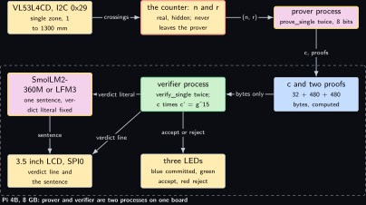
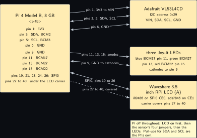
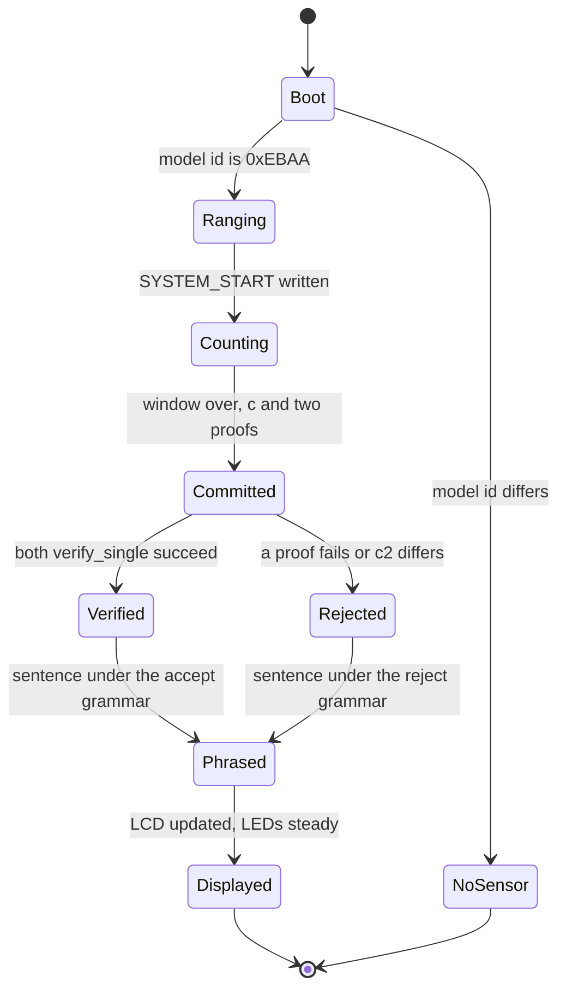
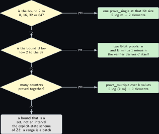

# Project 20. The occupancy counter that proves it stayed under the limit

> **Board:** Pi 4B with the Adafruit VL53L4CD on I2C at 0x29, the 3.5 inch LCD on SPI0 for the verdict, three of the four Joy-it LEDs on BCM 17, 27 and 22  
> **Language:** Rust

> [!IMPORTANT]
> **The question, instanced**
>
> What can a verifier learn from a device without the device revealing itself, and what does it cost on this board? This is the volume's demonstration. A time-of-flight sensor at a doorway counts crossings; the count $`n`$ is the secret of the room. The device commits to $`n`$ and proves, with a Bulletproofs range proof, that $`n`$ lies below the limit of 16 without saying whether it was 3 or 15. A verifier on the same board checks the proof, lights a green or a red LED, writes the verdict to the LCD, and lets a small language model phrase one sentence it cannot change. The cost is a proof of a few hundred bytes and two scalar multiplications per bit, priced here by count and by the price list of [Project 1](01-the-price-list.md).

> **Key facts**
>
> - **Board:** Raspberry Pi 4 Model B Rev 1.4 (8 GB), \<pi4b\>; the prover and the verifier are two processes on the one board
> - **Parts:** Adafruit VL53L4CD time-of-flight breakout (1 to 1300 mm), the Waveshare 3.5 inch RPi LCD (A) on SPI0, the blue, green and red Joy-it LEDs, jumpers, the breadboard
> - **Interface:** I2C at 0x29 on header pins 1, 3, 5, 6; the LCD's ili9486 on SPI0 CE0 and its ads7846 touch on CE1, its carrier covering header pins 27 to 40; LEDs on BCM 17, 27, 22 at header pins 11, 13, 15 with ground on pin 9; the model over HTTP as in [Project 16](16-the-model-proposes-a-ranking-function-the-certifier.md)
> - **Language and library:** Rust with `bulletproofs` 5.0.0 \[[7](#references)\], `curve25519-dalek` at the version `bulletproofs` 5.0.0 depends on (to verify against 5.0.0 \[[8](#references)\]), `merlin` for the transcript, `rppal` (version to verify) for I2C and GPIO, `embedded-graphics` for the LCD frame (to verify)
> - **Primitive:** the Bulletproofs range proof \[[4](#references)\] on the inner-product argument \[[5](#references)\], the paper's `zkrp` of Figure 4 \[[1](#references)\]
> - **Secret:** the count $`n`$ and the blinding $`r \in \mathbb{Z}_p`$
> - **Public:** $`c = g^n h^r`$, the bound 16, the proof bytes, the verdict
> - **Model:** SmolLM2-360M or LFM3-1.7B \[[11](#references), [10](#references)\] writes the one-sentence explanation of the verdict under a grammar whose verdict literal the verifier fixed; the model never decides
> - **Acceptance:** the model id register reads 0xEBAA; ten runs with staged crossings of 0, 5, 15 and 16 produce accept, accept, accept, reject with the matching LED; the proof bytes equal the computed count; prove and verify times on the Pi 4B with a repeat spread under 5 percent over 64 repeats and `vcgencmd get_throttled` at 0x0 before and after
> - **Difficulty:** 4 of 5
> - **Effort:** one evening for the proof on the build laptop, one afternoon for the sensor and the LEDs on the Pi, one afternoon for the LCD and the sentence, a morning for the timings

## Pitch

Every earlier chapter proves one piece; this one puts a piece in front of a person. The secret is a number that a building manager wants to keep private (how many people are in the room) and that a safety rule wants bounded (no more than 15). A Pedersen commitment hides the number by Theorem thm:z01\_hiding and binds the device to it by Theorem thm:z01\_binding; a range proof shows that the committed number lies in $`[0, 2^m)`$ without opening the commitment, and the paper uses exactly this primitive for the bound checks of its Equation 25 \[[1](#references)\]. The chapter proves the lemma that turns "$`n`$ is in range" into three vector equations over the bits of $`n`$, and the theorem that turns those three equations into one inner product whose proof has $`2 \log_2 m + 9`$ elements, and then counts the bytes: 480 for one 8-bit proof, 544 for one 16-bit proof, 672 for one 64-bit proof, all computed from the count, none measured. The limit 16 is not a bit size the crate accepts, so the device proves two 8-bit statements, about $`n`$ and about $`15 - n`$, whose commitments the verifier ties together by the homomorphism; the corollary says why that suffices. The sentence on the LCD comes from a model that is handed the verdict as a literal in its grammar and can only choose the phrasing; Theorem thm:z16\_independent is the reason that is safe.

## Parts and interface

| **Part** | **Role** | **Interface** | **Address or pin** |
| --- | --- | --- | --- |
| Raspberry Pi 4 Model B | prover and verifier, two processes; the model host or its client | SSH | \<pi4b\> |
| Adafruit VL53L4CD | the doorway sensor; single zone, 1 to 1300 mm \[[13](#references)\] | I2C, 16-bit register addresses | 0x29; VIN pin 1, SDA pin 3, SCL pin 5, GND pin 6 |
| Waveshare 3.5 inch RPi LCD (A) | the verdict display, 480 by 320 \[[12](#references)\] | SPI0: ili9486 on CE0, ads7846 touch on CE1 | its carrier covers header pins 27 to 40 |
| blue LED | lit when the commitment exists | GPIO, anode on the pin, drive high | BCM17, pin 11; cathode to pin 9 |
| green LED | lit on accept | the same | BCM27, pin 13 |
| red LED | lit on reject | the same | BCM22, pin 15 |
| `llama-server` | phrases the sentence; on the Pi or on the build laptop | HTTP 8080 | as [Project 16](16-the-model-proposes-a-ranking-function-the-certifier.md) |
| the build laptop, WSL side | every compile; the cross build for aarch64 | LAN | \<build-laptop\> |

## The secret, the statement and the relation

The witness is $`(n, r)`$ and the statement is $`(c, m)`$:

$$
\mathcal{R}_{\mathrm{range}} = \lbrace \thinspace  ((n, r), (c, m)) \thickspace :\thickspace  n \in \mathbb{Z},\thickspace  r \in \mathbb{Z}_p,\thickspace 
  c = g^n h^r \in \mathbb{G},\thickspace  0 \le n < 2^m \thinspace \rbrace , \tag{20.1}
$$

over ristretto255 with $`g, h`$ the generators of the crate's `PedersenGens` \[[7](#references)\]. The paper's `zkrp` relation, its $`\mathcal{R}_{\mathrm{zkrp}}`$ of Section 5.1, is the same relation taken over every entry of a committed matrix with the bound $`M`$ in place of $`2^m`$ \[[1](#references)\]; here there is one entry and the bound is the room's limit. The limit itself, $`B = 16`$, is not of the form $`2^m`$ for a bit size the crate accepts, so the statement the device actually proves is the conjunction

$$
((n, r), (c, 8)) \in \mathcal{R}_{\mathrm{range}} \thickspace \wedge\thickspace 
  ((B - 1 - n, -r), (c', 8)) \in \mathcal{R}_{\mathrm{range}} \thickspace \wedge\thickspace  c \cdot c' = g^{B-1}, \tag{20.2}
$$

and Corollary **Corollary Z20.4** says this is equivalent to $`0 \le n \le B - 1`$.

## The mathematics

Throughout, $`m`$ is a power of two, $`p`$ is the prime order of ristretto255 (about $`2^{252}`$, so $`2^m < p`$ for every $`m`$ used), vectors are in $`\mathbb{Z}_p^m`$, $`\mathbf{1}^m = (1, \ldots, 1)`$, $`\mathbf{2}^m = (1, 2, 4, \ldots, 2^{m-1})`$, $`\mathbf{y}^m = (1, y, \ldots, y^{m-1})`$, $`\circ`$ is the entrywise product and $`\langle \cdot, \cdot \rangle`$ the inner product.

**Definition Z20.1 (Range relation and bit vectors).** For $`n \in \mathbb{Z}_p`$ and $`m \ge 1`$, a *bit decomposition* of $`n`$ is a vector $`\mathbf{a}_L \in \lbrace 0, 1\rbrace ^m \subset \mathbb{Z}_p^m`$ with $`\langle \mathbf{a}_L, \mathbf{2}^m \rangle = n`$. The range relation is (20.1); a witness for it is $`(n, r)`$ together with any bit decomposition of $`n`$.

**Lemma Z20.2 (Bit decomposition in both directions).** Let $`\mathbf{a}_L, \mathbf{a}_R \in \mathbb{Z}_p^m`$ and $`n \in \mathbb{Z}_p`$. The three conditions

$$
\mathbf{a}_L \circ \mathbf{a}_R = \mathbf{0}^m, \qquad
  \mathbf{a}_L - \mathbf{a}_R = \mathbf{1}^m, \qquad
  \langle \mathbf{a}_L, \mathbf{2}^m \rangle = n \tag{20.3}
$$

hold if and only if $`\mathbf{a}_L`$ is the binary representation of an integer $`n`$ with $`0 \le n < 2^m`$ (and then $`\mathbf{a}_R = \mathbf{a}_L - \mathbf{1}^m`$).

*Proof.* ($`\Rightarrow`$) From the second condition, $`a_{R,i} = a_{L,i} - 1`$ for every $`i`$. Substituting into the first, $`a_{L,i} (a_{L,i} - 1) = 0`$ in $`\mathbb{Z}_p`$ for every $`i`$. Since $`p`$ is prime, $`\mathbb{Z}_p`$ is a field and has no zero divisors, so $`a_{L,i} = 0`$ or $`a_{L,i} = 1`$. Hence $`\mathbf{a}_L \in \lbrace 0, 1\rbrace ^m`$, and the third condition reads $`n = \sum_{i=0}^{m-1} a_{L,i} 2^i`$ in $`\mathbb{Z}_p`$. The integer $`N = \sum_{i} a_{L,i} 2^i`$ satisfies $`0 \le N \le \sum_i 2^i = 2^m - 1 < p`$, so $`N`$ is the canonical representative of the residue $`n`$, and $`0 \le n < 2^m`$ as an integer. Finally, the binary representation of an integer in $`[0, 2^m)`$ with $`m`$ digits is unique (two distinct digit vectors differ first at some position $`j`$, and the difference of their values is then $`\pm 2^j + \sum_{i < j} \epsilon_i 2^i`$ with $`\epsilon_i \in \lbrace -1, 0, 1\rbrace`$, which is non-zero because $`\sum_{i<j} 2^i = 2^j - 1 < 2^j`$), so $`\mathbf{a}_L`$ is that representation.

($`\Leftarrow`$) Let $`\mathbf{a}_L`$ be the binary representation of $`n \in [0, 2^m)`$ and set $`\mathbf{a}_R = \mathbf{a}_L - \mathbf{1}^m`$. The second condition holds by construction. For the first, $`a_{L,i} \in \lbrace 0, 1\rbrace`$ gives $`a_{L,i} a_{R,i} = a_{L,i}(a_{L,i} - 1) = 0`$ for each $`i`$. For the third, $`\langle \mathbf{a}_L, \mathbf{2}^m \rangle = \sum_i a_{L,i} 2^i = n`$ by the definition of the binary representation, and the equation holds in $`\mathbb{Z}_p`$ because it holds in $`\mathbb{Z}`$ and $`n < p`$. &#9632;

**Theorem Z20.3 (Structure of the range proof).** Let $`m`$ be a power of two. (a) For $`\mathbf{a}_L, \mathbf{a}_R \in \mathbb{Z}_p^m`$ and $`n \in \mathbb{Z}_p`$, the three conditions (20.3) hold if and only if, for all $`y, z \in \mathbb{Z}_p`$,

$$
\big\langle \mathbf{a}_L - z \mathbf{1}^m,\thickspace 
  \mathbf{y}^m \circ (\mathbf{a}_R + z \mathbf{1}^m) + z^2 \mathbf{2}^m \big\rangle
  = z^2 n + \delta(y, z), \qquad
  \delta(y, z) = (z - z^2) \langle \mathbf{1}^m, \mathbf{y}^m \rangle
  - z^3 \langle \mathbf{1}^m, \mathbf{2}^m \rangle . \tag{20.4}
$$

(b) A claim $`P = \mathbf{g}^{\mathbf{a}} \mathbf{h}^{\mathbf{b}} u^{\langle \mathbf{a}, \mathbf{b} \rangle}`$ about vectors of length $`m`$ reduces, in one round that sends two group elements $`L, R`$ and receives a challenge $`x`$, to a claim of the same shape about vectors of length $`m / 2`$; after $`\log_2 m`$ rounds the claim is about scalars $`a, b`$, which are sent. (c) Hence the range proof for $`m`$ bits consists of $`2 \log_2 m + 4`$ group elements ($`A`$, $`S`$, $`T_1`$, $`T_2`$, and $`L_j, R_j`$ for $`j = 1, \ldots, \log_2 m`$) and $`5`$ scalars ($`t_x`$, $`\tau_x`$, $`\mu`$, $`a`$, $`b`$): $`2 \log_2 m + 9`$ elements, each $`32`$ bytes on ristretto255.

*Proof.* (a) Expand the left-hand side of (20.4) by bilinearity of the inner product:

$$
\begin{aligned}
\langle \mathbf{a}_L - z \mathbf{1}, \mathbf{y}^m \circ (\mathbf{a}_R + z \mathbf{1})
    + z^2 \mathbf{2}^m \rangle
  &= \langle \mathbf{a}_L, \mathbf{y}^m \circ \mathbf{a}_R \rangle
    + z \langle \mathbf{a}_L, \mathbf{y}^m \rangle
    + z^2 \langle \mathbf{a}_L, \mathbf{2}^m \rangle \notag \cr 
  &\quad - z \langle \mathbf{1}, \mathbf{y}^m \circ \mathbf{a}_R \rangle
    - z^2 \langle \mathbf{1}, \mathbf{y}^m \rangle
    - z^3 \langle \mathbf{1}, \mathbf{2}^m \rangle . \tag{20.5}
\end{aligned}
$$

Two identities hold for every $`\mathbf{u}, \mathbf{v}, \mathbf{w}`$: $`\langle \mathbf{u}, \mathbf{w} \circ \mathbf{v} \rangle = \sum_i u_i w_i v_i = \langle \mathbf{u} \circ \mathbf{v}, \mathbf{w} \rangle`$ and $`\langle \mathbf{1}, \mathbf{w} \circ \mathbf{v} \rangle = \langle \mathbf{v}, \mathbf{w} \rangle`$. Applying them to the first and fourth terms of (20.5) and collecting the $`z`$ terms,

$$
\text{LHS} = \langle \mathbf{a}_L \circ \mathbf{a}_R, \mathbf{y}^m \rangle
  + z \langle \mathbf{a}_L - \mathbf{a}_R, \mathbf{y}^m \rangle
  + z^2 \langle \mathbf{a}_L, \mathbf{2}^m \rangle
  - z^2 \langle \mathbf{1}, \mathbf{y}^m \rangle - z^3 \langle \mathbf{1}, \mathbf{2}^m \rangle . \tag{20.6}
$$

If the three conditions hold, the first term is $`\langle \mathbf{0}, \mathbf{y}^m \rangle = 0`$, the second is $`z \langle \mathbf{1}, \mathbf{y}^m \rangle`$ and the third is $`z^2 n`$, so the right-hand side of (20.6) is $`z^2 n + (z - z^2) \langle \mathbf{1}, \mathbf{y}^m \rangle - z^3 \langle \mathbf{1}, \mathbf{2}^m \rangle = z^2 n + \delta(y, z)`$, which is (20.4). Conversely, if (20.4) holds for all $`y, z`$, subtract $`z^2 n + \delta(y, z)`$ from (20.6): the polynomial

$$
F(y, z) = \sum_{i=0}^{m-1} a_{L,i} a_{R,i} \thinspace  y^i
  + z \sum_{i=0}^{m-1} (a_{L,i} - a_{R,i} - 1) \thinspace  y^i
  + z^2 \big( \langle \mathbf{a}_L, \mathbf{2}^m \rangle - n \big)
$$

vanishes at every point of $`\mathbb{Z}_p^2`$. Its degree is at most $`m - 1 < p`$ in $`y`$ and $`2 < p`$ in $`z`$, so by the Schwartz-Zippel lemma \[[6](#references)\] a non-zero $`F`$ would be non-zero at some point; hence $`F`$ is the zero polynomial and every coefficient is zero: the $`z^2`$ coefficient gives the third condition, the $`z^1`$ coefficients give $`a_{L,i} - a_{R,i} = 1`$ for every $`i`$, and the $`z^0`$ coefficients give $`a_{L,i} a_{R,i} = 0`$ for every $`i`$.

(b) Write $`\mathbf{a} = (\mathbf{a}_1, \mathbf{a}_2)`$ for the two halves of length $`m / 2`$, and likewise $`\mathbf{b}`$, $`\mathbf{g}`$, $`\mathbf{h}`$. The prover sends

$$
L = \mathbf{g}_2^{\mathbf{a}_1} \mathbf{h}_1^{\mathbf{b}_2}
      u^{\langle \mathbf{a}_1, \mathbf{b}_2 \rangle}, \qquad
  R = \mathbf{g}_1^{\mathbf{a}_2} \mathbf{h}_2^{\mathbf{b}_1}
      u^{\langle \mathbf{a}_2, \mathbf{b}_1 \rangle},
$$

the verifier returns $`x \ne 0`$, and both sides form $`\mathbf{g}' = \mathbf{g}_1^{x^{-1}} \circ \mathbf{g}_2^{x}`$, $`\mathbf{h}' = \mathbf{h}_1^{x} \circ \mathbf{h}_2^{x^{-1}}`$, $`P' = L^{x^2} P R^{x^{-2}}`$, while the prover forms $`\mathbf{a}' = x \mathbf{a}_1 + x^{-1} \mathbf{a}_2`$ and $`\mathbf{b}' = x^{-1} \mathbf{b}_1 + x \mathbf{b}_2`$. We check that $`P' = \mathbf{g}'^{\mathbf{a}'} \mathbf{h}'^{\mathbf{b}'} u^{\langle \mathbf{a}', \mathbf{b}' \rangle}`$ term by term. First,

$$
\mathbf{g}'^{\mathbf{a}'}
  = \prod_i \big( g_{1,i}^{x^{-1}} g_{2,i}^{x} \big)^{x a_{1,i} + x^{-1} a_{2,i}}
  = \mathbf{g}_1^{\mathbf{a}_1} \thinspace  \mathbf{g}_1^{x^{-2} \mathbf{a}_2} \thinspace 
    \mathbf{g}_2^{x^{2} \mathbf{a}_1} \thinspace  \mathbf{g}_2^{\mathbf{a}_2},
$$

and in the same way $`\mathbf{h}'^{\mathbf{b}'} = \mathbf{h}_1^{\mathbf{b}_1} \thinspace \mathbf{h}_1^{x^{2} \mathbf{b}_2} \thinspace \mathbf{h}_2^{x^{-2} \mathbf{b}_1} \thinspace \mathbf{h}_2^{\mathbf{b}_2}`$. Second,

$$
\langle \mathbf{a}', \mathbf{b}' \rangle
  = \langle \mathbf{a}_1, \mathbf{b}_1 \rangle + x^2 \langle \mathbf{a}_1, \mathbf{b}_2 \rangle
  + x^{-2} \langle \mathbf{a}_2, \mathbf{b}_1 \rangle + \langle \mathbf{a}_2, \mathbf{b}_2 \rangle
  = \langle \mathbf{a}, \mathbf{b} \rangle + x^2 \langle \mathbf{a}_1, \mathbf{b}_2 \rangle
  + x^{-2} \langle \mathbf{a}_2, \mathbf{b}_1 \rangle .
$$

Third, expanding $`L^{x^2} P R^{x^{-2}}`$ with $`P = \mathbf{g}_1^{\mathbf{a}_1} \mathbf{g}_2^{\mathbf{a}_2} \mathbf{h}_1^{\mathbf{b}_1} \mathbf{h}_2^{\mathbf{b}_2} u^{\langle \mathbf{a}, \mathbf{b} \rangle}`$ gives exponent $`\mathbf{a}_1 + x^{-2} \mathbf{a}_2`$ on $`\mathbf{g}_1`$, $`x^2 \mathbf{a}_1 + \mathbf{a}_2`$ on $`\mathbf{g}_2`$, $`\mathbf{b}_1 + x^2 \mathbf{b}_2`$ on $`\mathbf{h}_1`$, $`x^{-2} \mathbf{b}_1 + \mathbf{b}_2`$ on $`\mathbf{h}_2`$, and $`\langle \mathbf{a}, \mathbf{b} \rangle + x^2 \langle \mathbf{a}_1, \mathbf{b}_2 \rangle + x^{-2} \langle \mathbf{a}_2, \mathbf{b}_1 \rangle`$ on $`u`$; these are exactly the exponents found in the first two steps, so the identity holds and the new claim has the same shape with length $`m / 2`$ \[[5](#references), [4](#references)\]. By induction on $`j`$, after $`j`$ rounds the length is $`m / 2^j`$, and after $`\log_2 m`$ rounds it is $`1`$: the prover sends the scalars $`a, b`$ and the verifier checks $`P' = g'^{a} h'^{b} u^{ab}`$ directly.

(c) Before the inner-product argument the prover commits to $`\mathbf{a}_L, \mathbf{a}_R`$ in $`A`$ and to the blinding vectors in $`S`$ (two elements), then to the two non-constant coefficients $`t_1, t_2`$ of $`t(x) = \langle \mathbf{l}(x), \mathbf{r}(x) \rangle`$ in $`T_1, T_2`$ (two elements), then sends $`t_x = t(x)`$, its blinding $`\tau_x`$ and the blinding $`\mu`$ of the combined vector commitment (three scalars) \[[4](#references)\]. Part (b) contributes $`2 \log_2 m`$ group elements and the final $`2`$ scalars. Adding, $`4 + 2 \log_2 m`$ group elements and $`3 + 2 = 5`$ scalars, that is $`2 \log_2 m + 9`$ elements, and a ristretto255 point and a scalar both encode in $`32`$ bytes \[[8](#references)\]. &#9632;

**Corollary Z20.4 (The limit 16 from two 8-bit proofs).** Let $`B = 16`$ and let $`c = g^n h^r`$ and $`c' = g^{n'} h^{r'}`$ be commitments with $`c \cdot c' = g^{B - 1}`$. If both $`((n, r), (c, 8))`$ and $`((n', r'), (c', 8))`$ are in $`\mathcal{R}_{\mathrm{range}}`$, then $`0 \le n \le B - 1`$ as integers, under the discrete logarithm assumption of Theorem thm:z01\_binding. Conversely, for every integer $`0 \le n \le B - 1`$ and every $`r`$, the prover can set $`n' = B - 1 - n`$ and $`r' = -r`$ and both memberships hold with $`c \cdot c' = g^{B-1}`$. The two proofs together are $`2 \cdot 15 = 30`$ elements, $`960`$ bytes, plus the $`32`$ bytes of $`c`$ ($`c'`$ is computed by the verifier).

*Proof.* From $`c \cdot c' = g^{n + n'} h^{r + r'} = g^{B-1} h^{0}`$ and Theorem thm:z01\_binding, $`n + n' = B - 1`$ in $`\mathbb{Z}_p`$ (an adversary who produced the two openings with $`n + n' \ne B - 1`$ would have computed $`\log_g h`$). Both $`n`$ and $`n'`$ lie in $`[0, 2^8)`$ as integers by Lemma **Lemma Z20.2**, so $`n + n' \in [0, 2^9 - 2]`$ as an integer, and since $`2^9 < p`$ the equation $`n + n' = B - 1`$ holds over the integers. Hence $`n = B - 1 - n' \le B - 1`$, and $`n \ge 0`$ from its own range. For the converse, $`n' = B - 1 - n \in [0, B - 1] \subset [0, 2^8)`$ when $`n \in [0, B - 1]`$, the ranges hold, and $`c \cdot c' = g^{n + n'} h^{r - r} = g^{B-1}`$. The count is twice the $`2 \log_2 8 + 9 = 15`$ elements of Theorem **Theorem Z20.3**(c). &#9632;

**Remark Z20.6.** The computed sizes, each from Theorem **Theorem Z20.3**(c): $`m = 8`$ gives $`15`$ elements, $`480`$ bytes; $`m = 16`$ gives $`17`$ elements, $`544`$ bytes; $`m = 32`$ gives $`19`$, $`608`$ bytes; $`m = 64`$ gives $`21`$, $`672`$ bytes. An aggregated proof of $`k`$ values of $`m`$ bits replaces $`m`$ by $`k m`$ in the logarithm \[[4](#references)\], so the pair of 8-bit statements in one `prove_multiple` call would be $`2 \log_2 16 + 9 = 17`$ elements, $`544`$ bytes, against $`960`$ for the two single proofs the code below produces. Every one of these is a count, not a measurement.

## The protocol

1. The prover reads the sensor's model id register (0xEBAA expected, to verify), starts continuous ranging, and counts crossings of the near zone for the window; the count is $`n`$.
2. The prover draws $`r`$ uniformly, forms the transcript with a fixed domain label, and calls `prove_single` for $`n`$ at 8 bits, obtaining $`(\pi_n, c)`$; then for $`n' = 15 - n`$ with blinding $`-r`$, obtaining $`(\pi_{n'}, c')`$. It lights the blue LED: a commitment exists.
3. The prover hands $`(c, \pi_n, \pi_{n'})`$ to the verifier process; $`n`$ and $`r`$ stay in the prover.
4. The verifier computes $`c' = g^{15} \cdot c^{-1}`$ itself, replays both transcripts, calls `verify_single` twice, and accepts if both succeed and its own $`c'`$ equals the one the proofs were made for.
5. On accept the green LED is lit, on reject the red; the verdict line goes to the LCD.
6. The verifier writes the grammar with its verdict literal and asks the model for one sentence; the sentence goes to the LCD under the verdict line.

## The code

One binary runs both roles in sequence, so the demonstration needs one command; the two roles share no variable but the bytes named in step 3, which is checked by reading the code. The sensor's register names are those of the ST ULD and are marked to verify.

```rust
use bulletproofs::{BulletproofGens, PedersenGens, RangeProof};
use curve25519_dalek::scalar::Scalar;
use merlin::Transcript;
use rppal::{gpio::Gpio, i2c::I2c};

const ADDR: u16 = 0x29;
const LIMIT: u64 = 16;                 // the public bound: n in [0, 16)
const BITS: usize = 8;                 // the crate accepts 8, 16, 32 or 64
// VL53L4CD registers, 16-bit addresses, from the ST ULD (to verify)
const REG_MODEL_ID: u16 = 0x010F;      // reads 0xEBAA
const REG_SYSTEM_START: u16 = 0x0087;  // 0x40 starts continuous ranging
const REG_TIO_HV_STATUS: u16 = 0x0031; // bit 0 is data ready (polarity to verify)
const REG_RESULT_DISTANCE: u16 = 0x0096;
const REG_INTERRUPT_CLEAR: u16 = 0x0086;

fn rd(i2c: &mut I2c, reg: u16, buf: &mut [u8]) {
    i2c.write_read(&reg.to_be_bytes(), buf).unwrap();
}
fn wr(i2c: &mut I2c, reg: u16, val: u8) {
    let r = reg.to_be_bytes();
    i2c.write(&[r[0], r[1], val]).unwrap();
}

fn count_crossings(i2c: &mut I2c, near_mm: u16, samples: usize) -> u64 {
    let (mut n, mut inside, mut b) = (0u64, false, [0u8; 2]);
    for _ in 0..samples {
        loop { rd(i2c, REG_TIO_HV_STATUS, &mut b[..1]); if b[0] & 1 == 1 { break; } }
        rd(i2c, REG_RESULT_DISTANCE, &mut b);
        let mm = u16::from_be_bytes(b);
        wr(i2c, REG_INTERRUPT_CLEAR, 0x01);
        let now_inside = mm < near_mm;
        if now_inside && !inside { n += 1; }      // one crossing per entry into the near zone
        inside = now_inside;
    }
    n
}

fn main() {
    let mut i2c = I2c::new().expect("i2c");
    i2c.set_slave_address(ADDR).unwrap();
    let mut id = [0u8; 2];
    rd(&mut i2c, REG_MODEL_ID, &mut id);
    assert_eq!(u16::from_be_bytes(id), 0xEBAA, "not a VL53L4CD at 0x29");
    wr(&mut i2c, REG_SYSTEM_START, 0x40);
    let gpio = Gpio::new().unwrap();
    let mut blue = gpio.get(17).unwrap().into_output();
    let mut green = gpio.get(27).unwrap().into_output();
    let mut red = gpio.get(22).unwrap().into_output();
    let n = count_crossings(&mut i2c, 600, 3000);  // the window; rate to verify

    // ---- prover: n and r never leave this block except as c and the two proofs
    let pc = PedersenGens::default();
    let bp = BulletproofGens::new(BITS, 1);
    let r = Scalar::random(&mut rand::thread_rng());
    let mut t1 = Transcript::new(b"z20 occupancy n");
    let (proof_n, c) = RangeProof::prove_single(&bp, &pc, &mut t1, n, &r, BITS).unwrap();
    let n2 = (LIMIT - 1).wrapping_sub(n);          // 15 - n; wraps only when n > 15
    let mut t2 = Transcript::new(b"z20 occupancy 15 minus n");
    let (proof_m, _) = RangeProof::prove_single(&bp, &pc, &mut t2, n2, &(-r), BITS).unwrap();
    blue.set_high();
    let (bytes_n, bytes_m) = (proof_n.to_bytes(), proof_m.to_bytes());
    println!("z20 committed: proof_n {} bytes, proof_m {} bytes", bytes_n.len(), bytes_m.len());

    // ---- verifier: sees c and the two proofs; derives c2 = g^15 * c^-1 itself
    let c2 = (pc.commit(Scalar::from(LIMIT - 1), Scalar::ZERO) - c.decompress().unwrap())
        .compress();
    let mut v1 = Transcript::new(b"z20 occupancy n");
    let mut v2 = Transcript::new(b"z20 occupancy 15 minus n");
    let ok = RangeProof::from_bytes(&bytes_n).map_or(false, |p|
                 p.verify_single(&bp, &pc, &mut v1, &c, BITS).is_ok())
          && RangeProof::from_bytes(&bytes_m).map_or(false, |p|
                 p.verify_single(&bp, &pc, &mut v2, &c2, BITS).is_ok());
    if ok { green.set_high(); } else { red.set_high(); }
    println!("z20 verdict={} limit={}", if ok { "under" } else { "not shown" }, LIMIT);
    std::thread::sleep(std::time::Duration::from_secs(10));
}
```

```bash
# build laptop, WSL: cross build for the Pi 4B, then copy
cargo build --release --target aarch64-unknown-linux-gnu
scp target/aarch64-unknown-linux-gnu/release/zk20 <user>@<pi4b>:~/zk20
# on the Pi 4B over ssh: the sensor must answer first
i2cdetect -y 1
./zk20
```

A count of 16 or more makes `n2` wrap to a value far above $`2^8`$; the crate still returns a proof, and that proof fails `verify_single`, so the red LED is the verdict and no panic is needed. That the value is not checked by the prover is the point: the verifier does not trust the prover's code.

## The model, if any

SmolLM2-360M as the small rung, or LFM3-1.7B \[[11](#references), [10](#references)\] when the Pi hosts it, served by `llama-server` as in [Project 16](16-the-model-proposes-a-ranking-function-the-certifier.md). The model writes one sentence for the LCD under a grammar that the verifier writes after the verdict exists; the verdict literal is the only alternative of its rule, so the model chooses a phrasing and nothing else. Every rule is one line.

```gbnf
root    ::= "The room " verdict " the limit of 16 people" tail "."
verdict ::= "stayed under"
tail    ::= "" | " for the whole window" | " while the sensor watched" | ", as the proof shows"
```

On reject the verifier writes `verdict ::= "could not be shown to be under"` in place of the second rule. The control rule is the verdict line itself, printed before the model is asked; the sentence is checked by the harness to contain the verdict literal, which the grammar guarantees, and the agreement between the two is $`100`$ percent by construction, not by measurement. Theorem thm:z16\_independent applies with the model as a proposer whose proposal enters no decision: the verdict is a function of $`(c, \pi_n, \pi_{n'})`$ computed before the grammar exists, so no output of the model can change it. The phrasing count per model is "not measured" until the demonstration has run.

## Real, modelled, absent

- **have:** real: the Pi 4B, the VL53L4CD on the bench at 0x29, the LCD, the three LEDs measured on BCM 17, 27 and 22 on Saturday 3 October 2026, the two crates at the versions read on Friday 6 November 2026, the proof sizes as computed counts
- **learn:** modelled: the sensor's register map and data-ready polarity are from the ST ULD and are to verify on the bench with `i2cget`; the ranging rate that makes 3000 samples a one-minute window is to verify; the LCD's framebuffer path for the verdict line (the console mapped to the LCD's fb device by the vendor script) is to verify; the `curve25519-dalek` version the crate pulls is to verify against 5.0.0; the timing bars are absent from the figure because no order of magnitude is claimed before the price list of [Project 1](01-the-price-list.md) exists
- **absent:** absent: a second sensor or the licence-gated 8 by 8 part, so the counter sees crossings and not direction, and $`n`$ is the number of entries into the near zone, an upper bound on the occupancy if nobody leaves and re-enters; a stacking header, so every jumper must reach its pin beside the LCD's carrier, to confirm on the bench

## System architecture



*Figure 20.1. The demonstration on one board. Along the top, left to right: the VL53L4CD as a solid hardware block on I2C at 0x29, the counter as a secret block with the stop-coloured outline holding n and r, and the prover with its yellow outline calling prove single twice. In the middle row: the language model block with its yellow outline phrasing one sentence under the grammar, the verifier with its green outline calling verify single twice and tying the two commitments, and the commitment block in kernel blue holding c and the two proofs with their computed byte counts. At the bottom, two solid hardware blocks: the LCD on SPI0 showing the verdict line and the sentence, and the three LEDs with their meanings. A dashed layer around the middle and bottom rows names the Pi 4B as the one board on which the prover and the verifier are two processes. Solid arrows carry crossings into the counter, (n, r) into the prover, c and the proofs into the commitment block and on to the verifier, the verdict to the LEDs and to the LCD, the verdict literal into the model's grammar, and the sentence to the LCD.*

Read the figure as a secret that crosses one arrow only: from the counter into the prover. Everything right of the commitment block is public, and the model sits downstream of the verdict, not upstream.

## Wiring



*Figure 20.2. Every line on the header. On the left the Pi 4B as a tall solid hardware block with its pins called out: 3V3 on pin 1, SDA (BCM2) on pin 3, SCL (BCM3) on pin 5, GND on pin 6, GND on pin 9, BCM17 on pin 11, BCM27 on pin 13, BCM22 on pin 15, SPI0 on pins 19, 21, 23, 24 and 26, and pins 27 to 40 marked as covered by the LCD's carrier. On the right, top to bottom: the VL53L4CD as a solid hardware block with VIN, GND, SCL, SDA and the address 0x29; the three LEDs as a solid hardware block with their colours, BCM numbers and header pins and their cathodes joined to pin 9; the LCD as a solid hardware block naming the ili9486 on CE0, the ads7846 on CE1 and the covered pins. Horizontal runs join each pin to its part; the note says the LCD goes on first, then the sensor's four jumpers, then the LEDs, with the Pi off throughout.*

| **Signal** | **From** | **To** | **Note** |
| --- | --- | --- | --- |
| 3V3 | Pi header pin 1 | VL53L4CD VIN | the breakout's regulator accepts 3.3 V; 5 V is not needed |
| SDA | Pi header pin 3, BCM2 | VL53L4CD SDA | the Pi's own 1.8 kilohm pull-ups to 3.3 V are fitted on GPIO2 and GPIO3 |
| SCL | Pi header pin 5, BCM3 | VL53L4CD SCL | 400 kHz is the ULD's rate; 100 kHz is the default and is fine |
| GND | Pi header pin 6 | VL53L4CD GND |  |
| blue LED | Pi header pin 11, BCM17 | LED anode | lit when the commitment exists; series resistor on the Joy-it board |
| green LED | Pi header pin 13, BCM27 | LED anode | accept |
| red LED | Pi header pin 15, BCM22 | LED anode | reject |
| LED ground | Pi header pin 9 | the three cathodes | one ground for the three |
| SPI0 | Pi header pins 19, 21, 23, 24, 26 | LCD MOSI, MISO, SCLK, CE0, CE1 | through the LCD's own connector; its carrier covers pins 27 to 40 \[[12](#references)\]; its reset and data lines are the overlay's and are to verify |

## Sequence and states

```mermaid
sequenceDiagram
  participant T as VL53L4CD, 0x29
  participant P as prover process
  participant V as verifier process
  participant L as LEDs and LCD
  participant M as model, llama-server
  P->>T: model id 0x010F, expect 0xEBAA
  P->>T: SYSTEM_START 0x40
  loop the window
    T->>P: distance in mm, interrupt cleared
  end
  P->>P: n crossings; r random; prove_single twice
  P->>L: blue LED: committed
  P->>V: c, proof_n, proof_m (n and r stay here)
  V->>V: c2 = g^15 * c^-1; verify_single twice
  V->>L: green on accept, red on reject; verdict line
  V->>M: grammar with the verdict literal fixed
  M->>V: one sentence, phrasing only
  V->>L: the sentence under the verdict
```



## Decision tree



*Figure 20.3. Which range proof for which bound. The root diamond asks whether the bound is 2 to a bit size the crate accepts, 8, 16, 32 or 64; yes leads to a leaf with one prove single at that bit size. No leads to a second diamond asking whether the bound B is below 2 to the 8; yes leads to a leaf with two 8-bit proofs on n and on B minus 1 minus n, the second commitment derived by the verifier. No leads to a third diamond asking whether many counters are proved together; yes leads to a leaf with prove multiple and the aggregated size 2 log k m plus 9; no leads to a grey leaf saying a bound that is a set rather than an interval belongs to the explicit-state scheme of Z3, where a range is a batch.*

## Benchmark


*Figure 20.4. Proof size in bytes, computed from the count of Theorem **Theorem Z20.3** and drawn dashed because a computed figure is not a measured one; six bars from left to right: one 8-bit proof at 480, one 16-bit proof at 544, one 32-bit proof at 608, one 64-bit proof at 672, the two single 8-bit proofs of this chapter at 960, and the aggregated pair at 544. Timing bars are absent on purpose: no order of magnitude is claimed before the price list of Z1 exists, and the table below carries the timings as not measured with their instrument.*

| **Quantity** | **Pi 4B** | **Kind** | **Instrument** |
| --- | --- | --- | --- |
| proof bytes, one 8-bit proof | 480 | computed | $`32 (2 \log_2 8 + 9)`$ |
| proof bytes, one 16-bit proof | 544 | computed | $`32 (2 \log_2 16 + 9)`$ |
| proof bytes, one 64-bit proof | 672 | computed | $`32 (2 \log_2 64 + 9)`$ |
| proof bytes, this chapter's pair | 960 plus 32 for $`c`$ | computed | twice the first row; checked against `to_bytes().len()` at run time |
| proof bytes, aggregated pair | 544 | computed | $`32 (2 \log_2 16 + 9)`$ |
| prove, two calls | not measured |  | `Instant`, 64 repeats, throttle word 0x0 before and after |
| verify, two calls | not measured |  | the same |
| crossings counted vs staged | not measured |  | ten staged runs, the log |
| sensor ranging rate | not measured |  | `Instant` over 1000 data-ready events |
| sentence per model | not measured |  | the harness log of [Project 16](16-the-model-proposes-a-ranking-function-the-certifier.md) |

The paper's Table 1 gives the symbolic prover at 1 to 4700 s and the verifier at 10 to 1300 s on its AWS `c6g.8xlarge` for whole tasks of up to $`2^{13.7}`$ obligations \[[1](#references)\]; one range proof is a small part of one obligation there, and none of those figures is copied into a cell above.

## Steps

**Step 1.** On the authoring laptop, write the crate with the manifest pinning `bulletproofs` 5.0.0, `merlin`, `rppal` and `rand`; commit. Nothing is compiled here.

**Step 2.** On the build laptop in WSL, `git pull --ff-only`, cross build for aarch64, run the proof part once on the host with a fixed $`n`$ to confirm the byte counts, and copy the binary to the Pi 4B.

**Step 3.** With the Pi 4B off, seat the LCD, wire the sensor to pins 1, 3, 5, 6 and the three LEDs to pins 11, 13, 15 with ground on pin 9; power on and run `i2cdetect -y 1` to see 0x29.

**Step 4.** On the Pi 4B over ssh, read the model id register with `i2cget` and record 0xEBAA or the value found; enable the LCD overlay per the wiki and confirm the console appears on it.

**Step 5.** Run the binary with no one in the doorway: expect $`n = 0`$, blue then green. Stage 5 crossings, then 15, then 16: expect green, green, red.

**Step 6.** Read `vcgencmd get_throttled`, run the prove and verify loop 64 times, read it again, and keep the medians and spreads.

**Step 7.** Start `llama-server` with SmolLM2-360M, run the sentence step for an accept and a reject, and photograph the LCD for the record.

## Acceptance test

The chapter passes when the model id reads 0xEBAA, the four staged runs give accept, accept, accept, reject with the matching LED, `to_bytes().len()` prints 480 for each proof, the 64-repeat timings have a spread under 5 percent with the throttle word at 0x0 on both reads, and the LCD shows the verdict line with a sentence whose verdict literal is the verifier's. It fails if a run with 16 staged crossings is accepted, if the verifier process reads $`n`$ or $`r`$ from anywhere, if a timing cell is filled from a laptop run, or if the sentence's verdict literal ever differs from the verdict line.

## Variants

**The multizone sensor and an explicit-state proof.** The single-zone VL53L4CD is replaced by the X-NUCLEO-53L8A1's 8 by 8 array on flying leads to the Pi's I2C bus, so the doorway becomes a room of 64 zones and the secret becomes the occupancy those zones imply rather than a crossing count; the bound is then proved the way the brief's thirteenth sketch proves it \[[9](#references)\], by committing the observed state set as a polynomial and opening a batch vanishing proof \[[3](#references)\] in the paper's explicit-state scheme \[[1](#references)\], instead of by a Bulletproofs range proof. The arithmetic favours the swap once the statement is about a whole run rather than one number: this chapter's route pays 480 bytes for each of its two 8-bit statements, 960 bytes in all, while a batch vanishing proof is two compressed $`\mathbb{G}_1`$ elements of 48 bytes, 96 bytes, whatever the number of observed states, a factor of 10.0 (computed from the element counts, none of it measured on this bench). Choose this variant when what must be bounded is every state of the run, as in the brief's $`\mathrm{G}(\mathsf{Occupancy} \le 10)`$, and keep this chapter's own route when a single committed number is bounded once, because a range proof needs no commitment to a trace at all. Two bench corrections apply, and both land in the parts list rather than in the mathematics: the 8 by 8 part's ultra lite driver is licence gated and reaches the device as a 90 kilobyte firmware upload, so it is marked learn with that cost and no frame rate is claimed as achieved; and the brief's cloud leg is dropped, because nothing in this volume goes outward and the verifier is the second process on the same Pi 4B.

## Pitfalls

- The crate takes bit sizes 8, 16, 32 and 64 only; asking for 4 returns an error, which is why the limit 16 is proved as two 8-bit statements, and why the verifier must compute $`c'`$ itself rather than accept one from the prover.
- Two different `curve25519-dalek` versions in one build give two `Scalar` types that do not unify; the error is at compile time on the build laptop, never on the Pi, and the fix is to import the group from the version the proof crate uses.
- A transcript label that differs between prover and verifier by one byte makes every proof fail; both labels are constants in one source file for that reason.
- The sensor's data-ready bit polarity follows a register the ULD sets at init; a loop that waits for the wrong level waits forever, and the first run is watched with a timeout.
- A single-zone sensor counts crossings, not people; the count is an upper bound on entries, and the chapter says so rather than calling it occupancy.
- The LCD's overlay claims SPI0 and its own control lines; the LEDs on BCM 17, 27, 22 are chosen because they stay free of the overlay's lines, to be confirmed against the wiki before the first run.

## Languages and libraries not chosen

- C with `libsodium`: the group is there, the range proof is not; writing Bulletproofs by hand is a different project.
- Zig with `std.crypto.ecc.Ristretto255`: the opening check of [Project 15](15-a-zig-verifier-of-pedersen-openings.md); the same gap, no range proof in the standard library.
- Noir with a range constraint: [Project 13](13-the-obligation-in-noir.md) proves a bound inside a SNARK; here the proof is the primitive itself and no circuit compiler stands between the count and the bytes.
- Python with the paper's own encoder: the paper calls the same Bulletproofs construction from its Rust back-end \[[2](#references)\]; the demonstration keeps one binary on the board.

## Sources

- [arxiv.org/abs/2605.00487](https://arxiv.org/abs/2605.00487) (verified Friday 6 November 2026), the zkrp relation and Figure 4.
- [crates.io, bulletproofs 5.0.0](https://crates.io/api/v1/crates/bulletproofs) (verified Friday 6 November 2026).
- [crates.io, curve25519-dalek 5.0.0](https://crates.io/api/v1/crates/curve25519-dalek) (verified Friday 6 November 2026).
- [waveshare.com/wiki/3.5inch\_RPi\_LCD\_(A)](https://www.waveshare.com/wiki/3.5inch_RPi_LCD_(A)) (to verify), the overlay and the covered pins.
- [huggingface.co/LiquidAI/LFM3-1.7B-GGUF](https://huggingface.co/LiquidAI/LFM3-1.7B-GGUF) (to verify), the larger model's card.

<a id="references"></a>

## References

1. Pascal Berrang, Mirco Giacobbe, Jacob Swales and Xiao Yang. Zero-Knowledge Model Checking. arXiv:2605.00487v2 \[cs.CR\], version 1 submitted Friday 1 May 2026, version 2 Tuesday 8 September 2026. [arxiv.org/abs/2605.00487](https://arxiv.org/abs/2605.00487) (verified Friday 6 November 2026).
2. aiverification. zkmc: monorepo for the zkmc toolchain, proving termination of guarded-command programs and exporting the obligations as zero-knowledge proofs. Python encoder, Rust explicit and symbolic back-ends, MIT licence, 141 commits, 5 stars when read. [github.com/aiverification/zkmc](https://github.com/aiverification/zkmc) (verified Friday 6 November 2026).
3. Aniket Kate, Gregory M. Zaverucha and Ian Goldberg. Constant-size commitments to polynomials and their applications. In ASIACRYPT 2010, LNCS 6477, pages 177 to 194. Springer, 2010. [doi:10.1007/978-3-642-17373-8\_11](https://doi.org/10.1007/978-3-642-17373-8_11) (to verify).
4. Benedikt Bunz, Jonathan Bootle, Dan Boneh, Andrew Poelstra, Pieter Wuille and Greg Maxwell. Bulletproofs: short proofs for confidential transactions and more. In IEEE Symposium on Security and Privacy 2018, pages 315 to 334. IEEE, 2018. [doi:10.1109/SP.2018.00020](https://doi.org/10.1109/SP.2018.00020) (to verify).
5. Jonathan Bootle, Andrea Cerulli, Pyrros Chaidos, Jens Groth and Christophe Petit. Efficient zero-knowledge arguments for arithmetic circuits in the discrete log setting. In EUROCRYPT 2016, LNCS 9666, pages 327 to 357. Springer, 2016. [doi:10.1007/978-3-662-49896-5\_12](https://doi.org/10.1007/978-3-662-49896-5_12) (to verify).
6. Jacob T. Schwartz. Fast probabilistic algorithms for verification of polynomial identities. Journal of the ACM, 27(4), pages 701 to 717, 1980. [doi:10.1145/322217.322225](https://doi.org/10.1145/322217.322225) (to verify).
7. dalek cryptography and zkcrypto contributors. bulletproofs: a pure-Rust implementation of Bulletproofs using Ristretto. Version 5.0.0, updated Tuesday 4 June 2024, 3.1 million downloads. [crates.io, bulletproofs](https://crates.io/api/v1/crates/bulletproofs) (verified Friday 6 November 2026).
8. dalek cryptography contributors. curve25519-dalek: group operations on ristretto255 and Curve25519. Version 5.0.0, updated Monday 6 July 2026, 318.9 million downloads. [crates.io, curve25519-dalek](https://crates.io/api/v1/crates/curve25519-dalek) (verified Friday 6 November 2026).
9. Advanced hardware-software architectures for edge artificial intelligence and zero-knowledge model checking. A design brief of twenty project sketches, read on Friday 6 November 2026 and held locally at `a local design brief`. It is the input to this second edition and is not a published source; where its hardware claims disagree with the bench, the bench is followed and the disagreement is stated.
10. Hugging Face, trending text-generation models, read on the day: LiquidAI/LFM3-1.7B and its official GGUF, Qwen3.5-4B derivatives, NVIDIA Nemotron-3.5-Bolt-E4B-4GB, prism-ml Ternary-Bonsai-2-27B GGUF, XHToken Spark-X2.6-4B, and the DeepSeek-V4.1-Flash GGUF quantisations. [huggingface.co/models, trending](https://huggingface.co/models?pipeline_tag=text-generationsort=trending) (verified Friday 6 November 2026).
11. Liquid AI. LFM3-1.7B-GGUF, the official llama.cpp quantisations of LFM3-1.7B. [huggingface.co/LiquidAI/LFM3-1.7B-GGUF](https://huggingface.co/LiquidAI/LFM3-1.7B-GGUF) (to verify).
12. Waveshare. 3.5 inch RPi LCD (A) wiki. [waveshare.com/wiki/3.5inch\_RPi\_LCD\_(A)](https://www.waveshare.com/wiki/3.5inch_RPi_LCD_(A)) (to verify).
13. STMicroelectronics. VL53L4CD time-of-flight sensor datasheet; Adafruit breakout ADA5396, 1 to 1300 mm. (to verify)

---

[Previous](19-a-commitment-over-nb-iot-and-the-energy.md) &nbsp;&nbsp;|&nbsp;&nbsp; [Contents](../CONTENTS.md) &nbsp;&nbsp;|&nbsp;&nbsp; [Next](21-a-zero-knowledge-virtual-machine-on-the-bench.md)
