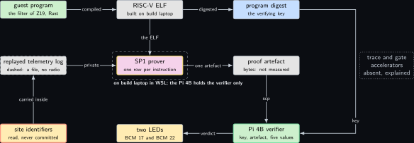
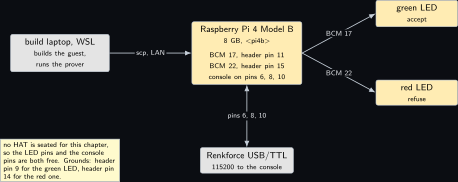
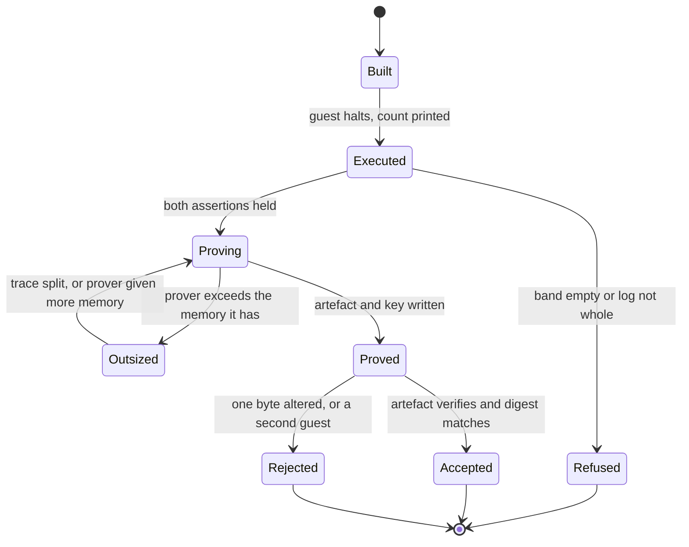
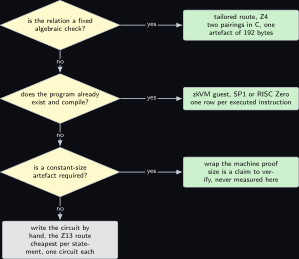
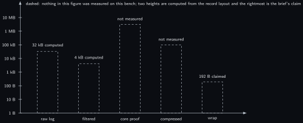

# Project 21. A zero-knowledge virtual machine on the bench

> **Board:** Pi 4B as the verifier and the host of the guest build; the build laptop in WSL compiles everything and runs the prover; two Joy-it LEDs for the verdict  
> **Language:** Rust

> [!IMPORTANT]
> **The question, instanced**
>
> What can a verifier learn from a device without the device revealing itself, and what does it cost on this board? Every earlier chapter answered that by building one circuit for one statement. This one changes the unit: the statement is no longer the satisfaction of a circuit but the execution of a program. The anonymising filter of [Project 19](19-a-commitment-over-nb-iot-and-the-energy.md) is compiled to RISC-V, run inside a zero-knowledge virtual machine, and what the verifier learns is that the filtered series it holds is what that program produces on an input it never sees. The cost is the whole chapter: a general machine commits a row per executed instruction, and this chapter counts the factor that buys.

> **Key facts**
>
> - **Board:** Raspberry Pi 4 Model B Rev 1.4 (8 GB), card A, address \<pi4b\>, as the verifier; the build laptop (Windows 11, WSL, 8 cores, 24 GB, \<build-laptop\>) as the only machine that compiles and as the prover
> - **Parts:** no HAT is seated, so the LED pins and the console pins are both free: a green Joy-it LED on BCM 17 (header pin 11) and a red one on BCM 22 (header pin 15), grounds on header pins 9 and 14; the Renkforce USB/TTL cable on header pins 6, 8 and 10 at 115200
> - **Interface:** SSH and `scp` over the LAN between the build laptop and the Pi 4B; the artefact and the verifying key are two files and nothing else crosses
> - **Language and library:** Rust for both sides. SP1 v6.10.0 \[[6](#references)\] as the machine, with RISC Zero v3.0.6 \[[7](#references)\] as the second instrument on the same guest source; the polynomial commitment layer underneath is the Plonky3 toolkit \[[10](#references)\]. The guest target triple `riscv32im-succinct-zkvm-elf` and the host entry points named in the listing are marked (to verify) against the release the day it is pinned
> - **Primitive:** proving the execution of a program rather than the satisfaction of a circuit; the committed object is the program together with its input, and the proved object is a machine trace \[[6](#references), [7](#references)\]
> - **Secret:** the raw telemetry log of [Project 19](19-a-commitment-over-nb-iot-and-the-energy.md), replayed from a file, and in particular the per-record site identifier that the filter reads and never forwards
> - **Public:** the digest of the committed log, the admitted band $`[\ell, h]`$, the number of records kept, the digest of the filtered series, the program digest that SP1 calls the verifying key, and the proof artefact
> - **Model:** none
> - **Acceptance:** the guest executes to a halt with a printed instruction count; the artefact verifies on the Pi 4B against the same verifying key and lights the green LED; an artefact with one byte altered lights the red LED; a second guest built from a source with one changed constant produces a different verifying key, and the first artefact is then refused
> - **Difficulty:** 4 of 5
> - **Effort:** one evening on the build laptop for the guest and the host, one further evening for the first proof run and its memory ceiling, one afternoon on the Pi 4B for the verifier and the two LEDs

## Pitch

A circuit is written once for one statement and is then cheap. A machine is written once for every statement and is then expensive. That is the whole trade, and this chapter is the one place in the volume where it is costed rather than asserted, as far as two stated inputs allow, one of which is still unread. The guest is small and already exists in prose: the filter of [Project 19](19-a-commitment-over-nb-iot-and-the-energy.md) reads a telemetry log, drops every record whose value falls outside a public band, rounds what survives to a grid, and never copies the site identifier into its output. Compiled to RISC-V and executed inside SP1 \[[6](#references)\], that program yields a proof that the published series is its own output on a log whose digest is public and whose contents are not. Nothing about this is free: the prover commits one row of the arithmetisation per executed instruction, so a software pairing inside the machine costs thousands of rows where [Project 4](04-two-group-elements.md) spends one group operation. The mathematics below states that cost as a lemma with its constant named, and the corollary turns the two counts into a single ratio, derived from one computed input and one figure that has not been read on this bench, and from no measurement anywhere.

## Parts and interface

| **Part** | **Role** | **Interface** | **Address or pin** |
| --- | --- | --- | --- |
| the build laptop, WSL side | the only machine that compiles; builds the guest ELF and the host, and runs the prover | LAN, \<build-laptop\> |  |
| Raspberry Pi 4 Model B | the verifier; it holds the artefact, the verifying key and the public values, and no secret at all | SSH over the LAN, or the Renkforce cable at 115200 | header pins 6, 8, 10 for the console |
| green Joy-it LED | accept; the artefact verified and the program digest matched | GPIO, drive high, anode on the signal pin | BCM 17, header pin 11, ground on pin 9 |
| red Joy-it LED | refuse; the artefact failed, or the digest was a different program | GPIO, drive high | BCM 22, header pin 15, ground on pin 14 |
| the replayed log | the secret input; a file written once by the driver of [Project 19](19-a-commitment-over-nb-iot-and-the-energy.md) and drawn dashed in every figure here | a file on the build laptop |  |
| the artefact and the key | the only two things that cross the LAN | `scp` |  |

No HAT is seated for this chapter, which is why the console pins and the LED pins are both available: the rule of this bench is one HAT per header at a time, and here there is none.

## The secret, the statement and the relation

Write $`I`$ for the guest program, $`x`$ for its private input, $`\tau`$ for the machine trace and $`y`$ for the public output. The relation this chapter proves is

```math
\mathcal{R}_{\mathrm{vm}} = \mathsf{PoK}\Big\{\, \underbrace{(I, x, \tau, r_I, r_x)}_{w} ;\;
  \underbrace{(c_I, c_x, y)}_{u} \;:\;
  \mathsf{Com}(\mathsf{sp}, I; r_I) = c_I \;\wedge\; \mathsf{Com}(\mathsf{sp}, x; r_x) = c_x
  \;\wedge\; \tau \in \mathrm{Tr}(I, x) \;\wedge\; \mathrm{out}(\tau) = y \,\Big\},
```

*(21.1)*

where $`\mathrm{Tr}(I, x)`$ is the set of valid traces defined below. Instanced on this bench, the witness is the replayed log together with its site identifiers, and the statement is

```math
u = \{\, c_x,\; \ell,\; h,\; k,\; c_y \,\},
```

with $`c_x`$ the digest of the log, $`[\ell, h]`$ the admitted band, $`k`$ the number of records kept and $`c_y`$ the digest of the filtered series. The site identifier appears in $`w`$ and in no component of $`u`$, and the theorem below is what makes that an assurance rather than a hope: it says the published $`y`$ is the output of the committed program, and the committed program is the one whose source says the identifier is read and dropped.

## The mathematics

**Definition Z21.1 (Register machine).** A register machine is a triple $`(\Sigma, \mathcal{I}, \delta)`$. A machine state is $`\sigma = (\mathit{pc}, R, \mu) \in \Sigma`$ with a program counter $`\mathit{pc} \in \{0, \ldots, 2^{32} - 1\}`$, a register file $`R : \{0, \ldots, 31\} \to \{0, \ldots, 2^{32} - 1\}`$ and a memory $`\mu : \{0, \ldots, 2^{32} - 1\} \to \{0, \ldots, 255\}`$. A program is a finite map $`I : \mathcal{A} \to \mathcal{I}`$ from addresses to instructions. The one-step function $`\delta_I : \Sigma \rightharpoonup \Sigma`$ is the partial function the instruction set defines; it is undefined exactly on the halting states.

The word *partial function* carries the whole of the theorem that follows: for a given $`I`$, a state has at most one successor. Nondeterminism, if the instruction set admits any, is pushed into the input $`x`$ and so into the witness.

**Definition Z21.2 (Execution trace).** Let $`\mathrm{init}(x) \in \Sigma`$ be the initial state the loader builds from an input $`x`$. A sequence $`\tau = (\sigma_0, \sigma_1, \ldots, \sigma_n)`$ is a *valid trace of $`I`$ on $`x`$*, written $`\tau \in \mathrm{Tr}(I, x)`$, when

```math
\sigma_0 = \mathrm{init}(x), \qquad
  \sigma_{i+1} = \delta_I(\sigma_i) \;\; \text{for every } 0 \le i < n, \qquad
  \delta_I(\sigma_n) \text{ undefined}.
```

*(21.2)*

The output $`\mathrm{out}(\tau)`$ is the designated output region of $`\sigma_n`$, and $`\mathrm{out}_I(x)`$ denotes the output of the run of $`I`$ on $`x`$ when that run halts.

**Theorem Z21.3 (A machine proof carries the committed program's own output).** Assume (a) the argument system for $`\mathcal{R}_{\mathrm{vm}}`$ of Equation (21.1) is knowledge sound with error $`\mathrm{negl}(\lambda)`$, so that from an accepting prover a witness satisfying the relation can be extracted; (b) the commitment $`\mathsf{Com}`$ is binding, which on this bench is Theorem thm:z01\_binding; (c) $`\delta_I`$ is a partial function, as in Definition **Definition Z21.1**. Let the verifier accept a proof on the statement $`(c_I, c_x, y)`$. Then, except with probability $`\mathrm{negl}(\lambda)`$, there are $`I`$ and $`x`$ with $`\mathsf{Com}(\mathsf{sp}, I; r_I) = c_I`$ and $`\mathsf{Com}(\mathsf{sp}, x; r_x) = c_x`$ such that $`y = \mathrm{out}_I(x)`$; and no accepting proof on $`(c_I, c_x, y')`$ with $`y' \ne y`$ exists unless the binding property fails.

*Proof.* By hypothesis (a), from the accepting prover extract a witness $`w = (I, x, \tau, r_I, r_x)`$ that satisfies the relation, which fails only with probability $`\mathrm{negl}(\lambda)`$. The relation gives three facts: the two commitment equations, and $`\tau \in \mathrm{Tr}(I, x)`$ with $`\mathrm{out}(\tau) = y`$.

Write $`\rho_0, \rho_1, \ldots`$ for the states of the actual run of $`I`$ on $`x`$, so $`\rho_0 = \mathrm{init}(x)`$ and $`\rho_{i+1} = \delta_I(\rho_i)`$ wherever defined. We show by induction on $`i`$ that $`\sigma_i = \rho_i`$ for every $`0 \le i \le n`$.

For $`i = 0`$: Equation (21.2) gives $`\sigma_0 = \mathrm{init}(x) = \rho_0`$.

For the step, assume $`\sigma_i = \rho_i`$ for some $`i < n`$. Equation (21.2) gives $`\sigma_{i+1} = \delta_I(\sigma_i)`$, so $`\delta_I`$ is defined at $`\sigma_i`$, hence at $`\rho_i`$, hence $`\rho_{i+1} = \delta_I(\rho_i)`$ exists. By hypothesis (c) $`\delta_I`$ is a function, so it takes one value at the single point $`\sigma_i = \rho_i`$, and therefore $`\sigma_{i+1} = \delta_I(\sigma_i) = \delta_I(\rho_i) = \rho_{i+1}`$. This closes the induction, so $`\sigma_n = \rho_n`$.

Equation (21.2) also says $`\delta_I(\sigma_n)`$ is undefined, so $`\delta_I(\rho_n)`$ is undefined and the run of $`I`$ on $`x`$ halts after exactly $`n`$ steps in the state $`\rho_n = \sigma_n`$. Therefore $`\mathrm{out}_I(x) = \mathrm{out}(\sigma_n) = \mathrm{out}(\tau) = y`$, which is the first claim.

For the second claim, suppose a verifier also accepts a proof on $`(c_I, c_x, y')`$ with $`y' \ne y`$. Extract from it a witness $`(I', x', \tau', r_I', r_x')`$. By the first claim applied to that witness, $`y' = \mathrm{out}_{I'}(x')`$. If $`I = I'`$ and $`x = x'`$ then $`\mathrm{out}_{I'}(x') = \mathrm{out}_I(x)`$, that is $`y' = y`$, contrary to assumption. So $`I \ne I'`$ or $`x \ne x'`$. In the first case $`\mathsf{Com}(\mathsf{sp}, I; r_I) = c_I = \mathsf{Com}(\mathsf{sp}, I'; r_I')`$ with $`I \ne I'`$, which is exactly a binding break; in the second case the same holds for $`x`$ and $`x'`$ against $`c_x`$. By hypothesis (b) each happens only with probability $`\mathrm{negl}(\lambda)`$. &#9632;

**Remark Z21.4.** The theorem says $`y`$ is the output of *the committed* program. It does not say the committed program is the right one. A verifier that has never read the guest source learns only that some program with digest $`c_I`$ produced $`y`$; the step from there to "the site identifier was dropped" is a reading of the source, not a consequence of the proof. This chapter therefore publishes the guest source and its digest together, and the acceptance test checks that a source with one changed constant yields a different digest.

**Lemma Z21.5 (A trace of $`n`$ instructions needs $`\Theta(n)`$ committed rows).** Let the arithmetisation lay out one row per executed instruction, with $`w`$ committed columns per row, and let the evaluation domain be padded to a power of two. Then the number $`N`$ of committed field elements for a trace of $`n \ge 1`$ instructions satisfies

```math
w\,n \;\le\; N \;=\; w \cdot 2^{\lceil \log_2 n \rceil} \;<\; 2\,w\,n .
```

*(21.3)*

*Proof.* By the layout each executed instruction contributes exactly one row, so the trace occupies $`n`$ rows before padding, and padding to the next power of two makes the row count $`2^{\lceil \log_2 n \rceil}`$; multiplying by the $`w`$ columns gives the middle expression.

Put $`k = \lceil \log_2 n \rceil`$. By the definition of the ceiling, $`k \ge \log_2 n`$, hence $`2^k \ge n`$, which is the left inequality after multiplying by $`w > 0`$.

For the right inequality, consider the two cases. If $`n`$ is a power of two then $`\log_2 n`$ is an integer, $`k = \log_2 n`$ and $`2^k = n < 2n`$. If $`n`$ is not a power of two then $`k - 1 < \log_2 n`$, because otherwise $`k - 1`$ would be an integer at least $`\log_2 n`$ and the ceiling would not be $`k`$; so $`2^{k-1} < n`$, that is $`2^k < 2n`$. In both cases $`2^k < 2n`$, and multiplying by $`w > 0`$ gives the right inequality.

Both bounds are linear in $`n`$ with the constants $`w`$ and $`2w`$, so $`N = \Theta(n)`$ with the constant $`w`$. &#9632;

**Remark Z21.8.** The constant of Lemma **Lemma Z21.5** is the column count $`w`$ together with the per-row hashing that turns those columns into a commitment, and that product is precisely what the trace-generation accelerator work addresses \[[8](#references)\]; a gate-level accelerator addresses the other half, the proof over the committed rows \[[9](#references)\]. Neither accelerator is on this bench, so every row here is produced by a general-purpose core on the build laptop.

**Corollary Z21.7 (The factor a general machine pays over a tailored protocol).** Let a tailored protocol perform $`m`$ operations in the base field, as the KZG batch verifier of [Project 4](04-two-group-elements.md) does with the counts of Lemma lem:z01\_counts, and let the same check run as a guest program that needs $`q`$ machine instructions per base-field operation. Then by Lemma **Lemma Z21.5** the machine prover commits $`N`$ field elements with $`w\,q\,m \le N < 2\,w\,q\,m`$, against the tailored prover's $`\Theta(m)`$ field operations. The ratio $`w\,q`$ is therefore committed field elements per base-field operation and not a ratio of like quantities: the tailored prover commits nothing at all in this check, so its committed count is $`0`$ and no finite ratio of committed elements exists. Read $`w\,q`$ as the number of elements the machine must commit for each operation the tailored route simply performs, which is the quantity that sets the prover's bill, and read the two routes’ wall times from [Project 11](11-the-provers-cost.md) rather than from this number.

*Proof.* The guest executes $`n = q\,m`$ instructions by hypothesis, and Lemma **Lemma Z21.5** applied to that $`n`$ gives $`w\,q\,m \le N < 2\,w\,q\,m`$. Dividing the lower bound by the tailored count $`m`$ leaves $`w\,q`$. &#9632;

Both inputs of the corollary can be put at numbers on this bench, and neither is measured: one is computed and the other has not been read, so the product inherits the weaker of the two. For $`q`$: the base field of BLS12-381 is 381 bits, and $`\lceil 381 / 32 \rceil = 12`$ limbs on a 32-bit machine, so one schoolbook product is $`12 \times 12 = 144`$ limb multiplications and the Montgomery reduction adds $`12 \times 12 + 12 = 156`$ more, giving $`144 + 156 = 300`$ limb multiplications, hence $`q \ge 300`$ instructions per field multiplication, computed. For $`w`$: the width of the machine's arithmetisation is taken as 60 columns, a figure taken from the proof system's documentation, not yet read on this bench, and marked (to verify). The product $`60 \times 300 = 18000`$ therefore moves with $`w`$ and is a shape and not a count; reading $`w`$ from the arithmetisation is what would turn it into a computed figure. Read as a shape it says that a general machine commits some four orders of magnitude more field elements per base-field operation than a tailored protocol performs operations in the same check. That is the argument for writing a circuit when the statement is fixed, and the argument for a machine when the statement is a program that already exists.

## The protocol

1. The guest source is fixed and its RISC-V ELF is built on the build laptop; the prover and the verifier both derive the program digest $`c_I`$ from that one file.
2. The prover loads the replayed log as the private input $`x`$ and the band $`[\ell, h]`$ as a public input, executes the guest to a halt, and records the instruction count.
3. The guest commits its public values in order: $`c_x`$, then $`\ell`$, then $`h`$, then the kept count $`k`$, then $`c_y`$. Nothing else is committed, and the site identifiers are in no committed value.
4. The prover generates the artefact over the recorded trace and writes it, with the verifying key, to two files.
5. The two files cross to the Pi 4B by `scp`. Nothing else crosses.
6. The verifier checks the artefact against the verifying key, reads the public values back in the committed order, and compares the program digest against the digest it derived itself in step 1.
7. On success the verifier drives BCM 17 high; on any failure it drives BCM 22 high and prints which of the two checks failed, the artefact or the digest.

## The code

The guest and the host are one Rust workspace with two crates. Names marked (to verify) in the comments are the ones to read from the release before the first build: the entry-point macro, the input and commit calls, the client constructor, the instruction-count accessor and the target triple of the guest ELF.

```rust
// ---- guest crate: compiled to riscv32im-succinct-zkvm-elf  (triple to verify)
#![no_main]
sp1_zkvm::entrypoint!(main);           // entry-point macro name (to verify)

use sha2::{Digest, Sha256};

/// One telemetry record as the driver of Z19 writes it: an index, a value,
/// and a site identifier that must be read and must never be forwarded.
#[derive(Clone, Copy)]
struct Record { idx: u32, value: u16, site: u16 }

fn decode(buf: &[u8]) -> Vec<Record> {
    buf.chunks_exact(8)
        .map(|c| Record {
            idx: u32::from_le_bytes([c[0], c[1], c[2], c[3]]),
            value: u16::from_le_bytes([c[4], c[5]]),
            site: u16::from_le_bytes([c[6], c[7]]),
        })
        .collect()
}

/// Drop every record outside the admitted band, round what survives to a
/// grid of 64 units, and copy no site identifier into the result.
fn filter(rs: &[Record], lo: u16, hi: u16) -> Vec<u16> {
    let mut kept = Vec::new();
    for r in rs {
        let _ = r.site;                 // read, and deliberately not used
        if r.value < lo || r.value > hi { continue; }
        kept.push((r.value / 64) * 64);
    }
    kept
}

pub fn main() {
    let raw: Vec<u8> = sp1_zkvm::io::read::<Vec<u8>>();     // private input
    let lo: u16 = sp1_zkvm::io::read::<u16>();
    let hi: u16 = sp1_zkvm::io::read::<u16>();
    assert!(lo <= hi, "zk21: the admitted band is empty");
    assert!(raw.len() % 8 == 0, "zk21: the log is not whole records");

    // The relation names Com(sp, x; r_x), a randomised commitment. A bare digest of
    // the log is not one: it is deterministic, so a guess at the log can be confirmed
    // against c_x, and the site identifier is only 16 bits wide. Read a blinding value
    // as part of the private input and commit to the blinded digest.
    let r_x: [u8; 32] = sp1_zkvm::io::read::<[u8; 32]>();   // private blinding
    let mut hx = Sha256::new();
    hx.update(&r_x);
    hx.update(&raw);
    let c_x: [u8; 32] = hx.finalize().into();
    let kept = filter(&decode(&raw), lo, hi);
    let mut h = Sha256::new();
    for v in &kept { h.update(v.to_le_bytes()); }
    let c_y: [u8; 32] = h.finalize().into();

    sp1_zkvm::io::commit(&c_x);         // commit call name (to verify)
    sp1_zkvm::io::commit(&lo);
    sp1_zkvm::io::commit(&hi);
    sp1_zkvm::io::commit(&(kept.len() as u32));
    sp1_zkvm::io::commit(&c_y);
}

// ---- host crate on the build laptop: execute, then prove, then write two files
use sp1_sdk::{ProverClient, SP1Stdin};

const ELF: &[u8] = include_bytes!("../../guest/elf/zk21-guest");

fn prove_on_host() {
    let raw = std::fs::read("zk19_telemetry.log").expect("the replayed log");
    let mut stdin = SP1Stdin::new();
    stdin.write(&raw);
    stdin.write(&1200u16);
    stdin.write(&4800u16);
    // the blinding the guest reads for c_x, drawn once per proof on the prover side
    let mut r_x = [0u8; 32];
    rand::thread_rng().fill(&mut r_x[..]);              // generator name (to verify)
    stdin.write(&r_x);

    let client = ProverClient::from_env();              // constructor (to verify)
    let (_values, report) = client.execute(ELF, &stdin).run().expect("execute");
    println!("zk21 instructions={}", report.total_instruction_count());

    let (pk, vk) = client.setup(ELF);
    let proof = client.prove(&pk, &stdin).run().expect("prove");
    proof.save("zk21_proof.bin").expect("save the artefact");
    std::fs::write("zk21_vk.json", serde_json::to_vec(&vk).unwrap()).unwrap();
    let n = std::fs::metadata("zk21_proof.bin").unwrap().len();
    println!("zk21 artefact_bytes={}", n);
}

// ---- verifier crate on the Pi 4B: the only side that must fit in 8 GB
// The digest is the whole of the assurance (Remark rem:z21_honest), so the verifier
// derives the key from the ELF it holds itself and never from the file that travelled
// with the artefact. The two failures are reported apart, as the protocol requires.
const ELF_ON_THE_PI: &[u8] = include_bytes!("../elf/zk21-guest");

enum Verdict { Accept, BadArtefact, BadDigest }

fn verify_on_the_pi() -> Verdict {
    let (_pk, vk_own) = ProverClient::from_env().setup(ELF_ON_THE_PI);
    let proof = sp1_sdk::SP1ProofWithPublicValues::load("zk21_proof.bin").unwrap();
    let vk_sent: sp1_sdk::SP1VerifyingKey =                      // type name to verify
        serde_json::from_slice(&std::fs::read("zk21_vk.json").unwrap()).unwrap();
    if vk_sent.bytes32() != vk_own.bytes32() {                   // accessor to verify
        return Verdict::BadDigest;
    }
    match ProverClient::from_env().verify(&proof, &vk_own) {
        Ok(()) => Verdict::Accept,
        Err(_) => Verdict::BadArtefact,
    }
}
```

```bash
# build laptop, WSL: the guest ELF, the host, then the two files to the Pi
cargo prove build --output-directory guest/elf   # guest build command (to verify)
cargo run --release --bin zk21_host
scp zk21_proof.bin zk21_vk.json <user>@<pi4b>:~/zk21/
```

The authoring laptop runs neither line; it writes the sources and nothing else.

## The model, if any

None. No language model proposes anything here: the guest is a fixed program, the band is a public constant, and there is no proposal for a certifier to check.

## Real, modelled, absent

- **have:** real: the Pi 4B with 8 GB as the verifier, build laptop with 24 GB as the prover and the only machine that compiles, the two Joy-it LEDs on BCM 17 and BCM 22 measured on Saturday 3 October 2026, the Renkforce cable, the LAN between them
- **learn:** modelled: the telemetry log is a file written once by the driver of [Project 19](19-a-commitment-over-nb-iot-and-the-energy.md) and replayed, drawn dashed in every figure here, because no SIM is on the bench and nothing arrives over a radio; the bars of the benchmark figure are expected orders of magnitude and are drawn dashed until a run exists
- **absent:** absent: the trace-generation accelerator \[[8](#references)\] and the gate-level accelerator \[[9](#references)\], neither of which is on this bench, so every committed row is produced by a general-purpose core; and the radio of [Project 19](19-a-commitment-over-nb-iot-and-the-energy.md), so the input is a file
- **learn:** modelled: the verifier cannot check $`c_x`$ against anything on this bench, because the only party that holds the log is the prover. The statement the Pi 4B actually accepts is therefore "some log with digest $`c_x`$ produces this series", and not "the log the device recorded produces this series". Anchoring $`c_x`$ needs the device-side commitment of [Project 2](02-a-sensor-reading-committed-on-the-microcontroller.md), which this chapter does not carry, so the assurance of [Project 19](19-a-commitment-over-nb-iot-and-the-energy.md)'s driver is named here and not claimed

## System architecture



*Figure 21.1. The machine as two halves. Along the top, three solid blocks: the guest program in user-space green, the RISC-V ELF in grey as the public artefact of the build, and the program digest in kernel blue as the verifying key; solid arrows carry the compile and the digest. In the middle, the replayed telemetry log drawn with a dashed outline because it is a file and not a radio, the SP1 prover in the yellow prover style inside a dashed layer that says it lives on the build laptop, and the proof artefact in grey; a solid arrow carries the ELF down into the prover. At the bottom, the site identifiers in the stop-coloured secret style with a solid arrow up into the log that carries them, the Pi 4B verifier in the green verifier style, and the two LEDs as a solid hardware block. To the right, a dotted grey block for the two accelerators that are absent from this bench.*

Read the figure along the two arrows that cross the LAN and no others. Everything above the prover is public by construction: the source, the ELF and its digest. Everything to the left of the prover is secret by construction: the log and the identifiers inside it. The verifier touches only the artefact, the verifying key and the five committed values.

## Wiring



*Figure 21.2. The verifier side is the only wired side. On the left the build laptop as a grey external block, joined to the Raspberry Pi 4 Model B in the middle by one labelled arrow for the two files over the LAN. The Pi is drawn as a solid hardware block with its three pin groups called out: BCM 17 on header pin 11, BCM 22 on header pin 15, and the console on header pins 6, 8 and 10. To the right the green accept LED and the red refuse LED as two solid hardware blocks, each reached by its own labelled arrow. Below the Pi the Renkforce USB/TTL cable as a grey block on a two-headed arrow to the console pins, and a note saying that no HAT is seated, so both pin groups are free.*

| **Signal** | **From** | **To** | **Note** |
| --- | --- | --- | --- |
| accept | Pi 4B BCM 17, header pin 11 | green Joy-it LED anode | drive high; ground on header pin 9; the pin trio was measured on Saturday 3 October 2026 |
| refuse | Pi 4B BCM 22, header pin 15 | red Joy-it LED anode | drive high; ground on header pin 14 |
| console | Renkforce USB/TTL cable | Pi 4B header pins 6, 8 and 10 | 115200; ground on pin 6, the cable's transmit to pin 10 and its receive to pin 8 |
| the two files | build laptop | Pi 4B, \<pi4b\> | `scp` over the LAN; the artefact and the verifying key, and nothing else |

## Sequence and states

```mermaid
sequenceDiagram
  participant A as authoring laptop, authoring only
  participant S as build laptop WSL
  participant P as SP1 prover on the build laptop
  participant B as Pi 4B verifier
  A->>S: guest and host sources; the authoring laptop never compiles
  S->>S: build the guest to a RISC-V ELF, take its digest
  S->>P: the ELF, the replayed log, the public band
  P->>P: execute to a halt, read the instruction count
  P->>P: commit one row per instruction, write the artefact
  P->>B: artefact and verifying key by scp
  B->>B: verify, then compare the program digest
  B->>A: green on BCM 17, or red on BCM 22 with a reason
```



## Decision tree



*Figure 21.3. When a machine earns its factor. The root diamond asks whether the relation is a fixed algebraic check; yes leads to a leaf naming the tailored route of Z4, two pairings in C. No leads to a second diamond asking whether the program already exists and compiles; yes leads to a leaf naming the zkVM guest with SP1 or RISC Zero. No leads to a third diamond asking whether a constant-size artefact is required; yes leads to a leaf naming the wrap, marked as a claim to verify, and no leads to the grey leaf naming a hand-written circuit in the style of Z13.*

## Benchmark



*Figure 21.4. Expected artefact sizes, log scale in bytes, drawn as dashed bars because nothing here has been measured on this bench. From left to right: the raw telemetry log, whose size is computed from the record layout; the filtered series, computed the same way; the core proof artefact and its compressed form, both expected orders of magnitude and both not measured; and the wrapped artefact at the brief's 192 bytes, which is recorded as a claim to verify and never as a measurement. A dashed bar is replaced by a solid one only when a run exists and the acceptance test has passed.*

| **Quantity** | **build laptop** | **Pi 4B** | **Instrument or reason** |
| --- | --- | --- | --- |
| guest instructions per record | not measured | not run | the host's own execute pass prints the count; no run has happened |
| cycles per instruction, prover side | not measured | not run | no timing harness has been attached to the prover |
| committed rows | computed | not run | Lemma **Lemma Z21.5**: between $`w n`$ and $`2 w n`$ for $`n`$ instructions and $`w`$ columns |
| factor over the tailored route | computed from one bound and one unread figure | the same | Corollary **Corollary Z21.7** with $`q \ge 300`$ computed from the limb count, and $`w = 60`$ taken from the proof system's documentation and not yet read on this bench; the product 18000 therefore moves with $`w`$ and is a shape and not a measurement. Reading $`w`$ from the arithmetisation turns this cell into a computed one |
| raw log size | computed | computed | 8 bytes per record by the layout of [Project 19](19-a-commitment-over-nb-iot-and-the-energy.md) |
| core artefact bytes | not measured | not measured | no proof has been generated |
| wrapped artefact bytes | claim to verify | claim to verify | the brief states 192 bytes \[[5](#references)\]; two compressed $`\mathbb{G}_1`$ elements and one compressed $`\mathbb{G}_2`$ element of BLS12-381 are $`2 \times 48 + 96 = 192`$, computed, but whether this toolchain emits exactly that is unread |
| prover peak memory | not measured | not measured | the reason the prover is placed on the build laptop at all is unverified until this cell holds a number |

The only measured numbers anywhere near this chapter remain the paper's, taken on its AWS `c6g.8xlarge` and never copied into a cell above \[[1](#references)\].

## Steps

**Step 1.** On the authoring laptop, write the guest, the host and the verifier sources, and the band constants; commit. Nothing is compiled here.

**Step 2.** On the build laptop in WSL, install the proof system's toolchain, build the guest to its RISC-V ELF, and record the ELF digest in the chapter's record file.

**Step 3.** On the build laptop, run the host's execute pass first and read the instruction count; this is the cheap pass and it either halts or finds the assertion that fails.

**Step 4.** On the build laptop, run the proving pass and watch the resident memory. If it exceeds what the machine has, record the figure and say so rather than moving the run to the Pi, which has less.

**Step 5.** On the build laptop, copy the artefact and the verifying key to the Pi 4B over the LAN, and nothing else.

**Step 6.** On the Pi 4B over ssh, build the verifier, run it against the two files, and drive BCM 17 or BCM 22 from the result.

**Step 7.** On the Pi 4B, repeat with one byte of the artefact altered, and then with the verifying key of a second guest built from a source with one changed constant; both must light the red LED, for two different printed reasons.

**Step 8.** On the build laptop, rebuild the same guest under RISC Zero and repeat steps 3 to 6, so that the two instruments can be compared on one source \[[7](#references)\].

## Acceptance test

The chapter passes when, on one recorded day: the execute pass halts and prints an instruction count greater than zero for a log of exactly 4096 records, which is the size the record file is cut to for this test; the proving pass writes an artefact and a verifying key; the Pi 4B verifies that pair and lights the green LED; the five public values read back in the committed order and the kept count $`k`$ satisfies $`0 \le k \le 4096`$, which is the record count of that file and is the only bound the guest's own loop guarantees; an artefact with one byte altered lights the red LED with the reason "artefact"; and the verifying key of a second guest, built from a source whose grid constant is 32 rather than 64, lights the red LED with the reason "digest". It fails if the verifier accepts an artefact whose verifying key it did not derive itself, if any site identifier appears in any committed value, or if a figure in this chapter carries a solid bar without a named record.

## Variants

**The same guest under RISC Zero.** The one thing swapped is the machine: the guest source is unchanged and is rebuilt for the second instrument \[[7](#references)\], so the statement, the band and the five public values are identical and only the arithmetisation and the artefact differ. What it buys is the only honest comparison available on one bench, because the two provers run the same program on the same input; what it costs is a second toolchain on the build laptop and a second verifier binary on the Pi. By Lemma **Lemma Z21.5** the row count differs only through the column count $`w`$, so a ratio of artefact sizes between the two is a measurement of $`w`$ and of the commitment layer, computed from the same $`n`$. Choose it whenever a cost figure from this chapter is about to be quoted as a property of zero-knowledge machines rather than of one of them. It is this volume's variant and not the brief's, which names one machine only \[[5](#references)\].

**The verifier of a tailored protocol as the guest.** The guest is replaced by the KZG batch verifier of [Project 4](04-two-group-elements.md), so that a verifier's own run becomes the thing proved, and the parts and the language are unchanged. What it buys is recursion in its plainest form: one artefact that stands for a check someone else already performed. What it costs is the factor of Corollary **Corollary Z21.7**, of the order of $`60 \times 300 = 18000`$ committed rows per base field operation, which is a shape while $`w = 60`$ is unread and not a counted figure. Choose it only when the tailored proof must be checked by a party that cannot run a pairing at all. It is the brief's own suggestion of compiling arbitrary logic into a machine \[[5](#references)\], with the bench correction that the prover runs on the build laptop and not on a Pi 3B+.

## Pitfalls

- The program digest is the whole of the assurance, by Remark **Remark Z21.4**. A verifier that accepts a verifying key handed to it with the artefact has checked that some program produced the output, which is close to nothing. Derive the key from the ELF on the verifying side, or pin its digest in the verifier binary.
- The execute pass and the proving pass fail in different ways. An assertion inside the guest stops the cheap pass in seconds; memory stops the expensive one after minutes. Run the cheap pass first, always, and record its instruction count before paying for the second.
- A guest that allocates grows the trace invisibly. The filter here builds one vector whose length is at most the record count, which is bounded by the public log size, so the row count is bounded by a public quantity. A guest whose allocation depends on the secret leaks through the row count, which the verifier can see.
- The authoring laptop does not compile, and a proving toolchain is large enough that the mistake is expensive. Every build line in this chapter names the build laptop.
- The wrap is a claim until it is read. A 192-byte artefact is the size of a Groth16 proof over BLS12-381 by arithmetic, which is why the number is plausible and exactly why it must not be written into a benchmark cell as though it had been produced here.

## Languages and libraries not chosen

- C with `blst` v0.3.17 \[[3](#references)\]: the language of [Project 4](04-two-group-elements.md) and the fastest route to the tailored check; it cannot express "this program ran", which is the one thing this chapter is about.
- Noir \[[4](#references)\]: a circuit written in a domain-specific language is far cheaper per statement, and [Project 13](13-the-obligation-in-noir.md) uses it; the cost is one circuit per statement, which is the opposite trade from this one.
- Go with `gnark` \[[2](#references)\]: a strong circuit toolchain with no RISC-V machine behind it, so the guest would have to be rewritten rather than compiled.
- Python as a host harness: it can drive the proving binary but cannot hold the guest, and the volume's rule keeps Python to front ends and harnesses.

## Sources

- [github.com/succinctlabs/sp1](https://github.com/succinctlabs/sp1) (verified Friday 6 November 2026), the machine, release v6.10.0 of Friday 23 October 2026.
- [github.com/risc0/risc0](https://github.com/risc0/risc0) (verified Friday 6 November 2026), the second instrument, release v3.0.6 of Friday 17 July 2026.
- [github.com/Plonky3/Plonky3](https://github.com/Plonky3/Plonky3) (to verify), the polynomial commitment toolkit underneath.
- [arxiv.org/abs/2605.25493](https://arxiv.org/abs/2605.25493) (verified Friday 6 November 2026), the trace-generation accelerator whose target is the constant of Lemma **Lemma Z21.5**.
- [arxiv.org/abs/2605.00487](https://arxiv.org/abs/2605.00487) (verified Friday 6 November 2026), the paper whose Table 1 holds the only measured figures this volume quotes.

<a id="references"></a>

## References

1. Pascal Berrang, Mirco Giacobbe, Jacob Swales and Xiao Yang. Zero-Knowledge Model Checking. arXiv:2605.00487v2 \[cs.CR\], version 1 submitted Friday 1 May 2026, version 2 Tuesday 8 September 2026. [arxiv.org/abs/2605.00487](https://arxiv.org/abs/2605.00487) (verified Friday 6 November 2026).
2. Consensys. gnark: a fast zk-SNARK library in Go. Release v0.16.4, Wednesday 7 October 2026, carrying a high-severity soundness fix in emulated elliptic-curve scalar multiplication and a BW6-761 pairing fix. The licence is not recorded here because it has not been read; read it from the repository's LICENSE file (to verify). [github.com/Consensys/gnark, latest release](https://api.github.com/repos/Consensys/gnark/releases/latest) (verified Friday 6 November 2026).
3. Supranational. blst: a BLS12-381 signature and pairing library in C and assembly. Release v0.3.17, Friday 24 July 2026. The licence is not recorded here because it has not been read; read it from the repository's LICENSE file (to verify). [github.com/supranational/blst, latest release](https://api.github.com/repos/supranational/blst/releases/latest) (verified Friday 6 November 2026).
4. Aztec. Noir: a domain-specific language for zero-knowledge circuits. Release v1.0.0, Thursday 29 October 2026; 1431 stars when read. The licence is not recorded here because it has not been read; read it from the repository's LICENSE file (to verify). [github.com/noir-lang/noir, latest release](https://api.github.com/repos/noir-lang/noir/releases/latest) (verified Friday 6 November 2026).
5. Advanced hardware-software architectures for edge artificial intelligence and zero-knowledge model checking. A design brief of twenty project sketches, read on Friday 6 November 2026 and held locally at `a local design brief`. It is the input to this second edition and is not a published source; where its hardware claims disagree with the bench, the bench is followed and the disagreement is stated.
6. Succinct Labs. SP1: a zero-knowledge virtual machine that proves the execution of a RISC-V binary. Release v6.10.0, Friday 23 October 2026. The licence is not recorded here because it has not been read; read it from the repository's LICENSE file (to verify). [github.com/succinctlabs/sp1](https://github.com/succinctlabs/sp1) (verified Friday 6 November 2026).
7. RISC Zero. risc0: a RISC-V zero-knowledge virtual machine and proof system. Release v3.0.6, Friday 17 July 2026. The licence is not recorded here because it has not been read; read it from the repository's LICENSE file (to verify). [github.com/risc0/risc0](https://github.com/risc0/risc0) (verified Friday 6 November 2026).
8. Jieran Cui, Zhengkai Wen, Haowen Fang, Yinan Zhu, Jia Xiong, Cheng Ni, Mingchi Zhang, Nan Guan and Xi Wang. ZK-Tracer: a high-performance heterogeneous accelerator for zero-knowledge virtual machine trace generation. arXiv:2605.25493, submitted Monday 25 May 2026, revised Tuesday 26 May 2026. [arxiv.org/abs/2605.25493](https://arxiv.org/abs/2605.25493) (verified Friday 6 November 2026).
9. zkPHIRE: a programmable accelerator for zero-knowledge proofs over high-degree, expressive gates. arXiv:2508.16738, 2025. [arxiv.org/abs/2508.16738](https://arxiv.org/abs/2508.16738) (to verify).
10. Plonky3 contributors. Plonky3: a toolkit for polynomial commitment based proof systems, the backend of several zero-knowledge virtual machines. The licence is not recorded here because it has not been read; read it from the repository's LICENSE file (to verify). [github.com/Plonky3/Plonky3](https://github.com/Plonky3/Plonky3) (to verify).

---

[Previous](20-the-occupancy-counter-that-proves-its-committed-count.md) &nbsp;&nbsp;|&nbsp;&nbsp; [Contents](../CONTENTS.md) &nbsp;&nbsp;|&nbsp;&nbsp; [Next](22-embedded-swift-on-the-microcontroller.md)
