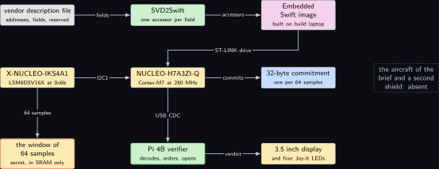
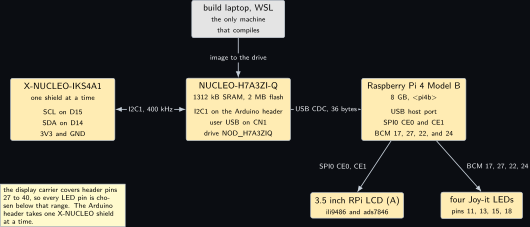
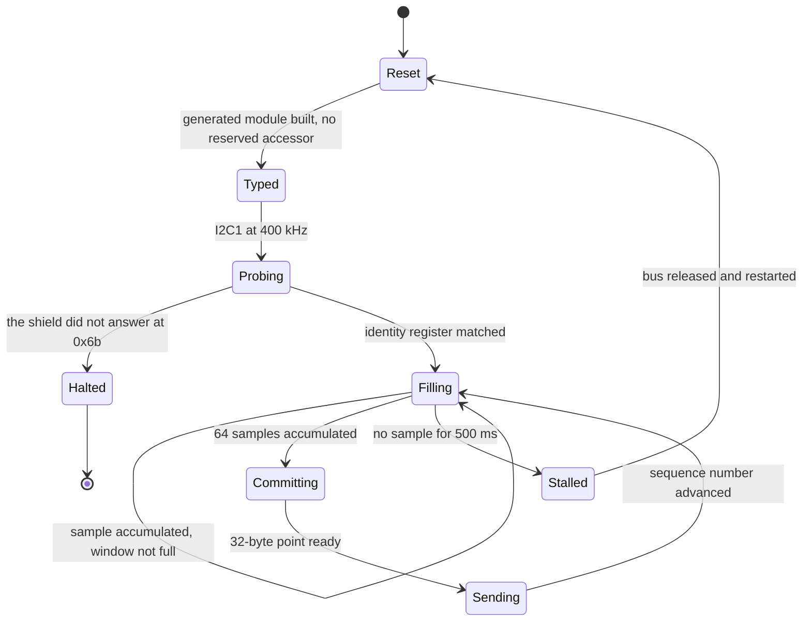
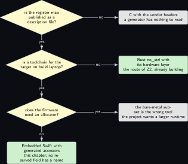
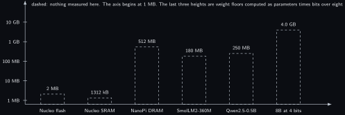

# Project 22. Embedded Swift on the microcontroller

> **Board:** NUCLEO-H7A3ZI-Q with one X-NUCLEO shield on its Arduino header; Pi 4B with the Waveshare 3.5 inch display and four Joy-it LEDs  
> **Language:** Embedded Swift

> [!IMPORTANT]
> **The question, instanced**
>
> What can a verifier learn from a device without the device revealing itself, and what does it cost on this board? Here the cryptography is the control and the language is the variable. The commitment is the one of [Project 2](02-a-sensor-reading-committed-on-the-microcontroller.md), unchanged: a Pedersen commitment to a window of accelerometer samples, 32 bytes leaving over USB CDC, the window never leaving. What changes is that the firmware is written in Embedded Swift with its registers generated from the vendor description file \[[5](#references)\], so the chapter can ask a second and narrower question: what does a typed register discipline actually guarantee, and is any part of that guarantee a guarantee about the proof?

> **Key facts**
>
> - **Board:** NUCLEO-H7A3ZI-Q (STM32H7A3ZI, Cortex-M7 at 280 MHz, 1312 kB SRAM, 2 MB flash) as the prover; Raspberry Pi 4 Model B Rev 1.4 (8 GB), address \<pi4b\>, as the verifier and as the display driver
> - **Parts:** one X-NUCLEO-IKS4A1 on the Nucleo's Arduino header with the LSM6DSV16X at 0x6b, seated alone because the three X-NUCLEO shields fit that header one at a time; the Waveshare 3.5 inch RPi LCD (A) on the Pi's header, ili9486 on SPI0 CE0 and ads7846 touch on CE1; four Joy-it LEDs
> - **Interface:** I2C1 at 400 kHz from the Nucleo to the shield; USB CDC from the Nucleo's user USB to the Pi 4B; the ST-LINK drive `NOD_H7A3ZIQ` for the image; the display on the Pi's SPI0 and the LEDs on BCM 17, 27 and 22, with a fourth on BCM 24 (to verify)
> - **Language and library:** Embedded Swift, the bare-metal subset, with SVD2Swift generating one typed accessor per non-reserved register field \[[5](#references)\]; the ristretto255 arithmetic is a C module imported into Swift, following RFC 9496 \[[7](#references)\]. Every generated name in the listing is marked (to verify) against the tool's own output
> - **Primitive:** the Pedersen commitment $\mathsf{Com}(v; r) = g^v h^r$ of the paper's symbolic scheme \[[1](#references)\], exactly as [Project 2](02-a-sensor-reading-committed-on-the-microcontroller.md) uses it, so that the only variable between the two chapters is the language
> - **Secret:** the window of 64 signed accelerometer samples and the randomness $r \in \mathbb{Z}_p$
> - **Public:** the commitment $c = g^v h^r$, 32 bytes, one per window, with its sequence number; later $(v, r)$ for the windows the verifier asks about
> - **Model:** none
> - **Acceptance:** the generated module contains no accessor whose bit range meets a reserved range, checked by a script over the description file; 100 consecutive windows decode as ristretto points on the Pi 4B with no gap over 7 seconds; ten requested openings verify and ten altered openings are refused; the firmware image fits the 2 MB flash with the figure printed by the build
> - **Difficulty:** 4 of 5
> - **Effort:** two evenings on the build laptop for the toolchain, the generated module and the first image, one afternoon on the bench for the shield, the display and the first hundred windows

## Pitch

The brief proposes this firmware as the flight logic of a small aircraft \[[2](#references)\]. There is no drone on this bench and no aircraft of any kind, so that framing is absent here and is replaced by the one thing the bench can actually hold: a Nucleo with one sensor shield and a window of samples that must not leave. Everything cryptographic is held fixed from [Project 2](02-a-sensor-reading-committed-on-the-microcontroller.md) on purpose. That leaves the language as the only moving part, and makes the chapter's own contribution a narrow and checkable one. Embedded Swift generates its register types from the vendor description file, so a reserved field has no accessor at all; the mathematics below turns that into a definition and a proposition with a proof, and then says plainly what the proposition does not cover. It does not cover the proof system. A commitment computed from a correctly read register and a commitment computed from a wrongly read one are both valid commitments; the type discipline buys a class of firmware defect, not a class of cryptographic one, and a chapter that blurs the two would be selling the language. The second half of the mathematics is an arithmetic correction: the brief runs an 8B model on a 512 MB board, and three lines of division show why that cannot happen here.

## Parts and interface

| **Part** | **Role** | **Interface** | **Address or pin** |
| --- | --- | --- | --- |
| NUCLEO-H7A3ZI-Q | the prover; it reads the window, reduces it and commits; it is shared between volumes, so it is reflashed immediately before every capture | USB CDC to the Pi; the ST-LINK drive for the image | `NOD_H7A3ZIQ`; CN1 for the console |
| X-NUCLEO-IKS4A1 | the sensor; the LSM6DSV16X supplies the window. One shield at a time on this header, which is why no second shield appears anywhere in this chapter | I2C1 at 400 kHz on the Arduino header | LSM6DSV16X at 0x6b; first output register 0x28 |
| Raspberry Pi 4 Model B | the verifier; it decodes the point, checks the sequence number and drives the display and the LEDs | USB CDC from the Nucleo; SSH over the LAN | \<pi4b\> |
| Waveshare 3.5 inch LCD (A) | the verdict surface, 480 by 320 | SPI0 CE0 for the panel, CE1 for the touch controller | its carrier covers header pins 27 to 40 |
| four Joy-it LEDs | accept, refuse, waiting, stalled; anode on the signal pin, drive high | GPIO on pins the display carrier leaves free | BCM 17 pin 11, BCM 27 pin 13, BCM 22 pin 15, BCM 24 pin 18 (to verify) |
| the build laptop, WSL side | every compile; the Swift toolchain, SVD2Swift and the image. The authoring laptop compiles nothing | LAN, and the ST-LINK drive |  |

## The secret, the statement and the relation

Let $s_1, \ldots, s_n$ with $n = 64$ be the signed 16-bit samples of one window, and let

$$
v \;=\; \Big(\sum_{i=1}^{n} s_i\Big) \bmod p \tag{22.1}
$$

be the reduction the firmware computes, with $p$ the order of the ristretto255 group \[[7](#references)\]. The relation is the one of [Project 2](02-a-sensor-reading-committed-on-the-microcontroller.md) with the window of this chapter substituted:

$$
\mathcal{R}_{\mathrm{win}} = \mathsf{PoK}\Big\{\, \underbrace{(s_1, \ldots, s_n, r)}_{w} ;\;
  \underbrace{(c, t)}_{u} \;:\;
  c = g^{\,v} h^{\,r} \;\wedge\;
  v = \Big(\sum_{i=1}^{n} s_i\Big) \bmod p \,\Big\}, \tag{22.2}
$$

with $t$ the sequence number the verifier uses to order the stream. The witness set is

$$
W = \{\, (s_1, \ldots, s_{64}, r) \in (\{-2^{15}, \ldots, 2^{15} - 1\})^{64} \times \mathbb{Z}_p \,\},
$$

and the statement set is $U = \{\, (c, t) \in \mathbb{G} \times \mathbb{N} \,\}$. The two properties the relation rests on are proved once in [Project 1](01-the-price-list.md) and are cited here and not reproved: the commitment is perfectly hiding by Theorem thm:z01\_hiding, so the 32 bytes carry no information about the window at all, and it is binding under the discrete logarithm assumption by Theorem thm:z01\_binding, so an opening the Nucleo later supplies is the window it actually held.

## The mathematics

The new content of this chapter is not cryptographic. It is a statement about what a generated register interface guarantees, written precisely enough that the boundary of the guarantee is visible.

**Definition Z22.1 (Register layout and its typed view).** Let $\mathcal{A}$ be the set of word addresses of a peripheral block. A *register layout* is a finite set $\mathcal{F}$ of fields, each a tuple $f = (a_f, \ell_f, h_f, \kappa_f)$ with an address $a_f \in \mathcal{A}$, a bit range $0 \le \ell_f \le h_f \le 31$, and a kind $\kappa_f \in \{\mathsf{rw}, \mathsf{ro}, \mathsf{wo}, \mathsf{res}\}$, where $\mathsf{res}$ marks a reserved field. Write

$$
\mathrm{bits}(f) = \{\, (a_f, j) \mid \ell_f \le j \le h_f \,\} \tag{22.3}
$$

for the *footprint* of $f$. The layout is *disjoint* when $\mathrm{bits}(f) \cap \mathrm{bits}(g) = \emptyset$ for all $f \ne g$ in $\mathcal{F}$. Write $\mathcal{F}_{\mathrm{acc}} = \{\, f \in \mathcal{F} \mid \kappa_f \ne \mathsf{res} \,\}$ for the accessible fields, and define the *typed view* of the layout as the map

$$
T : \mathcal{F}_{\mathrm{acc}} \to 2^{\mathbb{N}}, \qquad
  T(f) = \{\, 0, 1, \ldots, 2^{\,h_f - \ell_f + 1} - 1 \,\}. \tag{22.4}
$$

A *well-typed read* of $f \in \mathcal{F}_{\mathrm{acc}}$ from a word $W_{a_f} = \sum_{j=0}^{31} b_j 2^j$ is the value

$$
\mathrm{rd}(f) \;=\; \big\lfloor W_{a_f} / 2^{\,\ell_f} \big\rfloor
  \;\bmod\; 2^{\,h_f - \ell_f + 1}, \tag{22.5}
$$

which is the shift and mask the generated accessor emits. A code generator is *faithful* to the layout when it emits an accessor for every $f \in \mathcal{F}_{\mathrm{acc}}$ and for no other field.

**Proposition Z22.2 (A well-typed read cannot reach a reserved field).** Let $\mathcal{F}$ be a disjoint layout, let the generator be faithful to it, and let $f \in \mathcal{F}_{\mathrm{acc}}$. Then

1. $\mathrm{bits}(f) \cap \mathrm{bits}(g) = \emptyset$ for every $g \in \mathcal{F}$ with $\kappa_g = \mathsf{res}$;
2. $\mathrm{rd}(f)$ depends on the bits of $\mathrm{bits}(f)$ and on no other bit of the word $W_{a_f}$;
3. $\mathrm{rd}(f) \in T(f)$.

*Proof.* (1) Let $g \in \mathcal{F}$ with $\kappa_g = \mathsf{res}$. Since $f \in \mathcal{F}_{\mathrm{acc}}$ we have $\kappa_f \ne \mathsf{res}$, so $\kappa_f \ne \kappa_g$ and therefore $f \ne g$ as tuples. The layout is disjoint, so $\mathrm{bits}(f) \cap \mathrm{bits}(g) = \emptyset$.

(2) Write $\ell = \ell_f$, $h = h_f$ and $m = h - \ell + 1$, and write $W_{a_f} = \sum_{j=0}^{31} b_j 2^j$ with $b_j \in \{0,1\}$. Split the sum at $\ell$:

$$
W_{a_f} \;=\; \sum_{j=0}^{\ell-1} b_j 2^j \;+\; 2^{\ell}\sum_{j=\ell}^{31} b_j 2^{\,j-\ell}.
$$

The first sum is at most $2^{\ell} - 1$, so it contributes nothing to the integer quotient and

$$
\big\lfloor W_{a_f} / 2^{\ell} \big\rfloor \;=\; \sum_{j=\ell}^{31} b_j 2^{\,j-\ell}.
$$

Now split that sum at $j = h$:

$$
\sum_{j=\ell}^{31} b_j 2^{\,j-\ell}
  \;=\; \sum_{j=\ell}^{h} b_j 2^{\,j-\ell} \;+\; 2^{m}\sum_{j=h+1}^{31} b_j 2^{\,j-h-1}.
$$

The second term is a multiple of $2^m$ and so vanishes modulo $2^m$; the first term is at most $\sum_{j=\ell}^{h} 2^{\,j-\ell} = 2^{m} - 1 < 2^m$ and so is its own residue. Therefore

$$
\mathrm{rd}(f) \;=\; \sum_{j=\ell}^{h} b_j 2^{\,j-\ell}, \tag{22.6}
$$

whose terms are indexed exactly by $\ell \le j \le h$, that is by $\mathrm{bits}(f)$ of Equation (22.3). No $b_j$ outside that range appears, so by part (1) no bit of any reserved field appears.

(3) From Equation (22.6), $\mathrm{rd}(f) \ge 0$ and $\mathrm{rd}(f) \le \sum_{j=\ell}^{h} 2^{\,j-\ell} = 2^{m} - 1$, so $\mathrm{rd}(f) \in \{0, \ldots, 2^m - 1\} = T(f)$ by Equation (22.4). &#9632;

**Remark Z22.3.** Read the hypotheses and not only the conclusion. The proposition assumes the layout is disjoint and the generator is faithful; both are properties of the description file and of the tool, not of the Swift compiler, so the gate that enforces them is the acceptance test's script over the description file and nothing else. And the conclusion is about firmware. It says a correct accessor reads the bits its field names; it says nothing about whether the sample those bits carry is the right sample, nothing about the commitment, and nothing about the proof. A commitment to a wrongly read window is a perfectly valid commitment to a wrong value, and [Project 16](16-the-model-proposes-a-ranking-function-the-certifier.md) is where that distinction is given its theorem. The language buys a class of firmware defect. It does not buy soundness, and this chapter does not claim it does.

**Lemma Z22.4 (The memory arithmetic that rules the larger model out).** A transformer with $P$ parameters quantised to $b$ bits per parameter needs at least $P b / 8$ bytes of weights resident before any activation, cache or runtime is counted. For $P = 8 \times 10^{9}$ and $b = 4$ that floor is $4.0 \times 10^{9}$ bytes; the NanoPi NEO Air carries $512 \times 2^{20} = 5.37 \times 10^{8}$ bytes of DRAM, so the floor exceeds the whole of memory by a factor of $7.5$. For $b = 2$ the floor is $2.0 \times 10^{9}$ bytes and the factor is $3.7$. In both cases the model does not fit.

*Proof.* Each parameter occupies $b$ bits, so $P$ parameters occupy $P b$ bits, which is $P b / 8$ bytes; this is a floor and not an estimate because nothing has yet been allocated for the activation buffers, the key and value cache, the runtime or the operating system. For $P = 8 \times 10^{9}$ and $b = 4$:

$$
\frac{P b}{8} \;=\; \frac{8 \times 10^{9} \times 4}{8} \;=\; 4.0 \times 10^{9}
  \ \text{bytes}.
$$

The board's DRAM is $512 \times 2^{20} = 512 \times 1048576 = 536870912 \approx 5.37 \times 10^{8}$ bytes. The ratio is

$$
\frac{4.0 \times 10^{9}}{5.37 \times 10^{8}} \;=\; 7.45,
$$

so the weights alone need about seven and a half times the memory the board has. For $b = 2$ the floor halves to $2.0 \times 10^{9}$ bytes and the ratio is $2.0 \times 10^{9} / 5.37 \times 10^{8} = 3.72$. A ratio above one is a refusal, so both cases refuse, and the 8 GB of eMMC does not change this: paging weights from flash changes the latency per token by orders of magnitude and does not change the resident requirement that produced the ratio. &#9632;

**Remark Z22.6.** Lemma **Lemma Z22.4** is why the brief's pairing of an on-device inference runtime \[[3](#references)\] with an 8B model on that board \[[2](#references)\] is corrected rather than followed. The ladder this bench actually runs is the sibling volume's: SmolLM2-360M at 4 bits is $360 \times 10^{6} \times 4 / 8 = 1.8 \times 10^{8}$ bytes, computed, which is about a third of the board's DRAM, and Qwen2.5-0.5B at 4 bits is $2.5 \times 10^{8}$ bytes, computed, which is about half. Neither of those is used in this chapter, which has no model at all; the arithmetic is recorded here because this is the chapter where the brief's claim lands.

## The protocol

1. The Nucleo brings up I2C1 at 400 kHz through the generated accessors and reads the identity register of the LSM6DSV16X at 0x6b, refusing to proceed if it does not answer.
2. It reads one sample every 10 ms from the first output register at 0x28, two bytes, low byte first, and accumulates the signed sum. No sample is stored.
3. After 64 samples it reduces the accumulator modulo $p$ by Equation (22.1), draws $r$ from the hardware random generator, and computes $c = g^v h^r$ on ristretto255 in the imported C module.
4. It writes 36 bytes to the CDC endpoint: a 4-byte sequence number and the 32-byte compressed point. The accumulator and $r$ stay in SRAM and are indexed by the sequence number for a later opening.
5. The Pi 4B decodes the point, checks that the sequence number is the previous one plus one, and draws the verdict on the display with one of the four LEDs.
6. For an audit the Pi asks for a sequence number over the same link; the Nucleo returns $(v, r)$; the Pi recomputes $g^v h^r$ and compares it with the stored point. An altered pair is refused by Theorem thm:z01\_binding.

## The code

The listing is Swift, in the bare-metal Embedded Swift subset, printed in the plain listing environment because this volume has no Swift environment of its own. No allocation happens anywhere in it: the accumulator is a value type, the commitment buffer is a C static, and the window is never stored. Every generated name, the module name, the register and field spellings and the form of the modify closure, is marked (to verify) against the output of SVD2Swift before the first build.

```text
// zk22 firmware, Embedded Swift on the NUCLEO-H7A3ZI-Q.
// One window of 64 accelerometer samples is read from the X-NUCLEO-IKS4A1
// over I2C1, reduced to one scalar, and committed on ristretto255. The
// 32-byte point leaves over USB CDC; the window never does.

import STM32H7A3      // generated by SVD2Swift from the vendor SVD (to verify)
import Ristretto      // C module: pedersen_commit and zk22_commitment

let windowLength = 64
let imuAddress: UInt16 = 0x6b          // LSM6DSV16X on the IKS4A1
let whoAmIRegister: UInt8 = 0x0f
let firstOutputRegister: UInt8 = 0x28

@inline(__always)
func spin(while condition: () -> Bool) {
    while condition() { }
}

// The generated accessors below exist only for non-reserved fields, which
// is Proposition Z22.2 in code form: a reserved range has no name here.
func i2cPointAt(_ register: UInt8) {
    spin(while: { I2C1.isr.busy })
    I2C1.cr2.modify { r in
        r.sadd = imuAddress << 1       // 7-bit address, left aligned
        r.nbytes = 1
        r.rd_wrn = .write
        r.start = true
    }
    spin(while: { !I2C1.isr.txis })
    I2C1.txdr.modify { $0.txdata = register }
    spin(while: { !I2C1.isr.tc })
}

func i2cReadBytes(_ count: UInt8) -> (UInt8, UInt8) {
    I2C1.cr2.modify { r in
        r.sadd = imuAddress << 1
        r.nbytes = count
        r.rd_wrn = .read
        r.start = true
        r.autoend = true
    }
    spin(while: { !I2C1.isr.rxne })
    let low = I2C1.rxdr.rxdata
    if count == 1 { return (low, 0) }
    spin(while: { !I2C1.isr.rxne })
    return (low, I2C1.rxdr.rxdata)
}

func readSample() -> Int16 {
    i2cPointAt(firstOutputRegister)
    let (low, high) = i2cReadBytes(2)
    return Int16(bitPattern: UInt16(high) << 8 | UInt16(low))
}

struct WindowAccumulator {
    private var sum: Int32 = 0
    private var filled = 0

    // Returns the reduced window only when 64 samples have arrived, so no
    // sample is ever held past its own iteration.
    mutating func push(_ sample: Int16) -> Int32? {
        sum &+= Int32(sample)
        filled += 1
        if filled < windowLength { return nil }
        let value = sum
        sum = 0
        filled = 0
        return value
    }
}

@main
struct Firmware {
    static func main() {
        clockSetup()                   // generated reset and clock tree (to verify)
        i2cSetup(hertz: 400_000)
        cdcSetup()
        i2cPointAt(whoAmIRegister)
        let (who, _) = i2cReadBytes(1)
        if who != 0x70 { fault("zk22: the shield did not answer at 0x6b") }

        var window = WindowAccumulator()
        var sequence: UInt32 = 0
        while true {
            waitTick(milliseconds: 10)
            guard let value = window.push(readSample()) else { continue }
            pedersen_commit(value, sequence)   // writes zk22_commitment, 32 B
            cdcSend(sequence)
            cdcSend(&zk22_commitment, 32)
            sequence &+= 1
        }
    }
}
```

```bash
# build laptop, WSL: generate the register module, build, flash
swift run svd2swift --input STM32H7A3.svd --output Sources/STM32H7A3 \
  --peripherals I2C1,RCC,GPIOB,RNG
swift build -c release --triple armv7em-none-none-eabi \
  -Xswiftc -enable-experimental-feature -Xswiftc Embedded
arm-none-eabi-objcopy -O binary .build/release/zk22 zk22.bin && ls -l zk22.bin
cp zk22.bin /mnt/e/            # the ST-LINK drive NOD_H7A3ZIQ, mounted on the build laptop
```

The authoring laptop runs none of these lines. It writes the sources and the description file and nothing else; compiling happens only on the build laptop in WSL.

## The model, if any

None. No language model proposes anything in this chapter. The brief's own model for this sketch is the one Lemma **Lemma Z22.4** rules out on the board the brief names, and the chapter does not substitute another: the question here is about a language, and adding a proposer would add a second variable to an experiment built to have one.

## Real, modelled, absent

- **have:** real: the NUCLEO-H7A3ZI-Q, the X-NUCLEO-IKS4A1 whose addresses were measured on a Pi I2C bus on Wednesday 30 September 2026, the Pi 4B, the Waveshare 3.5 inch LCD (A), the four Joy-it LEDs measured on Saturday 3 October 2026, and the build laptop as the only machine that compiles
- **learn:** modelled: the Embedded Swift toolchain itself, which has not been built on the build laptop yet, so every generated name in the listing is marked to verify; and the bars of the benchmark figure, which are computed sizes and expected orders of magnitude and are drawn dashed
- **absent:** absent: the aircraft of the brief's framing, which is not on this bench in any form and is therefore not drawn at all rather than drawn dotted; a second X-NUCLEO shield on the same header, because the three shields fit it one at a time; and an 8B model on the NanoPi NEO Air, absent by Lemma **Lemma Z22.4** rather than by preference

## System architecture



*Figure 22.1. The language is the variable and the cryptography is the control. Along the top, three solid blocks: the vendor description file in grey, SVD2Swift in user-space green, and the Embedded Swift image in the firmware pink; solid arrows carry the fields into the generator and the accessors into the image, and a further arrow turns down and left to the board as the flashing step. In the middle, the X-NUCLEO-IKS4A1 and the NUCLEO-H7A3ZI-Q as solid hardware blocks joined by the I2C1 arrow, and the 32-byte commitment in kernel blue to their right. At the bottom, the window of 64 samples in the stop-coloured secret style below the shield that produces it, the Pi 4B verifier in the green verifier style below the Nucleo it listens to, and the display with its four LEDs as a solid hardware block. To the right, a dotted grey block for what the brief assumes and this bench does not have.*

The two vertical arrows are the whole honesty of the figure. One carries 64 samples downward into a block that never leaves the Nucleo's SRAM; the other carries 36 bytes to a verifier that can check them and cannot invert them.

## Wiring



*Figure 22.2. Two boards, one shield, one display. On the left the X-NUCLEO-IKS4A1 as a solid hardware block with its four called-out lines: SCL and SDA on the Arduino header, 3V3 and GND. In the middle the NUCLEO-H7A3ZI-Q as a tall solid block naming I2C1, the user USB and the ST-LINK drive. On the right the Raspberry Pi 4 Model B as a tall solid block naming its USB host port, SPI0 CE0 and CE1 for the display, and the three measured LED pins with the fourth marked to verify. Below the Pi the 3.5 inch display and the four LEDs as two solid blocks on their own labelled arrows, and a note recording that the display carrier covers header pins 27 to 40 and that only one shield sits on the Arduino header at a time.*

| **Signal** | **From** | **To** | **Note** |
| --- | --- | --- | --- |
| I2C1 SCL | Nucleo Arduino header, D15 | X-NUCLEO-IKS4A1 SCL | 400 kHz; the shield's own pull-ups are fitted, so none is added |
| I2C1 SDA | Nucleo Arduino header, D14 | X-NUCLEO-IKS4A1 SDA | the LSM6DSV16X answers at 0x6b, measured on Wednesday 30 September 2026 |
| shield supply | Nucleo 3V3 and GND on the Arduino header | X-NUCLEO-IKS4A1 | one shield on this header at a time, which is the whole reason no second sensor appears here |
| USB CDC | Nucleo CN1 user USB | Pi 4B USB host port | 36 bytes per window: 4 for the sequence number and 32 for the point |
| image | build laptop | ST-LINK drive `NOD_H7A3ZIQ` | the board is shared between volumes, so it is reflashed immediately before every capture |
| display | Pi 4B SPI0 | ili9486 panel on CE0, ads7846 touch on CE1 | the carrier covers header pins 27 to 40, so the LED pins are chosen below that range |
| LEDs | Pi 4B BCM 17, 27, 22 and 24 | four Joy-it LEDs | header pins 11, 13, 15 and 18; the first three were measured on Saturday 3 October 2026, the fourth is to verify |

## Sequence and states

```mermaid
sequenceDiagram
  participant S as shield, LSM6DSV16X at 0x6b
  participant N as Nucleo, Embedded Swift
  participant P as Pi 4B verifier
  participant D as 3.5 inch display and four LEDs
  N->>S: read the identity register at 0x0f
  S-->>N: one byte; the firmware stops if it is wrong
  loop 64 samples, one every 10 ms
    N->>S: I2C1 read of 0x28, two bytes
    S-->>N: one signed sample, low byte first
  end
  N->>N: reduce modulo p, draw r, compute g^v h^r
  N->>P: 4 sequence bytes and 32 point bytes over USB CDC
  P->>P: decode the point, check the sequence number
  P->>D: verdict on the panel and one LED of four
```



## Decision tree



*Figure 22.3. Which language for firmware that commits. The root diamond asks whether the register map is published as a machine-readable description file; no leads to the grey leaf naming C with the vendor headers, because a generator has nothing to read. Yes leads to a second diamond asking whether a toolchain for the target exists on the build laptop; no leads to a leaf naming Rust with its hardware abstraction layer, the route of Z2. Yes leads to a third diamond asking whether the firmware needs an allocator; yes leads to the grey leaf saying the bare-metal subset is the wrong tool and the project wants a larger runtime, and no leads to the leaf naming Embedded Swift with its generated accessors, which is this chapter.*

## Benchmark



*Figure 22.4. The memory arithmetic of this chapter, log scale in bytes with the axis beginning at 1 MB, every bar dashed because every height is computed or read from a datasheet and nothing here has been measured on this bench. From left to right: the Nucleo's 2 MB of flash and 1312 kB of SRAM, the NanoPi NEO Air's 512 MB of DRAM, the weight floor of SmolLM2-360M and of Qwen2.5-0.5B at 4 bits, and the weight floor of an 8B model at 4 bits, which stands above the board's whole memory by the factor of Lemma Z22.4. A dashed bar becomes solid only when a run exists and the acceptance test has passed.*

| **Quantity** | **Nucleo** | **Pi 4B** | **Instrument or reason** |
| --- | --- | --- | --- |
| image size in flash | not measured | not applicable | the build prints it; no image has been built, because the toolchain is not on the build laptop yet |
| cycles per commitment | not measured | not applicable | the DWT counter with the MCC 118 as the witness, as in [Project 1](01-the-price-list.md); no capture exists |
| window period | not measured | not measured | 64 samples at 10 ms is 640 ms per window, computed; the achieved period is unmeasured |
| bytes per window | computed | computed | 4 plus 32 is 36 bytes by the protocol above |
| weight floor, 8B at 4 bits | not applicable | not applicable | $4.0 \times 10^{9}$ bytes, computed in Lemma **Lemma Z22.4** |
| NanoPi DRAM | not applicable | not applicable | $5.37 \times 10^{8}$ bytes from the board's own specification \[[10](#references)\] |
| energy per commitment | not measured | no, the PPK2 cannot meter a Pi | the PPK2 can meter the Nucleo; no run exists |

## Steps

**Step 1.** On the authoring laptop, write the firmware sources, the C module interface and the script that checks the description file for overlapping or reserved accessors; commit. Nothing is compiled here.

**Step 2.** On the build laptop in WSL, install the Embedded Swift toolchain, run SVD2Swift over the description file, and read the generated module to confirm that no reserved field has an accessor.

**Step 3.** On the build laptop, build the image for the bare-metal triple, print its size, and refuse to continue if it exceeds the 2 MB of flash.

**Step 4.** On the bench, seat the X-NUCLEO-IKS4A1 on the Nucleo's Arduino header alone, and confirm with a Pi I2C scan on flying leads that the LSM6DSV16X answers at 0x6b before the shield is trusted on the Nucleo.

**Step 5.** On the build laptop, copy the image to the ST-LINK drive `NOD_H7A3ZIQ`. The board is shared between volumes, so this is done immediately before the capture and never earlier.

**Step 6.** On the Pi 4B over ssh, open the CDC device and record 100 windows with their arrival times; draw the verdict on the display and the LEDs.

**Step 7.** On the Pi 4B, ask for ten openings by sequence number, verify each, then alter one byte of each and confirm that all ten are refused.

**Step 8.** On the bench, repeat steps 5 to 7 after a power cycle, so that the first window after reset is covered too.

## Acceptance test

The chapter passes when, on one recorded day: the script over the description file reports zero accessors whose bit range meets a reserved range and zero overlapping fields, so the hypotheses of Proposition **Proposition Z22.2** are checked rather than assumed; the build prints an image size under 2 MB; the firmware stops with its own message when the shield is removed, and runs when it is seated; the Pi 4B records 100 consecutive windows whose sequence numbers increase by one with no gap over 7 seconds; ten openings verify and ten openings with one altered byte are refused; and the window period is reported as a measured figure with its instrument or as "not measured" with its reason. It fails if a reserved field is read anywhere, if any sample appears in any byte that crossed the CDC link, or if the chapter claims the type discipline as a property of the proof.

## Variants

**C with the vendor headers as the control arm.** The one thing swapped is the language: the same commitment, the same shield, the same 36 bytes, written in C17 against the vendor header set instead of a generated Swift module. What it buys is the comparison the chapter exists to make, because the firmware defect class of Proposition **Proposition Z22.2** is exactly the one a C macro cannot exclude; what it costs is the discipline moving from the compiler into review. The arithmetic figure is the image size: a bare-metal Swift image and a C image for the same peripheral set differ by the runtime each carries, a difference computed from the two build outputs and not yet available here, since neither has been built. Choose it when the toolchain for the target does not exist on the build laptop, which today it does not.

**The same firmware on the STWIN.box.** The board is swapped for the STEVAL-STWINBX1, whose microcontroller is an STM32U585AI with TrustZone \[[6](#references)\], so the register description file changes and the generated module with it while the commitment and the relation stay fixed. What it buys is a second description file for the same generator, which is the only honest way to test that the acceptance script generalises; what it costs is that the STWIN.box is a USB-C device with no Arduino header, so no X-NUCLEO shield stacks on it and the window comes from its own IIS3DWB instead. Choose it when the question is the generator rather than the sensor. The brief stacks two shields on that board \[[2](#references)\]; the bench correction is that it has no header to stack them on.

## Pitfalls

- Proposition **Proposition Z22.2** has two hypotheses and they live outside the compiler. A description file with overlapping fields, or a generator that emits an accessor for a reserved range, breaks the conclusion with no warning from the language, which is why the acceptance test checks the file and not the firmware.
- The Nucleo is shared between volumes and carries whatever image was flashed last. A capture taken without reflashing first is a capture of another project, and the build stamp beats the application name as evidence of which image is running.
- Three X-NUCLEO shields exist on this bench and the Arduino header takes one. A plan that needs two sensors at once needs flying leads to a Pi I2C bus, not a stack.
- An accumulator in `Int32` holds 64 samples of a signed 16-bit range without overflow, because $64 \times 2^{15} = 2^{21}$ is far inside $2^{31}$, computed; a longer window or a wider sample needs the arithmetic redone before the type is chosen.
- The display carrier covers header pins 27 to 40, so an LED assigned inside that range is unreachable while the panel is seated. The three measured pins are below it; the fourth is marked to verify for exactly this reason.

## Languages and libraries not chosen

- Rust `no_std` with `stm32h7xx-hal` 0.16.0 \[[8](#references)\] and `cortex-m-rt` 0.7.7 \[[9](#references)\]: the route of [Project 2](02-a-sensor-reading-committed-on-the-microcontroller.md), with typed registers from the same kind of description file and a toolchain that already builds on the build laptop; the delta is that it is already in the volume, so it cannot also be the variable under test.
- C17 with the vendor header set: the shortest path to a working image and the control arm of the first variant above; the delta is the defect class of Proposition **Proposition Z22.2**.
- TinyGo \[[4](#references)\]: another managed language that reaches a Cortex-M, used in a variant of [Project 12](12-a-plonk-gate-for-the-inductive-step.md); the delta is a garbage collector in the commit path, which puts a pause inside the 640 ms window.
- Python in any form: there is no allocator here and no interpreter, and the volume's rule puts nothing in Python on a microcontroller.

## Sources

- [swift.org, Embedded Swift](https://www.swift.org/get-started/embedded/) (to verify), the language subset and the SVD2Swift tool.
- [rfc-editor.org/info/rfc9496](https://www.rfc-editor.org/info/rfc9496) (verified Friday 6 November 2026), the ristretto255 group the commitment uses.
- [wiki.friendlyelec.com, NanoPi NEO Air](https://wiki.friendlyelec.com/wiki/index.php/NanoPi_NEO_Air) (to verify), the 512 MB figure of Lemma **Lemma Z22.4**.
- [github.com/pytorch/executorch](https://github.com/pytorch/executorch) (verified Friday 6 November 2026), the runtime the brief pairs with that board.
- [st.com, STM32U585AI](https://www.st.com/en/microcontrollers-microprocessors/stm32u585ai.html) (to verify), the part behind the second variant.
- [arxiv.org/abs/2605.00487](https://arxiv.org/abs/2605.00487) (verified Friday 6 November 2026), the paper whose symbolic scheme supplies the commitment.

<a id="references"></a>

## References

1. Pascal Berrang, Mirco Giacobbe, Jacob Swales and Xiao Yang. Zero-Knowledge Model Checking. arXiv:2605.00487v2 \[cs.CR\], version 1 submitted Friday 1 May 2026, version 2 Tuesday 8 September 2026. [arxiv.org/abs/2605.00487](https://arxiv.org/abs/2605.00487) (verified Friday 6 November 2026).
2. Advanced hardware-software architectures for edge artificial intelligence and zero-knowledge model checking. A design brief of twenty project sketches, read on Friday 6 November 2026 and held locally at `a local design brief`. It is the input to this second edition and is not a published source; where its hardware claims disagree with the bench, the bench is followed and the disagreement is stated.
3. PyTorch. ExecuTorch: an on-device inference runtime for PyTorch models. Release v1.5.1, Wednesday 23 September 2026. [github.com/pytorch/executorch](https://github.com/pytorch/executorch) (verified Friday 6 November 2026).
4. TinyGo contributors. TinyGo: a Go compiler for microcontrollers and WebAssembly, on LLVM. Release v0.44.0, Wednesday 28 October 2026. [github.com/tinygo-org/tinygo](https://github.com/tinygo-org/tinygo) (verified Friday 6 November 2026).
5. Swift project. Embedded Swift: a subset of Swift for bare-metal and constrained targets, with the SVD2Swift tool for typed register access. [swift.org/get-started/embedded](https://www.swift.org/get-started/embedded/) (to verify).
6. STMicroelectronics. STM32U585AI, an ultra-low-power Cortex-M33 with TrustZone; the microcontroller of the STWIN.box. [st.com, STM32U585AI](https://www.st.com/en/microcontrollers-microprocessors/stm32u585ai.html) (to verify).
7. Henry de Valence, Jack Grigg, Mike Hamburg, Isis Lovecruft, George Tankersley and Filippo Valsorda. The ristretto255 and decaf448 groups. RFC 9496, 2023. [rfc-editor.org/info/rfc9496](https://www.rfc-editor.org/info/rfc9496) (verified Friday 6 November 2026).
8. stm32h7xx-hal contributors. stm32h7xx-hal: a hardware abstraction layer for the STM32H7 series. Version 0.16.0, updated Tuesday 12 March 2024. [crates.io, stm32h7xx-hal](https://crates.io/api/v1/crates/stm32h7xx-hal) (verified Friday 6 November 2026).
9. rust-embedded. cortex-m-rt: the minimal runtime for Cortex-M microcontrollers. Version 0.7.7, updated Thursday 24 September 2026. [crates.io, cortex-m-rt](https://crates.io/api/v1/crates/cortex-m-rt) (verified Friday 6 November 2026).
10. FriendlyElec. NanoPi NEO Air wiki. [wiki.friendlyelec.com, NanoPi NEO Air](https://wiki.friendlyelec.com/wiki/index.php/NanoPi_NEO_Air) (to verify).

---

[Previous](21-a-zero-knowledge-virtual-machine-on-the-bench.md) &nbsp;&nbsp;|&nbsp;&nbsp; [Contents](../CONTENTS.md) &nbsp;&nbsp;|&nbsp;&nbsp; [Next](23-elixir-and-nerves.md)
