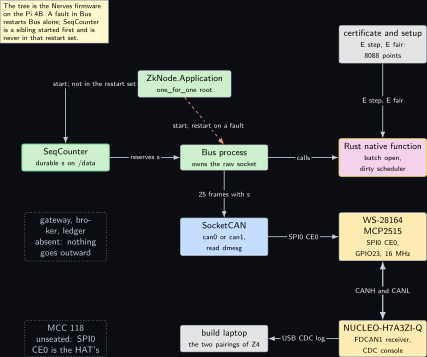
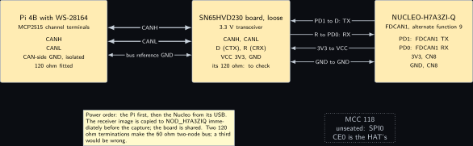
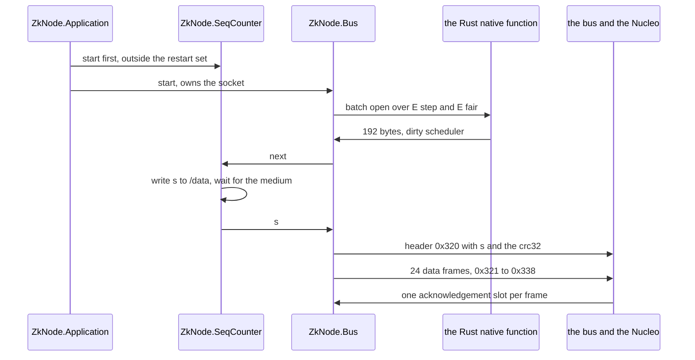
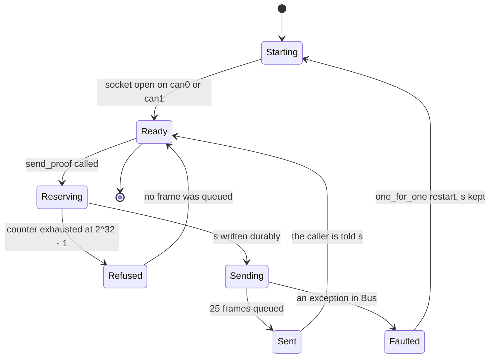
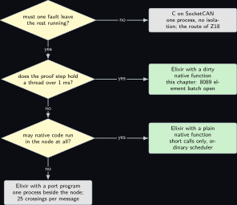
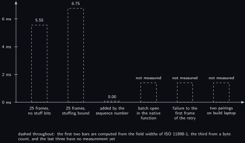

# Project 23. Elixir and Nerves: the CAN node on the Erlang virtual machine

> **Board:** Pi 4B with the WS-28164 HAT (MCP2515 channel) running Nerves as the proving node; NUCLEO-H7A3ZI-Q FDCAN1 on PD0 and PD1 through the loose SN65HVD230 board as the second node; the build laptop as the verifier of record  
> **Language:** Elixir, with a Rust native function

> [!IMPORTANT]
> **The question, instanced**
>
> What can a verifier learn from a device without the device revealing itself, and what does it cost on this board? Here the device is a node whose runtime isolates every part of itself from every other part, and the question gains a second half: when a supervisor restarts one process of the node in the middle of a message, what must the proof still cover? The answer of this chapter is that the cryptography does not change at all, and that one monotone sequence number, written durably before the first frame leaves, is what keeps a restart from putting a committed frame on the bus twice.

> **Key facts**
>
> - **Board:** Raspberry Pi 4 Model B Rev 1.4 (8 GB), card A, address \<pi4b\>, with the Waveshare WS-28164 HAT, running a Nerves firmware; NUCLEO-H7A3ZI-Q (STM32H7A3ZI, Cortex-M7 at 280 MHz), shared between volumes and reflashed immediately before every capture. The design brief names a Raspberry Pi 3 Model B Plus \[[2](#references)\]; the WS-28164 is for the Pi 4B and the Pi 5, so this chapter uses the Pi 4B and says so again in the Pitch
> - **Parts:** the HAT's MCP2515 channel (SPI0 CE0, interrupt GPIO23, 16 MHz crystal, 120 ohm fitted) with its SN65HVD230; the loose SN65HVD230 board at 3.3 V for the Nucleo; jumpers; the MCC 118 unseated because its SPI0 CE0 is the HAT's
> - **Interface:** SocketCAN on the Pi, `can0` or `can1` after reading `dmesg`, 500 kbit/s; FDCAN1 on PD0 (RX) and PD1 (TX) on the Nucleo; the ST-LINK drive `NOD_H7A3ZIQ` and the USB CDC console; the Nerves ssh console on the Pi
> - **Language and library:** Elixir on Nerves v1.15.1 \[[3](#references)\], with the bus access and the proof in a Rust native function built by Rustler against the `socketcan` crate (both names and both versions to verify; neither has an entry in this volume's references yet, and the want is recorded in `build/refs_wanted_z23.md`)
> - **Primitive:** the batch zero-check of [Project 4](04-two-group-elements.md), one quotient commitment per evaluation set, carried in classic CAN frames as [Project 18](18-a-proof-over-the-wire.md) carries them, with a monotone sequence number in the header frame
> - **Secret:** the transition polynomial $`p_T`$ of the committed system and its blinding $`b_T`$; they never leave the native function's stack
> - **Public:** the commitment $`c_T`$, the evaluation sets $`E_{\mathrm{step}}`$ and $`E_{\mathrm{fair}}`$, the 192-byte proof, the 25 identifiers 0x320 to 0x338, the CRC-32 and the sequence number $`s`$
> - **Model:** none; no model proposes anything on this bus
> - **Acceptance:** one message is 25 frames with a sequence number the Nucleo prints; a forced failure of the bus process between two data frames yields a restart, an incomplete first message the Nucleo refuses, and a second complete message with a strictly larger sequence number; the counter file never reads smaller after a restart than before it
> - **Difficulty:** 4 of 5
> - **Effort:** one evening for the supervision tree and the counter, one for the native function on the build laptop, one on the bench for the two mutations and the twenty repeats

## Pitch

The design brief puts this node on a Raspberry Pi 3 Model B Plus and sends its proof onward to a vehicle gateway \[[2](#references)\]. Two sentences of correction, both settled on this bench. The Waveshare WS-28164 is a Pi 4B and Pi 5 expansion board, so the node is the Pi 4B; and nothing in this volume goes outward, so the second node is the Nucleo on the bench's own two-node bus and the verifier of record is the build laptop, with no gateway, no broker and no ledger anywhere in the chapter. What survives the correction is the brief's real idea, which is a runtime question rather than a cryptographic one: the Erlang virtual machine runs each part of the node in its own process with its own heap, and a supervisor restarts a failed part without stopping the rest \[[3](#references)\]. That is a property every embedded engineer wants and it quietly changes what a proof of transport must cover, because a process that is restarted while a message is half sent may send the first half again. The cryptography is unchanged: the commitment still binds by thm:z01\_binding and the batch opening still costs what lem:z01\_counts counts. What is new is one definition, one lemma and one theorem about the supervision tree itself, and the smallest honest mechanism that discharges them, which is a four-byte counter written to the application data partition before the first frame is queued.

## Parts and interface

| **Part** | **Role** | **Interface** | **Address or pin** |
| --- | --- | --- | --- |
| Raspberry Pi 4 Model B | the proving node; runs the Nerves firmware, the supervision tree and the native function | ssh to the Nerves console | \<pi4b\> |
| WS-28164 HAT, MCP2515 channel | the node's bus hardware: MCP2515 at 16 MHz with an SN65HVD230, 120 ohm fitted \[[6](#references)\] | SPI0 CE0, interrupt GPIO23; SocketCAN | `can0` or `can1`, read from `dmesg` after every boot |
| NUCLEO-H7A3ZI-Q | the second node: receives the 25 frames, applies the freshness rule and prints each identifier and sequence number | FDCAN1, the ST-LINK drive, USB CDC | PD0 FDCAN1\_RX, PD1 FDCAN1\_TX; Zio positions to verify in UM2408 \[[5](#references)\] |
| SN65HVD230 board, loose | the Nucleo's transceiver at 3.3 V \[[7](#references)\] | TTL to the Nucleo, CANH and CANL to the HAT | D to PD1, R to PD0, 3V3, GND; its own 120 ohm to check |
| MCC 118 | unseated: its SPI0 CE0 is the HAT's | none | none |
| Verbatim 32 GB microSD card | carries the Nerves firmware and the application data partition that holds the counter file | written on the build laptop | `/data/zk23_seq` |
| the build laptop, WSL side | every compile: the firmware, the native function, the Nucleo image; the verifier of record for the two pairings | LAN | \<build-laptop\> |

## The secret, the statement and the relation

The cryptographic relation is the one [Project 4](04-two-group-elements.md) verifies, the proof of knowledge of a committed polynomial that vanishes on a public set \[[1](#references)\]:

$$
\mathcal{R}_{\mathrm{eval}} = \mathsf{PoK}\Big\lbrace \thinspace  \underbrace{(p, b)}_{w} ;\thickspace  \underbrace{(c_p, E)}_{u} \thickspace :\thickspace 
    c_p = \mathsf{Com}(p; b) \thickspace \wedge\thickspace  \forall e \in E .\thickspace  p(e) = 0 \thinspace \Big\rbrace , \tag{23.1}
$$

instantiated at $`u = (c_T, E_{\mathrm{step}} \cup E_{\mathrm{fair}})`$ with $`|E_{\mathrm{step}} \cup E_{\mathrm{fair}}| = 8088`$, the count [Project 4](04-two-group-elements.md) recomputes and refuses to take on trust. This chapter adds a second relation that no earlier chapter needs, because no earlier chapter has a runtime that may restart the sender. Let $`\mathbb{N}`$ be the sequence numbers and let $`A \subseteq \mathbb{N}`$ be the set a receiver has already accepted. The freshness relation and the transport relation are

$$
\begin{gathered}
\mathcal{R}_{\mathrm{fresh}} = \lbrace \thinspace  (s, A) \in \mathbb{N} \times 2^{\mathbb{N}} \mid s > \max(A \cup \lbrace 0\rbrace ) \thinspace \rbrace ,
   \cr 
  \mathrm{seg}_s(x) = \big((\mathrm{0x320},\thinspace  s_4 \thinspace \Vert \thinspace  \mathrm{crc}_{32}(x)_4),\thinspace 
    (\mathrm{0x321}, x_{0..7}),\thinspace  \dots,\thinspace  (\mathrm{0x338}, x_{184..191})\big), \tag{23.2}
\end{gathered}
$$

where $`x \in \lbrace 0,1\rbrace ^{8 \cdot 192}`$ is the proof, the subscripts are byte counts, and $`\mathrm{seg}_s`$ differs from the segmentation of [Project 18](18-a-proof-over-the-wire.md) in one place only: the four bytes that there carried a length and a fixed tag here carry $`s`$. The length is fixed at 192 by the identifier range instead, so the replay guard costs no additional frame and no additional bus time (computed: $`8 - 4 - 4 = 0`$ spare header bytes, and 25 frames either way). The verdict the second node writes is $`\mathsf{Verify}(c_T, E_{\mathrm{step}} \cup E_{\mathrm{fair}}, \pi_T) \wedge [\thinspace (s, A) \in \mathcal{R}_{\mathrm{fresh}}\thinspace ]`$, and the chapter's mathematics is about the right conjunct.

## The mathematics

**Definition Z23.1 (Supervision tree and its restart function).** A *supervision tree* is a triple $`(P, \mathrm{par}, \mathrm{str})`$ in which $`P`$ is a finite set of processes, $`\mathrm{par} : P \setminus \lbrace \rho\rbrace \to P`$ is a parent function with a single root $`\rho`$ whose graph is acyclic, and $`\mathrm{str}`$ assigns a strategy to every process that has children. Write $`\mathrm{sub}(p) = \lbrace \thinspace q \in P \mid p = q \text{ or } p \text{ is an ancestor of } q \thinspace \rbrace`$ for the subtree at $`p`$. Let $`\mathcal{E}`$ be a set of faults. The *restart function* is the partial function

$$
\mathrm{res} : P \times \mathcal{E} \rightharpoonup 2^{P}, \tag{23.3}
$$

which sends a failure $`(p, \epsilon)`$ to the set of processes that are terminated and started afresh in response to it, and is undefined where the failure is not caught, in which case the whole node restarts. Under the one-for-one strategy at $`\mathrm{par}(p)`$, $`\mathrm{res}(p, \epsilon) = \mathrm{sub}(p)`$: the failed process and its own descendants, and nothing else \[[3](#references)\].

**Definition Z23.2 (Durable monotone sequence).** A *durable counter* is a process $`\kappa \in P`$ holding a value $`n \in \mathbb{N}`$ and a file on a partition that survives a restart, with one operation $`\mathsf{next}`$ whose effect is: read $`n`$, write $`n + 1`$ to the file and wait for the write to reach the medium, set $`n`$ to $`n + 1`$, and return $`n + 1`$. On initialisation $`\kappa`$ reads the file and takes $`n`$ to be its contents, or $`0`$ if the file is absent. Because a process in this runtime serves one message from its mailbox at a time, the calls of $`\mathsf{next}`$ are totally ordered; write $`v_1, v_2, \dots`$ for the values they return in that order and $`n_0`$ for the value at the first initialisation. The *write-before-send rule* is the requirement that the call of $`\mathsf{next}`$ for a message returns before the first frame of that message is queued for transmission.

**Lemma Z23.3 (The counter is outside every restart set of the bus subtree).** Let $`\kappa`$ and $`\beta`$ be distinct children of the root $`\rho`$, let the strategy at $`\rho`$ be one-for-one, and let $`\epsilon`$ be a fault of $`\beta`$ or of any descendant of $`\beta`$. Then $`\kappa \notin \mathrm{res}(q, \epsilon)`$ for the failing process $`q`$, and the value held by $`\kappa`$ is the same after the restart as before it. If instead the failure is not caught and the whole node restarts, the value $`\kappa`$ holds after the restart is not smaller than the value it held before, provided the write-before-send rule's write has reached the medium.

*Proof.* Let $`q \in \mathrm{sub}(\beta)`$ be the failing process. By Definition **Definition Z23.1** the restart set is $`\mathrm{res}(q, \epsilon) = \mathrm{sub}(q) \subseteq \mathrm{sub}(\beta)`$. Now $`\kappa \notin \mathrm{sub}(\beta)`$: were $`\kappa \in \mathrm{sub}(\beta)`$ then either $`\kappa = \beta`$, which contradicts that they are distinct, or $`\beta`$ is an ancestor of $`\kappa`$, so the chain of parents from $`\kappa`$ passes through $`\beta`$; but $`\mathrm{par}(\kappa) = \rho`$ and $`\rho`$ has no parent, so that chain is $`\kappa, \rho`$ and does not contain $`\beta`$, which is not $`\rho`$ because $`\mathrm{par}(\beta) = \rho`$ is defined. Therefore $`\kappa \notin \mathrm{res}(q, \epsilon)`$. A restart terminates and starts afresh exactly the processes of the restart set, so $`\kappa`$ is not terminated, and a process that is not terminated keeps its state; the value is unchanged.

For the uncaught case, $`\kappa`$ is terminated with every other process and is initialised again by reading the file. By Definition **Definition Z23.2** the file holds the value written by the last completed call of $`\mathsf{next}`$, which is the value $`\kappa`$ held, so the value after the restart equals the value before it. If a call of $`\mathsf{next}`$ was in progress, the file holds either the old value or the new one, and both are at least the value held before that call began. In every case the value does not decrease. &#9632;

**Theorem Z23.4 (A restart cannot replay a committed frame).** Let the node obey the write-before-send rule of Definition **Definition Z23.2**, with $`\kappa`$ and the bus process $`\beta`$ arranged as in Lemma **Lemma Z23.3**, and let the receiver accept a message only when its sequence number satisfies (23.2) against the set $`A`$ of numbers it has already accepted. Then

1. two distinct calls of $`\mathsf{next}`$ return distinct values;
2. if the call for one message precedes a restart and the call for another follows it, the second value is strictly greater than the first;
3. no message is accepted twice, and in particular a sequence of frames re-queued by a restarted bus process is never accepted a second time.

*Proof.* (i) By Definition **Definition Z23.2** the calls are totally ordered, and the $`k`$-th call reads the value left by the $`(k-1)`$-th and returns one more than it. Write $`n_{k}`$ for the value held after the $`k`$-th call. Then $`v_1 = n_0 + 1`$ and $`n_1 = v_1`$; and if $`n_{k-1} = n_0 + (k-1)`$ then $`v_k = n_{k-1} + 1 = n_0 + k`$ and $`n_k = v_k`$. By induction $`v_k = n_0 + k`$ for every $`k \ge 1`$. The map $`k \mapsto n_0 + k`$ is strictly increasing on $`\mathbb{N}`$, hence injective, so distinct calls return distinct values.

(ii) Let the $`k`$-th call precede the restart and the $`k'`$-th follow it, $`k < k'`$. Suppose first that the restart is one the supervisor caught. By Lemma **Lemma Z23.3** the value $`\kappa`$ holds is unchanged, so the enumeration of (i) continues without interruption and $`v_{k'} = n_0 + k' > n_0 + k = v_k`$. Suppose instead that the whole node restarted. By Lemma **Lemma Z23.3** the value after the restart, call it $`n'_0`$, satisfies $`n'_0 \ge n_k = v_k`$. Applying (i) to the calls after the restart gives $`v_{k'} = n'_0 + j`$ for some $`j \ge 1`$, hence $`v_{k'} \ge v_k + 1 > v_k`$. In both cases the second value is strictly greater.

(iii) Let $`m`$ be a message that the receiver accepted, with number $`s(m)`$, and suppose a message $`m'`$ with the same 192 bytes is offered afterwards. At that moment $`s(m) \in A`$, so $`\max(A \cup \lbrace 0\rbrace ) \ge s(m)`$, and by (23.2) the receiver accepts $`m'`$ only if $`s(m') > s(m)`$. Two cases. If $`m'`$ is a re-queue of $`m`$ by the restarted bus process, it carries the number already reserved for $`m`$, that is $`s(m') = s(m)`$, and the receiver refuses it. If instead the restarted process called $`\mathsf{next}`$ again, then by (i) and (ii) its number is a value no earlier call returned and is strictly greater than every number issued before the restart; the frames it sends are then a fresh message with a fresh number, which is a new transmission and not a second acceptance of $`m`$. Hence no message is accepted twice. Finally, partial transmissions are covered by the same argument: a message missing one of the 24 data identifiers is refused before its number is examined, exactly as in [Project 18](18-a-proof-over-the-wire.md), so an incomplete first attempt adds nothing to $`A`$ and the retry is judged against the state $`A`$ had before it. &#9632;

**Remark Z23.5 (What the theorem does not say).** The theorem is about this node's own restarts. It says nothing about a third node that records the 25 frames and sends them again later, because such a node can pick any sequence number it likes; the bus has no notion of sender, as [Project 18](18-a-proof-over-the-wire.md) states, and only a signature over the payload and the number would change that. Nor does it say that the message was sent by a node whose system is the committed one: that is the binding property of the commitment, thm:z01\_binding, and it is about the bytes, not about the wire. The theorem's whole content is that the sender cannot be made to repeat itself by a fault in its own supervision tree, which is the one new obligation the runtime creates.

**Proposition Z23.6 (The counter's width, computed).** A four-byte counter admits $`2^{32} = 4294967296`$ messages before it wraps. At one message per second that is $`4294967296 / 31536000 = 136.2`$ years (computed, with 31536000 seconds in a year of 365 days); at the fastest rate this transport allows, one message per 6.75 ms from Proposition prop:z18\_bustime, it is $`4294967296 \times 0.00675 = 2.899 \times 10^{7}`$ seconds, that is 0.92 years (computed). A wrap is a failure of (23.2) and not of the theorem, whose hypothesis is a counter over $`\mathbb{N}`$; the firmware therefore refuses to send when the counter reaches $`2^{32} - 1`$ rather than wrapping in silence.

*Proof.* A four-byte unsigned field takes the values $`0`$ to $`2^{32} - 1`$, which is $`2^{32}`$ values, and $`2^{32} = 4294967296`$. Dividing by the seconds in a year, $`4294967296 / 31536000 = 136.19`$, rounded to 136.2. For the second figure, 6.75 ms is the upper bound on one message's bus time from the stuffing bound of [Project 18](18-a-proof-over-the-wire.md), so the smallest interval between consecutive messages on an idle bus is 6.75 ms and $`4294967296 \times 6.75 \times 10^{-3} = 2.899 \times 10^{7}`$ seconds; dividing by 31536000 gives 0.919, rounded to 0.92. Neither figure is measured: both are arithmetic on a field width and a bit count. &#9632;

## The protocol

1. On the build laptop the firmware is built for the `rpi4` target and written to the card with the application data partition carrying an absent counter file, so the first initialisation starts at $`n_0 = 0`$.
2. On the Pi, after the boot, `dmesg` names which of `can0` and `can1` is the MCP2515 this time; that interface is brought up at 500 kbit/s and the bus process is told its name.
3. The caller hands 192 bytes to the bus process. The bus process calls the native function to produce them if they are not already on the card, then calls $`\mathsf{next}`$ and waits for its reply, which does not return until the write has reached the medium.
4. The bus process queues the header frame 0x320 carrying $`s`$ and the CRC-32, then the 24 data frames 0x321 to 0x338, and replies to its caller with $`s`$ and the frame count.
5. The Nucleo collects the frames, refuses a message with a missing identifier or a failing CRC, refuses a message whose $`s`$ does not satisfy (23.2) against the largest it has accepted, and prints one line per message on its USB CDC console.
6. the build laptop reads the console log and the `candump` log, runs the two pairings of [Project 4](04-two-group-elements.md) on the reassembled bytes, and writes the verdict. Nothing is sent anywhere else.

## The code

Two listings. The first is Elixir, printed in the plain listing environment because this volume has no Elixir mode; it is the supervision tree, the durable counter and the bus process, which together are the subject of Lemma **Lemma Z23.3** and Theorem **Theorem Z23.4**. Every name marked to verify is checked against the installed versions of Nerves \[[3](#references)\], of Rustler and of the `socketcan` crate before the first run; `:file.open` with the `:sync` option, `:file.write`, `:erlang.crc32` and the Rustler attribute for a dirty scheduler are the four that matter most, because the write-before-send rule rests on the first two and the runtime's health on the last.

```text
# zk_node: the supervision tree, the durable counter and the bus process. Elixir on
# Nerves. Shown as one listing; in the firmware these are three files under lib/.
# Names marked (to verify) are read from the installed versions before the first run.

defmodule ZkNode.Application do
  use Application

  @impl true
  def start(_type, _args) do
    # SeqCounter is started first and is a sibling of Bus, never its child: that is
    # the hypothesis of the lemma, and it is the whole mechanism of the theorem.
    children = [
      {ZkNode.SeqCounter, "/data/zk23_seq"},
      {ZkNode.Bus, iface: System.get_env("ZK23_IFACE") || "can0"}
    ]
    Supervisor.start_link(children, strategy: :one_for_one, name: ZkNode.Supervisor)
  end
end

defmodule ZkNode.SeqCounter do
  @moduledoc "The durable monotone sequence of Definition z23_seq."
  use GenServer
  @limit 0xFFFFFFFF

  def start_link(path), do: GenServer.start_link(__MODULE__, path, name: __MODULE__)
  def next, do: GenServer.call(__MODULE__, :next, 5_000)

  @impl true
  def init(path) do
    n =
      case File.read(path) do
        {:ok, <<v::unsigned-big-32>>} -> v
        _ -> 0                                  # absent file: start at zero
      end
    {:ok, %{path: path, n: n}}
  end

  @impl true
  def handle_call(:next, _from, %{path: path, n: n} = st) when n < @limit do
    v = n + 1
    :ok = put(path, v)                          # durable before the reply is sent
    {:reply, {:ok, v}, %{st | n: v}}
  end

  def handle_call(:next, _from, %{n: n} = st) when n >= @limit do
    {:reply, {:error, :exhausted}, st}          # refuse rather than wrap in silence
  end

  defp put(path, v) do
    # :sync asks the driver to carry every write to the medium (to verify).
    {:ok, fd} = :file.open(String.to_charlist(path), [:raw, :binary, :write, :sync])
    r = :file.write(fd, <<v::unsigned-big-32>>)
    :file.close(fd)
    r
  end
end

defmodule ZkNode.Bus do
  @moduledoc "Owns the raw CAN socket. A fault here restarts this process alone."
  use GenServer
  @hdr 0x320
  @first 0x321

  def start_link(opts), do: GenServer.start_link(__MODULE__, opts, name: __MODULE__)

  def send_proof(bytes) when byte_size(bytes) == 192,
    do: GenServer.call(__MODULE__, {:send, bytes}, 10_000)

  @impl true
  def init(opts) do
    iface = Keyword.fetch!(opts, :iface)        # can0 or can1, read from dmesg
    {:ok, sock} = ZkNode.Nif.open(iface)        # socketcan crate name (to verify)
    {:ok, %{sock: sock, iface: iface}}
  end

  @impl true
  def handle_call({:send, bytes}, _from, %{sock: sock} = st) do
    {:ok, s} = ZkNode.SeqCounter.next()         # write-before-send: this blocks
    crc = :erlang.crc32(bytes)                  # :erlang.crc32/1 (to verify)
    :ok = ZkNode.Nif.send_frame(sock, @hdr, <<s::unsigned-big-32, crc::unsigned-big-32>>)
    for {chunk, k} <- Enum.with_index(chunks(bytes)) do
      :ok = ZkNode.Nif.send_frame(sock, @first + k, chunk)
    end
    {:reply, {:ok, s, 25}, st}
  end

  defp chunks(b), do: for(<<c::binary-size(8) <- b>>, do: c)
end
```

The second listing is the Rust native function. A native function runs on the scheduler thread of the process that called it, so a call that holds the thread for more than about one millisecond stalls every other process on that scheduler; the batch opening is a multi-scalar multiplication of 8089 elements by lem:z01\_counts and is nowhere near that budget, so it is declared on a dirty processor scheduler and the frame writes, which are short, are not.

```rust
// native/zk_node_nif/src/lib.rs: the raw socket and the batch zero-check of Z4, as one
// Rustler native function library. Crate and attribute names: to verify.
use rustler::{Binary, NifResult, ResourceArc};
use socketcan::{CanFrame, CanSocket, EmbeddedFrame, Id, Socket, StandardId};
use std::sync::Mutex;

pub struct Sock(Mutex<CanSocket>);

#[rustler::nif]
fn open(iface: String) -> NifResult<ResourceArc<Sock>> {
    let s = CanSocket::open(&iface).map_err(|_| rustler::Error::BadArg)?;
    Ok(ResourceArc::new(Sock(Mutex::new(s))))
}

#[rustler::nif]
fn send_frame(sock: ResourceArc<Sock>, id: u16, data: Binary) -> NifResult<rustler::Atom> {
    let sid = StandardId::new(id).ok_or(rustler::Error::BadArg)?;
    let f = CanFrame::new(Id::Standard(sid), data.as_slice()).ok_or(rustler::Error::BadArg)?;
    let mut g = sock.0.lock().map_err(|_| rustler::Error::BadArg)?;
    g.write_frame(&f).map_err(|_| rustler::Error::BadArg)?;
    Ok(rustler::types::atom::ok())
}

// One multi-scalar multiplication per evaluation set, exactly the batch opening that the
// verifier of Z4 checks with two pairings; 48 bytes per group element, 192 bytes out.
#[rustler::nif(schedule = "DirtyCpu")]
fn prove(coeffs: Binary, points: Binary) -> NifResult<Vec<u8>> {
    let p = crate::poly::parse(coeffs.as_slice());
    let e = crate::poly::parse_points(points.as_slice());
    Ok(crate::kzg::batch_open(&p, &e))
}

rustler::init!("Elixir.ZkNode.Nif", [open, send_frame, prove], load = on_load);
```

```bash
# build laptop, WSL: the firmware for the Pi 4B, then the card
export MIX_TARGET=rpi4
mix deps.get && mix firmware && mix firmware.burn     # the card is written here
# Pi 4B after the boot, over the Nerves ssh console: which channel is the MCP2515
dmesg | grep -i mcp251 ; ip link set can0 up type can bitrate 500000
candump -t a -l can0 &
# in the IEx console: send one message and keep the number it reports
# ZkNode.Bus.send_proof(File.read!("/data/zk03_proof.bin"))
```

## The model, if any

None. No model proposes anything in this chapter: the certificate is computed before the run and checked by the certifier of [Project 16](16-the-model-proposes-a-ranking-function-the-certifier.md), and the node's only decision on the bus is the freshness rule of (23.2), which is arithmetic on two integers.

## Real, modelled, absent

- **have:** real: the WS-28164 on the Pi 4B with its MCP2515 channel, proven as a two-node classic bus on Tuesday 7 October 2026; the loose SN65HVD230 board; the Nucleo's FDCAN1 on PD0 and PD1; the 192-byte proof file of [Project 3](03-the-modems-backoff-machine.md); the frame count and the counter arithmetic of Proposition **Proposition Z23.6**, computed
- **learn:** modelled: the Nerves release, the Rustler attribute for a dirty scheduler, the `socketcan` crate's frame writer and `:file.open` with `:sync` are names to verify against the installed versions \[[3](#references)\]; the application data partition must be confirmed to survive a firmware update before the counter is trusted across one; the durability of a write on a Verbatim card under a power cut is not characterised on this bench and is drawn dashed
- **absent:** absent: the vehicle gateway, the broker and the ledger of the design brief \[[2](#references)\], none of which exists here and none of which this volume would use; the MCC 118, unseated because the HAT's overlays own SPI0 CE0, so there is no witness of bus timing; an oscilloscope or logic analyser; an error injector

## System architecture



*Figure 23.1. The proving node and its supervision tree. On the left a note saying what the tree is. Above, the supervisor block in user-space green, and higher still on the right the public block holding the certificate and the two evaluation sets. In the middle row, three blocks: the durable sequence counter with the control rule's green outline, the bus process in user-space green, and the Rust native function in the prover's yellow outline. A solid arrow from the supervisor starts the counter with the note that it is not in the restart set; a stop-coloured dashed arrow from the supervisor to the bus process carries the restart on a fault; a solid arrow from the counter to the bus process is the reservation of the sequence number; a solid arrow from the bus process to the native function is the call. In the lower rows the hardware chain: the kernel-blue SocketCAN block, the solid WS-28164 MCP2515 channel, the two-wire bus drawn as a thick double line to the solid Nucleo block, and the solid the build laptop block that runs the two pairings. Two dotted grey blocks sit to the left: the absent gateway, broker and ledger, and the unseated MCC 118.*

Read the figure as two independent failures. A fault in the bus process restarts the bus process and nothing else, and the counter block is deliberately drawn outside the arrow that carries the restart; that separation is the whole content of Lemma **Lemma Z23.3**.

## Wiring



*Figure 23.2. The same two-node bus as [Project 18](18-a-proof-over-the-wire.md), with the data flowing the other way. On the left the Pi 4B carrying the WS-28164 as a solid hardware block, with the MCP2515 channel's CANH, CANL and isolated CAN-side ground terminals called out and its 120 ohm fitted. In the middle the loose SN65HVD230 board as a solid hardware block with CANH and CANL on its bus side and D, R, VCC and GND on its logic side, its own 120 ohm marked to check. On the right the NUCLEO-H7A3ZI-Q as a solid hardware block with PD1 for FDCAN1 TX, PD0 for FDCAN1 RX, a 3V3 pin and a GND pin on CN8. Two thick bus lines and one ground reference on the left, four logic lines on the right. Below, a note on the power order and on the MCC 118, and a dotted grey block for the unseated MCC 118.*

| **Signal** | **From** | **To** | **Note** |
| --- | --- | --- | --- |
| CANH | HAT CAN terminal H, MCP2515 channel | SN65HVD230 CANH | twisted with CANL; which terminal block is the MCP2515 channel is read from the HAT's silkscreen \[[6](#references)\] |
| CANL | HAT CAN terminal L, MCP2515 channel | SN65HVD230 CANL |  |
| bus reference | HAT isolated CAN-side GND terminal | SN65HVD230 GND | the HAT is isolated; without this wire the differential pair has no common-mode reference; terminal name to verify on the silkscreen |
| FDCAN1 TX | Nucleo PD1, alternate function 9 | SN65HVD230 D (CTX) | Zio position to verify in UM2408 \[[5](#references)\] |
| FDCAN1 RX | SN65HVD230 R (CRX) | Nucleo PD0, alternate function 9 | the transceiver drives 3.3 V logic; no level shifter |
| 3V3 | Nucleo 3V3 pin, CN8 | SN65HVD230 VCC | the board's Rs pin to GND for full slew rate, position to verify on the board \[[7](#references)\] |
| GND | Nucleo GND, CN8 | SN65HVD230 GND | logic-side reference |
| termination |  |  | the HAT's 120 ohm is fitted; the SN65HVD230 board's 120 ohm, if fitted, completes a correctly terminated two-node bus of 60 ohm; if absent, one 120 ohm across CANH and CANL at the transceiver |

## Sequence and states





## Decision tree



*Figure 23.3. Which runtime for the bus side of a proving node. The root diamond asks whether a fault in one part of the node must leave the rest running; no leads to a leaf naming C on SocketCAN, which is the route of [Project 18](18-a-proof-over-the-wire.md). Yes leads to a second diamond asking whether the proof step holds a thread for more than about one millisecond; yes leads to the leaf for this chapter, Elixir with a Rust native function on a dirty scheduler. No leads to a third diamond asking whether native code may run in the node at all; yes leads to a leaf for a plain native function on an ordinary scheduler, no to a grey leaf for a port program, one operating-system process beside the node, with the frame cost written beside it.*

## Benchmark



*Figure 23.4. Time per message on a linear scale in milliseconds, every bar dashed because nothing here has been measured on this bench. From left to right: the 25 classic frames at their minimum of 5.55 ms and at their maximum with the full stuffing bound of 6.75 ms, both computed in [Project 18](18-a-proof-over-the-wire.md) from the field widths of ISO 11898-1 and unchanged by the sequence number; a bar of height zero for the cost the replay guard adds to bus time, which is nothing because the four bytes replace four bytes; and three empty dashed outlines, for the batch opening in the native function, for the interval between a forced failure and the first frame of the retry, and for the two pairings on the build laptop, all three not measured.*

| **Quantity** | **Value** | **Kind** | **Instrument** |
| --- | --- | --- | --- |
| payload | 192 bytes, 1536 bits | computed | four compressed $`\mathbb{G}_1`$ elements of 48 bytes |
| frames per message | 25 | computed | $`1 + 192 / 8`$, as [Project 18](18-a-proof-over-the-wire.md) |
| bus time per message | 5.55 to 6.75 ms | computed | Proposition prop:z18\_bustime, field widths of ISO 11898-1 \[[4](#references)\] |
| bus time added by the sequence number | 0 ms | computed | four header bytes replace four header bytes |
| counter lifetime at one message per second | 136.2 years | computed | Proposition **Proposition Z23.6** |
| counter lifetime at the fastest rate | 0.92 years | computed | Proposition **Proposition Z23.6** |
| batch opening in the native function | not measured |  | `:timer.tc` around the call; `vcgencmd get_throttled` 0x0 before and after |
| durable write in next | not measured |  | `:timer.tc` around `ZkNode.SeqCounter.next`, on the card this bench has |
| failure to first frame of the retry | not measured |  | the `candump` log's kernel timestamps, which are a driver clock and not the bus |
| messages refused as stale, over 20 forced failures | not measured |  | the Nucleo's CDC console lines |

## Steps

**Step 1.** On the authoring laptop, write the three Elixir modules, the native function and the Nucleo receiver; commit. Nothing is compiled here.

**Step 2.** On the build laptop in WSL, `git pull --ff-only`, set the target to `rpi4`, fetch the dependencies, build the firmware and write the card; confirm that the application data partition is present and that `/data/zk23_seq` is absent.

**Step 3.** On the Pi 4B, unseat the MCC 118, seat the WS-28164, enable the HAT's overlays, boot, read `dmesg` for the MCP2515's interface name, and bring that interface up at 500 kbit/s; `ls /dev/spidev0.0` must fail, which is the sign that the HAT owns the bus.

**Step 4.** On the bench, wire the HAT's MCP2515 terminals to the loose SN65HVD230 board and the board to the Nucleo per the wiring table, with the bus reference; power the Pi first, then the Nucleo from its USB.

**Step 5.** On the build laptop, copy the Nucleo receiver image to `NOD_H7A3ZIQ` immediately before the capture and open the USB CDC console; the board is shared and whatever it ran before is gone.

**Step 6.** On the Pi 4B over the Nerves ssh console, start `candump -t a -l`, send one message, and keep the number the console reports; confirm that the Nucleo prints the same number and that 25 frames are in the log.

**Step 7.** On the Pi 4B, force a failure: send a second message from a build in which the bus process raises an exception after the twelfth data frame. Keep the counter file's contents before and after, the Nucleo's two console lines, and the `candump` log.

**Step 8.** On the Pi 4B, cut the power in the middle of a message, boot again, read the counter file, and send once more; the new number must be strictly larger than the last one the Nucleo accepted.

**Step 9.** Repeat Step 7 twenty times and count the Nucleo's refusals; a refusal is a counted fact, not a failure of the chapter.

**Step 10.** On the build laptop, run the verifier of [Project 4](04-two-group-elements.md) on the reassembled bytes of every accepted message and record the verdicts.

## Acceptance test

The chapter passes when (i) one run yields exactly 25 frames with identifiers 0x320 to 0x338 in the `candump` log, no error frames, and the header's sequence number equal to the number the Nerves console reported; (ii) the Nucleo's console prints the same number and the reassembled 192 bytes compare equal under `cmp` to the file the node read; (iii) [Project 4](04-two-group-elements.md) accepts those bytes on the build laptop; (iv) the forced failure of Step 7 yields a restart in which the Nucleo refuses the incomplete first attempt and accepts a second message whose number is strictly greater, with the counter file strictly larger after than before; (v) the power cut of Step 8 yields a number no smaller than the last accepted one; (vi) over twenty forced failures no number is ever seen twice on the console and no message is accepted twice; (vii) the counter at $`2^{32} - 1`$ yields the exhausted reply and queues no frame, shown by a test build that starts the counter there. It fails if any number repeats, if a message is accepted twice, if the counter file is found inside the restart set, if the MCC 118 is found seated with the HAT, or if any cell of the benchmark table is filled from Proposition **Proposition Z23.6** or from [Project 18](18-a-proof-over-the-wire.md) and labelled as measured.

## Variants

- **the bus side as a port program.** The Rustler native function is replaced by the C receiver and sender of [Project 18](18-a-proof-over-the-wire.md), run as a separate operating-system process beside the node and spoken to over a port. What changes is the language of the bus access, not the supervision tree: the port is itself supervised, so Lemma **Lemma Z23.3** and Theorem **Theorem Z23.4** hold word for word with the port process in place of the bus process. What it costs is one crossing of the port boundary per frame rather than one call for the whole message, 25 crossings against 1 (computed), and one copy of each frame in each direction. What it buys is that no code of this chapter's writing runs on a scheduler thread, so a defect in the native code can no longer stall unrelated processes. Choose it when the node carries work that must not be delayed by the bus side at all; this is the brief's own two automotive sketches \[[2](#references)\] with the gateway removed, because nothing here goes outward.
- **a virtual bus and no second node.** The MCP2515 channel is replaced by a virtual CAN interface on the build laptop under WSL, and the Nucleo by a receiver process on the same machine; the HAT is not seated and the whole bus is drawn dashed. The parts change and the language does not. What it costs is the physical layer entirely: the computed 5.55 to 6.75 ms of bus time per message becomes 0 ms (computed), so no timing claim of any kind survives, and arbitration, acknowledgement and bus-off cannot occur. What it buys is that the restart experiment of Steps 7 to 9 can be run twenty times in a minute with no hardware at all, which is the right way to find a defect in the supervision tree before the bench is wired. Choose it for the first pass over the theorem's mechanism, never for a number.

## Pitfalls

- `can0` and `can1` swap between boots on this HAT; the interface name is read from `dmesg` every time and handed to the bus process, never remembered from the last session.
- The HAT's overlays claim SPI0 CE0 and CE1; the MCC 118 shares CE0 and must be unseated, not merely unused, and `ls /dev/spidev0.0` is the check.
- A durable write is the hypothesis of the theorem, not a detail of the listing. A write that returns before the bytes reach the medium leaves a window in which a power cut loses an increment, and then two messages can carry the same number; the `:sync` option and a read-back after a deliberate power cut are what establish that the window is closed on this card.
- The counter must not live in the state of the bus process. Moving it there is a change of two lines and it silently removes the hypothesis of Lemma **Lemma Z23.3**, after which every restart resets the sequence to zero and the receiver refuses everything until its own high-water mark is passed.
- A native function holds the scheduler thread of its caller. A multi-scalar multiplication of 8089 elements is far longer than the runtime expects of one, so it is declared on a dirty processor scheduler; without that attribute the node's other processes, including the ssh console, stop responding for the duration.
- A Nerves firmware update replaces the root filesystem. The counter file is on the application data partition for that reason, and whether an update preserves that partition is confirmed before the counter is relied on across one.
- The freshness rule is a receiver-side rule and the receiver's high-water mark must be durable too. A Nucleo that forgets its mark on reset accepts a message it has already accepted, and the theorem says nothing about that, because the theorem is about the sender.
- Integrity is not authenticity here either. Any node on the bus can send 25 frames with these identifiers, a consistent CRC and a large number; [Project 18](18-a-proof-over-the-wire.md) says what a signature would add and what it would cost, and this chapter does not claim otherwise.

## Languages and libraries not chosen

- C on SocketCAN, the route of [Project 18](18-a-proof-over-the-wire.md): fewer moving parts and no runtime to learn, and no process isolation at all, so the question this chapter exists to ask cannot be put.
- Rust alone with `socketcan` and a thread per task: the same isolation at the thread level without a supervision tree, so a failure is a panic and the restart policy is written by hand; here the policy is the subject, so the runtime that already has one is the right instrument.
- Erlang rather than Elixir: the same virtual machine, the same supervision tree and the same theorem; Elixir is chosen because Nerves is the embedded platform that carries the firmware assembly and the card image \[[3](#references)\].
- Go with a goroutine per task: cheap concurrency and no supervision, and the volume already spends Go on [Project 12](12-a-plonk-gate-for-the-inductive-step.md).

## Sources

- [arxiv.org/abs/2605.00487](https://arxiv.org/abs/2605.00487) (verified Friday 6 November 2026), the paper, and the batch zero-check of its Section 4.
- [github.com/nerves-project/nerves](https://github.com/nerves-project/nerves) (verified Friday 6 November 2026), the platform, its release and its supervision model.
- [kernel.org, SocketCAN documentation](https://www.kernel.org/doc/html/latest/networking/can.html) (to verify), the raw socket the native function opens.
- [ti.com, SN65HVD230 datasheet](https://www.ti.com/lit/ds/symlink/sn65hvd230.pdf) (to verify), the Rs pin and the 3.3 V logic levels.
- ISO 11898-1:2015 \[[4](#references)\], the frame fields the bus-time figures are computed from; no URL, the standard is not on the web.
- The WS-28164 wiki \[[6](#references)\], the channel assignment and the terminal names; its URL is wanted in the references and is not invented here, and the want is recorded with the two others in `build/refs_wanted_z23.md`.

<a id="references"></a>

## References

1. Pascal Berrang, Mirco Giacobbe, Jacob Swales and Xiao Yang. Zero-Knowledge Model Checking. arXiv:2605.00487v2 \[cs.CR\], version 1 submitted Friday 1 May 2026, version 2 Tuesday 8 September 2026. [arxiv.org/abs/2605.00487](https://arxiv.org/abs/2605.00487) (verified Friday 6 November 2026).
2. Advanced hardware-software architectures for edge artificial intelligence and zero-knowledge model checking. A design brief of twenty project sketches, read on Friday 6 November 2026 and held locally at `a local design brief`. It is the input to this second edition and is not a published source; where its hardware claims disagree with the bench, the bench is followed and the disagreement is stated.
3. Nerves Project. Nerves: an embedded Elixir platform on the Erlang virtual machine. Release v1.15.1, Saturday 24 October 2026. [github.com/nerves-project/nerves](https://github.com/nerves-project/nerves) (verified Friday 6 November 2026).
4. ISO 11898-1:2015. Road vehicles, controller area network (CAN), part 1: data link layer and physical signalling. International Organization for Standardization, 2015. (to verify)
5. STMicroelectronics. UM2408, STM32H7 Nucleo-144 boards (MB1363) user manual. (to verify)
6. Waveshare. Isolated RS232, RS485, CAN and CAN FD expansion HAT for Raspberry Pi, product WS-28164, wiki. (to verify)
7. Texas Instruments. SN65HVD230 3.3 V CAN transceiver datasheet. (to verify)

---

[Previous](22-embedded-swift-on-the-microcontroller.md) &nbsp;&nbsp;|&nbsp;&nbsp; [Contents](../CONTENTS.md) &nbsp;&nbsp;|&nbsp;&nbsp; [Next](24-a-one-bit-model.md)
