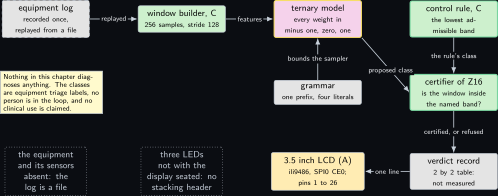
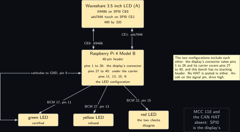
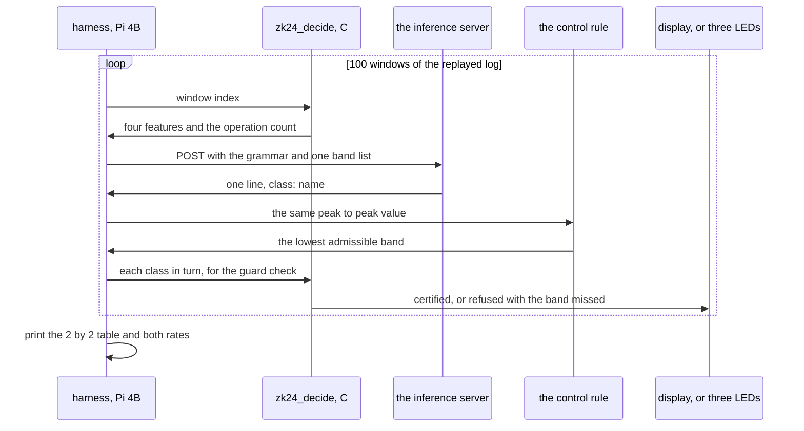
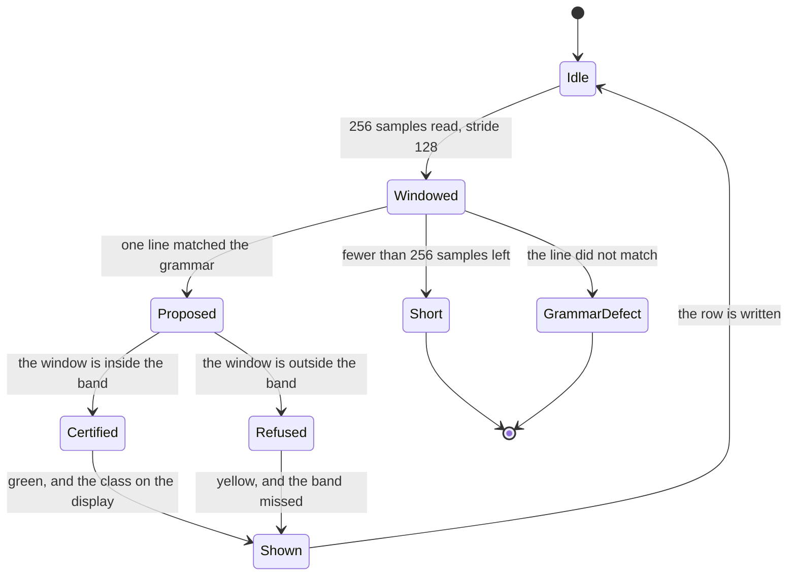
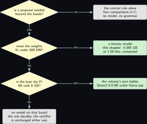

# Project 24. A one-bit model: ternary weights on the Pi

> **Board:** Pi 4B with the Waveshare 3.5 inch RPi LCD (A), or the three Joy-it LEDs in its place; an equipment log recorded once and replayed from a file  
> **Language:** C for the decision path, Python as the harness only

> [!IMPORTANT]
> **The question, instanced**
>
> What can a verifier learn from a device without the device revealing itself, and what does it cost on this board? This chapter narrows the second half to arithmetic: a model whose every weight is one of three values needs no multiplication by a weight at all, and the chapter counts exactly how many operations that saves and exactly what it costs at the decision boundary. The model proposes a triage class for a piece of equipment; the certifier of [Project 16](16-the-model-proposes-a-ranking-function-the-certifier.md) decides; and the honest limit, proved here, is that a margin smaller than the error the quantisation introduces is not preserved by it.

> **Key facts**
>
> - **Board:** Raspberry Pi 4 Model B Rev 1.4 (8 GB), card A, address \<pi4b\>, with nothing else on its header but one of two mutually exclusive configurations
> - **Parts:** the Waveshare 3.5 inch RPi LCD (A), 480 by 320, ili9486 on SPI0 CE0 with ads7846 touch on CE1 \[[7](#references)\], in the display configuration; or three Joy-it LEDs on BCM 17, 27 and 22, measured on Saturday 3 October 2026, in the LED configuration; never both, because the display's connector takes header pins 1 to 26 and its carrier covers pins 27 to 40, and this bench has no stacking header
> - **Interface:** SSH to the Pi; HTTP to the inference server on port 8080 (local, or the build laptop behind the Windows portproxy); the Renkforce USB/TTL cable on header pins 6, 8 and 10 for the console, in the LED configuration only
> - **Language and library:** C17 for the decision path, which holds the ternary layer, the control rule and the certifier's guard check, with `libgpiod` v2.3.2 \[[5](#references)\] for the LEDs; Python only as the harness, with the standard library's `urllib`
> - **Primitive:** a ternary linear layer, as in the one-bit model of \[[2](#references)\], in front of the certification relation of [Project 16](16-the-model-proposes-a-ranking-function-the-certifier.md); the certifier decides and the model proposes
> - **Secret:** none in this chapter's own proof; the replayed log, the features, every proposal and every verdict are public, and the point is what the quantisation costs
> - **Public:** the four class names, the four public guards as closed bands on one feature, the grammar, every proposal, every verdict, the $`2 \times 2`$ agreement table
> - **Model:** BitNet b1.58, whose every weight is in the set with the three values minus one, zero and one \[[2](#references)\], run by its own inference framework \[[3](#references)\]; beside it the volume's existing ladder, Qwen2.5-0.5B, as the small rung; the file size of each is read from its model card
> - **Acceptance:** at least 100 windows per proposer, every line parsed by the grammar, every proposal certified or refused by the C guard check, the agreement table printed with both marginal rates, and the ternary layer's printed operation count equal to the count Lemma **Lemma Z24.2** predicts for the same weights, on every window
> - **Difficulty:** 3 of 5
> - **Effort:** one evening for the decision path in C, one for the harness and the grammar, one afternoon on the Pi for the 100 windows per proposer

## Pitch

The design brief builds this project as a portable medical triage tool that a person types symptoms into \[[1](#references)\]. That is not what is built here, and the correction is the first sentence of the chapter rather than a footnote: the domain is equipment triage from a log of vibration amplitudes that was recorded once and is replayed from a file, nothing in this chapter diagnoses anything, no person is in the loop, and no clinical or medical use is claimed, supported or implied. What survives the correction is the brief's real question, which is arithmetic. A model whose weights are ternary replaces every multiplication by a weight with an addition, a subtraction or an omission, and the chapter counts both sides of that trade exactly rather than quoting a speed-up. It then proves the limit that the counting hides: quantising the weights moves the decision boundary by a bounded amount, a margin above that bound survives, and a margin below it need not, which a two-line construction shows. The verdict is not the model's in any case. The certifier of [Project 16](16-the-model-proposes-a-ranking-function-the-certifier.md) checks the proposed class against its public guard, and the theorem that a wrong proposal costs completeness and never soundness is cited from there and not re-proved here.

## Parts and interface

| **Part** | **Role** | **Interface** | **Address or pin** |
| --- | --- | --- | --- |
| Raspberry Pi 4 Model B | runs the decision path, the harness and, by default, the inference server | SSH | \<pi4b\> |
| Waveshare 3.5 inch RPi LCD (A) | shows the class and the verdict in the display configuration \[[7](#references)\] | ili9486 on SPI0 CE0, ads7846 touch on SPI0 CE1 | its connector takes header pins 1 to 26; its carrier covers pins 27 to 40 |
| three Joy-it LEDs | the verdict in the LED configuration: certified, refused, encodings disagree | `libgpiod` character device \[[5](#references)\] | BCM 17 (pin 11), BCM 27 (pin 13), BCM 22 (pin 15); anode on the signal pin, drive high |
| the equipment log | 20000 samples recorded once and replayed at their own timestamps; the equipment itself is not on the bench | a text file on the card | `z24/log.csv` in the user's home |
| the inference server | serves the ternary model and applies the grammar at sampling time \[[3](#references)\] | POST to `/completion` with a `grammar` field (endpoint to verify) | port 8080 on the Pi or on the build laptop |
| Renkforce USB/TTL cable | the console in the LED configuration, where no display is seated | 3.3 V TTL at 115200 | GND pin 6, TXD pin 8, RXD pin 10 |
| the build laptop, WSL side | every compile; the alternative inference host | LAN | \<build-laptop\> |

## The secret, the statement and the relation

Nothing is hidden in this chapter, so its relation is the certification relation of [Project 16](16-the-model-proposes-a-ranking-function-the-certifier.md) with a different proposer in front of it. Let $`\mathcal{W} = \{\, -1, 0, 1 \,\}`$ be the weight alphabet, let a window of the replayed log be $`v \in \mathbb{R}^{256}`$, and let the feature map be

```math
\phi(v) = \big(\max_i v_i - \min_i v_i,\; \tfrac{1}{256}\textstyle\sum_i |v_i - \bar v|,\;
    |\{\, i \mid |v_i| > 1 \,\}| / 256,\; \max_i |v_i| \big) \in \mathbb{R}^4,
```

*(24.1)*

with $`\bar v`$ the mean of the window. The four classes are $`C = \{\, \mathsf{nominal}, \mathsf{watch}, \mathsf{service}, \mathsf{withdraw} \,\}`$, indexed $`0`$ to $`3`$, and each carries a public guard written as a closed band on the first feature,

```math
G_0 = [0.0,\, 3.0], \quad G_1 = [2.0,\, 5.0], \quad G_2 = [4.0,\, 8.0], \quad
  G_3 = [7.0,\, \infty),
```

*(24.2)*

all in volts, the unit of the replayed log. The bands overlap deliberately, so that more than one class can be admissible on a window and a proposer has something to contribute. The relation the certifier decides is

```math
\mathcal{R}_{\mathrm{cls}} = \{\, (c, v) \in C \times \mathbb{R}^{256} \mid \phi(v)_1 \in G_c \,\},
```

*(24.3)*

and the two proposers are functions into $`C`$: the model $`P_{\mathrm{llm}}`$, bounded by the grammar below, and the control rule $`P_{\mathrm{rule}}`$, which returns the smallest index whose guard admits the window. The statement a later run would prove in zero knowledge is $`(c, v) \in \mathcal{R}_{\mathrm{cls}}`$ for a committed $`v`$; this chapter establishes, as [Project 16](16-the-model-proposes-a-ranking-function-the-certifier.md) does for ranking functions, that the right-hand side does not depend on which proposer produced $`c`$.

## The mathematics

**Definition Z24.1 (Ternary linear layer).** Let $`m, n \ge 1`$. A *ternary linear layer* is a pair $`(W, \beta)`$ with $`W \in \{-1, 0, 1\}^{m \times n}`$ and $`\beta \in \mathbb{R}_{>0}^{m}`$, acting on $`x \in \mathbb{R}^n`$ by

```math
L(x)_i = \beta_i \sum_{j=1}^{n} w_{ij}\, x_j, \qquad i = 1, \dots, m.
```

*(24.4)*

It is obtained from a real matrix $`A \in \mathbb{R}^{m \times n}`$ by the mean-magnitude quantiser of \[[2](#references)\]: with $`\beta_i = \frac{1}{n}\sum_{j} |a_{ij}|`$ assumed positive,

```math
w_{ij} = \mathrm{clip}\Big(\Big\lfloor \frac{a_{ij}}{\beta_i} \Big\rceil, -1, 1\Big),
```

*(24.5)*

where $`\lfloor \cdot \rceil`$ is rounding to the nearest integer, ties away from zero, and $`\mathrm{clip}(t, -1, 1) = \max(-1, \min(1, t))`$. The *cost model* counts one addition and one subtraction alike as one *additive operation*, counts one real multiplication as one *multiplication*, and counts a sign change as free, it being a flip of one bit of a floating-point word.

**Lemma Z24.2 (A ternary product needs only additions and subtractions).** Let $`(W, \beta)`$ be a ternary linear layer and $`x \in \mathbb{R}^n`$. For each row $`i`$ put $`p_i = |\{\, j \mid w_{ij} = 1 \,\}|`$ and $`q_i = |\{\, j \mid w_{ij} = -1 \,\}|`$, and $`k_i = p_i + q_i`$. Then $`L(x)`$ is computed with

```math
\sum_{i=1}^{m} \max(k_i - 1,\, 0) \;\le\; mn - m \quad \text{additive operations and} \quad
  m \quad \text{multiplications},
```

*(24.6)*

and with no multiplication by any entry of $`W`$. The dense layer $`x \mapsto A x`$ over the same shape costs $`mn`$ multiplications and $`m(n-1)`$ additive operations. Hence the ternary layer performs a fraction $`1/n`$ of the multiplications of the dense layer, and no more additive operations than it.

*Proof.* Fix a row $`i`$ and let $`P_i`$ and $`N_i`$ be the index sets of the entries equal to $`1`$ and to $`-1`$. By (24.4), and because the entries of $`W`$ outside $`P_i \cup N_i`$ are zero,

```math
L(x)_i = \beta_i \Big( \sum_{j \in P_i} x_j - \sum_{j \in N_i} x_j \Big).
```

Consider the inner expression. If $`k_i = 0`$ both sums are empty and the value is $`0`$; no operation is performed. If $`k_i \ge 1`$, evaluate it by taking the term of the smallest index as the initial accumulator, which is $`x_j`$ if that index lies in $`P_i`$ and $`-x_j`$ if it lies in $`N_i`$, a sign change and therefore free by the cost model, and then adding or subtracting the remaining $`k_i - 1`$ terms one at a time. Each such step is one additive operation, so $`k_i - 1`$ of them are performed. This is also the least possible number: each binary additive operation takes two values and leaves one, so it lowers the number of values still to be combined by exactly one, and reducing $`k_i`$ values to one value needs $`k_i - 1`$ of them. No entry of $`W`$ was multiplied by anything: the entries equal to $`0`$ caused a term to be omitted, the entries equal to $`1`$ an addition, and the entries equal to $`-1`$ a subtraction. Multiplying by $`\beta_i`$ is one multiplication per row, hence $`m`$ in total.

Summing over the rows gives $`\sum_i \max(k_i - 1, 0)`$ additive operations. Since $`k_i \le n`$ for every row, $`\max(k_i - 1, 0) \le n - 1`$, and summing the bound over the $`m`$ rows gives $`m(n-1) = mn - m`$.

For the dense layer, $`(Ax)_i = \sum_{j=1}^n a_{ij} x_j`$ is $`n`$ products and the sum of $`n`$ values, which by the counting argument above is $`n - 1`$ additive operations; over $`m`$ rows that is $`mn`$ multiplications and $`m(n-1)`$ additive operations. The ratio of multiplications is $`m / (mn) = 1/n`$, and the ternary count of additive operations is at most $`m(n-1)`$, which is the dense count. &#9632;

**Example Z24.3 (The two instances this chapter uses, computed).** For the decision path's own layer, $`m = n = 4`$: the dense form costs $`16`$ multiplications and $`12`$ additive operations, the ternary form at most $`12`$ additive operations and $`4`$ multiplications, a ratio of multiplications of $`1/4`$ (computed). For one square layer of the model at $`m = n = 2048`$: the dense form costs $`2048^2 = 4194304`$ multiplications and $`2048 \times 2047 = 4192256`$ additive operations, the ternary form $`2048`$ multiplications and at most $`4192256`$ additive operations, a ratio of multiplications of $`1/2048`$ (computed). Neither figure is a time: a multiplication and an addition do not cost the same on a Cortex-A72 and nothing here has been timed, so the benchmark table reads not measured for every duration.

**Proposition Z24.4 (A margin smaller than the quantisation error is not preserved).** Let $`a \in \mathbb{R}^n`$ be one row of a dense layer, let $`(w, \beta)`$ be its ternary quantisation by (24.5), and write $`e = \beta w - a`$ for the coefficient error. For $`x \in \mathbb{R}^n`$ let $`s(x) = \langle a, x \rangle`$ and $`\hat s(x) = \beta \langle w, x \rangle`$ be the dense and the quantised scores. Then:

1. if $`|s(x)| > \|e\|_2 \|x\|_2`$ then $`\hat s(x)`$ has the same sign as $`s(x)`$, so the decision $`\mathrm{sign}(s)`$ is preserved;
2. the bound is not vacuous and cannot be improved to zero: for every $`\varepsilon \in (0, 2/3)`$ and every $`\delta \in (0, \varepsilon)`$ there are $`a`$ and $`x`$ in $`\mathbb{R}^2`$ with $`s(x) > 0`$ and $`\hat s(x) < 0`$, the margin being $`s(x) = \varepsilon - \delta + \varepsilon\delta`$, which falls to $`\varepsilon^2`$ as $`\delta`$ rises to $`\varepsilon`$ and to zero only when $`\varepsilon`$ is taken to zero as well; so for every positive $`\eta`$ there is a pair with $`0 < s(x) < \eta`$ and $`\hat s(x) < 0`$, and no positive margin is safe without reference to $`\|e\|_2`$;
3. each coordinate of the error of an unclipped entry satisfies $`|e_j| \le \beta/2`$, so $`\|e\|_2 \le (\beta/2)\sqrt{n}`$ and a margin above $`(\beta/2)\sqrt{n}\,\|x\|_2`$ is safe.

*Proof.* (i) By the definition of $`e`$, $`\hat s(x) = \langle \beta w, x \rangle = \langle a + e, x \rangle = s(x) + \langle e, x \rangle`$, and by the Cauchy-Schwarz inequality $`|\langle e, x \rangle| \le \|e\|_2 \|x\|_2`$. Suppose $`s(x) > \|e\|_2\|x\|_2`$. Then $`\hat s(x) \ge s(x) - |\langle e, x\rangle| \ge s(x) - \|e\|_2\|x\|_2 > 0`$. If instead $`s(x) < -\|e\|_2\|x\|_2`$ then $`\hat s(x) \le s(x) + \|e\|_2\|x\|_2 < 0`$. In both cases the sign is unchanged.

(ii) The construction is two lines. Take

```math
a = (1,\; 1 - \varepsilon), \qquad x = (1,\; -1 - \delta),
  \qquad 0 < \delta < \varepsilon < 2/3 .
```

Then $`\beta = \tfrac{1}{2}(|1| + |1 - \varepsilon|) = 1 - \varepsilon/2 > 0`$, and the two quantised entries are both $`1`$: for the first, $`a_1/\beta = 1/(1 - \varepsilon/2) > 1`$, which clips to $`1`$; for the second, $`a_2/\beta = (1-\varepsilon)/(1-\varepsilon/2)`$, which is at most $`1`$ and is at least $`1/2`$, because $`(1 - \varepsilon) \ge \tfrac{1}{2}(1 - \varepsilon/2)`$ is equivalent to $`2 - 2\varepsilon \ge 1 - \varepsilon/2`$, that is to $`1 \ge \tfrac{3}{2}\varepsilon`$, that is to $`\varepsilon \le 2/3`$, which holds; so it rounds to $`1`$. Hence $`w = (1, 1)`$. Now

```math
\begin{aligned}
s(x) &= 1 \cdot 1 + (1 - \varepsilon)(-1 - \delta)
        = 1 - (1 + \delta - \varepsilon - \varepsilon\delta)
        = \varepsilon - \delta + \varepsilon\delta \;>\; 0,
    \quad \text{since } \delta < \varepsilon, \\
  \hat s(x) &= \beta\big(1 \cdot 1 + 1 \cdot (-1 - \delta)\big) = -\beta\delta
        = -(1 - \varepsilon/2)\,\delta \;<\; 0,
    \quad \text{since } \delta > 0 \text{ and } \varepsilon < 2 .
\end{aligned}
```

The signs differ. As $`\delta`$ rises to $`\varepsilon`$ the margin $`s(x) = \varepsilon - \delta + \varepsilon\delta`$ falls to $`\varepsilon^2 > 0`$ and, taking $`\varepsilon`$ small as well, to zero; so there is no positive margin below which the sign is guaranteed, and in particular the bound of (i) cannot be replaced by zero. For this pair, $`e = \beta w - a = (-\varepsilon/2,\; \varepsilon/2)`$ and $`\|e\|_2 = \varepsilon/\sqrt{2}`$, which is consistent with (i): the flipped margin $`\varepsilon - \delta + \varepsilon\delta`$ is below $`\|e\|_2\|x\|_2`$ for the $`\delta`$ chosen.

(iii) If the entry is not clipped, $`w_j = \lfloor a_j/\beta \rceil`$, so $`|a_j/\beta - w_j| \le 1/2`$ by the definition of rounding to the nearest integer; multiplying by $`\beta > 0`$ gives $`|a_j - \beta w_j| \le \beta/2`$, that is $`|e_j| \le \beta/2`$. Then $`\|e\|_2 = (\sum_j e_j^2)^{1/2} \le (n \beta^2/4)^{1/2} = (\beta/2)\sqrt{n}`$, and (i) gives the stated safe margin. &#9632;

**Remark Z24.5 (Why the guards are bands and not a boundary).** Proposition **Proposition Z24.4** is the reason the public guards of (24.2) are overlapping closed bands rather than three cut points. A proposer whose score sits within $`\|e\|_2\|x\|_2`$ of a cut point may name either side of it, and with cut points one of the two answers would be refused, which would make the measured acceptance rate a measurement of the quantisation and not of the proposer. With bands, both answers are admissible in the overlap and the certifier refuses only a class whose band the window is genuinely outside. The width of each overlap, 1.0 V, is a design choice recorded here and not derived from the bound, because the model's own $`\|e\|_2`$ is a property of weights this bench has not read.

**Proposition Z24.6 (Acceptance is independent of the proposer).** Let $`P`$ be any function into $`C`$: the quantised model of this chapter, the control rule, a person, or an adversary who has read the window. If $`c = P(\xi)`$ for some input $`\xi`$ and the certifier accepts, that is $`\phi(v)_1 \in G_c`$, then $`(c, v) \in \mathcal{R}_{\mathrm{cls}}`$.

*Proof.* By (24.3), $`(c, v) \in \mathcal{R}_{\mathrm{cls}}`$ is by definition the condition $`\phi(v)_1 \in G_c`$, which is the condition the certifier evaluated. Neither $`P`$ nor $`\xi`$ occurs in it, so the membership is a property of the pair $`(c, v)`$ alone and holds whatever produced $`c`$. &#9632;

**Remark Z24.7 (What is cited and what is not).** The proposition above is the analogue, for this chapter's static guard, of Theorem thm:z16\_independent of [Project 16](16-the-model-proposes-a-ranking-function-the-certifier.md), and it is proved here in two lines because it is a different statement. Theorem thm:z16\_independent concerns a certifier of ranking functions and concludes $`\mathcal{M} \models \phi`$ for a transition system and a temporal formula; this chapter has no transition system, no automaton, no ranking function and no temporal property, so that theorem's hypotheses are not instantiated here and its conclusion is not available. What carries over is only the shape of the argument, that a checked predicate on the pair does not mention the proposer. Nothing in this chapter weakens anything: the certifier here evaluates the public guard of (24.2) on the window and nothing else. What the quantisation can cost is completeness, which Proposition **Proposition Z24.4** bounds and the agreement table counts, and thm:z01\_hiding is the reason a committed window reveals nothing about the features to a verifier that checks only the guard.

## The protocol

1. The decision path reads the replayed log, builds window $`t`$ of 256 samples with a stride of 128, and computes $`\phi`$ by (24.1).
2. The decision path evaluates its own four by four ternary layer on $`\phi`$, prints the count of additive operations it performed, and takes the index of the largest output as the tiny layer's proposal.
3. The harness posts the prompt and the grammar to the inference server and receives one line; a line the regular expression does not match is a grammar defect and stops the run.
4. The control rule returns the smallest index whose guard admits $`\phi(v)_1`$.
5. The decision path checks each proposal against the guard of (24.2) and exits non-zero on a refusal, printing which band was missed and by how much.
6. The verdict is shown: on the display in one configuration, on the three LEDs in the other, and on the console in both.
7. After $`n \ge 100`$ windows the harness prints the $`2 \times 2`$ table with both marginal rates and the agreement rate, one row per proposer.

## The code

The decision path is C17: the ternary layer with its weights packed two bits each, the control rule, the certifier's guard check and the operation count that Lemma **Lemma Z24.2** predicts. The count is printed on every window so that the lemma can fail on the bench rather than only on the page.

```c
/* zk24_decide.c: the decision path of Z24. C17, no dynamic allocation.
 * Nothing here diagnoses anything: the classes are equipment triage labels over a log
 * that was recorded once and is replayed from a file. Build and run lines below. */
#include <stdio.h>
#include <stdlib.h>
#include <string.h>
#include <stdint.h>
#include <math.h>
#define NW 256                          /* samples per window */
#define NF 4                            /* features, equation z24_features */
#define NC 4                            /* classes */
static const char *CLASS[NC] = {"nominal", "watch", "service", "withdraw"};
static const float LO[NC] = {0.0f, 2.0f, 4.0f, 7.0f};      /* the public guards, volts */
static const float HI[NC] = {3.0f, 5.0f, 8.0f, 1.0e30f};

/* A ternary layer: two bits per weight, 1 for +1, 2 for -1, 0 and 3 for the zero. */
struct tlayer { uint32_t w[NC]; float beta[NC]; };
static int wget(const struct tlayer *L, int i, int j) {
    uint32_t c = (L->w[i] >> (2 * j)) & 3u;
    return c == 1u ? 1 : (c == 2u ? -1 : 0);
}

/* Lemma z24_addsub: k terms need k - 1 additive operations and no weight product. */
static long ternary_matvec(const struct tlayer *L, const float *x, float *y) {
    long ops = 0;
    for (int i = 0; i < NC; i++) {
        float acc = 0.0f; int terms = 0;
        for (int j = 0; j < NF; j++) {
            int w = wget(L, i, j);
            if (w == 0) continue;                       /* omitted, no operation */
            if (terms == 0) acc = (w > 0) ? x[j] : -x[j];   /* a sign change is free */
            else acc = (w > 0) ? acc + x[j] : acc - x[j];   /* one additive operation */
            terms++;
        }
        ops += terms > 0 ? terms - 1 : 0;
        y[i] = L->beta[i] * acc;                        /* one multiplication per row */
    }
    return ops;
}

static void features(const float *v, float *x) {
    float mn = v[0], mx = v[0], sum = 0.0f, dev = 0.0f, amx = 0.0f; int over = 0;
    for (int i = 0; i < NW; i++) {
        if (v[i] < mn) mn = v[i];
        if (v[i] > mx) mx = v[i];
        if (fabsf(v[i]) > amx) amx = fabsf(v[i]);
        if (fabsf(v[i]) > 1.0f) over++;
        sum += v[i];
    }
    float mean = sum / NW;
    for (int i = 0; i < NW; i++) dev += fabsf(v[i] - mean);
    x[0] = mx - mn; x[1] = dev / NW; x[2] = (float)over / NW; x[3] = amx;
}

static int guard_holds(int c, float x0) {
    return c >= 0 && c < NC && x0 >= LO[c] && x0 <= HI[c];
}
static int rule_class(float x0) {                      /* the control rule: lowest band */
    for (int c = 0; c < NC; c++) if (guard_holds(c, x0)) return c;
    return -1;                                         /* outside every band */
}
static int class_index(const char *s) {
    for (int c = 0; c < NC; c++) if (!strcmp(s, CLASS[c])) return c;
    return -1;
}

int main(int argc, char **argv) {       /* zk24_decide <log.csv> <window> <proposed> */
    if (argc != 4) { fprintf(stderr, "zk24_decide <log.csv> <window> <class>\n"); return 2; }
    long t = atol(argv[2]);
    FILE *f = fopen(argv[1], "r");
    if (!f) { perror("zk24 log"); return 2; }
    static float v[NW]; float s; long i = 0, start = 128 * t, got = 0;
    while (fscanf(f, "%f", &s) == 1) {
        if (i >= start && got < NW) v[got++] = s;
        i++;
    }
    fclose(f);
    if (got != NW) { printf("zk24 window=%ld short: %ld samples\n", t, got); return 2; }
    static float x[NF], y[NC];
    features(v, x);
    struct tlayer L = { .w = {0x06u, 0x01u, 0x09u, 0x25u},
                        .beta = {0.5f, 0.5f, 0.5f, 0.5f} };
    long ops = ternary_matvec(&L, x, y);
    int tiny = 0; for (int c = 1; c < NC; c++) if (y[c] > y[tiny]) tiny = c;
    int rc = rule_class(x[0]), pc = class_index(argv[3]);
    int ok = guard_holds(pc, x[0]);
    printf("zk24 window=%ld x0=%.3f ops=%ld tiny=%s rule=%s proposed=%s verdict=%s\n",
           t, (double)x[0], ops, CLASS[tiny], rc < 0 ? "none" : CLASS[rc],
           pc < 0 ? "unparsed" : CLASS[pc], ok ? "certified" : "refused");
    return ok ? 0 : 1;
}
```

The harness is Python and is only a harness: it posts one prompt, parses one line, runs the binary above, and tallies the table. It decides nothing.

```python
import json, re, subprocess, sys, urllib.request

URL = sys.argv[1] if len(sys.argv) > 1 else "http://127.0.0.1:8080/completion"
LOG, N = "log.csv", 100
GRAMMAR = open("z24_class.gbnf").read()
SHAPE = re.compile(r"class: (nominal|watch|service|withdraw)")
PROMPT = ("An equipment log is replayed. The window's peak to peak amplitude in volts "
          "is {x0:.3f}. Bands: nominal 0.0 to 3.0, watch 2.0 to 5.0, service 4.0 to "
          "8.0, withdraw 7.0 and above. Name one class for this window.\n")

def peak_to_peak(t):
    out = subprocess.run(["./zk24_decide", LOG, str(t), "nominal"],
                         capture_output=True, text=True).stdout
    return float(re.search(r"x0=([0-9.]+)", out).group(1))

def propose(x0):
    body = json.dumps({"prompt": PROMPT.format(x0=x0), "grammar": GRAMMAR,
                       "n_predict": 12, "temperature": 0.7, "seed": -1}).encode()
    req = urllib.request.Request(URL, body, {"Content-Type": "application/json"})
    with urllib.request.urlopen(req, timeout=180) as r:      # endpoint (to verify)
        text = json.load(r)["content"].strip()
    m = SHAPE.fullmatch(text)
    if m is None:
        sys.exit("grammar defect: " + repr(text))
    return m[1]

def certify(t, name):
    r = subprocess.run(["./zk24_decide", LOG, str(t), name], capture_output=True, text=True)
    print(r.stdout, end="")
    return r.returncode == 0

if __name__ == "__main__":
    n11 = n10 = n01 = n00 = 0
    for t in range(N):
        x0 = peak_to_peak(t)
        m = certify(t, propose(x0))
        g = certify(t, "nominal" if x0 <= 3.0 else
                       "watch" if x0 <= 5.0 else
                       "service" if x0 <= 8.0 else "withdraw")
        n11 += m and g; n10 += m and not g; n01 += (not m) and g; n00 += not (m or g)
    print(f"z24 n11={n11} n10={n10} n01={n01} n00={n00} "
          f"model={(n11 + n10) / N:.3f} rule={(n11 + n01) / N:.3f} "
          f"agreement={(n11 + n00) / N:.3f}")
```

```bash
# build laptop, WSL: the decision path is cross built for the Pi 4B
aarch64-linux-gnu-gcc -std=c17 -O2 -Wall -o zk24_decide zk24_decide.c -lm
scp zk24_decide z24_harness.py z24_class.gbnf log.csv <user>@<pi4b>:~/z24/
# Pi 4B over ssh, with the inference server on the Pi or on the build laptop
python3 z24_harness.py http://<build-laptop>:8080/completion
```

## The model, if any

BitNet b1.58, whose every weight is ternary \[[2](#references)\], served by its own inference framework \[[3](#references)\]; the ternary entry of the trending list read on Friday 6 November 2026 is the second instrument \[[6](#references)\], and Qwen2.5-0.5B from the sibling volume's ladder is the small rung. The file size of each is read from its model card before the first run; no model card URL is invented here, and the want is recorded in `build/refs_wanted_z24.md`. The model proposes one line under the grammar below and nothing else; the C guard check decides. Each rule sits on one line, because the grammar parser ends a rule body at the end of its line.

```gbnf
root ::= "class: " name
name ::= "nominal" | "watch" | "service" | "withdraw"
```

The grammar pins the whole line to a fixed prefix and four literals. That is deliberate: a free-text slot that pinned only a character class and a length would admit the prompt's own sentence back, and an acceptance rate measured against such a grammar would be a property of the grammar. The control rule is the lowest admissible band, and the theorem that says a wrong proposal cannot cost soundness is Theorem thm:z16\_independent of [Project 16](16-the-model-proposes-a-ranking-function-the-certifier.md). Every cell reads not measured until the 100 windows have run:

| **Proposer** | $`n_{11}`$ | $`n_{10}`$ | $`n_{01}`$ | $`n_{00}`$ | **rates** | **Instrument** |
| --- | --- | --- | --- | --- | --- | --- |
| BitNet b1.58, ternary | not measured | not measured | not measured | not measured | model, rule, agreement: not measured | the harness log, $`n \ge 100`$ |
| Qwen2.5-0.5B, the small rung | not measured | not measured | not measured | not measured | not measured | the same |
| the four by four ternary layer in C | not measured | not measured | not measured | not measured | not measured | the `tiny` field of the printed line |
| the rule alone |  |  |  |  | certified on every window by construction | the harness log |

The rule's own rate is printed on the same rows as the model's, because a model rate on its own is the share of windows whose band is wide, and says nothing about the model.

## Real, modelled, absent

- **have:** real: the Pi 4B with 8 GB; the 3.5 inch LCD (A) and its two chip selects \[[7](#references)\]; the three Joy-it LEDs on BCM 17, 27 and 22, measured on Saturday 3 October 2026; the console cable; the operation counts of Lemma **Lemma Z24.2** and Example **Example Z24.3**, computed; the construction of Proposition **Proposition Z24.4**, which is arithmetic and needs no bench
- **learn:** modelled: the equipment log is replayed from a file and is drawn dashed in every figure; the inference server's endpoint and its grammar field are to verify against the installed framework \[[3](#references)\]; the file size of each model is read from its model card; the weight packing the framework uses, and therefore the resident memory, is to verify rather than assumed from the information bound of the benchmark table
- **absent:** absent: the equipment itself and every sensor on it, so no feature in this chapter was ever measured from a machine; any clinical or medical use, which the chapter does not have and does not claim; the display and the LEDs at the same time, because the display's connector takes header pins 1 to 26 and its carrier covers pins 27 to 40 and the bench has no stacking header; the MCC 118 and the CAN HAT, because SPI0 is the display's

## System architecture



*Figure 24.1. Two proposers, one guard. Along the top, left to right: the replayed log as a public block drawn dashed because it is a file and not a machine, the window builder in user-space green, the ternary model in the language model's yellow outline, and the control rule with its green outline. In the middle row, the grammar as a public block with a solid arrow upward into the model that bounds its sampler, and the certifier with the verifier's green outline. Solid arrows carry the model's proposed class and the rule's class into the certifier, and the certifier's verdict downward into the verdict record. From the record a solid arrow reaches the solid hardware block for the 3.5 inch display on SPI0 CE0. Three dotted grey blocks stand to the left and below: the equipment and its sensors, absent; the three LEDs, which cannot be wired while the display is seated; and a note saying that nothing in the chapter diagnoses anything.*

Read the figure as a judge with two witnesses and no instrument. Every feature on the path comes from a file, every verdict is a comparison against a public band, and the only hardware on the path is the thing that shows the answer.

## Wiring



*Figure 24.2. The header, in the two configurations this bench allows. In the middle the Pi 4B as a solid hardware block with its 40-pin header named. Above it, the display configuration: the 3.5 inch LCD (A) as a solid hardware block, with the ili9486 on SPI0 CE0 and the ads7846 touch on SPI0 CE1 called out, its connector on header pins 1 to 26 and its carrier over pins 27 to 40. Below, the LED configuration: three solid hardware blocks for the green, yellow and red LEDs, each joined to the Pi by one line naming its BCM number and its physical pin, with the anode on the signal pin and the drive high, and one common return from the cathodes back to the Pi's ground on pin 9. A note to the right says that the two configurations exclude each other because there is no stacking header, and that no HAT is seated in either. To the right, a dotted grey block for the MCC 118 and the CAN HAT, both absent because SPI0 is the display's.*

| **Signal** | **From** | **To** | **Note** |
| --- | --- | --- | --- |
| display data | Pi 4B SPI0 MOSI, SCLK, CE0 | LCD ili9486 controller | the display configuration; the connector takes header pins 1 to 26 \[[7](#references)\] |
| touch | Pi 4B SPI0 CE1 | LCD ads7846 controller | the same connector; the touch panel is not used by this chapter and is listed so that the chip select is accounted for |
| carrier |  |  | the display's carrier covers header pins 27 to 40, so no wire reaches them while it is seated; the bench has no stacking header |
| green LED | Pi 4B BCM 17, header pin 11 | LED anode | the LED configuration only; drive high, measured on Saturday 3 October 2026; the verdict certified |
| yellow LED | Pi 4B BCM 27, header pin 13 | LED anode | the same; the verdict refused |
| red LED | Pi 4B BCM 22, header pin 15 | LED anode | the same; the C check and the rule disagree, which stops the run |
| LED return | LED cathodes | Pi 4B GND, header pin 9 | one common return; without it a LED floats and the verdict is not shown |
| console | Pi 4B pins 6, 8 and 10 | Renkforce USB/TTL cable | the LED configuration only, where no display is seated; 3.3 V TTL at 115200 |

## Sequence and states





## Decision tree



*Figure 24.3. Which proposer for a triage class. The root diamond asks whether a proposal is needed at all beyond the public bands; no leads to a leaf naming the control rule alone, four comparisons in C and no model. Yes leads to a second diamond asking whether the weights must fit in under 500 megabytes; yes leads to the leaf for this chapter, a ternary model under its own inference framework. No leads to a third diamond asking whether the host is the Pi 4B with 8 gigabytes; yes leads to a leaf naming the volume's own ladder, Qwen2.5-0.5B under llama.cpp; no leads to a grey leaf saying that no model runs on that board and the rule decides, with the certifier unchanged either way.*

## Benchmark


*Figure 24.4. Weights in memory for a model of two thousand million parameters, on a linear scale in gigabytes, every bar dashed because none has been measured on this bench: 4.00 for sixteen-bit floating point, 2.00 for eight-bit integers, 0.50 for two-bit packing and 0.395 for the information bound of 1.58 bits per weight, all four computed from the parameter count and the width. To their right one empty dashed outline for the resident memory an actual run would show, which is not measured. In the upper right a line of text names the Pi 4B's own 8 GB, twice the tallest bar and above the top of this axis, which is why it is named rather than drawn.*

| **Quantity** | **Value** | **Kind** | **Instrument** |
| --- | --- | --- | --- |
| multiplications, dense 2048 by 2048 layer | 4194304 | computed | Example **Example Z24.3** |
| multiplications, ternary 2048 by 2048 layer | 2048 | computed | Lemma **Lemma Z24.2**, one scale per row |
| additive operations, either form | at most 4192256 | computed | Lemma **Lemma Z24.2** |
| multiplications, the four by four layer in C | 4 against 16 | computed | Example **Example Z24.3**; the binary prints its own count |
| weights at 1.58 bits, 2.0 thousand million parameters | 0.395 GB | computed | $`2.0 \times 10^9 \times 1.58 / 8`$ |
| weights at two-bit packing | 0.50 GB | computed, to verify | the framework's packing is read, not assumed \[[3](#references)\] |
| weights at sixteen-bit floating point | 4.00 GB | computed | the same count at 2 bytes |
| model file size on the card | read it from the model card |  | the model card of each file |
| resident memory on the Pi 4B | not measured |  | `/usr/bin/time -v` around the server; `vcgencmd get_throttled` 0x0 before and after |
| seconds per proposal | not measured |  | `time.monotonic` around the POST |
| microseconds per window in the C path | not measured |  | `clock_gettime` in the binary |

## Steps

**Step 1.** On the authoring laptop, write the decision path, the harness and the grammar, and record the four bands of (24.2) with the log they were chosen from; commit. Nothing is compiled here.

**Step 2.** On the build laptop in WSL, `git pull --ff-only`, cross build the decision path for aarch64, and copy the binary, the harness, the grammar and the replayed log to the Pi 4B.

**Step 3.** On the build laptop, fetch the ternary model and the small rung, read and record each file size from its model card, and start the inference server on port 8080; add the Windows portproxy and confirm it from the Pi with one POST.

**Step 4.** On the Pi 4B over ssh, run the decision path alone on twenty windows and confirm that the printed operation count equals the count Lemma **Lemma Z24.2** predicts for the packed weights, computed by hand from the two-bit fields.

**Step 5.** On the Pi 4B in the display configuration, seat the display, confirm that no wire reaches the header, and run 100 windows against the ternary model; keep the log.

**Step 6.** On the Pi 4B in the LED configuration, unseat the display, wire the three LEDs to pins 11, 13 and 15 with the return on pin 9, attach the console cable, and repeat the 100 windows; confirm that the LED shown matches the verdict printed.

**Step 7.** On the Pi 4B, swap in the small rung and repeat the 100 windows in whichever configuration is seated.

**Step 8.** On the authoring laptop, replace the not measured cells by the log's figures with the log's name, and redraw the benchmark figure solid for any bar that a run has produced.

## Acceptance test

The chapter passes when, for each proposer, 100 windows exist in the log; every line matched the grammar; the printed operation count equals the count Lemma **Lemma Z24.2** predicts, window by window, with no exception; a window deliberately placed in an overlap, with a peak to peak value of 4.5 V, is certified for both watch and service and refused for nominal and withdraw; the two-dimensional construction of Proposition **Proposition Z24.4** is evaluated by the same C arithmetic at $`\varepsilon = 0.5`$ and $`\delta = 0.25`$ and prints a dense score of $`0.375`$ and a quantised score of $`-0.1875`$, both computed; and the table prints $`n_{11}, n_{10}, n_{01}, n_{00}`$ with both marginal rates. It fails if any line failed to parse, if the operation count ever differs from the lemma's, if the overlap window is refused for a band it lies in, if a rate is printed without the rule's rate beside it, if the display and the LEDs are reported as seated at the same time, or if any cell of the benchmark table is filled from a computed figure and labelled as measured.

## Variants

- **the ladder model as the proposer.** The ternary model is replaced by Qwen2.5-0.5B from the sibling volume's ladder, served by llama.cpp, with the same grammar, the same guards and the same certifier. What changes is the weight format and nothing else: the arithmetic of Lemma **Lemma Z24.2** no longer applies, because a four-bit quantisation multiplies. What it costs is roughly four and a half bits per weight instead of 1.58, which for five hundred million parameters is $`5.0 \times 10^8 \times 4.5 / 8 = 0.281`$ GB against $`5.0 \times 10^8 \times 1.58 / 8 = 0.099`$ GB for the same count ternary (both computed), so the saving is real but the model is also smaller. Choose it when the bench has already served the file and the question is about the certifier rather than about the quantisation, which is most of the time.
- **a decision tree in front of the model.** A small random forest \[[4](#references)\] proposes the class instead of a language model, trained on the same replayed log, with the certifier and the guards unchanged. What changes is that the proposal becomes a path through a tree rather than a line of text, so the grammar is not needed and no sampling temperature enters; the cost is a training step this chapter does not otherwise have, and the gain is a proposer whose decision can itself be committed and proved, which is the brief's own predictive-maintenance sketch \[[1](#references)\]. Choose it when the proposal must later be proved as well as checked.

## Pitfalls

- The display and the LEDs exclude each other on this bench. The display's connector takes header pins 1 to 26 and its carrier covers pins 27 to 40, and there is no stacking header, so a plan that shows a class on the screen and lights a LED beside it is a plan for hardware this bench does not have.
- A rate without the rule's rate beside it is the width of the bands. If 62 of 100 windows lie in a single band, a proposer that always names that band scores 62 percent and has learned nothing; the table prints both margins for that reason.
- A grammar that pins only a length and a character class admits the prompt's own sentence and a fixed constant, and then every line parses and the acceptance rate measures the grammar. The grammar here is a fixed prefix and four literals, and a line outside it stops the run rather than being discarded.
- The operation count is a check on the lemma and not decoration. If the printed count ever differs from $`\sum_i \max(k_i - 1, 0)`$ for the packed weights, either the packing or the accumulation is wrong, and no verdict from that build is trusted.
- Two bit patterns, 0 and 3, encode the zero weight in the packing above. A reader who assumes a one-to-one encoding will compute a different count by hand and conclude the lemma failed; the encoding is written in the listing's comment for that reason.
- The information bound of 1.58 bits per weight is not a file size. A framework stores ternary weights in whole bits, typically two, and carries scales, an embedding table and a vocabulary beside them; the benchmark table therefore marks the two-bit figure to verify and reads the file size from the model card rather than deriving it.
- Proposition **Proposition Z24.4** is about one layer and one linear score. A model of many layers composes many such errors and the bound of part (i) does not compose into a useful end-to-end statement; the chapter does not claim one, and the guards are what make the verdict safe regardless.
- The replayed log is a file. A number taken from it is a property of a recording made once, and no cell of the benchmark table may be filled from it as if it were a measurement of equipment.

## Languages and libraries not chosen

- Python for the decision path: the brief's own choice \[[1](#references)\]; here Python is the harness only, because a decision that a certifier checks is written where the certifier can be read, and the volume's rule puts no decision in Python.
- C++ with the inference framework's own API in place of HTTP: one process instead of two and no port to forward, and the host may be the build laptop, so the harness talks HTTP and the C keeps the decision.
- Rust with a ternary kernel: safer accumulation and a borrow checker over the packed weights, and one more toolchain on the Pi for a 16-element product that fits on one page of C.
- A fixed-point integer path instead of single-precision floating point: the Cortex-A72 has floating-point hardware and the features are volts, so the conversion would add a scale factor to every band in (24.2) and buy nothing this chapter measures.

## Sources

- [arxiv.org/abs/2402.17764](https://arxiv.org/abs/2402.17764) (verified Friday 6 November 2026), the one-bit model and its mean-magnitude quantiser.
- [github.com/microsoft/BitNet](https://github.com/microsoft/BitNet) (verified Friday 6 November 2026), the inference framework and its kernels.
- [huggingface.co/models, trending](https://huggingface.co/models?pipeline_tag=text-generationsort=trending) (verified Friday 6 November 2026), the list the second ternary instrument is taken from.
- [github.com/brgl/libgpiod, tags](https://api.github.com/repos/brgl/libgpiod/tags) (verified Friday 6 November 2026), the library the three LEDs are driven through.
- [waveshare.com/wiki/3.5inch\_RPi\_LCD\_(A)](https://www.waveshare.com/wiki/3.5inch_RPi_LCD_(A)) (to verify), the display, its two chip selects and the pins its carrier covers.
- [arxiv.org/abs/2605.00487](https://arxiv.org/abs/2605.00487) (verified Friday 6 November 2026), the paper whose certification relation the guards instantiate.
- The model card of each served file is wanted in the references and is not invented here; the want is recorded in `build/refs_wanted_z24.md`.

<a id="references"></a>

## References

1. Advanced hardware-software architectures for edge artificial intelligence and zero-knowledge model checking. A design brief of twenty project sketches, read on Friday 6 November 2026 and held locally at `a local design brief`. It is the input to this second edition and is not a published source; where its hardware claims disagree with the bench, the bench is followed and the disagreement is stated.
2. Shuming Ma, Hongyu Wang, Lingxiao Ma, Lei Wang, Wenhui Wang, Shaohan Huang, Li Dong, Ruiping Wang, Jilong Xue and Furu Wei. The era of 1-bit LLMs: all large language models are in 1.58 bits. arXiv:2402.17764, submitted Tuesday 27 February 2024; every weight is ternary, in the set with the three values minus one, zero and one. [arxiv.org/abs/2402.17764](https://arxiv.org/abs/2402.17764) (verified Friday 6 November 2026).
3. Microsoft. BitNet: the official inference framework for 1-bit large language models, in C++, MIT licence, 41466 stars when read. [github.com/microsoft/BitNet](https://github.com/microsoft/BitNet) (verified Friday 6 November 2026).
4. Leo Breiman. Random forests. Machine Learning, 45(1), pages 5 to 32, 2001. [doi:10.1023/A:1010933404324](https://doi.org/10.1023/A:1010933404324) (to verify).
5. Bartosz Golaszewski and contributors. libgpiod: a C library and tools for the Linux GPIO character device. Newest tag v2.3.2 when the repository was read. [github.com/brgl/libgpiod, tags](https://api.github.com/repos/brgl/libgpiod/tags) (verified Friday 6 November 2026).
6. Hugging Face, trending text-generation models, read on the day: LiquidAI/LFM3-1.7B and its official GGUF, Qwen3.5-4B derivatives, NVIDIA Nemotron-3.5-Bolt-E4B-4GB, prism-ml Ternary-Bonsai-2-27B GGUF, XHToken Spark-X2.6-4B, and the DeepSeek-V4.1-Flash GGUF quantisations. [huggingface.co/models, trending](https://huggingface.co/models?pipeline_tag=text-generationsort=trending) (verified Friday 6 November 2026).
7. Waveshare. 3.5 inch RPi LCD (A) wiki. [waveshare.com/wiki/3.5inch\_RPi\_LCD\_(A)](https://www.waveshare.com/wiki/3.5inch_RPi_LCD_(A)) (to verify).

---

[Previous](23-elixir-and-nerves.md) &nbsp;&nbsp;|&nbsp;&nbsp; [Contents](../CONTENTS.md) &nbsp;&nbsp;|&nbsp;&nbsp; [Next](25-appendix.md)
