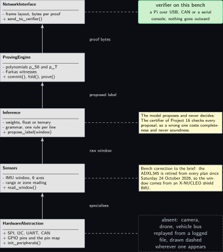
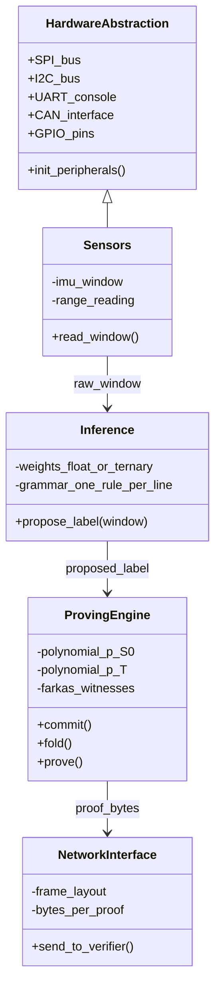
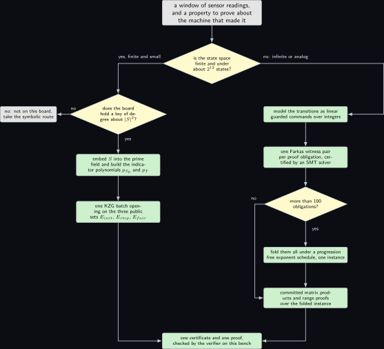

## Foundations

This part runs once from a state machine to a proof. It is a single narrative, not a reference list: each piece exists because the piece before it left something unfinished. A machine has runs, the runs form a language, a property is a language too, and containment of one language in another is what a model checker decides. That decision needs a witness, the witness is a ranking function, and the ranking function is public. What is secret is the machine, so the machine is committed to, and the proof shows only that the commitment and the public witness fit together. The two schemes that realise the last step, explicit-state and symbolic, differ in how the machine is written down; everything before them is shared.

Nothing in this part is measured. Where a number appears it is a count or a bound, and the sentence names the project of the volume that carries it.

### The node that does the proving

Before the mathematics, the shape of the thing. Every project in the volume is some slice of one five-layer node: a hardware abstraction over the buses, sensors that produce the secret, an inference step that may propose but never decides, a proving engine, and an interface that carries the proof to a verifier. A chapter is interesting precisely when it moves work across one of those boundaries.



*Figure 1. The five layers of an embedded node, drawn as UML classes in one column with the hardware abstraction at the bottom and the network interface at the top. The hardware abstraction class lists SPI, I2C, UART and CAN, the GPIO pins and the pin map, and an initialisation operation; the sensors class lists a six-axis inertial window, a range or zone reading, and a read operation, and specialises the hardware abstraction; the inference class lists weights that are either floating point or ternary, a grammar with one rule per line, and an operation that proposes a label for a window; the proving engine class lists the two indicator polynomials, the Farkas witnesses, and the three operations commit, fold and prove; the network interface class lists the frame layout and the bytes per proof and one send operation. Four solid arrows run upward and are named beside themselves rather than on themselves: specialises, raw window, proposed label, proof bytes. To the right of the top layer a green-outlined verifier block says that the verifier is a board on this bench reached over USB, CAN or a serial console and that nothing goes outward. Two pale notes sit beside the middle layers: one says the model proposes and never decides and that the certifier of Project 16 checks every proposal, so a wrong proposal costs completeness and never soundness; the other states the bench correction that the ADXL345 of the design brief is retired from every plan since Saturday 24 October 2026, so the window comes from an X-NUCLEO shield inertial unit instead. Beside the bottom layer a dotted grey block names the absent parts, a camera, a drone and a vehicle bus, and says each is replayed from a logged file and drawn dashed wherever one appears. Four dashed connectors join each remark to the layer it governs.*

The same five classes, as the HTML edition renders them live:



The design brief draws this diagram with an accelerometer and an 8 by 8 time-of-flight part named in the sensor class \[[26](#references)\]. Both are corrected here: the accelerometer is retired from this bench, and the 8 by 8 part's driver is licence gated and a large firmware upload, so it is marked learn and no chapter states a frame rate for it as achieved.

### Traces and languages

**Definition 1 (State transition system).** A **state transition system** is a tuple $`\mathcal{M} = (S, S_0, T, \sigma)`$ where $`S`$ is a set of states, $`S_0 \subseteq S`$ is the set of initial states, $`T \subseteq S \times S`$ is a transition relation that is total, in the sense that every state has at least one successor, and $`\sigma : S \to \Sigma`$ is an observation map into a finite alphabet $`\Sigma = 2^{\Pi}`$ over a set $`\Pi`$ of atomic propositions. The source paper writes the observation of $`s`$ as $`\langle\!\langle s \rangle\!\rangle`$; $`\sigma(s)`$ is the same thing, written shorter because it appears in every set below \[[1](#references)\].

**Definition 2 (Run, trace, language).** A **run** of $`\mathcal{M}`$ is an infinite sequence $`s_0 s_1 s_2 \ldots`$ with $`s_0 \in S_0`$ and $`(s_i, s_{i+1}) \in T`$ for every $`i`$. Its **trace** is the infinite word $`\sigma(s_0)\, \sigma(s_1)\, \sigma(s_2) \ldots \in \Sigma^{\omega}`$. The **language** of the system, written $`\mathcal{L}_\mathcal{M} \subseteq \Sigma^{\omega}`$, is the set of traces of all its runs.

Two consequences set up everything that follows. First, the system is secret but its alphabet is public: a verifier knows what can be observed without knowing what is observed. Second, because runs are infinite, a property is a set of infinite words, and the whole question becomes one of language containment rather than of reachability.

### Linear temporal logic and Buchi automata

**Definition 3 (Linear temporal logic).** Formulas of linear temporal logic over $`\Pi`$ are built from the atomic propositions by the Boolean connectives and by the temporal operators next, until, eventually and always \[[15](#references)\]. A formula $`\phi`$ denotes a set of infinite words $`\mathcal{L}_\phi \subseteq \Sigma^{\omega}`$, and the system satisfies it, written $`\mathcal{M} \models \phi`$, exactly when $`\mathcal{L}_\mathcal{M} \subseteq \mathcal{L}_\phi`$.

Containment is awkward to prove directly, so the automata-theoretic approach replaces it by emptiness of an intersection \[[16](#references), [17](#references)\]:

```math
\mathcal{L}_\mathcal{M} \subseteq \mathcal{L}_\phi
  \iff \mathcal{L}_\mathcal{M} \cap \overline{\mathcal{L}_\phi} = \emptyset
  \iff \mathcal{L}_\mathcal{M} \cap \mathcal{L}_{\mathcal{A}_{\neg\phi}} = \emptyset .
```

**Definition 4 (Nondeterministic Buchi automaton).** A **nondeterministic Buchi automaton** is a tuple $`\mathcal{A} = (Q, Q_0, \delta, F)`$ with a finite state set $`Q`$, initial states $`Q_0 \subseteq Q`$, a transition relation $`\delta \subseteq Q \times \Sigma \times Q`$, and a set of accepting transitions $`F \subseteq \delta`$. It accepts an infinite word when some run of the automaton on that word uses a transition of $`F`$ infinitely often. Any formula of linear temporal logic can be translated into such an automaton, and the translation is the subject of Project 17, which uses an established library for it \[[33](#references), [23](#references)\].

The pair to carry in mind is a small machine beside its observer. The observer is public, because it comes only from the public property; the machine is not.

![Figure 2. On the left, inside a dashed group labelled as the secret machine with four states, committed: a filled initial marker, an arrow into a state called s0 init, an arrow named boot to a state called s1 sample, a self loop above s1 named poll the sensor, a downward arrow named window full to a state called s2 infer, a second upward arrow beside it named cleared back to s1, a leftward arrow named anomaly from s2 to a stop-outlined state called s3 fault, which is the observation the property forbids, and a self loop below s3 named hold the fault.](../figures/supp_kripke.svg)

*Figure 2. On the left, inside a dashed group labelled as the secret machine with four states, committed: a filled initial marker, an arrow into a state called $`s_0`$ init, an arrow named boot to a state called $`s_1`$ sample, a self loop above $`s_1`$ named poll the sensor, a downward arrow named window full to a state called $`s_2`$ infer, a second upward arrow beside it named cleared back to $`s_1`$, a leftward arrow named anomaly from $`s_2`$ to a stop-outlined state called $`s_3`$ fault, which is the observation the property forbids, and a self loop below $`s_3`$ named hold the fault. On the right, inside a second dashed group labelled as the public observer for the negated property: a filled initial marker, an arrow into a state called $`q_0`$ watching with a self loop to its right named any step, a downward arrow named fault observed to a green-outlined state called $`q_1`$ accepting, which also carries a self loop to its right named any step. Below both groups a pale note says that a run of the machine that the observer accepts is a run on which the property fails, that the task is to show no such run exists without showing the initial states or the transition relation, that the ranking function is the public certificate ruling every such run out, and that the proof shows only that the committed machine and that certificate fit.*

The property the observer negates in this picture is that the machine never settles into the fault observation. Its negation is satisfied by exactly those traces on which the fault observation is seen and then held, which is what the two accepting loops express.

### Ranking functions and the fair-termination rule

Emptiness of the intersection is still a statement about infinitely many infinite runs. The step that makes it finite, and therefore provable, is a ranking function: a value in $`\mathbb{N} \cup \{+\infty\}`$ attached to each pair of a system state and an automaton state, finite at every pair of an initial system state and an initial automaton state, which cannot grow along a run from a pair where it is finite, and which must shrink whenever the automaton takes an accepting transition from such a pair.

Two kinds of property pass through this one apparatus, and it is worth separating them before any chapter uses it. A safety property forbids something from ever happening, so a word violates it at a finite index and the violation is visible in a finite prefix; the automaton for the negation then has a reachable accepting region it never has to leave, and a ranking function for it only has to be finite on the part of the state space from which the forbidden observation is unreachable, which makes a constant function on that part a legitimate certificate. A liveness property forbids something from being postponed forever, so no finite prefix of a word decides it; the automaton for the negation accepts by returning to its fair transitions infinitely often, and a certificate has to exhibit a quantity that falls on each of those returns. The property $`\neg\,\mathrm{FG}\,\mathsf{Wait}`$ that the volume carries throughout is of the second kind, which is why its certificates are interesting and why the descent argument, rather than a reachability argument, is the one that has to be proved. A chapter that certifies a bound on a value at one index is doing neither of these; it is checking a predicate, and Project 20 says so in its own words.

**Definition 5 (Ranking function).** A **ranking function** for $`\mathcal{M}`$ and $`\mathcal{A}`$ is a map $`V : S \times Q \to \mathbb{N} \cup \{+\infty\}`$. The codomain is the point of the definition. The value $`+\infty`$ marks the pairs the certificate makes no claim about, and the three conditions below are the ones that keep a run out of those pairs and make it descend in the well-founded part; the comparisons of conditions (ii) and (iii) are therefore read only where $`V(s, q) \ne \infty`$, as those conditions state, and condition (i) is what puts the start of every run in the finite part.

**Theorem 6 (The fair-termination rule; Theorem 3.2 of the source paper).** Let $`V`$ be a ranking function for $`\mathcal{M}`$ and $`\mathcal{A}`$ satisfying the three conditions

```math
\begin{aligned}
&\text{(i)} \quad V(s,q) \ne \infty
     && \text{for all } s \in S_0,\; q \in Q_0, \\
  &\text{(ii)} \quad V(s,q) \ge V(s',q')
     && \text{for all } (s,s') \in T,\; (q, \sigma(s), q') \in \delta
        \text{ with } V(s,q) \ne \infty, \\
  &\text{(iii)} \quad V(s,q) > V(s',q')
     && \text{for all } (s,s') \in T,\; (q, \sigma(s), q') \in F
        \text{ with } V(s,q) \ne \infty .
\end{aligned}
```

Then $`\mathcal{L}_\mathcal{M} \cap \mathcal{L}_\mathcal{A} = \emptyset`$, and therefore $`\mathcal{M} \models \phi`$ whenever $`\mathcal{A}`$ is an automaton for $`\neg\phi`$.

The proof is not repeated here. It is an induction along a hypothetical accepted run: condition (i) gives a finite starting value; (ii) carries finiteness forward one step at a time, so the whole sequence of values is a sequence of natural numbers and is non-increasing; and (iii) makes it drop by at least one at each of the infinitely many accepting transitions. The sequence itself is not strictly decreasing, and that is the point at which the argument has to be written out in full: between two accepting transitions the value may stand still, so (ii) has to be chained across the whole interval to carry the earlier drop past the gap. Doing that gives a subsequence, read at the accepting indices, that falls by at least one each time, so after more steps than the starting value it would be negative, which no natural number is. The well-foundedness of $`\mathbb{N}`$ is the only thing used, and it is used once. The volume carries the proof twice: as prose with every step written in the chapter that introduces the certificate, and machine checked in Lean 4 in Project 14, where the induction has to be named rather than gestured at \[[24](#references)\]. The rule itself is older than the paper and descends from the proof rule for fair termination of guarded commands \[[18](#references), [19](#references)\]; the synthesis of a linear $`V`$ is a solved problem for the systems the volume uses \[[20](#references), [21](#references)\].

**Remark 15.** The certificate is the pair $`(\mathcal{A}_{\neg\phi}, V)`$, and it is public. This is the asymmetry the whole construction turns on: checking the three conditions is cheap and the thing being checked gives nothing away, while the thing that must stay hidden, namely $`S_0`$ and $`T`$, enters only as the premise of each condition.

### Commitments, hiding and binding

The system has to be fixed before the certificate is checked against it, or a prover could choose a different system for each condition. That is what a commitment is for.

**Definition 8 (Commitment scheme).** A **commitment scheme** over a message space $`M`$ and a randomness space $`R`$ is a pair $`(\mathsf{Setup}, \mathsf{Com})`$ with $`\mathsf{sp} \leftarrow \mathsf{Setup}(1^\lambda)`$ and $`\mathsf{Com} : \{\mathsf{sp}\} \times M \times R \to C`$. It is **hiding** when the distributions $`\{\mathsf{Com}(\mathsf{sp}, m_0; r) : r \leftarrow R\}`$ and $`\{\mathsf{Com}(\mathsf{sp}, m_1; r) : r \leftarrow R\}`$ are indistinguishable for every pair of messages, and **binding** when no efficient adversary produces $`(m, r, m', r')`$ with $`m \ne m'`$ and equal commitments, except with probability $`\mathrm{negl}(\lambda)`$ \[[9](#references), [10](#references)\].

Both properties come in a perfect form and a computational form, and no scheme has both perfectly. If the commitment hides perfectly then every commitment value is consistent with every message, so for any value and any second message a suitable randomness exists and only the difficulty of finding it can bind; if it binds perfectly then the value determines the message, so an unbounded distinguisher reads the message off and only the difficulty of doing so can hide. The volume uses computationally binding commitments throughout, in two shapes, and only one of the two is perfectly hiding as it stands. The Pedersen shape is perfectly hiding and Project 1 proves it. The polynomial shape of Definition **Definition 10** is deterministic in the coefficient vector, so it is binding and not hiding on its own: a verifier who guesses the polynomial can confirm the guess by recomputing the commitment. It becomes perfectly hiding only once the committed polynomial carries a mask that vanishes on the interpolation domain, which is what Project 3 adds and what that project's remark on blinding records. Read "perfectly hiding" in this volume as a property of the Pedersen commitments and of the masked polynomial commitments, never of the bare polynomial commitment.

**Definition 9 (Pedersen commitment).** In a cyclic group of prime order $`p`$ with generators $`g`$ and $`h`$ whose relative discrete logarithm is unknown, $`\mathsf{Com}(v; r) = g^{v} h^{r}`$ for $`v, r \in \mathbb{Z}_p`$. The vector form commits to $`n`$ entries as $`h^{r} \prod_{i=1}^{n} g_i^{v_i}`$ \[[3](#references)\].

**Definition 10 (Polynomial commitment).** A commitment to a polynomial $`p`$ of degree at most $`d`$ together with an opening procedure that proves the value of $`p`$ at a point, or at a set of points, in a size independent of $`d`$. The scheme used throughout is the pairing-based one, whose commitment is a single group element $`\prod_{i=0}^{d}(g^{\tau^{i}})^{a_i}`$ over the coefficients $`a_i`$ and a structured reference string, and whose batch opening on a set $`E`$ is the commitment to the quotient of $`p`$ by the vanishing polynomial of $`E`$, checked with two pairings \[[2](#references)\]. The commitment carries no randomness of its own; Project 3 blinds the committed polynomial instead, and the hiding of the pair (commitment, batch opening) is a property of that mask.

Project 1 of the volume proves that the Pedersen form is perfectly hiding and computationally binding, and counts the group operations each commitment and each opening costs. Those counts are the only prices the later chapters multiply, and none of them has been measured on this bench.

### The explicit-state scheme

The first of the two schemes applies when the state space is finite and small enough to embed in a field. The three conditions of Theorem **Theorem 6** are rewritten as three sets of hypothetical states and state pairs that would violate them, and these sets are public, because they are built from $`V`$ and $`\mathcal{A}`$ alone:

```math
\begin{aligned}
E_{\mathrm{init}} &= \{\, s \in S \mid \exists q \in Q_0 .\; V(s,q) = \infty \,\}, \\
  E_{\mathrm{step}} &= \{\, (s,s') \mid \exists q, q' .\; V(s,q) \ne \infty
     \;\wedge\; (q, \sigma(s), q') \in \delta \;\wedge\; V(s,q) < V(s',q') \,\}, \\
  E_{\mathrm{fair}} &= \{\, (s,s') \mid \exists q, q' .\; V(s,q) \ne \infty
     \;\wedge\; (q, \sigma(s), q') \in F \;\wedge\; V(s,q) \le V(s',q') \,\} .
\end{aligned}
```

The three conditions then say exactly that the secret sets avoid the public ones:

```math
S_0 \cap E_{\mathrm{init}} = \emptyset
  \qquad\text{and}\qquad
  T \cap (E_{\mathrm{step}} \cup E_{\mathrm{fair}}) = \emptyset .
```

Disjointness of a secret set from a public one is what a polynomial commitment proves cheaply. The states are embedded into a prime field, $`S_0`$ and $`T`$ are encoded as polynomials $`p_{S_0}`$ and $`p_T`$ that vanish exactly off those sets, the prover commits to the two polynomials, and a single batch opening per set shows that each polynomial reads zero on every element of the corresponding public set. The artefact is two group elements regardless of how many states there are, and the verifier's work is a fixed number of pairings. What grows is the prover's: the degree of $`p_T`$ is of the order of $`|S|^2`$, so the commitment is one multi-scalar multiplication of that size. Project 4 builds that verifier in C and Project 11 prices the prover's two expensive pieces.

**Remark 16.** The scheme is the reason the volume cares about the size of a state space at all. A machine whose states do not fit a field element, or whose transition relation has more pairs than the board can hold as committed rows, is not a candidate for this route however small its source looks.

### The symbolic scheme and Farkas duality

When the state space is countably infinite, as it is for anything parsing a continuous quantity, the system is written instead as linear guarded commands over integer variables and each proof obligation becomes a claim that a system of linear inequalities has no solution, with a secret part contributed by the firmware and a public part contributed by the specification:

```math
\neg \exists y :\; A_s\, y \le b_s \;\wedge\; C_p\, y \le d_p \;\wedge\; E_p\, y \le f_p .
```

Farkas’ lemma turns that negative statement into a positive one \[[11](#references)\]. The system is infeasible over the rationals exactly when non-negative vectors $`\lambda_s`$ and $`\mu_s`$ exist with

```math
A_s^{T} \lambda_s + \begin{bmatrix} C_p^{T} & E_p^{T} \end{bmatrix} \mu_s = 0
  \qquad\text{and}\qquad
  b_s^{T} \lambda_s + \begin{bmatrix} d_p^{T} & f_p^{T} \end{bmatrix} \mu_s < 0 .
```

The pair $`(\lambda_s, \mu_s)`$ is the **Farkas witness**. It is short, it is checked by arithmetic rather than by search, and the check is a matrix product and two comparisons. The prover therefore commits to the secret matrices with a two-tier Pedersen commitment, proves the matrix products with a committed-matrix argument \[[5](#references)\], proves the equality with a sigma protocol in the style of the wallet-with-observers construction \[[8](#references)\], and proves the sign conditions with range proofs \[[4](#references)\]. Project 5 builds exactly this on a Pi with a joystick as the source of the guarded commands, and the solver that produces the witness is the one named in the prerequisites \[[22](#references)\].

### Choosing between the two

Two questions decide the route, and they are asked in this order: is the state space finite and small, and does the board hold a commitment key of the degree the first route needs. A yes to both is the explicit-state route; anything else is symbolic.



*Figure 3. A decision tree read from the top. A grey block holds a window of sensor readings and a property to prove about the machine that made it, and an arrow leads to a diamond asking whether the state space is finite and under about two to the twelve states. Its yes arm, named yes, finite and small beside the arrow, leads left and down to a second diamond asking whether the board holds a commitment key of degree about the square of the number of states; that second diamond's no arm leads to a grey leaf saying this is not the board for it and to take the symbolic route, and its yes arm continues down through two green leaves, the first embedding the state space into the prime field and building the two indicator polynomials, the second taking one batch opening on the three public violation sets. The first diamond's no arm, named no, infinite or analog beside the arrow, runs right and down into the symbolic column: a green leaf modelling the transitions as linear guarded commands over integers, then a green leaf producing one Farkas witness pair per obligation certified by a solver, then a diamond asking whether there are more than one hundred obligations. Its yes arm goes to a leaf that folds every obligation under a progression-free exponent schedule into one instance; its no arm bypasses that leaf on the left. Both arrive at a leaf for the committed matrix products and the range proofs. The two columns join at the bottom in one leaf holding one certificate and one proof, checked by the verifier on this bench.*

The brief draws this tree with the state-space question alone \[[26](#references)\]. The second diamond is the bench's addition, and it is not a refinement: on the smallest Linux board here, with 512 MB and no swap worth the name, the memory question decides the route for machines that the first question would have sent to the explicit-state side. A chapter that ignores it produces an arithmetic that does not fit, which is a result and is written as one.

### Folding, and why the schedule avoids three-term progressions

The symbolic route produces one obligation per guarded command and per condition, so a realistic machine produces hundreds or thousands of them. Proving each separately is the cost the scheme cannot pay on a constrained board, so all $`N`$ obligations are folded into one. The fold is a random linear combination with a public exponent schedule $`c_1, \ldots, c_N`$ and a verifier challenge $`r`$:

```math
A^{*} = \sum_{i=1}^{N} r^{\,c_i} A_i ,
  \qquad
  \lambda^{*} = \sum_{i=1}^{N} r^{\,c_i} \lambda_i .
```

The product $`A^{*} \lambda^{*}`$ expands into $`N`$ diagonal terms, carrying exponent $`2 c_i`$, and $`N(N-1)`$ cross terms, carrying exponent $`c_i + c_j`$ with $`i \ne j`$. The prover wants the diagonal terms, which are the quantities the obligations are about, and has to account for the cross terms, which are not. If some diagonal exponent equals some cross exponent, that is if $`2 c_i = c_j + c_k`$ for indices that are not all equal, then the two kinds of term land on the same power of $`r`$ and cannot be separated. A schedule with no such coincidence is exactly a set of integers containing no three-term arithmetic progression, which is a Salem-Spencer set \[[13](#references), [12](#references), [14](#references)\]. The classical construction reads the digits of $`i-1`$ in base 3, and it keeps the largest exponent below $`3^{\lceil \log_2 N \rceil}`$, which is what bounds the number of cross-term commitments the prover must publish. Project 6 computes that schedule exactly for the sizes this bench would use, and Project 9 compares the one-shot fold against a recursive one \[[6](#references)\].

### Two newer families this edition adds

The first edition stopped at the two schemes of the paper. This edition adds two families that have since become practical enough to sit on the same bench, and both change what the proof is about rather than how it is computed.

**Definition 12 (Machine execution trace).** For an instruction set with a state space $`\mathcal{C}`$ of machine configurations and a transition function $`\mathsf{step} : \mathcal{C} \to \mathcal{C}`$, an **execution trace** of length $`n`$ is a sequence $`c_0, c_1, \ldots, c_n`$ with $`c_{i+1} = \mathsf{step}(c_i)`$ for every $`i < n`$. A **zero-knowledge virtual machine** is a proof system whose statement is that such a trace exists, is consistent with a committed program and a committed input, and ends in a configuration carrying a claimed output.

The practical effect is that any program compiled to the machine's instruction set becomes provable without anyone writing a circuit for it \[[7](#references), [25](#references)\]. The price is that the trace has to be committed row by row: a trace of $`n`$ instructions needs of the order of $`n`$ committed rows, and generating that trace, rather than proving it, is the part the recent accelerator work addresses at the hardware level \[[31](#references), [32](#references)\]. Neither accelerator is on this bench. Project 21 builds the route on the boards that are here, with the two established implementations as the two instruments \[[27](#references), [28](#references)\], and compares the general machine against the tailored protocol of the earlier chapters by counting, not by timing.

**Definition 13 (Ternary linear layer).** A **ternary linear layer** is a map $`x \mapsto W x`$ where $`W \in \{-1, 0, 1\}^{m \times n}`$ and $`x \in \mathbb{R}^{n}`$. A model whose every weight matrix is of this form is a ternary-weight model; the architecture the volume uses is the one with $`\log_2 3 \approx 1.58`$ bits per weight \[[29](#references)\], run by its own inference framework \[[30](#references)\].

**Lemma 14 (A ternary product needs no multiplication).** Let $`W \in \{-1,0,1\}^{m \times n}`$ and $`x \in \mathbb{R}^{n}`$. Then $`W x`$ can be computed with additions and subtractions only, using at most $`n - 1`$ additive operations per output entry and no multiplication at all.

*Proof.* Fix a row $`i`$ and split its index set into $`P_i = \{\, j \mid W_{ij} = 1 \,\}`$, $`M_i = \{\, j \mid W_{ij} = -1 \,\}`$ and the rest, on which $`W_{ij} = 0`$. Then

```math
(W x)_i = \sum_{j=1}^{n} W_{ij} x_j
          = \sum_{j \in P_i} x_j \; - \sum_{j \in M_i} x_j ,
```

because every omitted index contributes $`0 \cdot x_j = 0`$. The right-hand side names $`|P_i| + |M_i| \le n`$ operands combined by $`|P_i| + |M_i| - 1 \le n - 1`$ additions and subtractions, and no product of two numbers appears anywhere in it. &#9632;

The lemma is the reason such a model runs on a processor with no accelerator at all, and Project 24 counts those operations against the floating-point count for the same shape. It is also where the honest limit sits: quantising the weights moves the decision boundary, and a margin smaller than the quantisation step is not preserved, which Project 24 proves by a two-line construction. That is precisely why the volume's rule holds in this family as elsewhere. The model proposes a label or a ranking function; the certifier or the verifier decides; and the soundness of the proof does not depend on the proposer, so a wrong proposal costs completeness and never soundness. Project 16 states and proves that theorem, and Project 24 cites it rather than proving it again.

<a id="references"></a>

## References

1. Pascal Berrang, Mirco Giacobbe, Jacob Swales and Xiao Yang. Zero-Knowledge Model Checking. arXiv:2605.00487v2 \[cs.CR\], version 1 submitted Friday 1 May 2026, version 2 Tuesday 8 September 2026. [arxiv.org/abs/2605.00487](https://arxiv.org/abs/2605.00487) (verified Friday 6 November 2026).
2. Aniket Kate, Gregory M. Zaverucha and Ian Goldberg. Constant-size commitments to polynomials and their applications. In ASIACRYPT 2010, LNCS 6477, pages 177 to 194. Springer, 2010. [doi:10.1007/978-3-642-17373-8\_11](https://doi.org/10.1007/978-3-642-17373-8_11) (to verify).
3. Torben P. Pedersen. Non-interactive and information-theoretic secure verifiable secret sharing. In CRYPTO 1991, LNCS 576, pages 129 to 140. Springer, 1991. [doi:10.1007/3-540-46766-1\_9](https://doi.org/10.1007/3-540-46766-1_9) (to verify).
4. Benedikt Bunz, Jonathan Bootle, Dan Boneh, Andrew Poelstra, Pieter Wuille and Greg Maxwell. Bulletproofs: short proofs for confidential transactions and more. In IEEE Symposium on Security and Privacy 2018, pages 315 to 334. IEEE, 2018. [doi:10.1109/SP.2018.00020](https://doi.org/10.1109/SP.2018.00020) (to verify).
5. Mingshu Cong, Tsz Hon Yuen and Siu-Ming Yiu. zkMatrix: batched short proof for committed matrix multiplication. In AsiaCCS 2024. ACM, 2024. [doi:10.1145/3634737.3645014](https://doi.org/10.1145/3634737.3645014) (to verify).
6. Abhiram Kothapalli, Srinath Setty and Ioanna Tzialla. Nova: recursive zero-knowledge arguments from folding schemes. In CRYPTO 2022, LNCS 13510, pages 359 to 388. Springer, 2022. [doi:10.1007/978-3-031-15985-5\_13](https://doi.org/10.1007/978-3-031-15985-5_13) (to verify).
7. Eli Ben-Sasson, Alessandro Chiesa, Eran Tromer and Madars Virza. Succinct non-interactive zero knowledge for a von Neumann architecture. In USENIX Security 2014, pages 781 to 796. USENIX Association, 2014. [usenix.org, Security 2014](https://www.usenix.org/conference/usenixsecurity14/technical-sessions/presentation/ben-sasson) (to verify).
8. David Chaum and Torben Pryds Pedersen. Wallet databases with observers. In CRYPTO 1992, LNCS 740, pages 89 to 105. Springer, 1992. [doi:10.1007/3-540-48071-4\_7](https://doi.org/10.1007/3-540-48071-4_7) (to verify).
9. Jonathan Katz and Yehuda Lindell. Introduction to Modern Cryptography, second edition. CRC Press, 2014. (to verify)
10. Dan Boneh and Victor Shoup. A graduate course in applied cryptography. Draft, version 0.6, 2023. [toc.cryptobook.us](https://toc.cryptobook.us/) (to verify).
11. Julius Farkas. Theorie der einfachen Ungleichungen. Journal fur die reine und angewandte Mathematik, 124, pages 1 to 27, 1902. [doi:10.1515/crll.1902.124.1](https://doi.org/10.1515/crll.1902.124.1) (to verify).
12. Felix A. Behrend. On sets of integers which contain no three terms in arithmetical progression. Proceedings of the National Academy of Sciences, 32(12), pages 331 to 332, 1946. [doi:10.1073/pnas.32.12.331](https://doi.org/10.1073/pnas.32.12.331) (to verify).
13. Raphael Salem and Donald C. Spencer. On sets of integers which contain no three terms in arithmetical progression. Proceedings of the National Academy of Sciences, 28(12), pages 561 to 563, 1942. [doi:10.1073/pnas.28.12.561](https://doi.org/10.1073/pnas.28.12.561) (to verify).
14. Paul Erdős and Paul Turan. On some sequences of integers. Journal of the London Mathematical Society, 11(4), pages 261 to 264, 1936. [doi:10.1112/jlms/s1-11.4.261](https://doi.org/10.1112/jlms/s1-11.4.261) (to verify).
15. Amir Pnueli. The temporal logic of programs. In FOCS 1977, pages 46 to 57. IEEE Computer Society, 1977. [doi:10.1109/SFCS.1977.32](https://doi.org/10.1109/SFCS.1977.32) (to verify).
16. Moshe Y. Vardi and Pierre Wolper. An automata-theoretic approach to automatic program verification (preliminary report). In LICS 1986, pages 332 to 344. IEEE Computer Society, 1986. (to verify)
17. Moshe Y. Vardi. Verification of concurrent programs: the automata-theoretic framework. Annals of Pure and Applied Logic, 51(1 to 2), pages 79 to 98, 1991. [doi:10.1016/0168-0072(91)90066-U](https://doi.org/10.1016/0168-0072(91)90066-U) (to verify).
18. Orna Grumberg, Nissim Francez, Johann A. Makowsky and Willem P. de Roever. A proof rule for fair termination of guarded commands. Information and Control, 66(1 to 2), pages 83 to 102, 1985. [doi:10.1016/S0019-9958(85)80014-0](https://doi.org/10.1016/S0019-9958(85)80014-0) (to verify).
19. Byron Cook, Alexey Gotsman, Andreas Podelski, Andrey Rybalchenko and Moshe Y. Vardi. Proving that programs eventually do something good. In POPL 2007, pages 265 to 276. ACM, 2007. [doi:10.1145/1190216.1190257](https://doi.org/10.1145/1190216.1190257) (to verify).
20. Andreas Podelski and Andrey Rybalchenko. A complete method for the synthesis of linear ranking functions. In VMCAI 2004, LNCS 2937, pages 239 to 251. Springer, 2004. [doi:10.1007/978-3-540-24622-0\_20](https://doi.org/10.1007/978-3-540-24622-0_20) (to verify).
21. Michael Colon and Henny Sipma. Synthesis of linear ranking functions. In TACAS 2001, LNCS 2031, pages 67 to 81. Springer, 2001. [doi:10.1007/3-540-45319-9\_6](https://doi.org/10.1007/3-540-45319-9_6) (to verify).
22. Leonardo de Moura and Nikolaj Bjørner. Z3: an efficient SMT solver. In TACAS 2008, LNCS 4963, pages 337 to 340. Springer, 2008. [doi:10.1007/978-3-540-78800-3\_24](https://doi.org/10.1007/978-3-540-78800-3_24) (to verify).
23. Alexandre Duret-Lutz, Etienne Renault, Maximilien Colange, Florian Renkin, Alexandre Gbaguidi Aisse, Philipp Schlehuber-Caissier, Thomas Medioni, Antoine Martin, Jerome Dubois, Clement Gillard and Henrich Lauko. From Spot 2.0 to Spot 2.10: what's new? In CAV 2022, LNCS 13372, pages 174 to 187. Springer, 2022. [doi:10.1007/978-3-031-13188-2\_9](https://doi.org/10.1007/978-3-031-13188-2_9) (to verify).
24. Leonardo de Moura and Sebastian Ullrich. The Lean 4 theorem prover and programming language. In CADE 2021, LNCS 12699, pages 625 to 635. Springer, 2021. [doi:10.1007/978-3-030-79876-5\_37](https://doi.org/10.1007/978-3-030-79876-5_37) (to verify).
25. Yinuo Zhang. Constraint-efficient techniques for zero-knowledge virtual machines. PhD dissertation, EECS, University of California, Berkeley, 2025; advisor Sanjam Garg; technical report EECS-2025-215. [eecs.berkeley.edu, 2025 dissertations](https://www2.eecs.berkeley.edu/Pubs/Dissertations/Years/2025.html) (verified Friday 6 November 2026).
26. Advanced hardware-software architectures for edge artificial intelligence and zero-knowledge model checking. A design brief of twenty project sketches, read on Friday 6 November 2026 and held locally at `a local design brief`. It is the input to this second edition and is not a published source; where its hardware claims disagree with the bench, the bench is followed and the disagreement is stated.
27. Succinct Labs. SP1: a zero-knowledge virtual machine that proves the execution of a RISC-V binary. Release v6.10.0, Friday 23 October 2026. The licence is not recorded here because it has not been read; read it from the repository's LICENSE file (to verify). [github.com/succinctlabs/sp1](https://github.com/succinctlabs/sp1) (verified Friday 6 November 2026).
28. RISC Zero. risc0: a RISC-V zero-knowledge virtual machine and proof system. Release v3.0.6, Friday 17 July 2026. The licence is not recorded here because it has not been read; read it from the repository's LICENSE file (to verify). [github.com/risc0/risc0](https://github.com/risc0/risc0) (verified Friday 6 November 2026).
29. Shuming Ma, Hongyu Wang, Lingxiao Ma, Lei Wang, Wenhui Wang, Shaohan Huang, Li Dong, Ruiping Wang, Jilong Xue and Furu Wei. The era of 1-bit LLMs: all large language models are in 1.58 bits. arXiv:2402.17764, submitted Tuesday 27 February 2024; every weight is ternary, in the set with the three values minus one, zero and one. [arxiv.org/abs/2402.17764](https://arxiv.org/abs/2402.17764) (verified Friday 6 November 2026).
30. Microsoft. BitNet: the official inference framework for 1-bit large language models, in C++, MIT licence, 41466 stars when read. [github.com/microsoft/BitNet](https://github.com/microsoft/BitNet) (verified Friday 6 November 2026).
31. Jieran Cui, Zhengkai Wen, Haowen Fang, Yinan Zhu, Jia Xiong, Cheng Ni, Mingchi Zhang, Nan Guan and Xi Wang. ZK-Tracer: a high-performance heterogeneous accelerator for zero-knowledge virtual machine trace generation. arXiv:2605.25493, submitted Monday 25 May 2026, revised Tuesday 26 May 2026. [arxiv.org/abs/2605.25493](https://arxiv.org/abs/2605.25493) (verified Friday 6 November 2026).
32. zkPHIRE: a programmable accelerator for zero-knowledge proofs over high-degree, expressive gates. arXiv:2508.16738, 2025. [arxiv.org/abs/2508.16738](https://arxiv.org/abs/2508.16738) (to verify).
33. Spot contributors. Spot: a C++20 library for LTL, omega-automata manipulation and model checking. Version 2.16.2, released Tuesday 3 November 2026, GNU GPL version 3. [spot.lre.epita.fr](https://spot.lre.epita.fr/) (verified Friday 6 November 2026).

---

[Prerequisites](prerequisites.md) &nbsp;&nbsp;|&nbsp;&nbsp; Foundations &nbsp;&nbsp;|&nbsp;&nbsp; [A tutorial: one proof, end to end](tutorial.md) &nbsp;&nbsp;|&nbsp;&nbsp; [A guide to the twenty-four projects](guide.md) &nbsp;&nbsp;|&nbsp;&nbsp; [The chapters](../chapters/00-about-this-volume.md)
