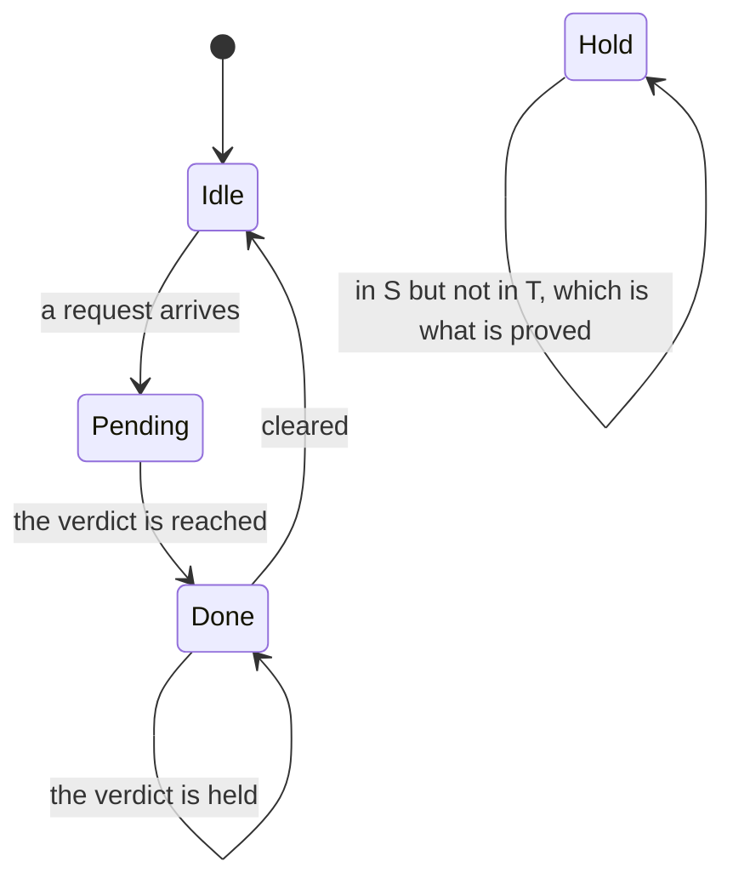

## A tutorial: one proof, end to end

The twenty-four chapters each take one piece of the paper's construction and price it on one board. This tutorial does the opposite: it takes the smallest complete instance of the whole construction, a system with four states, and walks it from a state machine to a verifier's verdict without skipping a line. Every set is small enough to write out on paper, and the instance is small enough that the prover's run on the Pi 4B finishes while the reader is still looking at the terminal.

> [!NOTE]
> **What this is.** Nothing in this tutorial has been run on this bench. The numbered steps are instructions to follow, not a record of a run, and every quantity below is derived rather than measured: each one says **computed** where it is first stated. Once the steps have been followed, the record of that run belongs in the chapter whose acceptance test it satisfies, and not here.

### What you will have at the end

Nine things, in this order, each one checkable before the next is built:

- a four-state transition system $`\mathcal{M}`$, written as a table, whose initial states and transition relation are the secret;
- one public specification $`\phi`$ in linear temporal logic, and the Buchi automaton $`\mathcal{A}_{\neg\phi}`$ for its complement;
- one public ranking function $`V`$ on eight cells, four states by two automaton states;
- the three violation sets $`B_{\mathrm{init}}`$, $`B_{\mathrm{step}}`$ and $`B_{\mathrm{fair}}`$ of the paper's Equations 7 to 9, computed by hand and then by a short script that must agree with the hand computation;
- two polynomial commitments, 96 bytes together (computed);
- two batch openings, 96 bytes together (computed), hence a proof file of exactly 192 bytes;
- one verifier's verdict from two pairing equations, on the Pi 4B;
- one deliberately broken system that differs from the honest one by a single transition, and the refusal it earns, with the probability of a wrong acceptance bounded above by $`3/r`$ (computed);
- a short list of which chapter to open next for each piece.

The mathematics behind the certificate is Theorem 3.2 of the paper \[[1](#references)\], proved in full in [Project 3](../chapters/03-the-modems-backoff-machine.md); the pairing check is the C verifier of [Project 4](../chapters/04-two-group-elements.md). Neither proof is repeated here. What the tutorial adds is the one thing a chapter cannot: the whole path on one instance, with nothing left as an exercise.

### The machine and its property

The machine is the bench's own verdict indicator. It sits idle, a request puts it in a pending state, it reaches a verdict, and it then either clears to idle or holds the verdict. A fourth state exists in the public state space and is the interesting one: a state that observes as pending and loops on itself, which is exactly the behaviour the specification forbids. The secret is that the machine never enters it.

Let $`\Pi = \lbrace \mathsf{idle}, \mathsf{pending}, \mathsf{done}\rbrace`$ and $`\Sigma = 2^\Pi`$. The state space is public:

$$
S = \lbrace \thinspace  \mathrm{Idle},\thickspace  \mathrm{Pending},\thickspace  \mathrm{Done},\thickspace  \mathrm{Hold} \thinspace \rbrace ,
  \qquad |S| = 4 \thickspace \text{(counted)}, \tag{1}
$$

with the observation function

$$
\langle\negthinspace \langle \mathrm{Idle} \rangle\negthinspace \rangle = \lbrace \mathsf{idle}\rbrace , \quad
  \langle\negthinspace \langle \mathrm{Pending} \rangle\negthinspace \rangle = \lbrace \mathsf{pending}\rbrace , \quad
  \langle\negthinspace \langle \mathrm{Done} \rangle\negthinspace \rangle = \lbrace \mathsf{done}\rbrace , \quad
  \langle\negthinspace \langle \mathrm{Hold} \rangle\negthinspace \rangle = \lbrace \mathsf{pending}\rbrace . \tag{2}
$$

Two states observe as pending, and that is deliberate. The verifier sees letters, never states, so no amount of watching tells $`\mathrm{Pending}`$ from $`\mathrm{Hold}`$, and the proof has to do the work instead.

The secret part of $`\mathcal{M}`$ is the pair

$$
\begin{gathered}
S_0 = \lbrace \thinspace  \mathrm{Idle} \thinspace \rbrace , \cr 
  T = \lbrace \thinspace  (\mathrm{Idle}, \mathrm{Pending}),\thickspace  (\mathrm{Pending}, \mathrm{Done}),\thickspace 
    (\mathrm{Done}, \mathrm{Idle}),\thickspace  (\mathrm{Done}, \mathrm{Done}) \thinspace \rbrace , \tag{3}
\end{gathered}
$$

so $`|S_0| = 1`$ and $`|T| = 4`$ (both counted). Note what is absent: no pair has $`\mathrm{Hold}`$ as a target, and no pair has $`\mathrm{Pending}`$ as both source and target. Those two absences are the entire content of the proof.



The public specification is one sentence: the indicator does not stay pending forever.

$$
\phi = \neg\thinspace  \mathrm{F}\thinspace \mathrm{G}\thinspace  \mathsf{pending}, \qquad
  \neg\phi = \mathrm{F}\thinspace \mathrm{G}\thinspace  \mathsf{pending} . \tag{4}
$$

Read $`\phi`$ carefully, because the machine of (3) does visit $`\mathrm{Pending}`$ infinitely often along the cycle $`\mathrm{Idle} \to \mathrm{Pending} \to \mathrm{Done} \to \mathrm{Idle}`$. Infinitely often is permitted; what $`\phi`$ forbids is eventually always. A reader who confuses the two will build the wrong automaton and then wonder why an honest system is refused.

### The certificate

The certificate is public, and it is the pair $`v_\phi = (\mathcal{A}_{\neg\phi}, V)`$. The automaton is the paper's Figure 2b with $`\mathsf{pending}`$ in place of its own proposition \[[1](#references)\]:

$$
\begin{gathered}
Q = \lbrace q_0, q_1\rbrace , \qquad Q_0 = \lbrace q_0\rbrace , \cr 
  \delta = \lbrace \thinspace  (q_0, \sigma, q_0) \mid \sigma \in \Sigma \thinspace \rbrace  \cup
    \lbrace \thinspace  (q_0, \sigma, q_1),\thinspace  (q_1, \sigma, q_1) \mid \mathsf{pending} \in \sigma \thinspace \rbrace ,
    \cr 
  F = \lbrace \thinspace  (q_1, \sigma, q_1) \mid \mathsf{pending} \in \sigma \thinspace \rbrace . \tag{5}
\end{gathered}
$$

In words: $`q_0`$ waits for as long as it likes, guesses at some point that the pending phase has begun, moves to $`q_1`$, and from then on can only continue while every letter carries $`\mathsf{pending}`$; the fair transitions are exactly those continuations. An accepting run is a guess that was right forever, which is the meaning of $`\mathrm{F}\thinspace \mathrm{G}`$.

The ranking function has eight cells. It is a public object: a reader, or a model as in [Project 16](../chapters/16-the-model-proposes-a-ranking-function-the-certifier.md), may propose it, and the certifier checks it.

| **State $`s`$** | **$`V(s, q_0)`$** | **$`V(s, q_1)`$** | **Why that value** |
| --- | --- | --- | --- |
| $`\mathrm{Idle}`$ | $`1`$ | $`0`$ | finite on $`q_0`$, which is what condition (4) asks of an initial state; nothing in $`q_1`$ can continue from an idle letter |
| $`\mathrm{Pending}`$ | $`1`$ | $`1`$ | one pending step is left to spend; the fair step out of it must land strictly lower |
| $`\mathrm{Done}`$ | $`1`$ | $`0`$ | the verdict is reached and no fair step leaves it |
| $`\mathrm{Hold}`$ | $`+\infty`$ | $`+\infty`$ | the one cell the certificate rules out; a system that can begin here, or step into here, has no finite rank to descend |

Theorem 3.2 of the paper asks three conditions of $`V`$, its Equations 4, 5 and 6: finite on $`S_0 \times Q_0`$, non-increasing along every transition of $`T`$ paired with every transition of $`\delta`$, and strictly decreasing when the automaton's transition is fair \[[1](#references)\]. All three are written out, with the descent argument in full, as Theorem Z3.5 in [Project 3](../chapters/03-the-modems-backoff-machine.md). Check them against the table on the four pairs of (3) before going on; the only one that needs thought is $`(\mathrm{Pending}, \mathrm{Done})`$ with the fair step $`q_1 \to q_1`$, where $`1 > 0`$ holds and the strict decrease is earned.

### The three sets, computed

Here is the step that makes the whole construction possible, and it is worth saying slowly. The certifier never checks the three conditions against $`S_0`$ and $`T`$, because it does not have them. It negates each consequent and enumerates, from public data only, every state and every pair that *would* violate a condition. Those are the paper's Equations 7 to 9:

$$
\begin{aligned}
B_{\mathrm{init}} &= \lbrace \thinspace  s \in S \mid \exists q \in Q_0 .\thickspace  V(s, q) = \infty \thinspace \rbrace ,
    \cr 
  B_{\mathrm{step}} &= \lbrace \thinspace  (s, s') \in S \times S \mid \exists q, q' .\thickspace  V(s, q) \ne \infty
    \wedge (q, \langle\negthinspace \langle s \rangle\negthinspace \rangle, q') \in \delta \wedge V(s, q) < V(s', q') \thinspace \rbrace ,
    \cr 
  B_{\mathrm{fair}} &= \lbrace \thinspace  (s, s') \in S \times S \mid \exists q, q' .\thickspace  V(s, q) \ne \infty
    \wedge (q, \langle\negthinspace \langle s \rangle\negthinspace \rangle, q') \in F \wedge V(s, q) \le V(s', q') \thinspace \rbrace , \tag{6}
\end{aligned}
$$

with $`V(s, q) < \infty`$ for every finite value. The prover then has to show only that its secret avoids them, which is the paper's Equation 10:

$$
S_0 \cap B_{\mathrm{init}} = \emptyset, \qquad
  T \cap B_{\mathrm{step}} = \emptyset, \qquad
  T \cap B_{\mathrm{fair}} = \emptyset . \tag{7}
$$

**The first set.** $`Q_0 = \lbrace q_0\rbrace`$, so (6) reads off the first numeric column of the table: one cell is $`+\infty`$, and

$$
B_{\mathrm{init}} = \lbrace \thinspace  \mathrm{Hold} \thinspace \rbrace , \qquad |B_{\mathrm{init}}| = 1
  \thickspace \text{(computed)}. \tag{8}
$$

**The second set.** Work source by source. The automaton steps available from a source $`s`$ depend only on $`\langle\negthinspace \langle s \rangle\negthinspace \rangle`$: from $`\mathrm{Idle}`$ and $`\mathrm{Done}`$, whose letters carry no $`\mathsf{pending}`$, the only step is $`q_0 \to q_0`$; from $`\mathrm{Pending}`$ and $`\mathrm{Hold}`$ the steps are $`q_0 \to q_0`$, $`q_0 \to q_1`$ and $`q_1 \to q_1`$. A source cell with $`V(s, q) = \infty`$ contributes nothing, because the premise of (6) fails there.

| **Source $`s`$** | **Finite cells** | **Steps $`(q, q')`$** | **Targets with a strictly larger value, and the pairs they give** |
| --- | --- | --- | --- |
| $`\mathrm{Idle}`$ | $`q_0 \mapsto 1`$, $`q_1 \mapsto 0`$ | $`(q_0, q_0)`$ only | against $`V(\cdot, q_0) = (1, 1, 1, \infty)`$ only $`\mathrm{Hold}`$ exceeds $`1`$: $`(\mathrm{Idle}, \mathrm{Hold})`$ |
| $`\mathrm{Pending}`$ | $`q_0 \mapsto 1`$, $`q_1 \mapsto 1`$ | $`(q_0, q_0)`$, $`(q_0, q_1)`$, $`(q_1, q_1)`$ | against $`V(\cdot, q_0)`$ and against $`V(\cdot, q_1) = (0, 1, 0, \infty)`$, again only $`\mathrm{Hold}`$ exceeds $`1`$: $`(\mathrm{Pending}, \mathrm{Hold})`$ |
| $`\mathrm{Done}`$ | $`q_0 \mapsto 1`$, $`q_1 \mapsto 0`$ | $`(q_0, q_0)`$ only | only $`\mathrm{Hold}`$ again: $`(\mathrm{Done}, \mathrm{Hold})`$ |
| $`\mathrm{Hold}`$ | none | not reached | both cells are $`+\infty`$, so this source contributes no pair at all |

$$
B_{\mathrm{step}} = \lbrace \thinspace  (\mathrm{Idle}, \mathrm{Hold}),\thickspace 
    (\mathrm{Pending}, \mathrm{Hold}),\thickspace  (\mathrm{Done}, \mathrm{Hold}) \thinspace \rbrace , \qquad
  |B_{\mathrm{step}}| = 3 \thickspace \text{(computed)}. \tag{9}
$$

**The third set.** $`F`$ holds only the steps $`q_1 \to q_1`$ on a pending letter, so the source is $`\mathrm{Pending}`$ or $`\mathrm{Hold}`$ and the cell is the $`q_1`$ one. The $`\mathrm{Hold}`$ cell is $`+\infty`$ and contributes nothing. From $`V(\mathrm{Pending}, q_1) = 1`$ the condition is $`1 \le V(s', q_1)`$, and $`V(\cdot, q_1) = (0, 1, 0, \infty)`$ satisfies it at $`\mathrm{Pending}`$ itself, where $`1 \le 1`$, and at $`\mathrm{Hold}`$:

$$
B_{\mathrm{fair}} = \lbrace \thinspace  (\mathrm{Pending}, \mathrm{Pending}),\thickspace 
    (\mathrm{Pending}, \mathrm{Hold}) \thinspace \rbrace , \qquad
  |B_{\mathrm{fair}}| = 2 \thickspace \text{(computed)}, \tag{10}
$$

and therefore

$$
B_{\mathrm{step}} \cup B_{\mathrm{fair}} = \lbrace \thinspace  (\mathrm{Idle}, \mathrm{Hold}),\thickspace 
  (\mathrm{Pending}, \mathrm{Hold}),\thickspace  (\mathrm{Done}, \mathrm{Hold}),\thickspace 
  (\mathrm{Pending}, \mathrm{Pending}) \thinspace \rbrace , \tag{11}
$$

of size $`4`$ (computed). Compare (11) with the secret $`T`$ of (3): the four forbidden pairs and the four real ones share no member, and $`\mathrm{Idle} \ne \mathrm{Hold}`$ settles the first condition of (7). The system satisfies $`\phi`$, and the reason is now a statement about two four-element sets of public pairs rather than about a machine.

> [!NOTE]
> **The one sentence to carry away**
>
> The secret never enters the argument as a secret. It enters as the claim that it misses four public pairs and one public state, and a polynomial commitment is exactly the object that can carry such a claim without opening.

The script below recomputes the three sets from the public data alone. It is the only piece of code in this tutorial that a reader must run before trusting anything else, because a hand computation of (6) is where an error hides most comfortably.

```python
"""supp_tutorial_sets.py: the tutorial's four-state machine, its certificate, and the
three violation sets of the paper's Equations 7 to 9. No curve library, no board."""
import itertools

IDLE, PEND, DONE, HOLD = 0, 1, 2, 3          # idx(s) for the embedding; |S| = 4
S = (IDLE, PEND, DONE, HOLD)
OBS = {IDLE: "idle", PEND: "pending", DONE: "done", HOLD: "pending"}
INF = float("inf")
V = {(IDLE, 0): 1, (PEND, 0): 1, (DONE, 0): 1, (HOLD, 0): INF,
     (IDLE, 1): 0, (PEND, 1): 1, (DONE, 1): 0, (HOLD, 1): INF}
S0 = {IDLE}                                  # secret: the initial states
T = {(IDLE, PEND), (PEND, DONE), (DONE, IDLE), (DONE, DONE)}   # secret: the relation

def delta(q, s):                             # q0 loops on every letter; pending reaches q1
    out = [0] if q == 0 else []
    return out + ([1] if OBS[s] == "pending" else [])

def is_fair(q, s, q2):                       # F is the self loop on q1 under pending
    return q == 1 and q2 == 1 and OBS[s] == "pending"

b_init = {s for s in S if V[(s, 0)] == INF}
b_step, b_fair = set(), set()
for s, t in itertools.product(S, S):
    for q in (0, 1):
        v = V[(s, q)]
        if v == INF:
            continue
        for q2 in delta(q, s):
            w = V[(t, q2)]
            if v < w:
                b_step.add((s, t))
            if is_fair(q, s, q2) and v <= w:
                b_fair.add((s, t))

print("sizes", len(b_init), len(b_step), len(b_fair), len(b_step | b_fair))
print("disjoint", not (S0 & b_init), not (T & (b_step | b_fair)))
```

Expected output, from the hand computation above: `sizes 1 3 2 4` and `disjoint True True`. If the first line disagrees, the hand computation and the script disagree, and neither may be used until they do not.

**Step 1.** On the authoring laptop, write the machine of (1) to (3), the certificate of (5) to (5) and the ranking table, and run `supp_tutorial_sets.py` with the system interpreter; it needs no package, and the authoring laptop compiles nothing. Confirm `sizes 1 3 2 4`; commit.

**Step 2.** On the build laptop in WSL, build the two things the bench side needs: the `no_std` image that runs the four-state machine on the Nucleo and prints each transition it takes over the USB CDC console, and the C verifier of [Project 4](../chapters/04-two-group-elements.md) for `aarch64-unknown-linux-gnu`. Copy the verifier to the Pi 4B. Nothing is built on the authoring laptop and nothing is built on the board.

**Step 3.** On the Nucleo, over the ST-LINK drive `NOD_H7A3ZIQ`, copy the image and open the USB CDC console in the same command line so the banner is caught; let it print 200 transitions and check by eye that every printed pair is one of the four of (3). A printed pair outside $`T`$ means the firmware and the paper instance have drifted apart, and the proof below would then be about the wrong machine.

**Step 4.** On the Pi 4B over ssh at \<pi4b\>, create the venv in the repository root, install `py_ecc` \[[6](#references)\], and run `supp_tutorial_sets.py` again on the board. The two `sizes` lines, from the authoring laptop and from the Pi 4B, must be identical before any curve arithmetic begins.

### The commitment

The sets are public; the system is not. The prover now binds itself to $`S_0`$ and $`T`$ with two polynomial commitments, and the trick is the one of [Project 3](../chapters/03-the-modems-backoff-machine.md): encode each secret set as the indicator function of an embedded set, and let the vanishing of that indicator on the public batch stand for disjointness.

Index the states in the order of (1), so $`\mathrm{idx}(\mathrm{Idle}) = 0`$, $`\mathrm{idx}(\mathrm{Pending}) = 1`$, $`\mathrm{idx}(\mathrm{Done}) = 2`$ and $`\mathrm{idx}(\mathrm{Hold}) = 3`$. Let $`\mathbb{F}_r`$ be the scalar field of BLS12-381, let $`\omega_1`$ be a primitive fourth root of unity in $`\mathbb{F}_r`$ and $`\omega_2`$ a primitive sixteenth root, both of which exist because $`2^{32}`$ divides $`r - 1`$. The two embeddings are

$$
e_1(s) = \omega_1^{\mathrm{idx}(s)}, \qquad
  e_2(s, s') = \omega_2^{\mathrm{idx}(s) + 4\thinspace \mathrm{idx}(s')}, \tag{12}
$$

injective because every exponent is below the order of its root. The exponents of the secret relation are, pair by pair from (3),

$$
J_T = \lbrace \thinspace  0 + 4 \cdot 1,\thickspace  1 + 4 \cdot 2,\thickspace  2 + 4 \cdot 0,\thickspace  2 + 4 \cdot 2 \thinspace \rbrace 
      = \lbrace \thinspace  4,\thickspace  9,\thickspace  2,\thickspace  10 \thinspace \rbrace  \thickspace \text{(computed)}, \tag{13}
$$

and the exponents of the public batch, from (11), are

$$
J_E = \lbrace \thinspace  0 + 4 \cdot 3,\thickspace  1 + 4 \cdot 3,\thickspace  2 + 4 \cdot 3,\thickspace  1 + 4 \cdot 1 \thinspace \rbrace 
      = \lbrace \thinspace  12,\thickspace  13,\thickspace  14,\thickspace  5 \thinspace \rbrace  \thickspace \text{(computed)}. \tag{14}
$$

$`J_T`$ and $`J_E`$ are disjoint, which is (7) read in exponents, and it is worth checking that by eye once: the four numbers $`2, 4, 9, 10`$ against the four numbers $`5, 12, 13, 14`$.

The indicator polynomials come from the Lagrange basis over the roots of unity, which has a closed form and needs no linear system solved; the lemma and its proof are Lemma Z3.9 in [Project 3](../chapters/03-the-modems-backoff-machine.md). With $`L_j(X) = n^{-1} \sum_{i=0}^{n-1} \omega^{-ij} X^i`$,

$$
p_{S_0} = L_0 \text{ over } \omega_1 \text{ with } n = 4, \qquad
  p_T = \sum_{j \in J_T} L_j \text{ over } \omega_2 \text{ with } n = 16, \tag{15}
$$

of degrees at most $`3`$ and $`15`$ (computed). Each is then blinded by adding $`(b_0 + b_1 X)(X^n - 1)`$ with $`b_0, b_1`$ drawn uniformly from $`\mathbb{F}_r`$, the technique PLONK uses on its wire polynomials \[[3](#references)\]: the mask vanishes on every $`n`$-th root of unity, so no evaluation the protocol uses changes, and the degrees rise to $`5`$ and $`17`$ (computed). Without the mask, a verifier facing only four states could guess a relation, recompute its polynomial and compare commitments, so the blinding is not an optional flourish.

The commitments are KZG \[[2](#references)\]: $`c = g_1^{p(\tau)}`$, evaluated as a multi-scalar multiplication of the setup powers by the coefficients. The setup this instance needs is therefore $`18`$ powers of $`\tau`$ in $`\mathbb{G}_1`$, for degrees $`0`$ to $`17`$, and $`5`$ in $`\mathbb{G}_2`$, for degrees $`0`$ to $`4`$, which is the degree of the larger vanishing polynomial (both computed). That is a toy setup whose $`\tau`$ the prover's own script draws and prints, so the proof convinces nobody but this bench; the same honest limitation is stated in [Project 3](../chapters/03-the-modems-backoff-machine.md) and [Project 4](../chapters/04-two-group-elements.md).

**Step 1.** On the Pi 4B over ssh, run the setup script for $`18`$ powers in $`\mathbb{G}_1`$ and $`5`$ in $`\mathbb{G}_2`$ and keep its log. Read the printed count back and refuse to continue on $`17`$ or fewer $`\mathbb{G}_1`$ powers: the two mask terms would then be dropped in silence by the coefficient-by-power loop, and the pairing check would fail later for a reason that looks like a wrong proof.

**Step 2.** On the Pi 4B, build $`p_{S_0}`$ and $`p_T`$ from (15), blind both, and commit. Print the two commitments as 48-byte compressed $`\mathbb{G}_1`$ elements, 96 bytes together (computed).

### The proof

The proof is the pair of batch openings. Let

$$
Z_{E_{\mathrm{init}}}(X) = X - \omega_1^{3}, \qquad
  Z_E(X) = (X - \omega_2^{5})(X - \omega_2^{12})(X - \omega_2^{13})(X - \omega_2^{14}), \tag{16}
$$

of degrees $`1`$ and $`4`$ (computed), and divide:

$$
q_{S_0} = \frac{p_{S_0}}{Z_{E_{\mathrm{init}}}}, \qquad
  q_T = \frac{p_T}{Z_E}, \tag{17}
$$

of degrees $`4`$ and $`13`$ (computed). Each division is carried out root by root by synthetic division, and each leaves a remainder that the prover checks to be zero before it continues. That check is the prover's own refusal, and it is the reason the deliberate error below never produces a file at all. The proof is $`\pi_{S_0} = g_1^{q_{S_0}(\tau)}`$ and $`\pi_T = g_1^{q_T(\tau)}`$, two more compressed $`\mathbb{G}_1`$ elements.

So the artefact is $`c_{S_0} \thinspace \Vert \thinspace c_T \thinspace \Vert \thinspace \pi_{S_0} \thinspace \Vert \thinspace \pi_T`$, four compressed elements of 48 bytes, that is 192 bytes (computed), whatever the size of the system. That constancy is the point of the explicit-state scheme and is what [Project 18](../chapters/18-a-proof-over-the-wire.md) carries over a CAN bus in 25 frames.

**Step 1.** On the Pi 4B, divide and open. Confirm that both remainders print as zero, that the file is exactly 192 bytes, and that its four elements decompress back to the points they were made from. A file of any other length is a serialisation defect and not a proof.

### The verification

The verifier holds no secret. It has the state space, the automaton, the ranking table, the setup and the 192 bytes, and it does three things: it recomputes the three sets from (6) to (6) itself and compares the sizes with the prover's, it decompresses the four elements and checks that each lies in $`\mathbb{G}_1`$, and it evaluates two pairing equations:

$$
e(c_{S_0}, g_2) = e\big(\pi_{S_0},\thinspace  g_2^{Z_{E_{\mathrm{init}}}(\tau)}\big), \qquad
  e(c_T, g_2) = e\big(\pi_T,\thinspace  g_2^{Z_E(\tau)}\big), \tag{18}
$$

accepting only if both hold. The second step is not a formality: a point on the curve but outside $`\mathbb{G}_1`$ decompresses without error and makes (18) meaningless, which is the first pitfall of [Project 4](../chapters/04-two-group-elements.md) and costs one subgroup check per element.

The first step deserves its own sentence. The verifier recomputing the sets is what ties the proof to the certificate rather than to some other certificate; if the prover's and the verifier's sizes differ, the honest response is to stop, not to evaluate a pairing. In this instance the two must both read $`1`$, $`3`$, $`2`$ and $`4`$.

**Step 1.** On the Pi 4B over ssh, run the verifier of [Project 4](../chapters/04-two-group-elements.md) against the file and the setup. It prints its own batch sizes, compares them, and lights the green LED on BCM 17 for accept. Record the verdict and the time its `clock_gettime` reports; the time is a number from this run and belongs in [Project 4](../chapters/04-two-group-elements.md)'s table, not in this tutorial's prose.

### The deliberate error and the refusal

This is the part of the exercise that matters. A tutorial in which everything is accepted has demonstrated nothing, because a verifier that accepts unconditionally would behave the same way.

The error is one transition. Add to the secret relation the pair $`(\mathrm{Pending}, \mathrm{Pending})`$, so that the indicator may stay pending for one more tick:

$$
T' = T \cup \lbrace \thinspace  (\mathrm{Pending}, \mathrm{Pending}) \thinspace \rbrace , \qquad |T'| = 5
  \thickspace \text{(counted)}. \tag{19}
$$

Nothing else changes: the state space, the specification, the automaton, the ranking table and all three violation sets are public and untouched. And $`T'`$ is a system that genuinely violates $`\phi`$: the execution $`\mathrm{Idle}, \mathrm{Pending}, \mathrm{Pending}, \dots`$ stays pending forever, the automaton's guess at the first pending letter is right forever, and the run is accepting. The property has failed, so a sound verifier must refuse, and here is the chain by which it does.

1. $`(\mathrm{Pending}, \mathrm{Pending}) \in B_{\mathrm{fair}}`$ by (10), so the third condition of (7) is broken.
2. The exponent of that pair is $`1 + 4 \cdot 1 = 5`$, so $`5`$ enters $`J_T`$, and $`5`$ is already in $`J_E`$ by (14). The two sets are no longer disjoint.
3. Therefore $`p_{T'}(\omega_2^5) = 1`$ rather than $`0`$: the indicator of a relation that contains the pair takes the value one there, and $`1 \ne 0`$ in a field.
4. The synthetic division of $`p_{T'}`$ by $`(X - \omega_2^5)`$ leaves a non-zero remainder. The prover's own assertion fires and no file is written. This is the ordinary outcome, and for most readers the exercise ends here.
5. Suppose the assertion is removed and the prover commits the quotient anyway. Then $`p_{T'} = Z_E \cdot q_{T'} + \rho`$ with $`\rho \ne 0`$ and $`\deg \rho \le 3`$. The second equation of (18) holds exactly when $`p_{T'}(\tau) = Z_E(\tau) q_{T'}(\tau)`$, that is when $`\rho(\tau) = 0`$. A non-zero polynomial of degree at most $`3`$ has at most $`3`$ roots, so over a $`\tau`$ the prover did not choose the probability of that is at most $`3/r`$ (computed), which for the scalar field of BLS12-381 is below $`2^{-253}`$ (computed) \[[4](#references)\]. The verifier refuses, and the red LED on BCM 22 lights.

Two honest caveats. First, the bound in item 5 is over a $`\tau`$ the prover does not know, and on this bench the setup script prints $`\tau`$; a prover who reads that log can forge, which is why the proof convinces only this bench and why [Project 4](../chapters/04-two-group-elements.md) states the ceremony as the missing piece. Second, the refusal in item 4 is a completeness failure, not a soundness one: a prover that cannot divide has learned that its system does not satisfy the specification, which is useful information and not a defect in the protocol.

**Step 1.** On the Pi 4B over ssh, add $`(\mathrm{Pending}, \mathrm{Pending})`$ to the relation in the prover's source, rerun, and confirm two things: that `supp_tutorial_sets.py` now prints `disjoint True False`, and that the prover stops at a non-zero remainder with no file written.

**Step 2.** On the Pi 4B, remove the remainder assertion, let the broken prover write its 192 bytes, and run the verifier of [Project 4](../chapters/04-two-group-elements.md) on them. Confirm the refusal and the red LED. Then restore the assertion in the same session, so that the next reader of the directory finds a prover that refuses rather than one that forges.

```bash
# Pi 4B over ssh at <pi4b>, in the repository's venv; this instance runs in seconds
cd ~/zk-bench/tutorial && source ../.venv/bin/activate
python supp_tutorial_sets.py          # expect: sizes 1 3 2 4   /   disjoint True True
python supp_tutorial_setup.py 18 5    # toy tau; 18 powers in G1, 5 in G2, both printed
python supp_tutorial_prove.py         # writes tutorial_proof.bin; expect 192 bytes
../zk04/zk04_verify tutorial_proof.bin tutorial_setup.bin   # expect accept, green LED
```

### What to do next

The tutorial is deliberately the smallest instance that is still complete, and every direction out of it is a chapter.

| **To go further with** | **Open** | **What changes** |
| --- | --- | --- |
| a machine with more than four states | [Project 3](../chapters/03-the-modems-backoff-machine.md) | 256 states and a transition polynomial of degree 65535, with the same four-element structure and a run measured in hours rather than seconds |
| the verifier's own arithmetic | [Project 4](../chapters/04-two-group-elements.md) | the two pairings written in C against a pinned library \[[5](#references)\], with the subgroup check and the compressed encoding done properly |
| the cost of every operation above | [Project 1](../chapters/01-the-price-list.md) | one scalar multiplication, one multi-scalar multiplication and one pairing priced per board, so that a count becomes a prediction |
| a system too large to enumerate | [Project 5](../chapters/05-farkas-witnesses-for-a-joystick-program.md) | guarded commands, Farkas witnesses and range proofs instead of an indicator polynomial |
| the proof crossing a wire | [Project 18](../chapters/18-a-proof-over-the-wire.md) | the same 192 bytes in 25 CAN frames, with the reassembly checked byte for byte |
| the ranking function written by something else | [Project 16](../chapters/16-the-model-proposes-a-ranking-function-the-certifier.md) | a model proposes $`V`$, a solver certifies it, and the theorem that a wrong proposal costs completeness and never soundness |
| the certificate's own soundness | [Project 14](../chapters/14-theorem-3-2-in-lean-4.md) | Theorem 3.2 as a Lean 4 statement whose kernel verdict is reproduced on the Pi 4B |

The one habit to keep from this tutorial is the order of the steps. The sets were computed and compared before a single group element was formed, and the prover's remainder was checked before a single pairing was evaluated. Both checks are cheap, both catch the errors that are easy to make, and an expensive run that begins before them is an expensive run that may prove the wrong thing.

<a id="references"></a>

## References

1. Pascal Berrang, Mirco Giacobbe, Jacob Swales and Xiao Yang. Zero-Knowledge Model Checking. arXiv:2605.00487v2 \[cs.CR\], version 1 submitted Friday 1 May 2026, version 2 Tuesday 8 September 2026. [arxiv.org/abs/2605.00487](https://arxiv.org/abs/2605.00487) (verified Friday 6 November 2026).
2. Aniket Kate, Gregory M. Zaverucha and Ian Goldberg. Constant-size commitments to polynomials and their applications. In ASIACRYPT 2010, LNCS 6477, pages 177 to 194. Springer, 2010. [doi:10.1007/978-3-642-17373-8\_11](https://doi.org/10.1007/978-3-642-17373-8_11) (to verify).
3. Ariel Gabizon, Zachary J. Williamson and Oana Ciobotaru. PLONK: permutations over Lagrange-bases for oecumenical noninteractive arguments of knowledge. IACR Cryptology ePrint Archive, report 2019/953. [eprint.iacr.org/2019/953](https://eprint.iacr.org/2019/953) (to verify).
4. Jacob T. Schwartz. Fast probabilistic algorithms for verification of polynomial identities. Journal of the ACM, 27(4), pages 701 to 717, 1980. [doi:10.1145/322217.322225](https://doi.org/10.1145/322217.322225) (to verify).
5. Supranational. blst: a BLS12-381 signature and pairing library in C and assembly. Release v0.3.17, Friday 24 July 2026. [github.com/supranational/blst, latest release](https://api.github.com/repos/supranational/blst/releases/latest) (verified Friday 6 November 2026).
6. Ethereum Foundation. py-ecc: elliptic curve cryptography in Python, including secp256k1, alt\_bn128 and bls12\_381. Version 8.0.0, released Monday 14 April 2025. [pypi.org/project/py-ecc](https://pypi.org/project/py-ecc/) (verified Friday 6 November 2026).

---

[Prerequisites](prerequisites.md) &nbsp;&nbsp;|&nbsp;&nbsp; [Foundations](foundations.md) &nbsp;&nbsp;|&nbsp;&nbsp; A tutorial: one proof, end to end &nbsp;&nbsp;|&nbsp;&nbsp; [A guide to the twenty-four projects](guide.md) &nbsp;&nbsp;|&nbsp;&nbsp; [The chapters](../chapters/00-about-this-volume.md)
